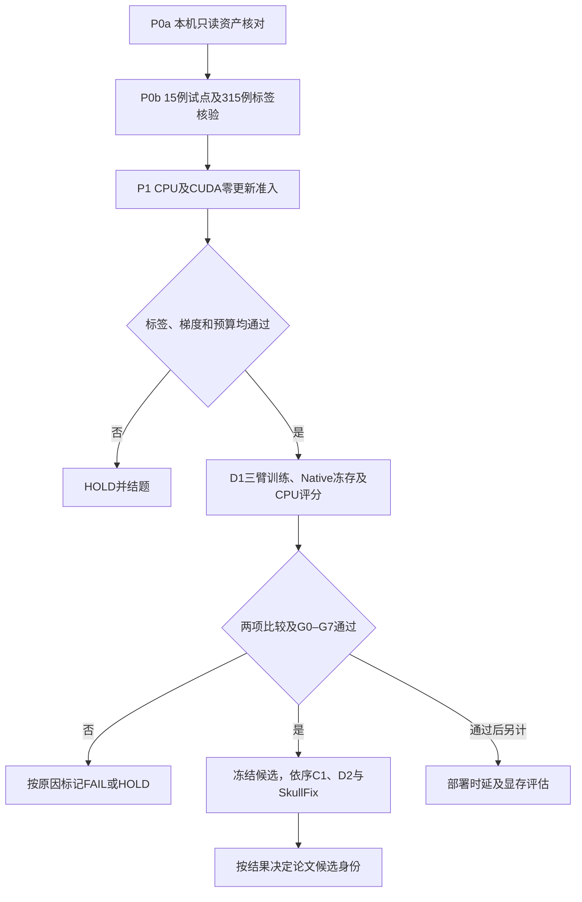

# Cranial-BCSP-FullMamba · BCSP-EJTC 正式实验计划

**名称**　自由表面与共享切壁感知尾部覆盖监督（E/J-aware Tail Coverage Supervision）  
**日期与版本**　2026 年 11 月 27 日，北京时间，v2  
**状态**　`PROPOSED_SPEC_HOLD`，待确认与资产准入  
**训练基座**　冻结 OASG+LQI，Cranial-BCSP-GeoV1  
**首轮预算**　SkullBreak Fold D 三臂，各 3,900 步，共 11,700 步，完整 Native 预测 315 次  
**机制搜索截止**　2026 年 11 月 30 日 23:59:59，北京时间

本计划由原 v1 审阅修订。保留唯一损失公式、点集、模型、三臂、种子和主要评价。v2 增加主终点基线漂移保护、冻结实际目标坐标的标签回放细节、P1 独立的调用上限与时间边界，区分研究判定与部署计时。计划制定过程中只读核对了已冻结结果索引和相关文献。标签和 CUDA 准入尚未执行。

## 1. 审阅判断与研究问题

**值得做一次限额实验，首项应为训练资产只读核对。** OASG 改善了粗结构和整体恢复，仍有切壁覆盖不足。前几轮围绕条件注入、序列化和密点放置的结果表明，改变结构能够改变预测，但收益容易在切壁或尾部暴露出代价。这次可以保留已验证的生成结构，直接问一个可证伪的问题：

> 对缺失骨块自由表面 E 与共享切壁 J 分别监督最差覆盖的目标点，是否比原损失及等形式的全目标尾部监督更有效，同时保持粗结构、整体覆盖和预测侧风险？

| 直接依据 | 观察及推论 |
| --- | --- |
| OASG 四组 | 冻结 A 的密 E P95 在 C seed1、D seed1、D seed2、SkullFix 分别为 4.98、5.06、6.09、4.94 mm，J Cover@2 为 57.50%、52.88%、49.43%、58.52%。均较历史 B 改善，但离完全覆盖仍有空间。D 两种子之间的 J 指标相差约 3.46 pp，说明小增量需要匹配参照和复现。 |
| OASG 剩余严重病例 | D seed2 的 `train__037__random_1` 在粗点阶段已明显偏位，密 E P95 约 30.03 mm、密 far20 约 0.17%。较少的远端点可以与明显漏覆盖同时出现。原损失是否造成该现象仍未知。 |
| CISC | I−U 密 J Cover@2 为 −5.78 pp，95% 来源区间约 [−7.75, −3.61]。现有残骨特征中可读出一部分切壁支持信息，当前条件注入仍未形成净收益。EJTC 直接使用训练目标面的真实标签监督。 |
| RBSS | S−R 的密 CD-L1 点估计 −0.1176 mm，区间跨零，同时密 E P95 +0.9637 mm、密 J Cover@2 −1.9356 pp，严重病例 2→5。均值距离改善方向可以与区域覆盖退化并存。 |
| PCAT、FCSP、SCQ-FV | 既有诊断提示父点位置与密点恢复均可能限制结果。EJTC 允许密点监督反传到粗点和编码器，并对粗结构设保护门。当前证据不足以把固定子点槽位或 CD 认定为统一根因。 |

直接索引见[OASG 冻结主结果](bcsp_oasg_20261124_v1/OASG_paper_main_results_freeze_v1.json)、[CISC 预注册裁决](bcsp_cisc_20261125_v2/p3_rui_d_cpu_score_v2/CISC_P2_FoldD_preregistered_decision_v1.json)、[RBSS 评分冻结裁决](bcsp_rbss_20261126_v2/foldd_native315_v1/RBSS_FoldD_native315_formal_post_score_freeze_and_decision_v1.json)及[原计划历史证据索引](<C:/Users/zhj/Desktop/BCSP-EJTC_自由表面与共享切壁感知尾部覆盖监督_实验计划_2026-11-27_v1.md>)。OASG 的历史 B 是其旧生成头参照。本计划的 R 是重新训练的完整 OASG+LQI。

### 对 v1 的关键修改

1. **保留 R/T/J，收紧归因措辞。** J−T 比较的是整个分区尾部目标，包括区域选择、均衡归约及引起的梯度改变。相同 λ 只固定外部标量。即使两组通过，也只能声称该组合优于指定全目标尾部对照。若论文需要论证“分区”和“尾部”分别必要，再在确认性方案中另行注册一个等权 E/J 区域均值对照，首轮无需第四臂。
2. **把方向与样本身份定在原始训练行。** G 标签须从独立目标抽样逐行获得，不能移植 CISC 的残骨侧标签。分区是体素占据的几何事实。真实训练 loader 的 dtype、行序、变换和距离方向是实施准入的一部分。
3. **增加阈值附近的描述性检查。** 上尾均值侧重远距离点，Cover@2 由越过 2 mm 界限的面积决定。两者可分离。固定额外输出密 J Cover@1/3、距 2 mm 附近的面积及 J P95，用于说明变化发生在哪里，主终点和晋级门保持固定。
4. **明确参照有效性及准入上限。** 在原 E P95 和严重病例保护外，增加 R 的 J Cover@2 历史漂移下限。将数值、梯度与资源准入做在同一小批真实训练数据上，冻结调用次数，避免无限排查。工程不可用、科学失败和证据不足各有单独状态。

## 2. 文献定位与潜在贡献

以下为截至 2026-11-27 针对原清单和本研究问题的核查。论文方法节、出版方摘要和预印本的证据等级分别标明。原清单的应用方向很多，本次检索优先覆盖与颅骨切壁、Mamba 补全和覆盖损失直接相关的工作。

| 研究 | 可核查结论及对 EJTC 的影响 |
| --- | --- |
| Li 等，2021，颅骨重建 | 主文使用体素重建及边界评价，附录已实验基于距离变换的边界损失。广义“给颅骨边界加监督”的新颖性不足。EJTC 的区别是完整缺失骨实体边界中的共享面分区、方向性点集足迹与区域内上尾均值。 [出版正文](https://www.sciencedirect.com/science/article/pii/S1361841521002176) · [作者全文及附录](https://arbook.icg.tugraz.at/schmalstieg/Schmalstieg_400.pdf) |
| Wodzinski 等，MICCAI 2023，颅骨点云补全 | 采用由占据体素得到的点、迭代补全及 DACD+kNN，正文消融显示目标函数选择可影响体素评价。适合成为任务近邻基线，表面协议、迭代与体素还原处理需对齐才能比较数值。 [方法与消融](https://arxiv.org/html/2308.03813) |
| Kodym 等，2021，SkullBreak / SkullFix | 数据定义是可配对颅骨、缺损和植入物，对三掩膜建立共享面有直接依据。两发布背景相关，项目开放来源的几何验证不足以支持独立临床中心泛化。 [数据论文](https://pmc.ncbi.nlm.nih.gov/articles/PMC8100897/) |
| Fishman 等，2024；Wodzinski 等，2026 | 临床植入物的厚度和接缘设计提供研究动机。后者预印本审计强调外观几何、干涉和可放置性会分离。EJTC 的 2 mm 覆盖衡量与合成参考切壁的近邻贴合，点集结果只支持几何评价。 [植入物测量](https://pubmed.ncbi.nlm.nih.gov/38430381/) · [可植入性审计预印本](https://arxiv.org/abs/2610.30035) |
| CDRMamba；CompletionMamba；3DMambaComplete；FusionMamba；Simba | CDRMamba 已将 Mamba 用于颅颌面三维医学影像缺损。CompletionMamba 的初始生成明确利用输入坐标和点特征，FusionMamba 结合局部与全局扫描和空间校正。3DMambaComplete、Simba 提供其他补全结构。EJTC 在现有推理路径上改变训练监督，若要声称依赖 Mamba，需要另做架构×损失交互验证。 [CDRMamba](https://www.sciencedirect.com/science/article/pii/S1746809424014344) · [CompletionMamba 原作者论文与方法](https://doi.org/10.1109/TIP.2025.3597041) · [3DMambaComplete](https://doi.org/10.1145/3774887) · [FusionMamba](https://doi.org/10.1016/j.inffus.2026.104378) · [Simba](https://ojs.aaai.org/index.php/AAAI/article/view/38259) |
| DCD、FCD、Correspondence-Aware CD、Contextual CD | 密度、距离加权和覆盖引导已有直接先例。Cho 等在 2026 年发表的工作已复用 CD 对应实现未覆盖区引导及内部扩散。Fu 等 11 月录用的 Contextual CD，机构摘要描述了局部密度和锚点法向约束。原分区上尾公式的区分点必须落在骨缺失 E/J 的标签和三臂证据，不能泛称首次监督欠覆盖或首次复用对应。 [DCD](https://arxiv.org/abs/2111.12702) · [FCD](https://doi.org/10.1109/TPAMI.2026.3669003) · [Correspondence-Aware CD](https://doi.org/10.1109/ACCESS.2026.3711059) · [Contextual CD 机构摘要](https://research-repository.uwa.edu.au/en/publications/contextual-chamfer-distance-for-point-cloud-restoration/) |
| 风险及边界损失先例 | 上尾风险思想有 CVaR 理论背景。医学影像中已有基于距离变换等策略降低 Hausdorff 距离的损失。当前经验 top-k 的取整定义仅作为方向性训练代理。 [Rockafellar 与 Uryasev](https://doi.org/10.21314/JOR.2000.038) · [Karimi 与 Salcudean](https://pubmed.ncbi.nlm.nih.gov/31329113/) |
| 2026 医学点云与隐式生成 | MedPCFM 与 TED 提供条件生成与单步出点的近邻参考。TriFlow 与 LOT-Bridge 分别采用三平面潜空间流和 SDF 潜空间桥接，说明形状表示与任务目标均有可比路线。公开跨表示数值只作背景。 [MedPCFM 预印本](https://arxiv.org/abs/2606.24433) · [TED Workshop](https://papers.miccai.org/miccai-2026-sat/SASHIMI_017.html) · [TriFlow](https://papers.miccai.org/miccai-2026/1089-Paper1927.html) · [LOT-Bridge](https://papers.miccai.org/miccai-2026/0596-Paper1071.html) |

潜在论文主张是，在固定的缺失骨块完整边界表示中，E/J 区域内上尾监督能否在等推理图的条件下改善接口覆盖。首轮若过门，仍需完成跨折、跨种子及跨发布确认。论文阶段优先完成同协议强基线、OASG 主要构件消融及架构对比。若 EJTC 成为主贡献，至少加入一个同协议公开覆盖或密度损失基线，优先评估 Correspondence-Aware CD 的实现可得性或使用 DCD/FCD。公开实现无法公平适配时，记录具体协议差异。原有 OASG 成果和论文验证任务无须等待新机制成功。

## 3. 固定几何、数据与模型合同

- 在冻结体素格中核验占据关系 `C = D ∪ G` 且 `D ∩ G = ∅`。G 的六邻接边界分为 J 与 E。共享面 J 的对侧邻格属于 D，E 为其余暴露面，可能包含内板、外板及孔腔边界。保留原代码的视野边界标记，并对其面积和尾部权重贡献作描述性报告。体素面空间对应使用世界 affine，面面积为两条切向列向量叉积模。若原采样器的实际标记口径与此不同，在 P0 停止核查。
- 固定 V1 物理面积采样、`D8192 → Q256 → P8192` 和 256×32 父子槽位。目标为缺失骨块完整边界。归一化仅用冻结 D 前景 bbox 的中心和半对角线。所有数据身份、dtype、单位和下标约定沿用实际母版。预测输入资产仅含残骨及其变换身份。训练标签、完整骨、G、真实 J、A1/A2 及 GT 变换均与预测入口隔离。
- SkullBreak 84 来源，每源五类。D1、C1、D2 各自为 63 训练来源 315 例、21 开发来源 105 例。C/D 开发来源互斥，训练侧重叠 42 来源。SkullFix 为 90 例既有开放队列及相同采样协议。曾参与几何 QC，与 SkullBreak 有发布层面的相关背景，因此视为跨发布迁移。不同折或种子结果不视作独立病例池。MUG500+、封存集及其他数据保持当前访问边界。
- 保留 OASG+LQI 原生 Mamba 编码、输入顺序、锚点与 coarse 生成、LQI 解码和密 FC。按经审计母版计数预期 39,907,012 个参数。完整 state_dict、持久 buffer、初始化后 Python／NumPy／CPU／CUDA RNG、优化器初态、批次内容、设备和依赖在同组一致。各臂独立从公共未训练初态联合优化。保留原 FP32、无 AMP/TF32、AdamW 初始 LR=1e−4、衰减与 no-decay、BN、裁剪和调度。P0a 以冻结源码与执行合同为准。

## 4. 三臂与唯一损失

| 臂 | 原粗＋密损失 | 新增密点监督 | 用途 |
| --- | --- | --- | --- |
| R | 原实现 `L0` | 无，绕过新增路径 | 原生 OASG+LQI 对照 |
| T | `L0` | 全 G 上尾均值 | 对照通用尾部监督 |
| J | `L0` | E 和 J 各自上尾均值的等权和 | 检验分区组合的增量 |

令 `d_bj = min_k ||g_bj − p_bk||₂`，取原密 Chamfer-L1 中未归约的 **目标→预测**欧氏最近邻距离。先核验实际后端、方向、返回顺序、双向因子和 denoise 禁用路径。原粗点与密点损失完整保留。新增项只直接作用于密点距离，允许沿原计算图反传至 Q、LQI、OASG 和编码器。

对单病例单集合 `A`，`k = (|A| + 9) // 10`。按距离降序取前 k，距离相同按原目标行号升序。排序索引可来自 detach 后的值，均值从可微的原距离向量索引。令 `tail(A)` 为此均值。全组先算每例再做 batch 均值。

```text
L_R     = L0
L_T     = L0 + λ × mean_b tail(G_b)
L_EJTC  = L0 + λ × mean_b [0.5 tail(E_b) + 0.5 tail(J_b)]
```

α=.10，E/J 权重 .5/.5，距离在原归一化空间。所有区域至少 32 个目标点。沿用面积抽样，每个入选点不再乘原面面积。每病例 T 取 820 点，J 共取 820 或 821 点，权重集中度仍可随区域大小而变。J 在新增目标权重中占一半，这个数不等于该区域在总损失、参数梯度或实际预测点数中的份额。优先从原 `cdist` 图复用方向向量，保留原 `min` 的 ties 梯度行为。batch 8 的单份密 FP32 距离张量约 2 GiB，严禁因取辅助向量重复构建密距离。若原接口无法等价复用，归入 `P1_HOLD_NUMERIC`。任何新后端、近似 KNN、改精度或改目标样本的方案独立处理。

## 5. P0：资产差量与标签准入

**P0a 是确认本计划后的首个动作，为本机只读。** 绑定实际 OASG 模型和 evaluator 的文件及版本、D 训练 G 点集和 loader 实际坐标、生成器与独立 G 抽样的 RNG 合同、三掩膜与原 affine、历史 D2 的 OASG A 最终权重、D 折冻结批序、P1 可用资源证据。区分能读到文件与已证明可逐行复现。归档的结果索引仅用于定位这些资产。

**P0b 先 15 例后全量。** 在冻结训练清单中按 bilateral、frontoorbital、parietotemporal、random_1、random_2 顺序，各类别按 case ID 字典序取未使用来源的前 3 例。共 15 个不同来源。验证 toy 的共享面、各向异性 affine、视野边界和重复面问题。真实样本重放应满足：

1. 用 G 暴露面键 `(i,j,k,axis,sign)` 记录行级实际抽样面。检查 J 的 D 对侧面朝向相反、空间重合且面积相等。检查 E/J 分区互斥且并集完备。
2. 使用冻结 G 面排序、RNG seed/类型/消费顺序、面内采样、FP32 输出与实际 loader 的 D-only 变换重放。世界坐标若有历史浮点重算差异，另报差异来源。最终 **8,192 行送入原损失的 G 坐标逐字节一致**。标签只由实际抽样面产生。原清单有冻结中心/尺度时优先检验其重放合同，并比较重算差异。无法唯一绑定行的样本进入 HOLD。
3. 15/15 通过后核验其余 300 例，全部 315/315 通过。冻结 `uint8` 标签 0=E、1=J，且每行有效。绑定病例、来源、split、世界 affine、目标行字节、面键、标签、采样器和 D 变换哈希。真实训练批读取的行顺序有同一绑定。如果 loader 运行期重排，以相同变换处理标签并验证。
4. 每例记录 n_E、n_J、真实面积、抽样占比、尾部 k、重复点及视野面。试点每例每区从行号排序中使用 PCG64 seed `2026112811` 的流无放回抽查 8 行，回验面键与邻格。低于 32、缺资产或 bytes mismatch 则 `P0_HOLD_LABELS`，完整集不删例、不补采。

## 6. P1：CPU 与真实 CUDA 零更新准入

### 6.1 数值与梯度

CPU 必测范围包括手算 n=10/11 的上尾、精确并列与重复坐标、区域不均衡与相似分布、多病例不跨例池化、目标和预测点数不等的方向测试、零距离原梯度行为、λ=0、同步置换和故意错位拒绝、非法标签和非有限值、D-only 变换、非并列且无 NN 切换时的有限差分。使用原 v1 的 CPU FP64 atol=1e−10/rtol=1e−8，真实 FP32 loss 和 P/Q 梯度 atol=1e−7/rtol=1e−5。用同一真实前向图分别走原损失与复用入口。CPU 多对一、并列测试要求复用的方向向量与原 NN 选择约定一致。真实 CUDA 参考溢出、重复基线噪声超限或 grad mismatch 即暂停查因。

### 6.2 共同 λ 与操纵证据

从 D 训练清单按五类、case ID 升序各取 8 个尚未使用的来源。按类别 round-robin 后切成 5 个 batch8，全部 40 例和顺序先冻结。每次从冻结状态恢复，在 D1 公共初态及独立的历史 D2 OASG A 权重上分别跑这 5 个批。后者使用已核验的 `OASG_A_D_seed2026112102_epoch99_step3900.pth`，始终只读，用于暴露训练后梯度尺度变化。

对 T/J 额外项各记 `r_v=A/L0`、`r_g=||∇P A||₂/||∇P L0||₂`，并计算 P、Q 和 Encoder、OASG、LQI、FC 四组的辅助/原梯度比、合成范数、cosine。零分母或非有限进入 HOLD。共同 λ 用初态 10 个观测在 float64 一次计算：

```text
λ = min(0.10, 0.20 / max(r_v), 0.25 / max(r_g))
```

λ≥.001。初态每臂 `λr_v≤.20`、`λr_g≤.25`，每臂五批的 `λr_g` 中位≥.01，各组和 Q 加权相对比≤.50。历史权重上分别≤.40、≤.50，各组和 Q 加权相对比≤1.0。边界浮点容差 1e−6。测量每例尾部选择权重之 TV 距离、T 给 J 的权重、NN 预测索引唯一数与最大负载。历史权重 40 例中至少 32 例 TV≥0.10，且每类至少 1 例。TV 验证两臂确实改变了训练权重。梯度集中、负 cosine、视野面主导或剂量不均作诊断并完整报告。λ 在 D1/C1/D2 固定，禁止按路径、阶段或表现重算。

### 6.3 有界 CUDA 流程与资源

| 工作 | 调用预算 |
| --- | --- |
| 同图原与复用损失等价 | 首个训练批，1 forward，2 次基础损失和 2 次 `autograd.grad` |
| 两状态校准 | 10 forward，10 次基础损失，T/J 各 10 次附加项，合计 30 次 `autograd.grad` |
| 三臂训练态计时与资源 | 固定首个训练批，每臂 3 预热加 10 计时，合计 39 forward、39 合成损失及 39 backward |
| Native 同初态等价 | 首个固定训练样本、三臂各 1 次 batch1 eval，共 3 forward |
| 总上限 | 53 forward、51 次基础损失计算、46 次辅助项计算、32 次 `autograd.grad`、39 次 backward、0 optimizer step。原基线路径若需重复噪声调查，停在准入并单独界定范围。 |

每次从固定状态、RNG 恢复，记录 BN 和其他 buffer 变化并最终复位。梯度读取可共享一张图，各图依次释放。计时包括 forward、loss、backward，统一同步边界，不包含状态重载和文件写入。T/J 的 P50≤R 的 1.50×，allocated 峰值≤1.25×，设备峰值≤容量 90%，无 OOM。同时报告 P95、reserved 和 SMI。核计正式组资源时，以同设备近期完整运行或实测数据管线补足 step、保存与评分开销，加至少 25% 缓冲。没有完整组预算时记 `P1_HOLD_RESOURCE`。

## 7. 正式执行矩阵

| 阶段 | 模型 seed／OASG 粗头 seed | 条件 | 开发预测 |
| --- | --- | --- | ---: |
| D1 | 2026112801／2026112803 | D 标签、共同 λ、计算图、资源与授权均通过 | 315 |
| C1 | 2026112801／2026112803 | D1 过晋级门，C 标签及本组初态资源再核验 | 315 |
| D2 | 2026112802／2026112804 | C1 过门，新状态确有差异且本组覆盖准入 | 315 |
| SkullFix | 固定 D2 R/T/J 最终权重 | D2 过门，90 例身份及参考面可比 | 270 |

每训练组 R→T→J，batch8、drop_last、100 遍历、每轮 39 批，每臂 3,900 updates、31,200 曝光、300 丢弃位次。固定 epoch99/step3900。训练日志保留完整批序、实际 loss 分解、λ、区域计数和 tail k、裁剪、BN/LR、耗时和显存。R 此附加项记 `not_applicable`。T 的 J 权重只在有限诊断读取标签；正式 T 入口只需 G。T/J 均可在训练日志记各自实际用于损失的集合大小。记录数值异常并停止，不自动 resume。工程故障只在明确原因、未读取本组开发分数且有整组预算时，另行授权最多一次完整重跑。模型、阈值、λ 或数据改变属于另一个协议。

Native 使用冻结最终权重、batch1、FP32 eval 和固定病例顺序。只允许残骨输入，0 loss、0 backward、0 update，无 BNCal/TTA。逐例保存真实 S、Q、Q−S、P、父索引、变换和身份。先冻结完整归档、模型状态与 RNG，再进入离线评分。C1/D2 以同样的 40 例选择规则验证各组初态等价、有限梯度及资源上限，使用原 λ。历史 D2 检查和 TV 硬门只在 D1 进行。SkullFix 不读取训练标签，继承 D2 监督身份和配对回执。正式训练累计最多 35,100 步，Native 最多 1,215 次，准入与计时独立计数。

## 8. 评分、门槛及裁决

冻结世界毫米坐标、原 A1 面中心面积权重、A2 每面四个子样本和原评分器。粗、密均报 E/J P95、Cover@2、反向 A2 P95、far20、CD-L1、质心和回转半径比，G3 只裁决指定密指标。far20 使用严格大于 20 mm。严重病例使用密 E P95>20 mm 或密 J Cover@2 的真实零值。不做对齐、删点、选择性区域筛点或补值。诊断性补充密 J Cover@1/3 和 (1,3] mm 面积，便于判断有无阈值附近变化，沿用同一 A1 集合。

按病例做左臂−右臂配对，SkullBreak 先五类等权再来源等权，SkullFix 每来源一例。PCG64 seed `2026112807`，2,000 次有放回重抽来源，对同组所有对照共用索引。95% 百分位区间用冻结 NumPy 的 linear quantile，严格改善按未舍入符号计算。报告点估计、区间、来源胜数、留一极值和严重名单，T−R 为描述性。21 来源区间条件于单次训练的权重，重复种子和折不合并学术显著性。下面保护门以点估计判定，区间用于披露不确定性。

| 门 | J−R | J−T |
| --- | --- | --- |
| G0 参照和身份 | D 的 R 密 E P95≤8.087807971901558 mm，严重≤6，密 J Cover@2≥44.427812447446904%。C 对应 ≤7.00 mm、≤5、≥52.49576104186145%。SF 对应 ≤7.00 mm、≤3、≥53.524817332028476%。三臂全配对且审计通过 | 同一 G0 |
| G1 粗结构保护 | 粗 E/J P95 各≤+0.25 mm，粗 E/J Cover@2 各≥−0.50 pp，粗反向 A2 P95≤+0.50 mm，粗 far20≤+0.25 pp | 同左 |
| G2 主指标 | 密 J Cover@2≥+2.00 pp，且至少 14/21 来源严格改善、CI 下端>0、留一最小>0。SF 为至少 60/90 来源 | 密 J Cover@2≥+1.00 pp，其他同左 |
| G3 密整体保护 | 密 E/J P95 各≤+0.25 mm，密 E Cover@2≥−0.50 pp，密 CD-L1≤+0.25 mm | 同左 |
| G4 预测侧风险 | 密 A2 P95≤+0.50 mm，密 far20≤+0.25 pp | 同左 |
| G5 严重病例 | 总数不增，新增≤1；同时列出挽回和共同名单 | 同左 |
| G6 监督身份 | 标签、共同 λ、有效 loss 及全部实际更新记录与冻结合同一致。SF 仅核权重、输入及预测隔离 | 同左 |
| G7 训练与推理合同 | 实际训练 T/J 的 step P50≤1.50×R、峰值 allocated≤1.25×R、SMI 峰值≤容量 90%，同精度同 batch。Native 模型参数与受监测有效算子路径等同，推理无 E/J/GT 或新训练 loss 路径。SF 继承训练证据 | 同左 |

G0 的新 J 下限用早先冻结的同发布 OASG A 参照减 5 pp。D 采用历史两种子中较低的 49.4278%，C 采用 57.4958%，SF 采用 58.5248%。5 pp 为预先提议的宽容漂移幅度，高于已见 D 两种子差值，目的是避免相对弱切壁参照得出过强结论。它不等于最小临床差异或非劣界。正的 J−R 效应须同时与历史 OASG 的绝对 J、E、严重数并列，再判断是否足以替换论文基座。

**G7 部署计时单列。** 几何和身份通过后，再以预先固定的 P0b 15 例作计时。每模型每例 3 次预热、10 次计时，分配 R/T/J、T/J/R、J/R/T 轮换，共 585 次 forward。计时前冻结 D-only 端到端边界和模型单独 forward 边界。设备、线程、输入驻留、时间和显存口径相同，保持每臂独占模型份额或单独测量模型驻留增量。按原提议目标 P50≤1.10×、P95≤1.15×、allocated≤1.10×，同时记录加载和首调用。计时超限或未执行进入部署状态 `DEPLOYMENT_HOLD`，不改写几何判定。结构检查及正式训练资源仍是硬门。无相同环境计时证据时，报告实际推理图等同及计时未验证。



G0 无效归入 `BASELINE_INVALID_HOLD` 或 `RUN_INVALID_HOLD`。合格运行的 G1–G5 任一未达为 `FAIL_STOP`。G6 失败为监督身份无效，G7 训练或推理合同失败归入工程 HOLD。全部通过为 `D1_PASS_CONDITIONAL`，随后按矩阵逐组确认。只在 T 或 J 一个比较中见到有利趋势、P95 改善而 Cover@2 未过门，以及 E/J 或离群指标出现交换，均照原门槛收束，不重新选择指标、权重或病例。D1 未完成或未通过前，不启动复现。11 月截止前没有完成 D1 有效裁决时，归档当前状态并返回 OASG-PV。截止后仅继续既已过门的冻结规格验证或论文准备。

## 9. 有界诊断、冻结与结题

如需要解释结果，最多 6 例，仅使用已冻结预测。按 J−R 新增严重 ID 最先两例、挽回最先两例、共同严重最先一例、其余 J Cover@2 差最负一例选择。空缺不补，差值并列按 ID。固定视角、毫米坐标和色标，保留全点及 E/J 参考。比较 S→Q→P 距离、质心、远端父子关系和密阶段补回面积。可报告 J 变好同时 E 退化的空间证据，无法从不同优化轨迹分辨具体因果时标为未决。无新增 forward 或训练。

结题保留原计划与 v2、代码差量和资产哈希、P0 全量标签身份、P1 调用和 λ、逐批训练日志及最终权重、Native 归档、逐例评分和 bootstrap 索引、独立重算结果、G0–G7 与部署状态。各类未开展项注明原因。建议结果表按每组列 R/T/J 与 J−R、J−T、T−R，另列来源数、区间、严重病例转移和动态资源记录。机器合同由本规格提取并在执行前逐项审核。启动请求须绑定当前设备和具体冻结证据。

若方案止于 HOLD 或 FAIL，后续根据已冻结的 OASG+LQI 推进 OASG-PV。优先级为同协议强基线、等参数的绝对坐标与观测锚残差对照、LQI 与 Mamba 的独立贡献和在合法来源上的确认，避免为解释单个异常而再次改变研究基座。若 EJTC 完成复现，论文可报告在此边界表示和推理结构下的训练目标增量，临床实体厚度、装配与干涉仍需另行验证。
