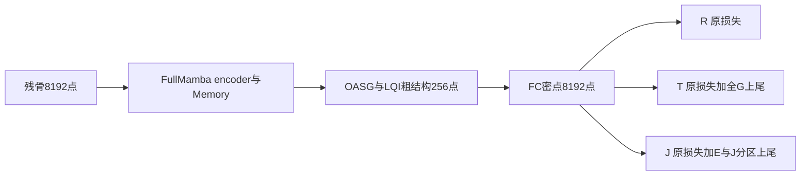

# Cranial-BCSP-FullMamba · BCSP-EJTC 完整实验报告

**实验名称：自由表面与共享切壁感知尾部覆盖监督（BCSP-EJTC）**  
**报告日期：2026-11-28；版本：中文 v1**  
**实际完成范围：D1，Fold D，单训练种子，R／T／J三臂**  
**科研裁决：D1_FAIL_STOP；按原协议不晋级C1／D2／SkullFix。**

## 摘要

本实验在既有OASG+LQI的AdaPoinTr派生FullMamba基座上，保持数据、架构、初态、训练顺序和更新次数一致，仅改变训练目标：R保留原重建损失，T增加全目标点集最差10%目标到预测距离的均值，J增加自由表面E和共享切壁J分别取最差10%后等权组合的均值。目的在于区分一般尾部监督与结构分区监督，验证后者能否提高接口覆盖，同时维持粗结构、自由表面和预测侧风险。

315个训练病例的2,580,480行目标点及E/J标签完成逐行核验；数值与真实CUDA零更新准入通过。三臂分别完成3,900步训练，共11,700次更新；固定105个开发病例产生315份Native预测。正式预测审计、下载核验及评分审计均通过。

J相对R的密J Cover@2提高3.293个百分点，95%来源bootstrap区间[1.464,5.037]；相对T提高4.284个百分点，区间[2.790,5.779]；两组均有18/21来源改善。主指标门通过。然而J−T粗far20增加0.391个百分点，超过+0.25的上限；密E Cover@2下降0.877个百分点，低于−0.50的保护下限。原协议要求两组比较全部保护门通过，因此本轮判为FAIL_STOP。该结论是“此固定配置未达到预注册的可靠性条件”，不是“结构监督完全无效”，也不证明Mamba或256个粗点本身不适用。

## 1. 研究背景与实验目的

### 1.1 科研问题

既有实验已经表明，CD类均值指标改善可能与切壁覆盖、表面漏覆盖或严重病例退化共存。OASG改善了首次粗生成的空间条件，但仍存在粗点偏位、局部覆盖不足和尾部风险。CISC尝试在输入侧注入切壁信息未获得预注册净收益；RBSS也出现平均距离与区域覆盖变化不一致。EJTC据此把研究变量转向训练目标，而不继续增加推理模块。

本实验回答：在同一骨组织完整边界表示、同一生成架构上，区域分离的目标到预测尾部监督，是否比原损失及全目标尾部监督更有利于切壁覆盖，并且不牺牲其他可靠性指标？

### 1.2 待检验假设

1. 原均值距离监督可能对较小或困难的共享切壁区域分配不足；该解释是研究假设，不是既定根因。
2. 按E/J分别取上尾并等权，能够实质改变被监督目标点的分布，而非仅增加相近的全局损失。
3. 增加的训练信号能通过原计算图影响dense、coarse、LQI、OASG及encoder，在保持风险保护门的条件下改善J覆盖。

实验成功标准并非只要求loss下降或J指标变好，而是同时满足预注册主终点与保护门。

## 2. 范围、数据与几何表示

### 2.1 已完成与未开展项目

| 项目 | 状态 |
|---|---|
| P0a资产／接口核对 | 已完成 |
| P0b先15例、后其余300例标签回放 | 315/315通过 |
| CPU数值与梯度验证 | 12/12通过 |
| P1真实CUDA零更新准入及正式审计 | 通过 |
| D1三臂训练及配对冻结 | 全部完成 |
| D1三臂Native预测及正式审计 | 315份完成 |
| 本机统一CPU评分、正式审计及原门槛裁决 | 完成 |
| 新增严重病例与退化来源有界复核 | 完成；独立诊断冻结审计未另行实施 |
| C1、D2、SkullFix后续矩阵 | 因D1未过门而未开展 |
| 专门部署计时 | 未开展；不得用本次批量预测耗时代替 |

### 2.2 数据与划分

本轮仅使用SkullBreak的冻结Fold D：训练315例／63来源，开发105例／21来源，每来源包含bilateral、frontoorbital、parietotemporal、random_1、random_2五种缺损。训练与开发按来源分离。这里的开发评价用于预注册晋级决策，不是尚未使用的最终独立测试。

输入为残骨8192点；目标为缺失实体骨块的完整边界8192点。边界包括原分割中存在的外侧、内侧、孔道／腔体边界及实体切除后的暴露切壁。并非仅外轮廓或从完整骨表面删除一片区域。均沿用既有实体缺损、点集采样和残骨bbox归一化，不重新切缺损、不改变采样或点数。

令完整实体为C，残骨为D，缺失骨块为G。G与D接触的共享切壁标为J；G边界其余部分标为E。这里“J”既用作几何区域名，也用作J监督臂名，下文按语境区分。标签来自离散实体共享面的几何关系，不能替代灰度CT上的解剖质量认证。

### 2.3 标签回放与身份保障

15例试点覆盖15来源，122,880行目标全部重放一致，240次抽查及各向异性、共享面、视野边界等toy检查通过；其后复用15例并补齐300例，合计315例／63来源、2,580,480行、5,040次抽查。每行标签为uint8，0=E、1=J，绑定实际G目标行、面键、坐标变换与数据哈希。

315例nE范围5477–7533，中位6847；nJ范围659–2715，中位1345，全部高于32点下限。E/J互斥且并集覆盖目标行。标签仅供训练J损失及离线核验使用；Native推理仅读取残骨partial数组。目标标签回放通过证明的是与现有冻结离散几何、抽样及行序一致，不能宣称连续解剖表面无误差。

## 3. 模型与训练目标

### 3.1 固定研究基座

基座为OASG+LQI的FullMamba实现：6层encoder、8层decoder，首次coarse为256点，FC以每父点32个子点输出8192点。模型参数约39,907,012。三臂不新增推理分支、注意力模块或后处理。Native观察验证22个不同SSM模块、每次完整forward共36次受监测SSM调用；P1记录受监测attention调用0次。该记录针对实际受监测支路，不应写成原始硬件trace证明任意第三方路径均不存在attention。

### 3.2 唯一监督公式

对目标点g_j及预测点p_k，使用原密Chamfer中的目标到预测欧氏最近邻距离：

\[
d_j=\min_k\|g_j-p_k\|_2.
\]

对集合A，令kA=ceil(0.1|A|)，按距离降序取前kA；精确并列按原目标行号升序。排序索引可以detach，但均值从原可微距离向量读取。先逐病例归约，再作batch均值，不跨病例池化。

\[
\begin{aligned}
L_R&=L_0,\\
L_T&=L_0+\lambda\,\mathrm{mean}_b\,\mathrm{tail}_{0.1}(G_b),\\
L_J&=L_0+\lambda\,\mathrm{mean}_b[0.5\,\mathrm{tail}_{0.1}(E_b)+0.5\,\mathrm{tail}_{0.1}(J_b)].
\end{aligned}
\]

L0为实际冻结的原重建损失，保留原有效分支及系数。本配置fine_coverage_weight=1、fine_local_weight=0、denoise_weight=0；日志中loss_sparse与loss_denoise为0，不能笼统宣称额外存在非零粗Chamfer监督。新增项直接取dense距离，但可沿计算图反传至上游粗点及encoder。

T每病例取820行，J两区合计取820或821行；J区域在新增项占一半，不等于其在总loss、参数梯度或最终预测点数中占一半。面积采样后的点不重复乘面面积。训练在原归一化空间，评价统一恢复毫米坐标。

### 3.3 距离复用与共同λ

沿用现有PyTorch cdist Chamfer分支，复用原图的目标到预测距离向量，不为新增项再建立一份8192×8192密距离矩阵，不改变最近邻ties与零距离梯度约定。

共同λ由D1初态固定训练批一次校准：min(0.10,0.20/max(rv),0.25/max(rg))，其中rv为辅助项／L0，rg为预测点梯度范数比。最终λ=**0.027474069997873135**，三臂及预定后续阶段均不依据开发结果重估。历史已训练OASG权重只用于训练后梯度尺度压力检查，不用于初始化或开发结果调参。

## 4. 数值、梯度与CUDA准入

CPU数值检查12/12通过，覆盖上尾取整、稳定并列、原最近邻ties、方向、零距离、λ=0、区域不均衡、变换／标签合同及梯度行为。真实CUDA阶段固定40个训练病例、5个batch8，在共同初态和独立历史权重上校准并验证。

| 准入项目 | 实测结果 |
|---|---|
| 完整forward／基础loss／辅助项 | 53／51／46 |
| autograd.grad／backward／optimizer step | 32／39／0 |
| 原与复用损失绝对差 | 0 |
| 梯度绝对差 | 9.313225746154785e−10 |
| 历史权重TV≥0.10 | 40/40例；范围0.333–0.527 |
| 初态T／J加权P梯度比最大值 | 0.250／0.170 |
| 初态T／J加权P梯度比中位数 | 0.220／0.151 |
| 历史T／J加权P梯度比最大值 | 0.248／0.358 |
| 初态T／J最大Q或参数组加权比 | 0.129／0.075 |
| 历史T／J最大Q或参数组加权比 | 0.190／0.256 |

TV表示T/J尾部权重分布确实不同，不能把它当成几何性能收益。原与复用数值等价、有限梯度和状态恢复通过，也不代表训练后一定优于R。

准入forward+loss+backward的P50分别为R 271.82、T 274.90、J 290.00 ms；P95为276.24、278.87、292.67 ms。allocated峰值约13.582、13.583、13.583 GB（十进制），SMI最大采样14614 MiB，准入资源门通过。该计时不包括optimizer、完整输入管线、保存及评分，不能作为完整训练或部署速度结论。

## 5. 正式训练与预测方法

### 5.1 配对合同

三臂均使用Fold D、模型seed2026112801及OASG头seed2026112803；这是两个不同组件的seed，不是完成了两个独立实验种子。共同初始化、起始Python／NumPy／CPU／CUDA RNG及完整实际批序均经训练冻结审计配对核验。

每臂batch8、drop_last、100遍历，每轮39批，固定3,900更新、31,200曝光及300丢弃位次。最终固定epoch99/step3900，不依据开发结果择优选checkpoint，无resume、BNCal或训练中评价。AdamW记录默认lr=1e−4、betas=(0.9,0.999)、eps=1e−8、weight_decay=0.01；实际参数分组、LR／BN动量调度和裁剪记录以冻结日志为准，三臂逐批保持配对，clip_max_norm=10。

设备为同一h7vvrr-0容器、RTX4090D，GPU UUID为GPU-3fea2502-c54e-30e1-ae67-8696c29238d2，驱动570.190。训练使用既有adapointr-mamba环境；CPU评分使用单独冻结的Python3.9.21、NumPy1.26.4、SciPy1.13.1环境，不能与早期CPU验证环境版本混写。

### 5.2 训练完成与权重冻结

| 臂 | 更新／曝光／丢弃 | 完成耗时 s | checkpoint SHA256 |
|---|---|---:|---|
| R | 3900／31200／300 | 1212.93 | `b9b023db67db68d328ecf1c2c6a8e8001b5a4f99f86dd296937fe448c9f18313` |
| T | 3900／31200／300 | 1200.19 | `06f7a525b88b4ae2e79034a609c9a956bddfa87d6f2be9af5462b1f73967ba14` |
| J | 3900／31200／300 | 1220.74 | `0aef4b6d5533851523a3631e5710d3c5c1145912e8146795dc858be163fb1d53` |

每份最终checkpoint为478,859,115字节，冻结审计独立哈希并核验完整计数、初态与批序。记录的张量指纹用于配对，不能把审计只读回读描述成重新训练或重新推理证明。

### 5.3 Native预测与本机评分

三臂各105例，batch1、FP32 eval、仅读取残骨partial；合计315次forward，0 loss／0 backward／0 step，无warmup、TTA、BNCal、配准或输出矫正。保存coarse、prediction、S、delta、parent_index、token_index，验证Q=S+delta与FC父组展开身份。每臂前后参数／buffer状态及Python、NumPy、CPU、CUDA RNG保持一致。

归档含315份预测及5份证据，合计320成员；输出目录325文件。归档31,616,787字节，SHA256为`4163ba2cf76b3d5e917d0bcd5afa68fa61de03ccd96bc74f37b5dc6451f814b7`。正式预测后审计独立重算各成员哈希并验证数组；四个下载文件及本机归档成员再次核验。

统一CPU评分315行、105个病例配对、21来源，比较J−R、J−T、T−R。实际进程约162.92 s退出码0；评分完成记录约162.28 s。完整预算60分钟／8 GiB／2 GiB输出，不把该耗时当模型推理效率。之后独立从逐例评分重算三组病例差值、来源均值、区间、留一范围与严重名单，审计通过；未重跑几何距离评分。

## 6. 评价指标与统计

所有几何评价在原世界毫米坐标下进行。E/J使用冻结A1面中心与面积权重；预测侧反向距离使用冻结A2每面4子样本参考。粗、密均记录E/J P95、Cover@2、反向A2 P95、far20、质心偏差及回转半径比；dense额外记录双向平均CD-L1。P95是冻结离散参考上的面积加权分位数，不是连续表面或临床装配认证。

far20为预测点到A2距离严格大于20 mm的比例。严重病例定义为密E P95>20 mm或密J Cover@2精确等于0；不按图像观感改定义。补充描述性指标为密J Cover@1、Cover@3及(1,3] mm面积，均复用现有dense到A1距离，不替换主终点。

按病例左臂−右臂计算，五种缺损先等权，再对21来源等权。PCG64 seed2026112807，2,000次来源有放回bootstrap，三组共用索引，95%百分位区间使用冻结NumPy默认linear分位数。覆盖和far20差值用百分点（pp），其余距离用mm。区间仅反映固定单次权重下的来源采样不确定性，不是跨种子或跨折稳定性证据。来源分组避免把同一来源五个病例当完全独立样本；但开发集经历既往反复使用，仍需披露选择适应风险。

## 7. 正式实验结果

### 7.1 三臂绝对结果：来源等权均值

| 指标 | R | T | J |
|---|---:|---:|---:|
| coarse E_P95_mm (mm) | 11.0954 | 11.5926 | 10.8150 |
| coarse J_P95_mm (mm) | 14.0144 | 14.7916 | 13.9582 |
| coarse E_Cover_at_2 (%) | 7.3504 | 7.2651 | 7.2019 |
| coarse J_Cover_at_2 (%) | 6.7408 | 6.2863 | 6.8600 |
| coarse reverse_A2_P95_mm (mm) | 8.6752 | 8.3624 | 8.4629 |
| coarse far20 (%) | 2.6190 | 2.2098 | 2.6004 |
| coarse centroid_offset_mm (mm) | 9.5691 | 10.1344 | 9.8074 |
| coarse radius_gyration_ratio (比值) | 0.9138 | 0.9095 | 0.9292 |
| dense E_P95_mm (mm) | 5.7266 | 6.0012 | 5.4061 |
| dense J_P95_mm (mm) | 8.0328 | 8.6657 | 7.4380 |
| dense E_Cover_at_2 (%) | 66.2850 | 66.7565 | 65.8792 |
| dense J_Cover_at_2 (%) | 52.9584 | 51.9670 | 56.2512 |
| dense reverse_A2_P95_mm (mm) | 7.6559 | 7.6127 | 7.8448 |
| dense far20 (%) | 2.4584 | 2.0957 | 1.9568 |
| dense CD_L1_mm (mm) | 3.3286 | 3.3081 | 3.0515 |
| dense centroid_offset_mm (mm) | 9.2157 | 9.8370 | 9.2215 |
| dense radius_gyration_ratio (比值) | 0.8764 | 0.8850 | 0.9089 |

### 7.2 预注册重点差值与不确定性

| 比较 | 密J Cover@2差 pp | 95%来源区间 | 改善来源 | 留一来源范围 pp |
|---|---:|---|---:|---|
| J_minus_R | +3.2929 | [1.4640, 5.0372] | 18/21 | [2.8746, 3.8057] |
| J_minus_T | +4.2842 | [2.7904, 5.7786] | 18/21 | [3.9839, 4.5856] |
| T_minus_R | -0.9914 | [-2.6981, 0.7317] | 8/21 | [-1.4080, -0.7605] |

J−R和J−T均通过主指标增量、14/21来源、区间下端>0及留一最小>0的要求。T−R仅为描述性比较；它没有呈现同方向的切壁覆盖增益。因此“任意增加一个尾部项都会带来同等收益”不受本轮支持。

| 指标差值 | J−R | J−T | T−R |
|---|---:|---:|---:|
| coarse E_P95_mm | -0.2805 | -0.7776 | +0.4972 |
| coarse J_P95_mm | -0.0563 | -0.8335 | +0.7772 |
| coarse far20 | -0.0186 | +0.3906 | -0.4092 |
| dense E_P95_mm | -0.3206 | -0.5952 | +0.2746 |
| dense J_P95_mm | -0.5948 | -1.2277 | +0.6329 |
| dense E_Cover_at_2 | -0.4058 | -0.8772 | +0.4715 |
| dense reverse_A2_P95_mm | +0.1889 | +0.2321 | -0.0431 |
| dense far20 | -0.5015 | -0.1388 | -0.3627 |
| dense CD_L1_mm | -0.2771 | -0.2566 | -0.0205 |

### 7.3 严重病例变化

| 比较 | 参照严重数→J/T严重数 | 新增 | 挽回 |
|---|---:|---|---|
| J_minus_R | 4→3 | train__093__parietotemporal | train__079__frontoorbital；train__095__parietotemporal |
| J_minus_T | 4→3 | train__093__parietotemporal | train__052__frontoorbital；train__079__frontoorbital |
| T_minus_R | 4→4 | train__052__frontoorbital | train__095__parietotemporal |

J共3个严重病例：046-parietotemporal、087-frontoorbital、093-parietotemporal。R与T各4个。J相对两参照均新增093-parietotemporal、挽回2例，符合“总数不增、新增≤1”；这并不能抵消另两项失败的保护门。

### 7.4 阈值附近的补充描述

| 臂 | 密J Cover@1 % | 密J Cover@2 % | 密J Cover@3 % | J面积落在(1,3]的平均比例 % |
|---|---:|---:|---:|---:|
| R | 16.953 | 52.958 | 71.358 | 54.405 |
| T | 16.707 | 51.967 | 70.032 | 53.324 |
| J | 18.545 | 56.251 | 73.615 | 55.070 |

J在1、2、3 mm覆盖阈值均优于两参照，说明收益并非仅2 mm单个阈值的数值偶然；但(1,3]面积比例本身不是越大越好，且这些描述没有独立晋级地位，不能替代原主终点或保护门。

## 8. 预注册门槛裁决

G0的D参照条件为R密E P95≤8.087807971901558 mm、严重≤6、密J Cover@2≥44.427812447446904%；实测5.7266 mm、4例、52.9584%，通过。三臂身份、完整配对及评分审计通过。

| 门 | 原要求摘要 | J−R | J−T |
|---|---|---|---|
| G1粗结构保护 | E/J P95≤+0.25 mm；E/J覆盖≥−0.50 pp；反向P95≤+0.50 mm；far20≤+0.25 pp | 通过 | **失败：粗far20 +0.390625 pp** |
| G2主指标 | J覆盖分别≥+2／+1 pp；≥14来源；CI下端>0；留一最小>0 | 通过 | 通过 |
| G3密整体保护 | E/J P95≤+0.25；E覆盖≥−0.50 pp；CD≤+0.25 mm | 通过 | **失败：E覆盖 −0.877242 pp** |
| G4预测侧风险 | 密反向P95≤+0.50 mm，far20≤+0.25 pp | 通过 | 通过 |
| G5严重病例 | 总数不增，新增≤1 | 通过 | 通过 |
| G6监督身份 | 标签、λ、有效loss及更新合同 | 继承正式训练冻结证据 | 同左 |
| G7工程／部署 | Native合同及独立部署计时分别披露 | Native证据已冻结；专门部署计时未验证 | 同左 |

G6的裁决脚本链接正式训练审计及权重，不在裁决时重复执行训练或反算全部梯度。G7记录DEPLOYMENT_HOLD_NOT_FULLY_ADJUDICATED，不能宣称全部工程／部署要求已被最终认证。

原协议规定：合格运行中G1–G5任一未达即FAIL_STOP。故D1结果为**D1_FAIL_STOP**。即使尚未完成部署计时，这两项几何失败已足以阻止按本协议晋级。C1、D2及SkullFix未开展是遵守停止规则，而非遗漏待补的实验。不得用去除来源、改阈值、另选指标或仅强调J−R通过来改写裁决。

## 9. 有界病例与来源归因

### 9.1 固定复核范围

仅使用既有预测、逐例评分及已存父子关系。对J−T粗far20增幅最大的3来源093、095、037，以及密E Cover@2下降最大的3来源068、004、101，合并为6来源30例。每项取来源内最差病例，并加入新增严重093-parietotemporal，最终重点回读6例R/T/J数组。选择规则在读取详细病例数组前记录；属于结果后的描述性复核，不是独立验证。

没有新增forward、距离评分、GT配准、删点或调参。没有内部S到首次coarse生成的完整trace，因此不能承诺把每个异常定位到具体网络层。

### 9.2 新增严重病例：093-parietotemporal

J的256个粗点中135个，即52.734%，距A2参考超过20 mm，而R/T均为0。粗质心相对GT偏差为J 32.10 mm、T 22.89 mm。dense远端比例虽降至9.265%，但E Cover@2仅1.458%、J Cover@2仅0.229%，密E P95达20.710 mm。远端子点759个，其中733个归属远端父点组，26个归属近端父点组。

因此失败不晚于已保存coarse端点，后续密点阶段部分拉回远端点，却未恢复目标覆盖。不能将其描述成“所有粗点均远离目标”，也不能仅凭质心或远端比例区分纯平移、尺度与完整形状畸变。S、delta记录只是端点位移描述，没有额外内部干预或Oracle配准证据。

### 9.3 两项失败具有不同来源结构

来源093的粗far20增量为+10.546875 pp，对21来源均值贡献+0.502232 pp，超过全折净增+0.390625 pp，其他来源净有抵消。描述性去掉093后为−0.117188 pp，说明这一保护门对该高影响来源敏感；095与037也有退化，不能说仅一个病例存在风险。

自由表面覆盖损失更分散：来源004、068、101的密E Cover@2差分别为−5.459、−6.167、−4.584 pp；即使描述性去掉093，均值仍为−0.734301 pp，仍低于原−0.50 pp下限。去除来源的描述绝不作为合法重判或删例依据。

### 9.4 远端父组传递与区域覆盖交换

037-random_1：T→J粗far20为6.641%→12.891%，密far20为4.443%→9.497%。远父远子281→695，近父远子均为83；新增414个远端子点全部体现在远父远子计数差。因此远端父组关联比“近端父点突然产生更多远端子点”更符合该例已存证据。068-random_1两种计数均增加，远父远子47→246、近父远子40→61。父组归属是观察关联，不能证明上游错误因果或训练梯度来源。

004-bilateral：两臂粗／密均无far20点，但J相对T切壁覆盖+16.867 pp、自由表面覆盖−15.544 pp。101-bilateral也无远端点，E覆盖仍下降8.722 pp。至少这些病例的退化不能只用远端离群解释，呈现区域几何覆盖交换／分布变化。没有密集连续表面误差图或额外干预，无法继续裁决究竟由局部点放置、形状细节或上游表示导致。

## 10. 科研解释与假设评价

### 10.1 得到支持的结论

在此数据表示、单折单种子及固定λ下，E/J分区尾部监督确实改变了训练权重，并提高了切壁覆盖。J相对T的差异说明“如何分配困难目标点权重”在本实验中比仅增加全目标尾部项更有信息。共同初态、批序和推理图控制减少了结构、数据顺序等混杂。

J密E/J P95与CD的点估计相对R/T均改善，严重病例总数也下降；不能把本轮概括为所有指标变差。相对R的E P95与CD区间跨零，部分总体改善受高影响来源影响，不能宣称均获得稳定统计优势。

### 10.2 未获支持的结论

“结构分区尾部监督能在不损害其他可靠性指标的条件下提高接口覆盖”未通过完整检验。J−T粗远端和密自由表面覆盖保护失败，使其不具备按冻结协议继续昂贵复现的资格。来源CI与胜数不能抵消保护门；R有效、训练审计通过也不能取消结果风险。

### 10.3 不能据此推出的结论

- 不能把区域等权直接等同于切壁获得一半有效梯度或一半预测点。
- 不能断言尾部监督导致某一种必然的梯度冲突；准入梯度有限只验证数值可用，未证明全训练过程无竞争。
- 不能证明所有失败统一由粗点偏位引起：存在无远端点的自由表面覆盖损失。
- 不能证明256个粗点不足、Mamba不适合或必须增加attention。
- 不能宣称跨折、跨种子、SkullFix迁移或临床植入适用性已经验证。

## 11. 实验中出现的问题

### 11.1 科研与方法限制

1. **上尾距离与覆盖阈值并不等价。** 降低最差10%均值不保证更多面积进入2 mm以内；E/J P95改善也可伴随E Cover@2下降。
2. **区域等权带来目标权重再分配。** 切壁通常更小；等权增强其困难点信号，可能伴随自由面资源交换，但具体梯度因果尚未证明。
3. **辅助项仍使用抽样点，不是精确连续面。** 8192点的局部密度、近邻分配和边界离散化仍影响训练；评价面权重并不消除训练抽样误差。
4. **单折单种子与高影响来源。** 原门槛阻止追加复现；区间仅对固定权重来源抽样成立。历史开发集多次使用也限制泛化论断。
5. **接口距离不是临床吻合的全部。** 本轮没有重建封闭实体、厚度、碰撞、装配间隙、生物力学或医生评价。
6. **未形成内部因果定位。** coarse/dense端点与父组计数可限定表现阶段，无法直接判断首次内部错误或哪个参数组应修改。

### 11.2 工程问题及处置

早期R训练启动曾发生缺失导入及授权材料化调用问题，均保留失败证据、限定修订并使用新控制／证据路径；没有将失败尝试伪装成有效训练或自动resume。

Native准备时把Fold D开发输入误绑定至foldd_8192根。只读核查发现固定105例实际全部位于既有foldc_8192目录，且文件及partial数组哈希与冻结病例逐一一致。这是物理存储目录错误，不是将Fold C开发划分替换为Fold D。随后仅改实际路径绑定、scope哈希及对应CPU回归，重新冻结v2请求。原v1未执行。

人工CPU模型曾把coarse头返回顺序反置，修正fixture后验证通过，未改生产观察器。安装调用曾在本机静态阶段触发2048字节上限及命令渲染错误，未发出写入；缩短调用后重验并独占创建7文件。工程错误不解释训练后几何差异，但说明真实启动链和最终字节校验的重要性。

### 11.3 审计与实现证据的界限

预测审计验证的是冻结成员哈希、有效数组、已记录状态/RNG、计数与资源，不是重新执行315次模型证明同一结果。评分审计是从逐行距离指标独立重算统计，不是第二次真实表面距离评分。P3是有界本机源码与CPU合同复核，不等同独立外部同行评审。本次病例复核有证据哈希和报告，但未单独执行正式诊断后冻结审计。

## 12. 下一阶段建议与正式收束

1. **收束此固定EJTC候选。** 保留D1有效结果和FAIL_STOP，C1／D2／SkullFix不作为当前“未完成待继续”的任务；不能以主指标通过为由绕过保护门。
2. **完成证据与权重归档。** 三份最终checkpoint、共同初态与批序、标签行绑定、CUDA准入、315份预测、逐例评分、bootstrap索引、正式审计及决策记录均应保留。报告写成不代表已经新增完成本机权重备份或GitHub推送。
3. **优先返回OASG+LQI稳定基座的论文验证。** 在独立冻结协议下完成必要同协议强基线、OASG绝对坐标／观测锚残差对照、LQI和Mamba贡献验证，以及适当独立确认；这些是建议，当前未授权执行。
4. **如果未来重访监督创新，视为新假设。** 新方案必须同时解释如何保留J增益和避免自由面覆盖损失，并明确高影响粗结构风险的约束方式。不能在本轮上继续扫描λ、E/J权重、尾比例或门槛后仍声称预注册确认。先给出有界可证伪问题，再评估资源与独立评价。
5. **不为解释每例无限扩展诊断。** 当前已区分高影响coarse失败与较分散的E覆盖风险；内部因果未知允许保留未决。

## 13. 证据索引、复现与文件身份

本报告只综合本机已冻结证据，没有新的训练、forward或真实评分。以下索引为本报告最小可核验链。

- [正式协议](<E:/Codex/2026-06-06/mamba-ccf-c-1-high-resolution/outputs/BCSP-EJTC_自由表面与共享切壁感知尾部覆盖监督_正式实验计划_2026-11-27_v2.md>)；SHA256 `c2598f0a069969672de5e69a3dcfc2c4267153da019a236e8234b198e0bf4e9b`。

- [15例试点](<E:/Codex/2026-06-06/mamba-ccf-c-1-high-resolution/outputs/bcsp_ejtc_20261127_v2/p0b_pilot15_v1/pilot_result.json>)；SHA256 `dfb3a5800c1220fcb49d2283e0b12fb6fa2a09d91bbcac43aae36b9317fe18cd`。

- [315例全量标签](<E:/Codex/2026-06-06/mamba-ccf-c-1-high-resolution/outputs/bcsp_ejtc_20261127_v2/p0b_full315_v1/full_result.json>)；SHA256 `fad524497af55dc53ae74253ca37002447d606ea5a9186ecfb6a2cd15dd53255`。

- [CPU数值](<E:/Codex/2026-06-06/mamba-ccf-c-1-high-resolution/outputs/bcsp_ejtc_20261127_v2/p1_cpu_numeric_v1/cpu_numeric_gradient_receipt_v1.json>)；SHA256 `50edb44f22f64de2c5165817d1d21b482cf1f85f5b2a64fd07034b4fe0294678`。

- [CUDA正式冻结](<E:/Codex/2026-06-06/mamba-ccf-c-1-high-resolution/outputs/bcsp_ejtc_20261127_v2/p1_cuda_preparation_v1/post_cuda_freeze_audit_h7vvrr_v1/formal_post_cuda_freeze_audit_v1.json>)；SHA256 `0f2691b27dea6e4fab51403be24d3b482fc7fc936e1730c14be38ff0ea2708d6`。

- [R训练正式冻结](<E:/Codex/2026-06-06/mamba-ccf-c-1-high-resolution/outputs/bcsp_ejtc_20261127_v2/d1_r_d_preparation_v3/post_training_freeze_audit_v3/formal_post_training_freeze_audit_v3.json>)；SHA256 `a7da0f8d1102d53ccc3f5cf59bd83af9b4237ae48f4d2ce1574f435acb7376b7`。

- [T训练正式冻结](<E:/Codex/2026-06-06/mamba-ccf-c-1-high-resolution/outputs/bcsp_ejtc_20261127_v2/d1_t_d_preparation_v1/post_training_freeze_audit_v1/formal_post_training_pair_freeze_audit_v1.json>)；SHA256 `4374901d7baa239d6e06e0fa121fee4865732e066386ad978e0bad6db3cb05e7`。

- [J训练正式冻结](<E:/Codex/2026-06-06/mamba-ccf-c-1-high-resolution/outputs/bcsp_ejtc_20261127_v2/d1_j_d_preparation_v1/post_training_freeze_audit_v1/formal_post_training_pair_freeze_audit_v1.json>)；SHA256 `a6a524a0208978f7eadd2ea437ca7893dfcef107b68ab53b54ee6867faa12576`。

- [预测正式冻结](<E:/Codex/2026-06-06/mamba-ccf-c-1-high-resolution/outputs/bcsp_ejtc_20261127_v2/native_rtj315_preparation_v1/post_prediction_freeze_audit_v2/formal_post_prediction_freeze_audit_v2.json>)；SHA256 `5cece10fa88f91cdbb88cec31432d8f7dc7eff2773096c6f641fd95310cfaf60`。

- [下载核验](<E:/Codex/2026-06-06/mamba-ccf-c-1-high-resolution/outputs/bcsp_ejtc_20261127_v2/native_rtj315_preparation_v1/local_download_verification_v2/local_download_verification_receipt_v2.json>)；SHA256 `82eb8faeed3f9769decfb1143f4d0195cb2830aed52aa06c21e7db7c9e4dc2b3`。

- [评分请求](<E:/Codex/2026-06-06/mamba-ccf-c-1-high-resolution/outputs/bcsp_ejtc_20261127_v2/cpu_scoring_rtj315_v1/EJTC_RTJ_D_CPU_scoring_execution_request_v1.json>)；SHA256 `d45c5342e22ba09a937354efa928f42d2462999c5affa63a9d4f559a8237438e`。

- [评分正式冻结](<E:/Codex/2026-06-06/mamba-ccf-c-1-high-resolution/outputs/bcsp_ejtc_20261127_v2/cpu_scoring_rtj315_v1/post_score_freeze_audit_v1/formal_score_freeze_audit_v1.json>)；SHA256 `534b1f50360166d650fa9746a2cb38cbc01baca6249565fb3fbe3987f9c44e5a`。

- [原门槛裁决](<E:/Codex/2026-06-06/mamba-ccf-c-1-high-resolution/outputs/bcsp_ejtc_20261127_v2/cpu_scoring_rtj315_v1/EJTC_D1_preregistered_gate_decision_v1.json>)；SHA256 `781c04ba63680c201fb51ecb896f35666b26302892ea505a3e78192a99d1ad69`。

- [有界复核](<E:/Codex/2026-06-06/mamba-ccf-c-1-high-resolution/outputs/bcsp_ejtc_20261127_v2/cpu_scoring_rtj315_v1/bounded_failure_review_v1/EJTC_D1_bounded_failure_review_zh_v2.md>)；SHA256 `28868b4f357bb30e6e4aa2024c8cca444247d426016056d2ebbfcad0f43e05f5`。

- [完整逐例评分](<E:/Codex/2026-06-06/mamba-ccf-c-1-high-resolution/outputs/bcsp_ejtc_20261127_v2/cpu_scoring_rtj315_v1/cpu_scored_once_v1/model_scores.jsonl>)；SHA256 `226efebae29e9d304259b640b3621f91e2e9701ddcd1a04d12b115a302e3a7f0`。

- [来源配对统计](<E:/Codex/2026-06-06/mamba-ccf-c-1-high-resolution/outputs/bcsp_ejtc_20261127_v2/cpu_scoring_rtj315_v1/cpu_scored_once_v1/paired_summary.json>)；SHA256 `ee45d438ee18d441c803506244dc22240776714c7ca161e278fdb6ea5fcf8c8a`。

### 关键执行请求身份

- R训练：`91522ab958d4294327256ef4113be9ff9206995c44d264611ce27bda5afa07fc`
- T训练：`0764f6a292b0d05f1bf5a6c964adac22d7b2c3ae1e8147cd08260c5b5b38cb22`
- J训练：`325c229ee04e2e32bbb65b4c75a80c3a53be7e6c0e347e09d3d0da5f77917d86`
- Native v2：`4b9dc3dac44c4d547fb5c79826dc48346610a19ab828392c4fdbe1e98fcdec31`
- CPU评分：`d45c5342e22ba09a937354efa928f42d2462999c5affa63a9d4f559a8237438e`

预测本机存档目录：`E:/ResearchBackups/AdaPoinTr/BCSP_EJTC/2026-11-28_native_development_eval`。完整实验代码及阶段证据位于`outputs/bcsp_ejtc_20261127_v2`。本报告未新增文献综述，不使用外部最新论文为本轮结果背书；实验设计与历史文献依据见冻结正式计划。

**最终结论：本轮是标签、数值、训练和评价链有效，但总体可靠性假设未完全成立的预注册实验。J的切壁覆盖收益具有明确的本折证据，然而同时存在不可忽略的粗远端风险和自由表面覆盖交换，故保留结果、停止晋级，不把局部正结果包装为已完成的稳定方法改进。**
