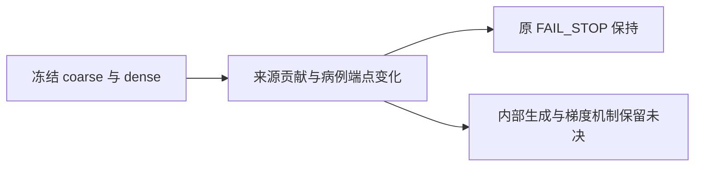

# EJTC D1：既有预测的有界失败复核

## 范围与方法

仅使用正式冻结的315行评分及已有预测。按 J−T 粗 far20 增量、密 E Cover@2 降幅各取最差3个来源，合并为6来源30例；逐例比较已存指标，重点回读下表病例的三臂 coarse／S／delta／dense 数组。没有新 forward、距离评分、配准、删点或训练。所有差值均为 J−T；覆盖与 far20 使用百分点。

## 来源贡献

| 来源 | 粗 far20变化 pp | 密 E Cover@2变化 pp | 对全折粗 far20贡献 pp |
|---|---:|---:|---:|
| train:004 | +0.0000 | -5.4593 | +0.0000 |
| train:037 | +1.2500 | -4.2114 | +0.0595 |
| train:068 | +0.8594 | -6.1665 | +0.0409 |
| train:093 | +10.5469 | -3.7361 | +0.5022 |
| train:095 | +1.9531 | -0.3781 | +0.0930 |
| train:101 | +0.0781 | -4.5841 | +0.0037 |

## 固定重点病例

| 病例 | T→J 粗 far20 % | T→J 密 far20 % | T→J 密 E Cover@2 % | T→J 密 E P95 mm |
|---|---:|---:|---:|---:|
| train__004__bilateral | 0.000→0.000 | 0.000→0.000 | 88.369→72.825 | 2.718→3.174 |
| train__037__random_1 | 6.641→12.891 | 4.443→9.497 | 84.955→75.859 | 2.603→3.120 |
| train__068__random_1 | 1.562→5.859 | 1.062→3.748 | 69.010→48.941 | 3.480→4.208 |
| train__093__parietotemporal | 0.000→52.734 | 0.000→9.265 | 19.312→1.458 | 9.774→20.710 |
| train__095__parietotemporal | 0.000→9.766 | 0.000→1.636 | 22.351→11.585 | 10.126→13.171 |
| train__101__bilateral | 0.000→0.000 | 0.000→0.000 | 74.218→65.497 | 3.297→4.359 |

## 判读边界

仅描述性去除来源093后，粗 far20 的 J−T 均值为 -0.1172 pp，密 E Cover@2 为 -0.7343 pp。这不是重判、也不允许据此删来源；原全量 FAIL_STOP 不变。

coarse 与 dense 的误差阶段只能在已保存端点之间定位。远端父点并不意味着其子点必然远端；父子远端计数及每例 delta、子点相对位移详见 JSON。仅凭这些端点不能认定 Mamba、256点数量或某一损失梯度为因果根因。

新增严重病例、粗远端比例和自由表面覆盖应分别判断；E P95 变好仍可同时出现 Cover@2 下降。不得以均值距离或切壁收益抵消预注册保护门。

## 下一步

本次复核后停止扩展诊断；形成结题报告并归档。未经新协议与单独授权，不改变权重、λ、点数、门槛或病例，也不启动 C1／D2／SkullFix。

## 本次可辨识的结果

1. **新增严重病例093-parietotemporal在coarse端点已出现明显失败，dense有所收回但未修复覆盖。** J 的256个粗点中135个（52.734%）距A2参考面超过20 mm，R/T均为0；J粗质心相对目标偏差32.10 mm，T为22.89 mm。这不是“256个粗点全部远离目标”。dense远端比例降至9.265%，但E Cover@2仅1.458%、J Cover@2仅0.229%，密E P95为20.710 mm。759个远端子点中733个属于远端父点组，26个来自近端父点组。远端比例下降不能等同正确骨块恢复。首次失败可定位为“不晚于已保存coarse端点”，不能继续追溯到S、首次生成头或LQI内部。

2. **粗far20保护门的全折增量主要受来源093驱动。** 来源093对全折J−T粗far20贡献+0.502 pp，而全折净增仅+0.391 pp，说明其他来源净有抵消。描述性去掉093后为−0.117 pp。来源095、037也有退化，不能称仅一例有问题；此留一结果只用于归因，不允许删来源后重判。

3. **自由表面Cover@2退化不是093一个来源能够解释。** 去掉093后仍为−0.734 pp，仍低于原−0.50 pp保护下限。004、068、101来源分别下降5.459、6.167、4.584 pp。004-bilateral没有粗/密远端点，J切壁覆盖比T提高16.867 pp，自由表面覆盖却下降15.544 pp；这是明确的区域覆盖交换表现，不能归结为远端离群。101-bilateral也没有远端点，自由表面覆盖仍下降8.722 pp；现有端点指标不足以区分表面细节、局部放置与形状分布的具体机制。

4. **037-random_1的远端退化主要沿已远离参考面的父组传递。** J相对T的远端子点增加414个，近父远子计数均为83，远父远子从281增至695。因此本例不是主要由近端父点的新远端子点解释。068-random_1则二者均增加：远父远子47→246，近父远子40→61。父组归属是观测关联，不能作为训练梯度的因果证明。

5. **整体结论保持原FAIL_STOP。** 切壁覆盖的总体收益与两类可分离的风险共存：粗结构的少量高影响失败，以及更分散的自由表面覆盖损失。现有证据不支持通过调门槛、删除093或追加一个局部修正来宣布方案成功；也不支持从这些病例推断Mamba本身或256个粗点数必然不适合。

本次有界复核到此停止，不追加内部采集、可调参数扫描或训练。下一步可形成EJTC结题报告与归档，并依既定计划返回稳定OASG+LQI基座的论文验证工作。
