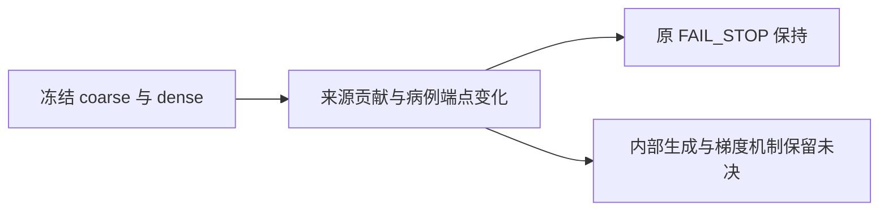

# EJTC D1：既有预测的有界失败复核

## 范围与方法

仅使用正式冻结的315行评分及已有预测。按 J−T 粗 far20 增量、密 E Cover@2 降幅各取最差3个来源，合并为6来源30例；逐例比较已存指标，重点回读下表病例的三臂 coarse／S／delta／dense 数组。没有新 forward、距离评分、配准、删点或训练。所有差值均为 J−T；覆盖与 far20 使用百分点。

## 来源贡献

| 来源 | 粗 far20变化 pp | 密 E Cover@2变化 pp | 对全折粗 far20贡献 pp |
|---|---:|---:|---:|
| train:004 | +0.0000 | -5.4593 | +0.0000 |
| train:037 | +1.2500 | -4.2114 | +0.0595 |
| train:068 | +0.8594 | -6.1665 | +0.0409 |
| train:093 | +10.5469 | -3.7361 | +0.5022 |
| train:095 | +1.9531 | -0.3781 | +0.0930 |
| train:101 | +0.0781 | -4.5841 | +0.0037 |

## 固定重点病例

| 病例 | T→J 粗 far20 % | T→J 密 far20 % | T→J 密 E Cover@2 % | T→J 密 E P95 mm |
|---|---:|---:|---:|---:|
| train__004__bilateral | 0.000→0.000 | 0.000→0.000 | 88.369→72.825 | 2.718→3.174 |
| train__037__random_1 | 6.641→12.891 | 4.443→9.497 | 84.955→75.859 | 2.603→3.120 |
| train__068__random_1 | 1.562→5.859 | 1.062→3.748 | 69.010→48.941 | 3.480→4.208 |
| train__093__parietotemporal | 0.000→52.734 | 0.000→9.265 | 19.312→1.458 | 9.774→20.710 |
| train__095__parietotemporal | 0.000→9.766 | 0.000→1.636 | 22.351→11.585 | 10.126→13.171 |
| train__101__bilateral | 0.000→0.000 | 0.000→0.000 | 74.218→65.497 | 3.297→4.359 |

## 判读边界

仅描述性去除来源093后，粗 far20 的 J−T 均值为 -0.1172 pp，密 E Cover@2 为 -0.7343 pp。这不是重判、也不允许据此删来源；原全量 FAIL_STOP 不变。

coarse 与 dense 的误差阶段只能在已保存端点之间定位。远端父点并不意味着其子点必然远端；父子远端计数及每例 delta、子点相对位移详见 JSON。仅凭这些端点不能认定 Mamba、256点数量或某一损失梯度为因果根因。

新增严重病例、粗远端比例和自由表面覆盖应分别判断；E P95 变好仍可同时出现 Cover@2 下降。不得以均值距离或切壁收益抵消预注册保护门。

## 下一步

本次复核后停止扩展诊断；形成结题报告并归档。未经新协议与单独授权，不改变权重、λ、点数、门槛或病例，也不启动 C1／D2／SkullFix。
