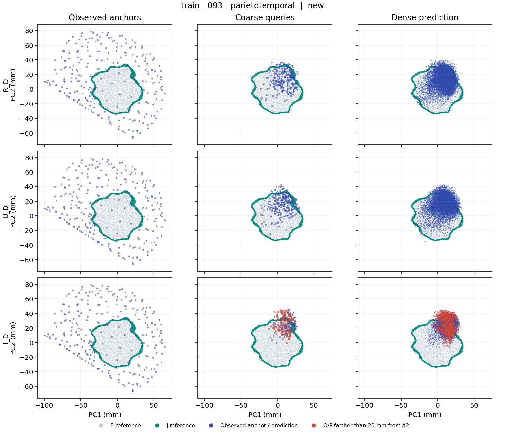

# BCSP-CISC 共享切壁条件化粗查询生成实验报告

_Cranial-BCSP-FullMamba · SkullBreak Fold D 首种子 · 结题版 v1 · 2026-11-25_

---

## 摘要

BCSP-CISC 检验从残骨点云中预测的共享切壁空间分布，能否改善缺失骨块的首次粗查询与最终切壁覆盖。研究以 OASG+LQI 为基座，在同一 Fold D、同一训练种子下配对比较三臂。R 保持原 OASG，U 使用匹配的辅助切壁监督和均匀条件，I 使用同样的监督及参数规模，并将切壁支持按空间分布加权。三臂各训练 3,900 步，对相同 105 个开发病例各预测一次。

**预注册裁决为 `FAIL_STOP`。** 与 U 相比，I 的密点 J Cover@2 下降 **5.78 个百分点**，来源级 95% bootstrap 区间为 **[−7.75, −3.61] 个百分点**，仅 2／21 个来源改善。严重病例总数同为 3 例，其中新增 2 例、挽回 2 例、共同严重 1 例，新增数超过门槛。I 对 U 和 R 的 G1–G5 均未通过，切壁信号的机制门 G6 通过。五例离线复核中，三臂观测锚点 S 逐字节相同，新增严重病例的主要差异在首次粗查询 Q 上已经可见。当前空间条件实现收束，OASG+LQI 保留为论文验证主方法。[冻结评分汇总](../p3_rui_d_cpu_score_v2/scored_once_v2/source_summary.json) · [裁决记录](../p3_rui_d_cpu_score_v2/CISC_P2_FoldD_preregistered_decision_v1.json)

## 1. 研究目的和检验问题

既有 OASG 实验表明，将粗查询建立在残骨观测锚点上，可以改善缺失区的整体覆盖。共享切壁仍有可观的漏覆盖，个别病例也出现骨块偏位。CISC 将问题收敛为一项可证伪的假设：**当监督、参数规模和训练合同匹配时，将切壁预测的空间分布注入首次粗查询，能否增加 J 覆盖，并控制 E 区误差、远端离群及严重失败？** [OASG 主结果冻结索引](../../bcsp_oasg_20261124_v1/OASG_paper_main_results_freeze_v1.json)

实验分三项判断。首先检查训练标签能否追溯到真实的体素共享面，并精确对齐正式输入的点行。其次检查冻结观测特征中能否读出切壁支持，以及空间场与均匀场能否产生可测差异。最后检查这种差异能否转化为稳健的几何收益。前两项提供研究依据，晋级由最后一项及预注册联合门槛决定。

## 2. 数据、结构和训练方法

### 2.1 数据与坐标

- 本轮只使用 SkullBreak Fold D 的开放数据。训练集为 **63 来源、315 例**，开发集为 **21 来源、105 例**。每个来源五种缺损，各组源内等权。开发病例及来源与本折训练集合不交叠。统计单位为来源，105 个病例共同构成 21 组配对观察。
- 输入为 **8,192 个残骨边界点**，输出为 **8,192 个缺失骨块完整边界点**。首次生成 256 个粗查询，每个父点对应 32 个密点槽位。使用冻结的残骨 D-only 归一化，评分反变换到世界毫米。
- 在同一原始体素格内核验完整骨 `C = D ∪ G` 及残骨 D、缺失骨 G 互斥。J 是 D/G 的六邻接共享面，E 是缺失骨边界的其余区域。共享面键、对向法向和物理面积通过原始仿射核验。训练标签由原采样器的面索引恢复。为重现顺序，先按物理面积采 16,384 点，再截取 8,192 点前缀。
- 正式 Native 推理只读取残骨 `partial`。完整骨、缺失骨、切壁真值和参考面用于训练监督或预测冻结后的 CPU 评分。开发标签在预测完成后另行回放。SkullFix 迁移、MUG500+ 和封存测试集均无本轮观测。[冻结 Fold 清单](../../cranial_bcsp_scq_foldC_training_preparation_20261113_v1/candidate_payload/fold_binding.json) · [历史采样器](../../cranial_bcsp_geov1_20261024/real_data_qc_v1.py)

### 2.2 三臂与唯一干预点

| 臂 | 首次粗查询的条件 | 辅助监督 | 参数量 |
|---|---|---:|---:|
| R · Reference | 冻结 OASG+LQI 的原生观测锚点及特征 | 无 | 39,907,012 |
| U · Uniform | 从预测支持得到每例全局平均质量，用均匀场构造条件 | 0.05 × cell BCE | 39,968,069 |
| I · Interface | 非空 cell 使用自己的预测支持，空 cell 使用同例均值 | 0.05 × cell BCE | 39,968,069 |

每个残骨输入点分配给最近的原生锚点 S，精确同分取最小索引。对每个 cell 记录点数 `nᵢ`、点占比 `wᵢ=nᵢ/8192` 和真实 J 点比例 `tᵢ`。辅助头读取 384 维 Memory 特征与 3 维锚点，输出 logit，得到预测支持 `pᵢ=σ(logitᵢ)`。BCE 以 `wᵢ` 加权，空 cell 权重为零。U/I 使用相同的训练折比例先验、辅助头、条件映射和辅助权重。

条件包含局部有效支持、全局均值、锚点相对加权中心的位置及协方差的六个独立元素，共 11 维。零初始化线性映射将其加到原粗头首层。后续沿用 OASG 残差形式 `Q=S+δ` 与原 LQI/FC 解码。U/I 的主要设计差异是是否保留空间分布。R/U 对比同时引入条件路径和辅助监督，作为描述性对照。[CISC 接入](../bcsp_cisc_entry_v1.py) · [切壁条件头](../bcsp_cisc_head_v1.py)

~~~mermaid
flowchart LR
    D["8,192 点残骨输入"] --> M["观测锚点 S、Memory 与全局摘要"]
    M --> R["R 原生 OASG"]
    M --> H["切壁支持预测"]
    H --> U["U 均匀条件"]
    H --> I["I 空间条件"]
    T["训练折共享面标签"] -. "仅辅助损失" .-> H
    R --> Q["256 个粗查询 Q"]
    U --> Q
    I --> Q
    Q --> P["LQI / FC 生成 8,192 个密点"]
    P --> A["冻结预测后离线评分"]
~~~

### 2.3 配对、评分与判据

三臂训练种子为 `2026112601`，OASG 粗头使用 `2026112603`，U/I 辅助初始化使用 `2026112605`。使用同设备及软件环境、FP32、原 AdamW 和原 LR/BN 调度。本折每臂训练 100 轮，batch 8，每轮 39 步并丢弃 3 个尾批槽位，固定 epoch 99／step 3900 的最终 checkpoint。三臂共有初态、起始 Python/NumPy/PyTorch CPU/CUDA RNG、完整批序与逐来源曝光一致，U/I 完整模型初态一致。每臂为 31,200 次病例曝光和 300 个丢弃槽位。Native 每例 batch 1，三臂合计 315 次真实预测，零更新。

评分中，E/J P95 为 A1 面中心至预测的面积加权最近邻距离的第 95 百分位。Cover@2 为 2 mm 内的面积占比。反向 A2 P95、far20 衡量预测点至每面四个子采样点形成的 A2 参考的距离，far20 使用严格大于 20 mm。密 CD-L1 为双向最近邻均距的半和。严重病例定义为密 E P95 >20 mm 或密 J Cover@2 =0。差值按同病例配对、来源内五例等权、21 来源等权汇总。三个对照共用固定 PCG64 种子 `2026112507` 的 2,000 次来源级重复抽样，并报告百分位区间与留一来源结果。区间反映这组已训练权重下的来源波动。

## 3. 阶段结果与工程核验

| 阶段 | 实际完成 | 结果 |
|---|---|---|
| P0 来源与可辨识性 | 315 例训练标签回放、15 例试点与其余 300 例冻结前缀采集 | 315 例通过标签准入，试点 15／15 通过联合操纵门，要求至少 12 例 |
| P1 人工 CPU 与 CUDA | 9 项人工 CPU 检查，6 次验证 forward、3 loss、3 backward、0 step，另有 75 次准入计时 forward | CUDA 准入冻结审计通过 |
| P2 三臂训练 | R、U、I 各 3,900 步，合计 11,700 步、93,600 次病例曝光 | 三份最终权重均实测 SHA256，配对审计通过 |
| P2 Native 与 CPU 评分 | 315 次零更新预测，105 例开发标签、315 条模型评分 | 归档 319 个成员逐一验证；评分 216 个产物双遍哈希稳定，三对照及来源汇总独立复算一致 |
| P2 裁决和收束 | 原 G1–G7 判据及五例既有预测复核 | `FAIL_STOP`，几何门未通过，正式训练后效率门缺证 |

P0 的五折来源分组读出使用历史 OASG 的冻结特征。常数、几何和几何+Memory 的 soft AP 分别为 **0.02189、0.10713、0.31486**。Memory 相对 π 的提升为 **0.29297**，63／63 来源严格为正，Brier 为 **0.00414**，低于常数 **0.00834**。探针按来源留出拟合，历史 OASG 权重已训练见过这批来源，该结果说明既有表示具备读出条件，跨开发来源的表现由后续 Native 评分检验。[15 例准入](../token_gate_15_v1.json) · [315 例读出](../p0b_probe_315_result_v1.json)

P1 准入的 batch 1 P50 为 R **42.47 ms**、U **44.08 ms**、I **43.38 ms**，I 为 R 的 **1.021 倍**，峰值 allocated 为 **0.996 倍**。这是训练前的准入计时。协议要求另用训练后权重、20 个冻结开发病例、每臂 10 次预热和 200 次计时执行正式 G7。该计时未运行。已归档的 Native 资源记录全部通过，训练可执行性及预测状态／RNG 证据完整。[CUDA 准入审计](../p1_cuda_post_freeze_audit_v1/formal_post_cuda_freeze_receipt_v1.json) · [预测冻结审计](../p3_rui_d_native_post_freeze_v1/formal_post_prediction_freeze_receipt_v1.json) · [评分冻结审计](../p3_rui_d_cpu_score_v2/formal_post_score_freeze_receipt_v2.json)

### 3.1 技术中断与复核

- I 臂首个启动调用未返回回执。无写入探针能重现约 6.9 kB 载荷的卡顿，短载荷完整回传。后续将启动前核验拆为 ≤2,048 字节的多段只读调用，通过后以独立短命令单次启动。停滞发生于传输调用，本轮三臂训练最终均按同一科学合同执行。
- CPU 评分 v1 在第 8 例 `train__005__parietotemporal` 的坐标守卫停止。重算尺度比冻结尺度低 1 ULP。只读复算确认两种尺度得到的 8,192 行 FP32 坐标均与正式输入逐字节一致。v2 用冻结参数重放并记录重算差异。105 例全部通过，16 例重算参数有浮点差异，最大尺度差 **2.84×10⁻¹⁴ mm**。旧失败证据保留。修订限定于标签回放，评分的几何定义、病例名单和预注册阈值沿用原协议。[v1 失败记录](../p3_rui_d_cpu_score_v1/scored_once_v1/failure.json) · [v2 冻结回执](../p3_rui_d_cpu_score_v2/scoring_request_freeze_receipt_v2.json)

## 4. 开发集几何结果与预注册裁决

数值为来源等权均值。覆盖率与 far20 的表内臂值用百分数，差值用百分点。P95 与 CD-L1 的差值用毫米。

| 指标 | R | U | I | I−R | I−U | U−R |
|---|---:|---:|---:|---:|---:|---:|
| 粗 E P95 ↓ | 11.32 | 10.84 | 12.36 | +1.04 | +1.51 | −0.48 |
| 粗 J P95 ↓ | 14.73 | 14.26 | 16.37 | +1.64 | +2.11 | −0.47 |
| 粗 J Cover@2 ↑ | 6.28 | 6.85 | 5.95 | −0.32 | −0.90 | +0.58 |
| 粗 far20 ↓ | 2.08 | 2.19 | 2.94 | +0.87 | +0.75 | +0.12 |
| 密 E P95 ↓ | 6.08 | 5.50 | 6.41 | +0.33 | +0.92 | −0.58 |
| 密 J P95 ↓ | 8.74 | 8.50 | 9.48 | +0.74 | +0.97 | −0.24 |
| 密 J Cover@2 ↑ | 50.44 | 55.16 | 49.39 | −1.06 | **−5.78** | +4.72 |
| 密 E Cover@2 ↑ | 63.15 | 69.42 | 64.71 | +1.56 | −4.71 | +6.27 |
| 密 A2 P95 ↓ | 7.83 | 7.30 | 8.13 | +0.30 | +0.83 | −0.53 |
| 密 far20 ↓ | 1.48 | 1.45 | 1.83 | +0.36 | +0.38 | −0.03 |
| 密 CD-L1 ↓ | 3.07 | 2.98 | 3.58 | +0.52 | +0.61 | −0.09 |
| 密点质心偏差 ↓ | 9.54 | 8.90 | 10.30 | +0.76 | +1.40 | −0.63 |
| 严重病例数 | 2 | 3 | 3 | +1 | 0 | +1 |

| 对照 | 密 J Cover@2 差值 | 95% 区间 | 改善来源 | 留一来源范围 | 严重转换：新增／挽回／共同 |
|---|---:|---:|---:|---:|---:|
| I−R | −1.06 pp | [−3.55, +1.45] | 9／21 | [−1.56, −0.56] | 2／1／1 |
| I−U | **−5.78 pp** | **[−7.75, −3.61]** | **2／21** | [−6.33, −5.33] | 2／2／1 |
| U−R | +4.72 pp | [+3.13, +6.36] | 18／21 | [+4.24, +5.05] | 1／0／2 |

I−U 的密 J 覆盖差值在五个缺损类型的描述性分层中均为负。顶颞缺损为 **−11.50 pp**，额眶缺损为 **−1.26 pp**。留掉任意单个来源，I−U 的总体差值仍为负。该结果支持本折观测到的覆盖回退具有来源稳健性，分层数据的用途仍限于描述。

| 门组 | I−R | I−U | 判定依据 |
|---|---|---|---|
| G1 密 J 覆盖优越 | FAIL | FAIL | 要求至少 +2.00／+1.00 pp，区间下端 >0，改善来源 ≥14 |
| G2 粗/密 J P95 | FAIL | FAIL | 粗 J P95 分别 +1.64、+2.11 mm，密 J P95 分别 +0.74、+0.97 mm |
| G3 E 与整体形状保护 | FAIL | FAIL | 两对照的粗/密 E、密 E 区间上端和密 CD-L1 均超出各自容许上限 |
| G4 反向风险 | FAIL | FAIL | 两对照的粗与密 far20 超限。I−U 的密 A2 P95 同时超限 |
| G5 严重病例 | FAIL | FAIL | I−R 总数增加。两对照均新增 2 例，超过上限 1 例 |
| G6 机制 | PASS | PASS | 按预注册作为 I 的组级判据，详见下节 |
| G7 资源与数据边界 | 未完整裁决 | 未完整裁决 | 已有准入与运行资源证据，缺正式训练后计时 |

R 的密 E P95 **6.0805 mm**，严重 **2 例**。对照两个历史 OASG Fold D 冻结结果，漂移上限为 **8.0878 mm／6 例**，本轮 R 通过基线漂移保护。G1–G5 已给出充分的停机依据，正式 G7 缺证独立保留。[逐例评分](../p3_rui_d_cpu_score_v2/scored_once_v2/model_scores.jsonl) · [来源级汇总](../p3_rui_d_cpu_score_v2/scored_once_v2/source_summary.json) · [逐门未舍入判定](../p3_rui_d_cpu_score_v2/CISC_P2_FoldD_preregistered_decision_v1.json)

## 5. 机制结果与解释

| 开发集机制指标 | U | I |
|---|---:|---:|
| soft AP 可定义病例 | 105／105 | 105／105 |
| 来源均值 AP−π | 0.31207 | 0.31033 |
| AP−π 严格为正的来源 | 21／21 | 21／21 |
| cell Brier | 0.003514 | 0.003547 |
| 训练比例常数 Brier | 0.008271 | 0.008271 |
| 相对均匀场的加权中心偏移 | 约 0 mm | 58.66 mm |
| 相对均匀场的协方差 Frobenius 变化 | 约 0 | 0.599 |
| 达空间操纵阈值的来源 | 0／21 | 21／21 |

**切壁信号的定位与生成收益发生分离。** I 的 soft AP、Brier 和空间操纵结果支持切壁预测有定位信息，且确实改变了首次粗头得到的几何条件。I 生成的粗点在 J P95 上已落后 U，随后密点的 J 覆盖、反向误差和整体误差也落后。共享切壁局部支持可以反映接触位置，缺失实体的全局中心、范围与表面拓扑仍需由生成目标决定。

I 相对均匀场的中心位移均值为 58.66 mm，大小值得关注。该量的参照是全残骨均匀场中心，无法直接解释为生成骨块移动了 58.66 mm，也无法据此认定模型过度位移。二阶矩压缩可能把多连通接口或窄边界混在一起。条件尺度、原有位移路径及联合训练的相互作用均为可解释假设，当前证据没有分离这几项贡献。

U−R 的切壁覆盖提升 **4.72 pp**，密 E P95 降低 **0.58 mm**，同时新增 1 个严重病例。U 结果提供了一个值得记录的对照，说明该种子下均匀条件与辅助监督的组合可能有用。U 同时改变了多项机制，而且仅完成一折一个种子。单从本轮无法把收益归于辅助监督、均匀条件或其组合，也不构成将 U 直接升格为论文主方法的证据。

## 6. 五例离线复核

### 6.1 方法与证据边界

固定病例为 I−U 的两例新增、两例挽回和一例共同严重。对每例三臂的 15 份预测重核归档成员哈希、`S+δ=Q` 及 32 个子点的父槽位。全部病例中，三臂 S 的坐标和顺序逐字节一致。使用冻结 E/J/A2 和目标采样，在同一世界坐标中度量 S、Q 和 Dense，复算的 Q/Dense 指标与正式评分一致。S 为残骨观测锚点，S 对缺失骨的距离只用于定位差异来源。图采用同一病例的 GT 主轴投影，全部臂和阶段共用视角及坐标范围。投影只用于显示，数值全部来自三维距离。新增 forward 为 **0**。[逐臂、逐阶段数值与哈希](five_case_offline_review_v1.json)

### 6.2 病例证据

| 病例 | 首次粗查询 Q，U → I | 最终输出 Dense，U → I | 最早可辨识阶段 |
|---|---|---|---|
| **022 random_1** 新增严重 | J P95 28.96 → 32.92 mm，J 覆盖 0.29% → 0%，far20 30.86% → 43.36% | J 覆盖 5.02% → 0%，far20 6.88% → 18.63% | 切壁漏覆盖与远端父点在 Q 已出现。密点 E P95 略改善，切壁仍完全失配 |
| **093 parietotemporal** 新增严重 | E P95 11.45 → 31.47 mm，J P95 13.99 → 34.00 mm，far20 0% → 48.83% | E P95 4.84 → 24.29 mm，J 覆盖 44.95% → 0.57%，far20 0% → 16.54% | Q 已明显偏位并缩窄，Dense 只部分回收 |
| **069 random_2** 挽回 | E P95 31.80 → 27.69 mm，J P95 48.59 → 43.83 mm，far20 均为 0% | E P95 24.83 → 14.86 mm，J 覆盖 30.55% → 31.43% | 粗点覆盖改善先出现，密点阶段改善增大并跨过严重阈值。主要问题是漏覆盖 |
| **087 random_1** 挽回 | E P95 24.38 → 19.94 mm，far20 58.98% → 37.11%，J 覆盖 0% → 0.10% | E P95 17.33 → 11.03 mm，J 覆盖 0% → 9.16%，far20 仍为 28.38% | Q 改善已可见，Dense 恢复局部覆盖，仍有大量远端点 |
| **046 parietotemporal** 共同严重 | R/U/I 的 Q 均有 100% 点距 A2 >20 mm，U→I 的 Q 质心误差 84.73 → 111.57 mm | R/U/I 密 E P95 为 43.26／53.82／92.98 mm，J 覆盖均为 0% | 三臂共同粗定位失败。I 偏得更远，密点阶段延续失效 |

022 的 I 臂 1,526 个远端密点中，**1,492 个**来自已超过 20 mm 的粗父点。093 对应为 **1,255／1,355**。这一父子槽位证据支持粗点已承担主要偏差。它也记录了少量由近父点生成的远端子点，因此密点放置仍有局部失败。046 的 I 臂 8,192 个密点全部为远端点，父点也已全数远离参考。069 提示单看 far20 会漏掉覆盖型严重病例，087 则提示跨过严重阈值后仍可有高离群。

**可辨识的是误差出现的最早观测阶段。** 五例的输入锚点相同，Q 差异早于 Dense。三臂的上游特征、粗头与解码器经独立训练，观察无法识别每例的因果归属，也无法确认是支持分布、Memory 表征、粗头权重或训练动力学在主导。I 的同权重空间场切换按预注册仅在通过 P2 后执行，本轮保留未决。五例按严重状态选择，结论限于病例机制描述，整体效应由 105 例配对结果给出。

其余图件按病例查看。[022 新增严重](train__022__random_1_stages.png) · [069 挽回](train__069__random_2_stages.png) · [087 挽回](train__087__random_1_stages.png) · [046 共同严重](train__046__parietotemporal_stages.png)

## 7. 实验问题、结题与后续方向

1. **首要问题是切壁可辨识性没有转化为粗结构与最终几何收益。** 数据来源、标签回放、同折配对和运行计数均已核验。I 在主要对照上的切壁覆盖回退跨越多个来源和缺损类型，两例新增失败也分别涉及切壁零覆盖和全局偏位。
2. **空间矩存在表达边界。** 局部接触面的中心和范围无法唯一确定缺失骨块形状。多连通接口可能共享相似低阶矩，距 S 的欧氏分派会使近邻几何进入同一个 cell。当前尚不能量化这些因素各自对退化的贡献。
3. **单折单种子限制结论范围。** 来源级区间反映本折内的波动，无法估计跨种子和跨数据源稳定性。D 首种子已触发停机条件，Fold C、D 第二种子、SkullFix 迁移、正式 G7 和额外 15 次干预均未执行。结论适用于本实现与本协议。
4. **临床外推仍需独立证据。** 本实验的 J 是合成缺损的真实体素共享面，覆盖率是点集参考距离。临床配合、厚度、骨板连续性、碰撞与可制造性需要另行评价。
5. **最优先的论文工作是验证 OASG+LQI 的可主张贡献。** 复用已有 SkullBreak C/D、D 第二种子和 SkullFix 的冻结证据，统一同协议主结果。再补足同协议强基线、OASG 与 LQI 的拆分对照，以及 Mamba 主干与可比替代结构的独立贡献。CISC 可作为边界清晰的负结果和误差归因资料。U 的描述性改善保留在附录，待有针对性的对照才能作归因。

**结题结论。** BCSP-CISC 按预注册 `FAIL_STOP` 收束。五例离线复核完成，加重或缓解的现象在 Q 阶段已可见，生成路径的病例级因果归属仍未决。当前论文主线继续采用已冻结的 OASG+LQI。

## 8. 主要证据与复现入口

| 证据 | 路径或身份 |
|---|---|
| P0 标签与来源读出 | [15 例准入](../token_gate_15_v1.json) · [315 例探针](../p0b_probe_315_result_v1.json) |
| 三臂冻结权重与配对 | [R_D](../p2_r_d_post_training_freeze_v1/R_D_formal_post_training_freeze_receipt_v1.json) · [U_D](../p2_u_d_post_training_freeze_v1/U_D_formal_post_training_freeze_receipt_v1.json) · [I_D](../p2_i_d_post_training_freeze_v1/I_D_formal_post_training_freeze_receipt_v1.json) |
| 预测归档 SHA256 | `ff1cf4738fdb5e0e84bb9ee02ee6718ddd52c91c4e12ad624b9d632205ac4c78` · [本机校验](../p3_rui_d_native_post_freeze_v1/local_prediction_archive_verification_v1.json) |
| 评分和裁决 | [逐例评分](../p3_rui_d_cpu_score_v2/scored_once_v2/model_scores.jsonl) · [来源汇总](../p3_rui_d_cpu_score_v2/scored_once_v2/source_summary.json) · [冻结审计](../p3_rui_d_cpu_score_v2/formal_post_score_freeze_receipt_v2.json) · [预注册裁决](../p3_rui_d_cpu_score_v2/CISC_P2_FoldD_preregistered_decision_v1.json) |
| 离线复核 | [五例指标](five_case_offline_review_v1.json) · [复核脚本](review_five_cases_v1.py) |
