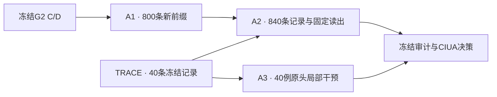

# Cranial-BCSP-FullMamba · BCSP-CIUA 完整实验报告

**日期** 2026-11-18　**阶段状态** 正式收束　**协议** CIUA审阅修订版v2

## 📌 摘要

BCSP-CIUA研究冻结的BCSP-SPCG G2模型中，缺失颅骨骨片的位置、尺度和粗空间布局能否从编码特征读出，以及固定读出相对原生粗点云是否还有稳定改善空间。实验另外对原粗生成头的局部输入做受控干预，观察槽位特征怎样影响输出。CIUA沿用SkullBreak固定数据和G2两折最终权重，新增800次零更新前缀采集，复用40条TRACE记录，完成840条模型—病例记录上的16次固定岭回归求解，以及40例共120次原头CPU调用。各阶段均完成正式冻结审计，训练更新为0。

三组编码特征读出均通过相对输入几何D18的可读性门，均未通过相对原生粗点云Q的预设质心与八区联合改善门。局部特征的两种均值拼接没有达到预设增量标准。原粗生成头对局部槽位特征有明显响应。均值替换造成粗点云整体收缩，循环移位产生很大的同槽位位移，整体质心和八区比例却变化较小。证据支持“空间信息可读、原头对局部条件敏感”，尚不足以认定生成头存在条件利用失败，亦未达到启动新位置、尺度或汇聚训练的依据。

收束后对两折保存预测的全量复核进一步区分了两种问题。16例G2新增严重病例中14例在粗阶段已比配对G1差，D折另外存在较多粗阶段相对不差而最终变差的病例。下一阶段应分别研究严重尾部的粗表面定位与覆盖，以及展开后未能恢复的目标区域。

## 🎯 研究背景与目的

颅骨补全的任务是从残余骨组织的完整边界点云预测缺失骨块的完整边界。本轮沿用8,192点输入和8,192点最终输出，研究其中的256点粗生成节点。表面接触区、非接触区、内外表面及暴露切壁的准确覆盖仍是最终目标，低阶读出只检查其中有限的空间描述。

前期SPCG训练比较留下了粗阶段偏位和漏覆盖病例。TRACE进一步确认探针确实访问了冻结G2的Memory，但原有结果不足以支持追加锚点训练。早期P2的M0读出曾表现出尺度改善，后续H2也未由此获得稳定的完整几何收益。CIUA将研究对象锁定为当前G2，依次回答三项问题。[^protocol]

1. **可读性 I**。固定来源外线性读出能否从G2编码特征预测比D18更准确的质心和粗布局？
2. **余量 U**。使用编码特征的固定读出能否在原生Q之上进一步改善质心和粗布局，同时控制尺度回退？
3. **局部条件响应**。在固定原头权重和其他输入块时，均值替换和循环移位局部特征会怎样改变Q？

I检验统计可预测性，U是项目内的后续投入标准。两者均不直接识别条件利用的因果机制。A3干预只改变局部特征块，因果解释限于这两种受控输入变化对冻结头输出的影响。

## 🧪 实验设计与方法

### 固定数据、权重和采集节点

SkullBreak共84个颅骨来源，每来源五类缺损，合计420份不同点集。C和D分别使用固定的最终G2权重，每折63个训练来源和21个开发来源，分别对应315和105个病例。两折合计840条模型—病例记录，其中630条用于相应折的读出拟合，210条用于开发评价。两折开发来源互斥，训练来源部分重叠。归一化中心、尺度与轴向沿用冻结的残余骨输入坐标合同。GT仅在离线分析取标签时进入分析链。[^a0][^a1]

实际采集观察原G2头的消费者。每个探针槽位的输入向量为 `x_i = [z, f_i, A_i, μ_i, ρ_i, τ_i]`，共1,416维，其中全局特征 `z` 为1,024维，局部特征 `f_i` 为384维，其余为冻结的探针及局部几何描述。粗生成头输出形状为256×3。A1在Q返回处截断，后续查询构造、Decoder和点展开并未进入调用链。40条缓存复用TRACE原生记录，身份按模型、病例、输入、权重及归一化核验。[^protocol][^a1]

### A2固定读出与对照

每例标签共12维。前三维是GT骨片点云质心，第四维是关于质心的RMS半径取自然对数，后八维是以残余骨输入包围盒中心为原点划分的八区点数比例。原生Q用同一口径生成描述量。质心距离转回毫米，尺度误差为绝对log半径差，布局误差用八区比例总变差 $\mathrm{TV}=\tfrac12\sum_k |\hat p_k-p_k|$。读出的八区预测先投影至概率单纯形。八区比例基于固定点样本，粗细两阶段的点数和采样方式会影响解释。[^protocol][^a2]

| 方法 | 输入或预测来源 | 作用 |
|---|---|---|
| 训练常数 | 相应折训练来源等权的标签均值 | 衡量训练先验 |
| D18 | 输入点云3个均值、6个协方差分量、9个逐轴分位数 | 简单输入几何读出 |
| 原生Q | 冻结G2的256点粗输出 | 检查相对实际生成输出的改善余量 |
| z | 1,024维全局特征 | 主读出分支 |
| zF | z拼接逐Memory token离线层归一化后的均值 | 检查原Memory均值的增量 |
| zf | z拼接实际局部槽位特征的均值 | 检查局部特征均值的增量 |
| 四组置换控制 | D18、z、zF、zf各使用一次固定来源标签置换 | 保留缺损类型结构并破坏真实来源配对 |

每折仅用训练来源确定输入和标签的标准化参数，采用来源加权平均损失的多输出岭回归，固定 $\lambda=1$。每个来源五个病例各占该来源权重的五分之一。每折四组真实配对和四组固定置换，两折共16次求解。开发评价保留十种方法，先按病例计算误差，再在来源内平均，最后对每折21个来源等权汇总。比较的95%区间来自固定的2,000次来源配对Bootstrap。标签置换保留五类缺损对应，C/D置换种子为2026111803/04，Bootstrap种子为2026111801/02。[^protocol][^a2]

| 预设判据 | 两折均需满足的条件 |
|---|---|
| I，相对D18 | 质心平均改善至少2.0 mm、八区TV至少改善0.03，两项各至少14/21来源改善，训练八区目标有变异 |
| U，相对原生Q | I通过，质心平均改善至少1.0 mm、八区TV至少改善0.03，两项各至少14/21来源改善，任一折绝对log半径误差的平均回退不超过0.01 |
| 汇聚增量，相对z | zF或zf分别达到1.0 mm质心与0.03 TV改善，两项各至少14/21来源改善，同时满足半径回退限制 |

阈值用于筛选下一步投入。Bootstrap描述来源差异的不确定性，实际判门仍按冻结阈值和改善来源数执行。[^protocol]

### A3原头的受控局部干预

每折复用20条TRACE G2缓存。每例依序执行N、M、R。N为原样输入，M把256个局部槽位特征替换成该例局部特征均值，R将原局部特征沿槽位循环移动一位。三组均冻结 `z, A, μ, ρ, τ` 及原头权重。N与历史Q须同时满足归一化坐标 `rtol=2e-5, atol=2e-6`，以及最大世界坐标分量绝对差不超过0.01 mm。40例完整记录同槽位位移及整体质心、尺度和八区比例变化。[^a3]

## 📊 实际执行与结果

### 执行、审计与一致性

| 阶段 | 实际完成 | 审计结果 |
|---|---|---|
| A0及实现 | 核验两份G2权重、420份点集与40条缓存，完成24项人工CPU契约验证 | 源码、输入与执行范围冻结 |
| A1 GPU前缀 | 800/800，新开发Q各折85份，采集墙钟约416.52秒 | 退出码0，19组核验通过。170份新开发Q与历史Native Q逐字节一致，最大分量差0 mm |
| A2 CPU读出 | 840条记录、16次求解、2,100条开发病例—方法评分 | 退出码0，19项核验通过。用保存系数独立重算预测、汇总、区间及判门 |
| A3 CPU原头 | 40例、120次调用、240条认领和返回事件 | 退出码0，51份结果文件、46个归档成员重新核验。40例N均通过 |

A1保留冻结模型参数、缓冲区、模式和RNG一致性证据。A2审计重新检查保存系数的驻点方程，无额外拟合。A3最差N重放分量误差为0.0000921 mm。A2、A3的进程耗时约21.8秒和9.8秒，均包含读取与写出。本轮训练更新为0。[^a1][^a2][^a3]

### A2正式读出结果

下表为每折21个开发来源等权平均，三项均为误差，数值越小越好。尺度与TV列均无量纲。[^a2]

| 方法 | C质心 mm | C尺度 | C八区TV | D质心 mm | D尺度 | D八区TV |
|---|---:|---:|---:|---:|---:|---:|
| 训练常数 | 57.382 | 0.20068 | 0.59593 | 57.671 | 0.19832 | 0.58817 |
| D18 | 33.756 | 0.13035 | 0.36080 | 32.168 | 0.12792 | 0.34569 |
| 原生Q | 15.378 | 0.12337 | 0.17540 | 12.366 | 0.12504 | 0.14991 |
| z | 17.195 | 0.09433 | 0.18983 | 12.688 | 0.10409 | 0.14594 |
| zF | 17.219 | 0.08862 | 0.18993 | 12.592 | 0.09622 | 0.14566 |
| zf | 17.008 | 0.08886 | 0.18883 | 12.591 | 0.09572 | 0.14556 |
| D18置换 | 52.644 | 0.14908 | 0.55993 | 53.419 | 0.14795 | 0.56412 |
| z置换 | 48.043 | 0.12746 | 0.52074 | 54.674 | 0.14729 | 0.57184 |
| zF置换 | 48.795 | 0.12645 | 0.52465 | 55.124 | 0.14436 | 0.57711 |
| zf置换 | 49.109 | 0.12825 | 0.52959 | 54.957 | 0.14561 | 0.57500 |

**三组编码特征均通过I。** 主分支z相对D18在C/D折的质心误差分别降低16.56/19.48 mm，TV分别降低0.17096/0.19975。两折在这两个指标上分别都有21/21来源改善。质心差的来源Bootstrap 95%区间分别为［−19.77，−13.41］与［−22.98，−16.09］mm。真实配对读出远优于固定置换对照，表明真实来源与标签的对应关系对开发集表现有价值。[^a2]

**三组均未通过U。** z相对Q的质心差为C折+1.82 mm、D折+0.32 mm，分别只有5/21和10/21来源改善。对应95%区间为［+0.68，+2.96］和［−0.43，+1.12］mm。TV差为C折+0.01444、D折−0.00397，两折区间均跨零。zF与zf也没有达到质心和TV的联合改善要求。[^a2]

**尺度读出改善，汇聚增量门未通过。** z相对Q在两折的绝对log半径误差分别减少0.02904和0.02094，zF与zf又有小幅改善。zf相对z在C/D折的质心误差只减少0.186/0.098 mm，TV只减少0.00101/0.00038。三组均未触发相对Q的尺度回退标记。仅据这些尺度结果，无法预测完整表面、远端离群或接口表现。[^a2]

### A3局部干预结果

数字为每折20例的病例等权平均，各干预相对同病例N。[^a3]

| 折与干预 | 同槽位平均位移 mm | 质心位移 mm | log RMS半径有符号变化 | 八区比例TV |
|---|---:|---:|---:|---:|
| C · M 均值替换 | 27.71 | 10.30 | −3.420 | 0.4240 |
| D · M 均值替换 | 30.67 | 11.68 | −3.730 | 0.4039 |
| C · R 循环移位 | 41.82 | 0.220 | −0.0159 | 0.0115 |
| D · R 循环移位 | 44.94 | 0.256 | −0.0119 | 0.0078 |

M消除局部特征槽位差异后，两折都出现明显尺度收缩并伴随质心和八区变化。R保留局部特征多重集，导致较大同槽位位移，而整体质心、尺度与八区分布变化较小。位置可能在槽位间重排，也可能发生低阶描述量无法捕捉的集合形状变化。R的局部特征向量扰动幅度比M大，两个位移数值不可直接作为机制强弱排序。A3确认原头对给定干预敏感，未检验正常输入中的槽位对应是否具备解剖正确性，也没有度量干预后的最终补全性能。[^a3]

## 🔍 科研解释、问题与局限

1. **从“存在可读信息”到“存在可用改进”之间仍有证据缺口。** 固定编码特征能解释超出D18的低阶几何差异，而原生Q在质心和八区表现上已经接近或优于预设读出。U未达到说明本实验没有发现足够的联合改善余量。其他目标、更丰富的几何基线或非线性读出仍有未知空间。
2. **对照之间的模型容量不同。** D18、z、zF和zf分别为18、1,024、1,408、1,408维。保存的有效自由度约为5.5、111–114、122–126及121–125。统一正则并未匹配自由度。当前证据支持固定读出在本协议下的表现差异，无法识别Mamba架构本身的独立贡献。一次固定置换也不能产生置换检验p值。
3. **均值丢失空间对应，低阶目标遗漏解剖细节。** zF、zf的拼接没有保留逐槽位或逐探针的局部布局。质心、半径与八区相似的两个点集可能在内外板、切壁和远端尾部存在不同错误。均值增量门未通过的结论限于本次两种摘要。
4. **干预可能超出自然输入分布。** M和R都改变了局部特征与探针几何之间的联合分布，A3的40例来自已有TRACE缓存，也包含已曝光解释病例。大响应不能建立正常条件依赖的必要性或可靠性。冻结入口逐病例断言前后参数、缓冲区、模式与RNG相等，A3未另存原始指纹以供事后逐字节比较。
5. **泛化和数据范围有限。** 开发集来自既有SkullBreak来源，C/D共享部分训练来源，两折结果不能当作独立外部验证。没有新增SkullFix或真实临床缺损数据验证。2 mm与20 mm是项目几何诊断口径。
6. **实施与记录存在可追溯的异常。** A1启动前，本机运输调用超过2,048字节，在发往服务器前停止。缩短调用后保留冻结控制字节并完成唯一一次实际启动。A2静态审查辅助代码一度无法解释源码中的字典构造，修正后合同检查通过。CIUA归档成员清单首次用ASCII写出时遇到中文文件名，改用UTF-8并逐成员回读。全量复核的首版汇总另遇整数序列化问题，从完整CSV复核并形成v2，几何计算只执行一次。这些情况应与科研判门和诊断结果分开记录。[^a2][^archive][^follow]

## 🧭 收束后的证据与下一阶段建议

CIUA收束后独立复用G1/G2两折的420份历史开发预测，共210个病例对、42个颅骨来源对。该补充复核检查从256点粗输出到8,192点最终输出时，同一参考区域的2 mm覆盖是否延续，以及超过20 mm的远端子点来自何类父点。密输出重算指标与原冻结评分匹配。[^follow]

| 补充诊断 | C折 | D折 |
|---|---:|---:|
| G2新增严重病例中粗E P95已比G1差 | 9/9 | 5/7 |
| 密E P95变差病例中粗E P95已变差 | 35/52 | 26/67 |
| 来源等权的E P95差值，粗→密，G2减G1 | −1.43 → +1.53 mm | −2.31 → +1.87 mm |
| 来源等权的J P95差值，粗→密，G2减G1 | −2.10 → +1.93 mm | −3.54 → +2.23 mm |
| 阈值内粗点生成的远端子点比例差，G2减G1 | −0.086个百分点 | −0.056个百分点 |

严重失败与普通回退呈现不同模式。新增严重病例中14/16在粗阶段已经相对G1退化，支持优先关注粗表面的严重偏位与区域漏覆盖。D折有41例粗E P95不差而密E P95变差，且来源等权的非接口恢复覆盖比G1少5.09个百分点。该结果把问题缩小到“粗阶段的相对优势为何没有转化为最终覆盖”，仍无法单凭两阶段P95确定子点重叠或展开模块的因果作用。两折均未出现来自阈值内粗点的远端子点比例平均增加，普遍回退的排查应优先看覆盖分配。[^follow]

**建议先完成一项保存输出诊断。** 预先固定D折“粗E P95持平或较好、密E P95变差”的病例范围和同折对照，依据每粗点32个子点的保存顺序，测量未覆盖参考面元被多少个父槽位新覆盖、已覆盖区域被多少个父槽位重复覆盖，以及各父槽位贡献的新增面积。按E、J和颅骨来源报告，给出病例级分布。分析同时保留粗点局部密度和最终点数的解释限制。该设计可检验“展开将有限子点重复分配给已覆盖区域”的最小假设。

如证据支持展开覆盖分配异常，下一阶段可设计一个单因素的子点展开候选，冻结粗生成、输入和评价协议。若更稳定的证据集中在粗阶段严重偏位或粗表面漏覆盖，应另立粗表面几何假设并采用覆盖及失败尾部指标。正式评价应同时报告两折E/J P95、2 mm覆盖、反向离群、新增与挽回严重病例，并在调参前冻结病例规则和主要终点。若阶段证据不能稳定复现，先保留为机制未裁决。CIUA本轮正式收束，训练准入保持关闭。

## 📁 实验资产与复现

本机证据归档包含179个经回读核验的成员，主包16,742,576字节，SHA256为 `b55d678219e15208536009431db24737baa1ca64f9c9cda16ae98fa23705010d`。含冻结协议、实现、A1/A2/A3结果与审计凭据。G2权重继续引用TRACE既有本机备份，每份478,923,818字节。[^archive]

| 资产 | SHA256 |
|---|---|
| G2_C最终权重 | `7b0ee55071b8a4d3d916e9324fd306c5edcdea4079f3c30851591f99651376d8` |
| G2_D最终权重 | `61aec7309b20a67bb0db74dcec7a78d3148265e80fd04fff6699ca0d459ededb` |
| A1结果归档 | `940166692b37c8428de8945deba22b64092db4029b720e99f23d8f69c9b1858a` |
| A2结果归档 | `681505199472bdfad7bf1a03303a2c24b56e861b03296931b341a91ecf7ba47b` |
| A3结果归档 | `fca37dcf66f731544c1c2c054657727a55ee2ea231642d1487909ac4027c7c7b` |
| 收束后两折全量复核有效汇总v2 | `6e56776be1059133c0ba1a3a6a24f4ccd84c65e6910f99e7bc39880308545238` |

[^protocol]: 冻结协议身份见 [README](README.md)。
[^a0]: A0完成两折资产绑定。采集、分析和验证实现见 [code](code/)。
[^a1]: [A1审计摘要](results/A1_audit_summary.json)。
[^a2]: [A2读出与审计摘要](results/A2_readout_summary.json)。
[^a3]: [A3干预与审计摘要](results/A3_intervention_summary.json)。
[^archive]: [本机归档及继承权重指纹](results/reproduction_references.json)。
[^follow]: [两折全量复核汇总](results/followup_coarse_dense_summary.json)。
