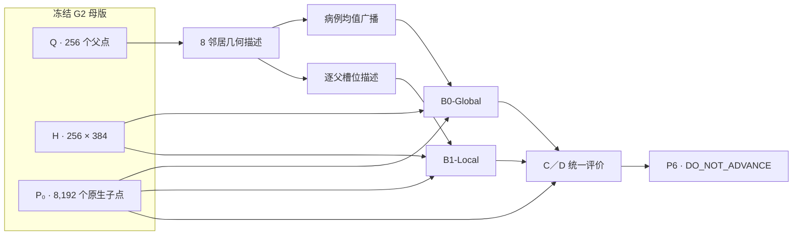

# Cranial-BCSP-FullMamba · BCSP-FCSP 完整实验报告

**报告日期**　2026-11-21（北京时间）  
**实验主题**　固定粗结构条件下的几何感知子点放置  
**最终判定**　`DO_NOT_ADVANCE`，本轮正式收束，B1-Local 未获第二种子验证资格。

## 1. 摘要

本实验检验逐父槽位几何描述能否在固定粗点、父槽位特征与原生密集点的条件下，改善 SkullBreak 颅骨缺损骨块表面的重建。采用固定 FullMamba G2 母版，在 C／D 两个开发折分别训练同容量的 B0-Global 与 B1-Local 残差头。四个头均完成 3,900 步。统一评价包含 210 个开发病例、42 个来源和 630 行模型评分，其中 210 行为共享原生基准 N。

B1 相对 B0 的 E 区条件恢复率仅提高 C 折 **0.23 pp**、D 折 **0.35 pp**，均低于预注册的 **3.0 pp**。D 折 E 区 P95 改善 **0.10 mm**，幅度低于 **0.50 mm** 门槛，同时接口 J 区 Cover@2 下降 **0.68 pp**，超过允许的 **0.50 pp**。B1 相对 N 在两折均改善反向 A2 P95，但 J 区 P95 分别恶化 **0.60 mm** 和 **0.41 mm**，两折均未通过原生基准门槛。评估中两组晋级比较均无新增严重病例。P5 与 P6 冻结审计通过，结论限于本轮冻结母版、固定开发折和 seed0。

## 2. 研究背景、目的与可辨识问题

前一阶段 PCAT 发现，G2 相对 G1 的 E 区条件恢复变化在 C／D 两折分别为 +5.99／−5.54 pp。16 个新增严重病例中有 14 个在粗阶段的 E 区 P95 已退化。这些结果提示粗定位与密展开可能沿不同路径失效。FCSP 固定粗结构，只检验密阶段的子点放置能否提供可复现的收益。 [PCAT 完整报告](../pcat_experiment_report_20261120_v1/Cranial_BCSP_FullMamba_BCSP_PCAT_完整实验报告_zh_v1.md)

实验的主要问题是，**在相同母版和训练预算下，逐父槽位几何描述相对病例均值，能否改善粗点未覆盖的 E 区，并降低 E 区 P95，同时控制接口和远端风险**。另外检查候选能否超过直接使用 G2 的原生输出。对照组同样接收逐父特征 H，因此主比较识别的是**显式逐槽位几何条件相对全局均值的增量**。局部描述的分布变化与几何描述和父槽位的正确对应在这一比较中同时变化，二者各自的贡献仍待区分。

## 3. 数据、对照与实现

### 3.1 数据与配对设计

本轮使用 SkullBreak 的冻结点集。每折包含 **315 个训练病例、63 个训练来源**和 **105 个开发病例、21 个开发来源**，折内训练与开发来源互斥。每个来源含 bilateral、frontoorbital、parietotemporal、random_1、random_2 五种缺损，两折开发来源互斥。C／D 使用各自的 G2 权重与缓存，因此两折代表不同的固定母版与来源组合。训练输入使用 P3 冻结特征，监督使用对应的 8,192 点缺失骨块表面标签。评价沿用残颅建立的归一化坐标，计算距离前转换回世界毫米。开发标签与参考面只在隔离评分阶段读取。 [正式实验协议](../../docs/cranial_bcsp_fcsp_20261120_v2/Cranial_BCSP_FullMamba_BCSP_FCSP_正式实验计划书_审阅修订v2_2026-11-20.md)

| 组别 | 输出 | 用途 |
|---|---|---|
| N | 同一 P3 缓存的原生密点 P₀ | 冻结 G2 原生基准，每病例共享一次 |
| B0-Global | H 与病例内几何描述均值送入残差头 | 同容量、同训练合同的对照 |
| B1-Local | H 与对应父槽位的几何描述送入残差头 | 检验逐槽位显式几何条件 |

### 3.2 特征提取、局部描述和残差约束

固定母版的 Encoder、SPCG Coarse、LQI Decoder 与原 FC 分支。实际 FC 消费者的输入为 H，维度为 **256×384**。每例有 256 个粗父点 Q，每父点对应 32 个原生子点，P₀ 保存为 **256×32×3**。扁平输出采用父槽位优先顺序，第 j 个子点对应父槽位 `j // 32`。P1 验证了生产 FC 消费路径、输出加法和保存顺序。

对各父点从 Q 中排除自身，按平方欧氏距离稳定排序选择 **8 个邻居**。用邻域偏移的均方根尺度归一化相对向量，加入固定的数值稳定项 `1e-6`。几何描述共 10 维，包括相对向量的一阶均值 3 维、二阶矩上三角 6 维及对数尺度 1 维。B0 对这 256 个描述取均值并广播，B1 保留逐槽位对应。描述采用固定坐标轴，欧氏近邻可能跨越颅骨相邻薄层，来源语义与法向未显式编码。

两臂均使用 `Linear(394, 128) → GELU → Linear(128, 96)`，合计 **62,944 个可训练参数**。末层权重和偏置零初始化。各头输出按父槽位还原为 32 个三维偏移，以 `P = P₀ + b_train × tanh(a)` 计算最终密点。每折从 315 份训练缓存中汇集原生父子偏移范数，以 FP64 线性插值求 95% 分位得到 `b_train`，再以冻结的 FP32 字节执行。C 折尺度为 **0.09540301117343965**，D 折为 **0.09741911015971187**。每坐标分量的理论位移上限为 `b_train`，归一化欧氏上限为 `√3 × b_train`，转换到世界毫米时再乘病例尺度。 [残差头实现](../fcsp_isolated_implementation_20261120_v1/bcsp_fcsp_head_v1.py)

### 3.3 阶段记录与训练合同

| 阶段 | 实际执行与核验结果 |
|---|---|
| P0 | 核对两折 G2 权重、实际 FC 接口、原训练损失、Fold C／D 数据及批次清单。 |
| P1／P2 | 人工 CPU 验证覆盖槽位、重复点、Chamfer 有限梯度等 15 项。真实设备上完成 8 次冻结母版前向、4 次 FC 回放和 8 次零头前向。B8 人工压力测试共 2 次头前向、2 次密点损失、2 次反向、0 次更新。 |
| P3 | 实际新增 836 次冻结母版前向，复用 4 份 P1 缓存，得到 840 份缓存。630 份为训练，210 份为开发。开发集 Q 与 P₀ 全部与历史 G2 Native 按槽位逐字节一致。 |
| P4 | C／B0、C／B1、D／B0、D／B1 均完成 3,900 步并冻结。同折初始化文件逐字节一致，病例、批次顺序和学习率逐步一致。 |
| P5 | 两折共 420 次缓存残差头预测，加 210 份 N。完成 630 行 CPU 评分、210 例成对比较和 42 条来源汇总。原生指标逐例重放通过。 |
| P6 | 预注册门槛与来源级 bootstrap 执行完毕。正式只读审计独立复现抽样矩阵、区间、风险转移和判定。 |

训练使用 **seed0、FP32、batch 8、100 轮、每轮 39 批**，每臂 31,200 次病例曝光、300 个尾批丢弃槽位。两臂分别从同折共享初态开始，采用 AdamW（β₁=0.9、β₂=0.999、ε=10⁻⁸、权重衰减 10⁻⁴）、200 步线性 warmup 至 10⁻³、随后余弦衰减至 10⁻⁵，梯度裁剪上限 10。AMP、TF32 和在线增强关闭。损失沿用历史等权双向欧氏 L1 Chamfer，使用绑定的 PyTorch `cdist` 路径。每臂只保存最后一步残差头，不使用开发数据挑选权重。 [P1 冻结审计](../fcsp_P1_preparation_20261120_v1/post_P1_freeze_20261120_v1/formal_p1_freeze_receipt_v1.json) · [P3 历史一致性审计](../fcsp_P3_preparation_20261120_v1/P3_history_consistency_v1/formal_P3_history_consistency_receipt_v1.json)

| 保存权重 | 资源日志耗时（秒） | GPU 峰值占用（MiB） | 实测 checkpoint SHA256 |
|---|---:|---:|---|
| B0_C | 330.95 | 11,812 | `e9135aa79ac6a83e11f9266b24448e8d5c83476a7e738cd23b8675b98374b68b` |
| B1_C | 331.50 | 11,810 | `cfcf3032a012605a9497cb8e89a293051cd047a18266445139668fc70faefa64` |
| B0_D | 335.76 | 11,812 | `5980289c38a07655e68b6584a941c5d5697de61e9c4cdf413307858181cb6ffd` |
| B1_D | 332.15 | 11,810 | `a785f4874f60f222d9bf6b7d3c4b10b87a48bcb310ba8803bf2b527df15df156` |

P5 缓存预测的资源记录覆盖约 **12.79 秒**，GPU 峰值占用 **482 MiB**。该记录包含缓存推理和归档阶段的监测，不能代表 FullMamba 从残颅输入开始的端到端时延。 [C 折训练配对审计](../fcsp_P4_preparation_20261120_v1/B1_C_post_training_freeze_v1/formal_B1_C_post_training_freeze_and_pair_receipt_v1.json) · [D 折训练配对审计](../fcsp_P4_preparation_20261120_v1/B1_D_post_training_freeze_v1/formal_B1_D_post_training_freeze_and_pair_receipt_v1.json) · [P5 预测冻结审计](prediction_post_execution_freeze_v1/formal_prediction_freeze_receipt_v1.json)

## 4. 评价指标与预注册判据

- **正向几何覆盖**　A1 为离散面元中心及面积权重。J 表示缺损骨块与残骨的接口面元，E 为其余面元。分别计算参考面到预测的面积加权 P95 和 Cover@0.5／1／2 mm。Cover@2 表示 2 mm 内被覆盖的参考面面积比例。
- **粗点未覆盖后的恢复**　同一病例所有组共享粗 Q。对 E/J 各区定义 S0 为距 Q 大于 2 mm 的面元。Rec 的分母为 S0 面积，AbsRec 的分母为全区面积，两者的分子均为 S0 中被最终密点覆盖的面积。S0 小于分区面积 1% 时 Rec 在配对中记作缺失。按面元记录粗到密持续覆盖、恢复、丢失和持续未覆盖。
- **反向风险与总体距离**　用 A2 细分参考计算预测到参考的 P95 及距离大于 20 mm 的点比例 far20。以父槽位索引比较父子远端状态。CD-L1 计算预测与冻结 8,192 点 GT 的双向平均欧氏最近邻距离。严重病例定义为 **密 E P95 >20 mm 或 J Cover@2=0**。
- **统计单位**　先计算病例配对差，各来源内对五种缺损等权平均，再在各折内对来源等权。来源级 percentile bootstrap 每折 2,000 次，采用 NumPy 1.26.4 PCG64，折种子为 2026112001、2026112002。区间描述固定母版、固定初态下的开发来源变化。样本级报告只用于定位退化，晋级依据为两折来源级判据。

主比较 B1−B0 的每折门槛为 E Rec ≥+3.0 pp、E AbsRec ≥+2.0 pp、E P95 ≤−0.50 mm，三项各需至少 14/21 来源改善，且 E Rec 至少 17/21 来源可估。相对 N 的 E AbsRec 和 E P95 门槛为 ≥+1.0 pp、≤−0.25 mm。两项比较共用安全门，要求 J P95 ≤+0.25 mm、J Cover@2 ≥−0.50 pp、反向 A2 P95 ≤+0.50 mm、far20 ≤+0.25 pp、零新增严重且评分有限。主比较的强化区间要求 E Rec 95% 下界大于零且 E P95 95% 上界小于零。两折均满足全部条件才可申请第二种子。 [预注册协议](../../docs/cranial_bcsp_fcsp_20261120_v2/Cranial_BCSP_FullMamba_BCSP_FCSP_正式实验计划书_审阅修订v2_2026-11-20.md)

## 5. 实验结果

### 5.1 三组绝对表现

下表按折报告等来源均值。每来源均含五例，且 E Rec 在所有 210 例可估，因此本表的均值与等病例汇总相同。严重列是病例数。

| 折 | 组别 | E Rec（%） | E AbsRec（%） | E P95（mm） | J P95（mm） | J Cover@2（%） | 反向 A2 P95（mm） | far20（%） | CD-L1（mm） | 严重病例／105 |
|---|---|---:|---:|---:|---:|---:|---:|---:|---:|---:|
| C | N | 58.67 | 53.42 | 10.26 | 13.53 | 46.87 | 12.29 | 5.52 | 5.53 | 11 |
| C | B0 | 58.39 | 53.20 | 10.54 | 14.12 | 47.29 | 11.79 | 5.53 | 5.54 | 10 |
| C | B1 | 58.61 | 53.43 | 10.56 | 14.13 | 46.86 | 11.75 | 5.50 | 5.53 | 10 |
| D | N | 58.77 | 54.32 | 7.28 | 9.96 | 51.10 | 10.76 | 2.51 | 3.55 | 9 |
| D | B0 | 58.43 | 53.96 | 7.35 | 10.42 | 50.20 | 9.79 | 2.30 | 3.46 | 9 |
| D | B1 | 58.78 | 54.29 | 7.25 | 10.37 | 49.52 | 9.68 | 2.27 | 3.43 | 9 |

### 5.2 主比较 B1−B0

覆盖和恢复差使用百分点（pp）。表中区间为来源级 95% bootstrap 区间。

| 指标 | Fold C 差值［95% CI］ | Fold D 差值［95% CI］ |
|---|---:|---:|
| E Rec（pp） | +0.226［−0.161, +0.657］ | +0.350［+0.049, +0.683］ |
| E AbsRec（pp） | +0.228［−0.129, +0.622］ | +0.330［+0.045, +0.649］ |
| E P95（mm） | +0.020［−0.107, +0.136］ | −0.103［−0.215, −0.011］ |
| J P95（mm） | +0.006［−0.139, +0.152］ | −0.052［−0.197, +0.075］ |
| J Cover@2（pp） | −0.422［−0.760, −0.138］ | −0.683［−1.071, −0.325］ |
| 反向 A2 P95（mm） | −0.049［−0.139, +0.030］ | −0.107［−0.145, −0.068］ |
| far20（pp） | −0.029［−0.115, +0.057］ | −0.027［−0.060, +0.004］ |
| CD-L1（mm） | −0.012［−0.058, +0.026］ | −0.027［−0.066, −0.002］ |

两折的 E Rec 和 E AbsRec 均仅有 **13/21** 来源改善。E P95 的改善来源数为 **C 9/21、D 14/21**。D 折通过两项强化区间判据，但三项 E 区幅度均未达标，且 J Cover@2 越界。C 折 E P95 点估计方向为恶化，两项强化区间均未通过。

### 5.3 与原生基准的比较及严重病例

| 对照 | 折 | E AbsRec（pp） | E P95（mm） | J P95（mm） | J Cover@2（pp） | 反向 A2 P95（mm） | far20（pp） | 新增／解除严重 |
|---|---|---:|---:|---:|---:|---:|---:|---:|
| B1−N | C | +0.008 | +0.305 | +0.601 | −0.007 | −0.548 | −0.012 | 0／1 |
| B1−N | D | −0.033 | −0.027 | +0.410 | −1.587 | −1.073 | −0.238 | 0／0 |
| B0−N | C | −0.221 | +0.285 | +0.595 | +0.415 | −0.499 | +0.017 | 0／1 |
| B0−N | D | −0.362 | +0.076 | +0.462 | −0.904 | −0.966 | −0.211 | 0／0 |

B1−B0 在两折均无新增或解除严重病例。两臂相对 N 的反向 P95 改善，C／D 四个比较的 95% 区间均低于零。与此同时，两臂相对 N 的 J P95 在两折均恶化，四个区间均高于零。D 折 B1−N 的 CD-L1 改善 **0.116 mm**，J Cover@2 却下降 **1.587 pp**。该组合表明，点级平均距离的改善可以与接口覆盖损失同时存在。

**P6 判定**　C 和 D 均未通过 B1−B0 主门及 B1−N 原生基准门，故 **`DO_NOT_ADVANCE`**。D 折区间改善证据保留，第二种子验证的晋级条件仍未满足。 [P6 全量效应量和门槛](P6_preregistered_decision_v1/P6_decision.json) · [P6 正式冻结审计](P6_formal_read_only_freeze_audit_v1.json) · [本轮收束记录](FCSP_current_round_closure_v1.json)

## 6. 结果分析与问题

### 6.1 共同残差路径产生了可复现的方向性取舍

B0 和 B1 都改善了反向 P95，也都恶化了相对 N 的 J P95。该模式在两个折中重复，说明将预测子点向更近的参考区域移动，与将参考接口面完整覆盖，是两个需要分别约束的目标。B0−N 已呈现这一模式，支持共同残差路径及训练目标在其中发挥作用。B1−B0 的小幅变化表明，当前局部描述只提供有限的额外收益。由于训练优化的是双向 Chamfer，接口面积加权覆盖未进入训练目标，损失和评价之间的差异是可检验的机制假设。仅凭本轮结果还无法把接口退化归因于某个具体层、邻居或位移方向。

### 6.2 匹配安全阈值与极端病例仍需同时审查

零新增严重表示没有跨越本轮定义的二值风险线，尺寸较小的局部退化仍可出现。D 折 B1−B0 中，`train__029__frontoorbital` 的 J Cover@2 下降 **5.79 pp**。相对原生输出，D 折 `train__022__random_1` 的 J Cover@2 下降 **17.95 pp**，B0 也下降 **16.42 pp**。C 折 `train__036__bilateral` 相对 N 的 J P95 在 B0、B1 分别增加 **7.87 mm**、**8.02 mm**。这些极端值来自冻结评分的最差病例条目，适合定位问题区域。当前报告未追加可视化，空间位置与局部结构机制尚未核验。 [病例和风险明细](unified_cpu_scores_v1/paired_cases.jsonl) · [P6 最差病例记录](P6_preregistered_decision_v1/P6_decision.json)

### 6.3 位移上限约束了少数病例，整体表现还受其他环节影响

依据原生 P₀ 与世界坐标位移上界推导的乐观 S0 可达比例，E 区病例均值在 C／D 折分别为 **96.40%／98.93%**，而最低值分别为 **0%／76.39%**。J 区均值为 **95.48%／97.50%**，最低值为 **0%／49.43%**。这些是从冻结 P5 病例字段直接汇总的可达上界。它只要求附近存在一定范围内的原生子点，未考虑一个子点无法同时覆盖多个位置、实际轴向空间和模型表达约束。C 折最低值表明，部分病例的该区未覆盖表面完全落在本头理论可达范围外。

420 份残差头预测中，记录到的 `abs(tanh(a)) ≥0.99` 分量比例均为零。这表明在该定义下没有明显的输出饱和。结合总体乐观可达比例较高、实测额外恢复仍小，扩大残差上限缺少全折证据。固定母版偏位、局部特征冗余、邻域跨层及损失与接口度量不一致，仍是需要通过定向对照区分的解释。 [冻结病例评分](unified_cpu_scores_v1/case_metrics.jsonl)

### 6.4 工程问题与证据边界

- **平台字节差异。** Windows 内的人工邻居索引曾默认生成 `int32`，而 P3 缓存合同要求 `int64`。修复人工样例后 P4 CPU 合同通过。Windows 与 Linux/PyTorch 的 seed0 初态指纹也曾不一致，配对准入采用冻结 Linux 训练环境实测指纹。B0_D/B1_D 与 B0_C/B1_C 均通过折内初态、尺度和完整批次配对审计。
- **单种子和固定开发来源。** 两折可检视方向一致性，训练只使用一个残差头种子，母版本身也固定。区间反映这批开发来源的变化，无法用于声称多种子稳定性、独立确认集泛化或临床非劣性。
- **评价对象是点云表面。** 当前 J 指标来自 SkullBreak 的合成缺损面元。输出没有直接量化植入实体厚度、与残骨穿插、装配间隙或临床表现。
- **接口改动的辨识范围。** B1 同时改变了输入几何向量的病例内分布与槽位对应，现有配对无法单独识别两者的贡献。可选的端到端回读与错配干预未执行，本轮证据来自绑定的缓存路径。

## 7. 下一阶段建议

1. **先用原产物做有限的误差归因。** 固定预注册的 PCAT 病例与 C17／D41 压力病例，叠加 Q、N、B0 和 B1 的父子槽位轨迹，以同一世界尺度展示 E/J 面元。将 J 覆盖损失分解为原生已覆盖面元流失、候选新覆盖，以及与远端点回收同时发生的位移。将案例结论与折内分布并列，避免用少数病例推导全折机制。
2. **粗定位失效与密展开失效分开处理。** 先用冻结 Q 和 N 的可达上界查找在理论位移范围外的病例，作为粗定位评估对象。再在粗定位相对稳定、接口面理论可达的病例中检验局部表面结构是否在条件构造或密展开中丢失。开发病例分层只用于诊断，后续主检验仍应保留完整病例集。
3. **新模块先写可证伪的接口假设。** 若可视化与分层共同显示，预测点向主体表面收缩时反复丢失 J 的原生覆盖，再考虑仅从残颅或内部特征可取得的接触支持条件。预注册单一改动、同容量对照、原生锚点和风险边界，并用人工薄层测试检验是否跨表面混合。J 评估标签保留在评价端，避免通过标签构造推理条件。
4. **将计算资源从 FCSP 第二种子转向明确的机制问题。** 当前 B1 未通过晋级门。若后续提出新假设，先在开发条件下检验最小因果对照，证明实际收益与接口安全一致后，再开展第二种子及独立确认、SkullFix 迁移或同协议方法基线。

## 8. 复核入口

| 资产 | 核验用途 |
|---|---|
| [P3 正式冻结审计](../fcsp_P3_preparation_20261120_v1/post_P3_freeze_audit_v1/formal_post_P3_freeze_receipt_v1.json) | 缓存 840 条、共享基准与前向计数 |
| [P5 正式评分审计](P5_formal_scoring_freeze_receipt_v1.json) | 630 行评分、210 病例配对和 42 来源汇总 |
| [P6 判定、效应量与风险](P6_preregistered_decision_v1/P6_decision.json) | 各折、各比较的点估计、区间和逐项门槛 |
| [P6 产物清单](P6_preregistered_decision_v1/artifact_manifest.json) | 判定文件和来源抽样矩阵的大小与 SHA256 |
| [P6 实现](fcsp_p6_preregistered_decision_v1.py) | 统计、抽样矩阵生成和判门 |
| [正式收束记录](FCSP_current_round_closure_v1.json) | 本轮完成状态及未晋级决策 |

报告使用冻结产物和从保存的病例字段直接求得的描述统计。没有重跑模型、重新评分或修改既有判定。
