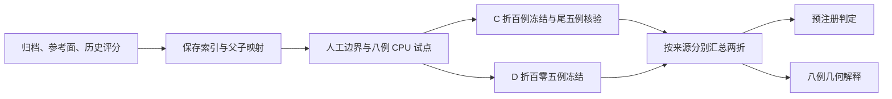

# Cranial-BCSP-FullMamba · BCSP-PCAT 完整实验报告

**父子点覆盖归因与尾部失效分流**  
报告版本 v1 · 2026-11-20 · 实验已收束

## 摘要

BCSP-PCAT 承接 BCSP-SPCG 和 BCSP-CIUA 的开发集诊断。既有结果显示，G2 相对 G1 的粗点云 E 区 P95 在两折均下降，但密点云 E 区 P95 在两折均上升。本研究检验其中一个可计算的几何解释：共同粗未覆盖区的后续恢复是否减少，同时更多父组是否集中支持相同表面。研究复用 SkullBreak 开发集 C、D 两折的 210 个配对病例和 420 份原生预测，追溯 256 个粗点至 8,192 个密点的确切输出索引，计算分区面积覆盖、父组重叠及远端父子转移，并按颅骨来源进行折内配对统计。

C／D 折共同粗未覆盖区的 E 区密阶段恢复差分别为 **+5.99／−5.54 个百分点**，全 E 区多父支持差为 **+4.95／−5.11 个百分点**。共同粗密覆盖区内的多父支持差在两折为正，折算到全 E 区仅为 **+0.0240／+0.0165 个百分点**。两折未同时满足预注册的恢复下降与重叠增加条件，正式判定为 `NO_STABLE_ALLOCATION_SIGNAL`。G2 新增的 16 个严重病例中，14 个在粗阶段的 E 区 P95 已较 G1 变差。余下两个 D 折病例在粗 P95 改善后，仍发生明显的密阶段漏覆盖。结果支持按失效阶段分流，目前不支持优先开展可变子点配额训练。全部工作在本机离线进行，新增模型前向、训练和权重加载均为零。[^summary][^closure]

## 🎯 研究背景与实验目的

SkullBreak BCSP Geo-V1 的任务是由残骨组织完整边界预测缺失实体骨块的完整边界。目标的 **E 区**是骨块从完整骨组织继承的自由表面，**J 区**是合成切除产生的共享切壁。E 区评估骨块主体几何覆盖，J 区评估与残骨接合部相关的表面覆盖。两者均为合成缺损上的几何量。

SPCG 的 G1、G2 都使用固定 Sobol 探针和直接生成粗点的头。G1 汇聚全部 256 个 Memory 槽位，G2 使用探针周围 8 个 Memory 槽位。两臂分别训练，PCAT 只分析其冻结输出。前序 CIUA 发现冻结特征含有可读的空间信息，但所试读出未达到相对原生粗点联合改善的门槛。后续粗密阶段复核发现，来源等权 E 区 P95 差在 C 折由粗阶段的 −1.43 mm 变为密阶段的 +1.53 mm，在 D 折由 −2.31 mm 变为 +1.87 mm。该现象为考察粗输出之后发生的几何变化提供了依据。[^spcg][^ciua][^history]

本轮固定三个问题。

1. **恢复是否下降。** 在 G1、G2 粗阶段均未覆盖的同一块参考面上，G2 的密阶段恢复是否较少，并在两折复现。
2. **已有覆盖是否出现更多多父重叠。** 同一参考面元能否被多个坐标父组的子点同时支持，以及共同已覆盖区域上的重叠变化是否与恢复下降同时出现。
3. **严重尾部首先在哪里显现。** 区分粗阶段已退化、粗 P95 未退化但密阶段覆盖变差、远端子点随父点偏移，以及远端子点出现在近父组等观察。[^protocol]

## 🧪 实验对象、资产与执行

| 项目 | 本轮范围 |
|---|---|
| 数据范围 | SkullBreak BCSP Geo-V1 的 C／D 开发集，各 21 个来源、105 例，两折开发来源互斥 |
| 缺损类型 | bilateral、frontoorbital、parietotemporal、random_1、random_2，每来源各一例 |
| 对照 | 同病例的 G1 与 G2 原生预测，合计 210 个病例对、420 份 Q／P 预测、840 个阶段点集 |
| 保存张量 | 每份预测 Q 为 256×3，P 为 8,192×3，每个坐标父槽位对应 32 个子点 |
| 归因规模 | 每折 53,760 个父组，合计 107,520 个父组，组级面积分摊保存在逐例记录内 |
| 执行范围 | 本机 CPU 离线几何计算，沿用既有归一化、原生预测和参考面。模型前向、训练、GPU、权重加载、配准、确认集访问均为零 |

四个模型权重的身份通过历史请求与预测档案绑定。本轮核对了预测成员、原评分、参考文件、目标点集和坐标口径。归一化坐标按残骨 D-only 的中心与尺度还原到世界毫米，参考面保持原位。原生保存路径的静态追溯覆盖 Decoder 序列重排及逆排、FC 入口槽位、相对偏移与 Q 相加、父维优先扁平化和 NPZ 写入。按从零开始的保存行号，父 ID 为 `p_index // 32`，父内子 ID 为 `p_index % 32`。用非自逆排列与双标签哨兵核对索引，故意交换父组验证能发现错配。父索引证明来自实际绑定的保存链和静态／人工验证，未采集真实运行的中间张量。[^assets]

## 📐 几何指标与统计方法

### 参考面与距离

- **A1 主参考面**使用原有面元中心、面积权重和 E/J 标签。对每个面元计算至 Q 或 P 的精确最近邻距离。Cover@2 的阈值为 ≤2 mm，P95 按 FP64 面积权重和历史稳定排序规则计算。0.5 mm 与 1 mm 覆盖保留为辅助值。
- **A2 敏感性参考**把每个 A1 面元权重均分给四个子参考位置。用它复核前向 2 mm 覆盖方向，同时用预测点到离散 A2 的距离计算反向 P95、离群和远端转移。
- **辅助参考**保留 B 的整体几何结果与历史 GT8192 的 CD-L1。参考源和距离方向在结果解释中分别注明。[^protocol]

### 支持集合与父组足迹

对于 E 或 J 分区 T，记面元面积和为 `w(·)`，区域总面积为 `W_T`。以两臂粗覆盖二值组合划分出四个共同层 S00、S01、S10、S11。S00 是两臂均未粗覆盖的区域，S11 是两臂均已粗覆盖的区域。对于同一臂另将面元分为持续覆盖、密阶段恢复、密阶段丢失和两阶段均漏覆盖，核验四份面积之和，以及“密覆盖减粗覆盖等于恢复减丢失”。

| 指标 | 定义及作用 |
|---|---|
| `Δ00,T` | `[w(S00∩P覆盖_G2) − w(S00∩P覆盖_G1)] / w(S00)`。共同区域小于 T 面积 1% 时条件率成对记缺失 |
| `Δabs00,T` | 与上项同一分子，以整个 T 面积分母计算，保留全部病例 |
| `ΔM_T` | 整个 T 区至少由两个不同父组支持的面积比例差。全区覆盖扩张时此量也可能增加 |
| `ΔM_shared,T` | 只在 S11 内且两臂均有密支持的同一面元上比较多父支持，差值仍用全 T 面积归一。另报告这块共同区域的面积和条件差 |

父组足迹由该组 32 个子点的 2 mm 支持并集组成。同父多个子点命中同一面元只计一次。若面元有 `n` 个不同父组支持，则向每组分摊 `1/n` 的面积。分别记录无支持、单父支持、多父支持和独占面积，核验父支持并集等于直接 P 覆盖、父分摊之和等于密阶段支持面积。采用分块 KD 树，避免构造参考面元与全部密点的完整距离矩阵。父组是坐标展开中的槽位，面积归属只描述已生成点的几何关系。[^protocol][^pilot]

### 远端、严重标签与来源级统计

父点和子点到离散 A2 参考的距离均以 **>20 mm** 为远端，四格转移比例分别用全部 8,192 个子点作分母。原严重规则固定为 **密 E P95 >20 mm 或密 J Cover@2 = 0**。同时保留原质心偏移和回转半径比标签。

所有差值为 **G2−G1**。全区分母指标在每颅骨来源内等权平均五种缺损，再对折内 21 个来源等权。条件率对共同可估病例作来源内平均，按可估来源汇总。两折 E/J 主条件率均为 105 例、21 个来源可估。来源级 percentile 95% bootstrap 使用 NumPy 1.26.4、PCG64、每折 2,000 次，C／D 种子 2026111901／2026111902。固定来源排序并保存抽样索引。区间描述已观察来源的变异，未纳入重训方差。

压力病例按既有 E 区 P95 选取。粗差值 ≤10⁻⁹ mm 且密差值 >10⁻⁹ mm 时归为“粗未变差、密变差”。比例量的方向计数使用 10⁻¹² 零差口径。严重转移和压力分层供描述，预注册投入判定以两折全量结果为准。[^protocol][^summary]

## 🛠️ 实施记录与完整性

| 阶段 | 完成内容与关键证据 |
|---|---|
| P0／P1 只读核对 | 确认四个 G1/G2 运行的预测和保存链，核实每折 105 例、C17/D41 反转病例、C9/D7 新增严重病例，冻结父映射 |
| P2／P3 人工与试点 | 验证 2 mm 边界、同父去重、错索引区分、父支持并集、面积守恒和空条件率。8 例正式审计复核 16 预测、32 阶段和 4,096 父组 |
| 距离复用等价性 | 同一批 8 例在复用 A1/A2 正反距离后，除耗时字段外保存结果完全一致。墙钟由 73.219 s 降至 43.407 s，降低 40.7% |
| P4 C 折 | 20 分钟单次尝试超时。正式失败冻结审计确认前 100 例具备完整写入证据，最后五例均为来源 107 的固定缺损。另行授权补算五例并独立复核，按原顺序原字节合并为 105 例，无重叠 |
| P4 D 折 | 结合参考面规模重估后采用 30 分钟上限，实际进程约 579.09 s、退出码为 0。正式审计核验 105 例、210 预测、53,760 父组、3,781 条资源样本，采样峰值 RSS 约 294 MiB |
| P5／P6 汇总与收束 | 核验 210 个病例对、42 个来源行、统计与抽样矩阵，完成八例图示复核、结果冻结和正式判定 |

C 折前缀和 D 折全量冻结审计复核了绑定哈希、历史评分、风险标签及已保存的面积和分摊算术。独立几何重算覆盖试点与 C 折五例补算审计，末阶段八例另核对 E/J P95、覆盖掩码和远端计数。全量冻结审计未逐例独立重跑最近邻搜索。原 C 折超时回执保留，其前缀只在核验后与单独版本的尾部结果合并。[^pilot][^reuse][^ctimeout][^ctail][^cmerge][^dfreeze]

## 📊 全量结果与预注册判定

### 共同未覆盖区恢复与多父重叠

表中数值为来源等权均值，方括号为来源级 95% bootstrap 区间，单位为百分点。

| E 区指标 | Fold C | Fold D |
|---|---:|---:|
| 共同粗未覆盖条件恢复 `Δ00,E` | **+5.99** [ +0.96，+10.76 ] | **−5.54** [ −7.83，−3.07 ] |
| 全区分母恢复 `Δabs00,E` | +5.00 [ +0.61，+9.21 ] | −4.82 [ −6.86，−2.66 ] |
| 全区多父支持 `ΔM_E` | **+4.95** [ +0.76，+8.90 ] | **−5.11** [ −6.95，−3.11 ] |
| 对齐共同覆盖多父支持 `ΔM_shared,E` | +0.0240 [ +0.0136，+0.0346 ] | +0.0165 [ +0.0100，+0.0235 ] |

| 预先冻结的跨折通过条件 | Fold C | Fold D |
|---|---:|---:|
| 每折至少 17/21 来源可估条件恢复 | 21/21，通过 | 21/21，通过 |
| 条件恢复 ≤−3 pp，且至少 14/21 来源为负 | +5.99 pp，6/21 为负，未通过 | −5.54 pp，18/21 为负，通过 |
| 全区分母恢复为负 | +5.00 pp，未通过 | −4.82 pp，通过 |
| 全区多父支持 ≥+3 pp，且至少 14/21 来源为正 | +4.95 pp，15/21 为正，通过 | −5.11 pp，2/21 为正，未通过 |
| 对齐共同覆盖多父支持为正 | 通过 | 通过 |

C 折多父支持面积增加的同时，密阶段恢复也增加。D 折密阶段恢复减少的同时，全区多父支持面积也减少。对齐后的共同粗密 E 覆盖区域本身仅占全 E 区约 0.61%／0.69%。在其可估病例上以共同区为分母，条件重叠差为 C 折 +1.19 pp（94 例，区间跨零）和 D 折 +3.73 pp（102 例）。该局部变化可与 D 折的全区重叠下降同时存在。全量结果没有达到预注册组合判据，状态为 **`NO_STABLE_ALLOCATION_SIGNAL`**。[^summary]

### E／J 覆盖、距离与方向敏感性

| 辅助结果，G2−G1 | Fold C | Fold D |
|---|---:|---:|
| E P95，粗 → 密阶段的配对差（mm） | −1.43 → +1.53 | −2.31 → +1.87 |
| J P95，粗 → 密阶段的配对差（mm） | −2.10 → +1.93 | −3.54 → +2.23 |
| 密 E／J Cover@2（pp） | +6.52／+7.02 | −4.77／+0.38 |
| J 共同粗未覆盖条件恢复（pp） | +6.60 [ +2.05，+11.63 ] | −0.43 [ −2.91，+2.18 ] |
| J 全区分母恢复（pp） | +5.71 | −0.37 |
| J 全区／对齐共同覆盖多父支持（pp） | +5.77／+0.0103 | −0.15／−0.0007 |
| 密 CD-L1（mm） | +0.50 [ −1.97，+3.39 ] | +0.51 [ +0.15，+0.96 ] |

两折密 E、J P95 的点估计均变差，D 折的 E、J 区间分别为 [ +1.00，+2.82 ] mm 和 [ +1.20，+3.39 ] mm，C 折两项区间跨零。C 折的 2 mm 覆盖提高而 P95 上升，说明阈值内获益可与远离参考面的剩余漏覆盖并存。D 折切壁平均 Cover@2 变化接近零，J 区 P95 仍上升，因此整体、接口和尾部应分别评价。

换用 A2 后，E 条件恢复为 +5.98／−5.54 pp，J 为 +6.59／−0.44 pp。逐一剔除单来源后，E 条件恢复范围仍为 C 折 [+4.87，+6.94] pp 和 D 折 [−6.28，−5.01] pp。J 的 D 折结论对来源有所敏感，范围为 [−1.07，+0.12] pp。按缺损类型描述时，E 条件恢复在 parietotemporal 的两折为 +19.80／+1.83 pp，而 random_1 为 −4.27／−6.70 pp。类型分层保留异质性线索，未作为筛病例或改变门槛的依据。[^summary]

### 压力分层与严重尾部

| 粗／密 E P95 相对变化 | Fold C | Fold D |
|---|---:|---:|
| 粗未变差、密未变差 | 52 | 37 |
| 粗未变差、密变差 | **17** | **41** |
| 粗变差、密未变差 | 1 | 1 |
| 粗变差、密变差 | 35 | 26 |
| 新增严重／挽回／共同严重／均非严重 | **9／4／2／90** | **7／0／2／96** |

压力组内 E 条件恢复差为 C17 的 −2.24 pp 和 D41 的 −9.86 pp，全 E 多父支持差分别为 −1.88 和 −7.77 pp。对应非压力集合的 E 条件恢复差为 +7.72 和 −4.25 pp。压力组以既有密 E 回退筛选，C 折压力组的负向恢复与全折的正向恢复可同时成立。D 折压力组中仅两例属于新增严重，C 折压力组没有新增严重。其余 14/16 个新增严重病例粗阶段 E P95 已相对变差。

| A2 反向远端辅助量，G2−G1 | Fold C | Fold D |
|---|---:|---:|
| 近父／近子比例（pp） | +3.356 | −0.707 |
| 近父／远子比例（pp） | −0.086 | −0.056 |
| 远父／近子比例（pp） | −2.650 | +0.104 |
| 远父／远子比例（pp） | −0.620 | +0.658 |
| 全部远端子点比例（pp） | −0.706 | +0.603 |
| 密输出到 A2 的反向 P95（mm） | −0.79 [ −4.58，+3.00 ] | +2.32 [ +1.23，+3.60 ] |

近父／远子比例的折内均值均未增加，二者的区间均跨零。D 折反向 P95 恶化清楚可见，但父组转移与个例表明远端点只能解释部分尾部。严重标签、远端比例和反向 P95 的定义不同，应保留各自数值。[^summary]

## 🔎 固定病例几何复核

图例按预定规则选取。每折包含压力组密 E P95 回退最大的两例、全折新增严重中回退最大的一例以及非压力集合字典序首例，去重后共 8 例。双臂共用世界坐标全景，保留全部预测点和远端点。局部图显示 E 与 J 面元的保留、恢复、丢失及两阶段均漏覆盖，面积计算沿用 A1 加权口径。以下链接给出两臂对照和具体分区。

| 病例 | 粗 E P95 G1→G2（mm） | 密 E P95 G1→G2（mm） | 几何观察 |
|---|---:|---:|---|
| [C · 107 bilateral](../pcat_P5_closure_20261120_v1/C__train__107__bilateral.png) | 25.26→23.39 | 8.65→13.53 | 双臂均无远端子点，G2 的 E/J 密覆盖率均下降 |
| [C · 076 frontoorbital](../pcat_P5_closure_20261120_v1/C__train__076__frontoorbital.png) | 13.57→10.57 | 4.07→6.78 | E/J 密 Cover@2 增加 11.66／13.22 pp，P95 同时上升 |
| [C · 051 random_1](../pcat_P5_closure_20261120_v1/C__train__051__random_1.png) | 24.88→96.87 | 9.56→88.56 | G2 有 253/256 个远父。8,140 个远子中 8,061 个来自远父，E/J 粗密 Cover@2 均为零 |
| [C · 001 bilateral](../pcat_P5_closure_20261120_v1/C__train__001__bilateral.png) | 9.79→6.94 | 4.13→2.71 | 固定对照，E/J 密 Cover@2 同时改善 |
| [D · 008 bilateral](../pcat_P5_closure_20261120_v1/D__train__008__bilateral.png) | 33.29→30.21 | 10.19→22.25 | 新增严重。共同粗未覆盖 E 区恢复低 9.54 pp，G2 有 83 个远子，其中 49 个来自远父 |
| [D · 069 random_2](../pcat_P5_closure_20261120_v1/D__train__069__random_2.png) | 41.34→32.25 | 15.17→25.04 | 新增严重。共同粗未覆盖 E 区恢复低 9.64 pp，G2 仅有 1 个远子 |
| [D · 008 random_2](../pcat_P5_closure_20261120_v1/D__train__008__random_2.png) | 25.98→46.65 | 5.31→35.56 | 粗阶段已经变差，E/J 密覆盖同步下降，两臂均无远子 |
| [D · 004 bilateral](../pcat_P5_closure_20261120_v1/D__train__004__bilateral.png) | 6.95→6.57 | 3.53→2.78 | 固定对照，E 密覆盖提高，J 密覆盖由 78.49% 降至 73.40% |

D 折两个粗 P95 改善但密阶段新增严重的病例，其 G2 粗已覆盖而密阶段丢失的 E 面积分别只占全 E 的 0.08% 和 0.16%。对照共同 S00 恢复结果可见，这两例主要差异是原有空缺未得到补齐。粗 P95 改善只描述一个距离分位数，两例的粗 Cover@2 仍低。C · 051 则提供了粗点已整体远离目标的明确实例。8 例的数量、图表哈希和 64 个掩码经过核查。[^closure]

## 💡 结果解释、出现的问题与局限

1. **重叠指标受覆盖范围和分母影响。** 全 E 多父面积随覆盖范围共同变化。C 折多父支持扩大同时补到了更多空缺，D 折全区多父支持和恢复同时收缩。共同已覆盖区域的局部重叠增量很小，其全区贡献无法单独解释折内恢复规模。现有诊断不支持把父组重叠直接作为低效配额的代理。
2. **严重病例存在两条失效路径。** 多数新增严重病例粗 E P95 已落后，其中有整体偏离，也有远端率为零的局部支持不足。少数病例在粗 P95 改善后仍漏覆盖，说明粗位置与分布改善无法自动保证密展开有效。D · 069 的结果给出了优先检查子点空间放置的理由。
3. **无法由分别训练的整模输出定位因果模块。** G1 与 G2 的条件汇聚不同，训练后粗坐标、隐藏状态和展开输出可以一起变化。已验证父映射只说明保存子点加到哪个 Q 槽位。父组支持、分摊和远端计数不能测得特征因果贡献，也不能预测改动一个父组预算后模型会怎样响应。
4. **交叉分区风险与外部有效性仍需验证。** E 与 J 指标可分离，开发来源虽在两折互斥，训练来源仍有重叠。来源 bootstrap 未覆盖随机种子间波动。病例图含结局选择，适合机制排查。SkullBreak 合成切壁上的结果只支持该任务范围内的几何解释，临床设计还需要独立评价。
5. **工程问题是运行预算外推不足。** 八例距离复用验证说明实现提速且输出等价，试点仍低估 C 折耗时，实际最慢病例约 27.73 s。C 折超时依靠可核验前缀、独立尾部尝试和确定性合并恢复完整性。D 折按参考面规模调整预算，在实际资源条件下提早结束。今后预算应纳入面元数量与难例计时，优先保留逐例落盘和可审计分段。此次修订限定在执行预算及补算范围，纳入统计的病例、分区、阈值和模型输出沿用原协议。[^summary][^ctimeout][^ctail][^dfreeze]

## 🧭 下一阶段建议

**收束 PCAT，保留阴性判定和诊断资产。** 不将可变父组配额作为下一轮的默认投入方向。保留 G1/G2 原生预测、父子索引、两折冻结结果和病例图，供后续新假设使用。PCAT 作为离线诊断没有产生新 checkpoint。

| 顺序 | 建议的最小研究问题 | 设计与裁决 |
|---|---|---|
| 1 | 同一粗坐标和输入条件下，仅改子点的空间放置，能否补到更多共同空缺 | 首先选定单一候选。保持 256 个 Q、每父 32 子点、总输出 8,192、展开输入条件、训练数据与损失一致。若需训练，先定义同一冻结粗阶段及进入展开的特征，并设置配对对照 |
| 2 | 观察到的恢复增益在两折是否稳定，且未换来接口和远端风险 | 预先冻结病例范围和来源级配对统计。以同 Q 下的 S00 恢复和全 E 分母变化为主，联合检查 E P95、J Cover@2、J P95、反向 P95、20 mm 远端比例和新增严重病例。事前设定最小获益及风险容忍边界 |
| 3 | 仍存在的粗阶段失败是否需要独立处理 | 对明确粗偏位病例建立单独的空间定位假设和停止条件。固定粗点实验的结果仅用于裁决密阶段的可改空间。保持已知尾例用于解释，将确认性样本范围另外冻结 |

下一阶段若做几何干预，应保证模型推理仅使用残骨及可用内部信号。参考骨块和 GT 切壁只用于监督及离线评分。只有在折间方向一致、切壁与尾部风险处于预注册边界之内时，再考虑扩展数据或增加训练规模。

## 📁 可复核资产与冻结记录

| 证据 | 用途 |
|---|---|
| [正式计划 v2][protocol] · [P0/P1 准入回执][assets] · [父映射](../pcat_P0_P1_readonly_20261119_v1/parent_id_v1.json) | 研究范围、阈值、父子映射 |
| [试点冻结回执][pilot] · [距离复用等价性及预算记录][reuse] | 试点通过、历史指标复现与加速证据 |
| [C 折失败前缀审计][ctimeout] · [尾五例冻结][ctail] · [C 折合并回执][cmerge] · [D 折冻结回执][dfreeze] | 全量计算的病例覆盖、退出、写入及哈希证据 |
| [两折汇总][summary] · [逐病例配对 CSV](../pcat_P5_paired_summary_20261119_v1/case_pairs_v1.csv) · [逐来源配对 CSV](../pcat_P5_paired_summary_20261119_v1/source_pairs_v1.csv) · [抽样索引](../pcat_P5_paired_summary_20261119_v1/bootstrap_indices_v1.npz) | 均值、区间、分层和预注册判定 |
| [正式收束记录][closure] · [几何复核逐例数值](../pcat_P5_closure_20261120_v1/fixed_case_review_v1.json) · [几何掩码](../pcat_P5_closure_20261120_v1/selected_masks_v1.npz) · [收束冻结清单](../pcat_P5_closure_20261120_v1/closure_freeze_v1.json) | 图例索引、数据证据和收束决定 |

两折汇总 SHA256 为 `fd00c6e70f28ba065ed52e3073350754b8dac5efa18e61bb59136d8d49016f16`，收束冻结清单 SHA256 为 `3e4807a5a58451c545d895acf49554c974b61c639cc1bcedb4079d91b0fb6103`。

[protocol]: ../../docs/cranial_bcsp_pcat_20261119_v2/Cranial_BCSP_FullMamba_BCSP_PCAT_正式实验计划书_审阅修订v2_2026-11-19.md
[assets]: ../pcat_P0_P1_readonly_20261119_v1/audit_receipt_v1.json
[pilot]: ../pcat_P2_P3_pilot_20261119_v1/formal_pilot_freeze_v1.json
[reuse]: ../pcat_P2_P3_pilot_20261119_v1/distance_reuse_and_full_budget_freeze_v2.json
[ctimeout]: ../pcat_P4_full_C_20261119_v1/fold_C_timeout_formal_freeze_v1.json
[ctail]: ../pcat_P4_full_C_20261119_v1/tail5_supplement_v1/tail5_formal_freeze_v1.json
[cmerge]: ../pcat_P4_full_C_20261119_v1/fold_C_merged_v1/merge_receipt_v1.json
[dfreeze]: ../pcat_P4_full_D_20261119_v1/fold_D_formal_freeze_v1.json
[summary]: ../pcat_P5_paired_summary_20261119_v1/paired_summary_v1.json
[closure]: ../pcat_P5_closure_20261120_v1/PCAT_病例几何复核与收束记录_2026-11-20.md

[^protocol]: [BCSP-PCAT 正式预注册计划 v2][protocol]。
[^spcg]: [BCSP-SPCG 完整实验报告](../spcg_experiment_report_20261117_v1/Cranial_BCSP_FullMamba_BCSP_SPCG_完整实验报告_zh_v1.md)。
[^ciua]: [BCSP-CIUA 完整实验报告](../ciua_experiment_report_20261118_v1/Cranial_BCSP_FullMamba_BCSP_CIUA_完整实验报告_zh_v1.md)。
[^history]: [既有两折全量粗密复核](../coarse_dense_full_review_20261118_v1/两折全量粗点云误差复核_zh_v1.md)。
[^assets]: [本机资产及父索引审计][assets]。
[^pilot]: [8 例试点冻结回执][pilot]。
[^reuse]: [同批 8 例距离复用等价性及预算冻结][reuse]。
[^ctimeout]: [C 折超时后前缀冻结审计][ctimeout]。
[^ctail]: [C 折独立补算五例冻结回执][ctail]。
[^cmerge]: [C 折 105 例无重叠合并冻结][cmerge]。
[^dfreeze]: [D 折 105 例正式冻结审计][dfreeze]及[原执行退出回执](../pcat_P4_full_D_20261119_v1/fold_D_exit_receipt_v1.json)。
[^summary]: [C／D 冻结来源统计与程序判定][summary]。
[^closure]: [8 例复核与正式收束][closure]。
