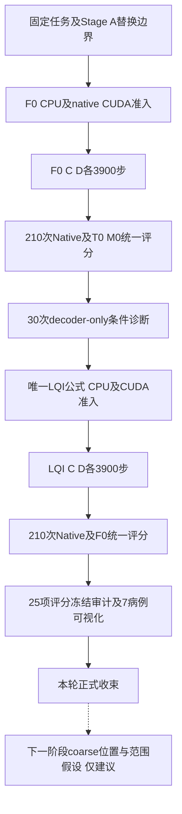
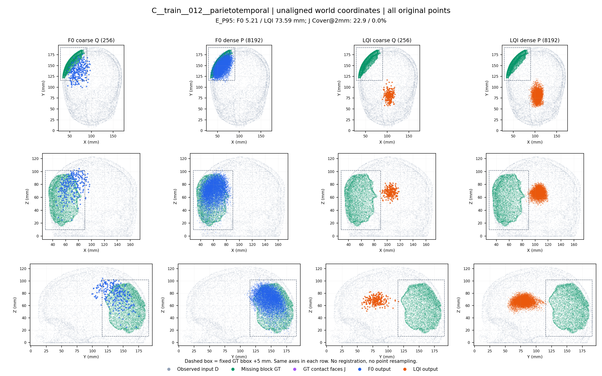
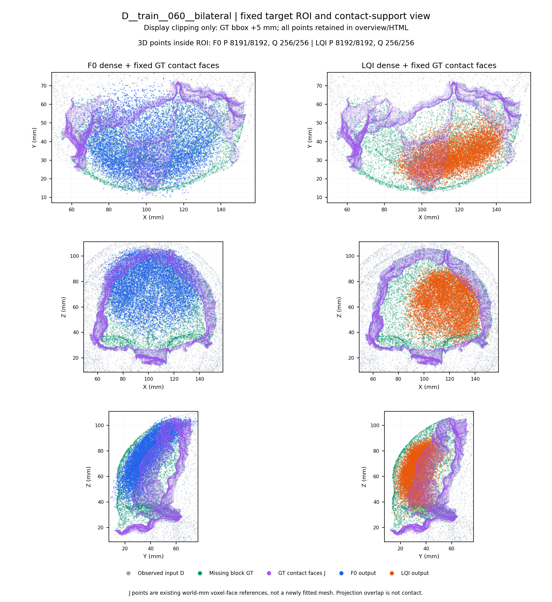

# Cranial-BCSP-FullMamba 本轮完整实验报告

**版本：v1.0｜编制与正式收束日期：2026-11-12（Asia/Shanghai）｜科研执行证据主要形成于2026-11-10—11。**

**本轮状态：科研执行阶段已完成并正式收束。F0是可运行、存在明确弱点的全Mamba基线；LQI是取得部分收益但尚未稳定胜出的修订候选。本轮不再以修补名义自动追加实验。**

本报告依据本机已冻结的源码、运行记录、正式审计及预测／评分元数据编制。没有新运行模型、重新评分、访问服务器、加载checkpoint或读取预测／GT数组。本次只从已存评分和诊断统计中整理数值，核对来源哈希，并生成报告及证据索引。文中“已完成”不等于已证明最终方法优越，也不等于已完成全部代码／权重的长期归档或GitHub发布。

## 摘要

本研究旨在为颅骨实体缺损补全建立实际可执行的无注意力Mamba编码—解码基线，降低后续创新对“先在Mamba encoder＋Transformer decoder混合架构有效、再更换decoder后收益可能变化”的依赖。任务固定为残余骨组织完整边界点云到缺失骨块完整边界点云的生成，使用已开放SkullBreak 84来源、420个实体缺损病例，固定8192输入／8192输出、256个coarse点及原训练／评价协议。

本轮完成F0-P-v2的隔离实现、人工CPU及原生CUDA准入、C／D两折各3900步scratch训练、210次Native预测和与既有T0／M0的统一评分；随后完成固定10组recipient/donor的30次decoder-only条件诊断。在其基础上，提出并完成LQI局部query对齐条件交错修订的实现、准入、两折训练、210次Native预测与F0统一评分，并复用7个固定病例进行无更新几何可视化。

F0的来源等权E_P95为C折7.615mm、D折10.913mm，均未优于M0，D折出现较明显的形状／接口和尾部风险退化。F0条件诊断中，prefix donor的平均dense坐标RMSE响应为0.034335mm，而local-graph donor为4.620589mm；这些仅为同权重敏感度，不是精度或分支重要性的等量因果比较。LQI的E_P95为C折7.338mm、D折6.898mm，相对F0分别变化−0.277mm、−4.014mm；D折J覆盖率@2mm由40.26%提高至48.05%，C折却由49.57%降至47.84%。两折严重几何标记总数16→10，但新增5例、恢复11例，仍不能宣称稳定可靠。可视化确认，一部分严重偏移在最终coarse出口已存在，另有目标区域内的范围收缩与接口缺覆盖。

因此，本轮完成了“目标架构基线建立—条件诊断—最小修订—完整评价—病例解释”的科研闭环，尚未获得跨折稳定、可直接作为论文优势结论的最终方法。下一阶段应独立研究输入空间条件如何进入coarse位置与范围生成，先冻结一个与既有H1／H2不同的最小假设，再决定同设备、同合同的有限证伪训练。

## 1. 研究背景与实验目的

### 1.1 为什么开展FullMamba替换

此前P1中的M0替换了encoder六个全局分支，decoder仍是Transformer。用户最终拟研究Mamba架构，因此混合架构上的创新是否可迁移到Mamba decoder，是合理的研究风险。本轮将主干替换提前完成，让后续结构研究面对实际目标架构。该动机不表示此前已经证明“混合架构创新必然不能迁移”。

本轮同时承认：无注意力是主动设定的架构约束，不是Mamba研究的普遍必要条件，也不自动带来精度、速度或临床价值。这里更准确的表述是：**带局部几何聚合的attention-free Mamba encoder–decoder**，而不是声称全网络每个运算均为SSM。

### 1.2 本轮研究问题

1. 能否在实际执行路径中替换encoder和decoder的内容注意力，保留可运行、可反传且有条件输入的Mamba补全网络？
2. 在相同数据和训练合同下，F0相对T0／M0的形状、接口及可靠性表现如何？
3. F0的prefix条件路径和首层保留的local-cross-graph路径是否表现出可区分的条件响应？
4. 将完整memory prefix改为query对齐的局部条件交错序列，能否改善Native结果？这种改善是否跨折稳定，是否产生新的严重失败？
5. 退化主要表现为最终coarse位置错误、范围不足，还是dense相对位移／局部接口问题？现有证据可以定位到哪一层级？

原计划与唯一LQI公式见[E01](evidence/docs/cranial_bcsp_fullmamba_20261110/Cranial_BCSP_FullMamba_正式实验计划书_zh_2026-11-10_v2.md)、[E02](evidence/docs/cranial_bcsp_fullmamba_20261110/F0_LQI_唯一公式与替换接口规格_zh_v1.md)。本报告以最终执行证据更新状态，不覆盖原草案中当时的“未实施”记录。

## 2. 任务、数据与几何表示

### 2.1 输入和目标

设完整骨组织为C，残余骨为D，缺失实体骨块为G。本轮沿用既有SkullBreak实体缺损及其互补关系，不在点云外壳上重新删一片点来制造缺损。

\[
\partial D\longrightarrow\partial G.
\]

输入是残余骨组织与背景相接的完整边界，可能包括外侧表面、朝向颅腔的内侧表面、分割中保留的孔道／腔体边界，以及缺损暴露切壁。输出是**缺失骨块完整边界**，包括原有自由表面和与残余骨相接的人工切除断面；不是整颗完整颅骨，也不是仅外侧表面片。

点云表达保留这些边界的采样机会，不意味着有限8192点已无误差地覆盖每个小孔道、薄板或接口，也不意味着已生成闭合、可制造的implant mesh。

### 2.2 数据范围与划分

| 项目 | 本轮实际范围 |
|---|---|
| 数据集 | 已开放SkullBreak |
| 来源／实体缺损 | 84来源／420病例，每来源五种缺损 |
| 缺损类型 | bilateral、frontoorbital、parietotemporal、random_1、random_2 |
| 每折训练 | 63来源、315病例 |
| 每折开发 | 21来源、105病例 |
| 评价折 | Fold C与Fold D，开发来源互不重叠 |
| 输入／目标点数 | 8192／8192，固定既有BCSP V1表示与采样 |
| coarse／重建 | 256点；每个query生成32个相对坐标，共8192点 |
| 坐标 | 仅由D确定中心和尺度，预测以相同元数据反归一化到world mm |
| 未加入 | SkullFix、MUG500+、未开放保护病例；confirmation20继续封存 |

本轮不重新证明采样优越性、不搜索8k／16k或其他输出点数，也不将此前表示研究的结果算成本轮Mamba结构收益。C／D训练来源有重叠，开发集也已被多次用于研究，不能将两折称为两次独立盲测。

### 2.3 数据访问与泄漏控制

模型推理只读取partial；GT、接触面标签、缺损类别和GT包围盒不进入条件构造、排序或query生成。GT只在已授权的本机评价和事后诊断中使用。Native结果不做GT平移／刚体配准、ICP、TTA、去离群或按病例选取最佳输出。

## 3. 对照模型与F0结构

### 3.1 模型定义

| 模型 | Encoder | Decoder | 本轮角色 |
|---|---|---|---|
| T0 | 原Transformer全局分支，保留局部几何 | 原Transformer self／cross注意力 | 复用历史冻结预测的强参照 |
| M0 | 六个全局分支改为Mamba，保留几何路径 | 原Transformer decoder | 复用历史冻结预测的混合参照 |
| F0-P-v2 | 沿用M0 encoder | 八层self-SSM＋prefix conditional-SSM＋FFN | 本轮全Mamba替换基线，简称F0 |
| F0-LQI-v1 | 与F0相同 | 仅将conditional序列改为局部条件／query交错 | 本轮唯一最小修订，简称LQI |

“全Mamba”不删除非注意力的KNN、局部图、MLP、max pooling或原重建头。母版`DynamicGraphAttention`类名含Attention，但其实际局部分支为几何KNN、MLP及max聚合，不能按名称误判为内容注意力。

### 3.2 F0替换边界

F0保留encoder grouper、512／256中心取点流程、coarse头、query MLP、首层两个局部graph分支及concat merge、原Norm／残差／FFN和relative FC头。替换decoder八层中真正的self／cross attention分支。

令memory特征F及坐标S分别为B×256×384和B×256×3，coarse/query坐标Q为B×256×3，初始query特征X来自原`mlp_query([z,Q])`。decoder宽384、八层；Mamba-1配置d_state16、d_conv4、expand2，使用冻结native实现。Encoder六个self mixer和decoder十六个mixer合计22个模块。

每层先执行按Q稳定XYZ字典序排列的双向query self-SSM，同层正反方向共享参数，逆排序后接回原残差。conditional分支中，memory及query分别排序，拼成：

\[
T=[\operatorname{Sort}_S(\operatorname{LN}_vF+e(S));
\operatorname{Sort}_Q(\operatorname{LN}_qX_1+e(Q))].
\]

同一个单向Mamba一次处理512 tokens，取后256个query出口并逆排序。第0层将该出口与原local-cross graph通过原merge合并，之后再走残差与FFN。新增共享位置投影e为无bias的Linear(3,384)，共1152参数，八层共享。Q在decoder层间不更新。

每个完整forward预期encoder调用12次SSM、decoder调用24次，共36次。该计数不是FLOPs，也不能由此宣称完整点云网络为严格线性复杂度；KNN、全点cdist loss、排序和其他算子仍有成本。

### 3.3 coarse与dense生成路径

原计算图从输入memory的全局聚合特征z通过MLP生成Q，再由`MLP([z,Q_i])`形成query特征。z来自D，因此Q不是无输入条件的常数。它没有在本轮新增显式逐token坐标锚定。

最终dense点由原重建头生成相对位移：

\[
P_{i,k}=Q_i+\Delta_{i,k},\quad i=1,\ldots,256,\ k=1,\ldots,32.
\]

该头还保留原有全局特征池化和融合，不能在条件诊断中用缓存backbone z代替其原计算。严重Q偏移可使dense难以恢复，但这需要逐例检查，不能仅凭公式宣称dense必然失败。

### 3.4 参数量与无注意力证据边界

| 分区 | 参数数 |
| --- | --- |
| total | 39,903,169 |
| encoder | 9,929,472 |
| decoder | 21,356,160 |
| other | 8,617,537 |

F0与LQI同为39,903,169参数；LQI没有新增学习参数，两者state_dict名称／形状及初始化匹配。M0构造证据记载33,942,337参数，因此F0并非与M0容量匹配的“只换一个等容量算子”实验。

CUDA准入的已知dispatch守卫和模块清单未发现禁止的注册attention及已知attention dispatch。该证据只覆盖冻结源码、已知守卫及实际执行范围；不能升级为对任意第三方opaque二进制内部每个算子的完整语义认证。[E03](evidence/outputs/cranial_bcsp_fullmamba_20261110/gpu_admission_v1/post_CUDA_freeze_audit_v1/post_CUDA_freeze_audit_result_v2.json)、[E10](evidence/outputs/cranial_bcsp_fullmamba_20261110/lqi_gpu_admission_v1/post_CUDA_freeze_audit_v1/formal_post_CUDA_freeze_audit_result_v1.json)、[E22](evidence/outputs/cranial_bcsp_fullmamba_20261110/implementation_v1/bcsp_f0_decoder_v1.py)—[E25](evidence/outputs/cranial_bcsp_fullmamba_20261110/lqi_implementation_v1/bcsp_lqi_factory_v1.py)。

## 4. LQI最小修订的动机与方法

### 4.1 动机

F0正式评分显示D折较大退化。30次同权重条件诊断发现，在固定配对中dense对prefix donor的响应很小，而对local-graph donor的响应较大，且第0层prefix响应具有query序列位置依赖。这支持提出“缩短条件到query的路径”假设，但不证明prefix无用或local分支更有价值。

### 4.2 唯一公式

复用原KNN索引，方向严格为在memory坐标S中查询Q_i的8个最近邻：

\[
\mathcal N_i=\operatorname{KNN}_8(S,Q_i),\qquad
A_i^{(l)}=\frac1{8}\sum_{j\in\mathcal N_i}
[\operatorname{LN}_v^{(l)}F_j+e(S_j)],
\]
\[
B_i^{(l)}=\operatorname{LN}_q^{(l)}X_{1,i}^{(l)}+e(Q_i).
\]

沿原recipient Q的稳定字典序π交错：

\[
T^{(l)}=[A_{\pi(1)}^{(l)},B_{\pi(1)}^{(l)},\ldots,
A_{\pi(256)}^{(l)},B_{\pi(256)}^{(l)}].
\]

原conditional Mamba仍单向处理512 tokens，每层一次；取零索引奇数位`1::2`的query输出并逆排序。不在每对A/B之间重置状态，不引入cache。先逐memory token做LN、加PE，最后沿8邻居取均值，不能换成对均值做LN。

八层共享固定邻域索引，但各层使用自己的LN重新构造A。KNN索引不可微，已有被索引特征／坐标的梯度通道保留。不增加门控、权重、角色token、距离阈值或fallback，不改变self分支、局部graph、coarse／dense头、loss、排序、点数及训练合同。[E02](evidence/docs/cranial_bcsp_fullmamba_20261110/F0_LQI_唯一公式与替换接口规格_zh_v1.md)

### 4.3 能归因与不能归因

该修改同时改变局部条件聚合和序列排列。即使Native更好，也只能先归因于这个组合候选，不能单独证明“局部聚合”或“交错距离”哪一项有效。Q偏离时，其8近邻可能不提供正确空间条件；本轮没有用GT邻域或临时阈值救场。

LQI沿用兼容trace字段`prefix_suffix`，但其语义已改为交错序列的conditional query-position出口，不能用旧F0 prefix钩子直接解读。尚未对训练后的LQI重复完整30次条件干预，因此不能宣称它已证明条件响应更均匀。

## 5. 完成的实验矩阵与调用边界

| 阶段 | 实际完成内容 | 主要边界 |
|---|---|---|
| Stage A／实施 | 有限计算图、16个decoder注意力替换分支、保留2个局部graph及接口核对；隔离实现与人工CPU验证 | 不修改P1/P2历史实现 |
| F0 CUDA | 4完整forward／4完整loss／4完整backward；另6 decoder forward／1局部backward；0step | 人工输入；71项正式审计通过 |
| F0正式训练 | C、D各3900步，合计7800更新 | scratch、固定末checkpoint |
| F0 Native | 两折105例各一次，共210次完整forward，保存所有Q/P；另20context／10trace来自同次调用 | 0 loss／backward／step／BNCal |
| F0统一评分 | T0／M0／F0各210模型行＋420共享控制，共1050行 | 复用T0／M0预测；24项正式评分审计通过 |
| 条件诊断 | 10组×3条件，共30 decoder＋30原重建头；720次native SSM调用 | 新encoder／coarse／完整Native／backward／step均0；35项审计通过 |
| LQI CUDA | 2完整forward／2完整loss／2完整backward、0step；72次native SSM调用 | 人工输入；34项正式审计通过 |
| LQI正式训练 | C、D各3900步，合计7800更新 | 同F0初始化与同折完整顺序 |
| LQI Native | 两折共210完整forward，保存所有Q/P，无context／全层trace | 45项正式预测审计通过 |
| LQI／F0评分 | 两臂420模型行＋420共享控制，共840行、168来源行 | 630行F0／控制与历史精确一致；25项审计通过 |
| 七病例诊断 | 5新增严重＋2固定改善，14张最终PNG及7个3D页面 | 仅既有数组；无forward、配准或重采样 |

本轮新增正式scratch训练四个run，共**15600 optimizer updates、124800病例曝光、1200 dropped exposures**；新增Native预测420次。30次decoder-only不得算作30次完整模型预测。人工准入另有自己的完整／局部调用预算，不能与正式训练或开发集预测混报。

## 6. 训练合同、初始化与环境

### 6.1 精确训练合同

| 字段 | 四个run共同合同 |
|---|---|
| 初始方式 | 从固定共同母版初始化构造；不加载训练后F0／M0权重warmstart |
| 随机流 | seed0；encoder和新decoder按各自隔离初始化合同；F0/LQI完整初始参数和持久状态指纹一致 |
| 每traversal | 315病例，batch8，drop_last；39个完整batch |
| 更新计数 | 100 traversals×39＝3900更新，不是3939或101 traversals |
| 曝光／丢弃 | 3900×8＝31200；315×100−31200＝300 dropped exposures |
| 优化器 | AdamW，lr1e−4，betas(.9,.999)，eps1e−8，clip10 |
| 实际wd组 | 169个参数记录为5e−4、242个为0；保留SSM A_log／D的no-decay等例外 |
| 调度 | 既有lr公式1e−4×max(.9^(epoch/21),.02)及BN时序；两种scheduler各100次 |
| 监督 | 原coarse CD＋dense CD，denoise及H1／H2／额外接口监督关闭 |
| 数值 | FP32、TF32=false；既有确定性设置，披露有限Mamba梯度非位级确定性 |
| checkpoint | 固定epoch99／update3900，不按开发集择优 |
| 禁止 | BNCal、AMP、TTA、自动重试／resume、改loss、换病例、按C成绩调D配置 |

`optimizer_actual_defaults.json`显示AdamW构造器默认weight_decay=0.01，但每组已有显式值，实际组为0或5e−4；不能把默认字典误写为所有参数实际采用0.01。训练中常规BN buffer更新不是额外BNCal。

正式配对审计核验了初始化、每个实际batch/source顺序、LR／BN／clip与committed step，以及曝光／drop记录。C／D来源与顺序本来不同，不要求两折病例序列相同；要求同折F0／LQI相同。[E04](evidence/outputs/cranial_bcsp_fullmamba_20261110/training_entry_v1/post_training_freeze_audit_v1/post_training_freeze_audit_result_v1.json)、[E05](evidence/outputs/cranial_bcsp_fullmamba_20261110/FoldD_training_entry_v1/post_training_freeze_audit_v1/post_training_freeze_audit_result_v1.json)、[E11](evidence/outputs/cranial_bcsp_fullmamba_20261110/lqi_training_entry_v1/post_training_freeze_audit_v1/post_training_freeze_audit_result_v1.json)—[E14](evidence/outputs/cranial_bcsp_fullmamba_20261110/lqi_FoldD_training_entry_v1/post_training_freeze_audit_v2/F0D_LQIC_pairing_freeze_audit_result_v2.json)

### 6.1.1 训练日志字段与loss结果

原runtime将`model.get_loss()`返回的`loss_denoised`、`loss_recon`兼容记录为`loss_sparse`、`loss_dense`。由于denoise关闭，日志中的`loss_sparse=0`并不表示coarse监督为0；`loss_reconstruction`仍含原coarse CD＋dense CD。该解释已对照绑定runtime源码SHA256 `939e317dd447d04c62897849c0230f1918dc65c46ec556acdb60c9d69dfebeee`及四个已审计训练日志核验。

下表仅整理归一化训练loss，每个traversal均为39个完整batch，不是world-mm开发指标，也不用于选择checkpoint。

| run | 第1 traversal平均loss | 最后traversal平均loss | 最后batch loss |
|---|---:|---:|---:|
| F0_C | 0.453837 | 0.038020 | 0.038323 |
| F0_D | 0.457358 | 0.037625 | 0.037698 |
| LQI_C | 0.446217 | 0.037674 | 0.035322 |
| LQI_D | 0.446269 | 0.038480 | 0.038143 |

四个run均出现训练loss下降，但没有据此证明充分收敛。尤其LQI_D末段loss略高于F0_D，开发E/J结果却明显改善，说明训练loss不能替代Native完整形状／接口评价。来源及哈希见`training_loss_log_interpretation_v1.json`。

### 6.2 实测训练资源和耗时

| run | 更新 | 训练记录时长 | RSS采样峰值 | Torch allocated峰值 | Torch reserved峰值 | SMI峰值 | 审计项 |
| --- | --- | --- | --- | --- | --- | --- | --- |
| F0_C | 3900 | 25.62 min | 1.551 GiB | 12.932 GiB | 13.785 GiB | 14604 MiB | 42 |
| F0_D | 3900 | 25.47 min | 1.554 GiB | 12.932 GiB | 13.785 GiB | 14604 MiB | 53 |
| LQI_C | 3900 | 27.71 min | 1.555 GiB | 12.933 GiB | 13.758 GiB | 14575 MiB | 42 |
| LQI_D | 3900 | 27.31 min | 1.558 GiB | 12.933 GiB | 13.758 GiB | 14575 MiB | 42 |

表中时间为completion记录的训练段时间，显存为训练资源日志采样峰值；不混用含启动、核验、归档的外层时长。它们不是同设备公平效率benchmark。四个run均精确结束、退出码0，各3900条训练指标和几何记录、3902条资源记录；训练阶段evaluation／BNCal／resume均false。

### 6.3 环境和跨设备混杂

| 训练run | 容器后缀 | GPU | UUID | 驱动 |
| --- | --- | --- | --- | --- |
| F0_C | n8xph5-0 | NVIDIA GeForce RTX 4090 D | `GPU-aa9e6ffb-fdbb-1836-1c32-7244231d3714` | 570.190 |
| F0_D | n8xph5-0 | NVIDIA GeForce RTX 4090 D | `GPU-aa9e6ffb-fdbb-1836-1c32-7244231d3714` | 570.190 |
| LQI_C | zv9bqd-0 | NVIDIA GeForce RTX 4090 D | `GPU-41b45aa3-f5e3-e609-53cb-9c48bc7716ed` | 575.51.03 |
| LQI_D | zv9bqd-0 | NVIDIA GeForce RTX 4090 D | `GPU-41b45aa3-f5e3-e609-53cb-9c48bc7716ed` | 575.51.03 |

公共GPU软件栈为Python3.10.20、PyTorch2.4.1+cu118、CUDA11.8、NumPy2.2.6、timm1.0.27、冻结Mamba包2.3.1；使用既有Python3.10 native PointNet2。Chamfer训练loss沿用冻结PyTorch `cdist`分支，没有捆绑重装或编译Chamfer。CPU评分为固定Windows Python3.9.21、NumPy1.26.4、SciPy1.13.1、psutil5.9.0、scikit-image0.24.0，禁用CUDA、2线程。

**重要限制：F0与LQI训练的GPU UUID及驱动不同。** 相同初始化／数据／顺序排除了很多明显混杂，但不能排除跨设备／驱动及有限梯度非确定性造成的训练轨迹差异。因此本轮应定位为分阶段探索结果，不能称为严格同设备的结构因果实验，也不能从LQI约27分钟、F0约25分钟的记录推出架构效率优劣。后续若将结构收益作为论文主张，需在确认阶段安排同设备匹配复现，而不是现在自动补跑。

### 6.4 人工CUDA准入的含义

F0与LQI准入均验证了真实native Mamba、原完整loss、梯度有限性、batch1 eval及batch8 train路径与资源合同。F0的人工早段memory扰动保持边界最后3个memory token不变，conditional出口仍有1.85e−5级特征响应，超过冻结1e−7阈值；这在该测试范围内排除了仅由边界短卷积产生响应的解释。

准入并不证明颅骨精度或训练收益；人工loss值不放入性能表。训练模式允许预期的3个BN缓冲临时改变，随后恢复。LQI恢复证据主要来自绑定源码的断言，未额外输出恢复前后两份独立原始哈希，该局限保留，不为补齐文档重跑GPU。

## 7. 预测、参考几何与评价方法

### 7.1 Native预测

每折固定105病例、batch1、eval/inference_mode。F0与LQI各210次，均保存完整Q256和P8192。前后参数／持久BN及CPU／CUDA／Python／NumPy RNG指纹一致；无loss、backward、optimizer、BNCal或warmup。

F0额外context和trace从同一Native调用提取，用于后续原定条件诊断，不增加预测次数。LQI只保存全量Q/P和几何摘要，没有直接套用旧prefix诊断缓存。预测目录、模型身份、输入SHA、归一化、权重与清单均经独立审计。[E06](evidence/outputs/cranial_bcsp_fullmamba_20261110/Native_prediction_implementation_v1/resource_rebind_v2/post_prediction_freeze_audit_v1/post_prediction_freeze_audit_result_v1.json)、[E15](evidence/outputs/cranial_bcsp_fullmamba_20261110/lqi_native_prediction_implementation_v1/post_prediction_freeze_audit_v1/post_prediction_freeze_audit_result_v1.json)

### 7.2 表面参考与主指标

- **A1**：缺失实体骨块边界的体素面中心，按物理面积加权；相邻残余骨D的面标为J接触断面，其余为E自由边界。
- **A2**：在每个A1面内固定四个位置细分，继承面积和E/J标签，用于敏感度及逆向距离。
- **B**：既有marching-cubes三角面中心与面积参考；不虚构其精确E/J分区。

主指标E_P95为A1中E区参考到预测点集最近邻距离的面积加权95分位。每病例先算P95，再在来源内五缺损等权，最后折内21来源等权。**不是将全部病例所有表面点混在一起求一个P95。**

\[
\mathrm{CD\!\!\!-L1}(P,G_{8192})=
\frac12\left[\frac1{|P|}\sum_{p\in P}\min_{g\in G_{8192}}\|p-g\|_2+
\frac1{|G_{8192}|}\sum_{g\in G_{8192}}\min_{p\in P}\|g-p\|_2\right].
\]

CD为未平方欧氏距离的双向均值半和。配套报告J_P95、E/J Cover@0.5／1／2mm、预测到A2的逆向离群、质心偏移和回转半径比。J覆盖是参考面到预测点的面积覆盖比例，不是医学装配间隙、厚度或闭合mesh认证。[E26](evidence/outputs/cranial_bcsp_geov1_20261024/blue_pair_eval_v1/bcsp_eval_metrics_v1.py)

### 7.3 风险标记与统计

冻结严重几何标记为`E_P95>20mm OR J_Cover@2mm==0`；位置尾部标记为质心偏移>20mm；紧缩分布标记为回转半径比<0.9。三者可重叠，均非临床合格线。分别记录baseline严重数、candidate严重数、新发、恢复和共同严重，不只报告净变化。

两次实际评分分别1050行与840行，包含重复的F0及控制记录。报告去重后汇总T0／M0／F0／LQI四臂各210行和共享控制420行，共1260条已存记录；这是报告归并，不是新增评分，也不是1260个独立病例。推断单位仍为来源，当前只有42个开发来源、一个训练seed。

没有bootstrap、p值、正式gate或事后非劣界值。本报告将LQI与T0／M0放在同表仅作透明的描述性参照，不将未新增登记的比较包装成新确认性检验。

## 8. F0、LQI及历史参照的Native结果

### 8.1 分折主要指标

| 折 | 模型 | E_P95 mm | J_P95 mm | E Cover@2mm | J Cover@2mm | CD-L1 mm | 逆向A2 >20mm | 严重标记 |
| --- | --- | --- | --- | --- | --- | --- | --- | --- |
| C | T0 | 8.450 | 11.626 | 62.09% | 47.01% | 4.308 | 4.82% | 7/105 |
| C | M0 | 6.935 | 9.476 | 67.49% | 50.29% | 3.885 | 2.49% | 4/105 |
| C | F0 | 7.615 | 10.286 | 66.04% | 49.57% | 4.476 | 4.06% | 4/105 |
| C | LQI | 7.338 | 10.148 | 64.42% | 47.84% | 4.040 | 3.65% | 5/105 |
| D | T0 | 7.450 | 10.922 | 63.44% | 45.91% | 3.484 | 2.54% | 5/105 |
| D | M0 | 7.812 | 10.795 | 60.29% | 48.13% | 4.194 | 3.99% | 10/105 |
| D | F0 | 10.913 | 13.999 | 53.40% | 40.26% | 6.295 | 7.30% | 12/105 |
| D | LQI | 6.898 | 9.468 | 63.54% | 48.05% | 3.986 | 3.14% | 5/105 |

### 8.2 合并来源等权描述

| 折 | 模型 | E_P95 mm | J_P95 mm | E Cover@2mm | J Cover@2mm | CD-L1 mm | 逆向A2 >20mm | 严重标记 |
| --- | --- | --- | --- | --- | --- | --- | --- | --- |
| ALL | T0 | 7.950 | 11.274 | 62.76% | 46.46% | 3.896 | 3.68% | 12/210 |
| ALL | M0 | 7.374 | 10.135 | 63.89% | 49.21% | 4.040 | 3.24% | 14/210 |
| ALL | F0 | 9.264 | 12.142 | 59.72% | 44.91% | 5.385 | 5.68% | 16/210 |
| ALL | LQI | 7.118 | 9.808 | 63.98% | 47.94% | 4.013 | 3.40% | 10/210 |

F0合并主指标比M0高约1.890mm，未形成跨折优势。LQI相对F0合并E_P95由9.264降至7.118mm，约下降23.16%，但合并值不能掩盖折间差异。LQI的C折E_P95仍高于M0，D折则较低；不存在“所有折、所有指标均优”的结果。

### 8.3 已登记主比较的来源分布

| 折 | baseline→candidate | ΔE均值 mm | 来源Δ中位 mm | 改善来源／21 | 退化来源／21 |
| --- | --- | --- | --- | --- | --- |
| C | T0→F0 | -0.834 | -1.826 | 14 | 7 |
| C | M0→F0 | +0.680 | +0.029 | 10 | 11 |
| C | F0→LQI | -0.277 | +0.368 | 10 | 11 |
| D | T0→F0 | +3.463 | +2.988 | 6 | 15 |
| D | M0→F0 | +3.101 | +2.969 | 6 | 15 |
| D | F0→LQI | -4.014 | -3.414 | 17 | 4 |

F0在C折相对M0表现混合，在D折15/21来源主指标退化；D折并非仅一个极端值抬高平均。相对T0，F0在C折部分P95指标改善，D折则退化。

LQI在D折17/21来源E_P95改善，来源差值中位数−3.414mm，E/J覆盖、CD和离群均有一致收益。C折只有10/21来源改善，中位差值却为+0.368mm；即使均值下降0.277mm，也不能称普遍改善。

C折LQI E/J Cover@2mm分别下降1.61和1.73个百分点；D折则提高10.14和7.79个百分点。P95、均值与阈值覆盖描述不同分布特征，方向不一致不是算术矛盾，必须完整呈现。

### 8.4 缺损类型

| 折 | 类型 | T0 E_P95 | M0 E_P95 | F0 E_P95 | LQI E_P95 | LQI−F0 mm |
| --- | --- | --- | --- | --- | --- | --- |
| C | bilateral | 6.068 | 4.390 | 5.023 | 4.777 | -0.245 |
| C | frontoorbital | 7.571 | 11.434 | 7.171 | 7.212 | +0.040 |
| C | parietotemporal | 11.839 | 6.555 | 9.191 | 9.450 | +0.259 |
| C | random_1 | 7.849 | 7.363 | 11.313 | 9.060 | -2.253 |
| C | random_2 | 8.920 | 4.934 | 5.377 | 6.192 | +0.815 |
| D | bilateral | 6.345 | 5.698 | 7.219 | 6.122 | -1.097 |
| D | frontoorbital | 6.978 | 8.812 | 20.910 | 6.341 | -14.569 |
| D | parietotemporal | 6.826 | 6.198 | 9.455 | 8.881 | -0.574 |
| D | random_1 | 8.909 | 8.271 | 7.319 | 5.688 | -1.632 |
| D | random_2 | 8.191 | 10.080 | 9.659 | 7.461 | -2.198 |

F0的D折frontoorbital最突出，E_P95约20.910mm，明显高于M0约8.812mm和T0约6.978mm。LQI在该组降至6.341mm，是D折收益的重要组成；D折其余四类均值也下降。

C折LQI的frontoorbital、parietotemporal和random_2均值回退，random_1改善较大。不能依据这些事后类别差异更换训练病例、改变D折配置或单独调参后仍称同一固定协议。

### 8.5 控制组与离散表示上限

| 折 | 模型 | E_P95 mm | J_P95 mm | E Cover@2mm | J Cover@2mm | CD-L1 mm | 逆向A2 >20mm | 严重标记 |
| --- | --- | --- | --- | --- | --- | --- | --- | --- |
| ALL | Nop_D | 29.664 | 3.494 | 5.30% | 60.96% | 37.162 | 85.08% | 187/210 |
| ALL | GT_8192 | 1.330 | 1.258 | 99.42% | 99.70% | 0.000 | 0.00% | 0/210 |

GT_8192的CD为0，但相对高分辨率A1参考的E_P95约1.33mm；有限点集与高分辨率参考不相同，因此主指标不必严格为0。然而当前模型7—11mm级E误差及严重偏移，不能仅归因于8192点离散上限。

Nop_D在J附近天然有较高支持，合并J覆盖约60.96%，却未补出缺失骨块，E_P95约29.66mm、CD约37.16mm。这说明接口指标必须与完整形状和逆向离群联合使用，不能把高J覆盖单独作为任务成功。

## 9. 风险转移与严重病例

| 折 | 比较 | 原严重 | 候选严重 | 新增 | 恢复 | 共同严重 |
| --- | --- | --- | --- | --- | --- | --- |
| C | T0→F0 | 7 | 4 | 2 | 5 | 2 |
| C | M0→F0 | 4 | 4 | 3 | 3 | 1 |
| C | F0→LQI | 4 | 5 | 4 | 3 | 1 |
| D | T0→F0 | 5 | 12 | 10 | 3 | 2 |
| D | M0→F0 | 10 | 12 | 9 | 7 | 3 |
| D | F0→LQI | 12 | 5 | 1 | 8 | 4 |

| 折 | F0→LQI标记 | F0 | LQI | 新发 | 恢复 |
| --- | --- | --- | --- | --- | --- |
| C | placement_tail | 10 | 11 | 5 | 4 |
| C | compact_distribution | 64 | 64 | 13 | 13 |
| D | placement_tail | 26 | 13 | 4 | 17 |
| D | compact_distribution | 75 | 64 | 10 | 21 |

F0相对M0两折合计新发12例、恢复10例严重几何事件。LQI相对F0严重数16→10，但**新发5例、恢复11例、共同严重5例**。C折严重数4→5，D折12→5；净改善并不消除新风险。该计数也不能按独立患者推导置信区间。

LQI新增病例包括C/012 parietotemporal、C/013 frontoorbital、C/038 random_1、C/041 frontoorbital、D/060 bilateral。C/013的E_P95虽未超过20mm，但J覆盖为0，仍满足既定严重标记，不能仅按E阈值漏报。

## 10. 30次同权重decoder-only条件诊断

### 10.1 固定配对与分支隔离

每折五种缺损各一recipient，C来源001配donor003，D来源004配donor005，共10组。recipient的z／Q／X及权重固定，仅执行decoder后缀和原重建头。

三条件分别为：①prefix原始F在norm_v前置零，保留PE及recipient local graph；②prefix F/S成对换donor，local graph保持recipient；③仅local graph换donor F/S并重算KNN，prefix保持recipient。30次调用不新增encoder、coarse、Native完整forward或optimizer更新。[E08](evidence/outputs/cranial_bcsp_fullmamba_20261110/conditional_diagnostic_implementation_v1/post_diagnostic_freeze_audit_v1/formal_post_diagnostic_freeze_audit_result_v1.json)、[E09](evidence/outputs/cranial_bcsp_fullmamba_20261110/conditional_diagnostic_implementation_v1/post_diagnostic_freeze_audit_v1/30次decoder条件诊断_正式冻结审计与科研解读_zh_v1.md)

具体recipient/donor编号在Native前枚举，但没有证据可追溯证明其精确ID表在训练前已冻结。保留该时序偏离，不将它改写为完全预注册。每折五例实际来自同一个来源，不能当五个独立来源做统计。

### 10.2 dense响应

| 折 | 条件 | 例数 | 坐标RMSE响应均值 mm | 病例范围 mm |
| --- | --- | --- | --- | --- |
| C | prefix特征置零 | 5 | 1.240174 | 0.867262—1.566292 |
| C | prefix donor | 5 | 0.045943 | 0.016066—0.085266 |
| C | local graph donor | 5 | 5.361726 | 1.123202—9.831231 |
| D | prefix特征置零 | 5 | 0.686436 | 0.427160—0.913709 |
| D | prefix donor | 5 | 0.022727 | 0.015273—0.031143 |
| D | local graph donor | 5 | 3.879453 | 2.288128—6.666407 |
| ALL | prefix特征置零 | 10 | 0.963305 | 0.427160—1.566292 |
| ALL | prefix donor | 10 | 0.034335 | 0.015273—0.085266 |
| ALL | local graph donor | 10 | 4.620589 | 1.123202—9.831231 |

响应定义为同一输出点槽位、三个坐标分量的RMSE乘recipient归一化尺度；逐点三维欧氏位移的RMS为其√3倍。它不是Chamfer、E/J P95、边缘误差或精度改善，槽位对应也不是解剖点对应。

在这组固定配对下，prefix donor平均响应小于local donor；但local donor会改变邻域搜索并可能制造更强的OOD几何不兼容。不能用两者响应比值声称局部分支“重要多少倍”。置零还会改变特征分布，不能直接等同于移除病例身份信息。

### 10.3 响应路径与LQI假设

local-only条件的第0层prefix出口保持Native不变，响应首先出现在local merge后的after_cross；第0层after_self也保持一致，支持分支隔离合同。prefix donor在conditional出口已有较小非零响应，说明当前F0并非完全不受prefix控制。

第0层prefix donor响应在C折early／late query组约相差236倍、D折约8.4倍，与序列位置依赖或条件传递衰减假设相容；更深层不总是继续衰减。未测当前权重重复Native噪声底，也未做匹配无prefix训练消融，因此不能证明SSM遗忘是唯一根因或prefix可删除。

LQI是由此提出的一次组合候选，而非对该机制的最终证明。它的Native收益和失败应由完整开发集评价，不能以响应更大作为成功标准。

## 11. 七个固定病例的几何可视化

本轮复用五个新增严重病例和两个已固定明显改善病例（D/008、D/052 frontoorbital），读取已有输入、GT、两臂Q/P和冻结J参考。所有图共用原world-mm坐标，未做平移／刚体配准、ICP、重采样或新forward。全局图保留全部点；接口近景GT bbox+5mm只作显示裁剪，不能将其视为推理先验或新的评分指标。[E17](evidence/outputs/cranial_bcsp_fullmamba_20261110/lqi_F0_geometry_visualization_v1/visualization_result_v2.json)、[E18](evidence/outputs/cranial_bcsp_fullmamba_20261110/lqi_F0_geometry_visualization_v1/delivery_QA_v1.json)

| 病例 | 固定角色 | E_P95 F0→LQI | LQI Q→P质心偏移 mm | LQI P半径比 | LQI J Cover2 |
| --- | --- | --- | --- | --- | --- |
| C/train__012__parietotemporal | new_severe | 5.21→73.59 | 91.74→92.77 | 0.417 | 0.00% |
| C/train__013__frontoorbital | new_severe | 4.80→18.54 | 28.30→26.84 | 0.795 | 0.00% |
| C/train__038__random_1 | new_severe | 18.49→25.06 | 24.01→23.41 | 0.671 | 22.07% |
| C/train__041__frontoorbital | new_severe | 16.15→30.96 | 58.41→49.65 | 0.857 | 0.00% |
| D/train__060__bilateral | new_severe | 17.93→21.64 | 16.05→15.70 | 0.536 | 1.55% |
| D/train__008__frontoorbital | clear_improvement | 77.21→6.69 | 33.42→20.22 | 0.938 | 54.57% |
| D/train__052__frontoorbital | clear_improvement | 66.34→4.42 | 17.70→13.90 | 0.921 | 61.80% |

### 11.1 典型位置失败

C/012 parietotemporal的LQI coarse质心偏移91.74mm，dense92.77mm，两者在固定显示ROI内均为0点；dense全部点距A2超过20mm。全局图直接显示紧缩点团偏离GT，而不是通过近景裁剪“制造失败”。相同病例F0的E_P95约5.21mm，LQI约73.59mm。

### 11.2 典型范围不足

D/060 bilateral的LQI所有Q/P均在目标ROI内，dense质心偏移较F0更小，但半径比降至0.536、J覆盖仅1.55%，外围GT／接口存在明显空缺。远端>20mm离群比例为0，这例不支持远端离群主导的解释。仅约束质心无法充分解决此类问题。

### 11.3 改善病例同样发生coarse布局变化

D/008和D/052的F0 Q/P均完全位于固定GT ROI外。LQI coarse回到缺损附近，dense继续改善：D008 E_P95约77.21→6.69mm，D052约66.34→4.42mm；J覆盖分别由0提高至54.57%和61.80%。它们仍有接口及形状误差，不能写成完整修复。

### 11.4 可定位到的阶段与因果限制

| 折 | 模型 | Q质心偏移均值 mm | P质心偏移均值 mm | Q半径比均值 | P半径比均值 |
| --- | --- | --- | --- | --- | --- |
| C | M0 | 11.777 | 10.766 | 0.907 | 0.897 |
| C | F0 | 13.793 | 12.184 | 0.923 | 0.874 |
| C | LQI | 13.624 | 12.022 | 0.916 | 0.874 |
| D | M0 | 12.890 | 12.160 | 0.892 | 0.893 |
| D | F0 | 20.482 | 17.631 | 0.901 | 0.850 |
| D | LQI | 14.522 | 12.696 | 0.895 | 0.864 |

M0列使用冻结的全病例几何摘要，并非声称其210例均保存实际Q张量；历史M0每臂只有12例Q张量。F0／LQI各210例Q均已保存。

多个病例在最终coarse出口已经发生位置／范围错误，dense未充分修复；这将问题优先级指向coarse空间条件可靠性，但不能据此唯一归罪于coarse头。Q在同次forward中位于decoder之前，LQI并不在推理时回写上游Q；其训练后Q不同，可以经端到端梯度与共有模块权重变化产生。

现有图不能区分更早的encoder、proxy取点、全局聚合、learned query头或实际memory邻域哪一步导致错误；也不能把对原8192输入的邻近关系当成对实际256 memory token邻域的观测。七例为事后机制诊断，不替代全210例性能统计。

## 12. 本轮出现的问题及处理

### 12.1 科研问题

1. **全Mamba可执行不等于优于混合架构。** F0在D折的精度和风险退化是有效负结果，不能用工程PASS覆盖。
2. **条件敏感度不等于正确条件利用。** donor大响应可能来自OOD不兼容，小响应也可能与固定X携带D信息、特征相似或样本局限有关。
3. **位置与形状覆盖存在不同失败模式。** D060质心更近但覆盖更差；C012是coarse已大幅错位。两个问题不应混为一个尺度标量。
4. **整体均值掩盖尾部风险与折间差异。** LQI合并均值更好，仍有C折覆盖下降和5个新增严重事件。
5. **原CD监督未显式保证拓扑／厚度／分层覆盖。** 当前数据支持关注覆盖不足，但没有做loss消融，不能宣称已证明CD是唯一原因。
6. **固定8k／8k和有限训练预算有边界。** 控制组说明存在离散误差，但当前严重失败明显超出该误差；本轮没有完成输出点数最优性、长期收敛或临床mesh恢复实验。

### 12.2 工程与执行问题

| 类型 | 记录与处理 | 对科研结论的影响 |
|---|---|---|
| Windows／Linux路径渲染 | 使用PurePosixPath限定远端路径，保留失败尝试 | 不把未进入模型的启动失败算成结构负结果 |
| 精确资源读取 | 为UTC符号链接及目标增加来源／大小／哈希绑定 | 不泛化放开链接或依赖目录 |
| 容器变更 | F0预测前对新zv9bqd资源重绑定，再冻结新request | 现场身份不能由旧记录代替；训练设备混杂另行披露 |
| LQI D启动 | 旧bridge文件读取绑定遗漏，0 forward即停止；v2仅补精确绑定后新尝试 | 模型、loss及3900步合同不变，最终运行单独冻结 |
| CPU fixture | 首批评分测试遗留三臂字典访问LQI而失败；测试v2修正、生产评分器不变，50项通过 | 人工测试失败不算真实评分失败 |
| 后台进程存活 | Start-Process返回PID后消失，无授权目录／worker；只读调查发现会话作业关闭终止限制，随后单独授权保留会话的前台启动 | 历史退出原因是高置信推断而非直接捕获；唯一实际评分已完成 |
| 审计辅助检查 | RNG格式、局部mean变量及响应回传等辅助问题按版本保留并限定修订 | 没有因此修改科研结果、阈值或重跑模型 |
| 图面呈现 | 接口J点透明度和图例位置做一次展示修订 | 点集、ROI、统计和病例选择未改 |

这些记录应作为可复现过程及成本分析保留，但本轮报告以科研问题、方法和结果为主，不继续扩展通用库存、传输或审计框架。成功恢复执行也不抹去已有失败版本。

## 13. 结果的专业解释与证据强度

### 13.1 已有较强支持的结论

- 冻结实现确实完成原生Mamba编码—解码的训练和Native预测；F0可作为有明确弱点的全Mamba对照。
- 当前F0-P-v2没有优于M0的跨折精度／可靠性证据，D折退化值得正面报告。
- F0不同条件路径具有可区分的敏感度，原prefix不完全无效；这足以提出LQI假设。
- LQI在D折有较广泛的Native收益，但C折覆盖和新发严重风险未同步改善，暂不能升级为稳定可靠的唯一母版。
- 典型严重失败在最终coarse出口已可观察，且位置偏差和范围不足需要区分。

### 13.2 仍属假设的解释

长prefix路由可能导致部分query条件利用不足；query对齐的局部摘要可能缩短路由，也可能在Q偏离时绑定不合适的邻域；global pooling到coarse坐标生成可能丢失某些空间信息。这些都与现象相容，但缺少单因素训练消融或阶段反事实证据，不能写成已证明机制。

### 13.3 不允许由本轮外推的结论

不宣称Mamba普遍优于Transformer、全部attention-free结构优于混合结构、LQI具有已验证的新颖性、临床可用、独立外部泛化、统计显著／非劣、严格线性整体复杂度或同设备效率优势。也不能把本轮开发结果当保护集测试成绩。

主要局限包括：单seed；训练GPU／驱动不同；已披露的有限梯度非确定性；重复观察的开发来源；每来源五个相关缺损；局部条件与交错同时改变；F0诊断选样每折只有一个recipient来源；LQI没有匹配的训练后30次条件干预；没有SkullFix外部确认或高精度MUG独立GT；point cloud指标不保证可制造implant。

## 14. 下一阶段独立实验建议

### 14.1 研究问题与优先级

下一阶段可定义为**coarse空间条件与可靠性研究**。最小问题是：在保持无注意力Mamba主体的条件下，让coarse坐标生成更直接地利用D的空间信息，能否同时减少整体错位和范围收缩，并使完整形状／接口获益？

该问题不自动等价于加质心loss、缩放半径或增加输入点数。此前H1／H2已暴露“矩或尺度改善未稳定转化成表面收益”的风险；新方案须说明与旧方案的实质区别，不重复包装其公式。

### 14.2 建议的有限步骤

| 步骤 | 工作与完成标准 | 暂不做的内容 |
|---|---|---|
| N0：唯一假设 | 复用已冻结计算图、F0/LQI及P2记录，确定一个公式、唯一替换接口和位置／范围预期；明确D-only信息来源 | 不扩充泛化库存，不用GT bbox作为推理条件 |
| N1：有限实现 | 验证坐标、梯度、batch、共同初始化及无注意力约束；人工CPU合同和必要零更新CUDA准入 | 不扫描轴、半径、k、门控增益或额外监督组合 |
| N2：有限证伪 | 预先选定F0或LQI其中一个母版，和新候选同设备、同合同配对；建议预算先限两折各基线＋候选，最多4次3900步运行 | 不同时扩展多候选、多seed、数据和点数 |
| N3：统一评价 | 完整105病例／折，全部形状、接口、新发／恢复风险及来源分布；报告事先固定失败标准 | 不只展示7例，不依据C成绩调D参数 |
| N4：确认研究 | 若证伪阶段得到一致收益，再登记额外seed、未用于设计的来源及任务适配比较 | 不把探索结果改称确认性结论 |

N2中的基线和母版必须在实施前一选一。历史F0/LQI作为参照保留；若要用“结构收益”作论文核心，应计划同设备匹配，而不是只用旧跨设备均值。最多4run是建议预算，不是本报告创建的执行request或训练授权。

### 14.3 验收逻辑

既看完整E/J误差、CD和覆盖，也看新发严重病例、位置尾部与范围收缩，不能以质心或半径单指标作为成功。两折方向、来源分布和固定退化／正常对照必须一起记录。若提出非劣界值或容忍新增风险的数值标准，应在新结果前给出科学依据，不能事后为了候选通过而设定。

SkullFix可作为后续任务／来源验证方向，但其已开放病例也不自动成为新盲测；需另行冻结来源划分。MUG500+仍不能因存在二值分割／同源STL就被当作高精度解剖GT。效率测量、更多点数或mesh／厚度恢复仅在论文主张确有需要时单独安排，不与新结构首轮训练捆绑。

## 15. 正式收束、归档与复现状态

| 判断层级 | 本轮状态 |
|---|---|
| 工程可执行性 | F0／LQI原生CUDA、完整loss／梯度、正式训练和预测通过 |
| 本轮科研闭环 | 已完成并正式收束，包含原计划条件诊断及LQI有限修订 |
| F0优势 | 未成立，当前为薄弱但有效的基线 |
| LQI稳定优越性 | 未成立；D折有收益、C折混合且有新增严重风险 |
| 最终论文方法／临床方案 | 尚未完成，不由本轮PASS推出 |
| 下一阶段训练 | 仅建议，未自动实施或创建request |
| 本轮报告 | 本文件及机器可读来源／数值清单已落盘 |
| 全量归档／关键权重本机备份／GitHub | 不是本次报告编制已完成的动作，需后续单独整理核验 |

### 15.1 关键checkpoint账本

| run | 字节数 | checkpoint SHA256 | 训练request SHA256 |
| --- | --- | --- | --- |
| F0_C | 478810419 | `4fd73dd8c265781225ba63a712a5589b175c94f0ea0878a69ebf466265ebebe9` | `afd2750a3738f65d6fcfc308153c4358a4ded5e242a7e74796f9d8dec519d32d` |
| F0_D | 478810419 | `c4f29a8df3e36af2c87a20dc4888eb4b6a344bb448baa6403fb6c9c86023edaa` | `ea45165142676c16b0c18e5616494ee78e1231970590ce4b314bf4c479bcd8b0` |
| LQI_C | 478810419 | `d8d819ffb9ed1f931c60f0ee96e9ae9c4093d61c73c2152a52f13b8cd95a0ddf` | `b616a762783fd4f43af4467c6c47e41e73aa40a24fac223317e710ee7372825e` |
| LQI_D | 478810419 | `2afd1b4540b856d4c829786729d8c2df80943edd65a0f01af412940fd973e5ed` | `317870937023da177930437f39b3179956e72e3773f53f4010eb86f25ed21da9` |

四文件各478,810,419字节，合计1,915,241,676字节；以上SHA来自正式服务器训练后冻结审计，本次没有访问服务器重新哈希或反序列化。checkpoint兼容字段仍含旧`BCSP_INPUT_DENSITY_V1`，科学归属由`run_identity`的`CRANIAL_BCSP_FULLMAMBA`、模型variant、request及源码共同确定，不能仅凭旧字段误归类。

复现需同时保存相应decoder／factory、母版encoder与项目来源、模型配置、provider／环境、归一化／source-fold和训练顺序合同；仅保存权重不足以保证正确恢复F0或LQI。

### 15.2 已确认的预测备份与诊断归档

| Native归档 | 字节数 | SHA256 | 已核验本机目录 |
| --- | --- | --- | --- |
| F0 | 180647685 | `32b80af60b4e3819e98c6bc096282e2bb71e3fe3b253e11c2a1623ec5e4aaac6` | `E:/ResearchBackups/AdaPoinTr/BCSP_FULLMAMBA_F0/2026-11-11_native_development_eval` |
| LQI | 19642001 | `fbb06d406a4fd705df3c30463b32dc31f4b728a33546fed01dd142458f6f876e` | `E:/ResearchBackups/AdaPoinTr/BCSP_FULLMAMBA_LQI/2026-11-11_native_development_eval` |

F0／LQI本机Native四文件已在先前正式核验流程中逐文件、逐成员确认，[E19](evidence/outputs/cranial_bcsp_fullmamba_20261110/lqi_F0_scoring_preparation_v1/local_LQI_and_F0_archive_verification_v1.json)记录此状态。本报告不重新解压或复制归档。完整30次条件诊断压缩包的本机长期副本状态，本次未核验；历史报告记载当时只有元数据／源码而未下载全量441MB数组，应在正式归档时补核，不能假定已有备份。

本报告读取的FullMamba本机备份目录确认了Native归档；未据此声明四个关键checkpoint已完成本机长期归档。不因“本机可能存在备份”而删除服务器任何权重、结果或审计文件。

### 15.3 代码与结果导航

- [F0 decoder／factory](LOCAL_ONLY_RESULTS.md)
- [LQI decoder／factory](LOCAL_ONLY_RESULTS.md)
- [F0训练后审计C](LOCAL_ONLY_RESULTS.md)
- [F0训练后审计D](LOCAL_ONLY_RESULTS.md)
- [F0统一评分与正式审计](LOCAL_ONLY_RESULTS.md)
- [30次条件诊断](LOCAL_ONLY_RESULTS.md)
- [LQI训练后审计C](LOCAL_ONLY_RESULTS.md)
- [LQI训练后审计D](LOCAL_ONLY_RESULTS.md)
- [LQI/F0统一评分与正式审计](LOCAL_ONLY_RESULTS.md)
- [七病例图像和同步3D总览](LOCAL_ONLY_RESULTS.md)

## 附录A：证据清单与核对方法

表中链接指向本机真实文件。`source_evidence_manifest_v1.json`保存完整绝对路径、字节数与SHA256；`verified_report_values_v1.json`保存本报告主表的机器可读数值。报告编制程序对两次正式评分中的630条F0／共享控制进行了精确一致性核对，并从已存结果整理四臂来源等权均值；没有生成新的几何距离或分数。

| 编号 | 来源文件 | SHA256 |
| --- | --- | --- |
| E01 | [Cranial_BCSP_FullMamba_正式实验计划书_zh_2026-11-10_v2.md](evidence/docs/cranial_bcsp_fullmamba_20261110/Cranial_BCSP_FullMamba_正式实验计划书_zh_2026-11-10_v2.md) | `7d69590ff52a3aa333299f85b9383d746048567849998aff3b6b27aabb7c8e75` |
| E02 | [F0_LQI_唯一公式与替换接口规格_zh_v1.md](evidence/docs/cranial_bcsp_fullmamba_20261110/F0_LQI_唯一公式与替换接口规格_zh_v1.md) | `70ba5de31b296fc370749d7fb07c4461774ff1cba89801cb3374fd774730883b` |
| E03 | [post_CUDA_freeze_audit_result_v2.json](evidence/outputs/cranial_bcsp_fullmamba_20261110/gpu_admission_v1/post_CUDA_freeze_audit_v1/post_CUDA_freeze_audit_result_v2.json) | `7ef059444d071ee7f59d6403504e89735a4949329fe8ea5fcba1102c7d41ffab` |
| E04 | [post_training_freeze_audit_result_v1.json](evidence/outputs/cranial_bcsp_fullmamba_20261110/training_entry_v1/post_training_freeze_audit_v1/post_training_freeze_audit_result_v1.json) | `d2e98602b245596268eb288ee5adcfb85d4f95975e7463a3e7c280563299c958` |
| E05 | [post_training_freeze_audit_result_v1.json](evidence/outputs/cranial_bcsp_fullmamba_20261110/FoldD_training_entry_v1/post_training_freeze_audit_v1/post_training_freeze_audit_result_v1.json) | `15236fe3e875f01e8f89b163f5f74cfaf30dfd95a1e2bd75d0e4723205b418bf` |
| E06 | [post_prediction_freeze_audit_result_v1.json](evidence/outputs/cranial_bcsp_fullmamba_20261110/Native_prediction_implementation_v1/resource_rebind_v2/post_prediction_freeze_audit_v1/post_prediction_freeze_audit_result_v1.json) | `69a2438f42a40daeaf068ab77775a5679a30013167ba303a5da5dfa7287ae09e` |
| E07 | [audit_report_v1.json](evidence/outputs/cranial_bcsp_fullmamba_20261110/Native_scoring_implementation_v1/post_scoring_freeze_audit_20261111_v2/audit_report_v1.json) | `92fb8fabb326aca17cd180c7e8f4be1f3008e2d2957f738322e904e34ced12ee` |
| E08 | [formal_post_diagnostic_freeze_audit_result_v1.json](evidence/outputs/cranial_bcsp_fullmamba_20261110/conditional_diagnostic_implementation_v1/post_diagnostic_freeze_audit_v1/formal_post_diagnostic_freeze_audit_result_v1.json) | `d5f7391a846101dbe86fba6b16a930d7348ce1a469d33a3e444af05145b21e28` |
| E09 | [30次decoder条件诊断_正式冻结审计与科研解读_zh_v1.md](evidence/outputs/cranial_bcsp_fullmamba_20261110/conditional_diagnostic_implementation_v1/post_diagnostic_freeze_audit_v1/30次decoder条件诊断_正式冻结审计与科研解读_zh_v1.md) | `ff036a41687e09b342f9246a1181e5a03b9014b73a7bd635af8896976643f873` |
| E10 | [formal_post_CUDA_freeze_audit_result_v1.json](evidence/outputs/cranial_bcsp_fullmamba_20261110/lqi_gpu_admission_v1/post_CUDA_freeze_audit_v1/formal_post_CUDA_freeze_audit_result_v1.json) | `bd7aa09346f26897ca375fca8c6ccc3b6b9d119421d60f8943a767440d1e1ca9` |
| E11 | [post_training_freeze_audit_result_v1.json](evidence/outputs/cranial_bcsp_fullmamba_20261110/lqi_training_entry_v1/post_training_freeze_audit_v1/post_training_freeze_audit_result_v1.json) | `17a45cb85282051a4448e31d8e9fe38b8d291c836c52cd7cf3e87320d7864291` |
| E12 | [post_training_freeze_audit_result_v1.json](evidence/outputs/cranial_bcsp_fullmamba_20261110/lqi_FoldD_training_entry_v1/post_training_freeze_audit_v2/post_training_freeze_audit_result_v1.json) | `e5dbd65191b71c866bfb2e1241fe881aadf62ff7061d1447ad8ffe1399b4063d` |
| E13 | [F0_pairing_freeze_audit_result_v1.json](evidence/outputs/cranial_bcsp_fullmamba_20261110/lqi_training_entry_v1/post_training_freeze_audit_v1/F0_pairing_freeze_audit_result_v1.json) | `b713ff09be222276df04b6afa5b4fc7a3f2c276b8663512a8ca29b0c76c70cd5` |
| E14 | [F0D_LQIC_pairing_freeze_audit_result_v2.json](evidence/outputs/cranial_bcsp_fullmamba_20261110/lqi_FoldD_training_entry_v1/post_training_freeze_audit_v2/F0D_LQIC_pairing_freeze_audit_result_v2.json) | `dd707546b1dfa1405a18e590723d83bc73f1e1328e8f1cbdcbda43f16e576ba3` |
| E15 | [post_prediction_freeze_audit_result_v1.json](evidence/outputs/cranial_bcsp_fullmamba_20261110/lqi_native_prediction_implementation_v1/post_prediction_freeze_audit_v1/post_prediction_freeze_audit_result_v1.json) | `158f869feb02203936e1d9a0002306c1c9349e2c16841109bd640c98763db482` |
| E16 | [audit_report_v1.json](evidence/outputs/cranial_bcsp_fullmamba_20261110/lqi_F0_scoring_implementation_v1/post_scoring_freeze_audit_v1/audit_report_v1.json) | `64dc091e2eeb7eaac217752e585111fdd156a270308d820d231c5d1595ad374e` |
| E17 | [visualization_result_v2.json](evidence/outputs/cranial_bcsp_fullmamba_20261110/lqi_F0_geometry_visualization_v1/visualization_result_v2.json) | `8fc1fedbb8983f64d8b37e3dbe0448240240b800c3a013d550139b18bb537d50` |
| E18 | [delivery_QA_v1.json](evidence/outputs/cranial_bcsp_fullmamba_20261110/lqi_F0_geometry_visualization_v1/delivery_QA_v1.json) | `41f8879050e104bdffb23e166dc3390d3c0e60394864c189722ebd5f20a469a9` |
| E19 | [local_LQI_and_F0_archive_verification_v1.json](evidence/outputs/cranial_bcsp_fullmamba_20261110/lqi_F0_scoring_preparation_v1/local_LQI_and_F0_archive_verification_v1.json) | `c9a5dc356b6df3a5dea530da9c60ccb4bb1141c1aa53acd3c6a946292faee2c2` |
| E20 | [readonly_investigation_result_v1.json](evidence/outputs/cranial_bcsp_fullmamba_20261110/lqi_F0_scoring_implementation_v1/startup_lifetime_readonly_investigation_v1/readonly_investigation_result_v1.json) | `1894c73a8e2a8c57efa3211da21f2bec446171c28459b3ed2404ff7eabcd76e2` |
| E21 | [execution_result_v1.json](evidence/outputs/cranial_bcsp_fullmamba_20261110/lqi_F0_scoring_implementation_v1/authorized_execution_v1/execution_result_v1.json) | `c64e3f2febf5c0aea15ce22e579b66ca6de9039fec1a76790d16a6b264080835` |
| E22 | [bcsp_f0_decoder_v1.py](evidence/outputs/cranial_bcsp_fullmamba_20261110/implementation_v1/bcsp_f0_decoder_v1.py) | `1f06524683e952e72c28c13f8cc7c3feb2102cd7092ade17b0509346e0407f5c` |
| E23 | [bcsp_f0_factory_v1.py](evidence/outputs/cranial_bcsp_fullmamba_20261110/implementation_v1/bcsp_f0_factory_v1.py) | `25336d7745386c56a23347b5c40a78f3c046ca297fbfd66574d2807bca76992f` |
| E24 | [bcsp_lqi_decoder_v1.py](evidence/outputs/cranial_bcsp_fullmamba_20261110/lqi_implementation_v1/bcsp_lqi_decoder_v1.py) | `92a52949ec037edd13bac7bfae7395bfafad84c5ffc204e1d178ea1f68507ea8` |
| E25 | [bcsp_lqi_factory_v1.py](evidence/outputs/cranial_bcsp_fullmamba_20261110/lqi_implementation_v1/bcsp_lqi_factory_v1.py) | `56d4cbe89660106f255a0d58e28c7cbaf38374c7788219d5a21779bd97aaf106` |
| E26 | [bcsp_eval_metrics_v1.py](evidence/outputs/cranial_bcsp_geov1_20261024/blue_pair_eval_v1/bcsp_eval_metrics_v1.py) | `af938519125b25b6d22d862dd4967dabef3be6d97d38e60eb9995ee7e9ce9766` |
| E27 | [responses.jsonl](evidence/outputs/cranial_bcsp_fullmamba_20261110/conditional_diagnostic_implementation_v1/post_diagnostic_freeze_audit_v1/downloads/output/responses.jsonl) | `1b93a80af2ad96e4850ec847a1e9a2c20beb5b5735c115f198b25ebbb66d4500` |
| E28 | [case_level_reliability_values_v1.json](evidence/outputs/cranial_bcsp_fullmamba_20261110/lqi_F0_scoring_implementation_v1/post_scoring_freeze_audit_v1/case_level_reliability_values_v1.json) | `b8908b1571b660d4f48779f4474fe896a8087d88c5a53a61a7a893ef3ef3e71a` |
| S_F0_T0_M0 | [case_metrics.jsonl](evidence/outputs/cranial_bcsp_fullmamba_20261110/Native_scoring_implementation_v1/unified_scores_v1/case_metrics.jsonl) | `e9ec5436b4efb103f5803b0443b6aaba465d23bef695f3fb2b7c4c8b02a18d19` |
| S_LQI_F0 | [case_metrics.jsonl](evidence/outputs/cranial_bcsp_fullmamba_20261110/lqi_F0_scoring_implementation_v1/unified_scores_v1/case_metrics.jsonl) | `7a7609fbb18e4849ee40d1b5ebe5494cb174222fbffc2e61d5455fafb02559ef` |
| Q_F0_C | [F0_FoldC_training_execution_request_v1.json](evidence/outputs/cranial_bcsp_fullmamba_20261110/training_entry_v1/F0_FoldC_training_execution_request_v1.json) | `afd2750a3738f65d6fcfc308153c4358a4ded5e242a7e74796f9d8dec519d32d` |
| Q_F0_D | [F0_FoldD_training_execution_request_v1.json](evidence/outputs/cranial_bcsp_fullmamba_20261110/FoldD_training_entry_v1/F0_FoldD_training_execution_request_v1.json) | `ea45165142676c16b0c18e5616494ee78e1231970590ce4b314bf4c479bcd8b0` |
| Q_LQI_C | [LQI_FoldC_training_execution_request_v1.json](evidence/outputs/cranial_bcsp_fullmamba_20261110/lqi_training_entry_v1/LQI_FoldC_training_execution_request_v1.json) | `b616a762783fd4f43af4467c6c47e41e73aa40a24fac223317e710ee7372825e` |
| Q_LQI_D | [LQI_FoldD_training_execution_request_v2.json](evidence/outputs/cranial_bcsp_fullmamba_20261110/lqi_FoldD_training_entry_v1/failed_startup_freeze_and_bridge_fix_v2/pending_transport_v2/LQI_FoldD_training_execution_request_v2.json) | `317870937023da177930437f39b3179956e72e3773f53f4010eb86f25ed21da9` |

## 附录B：本报告的使用边界

本文件可作为组会、学位研究记录、后续方案设计和归档索引。论文方法与结果撰写时，应保留负结果、跨设备混杂、单seed及反复开发集观察等限制；若增加新训练或独立确认结果，应另立版本，不回写本轮历史结论。

文献背景与核验边界沿用[E01](evidence/docs/cranial_bcsp_fullmamba_20261110/Cranial_BCSP_FullMamba_正式实验计划书_zh_2026-11-10_v2.md)的2026-11-10版本，本次没有新增“最新文献”检索或进行新颖性认证。下一阶段的具体新公式尚未在本报告中确定；当前完成的是本轮的可靠总结与收束。
