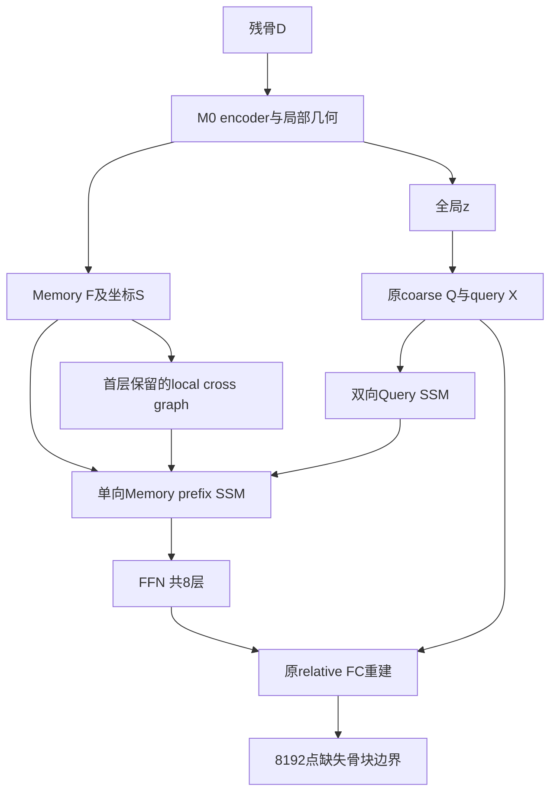

# Cranial-BCSP-FullMamba：无注意力编码—解码基线正式实验计划书

**版本：v2.0｜日期与检索截止：2026-11-10｜状态：待研究者确认；尚未实施。**

本版依据用户v1计划、82项文献题目清单、P1/P2冻结证据及本次重点文献核验修订。它是后续执行的科研参考协议，不是部署、访问真实数据、GPU检查、训练或保护集评价授权。不覆盖原稿、P1/P2失败记录或历史清理回执。

## 1. 总体判断与本阶段目标

**建议先建立最终拟采用的无注意力Mamba基线，再在冻结主干上开展结构创新。** 混合架构上验证的改进可能依赖其Transformer decoder；因此，在目标架构上检验创新能减少后续骨干变化造成的归因混淆。但迁移失败目前是合理风险，而不是已有实验结论；混合架构上的负结果和诊断仍有价值。

“无注意力”是本研究主动选择的架构约束，不是Mamba研究必须遵循的学术标准，也不意味着精度、资源或临床适用性必然更好。可以保留DGCNN、KNN、MLP、pooling和局部几何运算；应称**attention-free Mamba encoder–decoder with local geometric aggregation**，避免声称所有网络运算都是SSM。

本阶段只有一个首选候选：**F0-P-v2**。目标依次为：

1. 实际执行路径无self/cross或其他内容注意力算子。
2. 原生Mamba decoder保留可检查的Memory→Query条件通道。
3. 在原BCSP任务上完成有完整证据的同协议两折探索性训练与Native评价。
4. 决定它是可执行但薄弱的基线、值得继续的创新平台，还是应停止的负候选。

暂停混合M0上的H3实施；H3仅保留草案。第一轮不引入H1/H2、空间残差、rim loss、新排序、多表面定位器或新采样。这个阶段本身不承诺形成论文核心创新。

## 2. 本版相对原稿的关键修订

| 原稿问题或歧义 | v2决定 | 原因 |
|---|---|---|
| 只按模块名认定attention | 结合实际算子；保留已核实的非注意力局部graph | DynamicGraphAttention实际上为KNN＋MLP＋max |
| 同时移除decoder局部支路未明确 | 第一层local self/cross graph及concat merge均保留 | 避免把移除局部几何能力混入替换 |
| 公式conditional→self，实际母版self→cross→FFN | 固定self-SSM→conditional-SSM→FFN | 最大限度保持母版阶段顺序 |
| FFN可能使用过时残差输入，γ待选 | FFN读取第二次残差后的X2；继承母版残差尺度，不新增γ开关 | 消除公式／伪代码不一致和调参自由度 |
| PE可能在query构造、每层、memory重复叠加 | 原mlp_query不额外加PE；新增一份明确的decoder坐标投影，仅进入分支输入 | 冻结唯一坐标消费者合同 |
| “Memory改变输出”被视为SSM条件能力 | 单独检验前缀支路、排除局部graph和短卷积边界作用 | Mamba含causal Conv1d，不能只看边界附近响应 |
| 全拼接反向扫描被称为泄漏 | 本候选禁止它以保持前缀解释，但不称GT泄漏 | Memory和Query均来自D，其他双向结构不天然违法 |
| CUDA计划暗含10个优化step | 首轮准入0 optimizer step；若以后需要smoke另立范围 | 训练和零更新验证不能混报 |
| Stage A只读却要求实现patch | Stage A仅输出接口与差量设计，代码patch属于实施阶段 | 状态和产物名与实际权限一致 |
| 非崩溃即可称可靠平台 | 区分工程可用、描述性科学结果、后续投入与论文优势 | 不把未设非劣界值的“接近”写成相当 |
| 3DMambaComplete仅列2024预印本 | 补充2026 v2及其Cross-Attention事实 | 新版本对无注意力论证有直接影响 |

## 3. 文献核验及能支持的判断

这是重点、有界检索，不是82篇全文系统综述。已阅读用户完整清单，但对未取得全文的条目不虚构方法细节。检索围绕Mamba point cloud completion、attention-free decoder、Memory–Query conditioning及医学任务差异；优先原论文、作者实现和出版页。专用academic-search MCP未提供，使用网页工具访问arXiv、PubMed、作者库和出版页；部分ACM/AAAI/ScienceDirect页面403或反爬，不能当作全文已读。

| 证据 | 本次核验层级与相关认识 | 对本计划的约束 |
|---|---|---|
| [Mamba](https://arxiv.org/abs/2312.00752)；[官方实现](https://github.com/state-spaces/mamba/blob/main/mamba_ssm/modules/mamba_simple.py) | 原论文／实现；选择性状态空间，兼有短卷积与SSM状态 | 原生整体序列扫描；跨样本重置；区分两种条件传播 |
| [PointMamba](https://arxiv.org/abs/2402.10739) | 作者预印本；点云理解与空间序列化 | 说明排序重要，不是颅骨decoder的效果证据 |
| [CompletionMamba](https://pubmed.ncbi.nlm.nih.gov/40853794/)；DOI 10.1109/TIP.2025.3597041 | 2025 TIP摘要；Local SSM及shape-aware条件 | 全局／局部和形状信息已有先例；未逐算子认证其全网无attention |
| [3DMambaComplete v2](https://arxiv.org/html/2404.07106v2) | 2026-05-19修订全文方法；页面标注TOMM DOI 10.1145/3774887 | 图2及3.2节明确有Cross-Attention；不能当纯无注意力证明 |
| [DAPointMamba](https://arxiv.org/html/2511.20278v1) | 作者预印本方法；patch与跨域空间／通道结构 | 是域适应补全，不证明BCSP缺失骨块效果；不在F0叠加其机制 |
| [FusionMamba](https://www.sciencedirect.com/science/article/pii/S1566253526002575) | 2026出版摘要；空间感知、多尺度及几何校正 | 不凭摘要认证完全无attention或照搬创新；整页访问受限 |
| [PPC-MT](https://arxiv.org/abs/2603.00870) | 2026预印本；Mamba编码与Transformer解码 | 说明混合路线仍存在，不是无注意力替换方案 |
| [BuildingComSSSM](https://www.sciencedirect.com/science/article/pii/S1569843226001858) | 2026出版摘要明确self/cross-attention | “Mamba”名称不足以认证无attention；代码链接本次404 |
| [颅骨高分辨率补全](https://arxiv.org/abs/2308.03813) | 作者论文；solid点云与迭代恢复背景 | 与BCSP完整边界采样不同，不能跨论文直接比CD |
| [MedPCFM](https://arxiv.org/abs/2606.24433)、[MedPCFM-TED](https://arxiv.org/abs/2609.16934) | 2026作者预印本摘要；医学点云条件生成强参照 | 若后续主张方法先进性应考虑同任务适配，而非只比弱F0 |

上述材料没有证明本计划的prefix机制优于attention，也没有证明其新颖性。CDRMamba属于医学影像重建相关路线，用户其余临床、对称、SDF/occupancy与厚度论文用于约束最终任务外推，不当作已完成的点云decoder实现参照。固定排序和prefix方案是本次设计选择；其效果与合理性必须由实验检验。

## 4. 项目证据与固定任务

P1的M0只换六个encoder全局分支，decoder八层仍用attention。P1 M0−T0的E P95，C折−1.5144 mm、D折+0.3622 mm；严重事件分别T0 7→M0 4及5→10。不能将单折收益当作Mamba整体优越。

P2 H1及H2已收束；矩改善没有稳定转成完整表面／接口收益。冻结特征质心读出对M0仅改善约0.38／0.50 mm，frontoorbital反向变化。新增退化复盘显示部分位置／范围异常到coarse已可见，不等于coarse头被证明是唯一原因。因此F0须保存Q/P，不应把decoder替换当成必然修复早期定位。

| 项目 | 固定内容 |
|---|---|
| 任务 | ∂D残骨完整骨组织边界→∂G缺失骨块完整边界；不是完整颅骨或仅外侧薄壳 |
| 数据 | 已开放SkullBreak 84来源／420缺损；不新增病例 |
| Fold | C/D各63训练来源315例、21开发来源105例；每来源5类缺损 |
| 类别 | bilateral、frontoorbital、parietotemporal、random_1、random_2 |
| 表示 | BCSP V1、既有面积采样、8192输入／8192目标、256 coarse、每点32相对输出 |
| 坐标 | D-only归一化；Native world-mm评分；无GT对齐或去离群后处理 |
| Loss | 原coarse CD＋dense CD；冻结torch.cdist后端；禁H1/H2/H3等新监督 |
| 精度政策 | FP32、TF32=false；继承有限Mamba梯度非确定性披露 |
| 封存 | confirmation20继续封存；不以数据“存在”推断读取授权 |

C/D训练来源重叠，同来源五缺损相关；这些开发集已反复使用。不能称新盲测。SkullFix已准备的数据不自动加入本轮；MUG不作为未经独立验证的高精度GT。

## 5. 已核实的替换边界与attention定义

本次只读查看的是已冻结母版快照和既有配置，不是当前服务器现场审计：

- 母版：`deliverables/cranial_bcsp_mamba_P1_20261106_v2/payload/parent_source_snapshot/models/AdaPoinTr.py`。
- `Transformer_utils.py`中DynamicGraphAttention.forward实际为按几何KNN取邻域、拼接(local_v−q,q)、Linear/LeakyReLU、max，不含QK-softmax-V。类名不能用作拒绝依据。
- 既有encoder与decoder配置首层均有attn-graph拼接；后续为attn。Decoder实际顺序self→cross→FFN，首层含self/cross局部graph及768→384 merge映射。

F0替换所有真正的attention分支；**保留已核实的非注意力graph及merge**。若Stage A发现运行母版不同或某local路径实际上有learned query-key权重，应停止冻结，不能默默保留它。

禁止：全局／局部内容注意力、SDPA、flash attention及隐藏的query-key归一化加权value。允许：非注意力KNN图卷积、max pooling、MLP、Norm、位置嵌入、通道门控和SSM选择性参数。动态扫描不得因为看见softmax/einsum就误判——优化器或SSM可有einsum，损失可有全点距离，判定必须看算子语义及所有者。

最终冻结配置必须明确encoder/decode路径没有残余Attention模块；母版Python文件含旧类定义不等于它们运行了。可保留兼容OFF factory，但F0实例不挂载可执行的旧self/cross-attention支路，不以requires_grad=False冒充移除。

## 6. 唯一F0-P-v2结构

### 6.1 不变的入口

沿用M0 encoder、grouper、coarse head、mlp_query与relative FC head。Memory F形状[B,256,384]与坐标S=[B,256,3]逐token对应；Q=[B,256,3]；初始query X=原mlp_query(cat(z,Q))。实际尺寸须在Stage A确认。

不增加角色token、separator、重复memory、状态cache、层间共享SSM或新解码头。每个decoder层独立一套self SSM和一套conditional SSM；同层self正/反方向共享参数。原生Mamba-1配置d_model384、d_state16、d_conv4、expand2，与P1相同家族及锁定实现；不顺便升级Mamba-2/3或CUDA工具链。

### 6.2 排序与位置编码

π_m依S、π_q依Q做原XYZ稳定字典序。排序索引detach；被索引的坐标、特征和loss仍可微。每病例独立排序；memory与query绝不混排。Q在decoder层间不更新，其π_q一次确定复用；有变化须另立模型。

新增一份decoder共享坐标投影e:R³→R384，**Linear(3,384,bias=false)**，各层共用，不复用encoder pos_embed参数。它只加在下述SSM分支输入，原mlp_query外不另加一遍PE；原F自身已带编码位置，不称其位置无关。投影初始化用隔离新模块随机流；不置零、不额外加Norm/角色嵌入。该新增位置条件是替换实现的一部分，故整体不是纯“只换算子且容量相等”。

### 6.3 八层的固定顺序

对层ℓ，T为sequence反转，Sort/Restore同步作用特征及其空间对应；Norm与FFN继承母版位置和尺寸：

\[
U=Sort_{\pi_q}(N_s(X)+e(Q)),\quad
B_q=Restore_{\pi_q^{-1}}\{[M_s(U)+T M_s(TU)]/2\}.
\]

首层f_s=W_s concat(B_q,G_s(N_sX,Q))；其余层f_s=B_q。G_s是原局部graph，W_s是原merge，不额外新增宽化融合。第一残差为X1=X+R_s(f_s)。

\[
V_m=Sort_{\pi_m}(N_v(F)+e(S)),\quad
V_q=Sort_{\pi_q}(N_q(X1)+e(Q)),
\]
\[
C_q=Restore_{\pi_q^{-1}}\{M_c([V_m;V_q])[:,256:,:]\}.
\]

首层f_c=W_c concat(C_q,G_c(N_qX1,N_vF,Q,S))；其余层f_c=C_q。G_c/W_c继承原局部cross graph和merge，不使用替换过的donor来污染该保留路径。第二残差X2=X1+R_c(f_c)，最终X_next=X2+R_f(FFN(N_f(X2)))。

R_s/R_c/R_f是母版已有DropPath／LayerScale或Identity包装，**继承实际配置，不新增可调γ或output projection**。原配置若无LayerScale就是Identity；不能在实现时自行选1e−5、0或learned gate。Mamba已有out_proj，另加W只能是前述首层原merge。

此公式优先于原稿conditional→self及FFN读取旧X的表达。保留的共同Norm、FFN、graph/merge和head需按name/shape/dtype/初始张量校验。真实母版不兼容时先修订设计，不凭运行结果改公式。

### 6.4 状态语义与因果解释

M_c一次处理完整[Memory;Query]512 tokens，**不能分别调用M_c(Memory)、M_c(Query)并重置状态**；也不只传SSM state却丢掉convolution state。首版不使用增量cache，避免层／病例串状态。反向self只在256 query上调用独立、零状态的同一M_s。

条件前缀单向是本候选约定。对全串双向扫描可能是有效的另一种D-only架构，并不构成GT或未来数据泄漏；它只是失去“memory独立前缀”的简单解释，本轮不选。

首层局部G_c仍是直接跨集合路径，z也源于D。故只能称“用SSM替换全局cross-attention，同时保留局部几何条件”，不能说所有Memory→Query交互都由SSM独占。

## 7. 分阶段实施与明确完成标准

### A：一次有限只读核对

只核对实际母版、M0 factory/encoder、decoder首层graph/merge、数据/评分合同和本版公式；形成模块替换表、共同参数列表、消费者/排序合同和attention语义清单。禁止把全目录依赖库存、重新QC数据或通用审计框架纳入。只读阶段没有实现patch，也没有GPU调用。

### B：一次隔离implementation-only

拟限制为F0 decoder、factory适配、短入口、针对性测试四类代码；原P1/P2路径不变。集中验证：

- shape、逐batch索引与逆排列、32点relative/slot对应；共同参数初始化不漂移。
- 完全重复坐标按stable tie策略可重复；交换同坐标不同特征会改变tie顺序，**不能承诺严格集合置换不变或旋转等变**。近并列跳变只记录，不据此扫描轴。
- 顺序self→conditional→FFN、首层两路concat维度、所有Q消费者与e(Q)/e(S)唯一接入。
- native模块构造不被通用初始化覆盖，A_log/D no-decay及dt bias初始化标记保留。
- 原coarse/dense loss一致；中性新分支的代数fixture正确，但不要求新decoder与训练后的M0输出相同。
- 所有模型输入只由D确定，GT不可进入memory、排序或位置条件。

CPU mock只能验证接口／算术；不把CPU不支持native CUDA当作候选数学失败。完成一次针对性CPU验证和P3后才形成GPU待授权范围，不逐点无限扩展测试工具。

### C：限定人工CUDA、零更新准入

预算建议上限：**4次完整F0 forward＋4次完整loss/backward，另6次decoder-only forward＋1次decoder标量backward，optimizer step全部0**。即完整模型与局部调用分别计数，不笼统称10次完整forward。

完整检查为batch1 eval两次、batch8 train两次，使用独立隔离样本／同初始状态克隆，覆盖真实loss、原生SSM、参数组与batch8资源。train的BN buffer更新是预期行为，不能要求它与eval一样state全不变；明确保存检查前后状态及重建策略。不得用真实checkpoint或开发成绩做准入调参。

decoder-only六次固定为：原条件两次（用于数值噪声参照）、feature-null、full-prefix-token-null、只扰动memory前64 tokens且保留最后d_conv−1个tokens、第二病例变动的batch隔离检查。需要反向的原条件一次独立计算标量，核对Memory及新增分支梯度的模块级有限性与非零路径；不要求所有参数每一步都非零。

只扰动早段Memory、保持边界短卷积输入不变，并在**单层M_c后缀出口、merge前**看响应，可以排除“只因causal Conv跨边界”这一解释；但有响应也不证明解剖对应正确。不要只查看8层最终输出，self和local graph可能传播或掩盖变化。

零／正常／扰动都在同形状人工输入下进行；CPU可验证纯逻辑，真实SSM路径必须native CUDA。输入、张量构造种子、数值容差、模块级阈值及计数需在request前一次冻结；容差参考FP32及重复原条件噪声，不能看开发收益后修改。未能明确冻结时不执行。

资源继承RSS8 GiB、Torch allocated/reserved20 GiB、SMI22528 MiB、单run86400 s等原预算。GPU型号、hostname、版本现场确认，不复用11月7日容器身份。人工准入不能认证3900步训练收益。首轮不做10个优化step smoke；如确有工程原因必须另立有限范围。

### D：最多两个正式scratch运行

F0-P-v2_C、F0-P-v2_D，seed0；各3900更新，合计7800；不新增F0-S或中途保留attention的正式臂。工程分模块验证可逐步做，但不能把残留attention的过渡模型当F0。

先冻结两折配置，再跑C。仅工程失败或下述极端科学暂停条件可停止扩展；停止必须报告“D未执行，跨折结论未完成”，不能改D配置或只保留有利折。未达暂停条件即按同合同完成D，不因C小幅不利就换模型。

## 8. 初始化、训练与配对合同

| 字段 | 冻结要求 |
|---|---|
| scratch | 先构造对应M0共同初始化，隔离RNG创建替换decoder模块；不加载训练后M0 warmstart |
| 共同模块 | encoder/coarse/query/FC及保留Norm/graph/merge/FFN逐参数初值匹配；移除模块不要求匹配 |
| 新模块 | 原生Mamba初始化；新模块固定种子流与名称映射预登记；不扫seed或初始化尺度 |
| 优化 | AdamW lr1e−4、betas(.9,.999)、eps1e−8、clip10；实际wd组0或5e−4，保留SSM例外 |
| 日程 | lr=1e−4×max(.9^(epoch/21),.02)，BN按原runtime；锁定scheduler调用时序 |
| 每run | batch8、100 traversals、3900 updates、31200 exposures、300 dropped exposures；不是3939 |
| 顺序 | 完整case/source批次和drop计划与对应M0一致；训练后梯度／权重不要求相同 |
| checkpoint | 固定epoch99/update3900；完整参数/优化状态，禁止按开发集选epoch |
| 禁止项 | BNCal、AMP、TTA、resume、自动重试、动态更换排序、改loss或新增样本 |

记录total/encoder/decoder/other参数量；F0可能增容，首轮不称参数匹配单因素实验。母版共同参数先构造再替换可能消耗旧attention初始化，但最终优化器不应包含旧attention参数；新模块随机流独立管理。

## 9. Native预测与必需机制诊断

### 9.1 Native模型性能

每折固定105病例、batch1 eval/inference_mode，合计210次新预测；不做loss、backward、BNCal、warmup或GT对齐。保存所有8192点，**每例额外保存完整256点Q**，共210×256×3×4=645120字节（约0.62 MiB，不计压缩封装）。这一小成本能避免再次只有矩而无法查coarse形状。

每例保存同forward的Q/P质心、回转半径、边界范围和finite计数；仅对固定10代表例保存完整decoder层轨迹，并为它们及10个固定donor保存F/S/z/Q/X，避免全量特征库存。这些均从原210次Native中保存，不额外重跑encoder。预测前后模型/BN与CPU/CUDA/Python/NumPy RNG指纹应一致。

### 9.2 同权重条件诊断

在新成绩出现前，从每折既定开发顺序按五种缺损各取第一例，共10例；同来源重复必须披露。每个recipient的donor固定为该折顺序中同缺损类别、不同source_id的第一例，不依据GT或效果挑选。精确ID及donor表在训练前固定；不能简单循环这五例而误称来自不同来源，因为它们可能属于同一颅骨。

Native来自前述210次，不重跑。每例做三种干预：①仅prefix feature-null，保留PE；②仅prefix donor，feature/coordinate成对替换；③仅local-cross-graph donor，prefix保持recipient。**额外30次decoder后缀调用，0个新增encoder/coarse调用、0 step**；复用事前保存的recipient/donor F、S、z、Q、X，不把30次后缀调用报作30次完整模型预测。

所有干预保持recipient z/Q/X及权重不变。②中local graph仍用recipient原memory；③中prefix仍用recipient原memory，局部KNN需按donor坐标重算。这样才能分别检验两路；它们都是OOD诊断，不是合法Native输出，分数不得放入主性能表。Native的Q必须与干预完全一致。

报告每层prefix分支响应、query前中后序列组、dense变化和Native几何结果。没有变差不证明条件无用，有变化不证明条件正确；必要性需要以后匹配无prefix训练消融，本轮不自动加训。该30次机制范围仍需单独授权；未执行就标记机制证据未完成，不虚构其结论。

## 10. 评价、统计和决定标准

统一复用T0/M0冻结预测与原A1/A2/B参考。两折共630行模型评分（T0/M0/F0各210），共享Nop_D、GT8192共420行，总1050行；不是1050独立患者。若入口须适配，只改模型标签/输入绑定，不改指标。

主终点为A1面积加权E P95 mm；并列J P95、E/J Cover@0.5/1/2mm、CD-L1、Pred→A2 P95、>20mm离群、位置与半径诊断。CD使用未平方欧氏距离双向均值半和。风险继续为E P95>20mm或J Cover2=0，另列位置>20mm、半径比<.9；这些不是医学合格线。

先在来源内平均五缺损，再21来源等权；逐折报告F0−M0、F0−T0、改善/退化来源数、全部五类和新增/修复风险。不能以某个小均值改善抵消新增严重病例，也不能只报pooled分数。第一轮不新增bootstrap/p值；未来确需区间应另行固定source为抽样单位，且不包含训练seed方差。

**四个判定分别记录：**

1. 工程通过：attention语义及动态覆盖、loss/梯度、batch8资源、计数和归档完整。不以分析脚本PASS认证几何收益。
2. 可执行基线：足额训练及Native评分完整，能够冻结成有已知缺陷的F0对照。没有设非劣界值，不能据此宣称“与M0相当”。
3. 继续投入：条件路径证据可解释，未触发极端崩溃，并有明确可改善的问题；若性能弱，后续必须同时对比M0/T0，不能只打败弱F0。
4. 方法优势／可靠性：需两折形状/接口/风险支持、重复训练与独立来源确认。均值好但frontoorbital退化或新增严重病例，应记录风险转移，不直接称可靠。

保留原稿“极端暂停线”以限制预算，但改称**科学暂停，不是工程失败**：C折来源均值E P95>16.8992 mm或严重数>14；D折E P95>15.6238 mm或严重数>20。这些为历史T0/M0较差者的两倍，属于宽松资源决策建议，无临床依据。若实现与训练合同正确，触线仍是有效科研负结果；不得靠重训、放宽阈值或配准救场。

“有意义条件响应”的工程容差应先于GPU冻结；“可接受精度损失”的非劣界值目前没有外部依据，不能临时编造5%或10%并称科学标准。本轮如出现混合结果，应给出连续分数和选择理由，由研究者决定新研究问题，不自动批准创新。

## 11. 时间、显存与理论复杂度

8层decoder预计16次query self scan（长度256）和8次prefix scan（长度512），加encoder12次长度256，共36次native SSM调用，11264个token-visits；这些不是FLOPs或实测时延。首层graph、排序、KNN、max pooling、FC以及全点cdist loss仍有其他成本，不能说完整训练严格O(N)。

第一轮保存训练真实wall time、step时间及Torch/SMI/RSS峰值，描述实测即可。历史T0/M0时间不与新设备F0直接比成效率结论。只有决定研究效率时，再在同设备同环境独立计时三模型；预热、同步、batch、重复数、I/O边界单独冻结，不混入210次Native计数。普通FLOPs工具漏计selective scan时必须标为不完整。

F0慢或显存更高是可能结果，不说明SSM理论错误。OOM后不得静默减batch、层数、expand或加checkpointing；这些是新版本。microbatch累积也不等于含BN的原batch8。

## 12. 恢复、归档与执行成本控制

11月7日的清理已删除服务器六个P2最终权重和四个P1恢复副本；它们有本机已验证备份，不能假定服务器路径仍在。F0 scratch训练不需要恢复全部旧权重；T0/M0精度参照复用预测即可。确需同机效率计时或冻结模型诊断时，才恢复相应P1权重，不为“准备”复制所有历史模型。

本机P2代码/结果：`E:/ResearchBackups/AdaPoinTr/BCSP_MAMBA_P2/2026-11-07_P2_final_archive`；P2权重：同根`2026-11-07_P2_checkpoints_v1`。P1权重在`E:/ResearchBackups/AdaPoinTr/BCSP_MAMBA_P1/2026-11-06_P1_checkpoints_v1`。这些是历史归档位置，本次没有重新验证2GB权重、连接服务器或推断当前容器。

本机管理根与服务器`/home/jovyan/adapointr_work/PoinTr`不自动同步。每次实际执行仅核对本候选涉及的源码、provider、精确输入/父哈希、输出和资源，不重新扫描整个环境。只保留一份首选实现和一次针对性验证批；失败集中归因后版本化，不每个日志字段都开展一轮工程扩展。

每run保存实际初始化/参数组、3900计数、完整批次、资源、末步权重、退出码、实际图及无attention证据。每预测保存NPZ/coarse、清单、状态/RNG和world-frame。每评分保存case/source/risk及归约。工程失败、负结果和停止D的事实全部保留。

最小新工作为：一次只读差量核对→一次隔离实施/CPU/P3→一次新增路径CUDA准入→C/D各一次训练→210次Native预测和单独授权30次后缀诊断→固定CPU评分→报告。不是要求这些步骤全自动发生；每阶段执行边界沿用用户既有授权规范。

## 13. 完成定义与后续创新

本阶段完成并不要求F0胜出，但要求能回答：真实attention是否为0，前缀及局部条件如何作用，C/D完整表面和风险怎样，资源是否可承受，候选何以继续或停止。

如果F0可用且有可解释空间缺陷，后续在冻结F0上单独研究token空间组织、空间query或接口精修，固定主干、采样和loss；创新应比较F0±模块，并继续报告T0/M0强参照，避免只修复替换制造的损失。是否能迁移至其他backbone可以留作未来论文泛化消融，不要求创新先在混合架构上训练。

如果prefix长期失效或F0系统性灾难回退，先收束本版本；不能把H3、对称、rim和新loss一次叠加后宣称全Mamba成功。F0-S、interleave、局部cross-SSM或其他生成器均是独立后续假设，不自动备用运行。

**当前下一步仅是确认本版科研设计，随后可单独授权Stage A的有限只读替换边界核对。** 本次没有实施、CPU/CUDA测试、服务器操作、执行request、新训练、保护集访问或GitHub推送。
