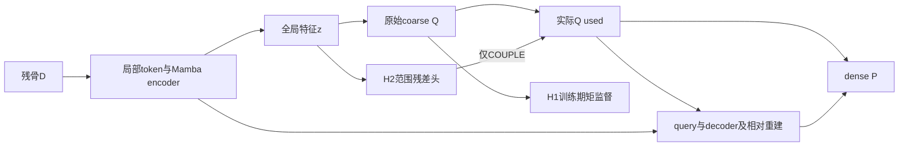

# Cranial-BCSP-Mamba P2 完整实验报告

**版本：v1｜报告日期：2026-11-07｜实验记录范围：2026-11-06—2026-11-07**

**性质：基于已完成、已冻结证据的正式阶段报告。** 本报告不执行模型、重算病例几何评分、重新拟合探针、计算统计显著性或正式gate；不把待审核H3记作已完成实验。报告中的完成状态指既有正式审计状态，本次仅复核本机记录及评分文件哈希，不重新认证服务器现状、长期备份或GitHub发布。

## 摘要

P2围绕颅骨完整缺失骨块生成中的位置、范围和覆盖错误，检验“coarse低阶几何监督”“冻结特征中的可读出条件”和“尺度条件进入生成路径”三类机制。沿用SkullBreak已开放来源、骨组织完整边界表面表示、8192输入／8192输出及256个learned coarse；每折63训练来源／21开发来源，每来源5种缺损，单seed、3900次更新。新增H1两次训练、H2四次训练，共23400次更新；完成210次H1和420次H2 Native预测，另用四个既有T0/M0模型完成1680次encoder/coarse前缀提取和固定线性读出。

H1改善部分coarse质心／半径误差，但两折E/J P95和CD均退化，并相对M0新增5例严重几何事件。冻结特征读出表明范围信息可以更好地读出，但M0的定位收益仅约0.38／0.50 mm，frontoorbital定位还出现回退。H2-COUPLE能改变coarse尺度，相对AUX在C折部分指标改善，D折E/J P95退化，两折J Cover@2mm均下降；相对M0的E/J P95两折均未改善。8个去重新增严重退化病例中，5例到coarse阶段已有>20 mm质心偏差、7例已有半径比<0.9；dense未普遍纠正。

因此，当前固定H1和H2候选均未获稳定的完整骨块与接口收益支持，应收束，保留M0作为比较基线。主要研究认识是：**低阶矩可预测、可优化、可改变，并不等于完整形状、接口覆盖和可靠性得到改善。** 下一步可审核单一的输入token—坐标空间残差假设，但不能把其草案或工程验证当成科研成功。

## 1. 背景、实验目的与研究问题

### 1.1 P1之后为什么开展P2

P1用Mamba替换encoder全局分支，decoder仍为Transformer。相对T0，M0在C/D的完整表面结果不稳定；部分病例具有大幅整体错位，另一些病例没有远端预测离群却仍漏覆盖。此前计算图和无更新诊断提示，部分明显偏差到learned coarse时已经存在，但未证明encoder、pooling、坐标头或dense重建中的某一环节是唯一根因。

P2不再把“换成Mamba”本身当作充分贡献，而是研究生成路径的可验证空间机制。其目的不是强行得到正结果，而是以有限配对实验排除无效解释，确定值得继续投入的结构问题。

### 1.2 三个核心问题

1. 原coarse已有Chamfer监督时，再加入质心和半径辅助监督，能否改善最终未知表面、接口和失败病例分布？
2. D-only全局特征是否含有可由固定读出利用的位置／范围信息？这些信息相比训练常数、简单几何摘要和原coarse如何？
3. 将D-only预测的范围残差实际耦合进coarse/query/dense生成路径，相比相同辅助学习但不耦合，是否带来稳定收益？

本阶段不重新比较体积／表面表示、缺损构造、点数或采样算法；不将SkullFix或MUG500+算作本次外部验证。它们的前期工作属于表示研究背景，不能扩大本报告的模型有效性结论。

## 2. 数据、几何表示与任务边界

### 2.1 数据与分折

实际研究数据为已开放的SkullBreak BCSP来源。每折315训练病例／63来源、105开发病例／21来源，每来源包含bilateral、frontoorbital、parietotemporal、random_1、random_2五种缺损。C/D开发集合共210病例／42来源，折内训练与开发来源隔离。

两个折的模型或其不同缺损不是独立患者重复；开发集合不重叠也不意味着两个训练实验独立，跨折训练来源可以重叠。全阶段不额外筛选病例、依据结果排除困难缺损或把开发病例用于ridge拟合。

### 2.2 输入、输出与GT语义

输入D为实体缺损后残骨的骨组织完整边界表面点云，输出目标G为**被移除骨块的完整边界表面**，不是完整颅骨，也不是仅缺失的外轮廓面片。原始实体与表面提取使内侧、外侧和切壁等边界有机会被表示，但固定8192点采样不保证每个微小孔道或薄切壁得到充分覆盖；不能将本任务GT称为独立临床认证的高精度解剖GT。

归一化由D确定，G与预测遵循同一坐标合同；评分回到原始world-mm。推理不读取GT中心／半径，不做GT平移、刚体配准或ICP。G只用于训练监督和离线评价。体素 spacing／坐标关系沿用冻结参考，本次不重建原始数据。

### 2.3 评价对象

E表示缺失骨块中待恢复的原始表面区域，J表示接触切壁／接口区域；两者不能相互替代。E/J的精确划分、参考集合、面积权重与阈值继承已冻结评分实现，不从结果反推边界或更换参考。

输入／输出均8192、coarse为256，每coarse生成32个dense点。点数和采样在P2保持不变，所以P2结果不能支持“点数已经最优”或“新采样胜出”的额外结论。

## 3. 模型计算图与共同训练合同

### 3.1 实际计算图

输入经DGCNN局部聚合及FPS 512→256，得到256个空间token；位置与特征送入6层encoder，memory维度384。M0在相应全局分支采用原生Mamba，使用XYZ字典序的稳定排序、共享参数前后向扫描并逆排序，不是三个轴各自独立扫描。局部图分支保留。

逐token映射并max pooling得到1024维全局特征z。原coarse头1024→1024→768输出256×3的Q。Q进入query特征、decoder q_pos和重建特征；decoder为8层Transformer，输出相对位移Δ，最终P[j,k]=Q_used[j]+Δ[j,k]。旧learned_only路径没有把临时输入FPS点直接拼进输出Q。

### 3.2 共同合同

| 项目 | 实际合同 |
| --- | --- |
| 输入／目标／coarse | 8192／8192／256；BCSP V1采样不变 |
| 初始化 | 各折原M0共同scratch初始化；不从最终checkpoint resume |
| seed | seed0；每臂每折一次，无跨seed方差估计 |
| 更新与batch | 3900次optimizer step；batch8 |
| 遍历与曝光 | 100 traversals；31200病例曝光；300次drop-last |
| 优化器 | AdamW；初始LR=1e-4；clip=10 |
| 权重衰减 | 实际参数组0或5e-4，SSM no-decay例外保留；defaults的0.01不代表实际组被改为0.01 |
| 日程与数值 | 完整批次、LR、BN momentum逐步配对；原torch.cdist Chamfer后端不变 |
| 模型选择 | 固定末步checkpoint，不依据开发成绩选择最佳轮次 |
| 训练中禁止项 | BNCal、development evaluation、resume均false |
| 资源限制 | RSS8 GiB、Torch峰值20 GiB、SMI设备22528 MiB；沿用原输出/磁盘/时间预算 |

这些合同证明比较具有明确控制条件，但不能保证逐步梯度相同。Mamba原生backward存在已接受并披露的有限非确定性；共同初始化、相同batch顺序并不等于完全确定性重复。PID口径按DIAGNOSTIC_ONLY处理，采样资源监测不是cgroup硬隔离或跨命名空间所有权证明。

原损失为双向欧氏距离Chamfer：

\[
CD(A,B)=\tfrac12\left(\operatorname{mean}_{a\in A}\min_{b\in B}\|a-b\|_2+\operatorname{mean}_{b\in B}\min_{a\in A}\|b-a\|_2\right),\quad L_{base}=CD(Q,G)+CD(P,G).
\]

继承实现字段称为CD-L1，但不是逐坐标L1距离。实际浮点路径及数值保护以冻结实现为准；本报告不替换后端。

## 4. 实验一：H1质心／半径辅助监督

### 4.1 假设与唯一公式

H1检验直接约束coarse低阶矩是否足够。设μ_X为点均值，r_X=√(mean||X−μ_X||²+ε)，ε=1e−6：

\[
c=\|\mu_Q-\mu_G\|_2/r_G,\qquad v=\log[(r_Q+\epsilon)/(r_G+\epsilon)],
\]
\[
H1=\tfrac12\left[\operatorname{mean}\mathrm{SL1}_{0.1}(c)+\operatorname{mean}\mathrm{SL1}_{0.1}(v)\right],\quad L=L_{base}+0.1H1.
\]

centroid_radius模式，无CVaR分支。H1直接梯度经过Q、coarse头、全局特征和encoder，不直接经过下游decoder／dense重建头；这些模块仍接受原重建梯度。runtime只观察分量，不重复增加H1。

### 4.2 执行与优化记录

H1_C、H1_D均完整3900步并通过正式训练后冻结审计，各23项检查通过。两折初始参数／持久state指纹与对应M0一致，完整case/source批次、LR、BN及曝光计数配对。

C折H1 raw首条2.14699、末条0.01938，末条总训练loss0.03770；D折2.10613→0.02493，末条总训练loss0.03939。辅助目标被优化，但这些训练数值本身不证明开发集收益。

### 4.3 H1的最终性能

距离单位mm；Cover列为百分比。各列都是先病例计算，再来源内平均五缺损、最后21来源等权平均；不是把所有点混在一起计算的总体P95。

| 折 | 模型 | E P95 | J P95 | CD | E Cover2 % | J Cover2 % | 离群>20mm % | 质心误差 |
| --- | --- | --- | --- | --- | --- | --- | --- | --- |
| C | M0 | 6.9352 | 9.4757 | 3.8854 | 67.4933 | 50.2928 | 2.4873 | 10.7658 |
| C | M-H1 | 8.7720 | 11.8903 | 4.7374 | 63.3075 | 47.5432 | 3.3061 | 10.8992 |
| D | M0 | 7.8119 | 10.7950 | 4.1944 | 60.2901 | 48.1309 | 3.9880 | 12.1600 |
| D | M-H1 | 8.5618 | 11.4576 | 4.5501 | 60.3294 | 48.4413 | 3.2152 | 10.6242 |

C折E P95增加1.8368 mm、J P95增加2.4145 mm、CD增加0.8520 mm；E P95在17/21来源退化。D折E/J P95分别增加0.7499／0.6626 mm，CD增加0.3557 mm，E P95在13/21来源退化。该方向不是单个异常病例足以解释的总体回退。

D折质心误差降低1.5358 mm、离群比例下降0.7728个百分点、部分覆盖略升，仍未改善E/J尾部误差和CD。**位置改善与完整表面收益不同，不能选择有利指标宣布成功。**

### 4.4 coarse矩与病例风险

| 折 | 量 | M0 | M-H1 |
| --- | --- | --- | --- |
| C | coarse质心误差 mm | 11.77734 | 11.63925 |
| D | coarse质心误差 mm | 12.89018 | 11.13400 |
| C | coarse绝对log半径误差 | 0.11213 | 0.09678 |
| D | coarse绝对log半径误差 | 0.15117 | 0.10960 |
| C | dense绝对log半径误差 | 0.12025 | 0.11498 |
| D | dense绝对log半径误差 | 0.14647 | 0.12116 |
| C | 严重病例：M0→H1；新增／修复 | 4→5 | 3／2 |
| D | 严重病例：M0→H1；新增／修复 | 10→7 | 2／5 |

尽管矩误差改善，两折共新增5例严重几何事件。D折严重总数减少也不能掩盖新增2例。frontoorbital的E/J P95，C折分别增加2.6695／2.9004 mm，D折增加6.1437／6.1054 mm，提示困难形态上的明显代价。

H1结论：当前固定矩监督不足以稳定改善本任务，收束该候选；不继续T-H1、权重扫描或病例替换。它不证明所有几何监督无效，也不支持把矩收益包装为接口改善。

## 5. 实验二：冻结特征读出对照

### 5.1 设计

使用既有P1的T0_C、M0_C、T0_D、M0_D最终冻结模型；每模型315训练＋105开发，合计1680次encoder/coarse前缀调用，0次完整dense forward、0次backward、0次optimizer step。前缀hook取得coarse头输入z（1024维）及Q矩后退出，不把它算成1680次完整骨块预测。

目标为G8192经验质心三坐标和log回转半径，共4维。四个对照：训练常数、已有coarse、18维D-only几何ridge、1024维冻结特征ridge。18维几何由xyz均值3、协方差上三角6、每轴10/50/90%分位数9组成。

训练/开发来源隔离；X/Y标准化只由训练决定。固定float64 ridge，平均加权平方损失＋1.0||W||²，截距不惩罚；不扫描正则。G只作离线标签，不进入模型。诊断不是新骨块生成器。

### 5.2 主要结果

| 折／模型 | 已有coarse质心 mm | 特征读出质心 mm | coarse半径误差 | 特征读出半径误差 | 质心改善/退化来源 | 半径改善/退化来源 |
| --- | --- | --- | --- | --- | --- | --- |
| C/T0 | 15.8723 | 14.7630 | 0.12333 | 0.08144 | 18/3 | 17/4 |
| C/M0 | 11.7773 | 11.3930 | 0.11213 | 0.07112 | 11/10 | 19/2 |
| D/T0 | 13.0854 | 11.2973 | 0.12825 | 0.08307 | 18/3 | 19/2 |
| D/M0 | 12.8902 | 12.3867 | 0.15117 | 0.09546 | 12/9 | 18/3 |

半径误差定义为|log(r预测/rGT)|，不是mm，也不是有符号平均半径比。

C/D训练常数质心误差57.3825／57.6710 mm；18维几何读出33.7561／32.1678 mm，明显差于已有M0。反对“模型完全不利用输入”的解释，但只否定这套固定摘要＋线性读出，不证明所有D-only几何条件无用。

M0特征读出的半径误差约下降36.6%／36.9%，19/21、18/21来源改善；质心仅下降0.3843／0.5035 mm，来源胜负接近。frontoorbital质心反而增加0.770／2.392 mm。范围有较稳定可读出余量，定位证据弱，不能用平均微小收益硬替换中心。

T0也具有读出收益，故不是Mamba特有发现。线性可读出低阶信息不等于原坐标头完全浪费该信息；更不证明替换头后可生成完整形状。探针没能区分encoder、max pooling和坐标头的因果贡献。

### 5.3 审计与限度

正式探针冻结审计17组通过，独立核对训练统计、系数、固定ridge一阶条件、预测误差与来源归约。最大驻点残差1.25e−15是解合同一致性，不是效果阈值。worker只持久保存模型/BN与RNG不变断言，未保存完整前后状态指纹；因此不能事后独立重哈希模型状态。Q只保存矩，不能据此复原完整coarse点形状。

## 6. 实验三：H2范围残差及生成路径软耦合

### 6.1 由探针到H2的假设

H2不再重复H1直接压coarse矩，而问：用D-only特征预测当前Q所需的相对范围修正，并真正进入query/dense生成路径，能否比相同辅助学习、不耦合的对照更好？固定绝对半径ridge成功不保证动态相对残差可预测，也不保证变换后形状正确。

### 6.2 参数化、监督和梯度

H2使用数学上不加epsilon的r_X=√mean||X−μ_X||²；遇非有限或r≤1e−6停止，不沿用H1加epsilon定义。新增1024→1线性头δ=wᵀz+b，共1025参数，w/b零初始化。目标与辅助项为：

\[
t=\log r_G-\operatorname{sg}(\log r_{Qraw}),\quad L_{aux}=\operatorname{mean}\mathrm{SL1}_{0.1}(\delta-t),
\]
\[
a=\log1.25,\quad s=\exp[a\tanh(\operatorname{sg}(\delta)/a)],\quad Q_c=Q+(s-1)(Q-\mu_Q).
\]

数学上0.8<s<1.25，保持Q质心、缩放其半径。AUX令Q_used=Q；COUPLE令Q_used=Qc。两臂均L=L_base(Q_used,P)+0.1L_aux，H1关闭。

标签中的Q detach；用于耦合的δ也detach。标量头只受辅助监督；z/encoder仍受辅助与重建梯度。原Q及其均值不detach，原重建梯度可经Qc回到原头。所有五处坐标消费者统一使用Q_used，不只改日志或末端输出。两臂共有初始化、参数与训练顺序配对，但动态标签、最终权重和loss不要求相同。

### 6.3 实施与CUDA准入

针对性CPU验证/P3后，人工CUDA检查完成AUX、COUPLE各1 forward＋1 backward，总2/2/0，16组正式冻结审计通过。使用真实M0/native Mamba及固定PointNet2 provider、原torch.cdist loss；人工非零条件检验耦合与梯度。该检查处于eval/autograd、batch1，不等于训练BN或batch8资源验证。

四次真实训练分别完成3900步，AUX_C/D各25项训练后检查、COUPLE_C/D各34项配对检查通过。首批δ=0、scale=1；后续COUPLE存在非中性尺度；逐步目标、SL1、单次加权、质心保持与r_used=s·r_raw日志自洽。

### 6.4 Native预测、统一评分和完整结果

四模型各105例，共420次Native forward；eval/inference模式，训练更新、loss、backward、BNCal为0。状态/BN及四类RNG指纹前后不变。420个8192×3有限FP32预测，20个事前代表例另存256×3 coarse；全量有同次forward几何摘要。冻结预测审计26项通过。

额外20次δ置零／供体置换未执行，不能声称已证明条件因果作用。统一CPU评分加入既有M0及共享控制，1050行病例评分、210行来源汇总，正式审计21项通过。

| 折 | 模型 | E P95 | J P95 | CD | E Cover2 % | J Cover2 % | 离群>20mm % | 质心误差 |
| --- | --- | --- | --- | --- | --- | --- | --- | --- |
| C | M0 | 6.9352 | 9.4757 | 3.8854 | 67.4933 | 50.2928 | 2.4873 | 10.7658 |
| C | H2-AUX | 10.0729 | 12.8670 | 5.3701 | 59.1530 | 44.8371 | 6.3322 | 14.2848 |
| C | H2-COUPLE | 8.6349 | 11.7172 | 4.6384 | 62.8457 | 43.2396 | 3.4495 | 11.8099 |
| D | M0 | 7.8119 | 10.7950 | 4.1944 | 60.2901 | 48.1309 | 3.9880 | 12.1600 |
| D | H2-AUX | 7.4644 | 10.1980 | 4.3751 | 61.1931 | 49.0644 | 4.1403 | 11.8597 |
| D | H2-COUPLE | 7.8668 | 11.2333 | 4.0450 | 61.3497 | 46.2252 | 3.3087 | 11.4153 |

### 6.5 主比较：COUPLE−AUX

负距离差／正覆盖差为改善。

| 折 | 指标 | 候选−对照 | 改善/退化来源 |
| --- | --- | --- | --- |
| C | E_P95_mm | -1.4380 | 14/7 |
| C | J_P95_mm | -1.1497 | 14/7 |
| C | CD_L1_mm | -0.7316 | 16/5 |
| C | E_coverage_2.0mm (百分点) | +3.6927 | 11/10 |
| C | J_coverage_2.0mm (百分点) | -1.5975 | 7/14 |
| C | reverse_A2_outlier_20.0mm (百分点) | -2.8827 | 18/2 |
| C | centroid_offset_mm | -2.4749 | 17/4 |
| D | E_P95_mm | +0.4024 | 9/12 |
| D | J_P95_mm | +1.0353 | 6/15 |
| D | CD_L1_mm | -0.3301 | 14/7 |
| D | E_coverage_2.0mm (百分点) | +0.1566 | 9/12 |
| D | J_coverage_2.0mm (百分点) | -2.8392 | 6/15 |
| D | reverse_A2_outlier_20.0mm (百分点) | -0.8316 | 15/6 |
| D | centroid_offset_mm | -0.4443 | 13/8 |

COUPLE相对AUX，C折E/J P95改善，但J Cover2下降；D折E/J P95变差，J Cover2也下降。两折CD均降低不能抵消接口覆盖损失。相对M0，C折E/J P95分别增加1.6998／2.2415 mm，D折增加0.0549／0.4383 mm，当前候选不足以替代基线。

### 6.6 严重退化与风险转移

严重几何标签沿用E P95>20 mm或J Cover2=0；placement_tail为质心偏差>20 mm，compact_distribution为半径比<0.9。它们可重叠，是诊断代理，不是临床失效率；J Cover2为0意味着固定参考下没有点落入2mm支持，不等于已经证明所有解剖接触绝对不存在。

| 折 | 比较 | 严重计数 | 新增 | 修复 |
| --- | --- | --- | --- | --- |
| C | H2_COUPLE_minus_H2_AUX | 11→4 | 1 | 8 |
| C | H2_COUPLE_minus_M0 | 4→4 | 2 | 2 |
| C | H2_AUX_minus_M0 | 4→11 | 9 | 2 |
| D | H2_COUPLE_minus_H2_AUX | 6→9 | 5 | 2 |
| D | H2_COUPLE_minus_M0 | 10→9 | 2 | 3 |
| D | H2_AUX_minus_M0 | 10→6 | 1 | 5 |

COUPLE相对AUX：C折11→4，但新增1例；D折6→9，新增5例。相对M0：两折各新增2例，即使C折总数不变、D折总数稍减，也存在风险转移。不能只报告净数或合并两折掩盖D折回退。

### 6.7 frontoorbital与尺度机制

| 折 | 模型 | E P95 mm | J P95 mm | 质心误差 mm |
| --- | --- | --- | --- | --- |
| C | M0 | 11.434 | 12.723 | 16.627 |
| C | H2_AUX | 10.712 | 12.332 | 17.904 |
| C | H2_COUPLE | 14.077 | 15.615 | 19.476 |
| D | M0 | 8.812 | 10.627 | 15.112 |
| D | H2_AUX | 10.092 | 11.828 | 18.556 |
| D | H2_COUPLE | 11.137 | 13.243 | 15.901 |

COUPLE的frontoorbital E/J P95两折均高于AUX和M0。D折定位较AUX改善，仍不能代表形状改善。

| 折 | 模型 | raw绝对log半径误差 | used误差 | 平均scale | scale范围 |
| --- | --- | --- | --- | --- | --- |
| C | H2_AUX | 0.1595 | 0.1595 | 1.0000 | 1.0000–1.0000 |
| C | H2_COUPLE | 0.3348 | 0.1585 | 1.1970 | 1.1487–1.2233 |
| D | H2_AUX | 0.1245 | 0.1245 | 1.0000 | 1.0000–1.0000 |
| D | H2_COUPLE | 0.2964 | 0.1317 | 1.2094 | 1.1734–1.2337 |

COUPLE内部raw→used半径误差确实减小，但used误差与AUX原始误差相近；COUPLE学到的raw误差反而更大。这与训练后原生成路径部分适应／抵消外部缩放的解释相容，却不能凭跨模型观察证明补偿因果。整体s偏大只是实际范围调节记录，不证明正确恢复厚度、内外板或接口。

绕自身质心的尺度变换不能直接移动coarse中心，不能修复各向异性或拓扑，也不保证dense保持中心。因此H2的负结果既不能全部归因为残差头没学到信息，也不能只靠半径校正成功否认最终失败。

## 7. 实验四：既有coarse/dense及新增退化病例复盘

### 7.1 固定选择与范围

只用630行已有模型记录，选COUPLE相对AUX及M0的全部新增严重病例并集。相对AUX6例、相对M0四例，重叠2例，合计8例／7来源；C3例来自2来源，D5例来自5来源。每例保留M0/AUX/COUPLE三臂，共24行。没有挑选最差一例代替总体，也不把事后失败子集当作无偏验证集。

### 7.2 全量阶段统计

| 折 | 臂 | coarse质心误差 mm | dense质心误差 mm | 平均质心位移模长 mm | 半径比coarse→dense | 紧缩数 |
| --- | --- | --- | --- | --- | --- | --- |
| C | M0 | 11.777 | 10.766 | 1.744 | 0.907→0.897 | 46→54 |
| C | H2_AUX | 14.770 | 14.285 | 1.778 | 0.880→0.883 | 59→58 |
| C | H2_COUPLE | 12.700 | 11.810 | 1.733 | 0.862→0.849 | 66→73 |
| D | M0 | 12.890 | 12.160 | 1.541 | 0.892→0.893 | 57→56 |
| D | H2_AUX | 12.839 | 11.860 | 1.775 | 0.928→0.923 | 42→45 |
| D | H2_COUPLE | 12.764 | 11.415 | 2.077 | 0.908→0.897 | 47→55 |

COUPLE两折平均dense位置误差均小于coarse，反对“dense普遍制造整体错位”的强解释。但紧缩数C折66→73、D折47→55，说明它也可能加重部分范围问题。

### 7.3 全部8例COUPLE退化记录

| 折/病例 | 相对谁新增 | E/J P95 mm | J Cover2 % | 离群>20mm % | 质心误差coarse→dense mm | 半径比coarse→dense |
| --- | --- | --- | --- | --- | --- | --- |
| C/train__025__parietotemporal | M0 | 34.17/37.07 | 5.32 | 40.33 | 42.20→40.05 | 0.716→0.701 |
| C/train__025__random_2 | M0 | 24.46/29.00 | 0.11 | 26.43 | 37.95→30.85 | 0.546→0.553 |
| C/train__053__frontoorbital | H2_AUX | 92.13/91.21 | 0.00 | 100.00 | 96.17→96.88 | 0.641→0.656 |
| D/train__004__random_2 | H2_AUX;M0 | 22.93/27.43 | 3.73 | 0.00 | 14.52→13.30 | 0.629→0.636 |
| D/train__022__random_1 | H2_AUX | 11.44/14.68 | 0.00 | 0.16 | 19.23→14.21 | 0.745→0.725 |
| D/train__060__bilateral | H2_AUX | 21.19/29.47 | 7.31 | 0.00 | 14.70→14.59 | 0.640→0.643 |
| D/train__079__frontoorbital | H2_AUX | 52.22/58.44 | 0.00 | 97.74 | 59.30→56.75 | 0.525→0.542 |
| D/train__087__random_1 | H2_AUX;M0 | 25.08/24.91 | 0.00 | 54.94 | 37.24→34.83 | 0.942→0.926 |

### 7.4 可观察到的三种表型

**早期大幅位置偏移。** 5/8例到coarse已有>20 mm质心误差，dense后仍>20 mm。C/053/frontoorbital最明显：96.17→96.88 mm，最终E P95 92.13 mm、远端离群100%。这证明到coarse输出时异常已可见，但没有定位到更早的encoder、pooling或坐标头中的哪一处。

**范围不足而非广泛远端飞点。** D/004/random_2与D/060/bilateral的COUPLE远端离群为0，E P95却为22.93／21.19 mm，半径比约0.63／0.64。预测可以落在骨块附近而未覆盖足够区域；没有离群不等于形状正确，也不能由这些矩证明是纯形状而非局部方向／位置错误。

**最终位置有所改善但接口仍漏覆盖。** D/022/random_1的质心19.23→14.21 mm，E P95 11.44 mm，但J Cover2=0，半径0.745→0.725。全局定位不是接口匹配的充分条件。该病例M0同样有接口零覆盖，不能写成COUPLE相对所有基线新增失败。

C/025的两个缺损相对M0新增严重事件，但AUX更差，说明COUPLE能缓解某些AUX退化而仍达不到M0。这两个缺损属于同一来源，不能当作两个独立患者证据。

### 7.5 dense位移的代数解释

每coarse生成相同32个点，因此：

\[
\mu_P=\mu_Q+\operatorname{mean}\Delta,\qquad r_P^2=r_Q^2+\operatorname{Var}(\Delta)+2\operatorname{Cov}(q,\Delta).
\]

位移方差非负，交叉项可负；有位移并不意味着覆盖扩大。630行保存记录通过该代数一致性核对。重点8例交叉项均负，但只有3例dense半径小于coarse，其余5例略大；不能把“负交叉项”直接翻译为全部被dense收缩。

7/8例在coarse已紧缩，dense后仍为7例。现有证据支持“多数重点异常早于最终dense已存在，dense未充分修正”，不支持“全部都是dense造成”或“调整一个半径就能解决”。

这些病例中只有1例有保存的COUPLE coarse完整点张量，其余7例只有同forward汇总。不能据此声称已可视化全部coarse切壁、重算其接口覆盖或确定离群空间方向。

## 8. 全阶段执行规模、资源与产物身份

### 8.1 完成规模

| 项目 | 已完成规模 | 不能误读为 |
| --- | --- | --- |
| 新模型训练 | H1两次＋H2四次；6×3900=23400 updates | 新增多个seed或独立外部验证 |
| 病例曝光 | 6×31200=187200；总drop-last1800 | 187200个独立病例 |
| 新Native预测 | H1 210＋H2 420=630次 | 包含额外20次条件干预 |
| 特征提取 | 四个既有模型1680次前缀；无完整dense调用 | 1680次新的完整骨块预测 |
| H1统一评分 | 840病例行／168来源行 | 840独立患者 |
| H2统一评分 | 1050病例行／210来源行 | 1050独立患者或新预测 |
| 重复控制 | M0及Nop_D/GT8192按同case复用 | 新增模型或独立重复实验 |

两轮评分合计1890行，但含重复M0和共享控制，不可合并为独立样本量。Nop_D用于参照不补全残骨，GT8192用于采样目标参照；GT控制的有限点密度可有非零表面距离，不能把它视为无限分辨率几何真值。

| 训练run | 训练秒 | RSS GiB | allocated GiB | reserved GiB | SMI MiB | 冻结检查通过项 |
| --- | --- | --- | --- | --- | --- | --- |
| H1_C | 1291.481 | 1.578 | 12.469 | 13.400 | 14210 | 23 |
| H1_D | 1288.258 | 1.578 | 12.469 | 13.400 | 14210 | 23 |
| AUX_C | 1305.668 | 1.577 | 12.469 | 13.400 | 14210 | 25 |
| COUPLE_C | 1300.187 | 1.584 | 12.469 | 13.398 | 14208 | 34 |
| AUX_D | 1302.113 | 1.586 | 12.469 | 13.400 | 14210 | 25 |
| COUPLE_D | 1311.043 | 1.583 | 12.469 | 13.398 | 14208 | 34 |

真实训练资源记录均满足原阈值。以上不是相对Transformer的效率对照，不支持Mamba效率优势。人工CUDA较低显存和Native推理峰值也不能替代batch8训练测量。资源为采样记录和框架峰值，不是硬隔离连续上界。

### 8.2 六个最终checkpoint

以下为既有正式审计实测的字节身份，本次不加载或重哈希服务器权重；也不据此宣布本机长期备份已完成。

| 模型 | bytes | SHA256 |
| --- | --- | --- |
| H1_C | 407224375 | `6839d694cdd8068085dceea1426aa9d55e71faeaff39a9032bf21af6b1e8b5b4` |
| H1_D | 407224375 | `6a76aa7dc156c0e2eeef29d4e03b253f624373ced8a48abebe1af4c99d7e789d` |
| AUX_C | 407239343 | `15c8c3f717c340a2661b78d9e17d33f56ceb79dfdadd10908015b02f7dfc9538` |
| COUPLE_C | 407239343 | `08bd09eecb0df821e7e34d81a45612a769cf4858e827787f2cfc0412c1720083` |
| AUX_D | 407239343 | `0e8afe3ba44e8b35105d7e4f45677517442fbcc54b48b7ada899075ee6e1162f` |
| COUPLE_D | 407239343 | `216bf45e144c205f7b52329d8542f04a75986012d53765ed43f8b622eeff34ca` |

### 8.3 评分与推理证据可信度

H1/H2正式评分审计各21组通过，独立核对授权、退出、完整集合／哈希、病例顺序、来源均值、差值、风险转移、缺损分层及CSV/JSON一致性。既有M0和控制630行均与P1冻结评分一致；没有为了比较H2重算M0或改变评分定义。

这些审计没有重算最近邻几何距离，因而证明的是保存结果、输入身份和归约一致性；距离正确性仍依赖冻结指标实现及验证。不能将“审计PASS”作为模型效果PASS。checkpoint字节哈希也不等于已反序列化独立验证每个张量或可恢复推理。

## 9. 综合分析：已建立的认识与尚未解决的问题

| 问题 | P2证据 | 可靠结论 | 不允许的外推 |
| --- | --- | --- | --- |
| 模型是否完全忽略输入 | coarse远好于训练常数／18维几何读出 | 模型已利用条件 | encoder包含全部必要信息 |
| coarse低阶矩是否能优化 | H1矩误差降低 | 目标可被优化 | 完整骨块因此更好 |
| 范围信息是否可读出 | 冻结ridge跨折半径改善 | 有低阶范围读出余量 | Mamba特有机制或信息上界 |
| 定位是否已解决 | M0读出收益弱、困难类型退化 | 定位仍不稳定 | 直接替换中心必然有效 |
| 尺度是否能作用于生成 | COUPLE非中性且公式核验通过 | 路径确实改变了coarse范围 | 已由干预证明有效语义利用 |
| coarse变好是否充分 | 矩改善但E/J和风险回退 | 低阶矩不是完整几何的充分条件 | 所有几何条件方法无效 |
| 失败首次可见阶段 | 部分大错位到coarse已有 | 不能只修dense末端 | 坐标头已被证明是唯一根因 |
| 可靠性是否提高 | 修复旧失败同时新增失败 | 必须报告病例风险转移 | 净失败减少就是安全提高 |

### 9.1 表征与目标之间的不充分对应

全局质心和回转半径只提供少量约束。双侧、多区域、内外板与切壁组合可在相同低阶矩下呈现完全不同形状，不能由矩恢复拓扑、局部厚度、接口方向或接触支持。H1/H2分别提供了监督与路径作用层面的反例，这比单看训练loss更能约束后续设计。

### 9.2 全局压缩与空间对应仍是候选问题

原coarse由全局max-pooled特征自由回归，局部输入与输出位置之间没有显式一一对应。但该结构特点本身不是已证实故障；当前探针无法区分encoder信息不足、pooling丢失、读出能力和目标多解性。直接增加模型深度、换排序轴或更多探针参数没有现成因果依据。

### 9.3 训练适应与dense传递

COUPLE的raw尺度更小、used误差与AUX接近，提示训练可能适应预设变换；dense又通过Δ改变分布。它们是与证据相容的解释，尚未通过同模型条件干预证实。注意力、非零梯度、条件变化或较好矩不能替代最终表面与风险评价。

### 9.4 指标冲突与困难缺损

CD平均距离、GT到预测覆盖、预测到GT离群和接口支持刻画不同错误。D折COUPLE相对AUX CD降低但E/J P95与J覆盖退化，说明平均指标可能掩盖薄弱区域。frontoorbital在H1、定位读出、H2中反复暴露风险，应保留为预先关注的分层，不能据此筛掉病例或另外选择有利指标。

### 9.5 没有解决的临床问题

P2只研究表面点集。没有证明双层骨板拓扑、水密实体、局部厚度、制造约束、碰撞／重叠、手术固定或真实临床缺损适用性；距离mm不能直接兑换临床可用性。SkullBreak合成缺损也不等于真实病灶或术中切除分布。

## 10. 科研失败与工程问题的区分

有效完成的6次训练都有完整计数和正式冻结，不能因为候选表现差便统称“训练没有跑好”。H1/H2的形状／风险退化属于当前固定候选的科学负结果。没有证据允许将其统一归咎于数据坐标或CUDA环境。

历史执行准备中曾有精确文件读取绑定、入口兼容与本机传输／审计调用阻断。H2-COUPLE C首尝试因初始化记录的精确读取绑定不足而停止，修订入口和新request后完成v2；旧失败保留。其后首版离线审计检查器把mode误填为AUX，仅修正检查器、用同批已下载证据生成审计v2，没有重训。

探针审计的启动／回传超时通过缩短载荷、阶段日志和紧凑回传完成只读核验，没有重跑科研量化。此类问题影响执行效率与证据回收，不是模型机制失败，也不能作为抹去科学负结果的理由。

后续应保留源码／数据身份、计数、资源、失败即停等必要边界，避免继续扩大通用库存、传输或审计框架。CPU/P3和人工CUDA准入只回答实现和指定路径能否正确执行，不回答模型是否改善目标。

## 11. 统计、因果与可重复性局限

1. **单seed。** 未估计训练随机性或有限Mamba梯度非确定性造成的方差。相同batch顺序不能替代重复seed，不能写“显著优于／显著劣于”。
2. **开发集被反复用于探索。** H1、探针、H2和后续H3均受同一证据影响；不能把下一候选在相同C/D上的成功当作全新盲测确认。
3. **来源聚类。** 同来源5缺损相关，模型臂和对照不增加患者样本量；跨折训练来源可重叠。
4. **有限GT与表示。** 8192采样目标、固定参考及原分割质量限制精度；表面矩不是骨实体体积矩。
5. **因果不足。** 未做H2预定义额外20次条件干预；没有证据定位某一encoder层、pooling或梯度冲突为唯一原因。
6. **中间记录不完全。** 多数coarse只保存同forward汇总；不能凭汇总重建点集或接口支持。探针未保留完整前后状态指纹；CUDA检查未保存完整梯度张量。
7. **审计有边界。** 本次报告只读本机，未独立复跑模型、评分、ridge、服务器或权重恢复，不认证完整备份、GitHub发布或当前环境可用性。
8. **非临床／非效率证明。** 没有独立真实病例、外部数据确认、植入物制造验证或公平效率研究。不能声称本研究已经达到临床高精度。

这些局限不使负结果失去价值，但限定了结论范围：应停止当前固定候选继续调参投入，而非宣布相关机制在所有任务中永久无效。

## 12. P2收束决策与完成状态

**P2本阶段已执行的研究路线可以正式收束为完成并包含负结果的阶段。** 本报告完成其综合科研记录，不要求再做H3才能称P2完成。

- H1：完成、冻结、未获稳定收益支持，不开展T-H1补训或权重搜索。
- 冻结特征诊断：完成，支持范围可读出余量；定位结论保留混合结果。
- H2固定候选：训练、Native预测、评分和阶段复盘完成，收束；额外20次干预未执行且不作为结题必需补项。
- M0：保留比较基线，不认证为最终可靠模型。
- H3：仅待审核草案，不计入本报告实验成果，也不自动获得实施／训练授权。

正式报告的形成不等同于轻量包、六个权重、恢复验证和GitHub归档全部完成；这些需要后续精确盘点，不能引用旧P1或其他阶段备份来代替P2。

## 13. 下一阶段建议

### 13.1 优先方向：单一输入空间条件假设，而非继续修尺度

已有H3草案只检验：在相同token特征读出之外，显式加入与token实际坐标对应的中心化空间残差，是否提供有用coarse位置条件。

其具体候选为：对现有memory F学习权重α，读出u=Σαf，并用相同小型特征残差b；对照Q_FEATURE=Q+b，候选Q_SPATIAL=Q+b+Σα(s−mean S)。两臂参数相同，新增分支1539参数（维度384前提），零初始化中性，原loss不变。输入坐标不硬替换目标中心，不把残骨表面当作缺失骨块表面。

它是针对当前证据的**可证伪候选，不是已证实方案**。保持coarse内部相对布局意味着它不能直接解决各向异性、紧缩或接口；若主要错误不受整体位置条件影响，它可以在实施前被否决，或在有限验证中失败后终止。不要把更多尺度、局部锚点、接口定位器一并加入而失去归因。

### 13.2 若选择实施，保持最小且公平

先一次性核对token—坐标对应和实际五个坐标消费者，集中验证中性初始化、梯度、无GT泄漏和实际loss路径。只覆盖新增路径，不重建通用工程框架。实施正确后仍需独立GPU／训练授权。

模型对照应保留FEATURE与SPATIAL两臂，以及已冻结M0；两折同初始化、完整batch顺序、8k→8k和3900步。不能只与M0比较并把新增参数／特征读出收益归为显式几何作用。若C折结果不理想，不改变D折配置救结果。

### 13.3 成败标准必须落在完整目标上

主比较为SPATIAL−FEATURE，要求两折未知表面E P95改善，接口、CD、覆盖与远端离群不以退化交换；相对M0也应受同方向约束。逐例报告新增／修复严重风险和frontoorbital，不以定位指标代替完整形状。若均值改善但新增严重失败，不能直接扩大训练。

只有固定候选真正得到一致收益，才值得安排重复seed、Transformer机制对照与独立未反复使用来源确认。更大样本和更多模型不是当前负结果的默认补救。

### 13.4 暂不优先投入的事项

不继续扫描H1/H2权重、尺度范围、Mamba轴顺序、probe正则或采样；不追加8k/16k实验；不依据现有开发成绩筛病例；不把GT Oracle配准作为推理；不把MUG作为未经认证的高精度训练GT来掩盖当前机制问题。独立外部SkullFix验证可在固定候选获得支持后规划，不能声称本阶段已完成。

### 13.5 论文与近期目标

P2目前适合作为完整论文中有价值的消融／负结果／机制依据，但还不足以单独支持“高精度、可靠、优于基线的Mamba颅骨补全新方法”主张。论文主贡献需要固定新方法、跨折与随机性证据，以及完整形状／接口和失败分布的稳定收益；临床、Mamba特异性和效率主张应各有对应验证。

不要为追求正结果无限追加候选。下一阶段应事前冻结一个最小假设和资源上限；若不支持，记录停止原因，再决定是改变研究问题还是结束该结构路线。

## 14. 最终结论

P2完成了从低阶监督、条件可读出性到生成路径耦合的有限机制研究。H1证明矩优化不充分，探针证明范围信息可被另一映射利用但定位证据较弱，H2证明范围条件可改变实际生成却未形成可靠形状／接口收益。退化复盘进一步表明，部分大偏移和紧缩到coarse时已有证据，dense并未普遍纠正，同时也存在不能用全局位置解释的覆盖错误。

据此收束当前H1/H2，是基于结果的研究选择。下一步的合理投入不是继续微调半径，而是审慎检验一个明确的输入空间条件假设，并始终以完整缺失骨块、接口和病例风险作为最终判断对象。

## 附录A：证据索引与复核说明

以下为本报告实际读取的本机证据。完整SHA256、大小与报告复核记录另存配套证据包。历史材料中的“下一步尚未评价”等语句描述其生成时状态；本报告按后续正式评分和收束记录更新整体状态，不覆盖原记录。

| 编号 | 文件 | SHA256 |
| --- | --- | --- |
| E01 | [audit_report_v1.json](E:/Codex/2026-06-06/mamba-ccf-c-1-high-resolution/outputs/cranial_bcsp_mamba_p2_20261106/H1_scoring_implementation_20261107_v1/post_scoring_freeze_audit_20261107_v1/audit_report_v1.json) | 49af4c6410b0e7b0c91df9d7ccfb43e13e3087ba8ceb0af72aaf4efedc4a2ed3 |
| E02 | [audit_report_v1.json](E:/Codex/2026-06-06/mamba-ccf-c-1-high-resolution/outputs/cranial_bcsp_mamba_p2_20261106/H2_scoring_implementation_v1/post_scoring_freeze_audit_20261107_v1/audit_report_v1.json) | ddbad8115c1c6c7adcfe379048cb6673a829420ea84bdf1eda0dcb51317f8289 |
| E03 | [case_metrics.jsonl](E:/Codex/2026-06-06/mamba-ccf-c-1-high-resolution/outputs/cranial_bcsp_mamba_p2_20261106/H1_scoring_implementation_20261107_v1/unified_scores_v1/case_metrics.jsonl) | c34b276de74d5dac411072a63a727537d0b55c5da021b8c9546fd5754c9994eb |
| E04 | [case_metrics.jsonl](E:/Codex/2026-06-06/mamba-ccf-c-1-high-resolution/outputs/cranial_bcsp_mamba_p2_20261106/H2_scoring_implementation_v1/unified_scores_v1/case_metrics.jsonl) | 4085872997213a88b99dd0734e826a80c7f6758ee68bec771f14a03fa57f8b98 |
| E05 | [paired_comparison.json](E:/Codex/2026-06-06/mamba-ccf-c-1-high-resolution/outputs/cranial_bcsp_mamba_p2_20261106/H2_scoring_implementation_v1/unified_scores_v1/paired_comparison.json) | c4c501e3bf2952edc4781e7edd7d1601072f7de2a1ddb7f3c67ee08814249a51 |
| E06 | [risk_transitions.json](E:/Codex/2026-06-06/mamba-ccf-c-1-high-resolution/outputs/cranial_bcsp_mamba_p2_20261106/H2_scoring_implementation_v1/unified_scores_v1/risk_transitions.json) | efd865ff42ba127bebf3305db644b8bbba1dae640908b1ec81913e80b1c82607 |
| E07 | [risk_transitions.json](E:/Codex/2026-06-06/mamba-ccf-c-1-high-resolution/outputs/cranial_bcsp_mamba_p2_20261106/H1_scoring_implementation_20261107_v1/unified_scores_v1/risk_transitions.json) | 2bbbc044344f6a3316c8b582907101d154ad2d154c9e581f2793e29ce436ada8 |
| E08 | [formal_audit_report_v1.json](E:/Codex/2026-06-06/mamba-ccf-c-1-high-resolution/outputs/cranial_bcsp_mamba_p2_20261106/condition_probe_implementation_v1/post_run_freeze_audit_20261107_v1/formal_audit_report_v1.json) | 1e03fdf58769350552b99f2e1a71f2a4640757efd98f8eac8a5aecad1bbf5074 |
| E09 | [audited_values_v1.json](E:/Codex/2026-06-06/mamba-ccf-c-1-high-resolution/outputs/cranial_bcsp_mamba_p2_20261106/condition_probe_implementation_v1/post_run_freeze_audit_20261107_v1/audited_values_v1.json) | bd853ba3ade1ea4d8dac316e06b1de25de333e7e1b47c6b047d940657d95e2e5 |
| E10 | [review_values_v1.json](E:/Codex/2026-06-06/mamba-ccf-c-1-high-resolution/outputs/cranial_bcsp_mamba_p2_20261106/H2_scoring_implementation_v1/coarse_dense_regression_review_v1/review_values_v1.json) | b36cdd9c14dcb07b0bac2bc1a3f950c4ef14a268a3afae6f53c4909ec5af82aa |
| E11 | [formal_audit_report_v1.json](E:/Codex/2026-06-06/mamba-ccf-c-1-high-resolution/outputs/cranial_bcsp_mamba_p2_20261106/H2_cuda_admission_v1/post_cuda_freeze_audit_20261107_v1/formal_audit_report_v1.json) | 545a5996309fbc865beb145f4a1df4aef5e2077e4374d52a6fc930dd9080313c |
| E12 | [audit_report_v1.json](E:/Codex/2026-06-06/mamba-ccf-c-1-high-resolution/outputs/cranial_bcsp_mamba_p2_20261106/H1_implementation_v1/post_training_freeze_audit_v1/audit_report_v1.json) | a082187c00978e85b678889ec4d25b9dc33733fa6812d0c6c5ee5f14b9ed5542 |
| E13 | [audit_report_v1.json](E:/Codex/2026-06-06/mamba-ccf-c-1-high-resolution/outputs/cranial_bcsp_mamba_p2_20261106/H1_implementation_v1/FoldD_request_v1/post_training_freeze_audit_v1/audit_report_v1.json) | f875bb667e86e7e933b083cdad25acc3aac9596f13d161da73de304e0dff7861 |
| E14 | [audit_report_v1.json](E:/Codex/2026-06-06/mamba-ccf-c-1-high-resolution/outputs/cranial_bcsp_mamba_p2_20261106/H2_AUX_foldC_training_preparation_v1/post_training_freeze_audit_v1/audit_report_v1.json) | 580a0b195c5730e56f260e357e135966e2ab954b9cef7582ff7298b35d33ee1c |
| E15 | [audit_report_v2.json](E:/Codex/2026-06-06/mamba-ccf-c-1-high-resolution/outputs/cranial_bcsp_mamba_p2_20261106/H2_COUPLE_foldC_initialization_readfix_v2/post_training_freeze_audit_v1/audit_report_v2.json) | 5a040e5d5903264c3658e52fb00c50a17b531394efcb804fa17af2f76b7310de |
| E16 | [audit_report_v1.json](E:/Codex/2026-06-06/mamba-ccf-c-1-high-resolution/outputs/cranial_bcsp_mamba_p2_20261106/FoldD_entry_implementation_v1/post_training_freeze_audit_v1/audit_report_v1.json) | 6809ed3590807458efe3b36f4964436e03efbd27aa9d6584a56199fc80788e7d |
| E17 | [audit_report_v1.json](E:/Codex/2026-06-06/mamba-ccf-c-1-high-resolution/outputs/cranial_bcsp_mamba_p2_20261106/FoldD_entry_implementation_v1/COUPLE_D_post_training_pair_freeze_audit_v1/audit_report_v1.json) | c68fea735ae30a885fc8d190f2d8705e2afcea9f8bdad332935396baf433ed3f |
| E18 | [audit_report_v1.json](E:/Codex/2026-06-06/mamba-ccf-c-1-high-resolution/outputs/cranial_bcsp_mamba_p2_20261106/H1_prediction_implementation_v1/post_prediction_freeze_audit_20261107_v1/audit_report_v1.json) | b2e0a03b1de6a075e8f6e57d39ae860db797c46546d2158445ca895b2d979635 |
| E19 | [audit_report_v1.json](E:/Codex/2026-06-06/mamba-ccf-c-1-high-resolution/outputs/cranial_bcsp_mamba_p2_20261106/H2_fourmodel_prediction_implementation_v1/post_prediction_freeze_audit_v1/audit_report_v1.json) | a2d653b6e3cb8d7556f9fa71bcd6bd0997f8b9644bfeb10e44c368398563c05f |
| E20 | [static_H2_AUX_training_config_v1.json](E:/Codex/2026-06-06/mamba-ccf-c-1-high-resolution/outputs/cranial_bcsp_mamba_p2_20261106/H2_AUX_foldC_training_preparation_v1/first_FoldC_request_v1/static_H2_AUX_training_config_v1.json) | 69e39118f3022d679126d3ab4064bb2fe2526e2c71af201bed70cd0e1b28f293 |
| E21 | [P2A_H1唯一公式声明_v1.json](E:/Codex/2026-06-06/mamba-ccf-c-1-high-resolution/docs/cranial_bcsp_mamba_p2_20261106/P2A_H1唯一公式声明_v1.json) | 6ffcb31e845f9450731c9c45472d2fba6b0f7f4ed0a23b1f199c7e654b9be7dd |
| E22 | [Cranial_BCSP_Mamba_P2_正式实验计划书_zh_v1.md](E:/Codex/2026-06-06/mamba-ccf-c-1-high-resolution/docs/cranial_bcsp_mamba_p2_20261106/Cranial_BCSP_Mamba_P2_正式实验计划书_zh_v1.md) | 3429bc5c37549caa4d70d5e3ff0ad943b0b776fe4e6bb7c9e04acde61b2302c4 |
| E23 | [P2A_差量计算图与H1公式确认_zh_v1.md](E:/Codex/2026-06-06/mamba-ccf-c-1-high-resolution/docs/cranial_bcsp_mamba_p2_20261106/P2A_差量计算图与H1公式确认_zh_v1.md) | 8b07d203c8b5edabfaf5abbfef64834c7a601aa005b686618c1ad91a1240e82a |
| E24 | [H2_输入范围条件与生成路径软耦合_最小假设草案_zh_v1.md](E:/Codex/2026-06-06/mamba-ccf-c-1-high-resolution/docs/cranial_bcsp_mamba_p2_20261106/H2_输入范围条件与生成路径软耦合_最小假设草案_zh_v1.md) | 21e1398d46022162dc04f35e65bfe9839c3c62233cc13e5aab110f5614e30e0f |
| E25 | [H2_尺度修正候选收束记录_zh_v1.md](E:/Codex/2026-06-06/mamba-ccf-c-1-high-resolution/docs/cranial_bcsp_mamba_p2_20261106/H2_尺度修正候选收束记录_zh_v1.md) | bac833d06ef85710aa7fb4ec534fa97676ace9791af2799f86022a72d4773b9d |
| E26 | [H3_coarse输入空间残差_最小假设草案_zh_v1.md](E:/Codex/2026-06-06/mamba-ccf-c-1-high-resolution/docs/cranial_bcsp_mamba_p2_20261106/H3_coarse输入空间残差_最小假设草案_zh_v1.md) | aea360d1798c7cad6bb73239fe85799854dc1bb325d4d487f8763d561faa3b5e |
| E27 | [H1_M0_两折评分冻结审计与科研解读_zh_v1.md](E:/Codex/2026-06-06/mamba-ccf-c-1-high-resolution/outputs/cranial_bcsp_mamba_p2_20261106/H1_scoring_implementation_20261107_v1/post_scoring_freeze_audit_20261107_v1/H1_M0_两折评分冻结审计与科研解读_zh_v1.md) | b49879d508b400ff9090a3629d6534ff145dca68e2541fc0d72754a2acd5782c |
| E28 | [冻结特征读出对照_正式冻结审计与科研解读_zh_v1.md](E:/Codex/2026-06-06/mamba-ccf-c-1-high-resolution/outputs/cranial_bcsp_mamba_p2_20261106/condition_probe_implementation_v1/post_run_freeze_audit_20261107_v1/冻结特征读出对照_正式冻结审计与科研解读_zh_v1.md) | ca1350beb8bf181caca6e825ba01f247f581874c37a3b0cc6ada6c4e2668686c |
| E29 | [科研结论与H2决策边界_zh_v1.md](E:/Codex/2026-06-06/mamba-ccf-c-1-high-resolution/outputs/cranial_bcsp_mamba_p2_20261106/condition_probe_implementation_v1/post_run_freeze_audit_20261107_v1/科研结论与H2决策边界_zh_v1.md) | d08b200c5d9855726a8b5749d419a9107c49c0eda0315f9e16d43c0aad0b7047 |
| E30 | [H2_M0两折评分后冻结审计与科研解读_zh_v1.md](E:/Codex/2026-06-06/mamba-ccf-c-1-high-resolution/outputs/cranial_bcsp_mamba_p2_20261106/H2_scoring_implementation_v1/post_scoring_freeze_audit_20261107_v1/H2_M0两折评分后冻结审计与科研解读_zh_v1.md) | d7ef85a0df1d984273d07e4a49fbb3223e43368ddebbd67398d385fd078ed828 |
| E31 | [H2新增退化病例与coarse_dense阶段复盘_zh_v1.md](E:/Codex/2026-06-06/mamba-ccf-c-1-high-resolution/outputs/cranial_bcsp_mamba_p2_20261106/H2_scoring_implementation_v1/coarse_dense_regression_review_v1/H2新增退化病例与coarse_dense阶段复盘_zh_v1.md) | b3d743968282ea79861a0796153dd957c0d1be34e6559b3bf31e315a9bcd178d |
| E32 | [descriptive_interpretation_values_v1.json](E:/Codex/2026-06-06/mamba-ccf-c-1-high-resolution/outputs/cranial_bcsp_mamba_p2_20261106/H2_scoring_implementation_v1/post_scoring_freeze_audit_20261107_v1/descriptive_interpretation_values_v1.json) | c997d8b770a3a65709fc2b6847909f475f8ea05599077b8aa7660bb4023f13e3 |

## 附录B：本次报告生成边界

仅使用Python标准库解析已保存JSON/JSONL，核对两轮评分原始12文件各自的哈希与本次读入字段，聚合固定来源等权表格，生成Markdown、机器可读汇总和证据清单。没有几何重评分、模型导入、Torch/GPU调用、真实点集解码、ridge拟合、服务器连接、训练、BNCal、bootstrap或正式gate。报告派生表格不会覆盖既有评分产物。
