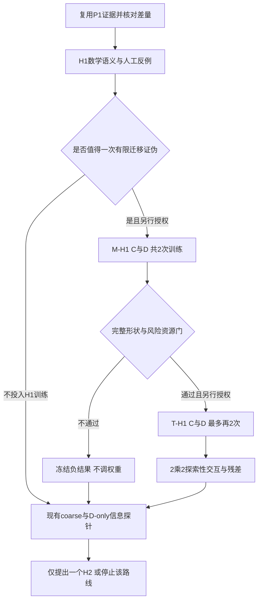

# Cranial-BCSP-Mamba P2：完整骨块空间覆盖机制与可靠性

**正式参考计划 v1.0｜2026-11-06**  
**状态：研究方案；待确认；不构成实施、服务器操作或训练执行授权。**  
文献检索截止：2026-11-06。本文替代原草案中与本版不同的建议；保留历史实验及其失败判定，不覆盖原文件。

## 1. 研究判断与本阶段边界

下一阶段应从“更换 encoder 能否提升平均精度”，转向：**完整缺失骨块生成中的位置、范围和覆盖错误，能否通过可验证的 coarse 几何机制得到稳定改善，同时不把风险转移给原本正常的病例。**

用户原计划总体合理：保留固定任务和数据、先查计算图、使用反例检验简单损失、要求全形状和风险收益、区分辅助监督与结构耦合、保留 Transformer 对照，都是正确的研究设计。需要修订的是实验语义、进入训练的条件、探针基线与研究预算。不能将“加质心/半径损失”“加入输入锚点”直接当作创新，也不能把一次 CPU 正确性检查视为训练效果证据。

本阶段的最低有效产出不是必须得到正结果，而是明确以下三种情况中的哪一种更接近事实：

1. **监督利用不足**：原模型已有足够位置/范围信息，简单辅助约束能改善完整形状和病例风险。
2. **条件信息利用或输出表达不足**：输入/encoder 中存在可预测信息，但 learned coarse/query 未有效使用，或者少量全局矩无法表达多区域骨块。
3. **当前机制无效或不稳定**：矩改善未转化为覆盖收益，或修复旧失败同时引入新失败，应停止该候选，不继续调权重救结果。

本计划只冻结 P2 的研究路线与决策原则。H1 的具体有限实验可在实施后形成独立 request；H2 尚需依据机制证据冻结一个具体设计。本文不是包含任意后续结构的无限授权。

## 2. P1 证据与不能越过的推断边界

### 2.1 已完成的基础

P1 已正式收束。T0 使用全局 attention encoder；M0 将相应分支换为 XYZ 稳定排序、双向共享 Mamba，decoder 仍保留 Transformer。输入/输出均为 8192 点，256 个 learned coarse/query；训练为每 run 3900 次更新。

| 开发集来源等权指标，M0−T0 | Fold C | Fold D | 正确解释 |
|---|---:|---:|---|
| E P95，mm | −1.5144 | +0.3622 | 跨折不稳定 |
| CD，mm | −0.4223 | +0.7101 | 不能声称总体稳定胜出 |
| J P95，mm | −2.1507 | −0.1273 | 局部收益不能替代全骨块覆盖 |
| E Cover@2mm，百分点 | +5.4050 | −3.1502 | D 折出现覆盖回退 |
| J Cover@2mm，百分点 | +3.2835 | +2.2164 | 同时存在局部改善和整体退化 |
| 严重几何代理事件，T0→M0 | 7→4 | 5→10 | 合计风险数没有改善 |

M0 参数量为 33,942,337，T0 为 31,707,457；M0 多约 7.05%。P1 的实际耗时与显存记录不支持已获得效率优势。Mamba 的序列复杂度不能替代本任务实测。

冻结病例显示至少两类机制：D/079/frontoorbital 在 coarse 阶段已明显错位并收缩；D/008/random_2 没有 >20mm 预测离群点，仍然漏覆盖。这支持同时观察位置与形状，但不证明具体某一 Mamba 层就是根因。当前 coarse **已有 Chamfer 监督**；不能写成“补上原本缺失的 coarse 监督”。

### 2.2 历史负结果的使用方式

更早 D2.1 的 centroid/radius 候选曾出现“对应矩改善但灾难病例增加”：Q0 31/420，Q2 38/420，另有非有限接口结果。该阶段任务表示、结构和评价与 BCSP 不完全相同，不能合并计分，也不能证明新表示上的 H1 必然失败；但它足以反对将 H1 当作默认有效方案。

因此，H1 定位为**一次有预算上限的迁移证伪/机制对照**，不是论文核心创新。训练前必须写明：新表示为何可能改变该机制的行为，以及怎样的结果会让我们放弃它。允许根据已有证据决定不训练 H1，直接进入有限的条件信息检查；不必先花 GPU 证明历史负结果再现。

### 2.3 证据恢复现状

P1 代码、配置、指标和冻结证据已有本机及 GitHub 归档；四个关键 checkpoint 已在本机验证保存。服务器清理后，不能假定这些权重和原始预测仍在服务器。

本机重要位置：

- 轻量归档：`E:\ResearchBackups\AdaPoinTr\BCSP_MAMBA_P1\2026-11-06_P1_final_archive`。
- 权重归档：`E:\ResearchBackups\AdaPoinTr\BCSP_MAMBA_P1\2026-11-06_P1_checkpoints_v1`。
- C/D 预测：同一根目录下 `2026-11-06_FoldC_paired_development_eval`、`2026-11-06_FoldD_paired_development_eval`。
- GitHub：[AdaPoinTr_Adapt](https://github.com/ZhangHuijun520/AdaPoinTr_Adapt)，annotated tag `cranial-bcsp-mamba-p1-20261106-final`，commit `8c638d04e53b6c2a7dfccef39488875bbcdd532d`。

需要恢复时，仅上传相应任务需要的精确文件，核验已记录 SHA256，不覆盖已有不同文件，不重训来替代恢复。新的容器身份、GPU、空闲资源与 provider 兼容性在实际操作前核对，本计划不指定过时 hostname。

## 3. 文献对路线与创新性的约束

### 3.1 Mamba 与几何锚定已经不是空白

AdaPoinTr 的几何 query 和去噪机制提供直接母版；AnchorFormer、SeedFormer 已分别研究区域锚点与 patch seeds。故“从输入预测若干锚点再生成点云”本身不足以构成新颖性；完整对象补全中保留输入点的设计也不能直接搬来作为只输出缺失骨块的方案。[AdaPoinTr](https://arxiv.org/abs/2301.04545)、[AnchorFormer](https://openaccess.thecvf.com/content/CVPR2023/html/Chen_AnchorFormer_Point_Cloud_Completion_From_Discriminative_Nodes_CVPR_2023_paper.html)、[SeedFormer](https://arxiv.org/abs/2207.10315)。

CompletionMamba、2026 年 Mamba–Transformer 补全网络及 FusionMamba 已涉及补全任务中的状态空间建模、空间信息和几何融合。它们使“把 attention 换成 Mamba”或“加入几何信息”更难成为充分贡献；但通用对象上的结果不能证明颅骨多表面任务的可靠性。[CompletionMamba](https://pubmed.ncbi.nlm.nih.gov/40853794/)、[Mamba–Transformer completion](https://www.sciencedirect.com/science/article/pii/S0957417425044410)、[FusionMamba](https://www.sciencedirect.com/science/article/pii/S1566253526002575)。

DAPointMamba 面向域适应补全，CloudMamba 面向点云分析，Hyper-PCN 面向高阶相关性。可用来界定相关工作，不能把它们都写成相同任务上的临床重建证据，也无需在本阶段全部复现。[DAPointMamba](https://ojs.aaai.org/index.php/AAAI/article/view/37596)、[CloudMamba](https://arxiv.org/abs/2511.07823)、[Hyper-PCN](https://openaccess.thecvf.com/content/CVPR2026/html/Li_Hyper-PCN_Hypergraph-Based_Point_Cloud_Completion_via_High-Order_Correlation_Modeling_CVPR_2026_paper.html)。

### 3.2 医学重建的竞争点与评价边界

MedPCFM 在 SkullFix/SkullBreak 等任务中引入 PTv3 和 flow matching，也构建确定性 PTv3 基线；这是后续同协议强基线的重要依据。其公开实验点数和采样协议与本项目不同，不能横比论文表格，也不能据此推翻本项目固定 8k 的选择。[MedPCFM，2026-06 预印本](https://arxiv.org/abs/2606.24433)。MedPCFM-TED 为 SASHIMI/MICCAI 2026 卫星研讨会工作，应与 MICCAI 主会区分。[官方页面](https://papers.miccai.org/miccai-2026-sat/SASHIMI_017.html)。

MICCAI 2026 的 TriFlow 与 LOT-Bridge 分别代表 triplane/flow 和 SDF/transport 路线。它们说明完整几何表达值得研究，但不要求本阶段切换输出表示、训练 diffusion 或重建整套生成框架。[TriFlow](https://papers.miccai.org/miccai-2026/1089-Paper1927.html)、[LOT-Bridge](https://papers.miccai.org/miccai-2026/0596-Paper1071.html)。

2026 年 10 月的 *Plausible but Unimplantable* 对公开模型零样本颅骨补全进行可信性审查，提示形状相似并不等同于可放置的植入物。其模型、训练方式和缺损表示与本项目不同，不能将其失败率迁移给 P1；可借鉴的是保留共享控制、关注残存骨与预测材料的关系，并明确点云指标的能力边界。[预印本／作者注明 ACCV TrustFMI 接收](https://arxiv.org/abs/2610.30035)。

临床 implant 的厚度与边缘设计也不同于简单的合成缺失骨块。完整边界点云提供多表面几何研究对象，但不是经过认证的临床可制造 implant。[Thickness and Design Features of Clinical Cranial Implants](https://pubmed.ncbi.nlm.nih.gov/38430381/)。

**本项目可争取的贡献**：在固定实体缺损和完整骨组织边界表示下，证明一种明确的输入条件—coarse—dense 耦合机制，改善跨来源的完整骨块覆盖和尾部风险；通过同机制 Transformer 对照判断其是否特别适合 Mamba。若只获得一般辅助损失收益，应如实收窄为通用机制，不强行宣称 Mamba 专属创新。

## 4. 固定任务、数据与训练合同

### 4.1 几何对象

实体互补关系为 \(C=D\cup G\)、\(D\cap G=\varnothing\)。输入为 \(\partial D\) 的固定 BCSP V1 点集，输出目标为 \(\partial G\) 的完整边界点集：包括原分割存在的内外表面、孔腔边界及实体切除产生的切壁。切壁是实体边界，不能从完整颅骨原表面删片后凭空获得。

不改变缺损构造，不重新搜索采样，不改变输入/输出点数，不把观测颅骨点拼到输出骨块里。当前“多表面”指几何采样覆盖的对象；模型并未因此自动获得显式内板/外板/切壁语义标签或专用特征。

### 4.2 数据与防泄漏

只使用 SkullBreak 已开放的 84 个来源、420 个固定病例。每折训练 63 来源×5 缺损=315 例；开发 21×5=105 例。C/D 开发来源互不重叠，但训练集重叠，不能视作两次完全独立抽样。

封存确认来源、官方测试、SkullFix 和 MUG 不因本计划而开放。SkullFix 可以作为最终候选的后续泛化验证，但须另定固定纳入来源与协议；MUG 暂不作为高精度训练 GT。

输入归一化/反归一化保持 defective-only。训练可使用 G 监督；推理不得使用 G、GT 质心/尺度、人工缺损类型、按 GT 计算的接口标签或 Oracle 配准。历史测试访问须保留溯源，不能重新命名为“从未看过的测试集”。

### 4.3 不随结果变化的合同

| 项目 | 固定值/原则 |
|---|---|
| 输入/输出 | 8192 / 8192；coarse 256 |
| 初始化 | 每个相同 backbone 的 H1 OFF/ON 共用对应 P1 初始化；共同参数按既有映射一致，新增分支另记种子 |
| batch / 更新 | batch 8；3900 optimizer steps；100 traversals |
| 曝光 | 31,200 exposures；300 drop-last；逐步 order 与 P1 绑定 |
| 优化 | 继承 P1 AdamW 参数组、有效 weight decay、SSM 例外、LR 及裁剪；不能只抄一个 wd 标量 |
| 已记录关键值 | LR 1e−4；betas 0.9/0.999；eps 1e−8；一般有效 wd 5e−4；clip 10；完整配置以冻结 runtime 为准 |
| 原损失 | coarse CD＋fine 重建；denoise=0；fine local=0；保持原方向和归约 |
| 数值 | 继承确定性/TF32 设置；保留已接受的有限梯度非确定性披露 |
| 执行 | 不自动 resume/retry；不进入 BNCal；固定末步 checkpoint，不按开发最优挑轮次 |

P1 曾在受控重复中观察到 M0 小幅梯度差异，不能承诺逐字节训练复现；单批次观察也不是全部训练误差上界。配对初始化与数据顺序仍必须一致。

## 5. 工作包 A：一次差量机制核对

优先复用 P1 计算图、实际取点轨迹、coarse/dense 与离线 Oracle 证据，不新建通用库存或传输审计工具。只核对与本次假设相关的差量：

1. D-only 坐标合同、world affine、轴顺序与毫米单位；模型坐标的中心/尺度来自 D。
2. encoder 输出、排序/逆排序、pooling、coarse 坐标头、decoder query 与 dense 相对位移的实际张量关系。
3. 原 coarse/fine loss 的实际输入与归约，H1 插入位置是否是最终训练 coarse，而非日志副本或 detach 张量。
4. 固定病例已有轨迹能否区分“coarse 已偏位”与“dense 新增错误”；缺失字段才另行限定 instrumentation，不能默认重跑全量 forward。
5. 恢复/读取所需权重和预测的精确本机来源，避免以已清理服务器路径为前提。

**完成标准**：一张有张量名称、维度和梯度关系的简图；一份差量清单；每个未知项写成具体问题。建议一个工作日内完成，超出则缩小研究问题或停止该候选，不扩展平台框架。该时间是管理预算，不是科研通过阈值。

旋转测试分清对象：统计损失可以旋转不变，XYZ 排序 Mamba 整体不因此保证旋转不变；不应给真实模型设一个其结构没有承诺的旋转等变准入条件。

## 6. 工作包 B：H1 的唯一数学语义与反例验证

### 6.1 修正原草案的公式歧义

本版选择与已有 `coarse_geometry_guard_components(..., requested_mode='centroid_radius')` 一致的数学定义，避免名同实异。对每例 coarse \(Q\) 与训练 GT \(G\)，在既有归一化模型坐标中计算：

\[
\mu_X=\frac1{N_X}\sum_i x_i,\quad
r_X=\sqrt{\frac1{N_X}\sum_i\|x_i-\mu_X\|_2^2+\epsilon},
\]
\[
a=\frac{\|\mu_Q-\mu_G\|_2}{r_G},\qquad
b=\log\frac{r_Q+\epsilon}{r_G+\epsilon},
\]
\[
L_{H1}=\frac12\left[\frac1B\sum_k\operatorname{SL1}_{\beta}(a_k)+\frac1B\sum_k\operatorname{SL1}_{\beta}(b_k)\right],\qquad
L=L_{P1}+0.1L_{H1}.
\]

其中 \(\operatorname{SL1}_\beta(z)=z^2/(2\beta)\) 当 \(|z|<\beta\)，否则 \(|z|-\beta/2\)。固定 \(\beta=0.1,\epsilon=10^{-6}\)。不添加 CVaR，不改变其他 loss。

原草案使用未归一化的三维质心差、\(\epsilon^2\) 和不同求和系数；这会改变量纲、旋转行为、梯度及有效权重，不能声称只是排版差异。0.1 仅是本候选的事前系数，不是最优值或跨定义通用值。

按实际代码，epsilon 同时进入平方根和半径比，量纲并不完全统一；这是与历史实现一致的数值约定，只用于固定归一化坐标。不得宣称任意缩放下严格等变。若将来改变此约定，应另立候选，不在本次顺手修正。

GT 矩来自固定的 8192 目标采样，属于该表示下的经验矩；不能解释为精确实体体积质心，也不能视为精确连续表面积分。Q/G 点数不同不妨碍均值计算，但 coarse 到 dense 的覆盖改善需要实测。

### 6.2 一批有针对性的 CPU 检查

只测试实际使用的函数与调用路径，不为可逆小改动堆叠通用测试。一次限定批次覆盖：

| 情形 | 需要验证/记录 |
|---|---|
| Q=G | loss 为零，有限梯度 |
| 共同平移、正交变换 | 标量 loss 不变；单独预测平移产生预期惩罚 |
| 放缩 | 固定 epsilon 下的实际偏差与适用尺度，不强断言精确等变 |
| 不同点数/排列 | 均值归约正确；点排列不改变 loss |
| 等质心等半径但形状不同 | H1 可接近零而覆盖错误，明确反例 |
| 完全坍缩与近坍缩 | 有限性、梯度；完全重合时半径项不保证能自行打散点 |
| 小 GT 尺度/退化 GT | 清楚报告数值行为；真实数据异常不能通过临时 clamp 隐藏 |
| batch 归约 | 单例结果与 batch 平均一致，0.5 系数不遗漏 |
| 真实训练调用 | H1 ON/OFF、总 loss、反向到 coarse 及 encoder 的梯度确实生效 |
| OFF 路径 | 原 loss、输出与公共参数不发生意外变化 |

记录 H1 与 CD 的梯度范数/夹角仅作机制描述。梯度相近不证明 H1 无用，梯度相反也不自动证明有害，不能仅凭一次 cosine 作训练效果判定。有限差分只对非奇异小样例使用。

如入口/算子后端不变，后续只做与新 loss 相关的最小实际 CUDA loss/backward 检查，建议两臂合计 2 forward、2 backward、0 optimizer step；不得重复整套已通过 preflight。精确次数、输入、预算在实施后 request 中冻结。若实际更换 CUDA/backend，则另行说明必要准入，不能扩大成通用审计项目。

### 6.3 是否值得训练的事前决定

CPU 数值正确只是必要条件。进入 H1 完整训练前另行确认：历史负结果、当前残差类型、H1 反例、有限训练预算已经被接受。若决定跳过 H1，记录原因后进入工作包 E；不能记为“H1 在 BCSP 上实验失败”。

## 7. 工作包 C：最多两次 H1 证伪训练

若选择训练，只新增 M-H1_C 与 M-H1_D，seed0，各3900步，与已冻结 M0_C/D 对应。两折结果必须都保留，不先看 C 再改 D 超参，不筛病例，不更换采样或目标。资源不足时允许顺序运行，但首个结果不用于改第二个合同。

每例保存 Native dense 评价、coarse/dense 质心误差和半径比。固定少数病例可以保存详细中间张量；全量不保存 attention/SSM 巨型轨迹。质心比较与毫米评价先正确反归一化。

### 7.1 指标与统计单位

沿用冻结评分器中 E、J、A1、A2 的精确定义及参考采样，不在此重新定义相似名字的集合。E/J 对参考表面的覆盖与 pred→A2 的反向精度分别报告，不能只看对预测有利的方向。

- 主效果：来源等权 E P95，mm。
- 关键伴随指标：E Cover@1/2mm，J P95/Cover@1/2mm，双向 CD，pred→A2 P95、>20mm 比例。
- 机制指标：coarse/dense 质心误差；半径比与 \(|\log(r_Q/r_G)|\)；Native 与既有离线 Oracle 的差距。
- 病例代理：centroid>20mm、radius_ratio<0.9 分别记录；严重几何事件仍为 `E_P95>20mm OR J_Cover@2mm=0`。

严重几何事件不把 centroid 或 radius 事件悄悄并入。非有限/未定义指标单列，不填零或丢行。每来源五缺损先平均，再对21来源等权；不能把105病例当105独立患者。

### 7.2 明确的资源晋级规则

以下是拟事前采用的**保守资源门**，用于决定是否追加 Transformer 对照；不是临床安全阈值、统计显著性结论或最小临床获益量。全部使用保存的未四舍五入数值，差值为 ON−OFF：

| 条件 | C、D 每折均须满足 |
|---|---|
| 完整性 | 训练、计数、初始化、批次顺序、评价清单通过；失败不解释为科学负结果 |
| 机制 | coarse 质心误差与绝对 log 半径误差均不增加，至少一项下降 |
| 主效果 | 来源等权 E P95 下降 |
| 伴随效果 | CD 不增加；E/J Cover@2mm 不下降；>20mm 反向离群比例不增加 |
| 病例风险 | 严重几何事件数不增加，且候选独有新严重病例为0 |

这是比“平均上更好”严格得多的筛选策略。任一不满足，停止 H1 自动晋级，仍完整报告连续效应、区间及新/救回/共有/均无四格转移。轻微混合结果应写“未通过预定资源门”，不能据此宣称普遍无效。任何改变晋级规则的建议须先作为新协议确认，不得追溯改判旧结果。

若只改善矩而全形状不改善，结论是“简单矩约束不足以解决当前覆盖/风险”，而非已经证明需要某一个指定新模块。若出现新风险，不能靠扫 lambda、改变阈值、筛掉 frontoorbital 或修改输出点数救候选。

## 8. 工作包 D：条件式 Transformer 对照与交互

只有 H1 通过上述资源门并经单独决定后，新增 T-H1_C/D 两次，构成每折 seed0 的2×2表：

| encoder | H1 OFF | H1 ON |
|---|---|---|
| Transformer | 已有 T0 | 条件式新增 T-H1 |
| Mamba | 已有 M0 | 工作包 C 的 M-H1 |

对同一来源、相同指标计算交互：
\[
I=(M\!+\!H1-M0)-(T\!+\!H1-T0).
\]
对误差指标 I<0 才表示 Mamba 的改善幅度更大；覆盖指标方向相反。同时报告各臂绝对水平及两种改善幅度。仅比较 M-H1 与 T-H1 不能分离 backbone 原有差异。

seed0 的交互是探索性结果。即使 H1 对 Mamba 更有效，也不能排除参数量、优化轨迹或方差影响。若两 backbone 均获益，应优先写成一般几何监督机制。P1 的参数不匹配继续披露；本阶段不捆绑宽度匹配大规模搜索。

**预算**：首轮最多4次新增训练，15,600更新；不是必须花满。若批准后续2臂×2折×新增seed1/2，需要另加8次；4臂则另加16次。现有 seed0 专用 factory/runtime 不能默认为已支持新 seed，须最小适配后另行授权。不得把“多seed”藏在首轮四次预算内。

## 9. 工作包 E：D-only 条件信息与表达力，先诊断再定结构

本工作包是后续结构研究的入口，可在 H1 被跳过或收束后开展，也可在 H1 有收益但仍有明显残差时提出。**不把“必须先让 H1 失败”当作结构创新的逻辑前提。**

### 9.1 先问现有模型已经知道多少

使用对应折的冻结 T0/M0，提取训练与开发的固定全局特征，不更新 backbone。标签为训练 G 的中心/尺度；开发标签只评价。最少基线为：

1. **常数基线**：该折训练来源等权标签均值。
2. **现有 coarse 基线**：冻结 T0/M0 已输出 Q 的中心、半径。这是不可缺少的基线，优于常数并不意味着新增定位器有价值。
3. **D-only 简单几何基线**：固定少量分布摘要；注明 bbox 归一化后某些 bbox 特征接近常数，不伪装成有效空间信息。
4. **冻结特征探针**：T0、M0 各一个固定的正则线性读出；先不同时比较一串 MLP 宽度与多个正则系数。

读出训练只用该折训练来源；标准化也只在训练拟合。若需要选择正则，使用事前固定的来源分组内层划分，且计入预算；更简单的选择是冻结一个标准正则配置作为有限诊断，不宣称其逼近可预测性上界。

**跨折泄漏关键点**：不能用 C 折 encoder 提取 D 折开发特征并称为 D 折未见来源验证，因为 D 开发来源可能已在 C 训练中出现。每折特征必须来自该折对应模型；标签、归一化和源编号溯源一起保存。

输出每来源误差与相对现有 coarse 的增益。探针优于现有 coarse，支持“信息存在但坐标头利用不足”；探针不优于 coarse，只是否定当前特征/读出组合，不能证明缺损位置从输入不可预测。

### 9.2 全局矩不够，不等于立刻加入多锚点

先区分：预测错位、各向异性范围错、缺失多区域、dense patch 覆盖不足。反例说明单中心/半径不能确定形状，却不能直接证明 K=4 或 K=8 最合适。

若开展 GT Oracle 表达力检查，必须先写明“参数如何生成几何/点集、输出点数和评价对象”，不能仅给球/椭球/多中心参数就报告形状覆盖率。GT 优化得到的配准/锚点只衡量该表征的拟合潜力，不是可推理性能。未明确解码器前，本版不授权此类 Oracle 数值比较。

根据证据只选择**一个**最小 H2：例如一个 D-only 的各向异性空间条件或固定少量区域条件，用软方式影响 learned coarse/query；避免先硬裁剪预测到错误区域。具体参数化、坐标系、监督对象、如何进入 query、OFF 恒等路径和损失权重需要另写一页补充协议。不能在训练时使用 GT 条件，在推理时换成预测条件却不单独评估误差传播。

### 9.3 AUX 与 COUPLE 的公平比较

若需要检验结构耦合，AUX 与 COUPLE 使用相同 head、相同参数与监督；区别只有预测条件是否进入 coarse/query。AUX 的辅助损失仍会更新 encoder，并非“没有结构影响”，需要完整描述梯度。

COUPLE 须有真实路径干预：关闭/置换预测条件会改变对应输出，且不读取 GT。仅注意力图或梯度非零不等于模型有效使用条件。条件置换只作离线诊断，不作为正式推理或评分操作。

先在固定 backbone 建立耦合价值，再决定是否做 backbone×coupling 的完整交叉。H2 的新训练预算独立审批，不包含在 H1 的4次中；禁止把“收尾”不断延长成未计数的实验矩阵。

## 10. 统计分析与结果解释

1. **分折为主**：先列 C/D 各自来源配对效应、均值/中位数、退化比例、病例风险转移，再给42个开发来源的描述性合并。不能让 C 的收益掩盖 D 的损失。
2. **来源簇**：如进行 bootstrap，固定10,000次，按折分层抽来源，每次带入同来源全部五缺损，所有臂共享抽样索引。多缺损不是独立样本。
3. **不确定性的范围**：单 seed 的来源 bootstrap 仅描述这些冻结模型在已开放开发来源上的条件不确定性；不覆盖训练 seed、训练集抽样、平台数值和外部人群差异。
4. **多 seed**：保留每seed各折结果。可先对同来源的匹配 seed 差值求平均再做来源簇 bootstrap，同时单列 seed 变化；不能把重复 seed 当成新增独立患者扩大 n。少数 seed 不足以稳定估计训练随机性的总体分布。
5. **主要/次要**：E P95 为主，覆盖、CD、风险为并列解释和资源决策项；缺损类型为固定分层描述。若做正式多指标检验，需要单独预定多重比较策略，不能从大量 p 值中挑最小者。
6. **开发集使用**：本批数据已多次用于机制和候选选择，所有结论标记为开发/探索性。仅对最终冻结候选使用符合历史访问限制的独立来源确认；不承诺现有 sealed 集一定适合所有新任务。
7. **Oracle 隔离**：Native 分数是模型性能；最优平移/刚体等 GT 辅助分数单列“误差归因”。配准后分数不得进入主表，也不能作为部署后处理。

位置改善、形状覆盖改善与接口改善须分别陈述。统计显著不自动意味着临床有用；当前未设有可靠依据的最小临床获益量，不应临时发明毫米阈值充当临床门槛。

## 11. 临床相关性与后续论文确认

当前输入/GT 包含的多表面信息不保证稀疏预测已保真恢复厚度、拓扑或水密性。2mm 接口覆盖是固定参考下的研究代理，不能当作临床接触质量认证。

共享的 no-op/简单控制必须与正式评分对象一致。原任务要求输出缺失骨块，直接返回 D 的控制只能按明确协议解释，不能混同完整颅骨重建。预测点靠近残存骨也不等于实体穿透；没有实体化与网格质量验证，不能给出可靠穿透体积或制造合格结论。

当固定候选在 C/D 和重复 seed 下显示可靠收益，再考虑三项论文级补强，单独制定有限预算：

- 一个同任务强基线，优先评估确定性 PTv3 或可合法获得、能适配目标的 completion Mamba；先核实代码/许可证/预算，不预先保证可复现。
- SkullFix 固定来源外部验证，保持任务/采样/物理单位一致，报告域差异；不把其结果与 SkullBreak 直接混成独立大样本。
- 独立确认集、资源实测与消融。若确有实体重建需求，再研究网格、厚度与碰撞，作为后续任务，不在当前 P2 随手加上。

目标是一个问题清楚、对照充分、风险诚实的研究，而不是尽量堆叠模块。是否适合投稿某个 CCF C 会议仍取决于创新、实验和具体征稿要求，当前计划本身不能保证录用。

## 12. 工作量、停止规则与交付

| 工作包 | 核心产出 | 本轮建议上限 | 何时结束 |
|---|---|---|---|
| A | 差量图/合同/未知项 | 1个工作日；不新建框架 | 问题具体化即可，不无界补证 |
| B | 唯一 H1 公式、人工反例与实际调用验证 | 1批限定 CPU 检查；必要的最小2/2/0 CUDA | 不通过则停止，修复需新版本授权 |
| C | M-H1 C/D 同协议结果 | 2 runs，7800更新 | 两折评价及冻结完成 |
| D | 条件式 T-H1 及交互 | 最多再2 runs | 首轮累计≤4新runs |
| E | 常数/coarse/几何/特征读出及残差归因 | 一个固定配置/读出；不扫参 | 形成一个可证伪 H2 或明确停止 |

以上时间是目标预算，受平台排队和资产恢复影响；不能用超时继续扩框架。GPU训练/预测的具体墙钟、显存、磁盘和监测阈值在实际 request 前结合当前设备冻结，继承可用 P1 合同；这里不凭空填入“保证可用”的数值。

执行只保留必要守卫：来源与代码身份、精确依赖/provider、授权范围、不覆盖安装、数据隔离、资源监测及超限停止、完整计数、产物哈希。服务器禁止联网下载/升级；如确需本机取得依赖，另行授权。使用平台可实现的监测与停止，不为不可提供的 cgroup 或跨 namespace PID 硬证明继续开发框架。监测不是硬隔离，应披露采样间隙和共享设备限制。

计划确认 → 最小实施/针对性验证 → 最终哈希与必要就绪核对 → 待授权 request → 单独执行授权 → 单次执行 → 正式冻结审计 → 科研解读。合并同范围准备，避免每个小字段都滚动扩展一次工具；未授权执行仍保持待授权。失败不自动重跑。

每个工作包仅需：版本化协议/差量说明、精确输入绑定、必要代码与测试记录、病例和来源表、风险转移、主图/结论、完整清单与哈希。关键权重存本机备份，GitHub 只存适合公开的代码、协议、指标和轻量证据。归档核验前不删服务器唯一产物。

## 13. 本次计划确认后的直接下一步

先完成工作包 A 的**差量核对＋H1 公式确认＋是否投入 H1 的事前决定**。不重新检索整台服务器，不重复已经通过的 GPU preflight，不自动恢复权重或训练。

若选择 H1，限定实施和验证后创建 M-H1_C/D 的待授权范围；若不选择 H1，则先做现有 coarse 与冻结特征的有限预测性对照，再冻结一个 H2。两条分支都以科研问题是否得到回答为完成标准。

## 附录：本版证据基线

- P1 正式报告：`outputs/cranial_bcsp_mamba_p1_20261104/P1_full_experiment_report_20261106_v1/Cranial_BCSP_Mamba_P1_完整实验报告_zh_v1.md`，SHA256 `43281c93cbe330f6f4aead318bef8c80f1169ac94259b34a29b935467ec98fe6`。
- P1 closeout：`P1_phase_closeout_receipt_v1.json`，SHA256 `3559e206fc4ae525f858a260cd28e148f57f82954916ba1bbf4356228bc25c04`。
- 既有 H1 最小假设草案：SHA256 `de6e69bc3ef2055cd2bad2f39c7b2bfc09628b62ddbb7d9846f7b9b332a97357`。
- H1 所在 `AdaPoinTr.py`：SHA256 `1f3eb07ad0c3e2f78756682dcb273d745939dc7efda5563c6528915d6d89a1d4`；P1 runtime：`939e317dd447d04c62897849c0230f1918dc65c46ec556acdb60c9d69dfebeee`。
- P1 本机 checkpoint 归档 SHA256：`7d1bf39505ae8a07145e878068e33b0253edcc34cd8eb7d66165290e7143c928`。本版未重新遍历大归档，其状态引用既有核验记录。

文献核查深度、可用性限制与补充资料见同目录《文献与证据核查表》。本方案没有声称已逐篇取得所有付费全文，也没有宣称系统综述穷尽了全部文献。
