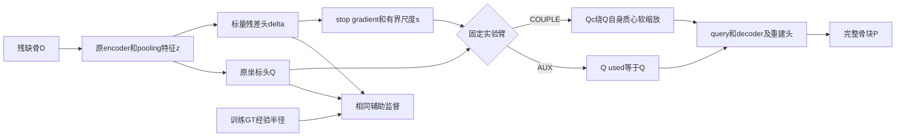

# H2：输入范围条件与生成路径软耦合——最小假设草案 v1

日期：2026-11-07。状态：**待审核草案，仅提出一个候选，不构成实现、数据处理或实验执行授权。**

## 1. 唯一科研假设

在固定 BCSP 完整缺失骨块任务下，**由 D-only 全局特征预测一个范围修正条件，并将其有界地作用于 learned coarse、query 和后续生成路径，相比使用同样监督但不耦合的 AUX，能够改善完整骨块表面覆盖与接口吻合，同时不增加严重退化。**

本草案只研究一个标量、各向同性的 coarse 范围修正；不同时加入中心预测、各向异性框、多锚点、接口定位器或新采样。候选若失败，不通过添加这些分支继续修补。

这里的“范围”是 GT8192 表面采样的经验回转半径，非实体体积、解剖厚度或外接球。**矩预测改善只是机制证据，不能替代完整形状、接口与风险结果。**

## 2. 证据依据及尚未成立的推断

冻结特征读出审计已通过。M0 C／D 的绝对 log 半径误差为 0.11213→0.07112、0.15117→0.09546，分别19/21、18/21来源改善；质心误差仅降低约0.38／0.50 mm，且 frontoorbital 两折定位均退化。T0 也有读出收益，故不声称 Mamba 专属机制。

H1 的辅助矩监督改善部分 coarse 矩，却使完整形状 E／J P95、CD 回退。因此不能再次把“加一个半径损失”当成完整方案，也不能把现有读出中心硬替换进去。

**新的、尚需证伪的两步推断**：

1. z 中可线性读出的绝对 log 半径，不保证相对当前 coarse 的范围修正量同样可预测；本候选的残差头需要直接接受检验。
2. 即使修正量预测正确，粗点的径向调整也不保证经 decoder 后得到更好的完整形状。等矩异形、位置错误与多区域缺损仍可能使本候选失败。

## 3. 固定边界与记号

继承 M0 的对应折模型结构、原任务、原数据／fold、BCSP V1采样、8192输入／8192输出、256 coarse、既定数值后端及3900-step合同。H1关闭，其结果单独保留。

设 z∈R^1024 为原 `base_model.coarse_pred` 输入，Q∈R^(256×3) 为原头输出；G∈R^(8192×3) 为训练目标，均在既有 D-only 归一化坐标中。定义：

\[
\mu_X=\operatorname{mean}_i X_i,\qquad
r_X=\sqrt{\operatorname{mean}_i\|X_i-\mu_X\|_2^2}.
\]

不把 H1 的加 epsilon 半径约定偷偷带入这里。数学定义不加 epsilon；拟议实施对非有限数或 r≤10^-6 停止，禁止临时 clamp、替换目标或隐藏退化。10^-6 是归一化数值保护，非临床／科研收益阈值。OFF 分支不新增该计算或断言，保持原路径。

## 4. 唯一候选参数化

### 4.1 零初始化的标量残差头

新增一个线性头，只有1025个参数，无隐藏层、BN、dropout或新的特征标准化：

\[
\delta=h_\theta(z)=w^Tz+b,\qquad w=0,\quad b=0\quad\text{at initialization}.
\]

训练标签为相对原始 Q 的 log 半径修正量：

\[
t=\log r_G-\operatorname{sg}(\log r_Q),\qquad
L_{aux}=\operatorname{mean}_{batch}\operatorname{SL1}_{0.1}(\delta-t).
\]

sg 表示 stop-gradient。标签参考始终是**未耦合前的原始 Q**，不是 Qc，也不是 dense P。G只用于训练损失，推理和实际耦合均不读取G。

原始Q随训练变化，因此标签是动态残差；这与已完成的固定绝对半径ridge不同，不能写成“直接迁移已验证探针”。AUX／COUPLE使用相同标签函数，训练后数值可随各自Q变化，不承诺两臂逐步标签或梯度完全相同。

### 4.2 有界软耦合

固定 a=log(1.25)，定义：

\[
s=\exp\!\left[a\tanh\!\left(\frac{\operatorname{sg}(\delta)}{a}\right)\right],
\qquad
Q_c=Q+(s-1)(Q-\mu_Q).
\]

数学上 0.8<s<1.25，且 μ_Qc=μ_Q、r_Qc=s·r_Q。浮点实现需用事先说明的数值容差核验这些恒等关系，不承诺逐位的中心相等。

1.25 是本次事前选定的保守单次范围上限，**不是从开发集优化出的最佳值或临床安全界限**。本轮不扫描它，也不在失败后放宽。它可能不足以修复严重收缩，也可能对正常病例有害，均如实记录。

δ=0 时以 `Q + zero_residual` 表达，使新头初始化为中性；正式OFF必须直接走原始路径，不用代数等价的重算代替恒等路径。有限非零δ才改变coarse范围。不投影到GT、不硬裁剪、无GT后处理，不修改输入点。

OFF构建也复用原factory，不实例化新头或改变原state_dict键；新增头仅属于AUX／COUPLE。旧M0严格加载路径不因本候选而改变。

### 4.3 梯度合同与区别于H1的地方

总损失为：

\[
L=L_{P1}(Q_{used},P)+0.1L_{aux},\qquad
Q_{used}=Q\ (AUX),\quad Q_c\ (COUPLE).
\]

保留原 coarse CD＋dense CD 的方向、系数与后端；不同时加H1或dense半径损失。辅助项系数0.1、SL1 beta0.1只是该候选的固定选择，不宣称跨目标最优；不扫描。

- L_aux→δ→z→encoder；由于标签中的Q被detach，不直接从此项反传到 `coarse_pred`。这与H1直接约束Q不同。
- 耦合中的δ也detach，因此重建损失不经标量头训练“非范围语义”的捷径。标量头只接受明确的范围残差监督；z仍接收原重建与辅助项梯度。
- 原重建梯度仍通过 Qc 回到 Q、原坐标头与encoder；μ_Q不detach。不能把整个Q或Qc detach。
- AUX同样会通过辅助监督更新encoder，并非“对模型无影响”。两臂训练轨迹不同是处理结果，不是需要强行保持的等价性。

这是“具有明确监督语义、stop-gradient条件的耦合”候选；不是端到端自由条件头，也不证明自由梯度方案无效。

## 5. 只能有一个坐标入口，必须贯通生成路径

在 `learned_only` 得到原 Q 后、构造 query 之前，对COUPLE产生Qc。所有原本消费最终coarse的位置一致使用Q_used：

1. `mlp_query(cat(z,Q_used))`；
2. decoder 的 `q_pos=Q_used`；
3. 重建特征拼接中的 coarse 坐标；
4. 最终 `P[j,k]=Q_used[j]+Delta[j,k]`；
5. 返回用于原coarse CD和评价的coarse。

原始Q仅作为范围残差标签参考及诊断记录，不混回下游。不得只修改日志副本、最后一行输出或仅修改coarse loss。

保留Q质心不等于保留P质心，因为decoder相对位移可改变。该机制不能独立修复整体错位、各向异性或拓扑，也不能保证不制造远端离群。

## 6. 最小公平对照与预算草案

| 臂 | backbone／原损失 | 标量头及L_aux | 条件进入生成 |
|---|---|---|---|
| 已冻结M0 | 原M0 | 无 | 无；复用已有结果 |
| H2-AUX | 同M0 | 同一参数化与权重 | 不进入；Q_used=Q |
| H2-COUPLE | 同M0 | 同一参数化与权重 | 按上式只进入一次 |

主比较为COUPLE−AUX，M0作既有锚点。不能只与M0比较便宣称结构耦合有效。初期不增加Transformer耦合臂或seed，不能宣称Mamba特有创新。

拟议预算上限：两臂×C/D各一次，共4次新训练、15,600更新；每run batch8、3900步、100 traversals、31,200 exposures、300 drop-last。每臂／每折仍315训练病例、105开发病例。四次从各折相同P1初始化重新训练，不从P1／H1最终权重resume。

两臂共同参数、输入／目标、完整batch顺序、LR／优化器／权重衰减／裁剪与既有合同一致。新增头在原母版和Mamba初始化完成后以零值创建，不重初始化原模块、不消耗公共RNG；两臂新增W采用既有一般参数wd=5e-4、bias不衰减，原参数组分类不变。须按实际optimizer合同再核对，不能仅凭本表推断实现。

C/D按事前冻结的同一配置完成，不根据C折loss或开发成绩改D折。资源／非有限失败即停，不自动补run、resume或换病例。4次是待单独授权的最高预算，不是已批准执行。

## 7. 最小实施与验证准入

草案确认后，才限定实现标量头、单一coarse分派、必要日志和对应入口。CPU验证集中覆盖：OFF复用原路径；零初始化中性；范围／质心恒等式；极端δ的有限有界性；非有限／退化拒绝；相同GT半径而异形的反例；真实坐标消费者一致；辅助／重建梯度符合detach合同；共同初始化、优化器分类与计数不变。

不把几何变换的正交协变性质误写成XYZ排序Mamba整体旋转等变。CPU成功也不代表CUDA成功。

不重复已完成的通用GPU preflight；若新增几何／梯度路径确需实际CUDA验证，应另列仅覆盖新路径的一次人工两臂检查，拟合计2 forward、2 backward、0 optimizer step。它的精确输入、资源、计数与授权独立冻结，不自动启动，更不借此扩大平台工具。

训练日志只增原Q／Qc／P经验矩、δ、目标t、尺度s、辅助及原损失，明确训练G仅作监督；不为常规日志重复完整forward或新增通用特征库存。

## 8. 评价必须回答形状问题

固定末步checkpoint，四模型各105例开发预测，共420次Native预测，复用已冻结M0评价。既有评分定义及阈值不变：来源等权E P95为主，CD、E／J Cover@2mm、J P95、预测到参考的>20mm离群及严重几何风险并列解释。分折、每来源和五缺损类型完整报告，frontoorbital单列但不剔除。

范围诊断同时列：δ对动态目标t误差、原Q／Qc／P半径误差、质心变化、尺度分布及接近上下界的情况。即使这些改善，若完整表面或接口不改善，仍是H2未获支持。

**事前继续投入条件草案**（保守研究资源条件，不是临床门槛）：

- COUPLE相对AUX在C/D的来源等权E P95均降低；CD、J P95不增加；E／J Cover@2mm不下降；>20mm离群不增加。
- COUPLE相对既有M0也不得以完整形状或接口回退交换矩收益，按上述同方向核对。
- 严重几何病例总数不增加，且相对AUX、M0分别统计的新增严重退化均为0；净数量下降不能抵消新失败。
- frontoorbital的来源等权E／J P95及质心误差不增加。此项根据既有明确回退风险事前提出，不是评价后追加筛选。
- 所有病例计数、代码／输入身份与数值合同完整；不放宽阈值、容差或剔除非有限病例换取通过。

均值／中位数、改善／退化来源数和风险转移共同解释；本轮不增加bootstrap或p值。两折各21开发来源，两个模型臂不是新增独立患者；结论仍是已多次使用开发集上的单seed探索性证据。

## 9. 验证“真的用到条件”的最小干预

只对COUPLE每折固定5例：在既定开发case顺序中，每种缺损取第一例，在H2新结果出现前冻结精确case ID。Native来自上述105例，无额外原生重跑。

每个固定例新增两次离线诊断：①强制δ=0；②替换成同折固定5例Native δ按预先固定case顺序循环移位的值。供体条件只来自D，不能依据G或结果选择。不改checkpoint、输入、模型模式或其他开关，共10例×2＝20次额外forward；连同Native评价总计440次，须单独授权。

记录原Q不受替换影响、Qc与P如何变化及形状／接口误差变化，检查相同输入下的条件路径。若供体δ相近或下游补偿使P不变，这就是证据，不扩大病例或置换次数补救。δ=0的COUPLE仍是训练过COUPLE的模型，**不是**恢复M0或AUX；置换／关断分数不进入Native主表，也不能作为正式推理方式。

按首例规则得到的五缺损可能来自同一来源；10个固定病例不等于10个独立患者，只作限定机制诊断，不进行独立样本统计。

只有梯度非零、尺度变化或注意力图变化不证明有效使用范围语义。干预能证明该路径的作用及局限，不能凭10例证明总体泛化；最终收益仍依赖完整Native评价。

## 10. 明确的证伪与停止解释

| 观察 | 应当得出的结论 |
|---|---|
| 残差头不能学到有用范围修正 | 固定绝对半径探针不能自动迁移成该残差头；停止当前候选，不扫头宽或lambda |
| Qc半径改善，P／E／J不改善 | 低阶矩或该耦合位置不足；不能报告补全成功 |
| AUX与COUPLE相近 | 无足够结构耦合增益，不能只靠参数或辅助监督包装贡献 |
| COUPLE改善均值却新增严重退化或损害frontoorbital | 风险转移，当前候选不进入扩大验证 |
| 输出对δ干预几乎不敏感 | 下游未显著利用此条件或已补偿；不能声称有效条件控制 |
| 完整形状、接口与风险均支持COUPLE，且干预方向一致 | 支持此固定候选，后续才讨论重复seed／Transformer对照／独立来源确认 |

无论何种结果，都不能由一个标量推断内外板、切壁、厚度、水密性或临床制造精度已恢复；这些仍是完整形状／实体化评价的问题。

## 11. 本次交付与下一步

本次只交付该待审核候选及证据绑定，不新增生产代码、测试、数据文件或execution request，不连接服务器、不运行模型／拟合。

若草案经审核确认，下一步只做一次限定implementation-only与针对性验证，冻结最终数学与实际入口合同后，再分别形成必要CUDA检查／训练的待授权范围。不得将本草案当作四次训练和440次评价的执行授权。

证据基线：P2正式计划、P2-A实际计算图、H1两折评分冻结审计与负结果、冻结特征读出正式审计及《科研结论与H2决策边界》。精确文件SHA256见同目录配套证据清单。
