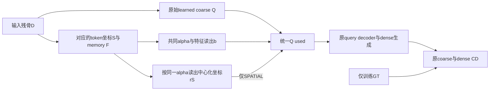

# H3：coarse输入空间残差——最小假设草案 v1

日期：2026-11-07。状态：**待审核假设；仅制定方案，不实施、不测试、不训练、不创建execution request。** H3为P2中的新候选编号，H1和H2的负结果保持不变。

## 1. 唯一假设与预期

在现有M0的learned coarse路径中，**在同一个输入token特征读出之外，增加与这些token实际坐标对应的、以输入中心为参照的空间残差，比只加入相同特征读出，能更稳定地改善最终骨块的位置及未知表面覆盖，同时不损害接口或增加严重退化。**

这是“显式特征—坐标对应是否提供有用位置条件”的假设，不是“模型完全不看输入”，也不是“coarse坐标头已被证明是唯一瓶颈”。输入特征已经含有位置编码，对照也并非没有几何信息；候选只增加一个显式的坐标读出通道。

本轮只改变coarse的整体位置条件。**不同时修正尺度、各向异性、局部形状或接口**。其相对点布局在这一次变换中保持不变；不能期待它单独解决所有7/8例紧缩问题。若完整覆盖或风险不支持，就停止该候选，不顺手增加范围头救结果。

## 2. 证据为什么允许检验、又为什么可能失败

已复盘的8例新增严重退化中，5例到coarse时已有>20 mm质心偏差，dense后仍超过20 mm。这使早期位置条件值得单独检验；它不证明替换中心一定有效。

反证风险包括：

1. 已有M0全局特征线性质心读出仅改善约0.38／0.50 mm，frontoorbital反而退化；不得直接将其硬替换为“可靠中心”。
2. D中缺失骨块的中心并不是已观测骨组织上的某个点，也不保证落在输入中心的局部邻域。bilateral、多区域缺损尤其如此。
3. 输入token来自既有FPS／局部聚合，接口附近支持可能不足；新读出不能恢复已丢失的信息。
4. 少量coarse全局矩不等于形状。dense可能补偿位置改变，也可能增加远端离群。
5. 反复使用C/D开发集增加探索偏差；即使本候选成功，也需后续独立确认。

因此不用GT中心训练一个新定位器，不强制中心落在输入表面或其凸包中，不声称本方案已有有效性或论文新颖性证据。

## 3. 冻结继承与记号

继承M0、BCSP V1采样、原source／fold、8192输入／8192输出、256 learned coarse、既有loss后端和3900步合同。H1、H2及其他可选目标保持关闭。不载入H2最终权重续训。

令输入聚合后的坐标为S={s_j}，encoder输出memory特征为F={f_j}。根据P2-A源码证据，拟用形状为S∈R^(256×3)、F∈R^(256×384)，且f_j必须对应同一s_j。Mamba逆排序后的对应关系不能省略；实际接入时需限定核对，不在本草案中假装已验证新接口。

原始coarse为Q∈R^(256×3)，其原头与原全局特征路径保留。S与Q虽然同为256点，但**不是逐点对应**，下式没有把第j个输入点当作第j个缺失目标。

所有坐标均用现有D-only归一化；推理不读取G、GT派生位置、Oracle配准或开发集统计。

## 4. 唯一公式：特征读出与中心化空间残差

### 4.1 两臂共同的轻量读出

新增一个可训练向量a∈R^384和一个线性层h:R^384→R^3：

\[
\ell_j=\frac{a^T f_j}{\sqrt{384}},\quad
\alpha_j=\operatorname{softmax}_j(\ell),\quad
u=\sum_j\alpha_j f_j,\quad b=h(u).
\]

固定零初始化a、h.weight、h.bias。没有额外温度、top-k、隐藏层、dropout、BN、GT标签或辅助loss。参数共384＋3×384＋3＝**1539**；该数值以实际维度384成立为前提，实施时不得默默换维度。

新增头在共享母版初始化后创建，不消耗或改变原公共参数的初始化RNG。旧OFF路径不实例化新头、不改变旧state_dict或计算图。

### 4.2 唯一实验差量

定义：

\[
\bar{s}=\frac1{256}\sum_j s_j,\qquad
r_S=\sum_j\alpha_j(s_j-\bar{s}).
\]

两个候选臂为：

\[
Q_{FEATURE}=Q+b,\qquad
Q_{SPATIAL}=Q+b+r_S.
\]

b与r_S均广播到256个Q点。FEATURE和SPATIAL拥有相同参数、相同token注意权重和特征读出；**唯一区别是是否将同一权重对应的实际坐标残差r_S加入coarse**。M0原始路径作为既有外部锚点。

a=0时α均匀，r_S在数学上为0；h=0时b=0，因此两臂初始输出与M0中性一致。浮点容差应在后续实现前明确；不承诺有限精度逐位相等。共同初始化仍须逐参数核对。

空间残差不是绝对目标中心预测。Q原有质心与b保持自由，故不强迫缺失骨块中心等于某个输入点或落入输入凸包。r_S受输入token分布范围影响，但**这不是可靠性保证或安全半径**；不新增按GT裁剪、经验放缩系数、门控或失败后的clamp。

使用以输入均值为参照的残差，是为了避免把已有绝对位置整体叠加两次；它也可能信息不足、学到无用平均或注意到错误区域。这些都应作为候选失败记录，而不是追加定位器或改ROI。

## 5. 真实作用与梯度合同

所有实际coarse坐标消费者统一使用Q_used：query坐标拼接、decoder q_pos、重建特征坐标、dense=Q_used+Δ以及返回coarse／coarse CD。原始Q仅用于诊断，不能让不同消费者混用Q与Q_used。

总损失仍为原coarse CD＋dense CD，**不增加质心、半径、接口或注意力监督**。不对F、α、b、r_S、Q_used额外detach。重建梯度可通过h／α／encoder及原coarse路径传播；FPS／KNN索引仍不可微。

FEATURE中的α通过u→h受训练；SPATIAL额外具有α→r_S的几何梯度。这种梯度差异正是实验处理，不应人为强行相等。零初始化h意味着FEATURE中α在最初时刻可能没有有效梯度，后续才通过学到的h获得梯度；必须披露，不能宣称逐步优化完全公平。两臂匹配参数和初始原模型状态，不等于匹配整个训练轨迹。

纯代数上，给所有s_j共同平移不会改变r_S，且同步置换S/F不会改变它；**不由此宣称整个XYZ排序Mamba旋转或刚体等变**。F本身依赖位置和输入处理。

## 6. 最小对照、预算与执行边界

| 对象 | 特征分支b | 显式坐标残差r_S | 用途 |
|---|---|---|---|
| 已冻结M0 | 无 | 无 | 原始基线；复用已有评价 |
| H3-FEATURE | 有 | 不进入生成 | 控制额外参数和特征读出 |
| H3-SPATIAL | 有 | 进入生成一次 | 唯一候选处理 |

若草案确认且后续实施／准入通过，预算建议上限为两臂×C/D，共4次新训练；每run仍3900步、batch8、100 traversals、31200 exposures、300 drop-last。两折各315训练病例／63来源、105开发病例／21来源，完整保留五类缺损。

两臂从各折原共同初始化开始；完整batch顺序、LR／优化器／数值后端及资源阈值继承原合同。新增参数的优化器分类须在实施阶段一次性写清，不在本草案中凭空认定已经绑定。

C/D配置事前同定，不根据C结果改变D；如果研究预算不足以完成配对两折，就暂不启动，而不是只报告有利折。Native拟每模型105例，共420次新预测；既有M0不重跑。**上述是待审核预算，不是执行授权或request。**

不重复通用平台审计或扩大框架；若实际新增梯度路径需要CUDA验证，只覆盖新分支，精确人工输入、计数、设备和资源另行冻结。任何测试失败即停，不借机自动修复重跑。

## 7. 实施前必须一次性验证的核心合同

本轮不执行以下验证。将来若授权implementation-only，应集中完成：

- S/F在Mamba排序／逆排序后对应正确；同步置换不改变读出，故意错配会被针对性fixture发现。
- 零初始化中性，OFF保持原路径，共有初始化和RNG不被新增参数创建扰动。
- 两臂参数完全同构，仅空间分派不同；所有实际坐标消费者绑定同一Q_used。
- α归一且有限；单样本batch处理不串病例；输入坐标大平移下r_S的代数关系成立。
- b/r_S广播仅平移coarse，相对几何与coarse回转半径不变；构造“位置改善却形状仍错误”的反例。
- 验证真实loss/backward路径与初始/后续梯度行为；不得用“forward能跑”替代。
- 训练和推理不从G构造α、b或r_S；G仅参与原loss与离线评价。

不增新采样、不预先筛掉frontoorbital、不重新提取全量探针，不调token数或注意力温度。

## 8. 必须检验最终形状，而非只检验中心

主比较SPATIAL−FEATURE，次比较SPATIAL−M0、FEATURE−M0。先在每来源内平均五种缺损，再在21来源间等权，分折报告；同来源缺损不当作独立患者。

完整继承E P95、J P95、CD、E/J Cover@2mm、>20 mm远端离群、严重几何定义及风险转移。逐来源改善/退化数、五缺损类型和frontoorbital完整保留。coarse/dense位置、半径和位移只作机制指标。

**事前继续投入标准草案**：两折SPATIAL相对FEATURE的来源等权E P95均降低，J P95和CD不增加，E/J Cover2不下降，远端离群不增加；相对M0也不能以形状／接口退化换定位改善。相对FEATURE、M0各自新增严重几何病例均为0，严重总数不增加；frontoorbital的E/J P95及质心误差不得退化。

这些是保守资源决策标准，不是临床精度门槛，不在本轮执行正式gate、bootstrap或显著性检验。均值方向满足也不等于独立验证成功。

最低日志仅保存同一次forward的Q原始／Q_used／P质心与半径、b/r_S及其模长、α的熵与有效token数1/Σα²；单位、取值定义在实施时固定。权重图集中或梯度非零本身不证明定位语义正确。

## 9. 证伪、解释与停止规则

| 观察 | 允许的解释和动作 |
|---|---|
| 两臂接近，或r_S近零 | 当前显式坐标分支无足够增益；不加温度/权重/定位器补救 |
| 中心改善但E/J覆盖或风险退化 | 当前位置条件不足以改善目标任务；停止候选 |
| SPATIAL胜FEATURE却不胜M0 | 可能弥补新增读出副作用，不能宣布优于原模型 |
| C/D方向不一致或新增严重病例 | 当前机制不稳定，不扩大训练 |
| 均值改善但frontoorbital退化 | 风险转移，不能排除该类后宣布成功 |
| 两折完整形状／接口／风险支持 | 仅支持此探索候选；后续才讨论重复seed、Transformer对照和独立来源确认 |

Native结果即使支持，也不能仅用注意权重宣称“找到了缺损”。若后续确需机制干预，应另行制定同模型、同输入、固定少量病例的坐标对应干预；本草案不预先捆绑额外forward预算。

## 10. 本次完成与待决定项

本次只完成H2收束和H3最小假设草案及证据清单。公式是一个可审核的具体候选，不声称为文献首创，也未进行新文献检索。方案仍属于P2机制研究，不能重新包装为已完成的新模型贡献。

**下一决策是审核是否值得实施这个单一候选。** 若认可，再单独授权限定implementation-only及针对性验证；如果认为其全局位置残差不足以解决当前主要问题，可以在实施前终止。不因本草案存在而自动进入训练。
