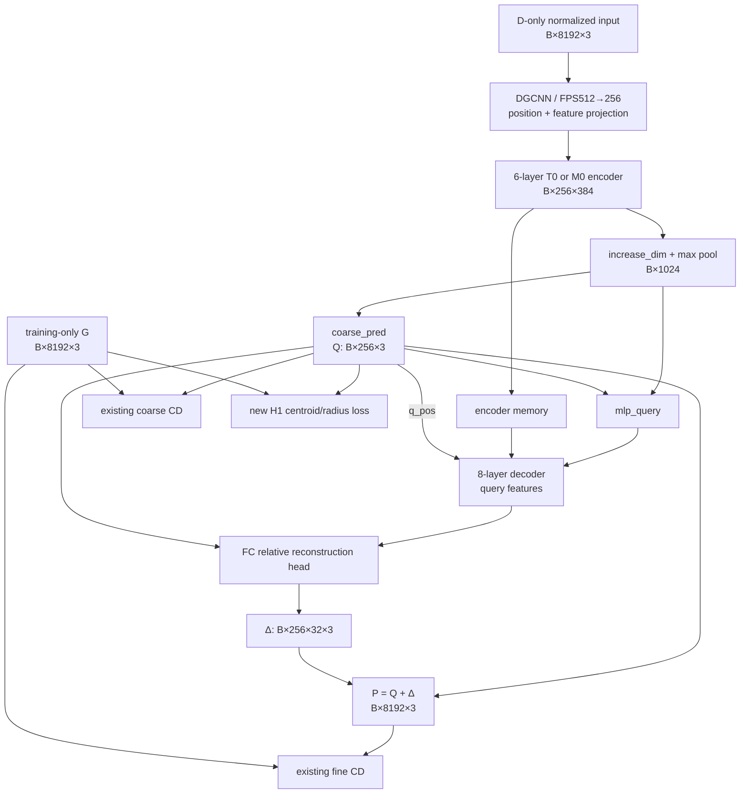

# P2-A 差量计算图核对与 H1 唯一公式确认

日期：2026-11-06。性质：**本机只读源码与既有证据复核**。本次没有修改生产代码、载入模型/权重、读取真实点集 payload、运行测试或 forward，也没有连接服务器、恢复资产、创建 execution request。

## 1. 结论与投入建议

**差量核对完成；H1 的唯一公式可以确认。建议保留 M-H1 在 C/D 各一次的有限证伪训练，但先完成一次限定的实现/人工验证，不具备直接启动训练的准入。**

投入理由不是预期它一定有效，而是：

1. P1 的一部分明显异常已出现在 learned coarse 的位置/范围，H1 的监督对象与这个问题直接对应。
2. 现有母版已有完整 H1 计算与 loss 接入，模型结构、encoder、factory 和 provider 均无需为此改变；可以用很小差量检验一个明确假设。
3. 历史 D2.1 的负结果和等矩异形反例使它很可能只能部分改善，恰好需要把“矩能否转化为完整覆盖”作为证伪目标，而不是当成既定创新。

**建议预算：只准备 M-H1_C、M-H1_D 两次，各3900步。** 不自动增加 T-H1，不调权重，不因第一折结果修改第二折。若人工反例/实际调用验证不通过，则不训练。后续是否真正执行，仍需最终 request 的单独授权。

这是一项研究投入建议，不是“H1 已有效”的结论。若更希望直接研究结构创新，也可以跳过该训练；但当前源码复用程度较高，使两次同协议证伪具备合理的信息成本比。

## 2. 核对的证据对象

本次直接读取并绑定：

- P1 配对训练合同、T0/M0 四次训练冻结审计与两折评分冻结状态。
- 母版 `AdaPoinTr.py`，以及其实际使用的 Chamfer 实现。
- P1 `bcsp_mamba_encoder_v1.py`、factory、training runtime 与训练短入口。
- BCSP 数据准备中的 `frame()`、数据读取接口和既有归一化记录。
- P1 C/D 冻结结果、固定病例 coarse/dense 摘要、历史 D2.1 负结果。
- P2 正式计划及既有 H1 草案。

精确路径、SHA256、源码行号和历史引用关系见同目录 `P2A_只读证据核对记录_v1.json`。本次对小型源码/证据文件重新计算哈希；不重新核验大型归档的全部 payload。四次训练和两折评分的完成状态来自既有正式审计，不伪称本次重新审计了服务器。

## 3. 实际前向计算图

以下 B 是 batch；训练 B=8。形状来自冻结配置与源码推导，本次没有实例化模型验证新候选。

| 环节 | 实际张量/操作 | 形状或数量 | 对 H1 的意义 |
|---|---|---|---|
| 输入 | normalized `partial` | B×8192×3 | 归一化由 D 决定；不读取 G 来构造输入 |
| 局部取点 | `DGCNN_Grouper`，k=16，FPS 512→256 | coor B×256×3；features B×256×128 | 输入信息先经过局部聚合；H1 不改变取点 |
| 投影 | `input_proj(features)+pos_embed(coor)` | B×256×384 | 坐标与特征一起进入 encoder |
| encoder | 6层；第一层保留 graph 分支 | B×256×384 | T0/M0 差别限于六个全局分支 |
| M0 序列化 | z/y/x 稳定排序形成 XYZ 字典序；共享参数前/后向扫描，平均后逆排序 | 每层两次扫描，六层共12次 | 不是三个独立轴序列各扫一遍；排序索引不是可微几何定位器 |
| 全局特征 | `base_model.increase_dim(x)` 后 token 维 max | B×1024 | coarse 位置依赖该 pooled 特征 |
| learned coarse | `coarse_pred(global_feature)` | Q，B×256×3 | H1 直接作用于 Q |
| query 特征 | `mlp_query(cat(global_feature,Q))` | B×256×384 | coarse 坐标也用于构造 decoder query |
| decoder | 8层，memory 为 encoder 特征；q_pos=Q | q，B×256×384 | 更新特征；此路径不输出新的 coarse 坐标 |
| 重建头 | q 的全局特征、q、Q 拼接，`reduce_map`，FC head | 相对位移 Δ，B×256×32×3 | 每个 coarse 点生成32个 dense 点 |
| dense | P[j,s]=Q[j]+Δ[j,s] | B×8192×3 | Q 改善不必然等于 P 改善 |

`learned_only` 分支仍在源码中计算了一份128点输入FPS候选，但并不使用它构成最终 Q。不能把该临时计算误解为模型已经用128个观测点锚定输出，也不在本轮顺手删除它。

P1 关闭旧 adapter、SCQR/rim 路径及去噪；`query_ranking` 的模块存在不等于该分支被执行。公式核对以实际配置选择的路径为准。



## 4. 反向路径与 dense 补偿

### 4.1 H1 的直接梯度能到哪里

母版 `get_loss()` 使用训练返回值 `ret[0]` 的 `pred_coarse`，没有 `detach()`；H1 被加到 `loss_recon`，runtime 将返回的两个 loss 相加后 `backward()`。

因此 H1 的直接梯度路径是：

`H1 → Q → coarse_pred → pooled global feature → increase_dim → encoder → input projection / grouper feature parameters`。

max pooling 的梯度由其选中的位置承担；Mamba 排序/逆排序通过特征 gather 传递梯度，离散排序和 KNN/FPS 索引本身不被 H1 优化。

H1 **没有**经过下游 `mlp_query`、decoder 或 dense FC head 的直接反向路径。这些模块仍受原 fine CD 训练，后续可能随上游特征与 Q 的变化而适应。不能声称新增 H1 会直接监督所有重建阶段。

完整 instrumentation 中保存的 `.detach()` 仅用于观察；不能把它当作真实训练断梯度证据。反过来，源码存在可微路径也不能替代未来实际调用验证。

### 4.2 coarse 矩改善为何不保证 dense 改善

每个 Q[j] 恰好生成32个点，所以在无去噪的实际路径中：

\[
\mu_P=\mu_Q+\frac1{256\times32}\sum_{j,s}\Delta_{j,s}.
\]

这是结构上的恒等关系：dense 的平均相对位移可以抵消或扩大 coarse 位移。dense 方差还受相对位移方差及交叉项影响，不能仅用 coarse 半径预测最终覆盖。

因此未来评价需同时保存 Q/P 的质心误差和半径比。若只 Q 改善、P 不改善，应记录为传递失败/相对位移补偿等候选解释，不能把 H1 判为成功，也不能仅凭该现象认定 decoder 的某一层是唯一根因。

## 5. 原损失与 H1 唯一公式

### 5.1 P1 实际优化目标

P1 中 denoise=0；fine local=0；fine 两方向权重均为1。实际为：

\[
L_{P1}=CD_{L1}(Q,G)+CD_{L1}(P,G),
\]
\[
CD_{L1}(A,B)=\frac12\left(\operatorname{mean}_{a\in A}\min_{b\in B}\|a-b\|_2+\operatorname{mean}_{b\in B}\min_{a\in A}\|b-a\|_2\right).
\]

这里名为 L1 的 Chamfer 使用欧氏距离，不是逐坐标绝对值之和；两方向取平均，不是未除2的和。冻结后端为现有 `torch.cdist(p=2)` 分支的实际平方、最小值和开方路径；不改为 compiled Chamfer，也不改为另一稳定版或分块版 loss。

runtime 的 `loss_sparse`/`loss_denoise` 对应第一个返回值，在当前配置下为0；`loss_dense`/`loss_reconstruction` 才包含 coarse CD 与 fine CD。不能从字段名误判“没有训练 coarse”。

### 5.2 唯一确认的 H1

对每例，在固定 D-only 归一化模型坐标中：

\[
\mu_X=\frac1{N_X}\sum_i x_i,\qquad r_X=\sqrt{\frac1{N_X}\sum_i\|x_i-\mu_X\|_2^2+10^{-6}},
\]
\[
a=\frac{\|\mu_Q-\mu_G\|_2}{r_G},\qquad b=\log\frac{r_Q+10^{-6}}{r_G+10^{-6}},
\]
\[
L_{H1}=\tfrac12\big[\operatorname{mean}_{batch}\mathrm{SL1}_{0.1}(a)+\operatorname{mean}_{batch}\mathrm{SL1}_{0.1}(b)\big],\qquad L=L_{P1}+0.1L_{H1}.
\]

`SL1_beta(z)` 为 `z²/(2 beta)`（|z|<beta）或 `|z|−beta/2`。唯一配置：

```json
{
  "enabled": true,
  "mode": "centroid_radius",
  "weight": 0.1,
  "smooth_l1_beta": 0.1,
  "cvar_fraction": 0.1,
  "eps": 0.000001
}
```

`cvar_fraction` 是现有接口的保留参数；`requested_mode='centroid_radius'` 不执行 CVaR 的 cdist/topk 计算，其值不产生附加损失。以上是公式声明，**不是已材料化 runtime config 或 execution request**。

特别确认：不是逐坐标 raw 质心 SmoothL1；不是 `sqrt(moment+eps²)`；不是 `log(rQ/rG)`；不是去掉0.5；不是对 dense 再加同一项；不是 GT 缩放推理输入。全部与已有 `coarse_geometry_guard_components` 的该分支一致。

epsilon 的历史约定使其不是任意单位缩放下的严格尺度等变损失；GT 是固定8192目标点集的经验矩，不是体积质心。完全坍缩时半径项不保证能自行打散点，等矩异形也可使 H1 接近零。H1 不替代 CD，不提供位置/形状正确性的保证。

## 6. 坐标合同核对

既有准备脚本使用 `world = index @ A + origin`。D 的前景体素中心 world bbox 给出 `center=(lo+hi)/2`、`scale=||hi−lo||/2`；D/G 点集均应用 `(world−center)/scale`，保存 float32。不是用完整 C 或缺失 G 的 bbox，也不是对两者独立居中。

数据接口校验 `BCSP-normalized-v1` 与 `normalization_source='defective_bbox'`；训练读取 `partial` 与 `implant`，推理输入构造不读取 GT 数组。毫米评价需按记录的同一 center/scale 反归一化。

本次未重读 NRRD/NPZ，故结论为**源码和冻结协议无坐标合同矛盾**，不扩张成“本次已重新验证全部原始文件或排除了所有坐标错误”。已有 QC/冻结证据继续作为大规模几何正确性的来源。

## 7. 固定病例证据是否支持该投入

下表复用已冻结 P1 摘要，没有新增 forward 或配准。均为 M0：

| 病例 | coarse→dense 质心误差，mm | coarse→dense 半径比 | 支持与限制 |
|---|---:|---:|---|
| D/079/frontoorbital | 66.303→64.018 | 0.428→0.467 | 大错位/收缩已经存在于coarse；dense没有充分纠正 |
| D/008/random_2 | 20.683→19.581 | 0.612→0.631 | coarse已收缩；无>20mm离群仍可漏覆盖，必须双向评价 |
| C/053/frontoorbital | 50.947→50.117 | 0.960→0.957 | 半径近正常也可整体偏移；半径单项不足 |
| C/026/bilateral，稳定对照 | 6.697→6.641 | 0.972→0.965 | 必须监测正常病例是否因新约束受损 |

这些记录能证明所列病例 coarse 已有相应异常，不能定位异常首次形成于 encoder 的哪一层。记录还注明未保存完整 coarse tensor，不能据摘要重建每个query的局部行为。本次不为此追加 instrumentation：回答 H1 是否值得一次有限证伪，不需要先恢复所有逐层轨迹。

历史 D2.1 的风险反增使我们不能承诺收益；P1 更换了表示和模型条件，仍留有一个可检验的迁移问题。两折同协议、禁止扫参、完整风险转移使该实验具有明确停止点。

## 8. 最小差量与剩余未知项

| 项目 | 当前状态 | 后续最小需要 |
|---|---|---|
| 模型/H1函数 | 已存在且语义确定 | 不改模型源码、encoder、factory或provider |
| 训练入口 | 冻结P1配置/哈希；与原配置精确比较 | 新版本入口只允许基线模型配置加上述唯一H1；不得直接改旧request |
| runtime | 已能将H1随reconstruction反向；日志未拆分H1 | 如需逐步分量，最小日志适配记录H1、加权H1及总loss；不可重复加入损失 |
| 初始化/顺序 | 既有factory与order可复用 | 同M0基线初始化，原3900步/100遍/31200曝光；不从最终checkpoint继续训 |
| 参数/优化器 | H1无新增参数 | 不应改变参数量、optimizer参数组或SSM初始化 |
| H1真实数值行为 | 仅源码确认；未执行 | 一批人工CPU反例与完整实际调用验证；必要时最小CUDA检查 |
| 未来设备/资产 | 本轮未查服务器 | 到执行准备时核对当前资源；不重建通用依赖库存 |
| 泛化收益/风险 | 未知 | C/D全量105例/折Native评价与预定资源门 |

最小日志适配不能假装“runtime完全不变”；未来如确需新runtime，保留旧版并明确差量哈希。逐步记录所需矩计算不涉及额外完整forward，不能为了拆解日志重复计算昂贵全量CD。

**不需要做的事**：重写 Mamba、重训 P1基线、重装 wheel、重新搜索采样、增加定位器、开放新病例、扫描lambda、重复12/4/0整套GPU准入、开发新的传输或库存框架。

## 9. 下一步范围建议

建议一次合并的限定 implementation-only：复用现有H1函数，新增严格配置绑定的P2短入口及必要的最小日志适配，完成唯一一批人工反例与完整训练loss调用验证，汇总P3。重点证明 OFF 与P1一致、ON恰好加一次0.1H1、真实coarse可得梯度、不误用detached记录、计数与优化器不变。

通过后再准备 M-H1_C/D 待授权训练范围，不自动启动。若需CUDA验证，只检验新增loss实际路径，精确次数另冻结；CPU正确不等于CUDA或训练收益通过。

本次研究决定建议为：**保留H1的两折有限证伪投入，先完成上述小差量验证；不投入新结构、不追加seed，不自动承诺后续Transformer对照。**
