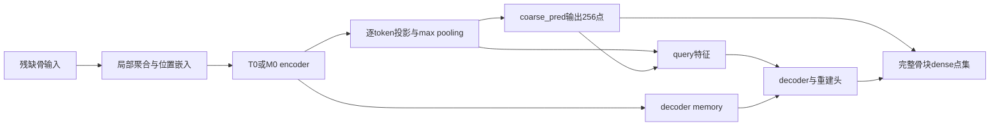

# 输入条件信息与 coarse 坐标头：既有证据复核 v1

日期：2026-11-07。**当前能确认条件路径存在、coarse随输入变化且存在显著残余误差；尚不能确认编码特征已含有足够定位信息却被坐标头浪费。暂不选择H2。**

## 1. 已完成的限定检查

重新核对母版、factory和encoder三份源码身份；读取正式冻结的P1与H1评分。复核3个预测归档的NPZ字段目录，没有解码点数组或载入checkpoint。未连接服务器、forward、拟合读出或改模型。

## 2. 实际路径及不能据此推出的结论

`global_feature`为B×1024，`coarse_pred`为1024→1024→768的非线性头，重排为256×3。它不是直接从GT得到的位置；learned_only不使用已计算的输入FPS候选拼成Q。源码可微路径只证明可利用；坐标随病例改变只证明非恒定输出，不证明变化正确，也不能区分encoder、pooling或坐标头瓶颈。

## 3. 保存统计能回答什么

各折每来源5例，故下表105例均值等于21来源等权均值。coarse→dense为位置误差，不是表面距离；修正例数不代表覆盖改善。

| 折 | 模型 | coarse质心误差mm | dense质心误差mm | dense降低位置误差例数 | coarse半径绝对对数误差 |
|---|---|---:|---:|---:|---:|
| C | T0 | 15.872 | 14.822 | 84/105 | 0.1233 |
| C | M0 | 11.777 | 10.766 | 84/105 | 0.1121 |
| C | M_H1 | 11.639 | 10.899 | 83/105 | 0.0968 |
| D | T0 | 13.085 | 12.340 | 61/105 | 0.1283 |
| D | M0 | 12.890 | 12.160 | 74/105 | 0.1512 |
| D | M_H1 | 11.134 | 10.624 | 77/105 | 0.1096 |

H1两折的coarse矩改善并未转化为完整形状收益，说明只检验全局矩不够；但不能据此断言encoder已充分识别缺损。dense可修正也可放大位置误差，不能只查看最终输出而跳过Q。完整病例记录与方向分解保存在JSON，不筛选异常后重新计分。

## 4. 证据缺口与下一步的最小研究问题

三份冻结预测归档只保存prediction及少量代表例coarse数组，另有全量coarse/dense摘要；没有可用于训练／开发读出的全局特征数组。生产源码虽有full_instrumentation接口，不等于这些特征已持久保存。训练来源全局特征和训练目标矩也不能从开发预测重建。

因此，本轮不能完成“冻结特征读出是否优于原坐标头”的实证判断，不能把缺失数据写成探针失败，更不能直接宣布H2。建议下一步一次性限定冻结特征提取＋单配置CPU读出对照，详见同目录方案。无需新模型训练、无optimizer step、无需重复GPU preflight。

## 5. 明确停止点

既有证据检查已结束。后续提取需要实际访问该折训练／开发输入及冻结checkpoint，须先绑定数据、设备和预算后单独执行授权；本报告不自动授权这些操作。
