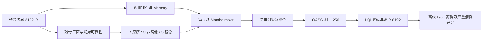

# Cranial-BCSP-FullMamba · BCSP-RBSS 完整实验报告

**实验名称**　可靠性约束双侧对称序列化  
**报告日期**　2026 年 11 月 27 日  
**结题范围**　P0 几何与缓存可行性、P1 CUDA 零更新准入、D1 离线预计算排列下的 Fold D 三臂精度对照  
**正式裁决**　D1 评分冻结审计通过，科研判定为 `FAIL_STOP`。本版 RBSS 收束，保留 OASG+LQI 为研究基座。

## 摘要

BCSP-RBSS 检验一个具体问题。对残骨点云中可靠的左右镜像锚点实施配对，并缩短它们在 Mamba 序列中的间隔，能否改善缺失骨块的粗结构、最终表面覆盖及共享切壁覆盖？实验将原生顺序 R、同端点非镜像配对 C、真实镜像配对 S 放在同一 OASG+LQI 母版上。模型参数、锚点、训练数据、初始化、起始随机状态与批次顺序按组冻结，唯一的设计干预是第六个编码器 Mamba mixer 的访问排列。

几何操纵在训练侧 308/315 例、开发侧 104/105 例生效。真实 CUDA 准入确认了计算与梯度路径。完整冷路径的 C/S 中位时延约 307–308 ms，约为 R 的 6.3 倍，超过原部署预算。随后按确认的协议修订，用离线预计算排列开展独立的 Fold D 精度验证，保留原精度门槛。

三臂各完成 3,900 步训练和 105 次 Native 预测。S 相对 R 的密 E P95 增加 **0.9637 mm**，密 J Cover@2 降低 **1.9356 个百分点**，严重病例由 **2/105 增至 5/105**。S 相对 C 的密 E P95 改善 **0.2805 mm**，但来源级 95% 区间为 **[−0.9055, +0.3128] mm**，仅 **12/21** 个来源严格改善，且粗点远端离群和密点反向距离越过预设上限。结果支持结束该版本。适用结论限定在当前插入层、排列规则、Fold D 和单训练种子。证据见[正式评分冻结与裁决](foldd_native315_v1/RBSS_FoldD_native315_formal_post_score_freeze_and_decision_v1.json)。

## 1. 研究背景与假设

OASG 将首次粗点生成锚定在观测残骨上，保留 LQI 与原有密点生成链。此前的 CISC 尝试表明，即便在相同观测锚点之后引入切壁条件，接口覆盖也可能退化。历史诊断还显示，远端点很少的预测仍可能漏掉目标骨块大面积表面。因此，本轮把问题前移到粗点生成前，检验双侧解剖对应是否能作为序列组织的有效先验，并同时关注参考面覆盖和预测侧离群。历史背景与证据索引见[正式实验计划](BCSP-RBSS_可靠性约束双侧对称序列化_正式实验计划_2026-11-26_v2.md)。

研究包含两个互补问题。

1. **S 相对 R 的实用增量**。将原生访问顺序改为镜像配对序列，能否提高缺失骨面与切壁的覆盖，且不增加严重失败？
2. **S 相对 C 的镜像特异增量**。使用相同端点、相同配对数量和相同回退规则时，真实镜像对应是否比受约束的非镜像配对更有效？C−R 作为描述性对照，衡量改变访问顺序后的一般性影响。

原计划同时要求冷、热路径满足部署预算。P1 后的修订将完全冷启动代价作为独立结果，允许使用由同一真实输入确定并逐条核验的排列缓存回答精度问题。G0–G6、训练和评分口径沿用原计划。见[精度验证协议修订](BCSP-RBSS_FoldD离线预计算排列_精度验证协议修订案_2026-11-27_v1.md)。

## 2. 数据与方法

### 2.1 数据、坐标和输出

使用 SkullBreak 已开放的 84 个来源、420 个实体缺损病例。Fold D 按来源隔离，63 个来源共 315 例用于训练，21 个来源共 105 例用于开发评价。每个来源含 bilateral、frontoorbital、parietotemporal、random_1、random_2 各一例。开发全量包含几何回退病例。SkullFix 迁移和封存数据未进入此次 D1。

输入为 8,192 个残骨完整边界点，目标为 8,192 个缺失骨块完整边界点。边界表示覆盖分割中实际存在的内侧、外侧及暴露切壁。OASG 从 8,192 个输入点经两级 FPS 得到 512、256 个观测中心，首次生成 256 个粗点。密点头按固定父子槽位输出 256×32 个点。评价用冻结残骨包围盒中心和半对角线尺度将预测反归一化到物理坐标。使用已核对的 LPS 轴向约定，正 X 指向患者左侧。所用 NRRD 方向为 0.4 的轴向对角矩阵，原始头部没有显式原点和单位，沿用既有零原点与毫米约定。中矢状平面由残骨估计。见[数据与坐标合同](BCSP-RBSS_可靠性约束双侧对称序列化_正式实验计划_2026-11-26_v2.md)。

### 2.2 三臂与实际插入位置

| 臂 | 序列 | 研究作用 |
| --- | --- | --- |
| R | 原生 XYZ 字典序，以原生 ID 稳定处理并列 | OASG+LQI 参照 |
| C | 相同端点、相同配对数的受约束非镜像配对 | 控制配对重排本身 |
| S | 通过可靠性门槛的双侧镜像互近邻配对 | 检验真实镜像对应的增量 |

插入位置为编码器第六块 `base_model.encoder.blocks.blocks.5.attn` 对应的 Mamba mixer。对同一组 token 施加排列，沿正反两个方向执行共享权重的扫描、融合，再逆排列回原槽位。OASG 粗点保留观测锚点加学习偏移的原公式。LQI、密点头、损失和输入表示沿用原实现。三臂均有 39,907,012 个参数。实际预测审计记录 22 个不同 Mamba 模块、36 次 SSM 调用，受监测的全局 Attention 调用为零。该计数仅覆盖合同内观测路径。见[训练三臂冻结](foldd_accuracy_preparation_v1/RBSS_S_D_formal_post_training_three_arm_freeze_v1.json)和[预测冻结](foldd_native315_v1/RBSS_FoldD_native315_formal_post_prediction_freeze_v1.json)。

### 2.3 双侧配对、可靠性和排列缓存

- 从固定输入行以间隔 8 取两组各 1,024 点，以同一残骨作为反射匹配的供体。用冻结的角度、偏移网格估计平面，以双侧相对均衡的截断最近邻距离评价，并以两组估计的一致性复核。关键阈值为法向差 ≤6°、平面偏移差 ≤5 mm、双侧 5 mm 覆盖均 ≥0.45、截断距离成本 ≤6 mm，并拒绝落在搜索边界的估计。
- 在真实的 256 个锚点上，按平面侧别和距离门槛找镜像互近邻。C 沿用 S 的端点与配对数 K，排除真实镜像配对及过于接近反射位置的候选，限制配对距离和原生秩间隔差。至少 16 对，且 C/S 均需使至少一半目标对新增相邻。S 的真实镜像邻接率相对 C 至少增加 0.25。
- 将配对与未配对锚点按原生秩组织，审核序列端点、平均跳距、P95 跳距与局部近邻比例。几何或匹配门槛未满足时，C/S 共同回退到 R。控制条件限制了若干序列扰动，剩余的高阶邻接差异依然存在。
- 缓存绑定有序输入字节、坐标与几何版本、真实锚点及原生序列，训练按批验证实际锚点内容。开发侧使用残骨和历史真实锚点预计算，GT 仅用于后续评分。详见[正式计划](BCSP-RBSS_可靠性约束双侧对称序列化_正式实验计划_2026-11-26_v2.md)与[开发排列冻结](foldd_accuracy_preparation_v1/FoldD_dev105_orders_summary_v1.json)。

### 2.4 训练及评价合同

三臂同设备，模型 seed `2026112701`，粗头 seed `2026112703`，共享初态及 Python、NumPy、PyTorch CPU/CUDA 起始 RNG。采用 FP32、AdamW、初始学习率 1e−4，按参数组使用 5e−4 或零衰减，沿用学习率、BN 与梯度裁剪合同。训练损失为原模型粗点、密点 Chamfer-L1 等权和，使用 `torch.cdist` 后端，沿用同一标签和归约。100 轮，batch 8，drop_last，每轮 39 个更新，共 3,900 步及 31,200 次病例曝光，累计丢弃 300 个位次。固定使用 epoch99/step3900 最终权重。见[训练三臂冻结](foldd_accuracy_preparation_v1/RBSS_S_D_formal_post_training_three_arm_freeze_v1.json)。

评价采用 batch 1、eval、Native 零更新。按冻结物理坐标直接评分。E 为缺失骨块的原始暴露面，J 为缺失块与残骨的共享切壁。A1 使用面积加权的参考面中心，A2 使用每面四个子样本。E/J P95 为参考面到预测的距离尾部，Cover@2 为 2 mm 内面积覆盖。反向 A2 P95 和 far20 分别衡量预测到 A2 的距离尾部及严格超过 20 mm 的预测点比例。密 CD-L1 为双向平均距离的半和。严重病例定义为密 E P95>20 mm 或密 J Cover@2=0。评分指标衡量几何拟合与覆盖，可用于比较算法，临床可植入性还涉及实体、厚度和术中条件。

先做同病例相减，源内五类等权，再对 21 个来源等权。三组对比共用 PCG64 seed `2026112707` 生成的 2,000 组来源级 bootstrap，报告百分位区间、逐来源严格改善数与留一来源范围。区间反映给定权重下的来源变动。见[评分入口](foldd_native315_v1/rbss_score315_v1.py)和[评分冻结与裁决](foldd_native315_v1/RBSS_FoldD_native315_formal_post_score_freeze_and_decision_v1.json)。

## 3. 执行结果与冻结证据

### 3.1 几何与缓存准入

| 阶段 | 核验规模 | 结果 |
| --- | --- | --- |
| P0a | 冻结母版、接口、输入轴向和训练合同 | 确认插入点、锚点与物理坐标合同，沿用原数据和损失 |
| P0b | 15 个不同训练来源，每类 3 例 | 14/15 活跃，各类至少 2/3，活跃例 K=77–98。034 bilateral 的两组平面法向差 8.93°，触发共同回退 |
| 前缀一致性 | 2 个固定病例共 16 次前缀调用 | 48 个归档成员复核，锚点内容在所检初始化、单例/批内位置与 train/eval 条件下逐字节一致，并匹配历史。截停于目标 mixer 之前，完整 forward 与更新均为零 |
| P0c | 复用 15 例，离线核验其余 300 例 | 308/315 活跃，约 97.8%。每类活跃数依次 62、62、61、61、62，63/63 来源至少 3 个活跃。7 个回退均触发法向差判据，部分同时触及搜索边界 |
| 开发排列 | 105 例 | 104/105 活跃，每类依次 20、21、21、21、21。21/21 来源至少 3 个活跃，008 bilateral 按同一规则回退 |

这些检查表明本折的操纵大范围生效。前缀试验支持所核条件下按内容复用，跨设备和未验证运行条件仍依赖实际在线验键。见[P0b 试点](p0b_v1/P0b_summary_v1.json)、[16 次前缀审计](p0b_prefix16_v1/P0b_prefix16_formal_post_diagnostic_freeze_audit_v1.json)、[P0c 全量几何结果](p0c_v1/P0c_summary_v1.json)和[开发排列冻结](foldd_accuracy_preparation_v1/FoldD_dev105_orders_summary_v1.json)。

### 3.2 P1 真实 CUDA 与资源结果

在 `h7vvrr-0` 的 RTX 4090 D、驱动 570.190 上完成 **200 forward、9 loss、9 backward、0 optimizer step**。检查涵盖原生路径一致性、活跃和回退行为、实际 Mamba 路径、完整损失和梯度、冷/热时延及峰值显存。五个预定病例的冷路径排列在两套 NumPy/SciPy 环境下复核一致。batch 8 的 PyTorch 峰值分配约 12.65 GiB，SMI 实测峰值 14,592 MiB。

| 臂 | 热 p50 / p95（ms） | 冷 p50 / p95（ms） |
| --- | ---: | ---: |
| R | 48.109 / 50.381 | 49.008 / 50.969 |
| C | 49.335 / 50.820 | 308.073 / 315.391 |
| S | 49.566 / 50.546 | 306.919 / 315.223 |

热路径和显存满足试点预算。冷路径原门槛为 p50 同时 ≤250 ms、≤R 的 3 倍，p95 同时 ≤500 ms、≤R 的 4 倍。C/S 的 p50 超过两项，p95 超过相对上限。冷计时包含现场重新估计与匹配等步骤，现有端到端记录不足以确定各步骤的耗时占比。正式部署资格停在 P1 冷路径门槛。上传核验时还发现过 v1 的一个依赖 SHA256 转录字符差异，v2 更正精确绑定后通过核验。见[CUDA 正式冻结审计](p1_v1/P1_v2_formal_post_cuda_freeze_audit_v1.json)。

### 3.3 训练与 Native 预测

| 权重 | 步数 | 训练时长（s） | 最终 checkpoint SHA256 |
| --- | ---: | ---: | --- |
| R_D | 3,900 | 1,200.702 | `9638d2b7f93377575fb2d3c31044a5ee5cca6fbee49cbc8d3dacc1ae146bd1a3` |
| C_D | 3,900 | 1,196.750 | `598b35e01e35e09ef8d07b9c897d2be4d87bc43e4e212188edbc3070c786ae19` |
| S_D | 3,900 | 1,198.813 | `bbee4284b63577cbe8451db7c39f7f43d7d0a0069ba6d5000f1d8bde670b6248` |

三份权重各 478,859,115 字节，正式回执独立重算哈希并核对共有初态、完整批序、起始 RNG 和曝光计数。共有初态 SHA256 为 `66e1ce594074e8c0521d0b4748b198db5ef9a528bf327a69121dbccea1e023f7`。实测三臂训练合计约 60 分钟。训练前约 16.65 小时是由保守初批耗时及缓冲系数得到的资源预留上限。见[R_D 冻结](foldd_accuracy_preparation_v1/RBSS_R_D_formal_post_training_freeze_v1.json)、[C_D 配对冻结](foldd_accuracy_preparation_v1/RBSS_C_D_formal_post_training_pair_freeze_v1.json)和[S_D 三臂冻结](foldd_accuracy_preparation_v1/RBSS_S_D_formal_post_training_three_arm_freeze_v1.json)。

三臂共 315 次 Native forward，保存观测锚点、粗点、偏移、密点、父索引及排列诊断。各臂模型状态和 RNG 前后一致，loss、backward、optimizer step 均为零。预测归档共 320 个成员，独立核验归档及成员哈希。归档大小 32,114,612 字节，SHA256 为 `e319634e8a7c500eb38b2f1f3021008876ce55efc2fa53d27d1053af3bc61196`。评分审计随后独立从 315 行逐例评分重算 105 个病例的三组配对及 21 来源汇总。见[预测冻结](foldd_native315_v1/RBSS_FoldD_native315_formal_post_prediction_freeze_v1.json)和[评分冻结](foldd_native315_v1/RBSS_FoldD_native315_formal_post_score_freeze_and_decision_v1.json)。

## 4. 精度结果

下表均为左臂减右臂，方括号为来源级 95% bootstrap 区间。距离以 mm 计，覆盖和 far20 以百分点计。距离和 far20 越低越好，覆盖越高越好。

| 指标 | S−R | S−C | C−R |
| --- | ---: | ---: | ---: |
| 粗 E P95（mm） | +0.3122 [−0.6869, +1.0375] | −0.4399 [−1.2927, +0.3712] | +0.7520 [−0.0539, +1.5569] |
| 粗 J P95（mm） | +1.0558 [+0.0171, +1.8488] | −0.5651 [−1.5124, +0.3755] | +1.6208 [+0.6333, +2.5056] |
| 粗 E Cover@2（pp） | +0.0617 [−0.3023, +0.4496] | −0.5881 [−0.9493, −0.2108] | +0.6498 [+0.2426, +1.1078] |
| 粗 J Cover@2（pp） | −0.2368 [−0.9411, +0.4232] | +0.2334 [−0.3409, +0.7896] | −0.4702 [−0.9993, +0.0794] |
| 粗反向 A2 P95（mm） | −0.4636 [−1.5787, +0.5199] | +1.1009 [+0.3553, +1.7994] | −1.5644 [−2.5465, −0.7267] |
| 粗 far20（pp） | +0.5841 [−0.2940, +1.8343] | +0.2679 [−0.9898, +1.2835] | +0.3162 [−0.6363, +1.6333] |
| **密 E P95（mm）** | **+0.9637 [+0.5793, +1.3763]** | **−0.2805 [−0.9055, +0.3128]** | **+1.2442 [+0.6671, +1.9471]** |
| 密 J P95（mm） | +1.8980 [+1.4369, +2.3907] | −0.0388 [−0.6866, +0.6643] | +1.9367 [+1.3140, +2.6373] |
| 密 E Cover@2（pp） | +0.2263 [−1.9780, +2.4953] | −0.2928 [−2.0977, +1.4696] | +0.5191 [−1.4403, +2.3348] |
| 密 J Cover@2（pp） | −1.9356 [−3.7274, −0.0792] | +0.9363 [−0.6790, +2.5624] | −2.8719 [−4.8488, −0.8243] |
| 密反向 A2 P95（mm） | −0.3619 [−1.3818, +0.4263] | +0.5167 [−0.2080, +1.1898] | −0.8786 [−1.5847, −0.2049] |
| 密 far20（pp） | +0.4547 [−0.1024, +1.3551] | −0.0505 [−1.5646, +1.2459] | +0.5051 [−0.1486, +1.7416] |
| 密 CD-L1（mm） | −0.1176 [−0.7522, +0.2865] | −0.2320 [−0.8687, +0.2533] | +0.1144 [−0.2102, +0.5995] |

按同一来源汇总口径，R、C、S 的密 E P95 分别为 **5.2986、6.5428、6.2623 mm**。S−R 有 3/21 个来源严格改善，留一来源范围为 [+0.8487, +1.0316] mm。S−C 有 12/21 个来源严格改善，留一范围为 [−0.4251, −0.1085] mm。C−R 有 2/21 个来源严格改善，留一范围为 [+0.9571, +1.3255] mm。密点质心误差 S−R 为 +0.6784 mm，S−C 为 +1.7080 mm，C−R 为 −1.0295 mm。质心与回转半径比均作为描述性指标，其完整配对区间可回溯。见[独立重算结果](foldd_native315_v1/RBSS_FoldD_native315_formal_post_score_freeze_and_decision_v1.json)。

### 4.1 严重病例

| 病例 | R | C | S |
| --- | :---: | :---: | :---: |
| `train__046__parietotemporal` | ✓ | ✓ | ✓ |
| `train__069__random_2` | ✓ | ✓ | ✓ |
| `train__087__frontoorbital` |  | ✓ | ✓ |
| `train__087__random_1` |  | ✓ | ✓ |
| `train__093__random_1` |  | ✓ |  |
| `train__093__parietotemporal` |  |  | ✓ |
| **合计** | **2/105** | **5/105** | **5/105** |

S 相对 R 新增 3 例、挽回 0 例。其中两例来自同一来源 087。S 相对 C 挽回来源 093 的 random_1，同时新增同来源的 parietotemporal，严重总数持平。表中状态由预注册阈值产生，单凭该表无法定位每例错误首次出现的阶段。见[逐例评分](foldd_native315_v1/cpu_scored_once_v1/model_scores.jsonl)与[正式裁决](foldd_native315_v1/RBSS_FoldD_native315_formal_post_score_freeze_and_decision_v1.json)。

### 4.2 预注册门槛

| 门槛 | S−R | S−C | 依据 |
| --- | :---: | :---: | --- |
| G0 基线、配对与身份 | 通过 | 通过 | R 密 E P95 5.2986 mm，低于 8.0878 mm 上限。2 个严重病例，低于 6 例上限。三臂 105 例完整 |
| G1 粗结构 | 失败 | 失败 | S−R 粗 E 效应未达 −0.50 mm，粗 far20 超过 +0.25 pp。S−C 粗 E 达 −0.25 mm 门槛，粗 far20 为 +0.2679 pp，超过上限 |
| G2 主指标密 E | 失败 | 失败 | S−R 效应、改善来源、区间上端和留一最大值均未达门。S−C 效应和留一通过，12/21 低于 14/21，区间上端大于零 |
| G3 切壁与整体 | 失败 | 通过 | S−R 粗、密 J P95 和密 J 覆盖越界。S−C 全部子项在预设保护范围 |
| G4 反向与远端风险 | 失败 | 失败 | S−R 密 far20 超过 +0.25 pp。S−C 密反向 A2 P95 超过 +0.50 mm |
| G5 严重病例 | 失败 | 通过 | S−R 总数增加 3、且新增 3。S−C 总数持平、仅新增 1 |
| G6 操纵 | 通过 | 通过 | 104/105 活跃且病例和实际观测锚点对应，各类及来源计数满足门槛 |
| G7 完整部署验证 | 未开展训练后正式效率试验 | 未开展训练后正式效率试验 | P1 已记录冷路径资源未达标，D1 精度失败后根据修订收束 |

G0/G6 成立且两组比较均有 G1–G5 失败，最终判定为 **`FAIL_STOP`**。门槛按全精度值判定。G3 属预设退化保护，按通过与否判断是否越过容许变化。见[原门槛](BCSP-RBSS_可靠性约束双侧对称序列化_正式实验计划_2026-11-26_v2.md)和[逐项判定](foldd_native315_v1/RBSS_FoldD_native315_formal_post_score_freeze_and_decision_v1.json)。

## 5. 科研分析与出现的问题

### 5.1 操纵成立，几何增益未成立

开发侧 104/105 例成功执行受约束排列，实际 mixer 路径和 token 身份经审计。R 基线在历史容许范围内，三臂共享初始化和数据顺序已有独立回执。因此，大面积回退、基线训练不合格和已知的配对错位缺乏证据支持。主要问题是**把可靠的镜像点拉近到序列相邻，未能在现有 mixer 和损失下形成可重复验证的骨块覆盖收益**。

S 相对 R 的粗 J P95 已增加 1.0558 mm，密 J P95 增至 +1.8980 mm。密 J 覆盖下降，且 21 个来源中没有来源在密 J P95 上严格改善。密 E P95 在删除任一来源后仍为正，说明主指标退化无法由一个来源单独解释。粗、密阶段的总体对比提示切壁退化在粗点阶段已可观测，密输出中更明显。由于三臂独立训练，组均值不足以识别某一具体病例的因果路径，也不足以区分 mixer 表征变化、生成头适配与密点扩张各自的贡献。

### 5.2 镜像配对可能缓解部分重排代价，但未体现对基座的价值

C 和 S 的密 E P95 均劣于 R，切壁指标也同方向退化。这支持把**访问顺序扰动本身**列为解释之一。S 相对 C 在粗 E、密 E 及密 J 覆盖的点估计上较好，提示真实镜像关系可能缓解某些非镜像配对的损失。S−C 的密 E 区间仍跨零，改善来源不足，粗远端比例和密反向风险未过门。C 的约束无法匹配所有三点以上邻接或序列方向关系，因此该差值的解释限于本次序列构造。

### 5.3 整体距离与接口覆盖出现分离

S 相对 R 的密 CD-L1 点估计下降 0.1176 mm，区间跨零。与此同时，E 的尾部距离、J 的尾部距离和切壁近距离覆盖均退化。C 还表现出密质心偏移和反向 A2 P95 有所改善，但参考面漏覆盖更重。双向平均距离和质心能够描述整体位置与误差，却可能弱化局部面积遗漏、缺损端部和切壁区域的信号。本实验保留 E/J 的方向性指标、远端比例和严重病例共同裁决。

### 5.4 工程代价与科学范围

1. **首次冷路径成本较高。** 真实输入现场计算排列所需的端到端时延超出原门槛。缓存使时延接近 R，并让训练和精度验证可完成。未见过的残骨仍需生成自己的排列，已有缓存不能证明新输入的部署成本。
2. **缓存条件有限。** 有界前缀试验支持当前实现的确定锚点对应，几何回放、环境和坐标约定仍须逐例维持。上传依赖哈希的转录错误也显示身份绑定应优先采用自动生成与回读。
3. **几何可信性与任务相关性存在差距。** 能从残骨稳定估计双侧平面和找到互近邻，只证明观测几何中存在可实施的对应关系。缺损可能横跨中线、两侧均有信息缺失，或所配锚点主要落在与目标骨片无关的部位。本轮没有独立证据能量化这些原因的贡献。
4. **稳定性与外推范围有限。** D1 只训练单种子、单折。来源级区间没有包含训练种子方差。Fold C、第二种子和 SkullFix 迁移未触发。严重个例的几何阶段归因也未作为本轮正式输出。

## 6. 结题决定

**正式收束当前 BCSP-RBSS 版本。** 已完成几何可操作性、可缓存计算路径和同协议三臂精度判断。S 相对原生 OASG+LQI 基座存在实际退化，相对非镜像对照的局部有利趋势没有满足预注册组合门槛。结果把两个限制分别落到可核验证据上。**冷路径在当前协议下超预算，离线缓存下的精度仍未通过。** 继续使用冻结 OASG+LQI 作为后续基座。Fold C、D 第二种子、SkullFix 迁移和训练后正式 G7 性能对照均按停止规则留在未启动状态。

本轮能够支持的结论是，在第六层 Mamba mixer 实施当前可靠性约束的镜像配对序列化，对 Fold D 的缺失骨块覆盖与切壁拟合没有形成符合门槛的净收益。若后续重新研究双侧信息，优先提出可证伪的任务相关性问题，例如可靠的对侧几何是否真正提供了缺损位置或切壁邻域的证据。来源 087 与 093 的现有预测可作为条件性机制复核的固定对象。该复核及后续新训练均未纳入本次结题工作。

## 7. 复现索引

| 证据 | 文件 |
| --- | --- |
| 预注册与协议修订 | [正式计划](BCSP-RBSS_可靠性约束双侧对称序列化_正式实验计划_2026-11-26_v2.md) · [离线精度修订](BCSP-RBSS_FoldD离线预计算排列_精度验证协议修订案_2026-11-27_v1.md) |
| 几何、前缀、开发排列 | [P0b](p0b_v1/P0b_summary_v1.json) · [前缀冻结](p0b_prefix16_v1/P0b_prefix16_formal_post_diagnostic_freeze_audit_v1.json) · [P0c](p0c_v1/P0c_summary_v1.json) · [开发排列](foldd_accuracy_preparation_v1/FoldD_dev105_orders_summary_v1.json) |
| CUDA 与训练 | [P1 CUDA 审计](p1_v1/P1_v2_formal_post_cuda_freeze_audit_v1.json) · [R_D](foldd_accuracy_preparation_v1/RBSS_R_D_formal_post_training_freeze_v1.json) · [C_D](foldd_accuracy_preparation_v1/RBSS_C_D_formal_post_training_pair_freeze_v1.json) · [S_D](foldd_accuracy_preparation_v1/RBSS_S_D_formal_post_training_three_arm_freeze_v1.json) |
| 预测、评分与裁决 | [Native 预测冻结](foldd_native315_v1/RBSS_FoldD_native315_formal_post_prediction_freeze_v1.json) · [逐例评分](foldd_native315_v1/cpu_scored_once_v1/model_scores.jsonl) · [配对汇总](foldd_native315_v1/cpu_scored_once_v1/paired_summary.json) · [Bootstrap 索引](foldd_native315_v1/cpu_scored_once_v1/source_bootstrap_indices.npy) · [评分冻结与裁决](foldd_native315_v1/RBSS_FoldD_native315_formal_post_score_freeze_and_decision_v1.json) |
