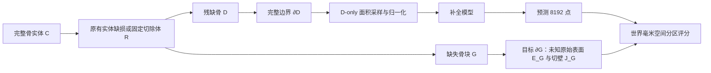
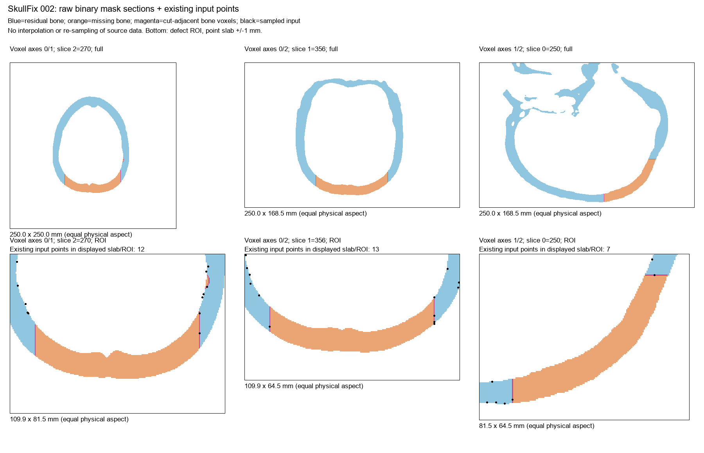
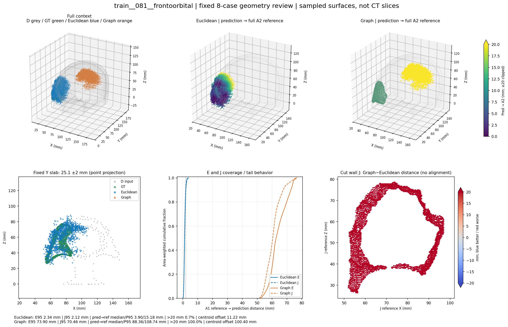
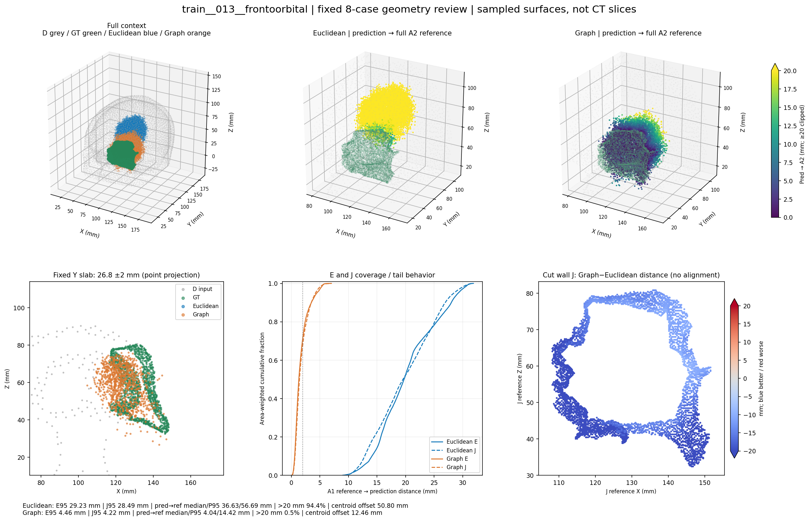

> GitHub／归档阅读副本：仅将本机绝对链接改为归档相对链接；原报告字节见 evidence/docs。

# 颅骨补全：骨组织完整边界点云、实体缺损、表面采样与点数设置综合实验报告

**版本：v1｜汇总日期：2026-11-04｜证据覆盖：2026-10-23—2026-11-04**

本报告汇总 Cranial-BCSP-GeoV1 及其输入密度、采样对照阶段的既有实验。它服务于后续基于 Mamba 的颅骨补全研究，但本阶段实际训练对照使用的是 **B0 AdaPoinTr／Transformer 母版**，不能称为 Mamba 的有效性验证。本报告也不替代此前已经结束的 Cranial-SCQR v1.2-QA 报告。

本次仅整理、核对既有本机证据，不重新训练、推理、评分、bootstrap 或连接服务器。历史报告中“下一步”的文字是当时进度；当前状态以本报告及 2026-11-04 的采样收束决定为准。文中编号对应第十二节的本机证据索引；源文件身份另见同批证据清单。

## 一、研究问题、主要结论与完成状态

本阶段的目的不是立即叠加新网络模块，而是首先回答：模型究竟观察什么几何、缺失目标是什么、接口是否真实存在、有限点数是否足够，以及采样几何改善是否能转化为模型收益。

| 问题 | 截至目前的回答 | 证据与限制 |
|---|---|---|
| 用体积点云还是表面点云？ | 固定使用**骨组织完整边界的表面点云** | 包含源分割实际存在的内外侧、孔道／腔体及切壁；不只取颅骨外壳。没有做体积／表面模型公平对照，不能称表面在所有任务上优于体积 |
| SkullBreak 缺损是否需要重造？ | 保留原有实体缺损，修改表示提取与目标合同 | 84 来源、420 病例完成实体互补、坐标、共享切壁及新点集核验；已开展模型实验 |
| SkullFix 是否完成？ | 90 个已开放来源完成批量几何 QC 和新表示 8k／8k 点集 | 原缺损已有切壁；新表示的大规模模型训练尚未开展，不能把资产准备等同模型泛化验证 |
| MUG500+ 是否完成可靠实体 GT？ | 实体切除算法已实现，但**高精度解剖 GT 准入未通过，分支收束** | 100 来源尝试中生成 82 组实体，62 组通过预设局部余量条件；这些不等于可靠解剖 GT。A0221 未能批准清理母版 C* |
| 输出目标是什么？ | **缺失骨块 G 的完整边界 ∂G** | 同时包含原始未知表面和切除后形成的共享切壁；不是完整颅骨，也不是仅删去的原始面片 |
| 采样用什么？ | 固定 V1：原生暴露体素面按世界物理面积均匀随机采样 | Morton、欧氏消减、表面图距离已有几何及模型结果；没有稳定证据支持更换主线默认，也没有证明 V1 全局最优 |
| 输入点数是否确定？ | 当前固定 8192；16384 作为已完成对照保留 | 两折四模型未验证 16k 输入稳定提升补全与接口，不能解释为等效或 16k 永远无效 |
| 输出点数是否最优？ | 当前固定 8192，**最优性尚未解决** | 做过 8k／16k 目标几何表示比较，未做匹配训练的输出点数对照 |

本阶段最重要的发现是：**原始切壁存在、输入采到切壁、输入覆盖改善、模型有效利用接口、连续骨块达到高精度吻合，是五个不同层次。** 现有实验完成了前几个层次的区分，尚未建立临床可用的连续实体重建证据。

## 二、任务定义与几何合同

### 2.1 实体及边界

令 C 为完整骨组织二值实体，D 为残缺骨组织，G 为被移除骨块。有效合成配对应满足：

\[
C=D\cup G,\qquad D\cap G=\varnothing.
\]

若使用切除体 R，则 D=C∖R，G=C∩R。先在实体中切除，再分别提取边界，才能自然生成暴露断面。直接从原始三角网格删除面片，只产生开放边，通常不会凭空生成连接内外层的新切壁。

当前输入为 ∂D，监督目标为 ∂G。将 ∂G 按面来源分为：

- **E_G：未知原始表面**，即 G 从 C 原边界继承的部分，可能包含外侧、朝颅腔内侧及孔腔表面；E_G 不等于外板。
- **J_G：共享切壁**，即 D 与 G 相邻体素的公共面。它是有面积的断面，不是一条外缘线。

二者按面集合构成 ∂G。D 上同一接口具有相同几何位置和相反外法向。输入中已有切壁并不等于泄漏未知骨块的其余表面；但使用 G／真实 J 选择推理输入点会造成信息泄漏，当前采样不允许这样做。

历史采样诊断有时也用 E 表示“D 的其余原生边界”。本报告称其为 E_D；模型主终点中的 E 均指 **E_G**，避免将输入已知表面与输出未知表面混淆。

### 2.2 V1 完整边界采样

V1 枚举骨前景六个方向上与背景相接的所有暴露体素面。每个面的物理面积由 affine 的两个切向向量叉积模长计算；按面积抽面，再在面内均匀取点。这样避免把不同物理面积的面、边界体素或网格顶点直接等权。

世界坐标采用既定 index→world affine；归一化只依据 D 的前景体素中心世界包围盒中心及半对角线，G 使用同一坐标框架。原生前景触及影像 FOV 时，域外按背景处理，截断面如实保留并标记，不将其称为自然解剖表面。

固定资产中的 8k 输入是抽取 16384 点后的前 8192 点。随机数消耗与抽样长度有关，不能另抽 8192 点并仅凭 seed 相同声称逐点相同。目标独立采样 8192 点；各历史候选保留其明确绑定的种子、池长度和点序政策。

### 2.3 “保留多表面”的准确含义

当前规则把源分割的全部暴露边界纳入候选，不做外壳筛选、自动填孔、平滑或删除小成分。它不能恢复源分割已经缺失或填掉的结构，也不能保证有限 8192 点充分覆盖每个细小曲面。

真实病例目前缺少独立、可信的内板／外板／孔腔语义标签。已有剖面能证明局部内外轮廓存在，J 可由实体相邻关系精确追溯；但不能据此报告“整颅内板覆盖率”或“所有内外板均被模型恢复”。原始体素边界也有阶梯效应，不是连续真实解剖的精确表面。

## 三、数据范围与总体实验设计

| 数据 | 实际开放范围 | 当前用途 | 未纳入范围 |
|---|---|---|---|
| SkullBreak | 84 来源，每来源 5 缺损，共 420 例 | 主表示、采样和模型对照；Fold C／D 每折 63 来源315训练例、21来源105开发例 | 封存确认、monitor、官方测试及其他未开放来源 |
| SkullFix | 原公共训练数据内部划分中 80 train＋10 val，共90来源 | 批量几何 QC、新 V1 点集、采样几何对照 | 10 个内部留出；未将此划分称为官方挑战划分 |
| MUG500+ | 初始 A0136／0137／0138；另有 A0221及既定 D6 开发100来源 | 来源质量、实体构造与前景可信度研究 | 未进入本阶段主训练；不把已审阅来源称为盲外部测试 |
| 解析 phantom | 双层平面、切开球壳、贯穿孔薄板、可展开 U 形曲面等 | 检查分层、近邻混合、刚体稳定性、跨表面距离机制 | 不替代患者解剖标注 |

SkullBreak 的五类为 bilateral、frontoorbital、parietotemporal、random_1、random_2，各84例。模型评价先在一个来源的五种缺损间平均，再对来源等权；同一来源的五个缺损不是五位独立受试者。三个 sampling seed 也不是三次独立模型训练。

模型训练矩阵共包含三轮：输入密度四运行，V1／Morton 两运行，欧氏／图距离两运行，合计八个训练运行；每个固定 3900 更新。对应既有模型开发预测分别为420、210、210份。另有两个固定病例四模型实际取点轨迹诊断，不能混为额外开发集。报告不据这些次数宣称八个独立统计重复。

## 四、最初诊断：问题究竟出在哪里

### 4.1 SkullBreak／SkullFix 原表示并非“只有外表面”

最初选取 SkullFix 002／003／004 与 SkullBreak train 000／001／002 bilateral，对18个 NRRD及6份既有点集配对核验。原分割六例均满足 C/D/G 互补；既有输入是残颅六邻域边界体素中心，局部剖面可见内外轮廓和切口厚度断面。[E01]

旧输入8192点、目标4096点的六例中，切口邻接输入点为116、156、134及166、142、323个。切壁2mm面积覆盖为 SkullFix 39.84%—54.30%、SkullBreak 54.43%—65.17%。这证明切壁在原数据及部分旧点集中已存在，但支持稀疏；不能将新工作描述为“首次让这两个数据集拥有内表面或切壁”。

**图1｜复用最初配对诊断图。** 二值原始分割显示残骨、骨块及接口，采样点为薄层投影；不是灰度CT，也不是新算法生成的解剖图。它支持局部边界和断面存在，不支持整颅内外板语义认证。

同时发现“距稀疏 implant 点≤2mm”与“距原始切壁面中心≤2mm”选中的输入点不完全一致。例如 SkullBreak 002 的计数分别为312和493，后者有181点未被旧规则选中。二者参考对象不同；新研究固定真实面来源，不自动改写旧 SCQR 指标或 QA gate。

### 4.2 MUG 旧删面流程缺少新生断面

A0136／0137／0138 STL 包含多层内部曲面，但原始开放边分别2601／1868／561，非流形边172／262／158。按旧椭球质心删面后新增开放边1251／2823／816条，却没有新增连接内外层的壁面。[E02]

因此旧 MUG 任务更接近“删除原有曲面片”，与当前“切除骨实体并预测完整骨块边界”不相同。开放边长度覆盖不能冒称切壁面积覆盖；这类目标也不能与新实体目标直接合并比较。

## 五、实体缺损与真实数据 QC

### 5.1 SkullBreak：保留原缺损，建立新表示

84个完整骨、420个残骨及420个骨块共924份原始 NRRD 完成身份、affine、精确互补和共享面核验；共享切壁用同一面键追溯，方向相反。新点集及世界坐标回读已核验，数值 roundtrip 最大误差约4.97×10⁻⁶mm。这是数值一致性，不是解剖精度。[E04]

| 420例 V1 表示诊断 | 8192 输入 | 16384 输入 |
|---|---:|---:|
| 实际 J 采样点均值 | 178.92 | 358.14 |
| J Cover@1mm | 19.723% | 35.538% |
| J Cover@2mm | 60.773% | 84.378% |
| J P95，mm | 3.4891 | 2.5193 |

8k输入每例实际J点45—517个，420例均非零。G的8k目标 J Cover@2mm约99.6416%，P95约1.2726mm。相同点数下目标骨块面积小于残颅，因而目标局部密度更高。上述全量 seed0 结果与后续开发集／多seed均值的分母不同，不应要求它们逐位相同。

### 5.2 SkullFix：90例完成 QC 与点集，未开展新表示训练

90例、270份原始 NRRD 全部通过形状、坐标、精确实体互补及共享切壁核验。90个完整骨都触及 FOV，而缺失骨块均不触及 FOV。018的G为2成分，最大成分占99.9968%，其余9体素；062为5成分，最大占99.9943%，其余19体素。保留这些结构，没有为整洁自动清理。[E05]

90份剖面图已生成，实际重点审阅002／003／004／018／062；不能称90例均经专家完整判读。完整mask精确重复未发现，也不等于完成患者身份去重。

已完成80训练＋10验证的新 V1 点对，每例输入8192、目标8192；真实标签和 J/E/FOV 仅用于诊断，不作为推理特征。原270文件哈希不变，归一化回读最大误差约6.10×10⁻⁶mm。[E06]

| 90例均值 | Cover@1mm | Cover@2mm | P95，mm |
|---|---:|---:|---:|
| 输入 D 全边界 | 11.9356% | 42.5561% | 4.4593 |
| 输入 D 的 J | 9.2523% | 34.4111% | 4.9291 |
| 目标 G 全边界 | 82.9795% | 99.8650% | 1.2933 |
| 目标 G 的 J | 74.9864% | 99.5820% | 1.4567 |

输入实际J点均值71.96、范围42—104，目标J点均值1052.62。SkullFix残颅面积大、接口占比小，8k输入的局部稀疏明显。全部90例均采到FOV截断面，总5717点；G未触及FOV。这是必须披露的上游特征，不是模型误差的既定唯一原因。

**是否必须马上大规模训练？** 不需要通过训练证明原缺损几何有效；几何 QC 已回答这一问题。若论文要声称跨数据集补全效果，则需要另行实施匹配的 SkullFix 模型验证。目前数据资产就绪不等于这一科研证据已经取得。

### 5.3 MUG：实体算法成立，不等于解剖 GT 可靠

#### 来源检查与坐标补证

初始 A0136／0137／0138 的 NRRD 为多值影像而非可直接使用的二值骨分割，A0137仅两层。源归档的官方 MD5一致只能排除本地传输损坏，不能认证发布内容质量。原 STL 声明 RAS、NRRD 为 LPS，可用固定轴变换核对；坐标一致不能补出缺失分割或扫描范围。[E07—E08]

#### A0221 单例实体切除

固定 LPS中心(48,0,65)mm、椭球半径(16,20,22)mm进行小试，未换位置或扫描参数。基于最大6连通前景的探索版本产生 G 70929体素，约11109.10mm³；共享J有6838面、面积1866.06mm²。8k目标含1702个J点，残颅8k只有19个J点，说明接口存在与输入预算充分仍不同。[E09]

#### 100来源批量实体构造

固定历史 D6 开发100来源、原椭球参数，严格接受二值及明确坐标约定，不灰度阈值化、不自动修复、不删前景成分。生成82组 C/D/G；其中62组通过预设5mm G/FOV余量条件，20组生成但不满足该条件；18组未生成。18组原因为1个形状／体素预算、1个原始 STL 坐标不可用、13个缺少明确RAS/LPS、3个非二值。[E10]

| 层次 | 数量 | 可支持结论 |
|---|---:|---|
| 固定来源尝试 | 100 | 已执行有界批量方法 |
| 成功生成实体 | 82 | 数学互补、坐标及共享面合同可成立 |
| 通过冻结局部余量条件 | 62 | 可保留为研究性几何候选 |
| 获批高精度解剖训练 GT | **0** | 前景、切除部位语义及解剖真实性未解决 |

82组均存在G多成分等需解释的结构；固定历史切除部位也不保证均为拟研究颅盖。不能将“多成分”自动判错，也不能将“满足余量”当作解剖正确。该批次未生成正式模型训练点集。

#### A0221 前景审阅的最终决定

固定ROI原前景79217体素。6连通核心70929；26连通关联但未进入核心5636；独立部分2652。若取最大6连通分量，将排除8288体素，约10.46%，但没有灰度CT或独立标注证明其均为伪影。在接口2mm附近存在567个有争议体素，直接关系到切壁形状。[E11]

因此未批准 C*，不把“看起来更整洁”的 C6/C26 任选其一作为高精度母版。用户确认没有额外影像／标注后，本分支收束，保留已有实体与负证据。将来只有新增可核对的影像、独立分割审阅或可靠局部标注，才可能重新讨论高精度准入；同源STL不能构成独立真值验证。此判断不等于宣称整个 MUG500+ 无价值。

## 六、初始表面提取与输入／输出点数实验

### 6.1 六例与 phantom 的 CPU 比较

固定3例 SkullBreak＋3例 SkullFix，比较 V0边界体素中心、V1暴露面面积采样、V2 Marching Cubes表面采样；三个sampling seed。另比较V1 16k输入、8k／16k目标及解析双层几何。[E03]

| 方法，输入8k除注明外 | 全边界Cover@1mm | J Cover@1mm | J P95，mm |
|---|---:|---:|---:|
| V0边界体素中心 | 16.439% | 16.651% | 3.7947 |
| V1物理面积面采样 | 17.185% | 16.331% | 3.9795 |
| V2 MC面积采样 | 17.217% | 16.910% | 4.0028 |
| V1，16k输入 | 31.143% | 29.403% | 2.9315 |

8k下没有方法同时达到原定J覆盖增加5个百分点及P95不恶化的筛选条件。V1成为工作基线的依据是明确的完整边界、物理面积和来源合同，**不是此小试证明 V1 精度胜出**。MC也不能仅因视觉更平滑被视为更真实。

目标G从8k到16k时，全边界Cover@1mm由78.888%提高到94.239%，J由75.951%提高到93.152%，整体P95由1.3848降至0.9882mm。这是目标表示密度收益，未验证更大输出的模型学习收益。

解析双平面提示近邻跨层混合与厚度和密度有关：3mm厚度、k=16时，跨层邻域比例从8k的15.33%降至16k的0.91%；k=32则32.58%降至14.99%。人工层标签不能直接转为真实颅骨内外板结论。

### 6.2 输入8k／16k：两折四模型结果

保持目标8k、同折初始化与批次顺序、固定3900更新、batch8、100遍历及原生BN状态。各模型开发105例，共420次预测，覆盖两折42个不同开发来源、210例。两折训练集有重叠，并非两个独立训练总体。[E12]

| 来源等权指标 | 8k输入 | 16k输入 | 16k−8k | 既有95%配对区间 |
|---|---:|---:|---:|---|
| E_G P95，mm，主终点 | 7.9496 | 7.7629 | −0.1867 | [−1.4907, 1.0677] |
| J P95，mm | 11.2744 | 11.1210 | −0.1534 | [−1.5111, 1.1686] |
| E_G Cover@2mm | 62.7643% | 63.6006% | +0.8363pp | [−2.3258, 3.9463]pp |
| J Cover@2mm | 46.4619% | 45.3089% | −1.1530pp | [−4.1071, 1.7904]pp |
| CD-L1，mm | 3.8960 | 3.5733 | −0.3227 | [−1.2318, 0.5120] |

区间来自原有42来源配对bootstrap10000次、seed20261024，本报告不重算。Fold C 的E P95为8.4496→8.7769，Fold D为7.4497→6.7489；J覆盖也一降一升。42来源的E误差改善／变差恰为21／21，不能只展示均值或有利折。

对应输入J覆盖由60.9554%增至84.5269%，但模型J覆盖仍约45%—46%；共同GT8192的J覆盖99.7040%，E/J P95约1.3297／1.2576mm。这提示当前主要误差不宜简单归因于8k输出的表示极限，GT点集也不是最优采样理论下界。

**决定：当前保留8k输入／8k输出。** 输入16k未显示稳定收益；输出16k尚未完成训练对照，若将来研究亚毫米细节或高分辨率连续重建，仍需单独验证，而非现在就宣称点数问题全部解决。

## 七、接口定位与局部表征：有价值的负结果

### 7.1 高曲率增采不是可靠接口定位

D-only PCA增强8k在六例三seed上，将J Cover@2mm从51.5013%降至33.5216%，J P95从3.9795增至5.2541mm；最高曲率候选中距J≤2mm比例仅约0.417%。这说明该固定曲率启发缺少接口专属性，并消耗全局覆盖，不支持直接进入训练。[E13]

### 7.2 实际取点轨迹没有证明“FPS完全删掉接口”

既有预测诊断后，对预定 C:001 bilateral、D:004 bilateral及其8k／16k四模型做无更新实际轨迹记录。检查真实512中心、256 proxy和四层KNN，而非只依赖NumPy近似。[E14—E15]

| 固定模型／病例 | 输入J覆盖 | 256坐标J覆盖 | 最终潜在依赖并集J覆盖 | 预测J覆盖 |
|---|---:|---:|---:|---:|
| C 8k | 64.60% | 5.29% | 64.60% | 71.96% |
| C 16k | 85.92% | 5.12% | 85.38% | 69.28% |
| D 8k | 57.59% | 5.45% | 57.59% | 67.64% |
| D 16k | 84.22% | 4.80% | 83.81% | 74.71% |

16k近接口点进入第一层直接邻域的比例下降，但最终潜在传播保留约97.76%—98.75%的近接口点，8k为100%。这些是计算连接上界，不是实际激活、max-pool通道赢家、有效信息量或因果重要性。因此不能据256坐标覆盖低直接给FPS、encoder或decoder定责。

### 7.3 三平面显式定位候选停止

固定512检查中心、8mm球、最多128点／至少24点、三平面RANSAC等条件，六例三seed共18份均未达到成功标准；precision@2mm平均8.160%，J Cover@6mm相对全局FPS32变化−0.195pp。每例大量邻域点数不足，人工刚体变换后anchor集合Hausdorff达34.336mm，超过冻结2mm容差。自然孔洞负例也可能误触发。[E16]

程序正常退出不等于科学准入通过。该候选停止，不扩大半径、调整定位轴或通过更换病例补救；结论只针对固定实现，不否定所有D-only定位方法。

### 7.4 无定位PCA双组表征也未准入

固定k16及8＋8分组，以局部最小PCA轴投影二分。1mm人工双层有明显分组收益，但3／5mm条件不满足原收益要求，刚体分组稳定性失败；真实邻域没有独立内外板标签。仅验证几何摘要，未实施学习分支或模型训练。[E17]

这些结果使问题更聚焦：需要研究可稳定利用的局部几何和位置条件，不能把一个未验证定位器当作后续网络的必要前提。

## 八、采样方法系列：从几何改善到模型检验

### 8.1 Morton等面积分层

固定体素面Morton空间排序，将累计物理面积分为8192区间，每区间随机取一个面积位置再面内采样；不增加真实J配额。六例小试J覆盖51.5013%→57.0956%，然后扩至已开放90例SkullFix＋420例SkullBreak，510病例、1530病例/seed配对。[E18—E19]

| 扩大几何核验 | V1 J Cover@2mm | Morton | 差值 | J P95，mm |
|---|---:|---:|---:|---:|
| SkullFix，90来源 | 34.4198% | 37.5251% | +3.1053pp | 4.8982→4.2321 |
| SkullBreak，84来源，每来源5缺损 | 60.5624% | 68.3190% | +7.7566pp | 3.5074→2.9635 |

SkullFix仍有10／90例J覆盖退化；SkullBreak来源均值均改善。排除原小试来源后方向保留，但仍是已开放开发材料，不是确认试验。扩大E_D参考部分使用固定Monte Carlo近似，不与全量面中心小试无说明拼接。

随后Fold C两臂fresh训练，目标、初始化、批次、3900更新等匹配，开发每臂105例。[E20]

| 模型指标 | V1 | Morton | Morton−V1 |
|---|---:|---:|---:|
| E_G P95，mm | 8.410 | 9.139 | +0.729 |
| J P95，mm | 11.226 | 11.889 | +0.663 |
| E_G Cover@2mm | 62.78% | 61.69% | −1.083pp |
| J Cover@2mm | 46.28% | 46.38% | +0.092pp |
| CD-L1，mm | 4.437 | 5.641 | +1.203 |

均值与差值来自原完整精度记录，表中四舍五入值之差可能有末位差异。主终点均值变差，但11来源改善、10变差，中位差略好，说明少量大回退影响均值，不能因此删病例或宣布胜出。该轮没有bootstrap、p值或正式gate。

### 8.2 固定点数欧氏样本消减

受加权样本消除启发，从32768个面积随机候选中逐步删除高拥挤点至8192，冻结 R=2√(面积/8192)、紧支撑核 max(0,1−d/R)^8，不移动点、不扫描半径或加权。它不是严格最小间距Poisson-disk认证，也未做蓝噪声频谱认证。[E21]

六例J的2mm覆盖明显改善，但SkullBreak三个bilateral的J点均值由166.0／167.3／358.7降至152.3／148.7／323.0，相应J自身0.5mm覆盖下降。后续只用保存点集分解支持来源：2mm收益主要仍来自J点自身，而非全部由邻面“虚假补足”；部分局部空间单元确实退化。[E22]

因此总体2mm收益不能替代细尺度多表面检查，也不能单凭最终存活点的邻面核权重反推每次删除原因。

### 8.3 人工机制对照与真实表面图距离

U形可展开双板曲面设置0.5／1／3mm厚度，比较欧氏、只移除远路径对侧捷径、精确展开距离。删除日志证明薄板对侧点参与过欧氏排斥，但移除捷径不必然增加切壁点：例如0.5mm时切壁点均值37.67→29.00，精确展开为23.67；1mm精确展开反而47.67。平面负对照三方法完全相同。[E23]

这说明全局固定预算、合法转折和跨板捷径影响交织，不能预设测地方案必胜。

真实图版本以原暴露体素面完整共享边建立邻接，歧义四面边阻断，只有顶点接触不连接；采用面中心／角点合法路径及局部展开改进。它是**保守离散表面路径近似**，不是连续精确测地距离。距离变化混合了合法曲率、跨层绕行、体素阶梯和近似误差。[E24]

扩大到每数据集12来源、三seed后：SkullBreak新增9来源图版相对欧氏的J细覆盖和总体覆盖均改善；SkullFix新增9来源均退化。全部12来源J Cover@2mm：SkullBreak欧氏77.991%、图81.287%；SkullFix欧氏54.189%、图45.486%。不能按数据集事后挑选有利方法拼成新算法。[E25]

随后12个SkullBreak来源五类缺损共60例适用性核验，三seed、三方法共540记录。图−欧氏的来源等权平均J自身0.5mm覆盖+0.460pp、J总体2mm覆盖+3.519pp、J P95−0.231mm，同时E_D覆盖−0.189pp。五类均见J改善方向，但仍是12来源探索性证据。[E26]

### 8.4 欧氏／图距离两臂模型对照

固定Fold C、seed0、8k→8k；共同初始化、batch8、3900更新、100遍历、31200实际曝光及300丢弃位置曝光计数；数值设置与批次顺序配对。各模型105次native预测，不BNCal、不TTA。预测后和评分后均有正式冻结审计。[E27—E28]

| 来源等权指标 | 欧氏 | 图距离 | 图−欧氏 | 改善／变差来源 |
|---|---:|---:|---:|---:|
| E_G P95，mm，主终点 | 6.7827 | 7.1922 | +0.4096 | 9／12 |
| J P95，mm | 9.0423 | 9.7036 | +0.6613 | 9／12 |
| E_G Cover@2mm | 67.0978% | 64.3448% | −2.7530pp | 8／13 |
| J Cover@2mm | 53.1758% | 46.7410% | −6.4348pp | 5／16 |
| CD-L1，mm | 4.0937 | 3.9148 | −0.1789 | 9／12 |

图距离输入本身J覆盖75.4364%→79.0998%、J P95 2.5251→2.4646mm，输出却没有继承接口优势。CD均值略好而多数来源变差，差值中位数为+0.2220mm；E/J尾部误差和J覆盖方向均不支持图版整体胜出。

五类中parietotemporal的E/J均值有改善，其他类别多数不利；不能据此筛选缺损类型重报主结果。本轮未计算bootstrap、p值或正式gate。

**不能跨轮宣布欧氏优于V1。** 最新两臂只直接比较欧氏与图版，未同时训练匹配V1；候选池、实际输入字节及优化轨迹与历史轮次有差异。跨轮均值可描述，不能作为单因素胜出证据。

### 8.5 最终采样决定

2026-11-04已确认收束采样搜索：主线固定V1；保留全部Morton、欧氏及图版记录，不继续改半径、权重、邻接、候选池或追加采样训练。选择V1是稳定研究变量和已有配对证据支持的工作决定，不是证明所有候选不可能有效。[E30]

## 九、既有预测可视化：局部支持并非唯一主要问题

最新固定两回退来源081／042、两改善来源051／013，每来源bilateral与frontoorbital，共8病例、16份模型预测，进行同视角原坐标诊断。全部8192点保留，无配准、平移校正、离群删除或新forward。[E29]

| 固定病例 | 观察到的几何现象 | 可支持解释 |
|---|---|---|
| 081 frontoorbital | 图版预测100%点距参考超过20mm，预测质心偏差约100.40mm；欧氏覆盖较好但有尾部 | 整块骨片级位置／形态失败，不是单纯切壁少几个点 |
| 042 frontoorbital | 图版超过20mm比例53.17%，E P95 20.518mm，J覆盖38.78% | 较广范围位置／形状偏差并存局部重叠 |
| 051 frontoorbital | 欧氏100%超过20mm；图版下降到49.66%，但J覆盖仅13.01% | 相对改善不等于合格重建 |
| 013 frontoorbital | 欧氏94.40%超过20mm，图版0.55%；图版J覆盖68.27% | 图版此例明显改善，但仍有残余尾部 |
| 042／051／013 bilateral | 部分预测更靠近目标，但目标覆盖仍差或J覆盖下降 | 预测→目标与目标→预测距离互补，单个CD不足 |

20mm只是本次描述远端偏离的尺度，不是临床验收阈值。显示用Y薄层投影不是CT剖面，J投影会重叠；不能从散点图认证连续切壁吻合或骨厚度。

该组结果支持下一阶段优先检查整体位置条件和完整形状覆盖；不证明坐标代码必然有错，也不证明FPS或某一查询模块是确定病因。选择8例用于解释已知差异，不能据此估计总体失败率、删例后重算或称为新独立验证。

**图2｜明显回退的既有病例。** 图距离臂出现整块骨片级偏离。色标饱和不表示超范围点被删除；完整8192点均参与原评分。

**图3｜明显改善的既有病例。** 相反方向的结果说明来源异质性；不能只展示图2或图3来代表全部105例。两图均复用已完成诊断，具体面板、距离色标与投影口径继承E29。

## 十、指标、可信度、工程问题及局限

### 10.1 评分口径

主终点为 E_G 参考→预测的物理面积加权P95，辅以J P95、E/J Cover@0.5／1／2mm，以及预测→参考的尾部距离和离群比例。P95按病例计算再来源汇总，不把所有面池化。CD-L1为固定G点集与预测的双向未平方欧氏最近邻均值之和的一半，单位mm，不与训练loss的名称、缩放或平方口径混用。

A1参考是原生体素暴露面中心与物理面积；A2是固定四子面中心；另有同源MC三角面参考B的全表面敏感性检查。它们有离散近似，不等同连续mesh精确距离、临床HD95或NSD。A2/B没有把主要方向系统翻转，但它们也不是独立解剖真值。

### 10.2 成功与失败应分开记账

| 层次 | 已完成 | 不能据此声称 |
|---|---|---|
| 代码／契约测试 | 人工CPU合同、限定P3、GPU零更新准入及分阶段运行证据 | 临床正确或科研候选有效 |
| 运行完整性 | 计数、初始化、批次、预测清单、文件哈希及退出码核验 | 任意未来运行也相同 |
| 实体几何 | 精确互补、共享面、affine与roundtrip | 原始分割就是高精度解剖真值 |
| 采样几何 | 来源级、分尺度支持与退化检查 | 模型必然有效利用 |
| 模型结果 | 固定母版／seed／开发数据的匹配对照 | 多seed稳定、Mamba有效或外部临床泛化 |

工程准备期间曾发生传输／启动／监测超时、资源查询与PID口径、文件读取预算和依赖入口兼容问题。它们分别属于环境或证据链问题，不能一概归为科研方法失败。典型地，Python二进制超过普通读取预算导致训练后审计停止时，多项训练计数检查已通过；之后为精确路径独立绑定大小／SHA256修正审计，不通过重训“补救”。

相反，高曲率、三平面定位和PCA双组候选是执行完成但科学准入失败；Morton／图采样则是输入几何改善而模型收益不稳定。这些负结果应保留，不能统一写成“程序没跑成功”，也不能因CPU测试通过就称CUDA或模型结果通过。

### 10.3 主要限制

1. **上游真值限制：** SkullBreak／SkullFix是经几何一致性核验的条件性参考，并非本项目重新获得的专家临床金标准；MUG争议更直接，未准入。
2. **语义限制：** E/J是几何来源标签，不是完整内外板语义标注；孔腔、薄层和FOV表面的解剖意义未全部判定。
3. **离散与预算限制：** 体素阶梯、面中心积分、固定采样预算、图距离近似影响结果；2mm支持不能代表亚毫米局部精度。
4. **数据使用限制：** 多个已开放来源用于连续探索，不是最终未见测试；采样seed不作为独立病例。原有封存边界必须保持。
5. **模型统计限制：** 当前训练seed0；Fold C/D训练集重叠；Morton与图版模型对照仅Fold C。不能将输入密度bootstrap区间套用于其他两轮。
6. **因果限制：** 实际取点轨迹仅两个固定病例，未记录完整激活／通道选择／梯度干预；无法确定哪个模型模块造成失败。
7. **输出限制：** 点云不是闭合、可制造或临床设计合格的植入物实体；尚未验证连续接触、厚度、法向一致、拓扑和工艺需求。
8. **横向比较限制：** 目标、点数、采样和评分变化会改变任务；旧SCQR、旧MUG删面任务及不同轮次模型均值不能直接拼接为统一性能排行榜。

## 十一、当前工作结论与下一阶段路线

### 11.1 已固定内容

主实验数据以 SkullBreak 为当前模型研究主线、SkullFix 为已准备的第二数据集；MUG保留研究性实体与质量审阅记录，暂不作为高精度GT主实验。输入是∂D，输出是∂G，包含真实分割所支持的多表面；V1、8192→8192、既定source/fold及训练合同保持固定。不得用G／真实J做推理输入采样或位置定位。

目前已经解决了**任务定义和可执行工作基线**，尚未解决**高精度模型补全、输出点数最优和临床连续重建**。固定采样不是研究全部结束，而是避免继续用采样搜索掩盖模型端问题。

### 11.2 优先级一：用既有失败定位一个可证伪的模型问题

建议先限定既有病例，核对输入—目标—预测的归一化／反归一化、查询位置及目标空间合同。目的是区分系统性坐标合同问题与已正确坐标下的学习失败，不因为看到大偏移就预设代码错误。尽量复用现有结果；确需新轨迹时另定范围。

预先提出相互区分的解释：H1为位置条件或目标骨块放置不足；H2为目标局部范围虽合理但完整形状覆盖不足；H3为整体合理后仍有切壁细节误差。分别用质心／包围范围、双向覆盖／尾部和J分区指标判断，不能由一个CD改进代替三者。

完成标准是得到一个明确模型切入点或明确“现有证据不足”，而非创建更多通用审计工具、重新打开MUG或重启采样扫描。

### 11.3 优先级二：最小Mamba科研对照

在空间合同明确后，围绕一个有限假设制定B0与Mamba匹配对照，例如在共同位置条件下检验表征是否改善未知骨片整体覆盖；具体模块仍需单独论证，不能从当前结果直接指定某个组件必然有效。

继续匹配源划分、输入点集、目标、点序政策、初始化可比性、更新／曝光预算和评价；若架构无法逐参数同初始化，应披露初始化策略而非声称完全相同。先验证完整执行和固定开发集主终点，再根据收益和失败分布决定是否扩展fold／训练seed。3900步是当前受控比较预算，不应未经训练曲线证据称为所有架构都已充分收敛。

Mamba创新需由模型对照建立；本阶段“完整边界、完整骨块目标”的数据定义和负面机制发现可作为方法动机，不直接包装成Mamba贡献。

### 11.4 优先级三：SkullFix泛化与输出分辨率

模型主假设成立后，在既有SkullFix80／10边界内开展匹配验证，判断大残颅面积、接口低占比及FOV截断是否改变方法适用性；保留10内部留出，最终评价前不得继续开发式反复查看。

输出16k值得保留为后续问题，但目前整体骨块位置／形状误差远大于GT8k离散误差，应优先解决前者。若研究目标上升到亚毫米局部精度，再固定输入与模型、匹配训练预算，独立比较8k与16k输出，报告几何上限、模型误差、显存和时间。不能同时更换采样、目标和架构，否则难以解释收益来源。

后续连续重建需独立考虑拓扑、内外表面关系、厚度、接口法向及接触间隙，并有适当解剖证据；本报告不将这些尚未完成的项目计为当前成果。

### 11.5 不继续的支线

本阶段不自动增加采样半径／权重扫描、不修补已停止定位器、不挑选有利病例或删除远端点重报、不重训既有矩阵、不通过BNCal掩盖主问题，也不在缺少独立前景证据时重新认证MUG。上述是科研收束决定，不影响保存负结果和未来因新证据提出新的独立协议。

## 十二、证据索引与复现说明

以下均为本机既有结果，链接指向精确版本。新报告不修改它们。定量值取自各报告及其冻结机器结果，百分比／毫米按表显示舍入；没有重新执行真实几何距离。各历史实验的完整代码、输入身份、计数与哈希应沿其报告进入原清单查看。

| 编号 | 精确版本 |
|---|---|
| E01 | [原始体素与旧点云六例配对诊断](<evidence/outputs/cranial_geometry_diagnostic_20261023/raw_pairing_v1/raw_pairing_report_zh_v1.md>) |
| E02 | [MUG三例STL与九例综合诊断](<evidence/outputs/cranial_geometry_diagnostic_20261023/mug_mesh_v1/mug_mesh_and_integrated_report_zh_v1.md>) |
| E03 | [六例与phantom表面提取、输入及目标密度CPU结果](<evidence/outputs/cranial_bcsp_geov1_20261024/cpu_geometry_results_report_zh_v1.md>) |
| E04 | [SkullBreak真实数据QC](<evidence/outputs/cranial_bcsp_geov1_20261024/real_data_qc_report_zh_v1.md>) |
| E05 | [SkullFix90例批量几何QC](<evidence/outputs/cranial_bcsp_geov1_20261024/skullfix_batch_geometry_qc_20261102_v1/report_zh_v1.md>) |
| E06 | [SkullFix90例新V1点集](<evidence/outputs/cranial_bcsp_geov1_20261024/skullfix_surface_points_20261103_v1/report_zh_v1.md>) |
| E07 | [MUG原固定三来源实体准入](<evidence/outputs/cranial_bcsp_geov1_20261024/mug_solid_pilot_20261029_v1/results/mug_fixed3_solid_pilot_report_zh_v1.md>) |
| E08 | [MUG来源与坐标补证](<evidence/outputs/cranial_bcsp_geov1_20261024/mug_solid_pilot_20261029_v1/source_completion_v1/source_completion_report_zh_v1.md>) |
| E09 | [A0221固定ROI实体切除小试](<evidence/outputs/cranial_bcsp_geov1_20261024/mug_solid_pilot_20261029_v1/a0221_solid_pilot_20261102_v1/report_zh_v1.md>) |
| E10 | [MUG100来源批量实体构造](<evidence/outputs/cranial_bcsp_geov1_20261024/mug_solid_defects_v2_20261102/report_zh_v1.md>) |
| E11 | [A0221前景审阅决定](<evidence/outputs/cranial_bcsp_geov1_20261024/a0221_foreground_adjudication_20261102_v1/前景审阅决定_zh_v1.md>) |
| E12 | [输入密度四模型开发评分与解读](<evidence/outputs/cranial_bcsp_geov1_20261024/development_eval_v1/local_scoring_v1/four_model_development_results_zh_v2.md>) |
| E13 | [D-only高曲率增强采样](<evidence/outputs/cranial_bcsp_geov1_20261024/input_interface_sampling_20261102_v1/report_zh_v1.md>) |
| E14 | [既有预测与proxy证据初步诊断](<evidence/outputs/cranial_bcsp_geov1_20261024/prediction_proxy_diagnosis_20261102_v1/report_zh_v1.md>) |
| E15 | [实际CUDA取点轨迹本机分析](<evidence/outputs/cranial_bcsp_geov1_20261024/actual_proxy_trace_20261102_v1/local_analysis_v1/report_zh_v1.md>) |
| E16 | [三平面D-only接口定位阶段A](<evidence/outputs/cranial_bcsp_geov1_20261024/interface_stageA_20261102_v1/report_zh_v1.md>) |
| E17 | [无定位PCA双组局部几何检查](<evidence/outputs/cranial_bcsp_geov1_20261024/multisurface_CPU_20261102_v1/report_zh_v1.md>) |
| E18 | [Morton六例CPU小试](<evidence/outputs/cranial_bcsp_geov1_20261024/spatial_stratified_pilot_20261103_v1/report_zh_v1.md>) |
| E19 | [Morton510例扩大几何核验](<evidence/outputs/cranial_bcsp_geov1_20261024/spatial_stratified_expanded_20261103_v1/report_zh_v1.md>) |
| E20 | [V1与Morton正式评分审计及解读](<evidence/outputs/cranial_bcsp_geov1_20261024/sampling_model_AB_foldC_seed0_20261103_v1/paired_development_eval_v1/post_scoring_freeze_audit_v1/formal_audit_and_scientific_interpretation_zh_v1.md>) |
| E21 | [固定点数欧氏样本消减小试](<evidence/outputs/cranial_bcsp_geov1_20261024/blue_noise_pilot_20261103_v1/report_zh_v1.md>) |
| E22 | [保存点集切壁与邻面支持分解](<evidence/outputs/cranial_bcsp_geov1_20261024/blue_noise_pilot_20261103_v1/cutwall_support_review_v2/report_zh_v1.md>) |
| E23 | [人工U形几何机制干预](<evidence/outputs/cranial_bcsp_geov1_20261024/blue_noise_artificial_mechanism_20261103_v1/report_zh_v1.md>) |
| E24 | [六例原生表面图距离检查](<evidence/outputs/cranial_bcsp_geov1_20261024/blue_noise_real_surface_graph_20261103_v1/report_zh_v1.md>) |
| E25 | [24来源表面图距离扩大检查](<evidence/outputs/cranial_bcsp_geov1_20261024/blue_noise_surface_graph_expanded_20261103_v1/report_zh_v1.md>) |
| E26 | [SkullBreak五缺损类型适用性](<evidence/outputs/cranial_bcsp_geov1_20261024/blue_noise_defect_types_20261103_v1/report_zh_v1.md>) |
| E27 | [欧氏训练后冻结审计](<evidence/outputs/cranial_bcsp_geov1_20261024/blue_noise_model_pair_foldC_seed0_20261104_v1/first_training_request_v2/post_Euclidean_training_freeze_audit_v1/formal_freeze_audit_report_zh_v1.md>) |
| E28 | [欧氏与图距离评分审计及科研解读](<evidence/outputs/cranial_bcsp_geov1_20261024/blue_pair_eval_v1/post_scoring_freeze_audit_v1/formal_audit_and_scientific_interpretation_zh_v1.md>) |
| E29 | [固定八病例几何可视化诊断](<evidence/outputs/cranial_bcsp_geov1_20261024/blue_pair_eval_v1/geometry_review_8cases_v1/geometry_review_report_zh_v1.md>) |
| E30 | [当前采样方案固定与搜索收束决定](<evidence/docs/cranial_bcsp_geov1_20261024/surface_sampling_freeze_and_search_closure_zh_v1_20261104.md>) |

### 12.1 关键归档与权重身份

| 证据 | 已有记录 |
|---|---|
| 输入密度四模型预测归档SHA256 | `c39b1d68aaf7dbc166d88dc57945187186ff01d753a5f20f8c69aa0dc49d9314` |
| 实际proxy轨迹归档SHA256 | `637cc82bb5ce20f3ef2f115df5147accf5792e300b095f6d792e07c4840d3181` |
| 欧氏／图两臂预测归档SHA256 | `135102bb6af6d18e45735ed63041c9fecb471a3a75556d7d2b9ea07d5a2ea2a6` |
| 最新欧氏checkpoint SHA256 | `f2ec18c5f3e6ded420f5c3026e1a0046346589121b354225c9b9b39ac789e624` |
| 最新图距离checkpoint SHA256 | `19bb53f61ef618ad1eca9b5acc45dae1ec1d6f3f56f6c97bca0098b1c20f216a` |

上述是既有冻结记录，不表示本次重新读取服务器checkpoint或核验所有长期备份。预测归档本机下载核验也不等于模型权重已经获得本机可恢复备份。

本报告及所引用证据的当前本机大小／SHA256记录于本报告配套清单。清单的用途是绑定本次汇总读取的材料，不替代原始实验审计，不把报告撰写转化为新的执行授权。

配套文件：[证据身份清单](<evidence/outputs/cranial_bcsp_geov1_20261024/representation_stage_report_20261104_v1/evidence_manifest_v1.json>)；[报告核查记录](<evidence/outputs/cranial_bcsp_geov1_20261024/representation_stage_report_20261104_v1/report_verification_v1.json>)。
