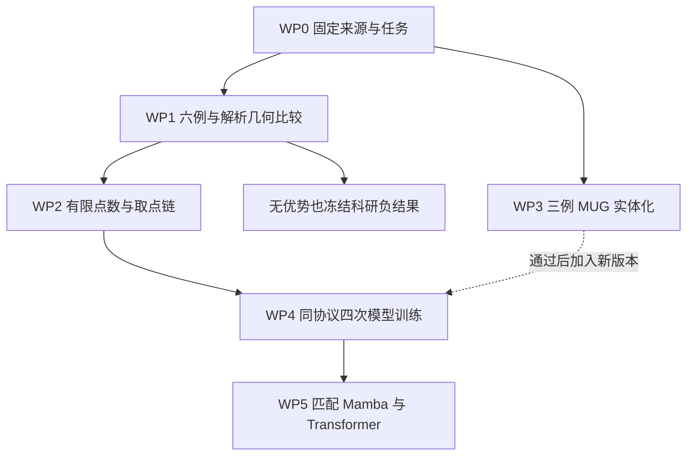

# 颅骨多表面点云与实体缺损：正式实验计划书 v1.1

_Cranial-BCSP-GeoV1 · 2026-10-24（Asia/Shanghai）· 数据表示验证与最小模型实验_

---

本文件修订自用户的《颅骨多表面点云与实体缺损_下一阶段实验计划书_2026-10-24.md》。原稿 SHA256：`f26cbcbf856507aa65720fb36f4f8b3c8efd00059fd4daa2fa08dd74ee6e6193`。原稿保留不变，本文件独立版本化。

**状态**：正式修订版；本轮已启动本机 WP0 元数据核对。尚未生成新缺损、运行几何采样比较、部署服务器或训练。协议成文不替代后续明确的数据生成／GPU 执行授权，不把拟议参数标记为实测。

证据标记：`E`＝项目既有实测；`L`＝核验的公开文献；`P`＝本计划决定；`H`＝待验证假设；`U`＝执行前仍需补齐的具体绑定。本文中的效果／资源门均是研究决策规则，不是临床安全标准。

## 🎯 1. 研究问题、范围与正式决策

### 1.1 唯一主线

在可信骨组织实体缺损下，研究残颅完整边界的点云表示是否保留了补全所需的多表面信息，以及模型能否在保持接触界面质量的同时，恢复缺失骨块的未知原始表面。

主线不是重新证明“切壁在所有旧数据中都不存在”，不是为旧 SCQR 负结果翻案，也不是开发通用库存／传输／审计框架。项目既有六例体素配对已经证实 SkullFix／SkullBreak 有切壁；MUG 旧删面分支则没有构造新切壁。[项目证据目录](E:/Codex/2026-06-06/mamba-ccf-c-1-high-resolution/outputs/cranial_geometry_diagnostic_20261023)

### 1.2 固定决策

| 项目 | v1.1 决策 |
|---|---|
| 主输入 | 残颅骨组织完整边界 `∂D` 的表面点云；不默认只取外壳 |
| 主输出 | 缺失骨块完整边界 `∂G`；不是整个颅骨，也不只是旧表面缺失片 |
| 模型主终点 | 未知原始表面 `E_G` 到预测点集的面积加权 P95 距离，mm |
| 关键次终点 | 整个 `∂G` 与接触界面 `J` 的覆盖／距离、预测离群与失败 |
| 第一组点数 | `8192 → 8192`，建立新任务基准 |
| 唯一点数升级候选 | `16384 → 8192`；先看表示与实际取点链，不预定胜出 |
| 首批训练 | 相同新 GT 的旧输入采样 vs 一个合格新输入采样；2 方法×2 source folds×seed0＝4 run |
| MUG 地位 | 独立并行实体化支线，不阻断 SkullBreak 合法基线 |
| Mamba 地位 | 几何与基线可用后，比较匹配的 Transformer／Mamba；不以旧 SCF 必须成功为前提 |

输出点集不自动构成闭合网格、正确骨厚度或可制造植入体。正式表述采用“缺失骨块边界重建／解剖几何重建”，不采用“临床植入物自动设计完成”。

### 1.3 可证伪问题

1. **表示问题 H1**：固定实体、点数与参考时，边界体素中心、暴露体素面采样、MC 采样的物理误差和局部支持不同。若优势只出现在候选自己的参考上，不判为更真实。
2. **点数问题 H2**：16k 输入可改善局部信息，但可能被后续下采样／proxy 压缩抵消。若实际取点链未保留信息，不进入该候选训练。
3. **预测问题 H3**：同一新目标下，输入表示改变可改善未知原始表面预测。几何覆盖改善但模型不改善，是可接受负结果，不重定义终点。
4. **机制问题 H4（后续）**：多表面邻接与序列组织可能影响 Mamba 对薄骨的建模；仅更换 backbone 或增加点数本身不是已证明的创新。

本阶段不预先声称表面点云优于体积点云；若未来主张这种优越性，需要另加匹配的体积表示对照。

## 📚 2. 证据、文献与需要修订的依据

### 2.1 项目实测的正确解释

| 证据 | 已知事实 | 本阶段含义 |
|---|---|---|
| SkullFix／SkullBreak 固定六例 | `C=D∪G` 且互斥；原输入采到切口邻接体素中心 | 不重造这些缺损，研究有限覆盖与几何近似 |
| 六例切壁 2 mm 覆盖 | 离散面心面积加权约 39.84%～65.17% | 是描述性采样结果，不是缺失面积或临床合格率 |
| MUG 三例旧生成器 | 原三角面质心判定删面，无新增切壁三角面 | 新实体切除必须单列版本 |
| MUG 三例原 STL | 已有开放／非流形边及多组件 | 不能默认可信闭合实体或盲目补洞 |
| 九例现有点云 | 全部输入 8192；SF／SB 本次目标 4096、MUG 8192 | 跨组差异不是匹配的因果实验 |

三个来源组各三例是已观察的开发 pilot，不能当作未接触验证集，也不能据此估计整个数据集的总体优越性。最早诊断报告的原几何缺口已由后两份补充，不能引用最早“部分完成”状态覆盖最新证据。

### 2.2 关键既有文献

Wodzinski 等的 MICCAI 2023 方法把骨前景体素坐标构造成占据点云，以分组／聚合处理高分辨率；它不是本计划的面积表面采样，点数不能直接移植。Friedrich 等则从 mask 经 MC 和 Poisson-disk 采样得到表面点，说明表面输入与后续实体恢复可以分工。[^1][^2]

MUG500+ 论文及作者说明区分 NRRD、原 STL 与清理后的 clear STL。同编号不意味着这些资产几何完全等价；NRRD 的文件扩展名也不证明本机成员已经是可直接使用的二值骨分割。[^3][^4]

临床植入物的厚度、边缘过渡和原骨并不必然相同；外轮廓指导面的研究与完整骨块接口重建也属于不同目标。因此本阶段保留原骨几何任务，不外推临床设计结论。[^5][^6]

### 2.3 截至本次检索的新增相关工作

| 文献／状态 | 本次核验深度 | 对本计划的有限影响 |
|---|---|---|
| MedPCFM，2026-06-23，arXiv v1 | 方法／实验 | 表面采样及点数扩展有直接相关研究；确定性 PTv3 是后续现代对照候选，不照搬其硬件和基准数值 |
| MedPCFM-TED，2026-09-15，arXiv v1 | 方法／实验 | 更新单步生成和效率相关工作；不增加 teacher／student 训练分支 |
| Plausible but Unimplantable，2026-10-21，作者接受稿，自述 ACCV TrustFMI workshop 接收 | 方法／结果／讨论 | 加入 no-op／点预算控制与有限薄层可辨性检查；不照搬临床门，不把零样本全颅负结果推广到本项目局部有监督任务 |
| CDRMamba，2025 年刊期 | 出版社摘要／highlights | 已有 3D U-Net＋Mamba 的颅颌面重建，不得声称“首次使用 Mamba”；未核验其全文实现 |

上述三项 2026 工作不在本文件中冒充已独立复现或正式主会成果。最新审计中的任务专用体素参考明确是 test-selected ceiling，也不能当无偏 SOTA 比较对象。[^7][^8][^9][^10]

检索日期：2026-10-24。检索词覆盖 cranial／skull、point cloud、completion／implant、Mamba、2025／2026，并精确核验原稿 arXiv／DOI。专用学术 MCP 在本会话未提供，使用网页检索到 arXiv、出版商、作者仓库等一手页面。此为针对性更新，不是系统综述或“全部最新论文已穷尽”的声明。

## 📋 3. 任务、来源与输入合法性合同

### 3.1 实体与目标区域

在同一物理网格上定义 `C` 完整骨组织、`D` 残颅、`G` 缺失骨块，要求：

\[
C=D\cup G,\quad D\cap G=\varnothing.
\]

MUG 新实体分支采用 `D=C\R, G=C∩R`。体素中心约定、边界位置约定和 NRRD 轴序必须明确；不能把中心坐标和面坐标相差半个 voxel 误认成模型误差。

`J` 是 D 与 G 相邻体素共享的物理面。两侧 face 位置一致，实体朝外法向相反；面积由 affine 切向向量叉积计算，体素体积为 `abs(det(A3x3))`。非正交 affine 也不能用 spacing 连乘代替所有面积计算。

将目标分为：

- `E_G`：G 对原背景暴露的面，即原完整骨边界属于 G 的部分，含原有内外表面和可信腔壁；
- `J_G`：G 面向 D 的新接口面。

在离散面模型下二者组成 `∂G`，分别建账。这里的“未知”指缺失原始表面，不是承诺该表面能由残颅唯一确定。

### 3.2 已知接口不是全部需要推断的新解剖

`J_G` 与残颅一侧切壁对应。模型在此既涉及接口保持／对应，也可能涉及稀疏观测的稠密恢复。不得用仅 J 的低误差证明隐藏形状推断变好。

保留三类无需训练的对照：

1. **Nop-D**：返回已有残颅点，明确其没有生成缺失骨块；揭示邻近残骨能贡献多少 proximity coverage。
2. **GT-sampling ceiling**：从同一目标几何采样固定 N 点；称“采样参考／表示基准”，不是数学上严格的最优上界。
3. **J-transfer oracle**：离线用真实 J 转移接口点，仅解释接口复制可取得的分数；明确 GT 辅助，不作为合法部署竞争方法。

同 N 输出方法按共同点预算评分。Nop-D 在 N_in 不同时同时报告原生点数和固定 8192 点版本；不能让更多已知点无声获得评价优势。

不能将 `∂D∪∂G` 直接称作 `∂C`，因为共享切壁在实体并集中变为内部面。未实现可靠界面消除／实体重建前，不报告“完整 skull 实体已恢复”。

### 3.3 来源与分区

首批固定六例：SkullFix 002／003／004；SkullBreak train 000／001／002 bilateral。MUG 并行 pilot 固定 A0136／A0137／A0138，不更换容易来源。

数据根目录仅指 Windows 本机：

- `E:/dataset/SkullFix/extracted/training_set`
- `E:/dataset/SkullBreak/raw/train`
- `E:/dataset/MUG500plus`

精确 21 个既有文件和 MUG 三个归档成员见 WP0 回执。不得把 Windows 路径转换为猜测的服务器路径。服务器计算仅在重新核验身份后使用授权的 Linux 项目／数据／结果目录；本轮未核验当前容器身份。

扩大样本前先根据现有允许开发 manifest 锁定 source ledger。六例之外不因本计划而自动解封。历史 official test 若已用过，标记 historically exposed，不称 untouched。对同一 source 的缺损、NRRD／STL、点数／采样变体统一分组；跨数据集来源重叠除文件哈希外，结合已有来源信息和非结果驱动的形状重复核对，疑似同源不得跨 split。

两个 pilot fold 是两个互斥 source 组的预先划分／轮换，不把同一 source 重复评分当独立病例。六例只作工具与几何 pilot，不能充当足够规模的模型泛化研究。

### 3.4 输入可见性与归一化

默认流水线是“残颅分割 D → 通用边界提取／采样 → 固定点云模型”；从 D 制作点云是已声明的输入前处理，不是利用 G。必须分别报告前处理输入和网络实际输入。

首批采样器不读取 `C/G/J`。模型只获得声明的坐标／D-only 特征。GT 和 provenance 只进入训练 loss 或离线评价。用访问隔离和替换 G/J 的负例测试验证，而不只靠函数命名。

如果以后局部定位额外读取高密度 D 网格／分割，而比较方法只得到固定稀疏点，须声明 segmentation-assisted preprocessing 并匹配信息预算；不能统称同一“仅固定点云输入”。`J+MC` 输入 hybrid 依赖 GT 且可能产生裂缝，本轮不实现。

所有几何指标使用世界 mm。每病例为全部输入候选使用同一 D-only 坐标框架：中心由 D 占据体素世界包围盒确定，scale 为该包围盒半对角线；空／退化 D 失败。target 使用同一变换。该规范与历史归一化如不同，两组新模型同时采用，旧指标不直接比较。

## 🔍 4. 几何参考、采样和点数设计

### 4.1 参考不等于真实解剖认证

**A：体素并集边界面**用于离散实体一致性和精确 J。**B：固定参数 MC 表面**用于另一种连续近似。两者均从同一 mask 得到、在候选运行前固定，不按候选重建参考。

V1 的几何正是 A，因此它在 A 上胜出可能只是表示自洽；V2 对 B 也有同类优势。正式报告必须给 A/B 交叉结果，不以任一自参考单独裁决解剖精度。

另设一个有限解析 phantom 包：平板／球壳实体切块，保留已知内外表面和切壁；在预定的各向异性、旋转及亚体素相位组合上比较离散提取误差。解析 phantom 提供独立几何真值，但不能取代真实病例真实性评价。

MC 统一记录 level=0.5、padding、轴序、affine 转换和版本；不平滑、不自动填洞／去组件。D/G 分别 MC 不保证共享接口严格配对，J 仍采用 A。MC 上接口区域若不能可靠对应，记为不可分区，不能用最近 J 的随意阈值伪造精确标签。

### 4.2 第一批几何比较

| 候选 | 几何／抽样 | 首批位置 |
|---|---|---|
| V0 | D 六邻域边界骨体素中心，唯一中心等概率无放回抽样 | 旧输入表示对照 |
| V1 | D 全部暴露体素面，按世界面积取面并在面内均匀抽样 | 首要新候选 |
| V2 | D 固定 MC 三角面，按面积抽样 | 诊断候选，不默认优于 V1 |

固定六例、N_in=8192、sampling seeds=0/1/2；每例每候选保存 provenance。当前共 `6×3×3=54` 组输入采样结果，不扩展缺损类型或病例。若现有精确 legacy 复现工具可用则复用；否则 V0 标注规则复现，不冒称与旧 NPZ 字节相同。

输出统一使用同一 G 的 V1 面积采样，8192 点；同 seed 的所有输入候选共用完全相同的目标坐标文件。V2 在此只作为输入几何候选，不隐式改变训练目标。

第一批不做 S2 局部得分器、FPS 全算法比较、Poisson 参数搜索、V3 hybrid、proxy1024 或新的法向输出头。它们不是启动模型实验的必要条件。

### 4.3 薄层可辨性与假覆盖

欧氏 1／2 mm 近邻可跨薄层计入覆盖。因此并列报告：

- 常规欧氏全点覆盖；
- 在已有可靠 face provenance 的区域，限制同一面域的支持覆盖；
- 在解析平板／球壳上，固定 k=16/32 的对侧邻域混合比例及间距／厚度比；
- 真实病例只对已有可信对应的有限局部截面给厚度／跨面诊断；没有内外板语义标签时，不报告全颅语义准确率。

不因增加了一个薄层检查而发展整颅解剖分割项目。参考欧氏覆盖达标也不能单独宣布骨厚度可辨；最新零样本审计支持重视这一风险，但不证明本计划点数必然失败。[^9]

### 4.4 有限点数选择

完成基本几何合同后，对一个合格母版分别测试：

- 输入 D：8192、16384，3 个固定采样 seed；
- 输出 G：8192、16384，3 个固定采样 seed；
- 若采用随机面积采样，使用固定顺序的 16384 样本前缀形成 8192 子集，并独立锁定参考，降低抽样差异的干扰。

这是输入／输出各自的无模型表示研究，不必先做全部 N00/N10/N11 神经网络矩阵。32k、输出16k训练、proxy扩容和输入局部加密本轮均为条件支线。

对实际入口、FPS／grouping／proxy 只核对现有代码与必要的一次采样链，记录输入点、保留点和 proxy 的 J 支持。不能要求 512 proxy 达到 raw 16k 的覆盖，也不能把 proxy 最近距当成已训练特征质量。

### 4.5 选型规则与停止扩张

数学／权限有效性是硬门；“新采样必须有正收益”不是启动合法 baseline 的硬门。

首批六例仅作描述性配对，不设总体显著性结论。优先检查参考偏差、薄层混合和成本；如 V1 无明确好处，保留 V0 输入＋共同新目标，记录负结果并进入可用基线，不自动追加更多候选。

在扩大 source 前，针对独立开发复核锁定一个候选和数值决策表。v1.1 提议采用下列**研发选择值**，需随协议确认，不能结果出炉后单向放宽：

| 选择项 | 提议规则 |
|---|---|
| 新输入采样值得训练 | source 平均 J Cover@1mm 增量≥5百分点，J-P95不恶化；noninterface Cover@1mm下降不超过2百分点；交叉参考与phantom无反向重大缺陷 |
| 输入16k值得补训练 | 同上质量规则，且实际取点链有可测信息保留；受限资源核验通过 |
| 没有候选达选择值 | 不称改进；采用最简单合法基线，不继续自动扫描 |
| 输出8k是否可用 | 报完整 G 和 J/E 两区表示误差；若不支持所声称精度，收紧论文精度主张或单独申请16k，而非伪称8k足够 |

5／2百分点是本项目预算下的提议筛选幅度，不是文献最优值或临床标准。参考分歧、真实薄层对应不足时结论写 unresolved，不凭表格机械裁决。

## ⚙️ 5. 工作包、真实执行顺序与预算

### 5.1 主线与并行支线



MUG 的箭头是可选接入，不是 SkullBreak 主线训练的前置依赖。所有 GPU 节点仍需单独执行授权。

### 5.2 工作包合同

| 工作包 | 固定范围 | 交付／出口 |
|---|---|---|
| WP0 元数据启动 | 原稿、三报告、既有 scopes；21文件存在性；3个MUG NRRD归档成员 | 路径／证据哈希／未决项；不解码几何 |
| WP1 CPU 几何 pilot | 解析phantom＋六例C/D/G；54组输入采样；共同G目标；A/B参考 | 互补／affine／J QC、配对表、薄层检查、代表剖面 |
| WP2 有限点数 | 一个母版，输入／输出分别8k与16k | 表示误差与成本；明确是否值得补N10 |
| WP3 MUG 并行 | A0136–0138精确NRRD成员；三个旧STL；一个切除族 | NRRD语义、物理对应、固定实体切除、失败清单 |
| WP4 最小模型 | 共同新GT，两个输入方案，两source folds，seed0 | 4个新训练run；配对未知表面与接口结果 |
| WP5 条件式Mamba | 固定数据与点数；T0 vs M0，之后才考虑一个几何机制 | 架构贡献及效率；不强制叠SCF |

WP1/2 可合并为一次限定 CPU 科研批次，避免每个指标单独启动。实现修订与真实数据读取仍必须在该批次范围中明确，失败后不自动修复重跑。

### 5.3 有界资源与准备完成标准

下一 CPU 包提议：本机既有 Python／NumPy／SciPy，MC 使用已存在的实现；不联网安装。逐病例串行，线程上限2，禁止构造所有参考点×输入点的稠密距离矩阵，采用分块近邻。总 wall time 上限60分钟，单病例15分钟，进程RSS监测上限8 GiB，输出上限1 GiB；监测不是专属 cgroup 硬隔离，局限须披露。

MUG 单独分支上限三个固定来源、一个既定切除族、每源一次固定参数尝试。若来源语义不清、读入失败或切除不合格，保留失败记录，不自动换源／调中心重试。NRRD 读取和新资产生成需要精确范围，不解压整个数据包。

准备工作最多两个集中实现／验证批次，目标是在两个有效工作日内给出第一份几何科研读数。这是项目排期预算，不是自动后台任务或保证；若未完成，汇总具体阻断并缩减可选项，不再扩展守卫框架。文档、工具验证和几何负结果都不冒充模型结果。

完成下列四项即可离开准备阶段：合法C/D/G与affine、共同GT及区域来源、无泄漏输入、可用指标及资源范围。无需等待S2、全颅内外板语义、MUG全源成功、实体后处理、proxy1024或全部点数组合。

## 📦 6. MUG 实体缺损并行方案

### 6.1 当前已定位的资产

本轮只读 ZIP 中央目录已找到：

```text
E:/dataset/MUG500plus/raw_v20/archives/d6_development100_v1/batch_001/A0136-A0140.zip
  A0136-A0140/A0136/A0136.nrrd
  A0136-A0140/A0137/A0137.nrrd
  A0136-A0140/A0138/A0138.nrrd
```

本轮没有读取／解压这些成员内容，没有验证其骨分割语义或当前 SHA256。三者成员大小差异很大，只能提示后续核对，不能据此断言损坏。A0139/A0140 不纳入读取／提取范围。

### 6.2 NRRD 准入与源差异

首次有界读取先检查 header、尺寸、编码、物理方向、数值类型及标签含义。若是灰度 CT 或非骨mask，不直接 `values>0` 当骨；阈值／人工分割需要单独明确方法，不从 STL 对齐效果反向调阈值。

通过同源身份与坐标核对后，对 NRRD 与 clear STL 的差异只做记录与固定QC，不为追求相同而自由ICP／缩放／填洞。不可修复或语义未定时，MUG 支线状态为 `UNRESOLVED`，不阻塞主线。

### 6.3 固定切除与验收

首批仅用 `ellipsoid_medium`，从历史参数记录读取 center/frame/radii，先确认其世界坐标是否适用于NRRD。不能直接假设坐标一致；变换必须由元数据或明确对应证据决定，不由结果优选。

在通过QC的 C 中切出 `G=C∩R`；要求非空、同affine、互补、J存在且两侧精确配对。记录G体积、组件、J面积、原始表面E_G面积与局部剖面。至少一个案例成功即可证明该固定pilot路线可行；三个案例全体成功／失败均报告，不据一例成功宣称全500源可用。

本阶段不引入 large/small/irregular 四族扩张，不自动选择更平滑病例。后续扩展需把通过率、源级排除及已冻结参数分别登记。

## 📊 7. 指标、统计与验收合同

### 7.1 第一批可直接定义的量

固定参考位置 `x_i` 及其面积积分权重 `w_i`，计算：

\[
\operatorname{Cover}_{\tau}(F,P)=\frac{\sum_iw_i\,1[d(x_i,P)\leq\tau]}{\sum_iw_i}.
\]

分位数由累计面积权重定义，P95不采用“每个面等权”的默认数组percentile。报告 `all D / noninterface D / J_D`，目标报告 `all G / E_G / J_G`。阈值固定0.5/1/2 mm，仅作描述性尺度。A参考面心是数值积分近似；必要的面内细分与B参考密度收敛检查固定一次，不按候选调密度。

模型主终点：`E_G → P_pred` 面积加权 P95。其余必须同时报告：

- `∂G → P_pred` 与 `J_G → P_pred` 的P95及覆盖；
- `P_pred → 固定G参考表面` 的均值／P95／最大值和离群比例；
- 明确公式的固定参考点集CD-L1，双向均值各占1/2、距离为欧氏mm、不平方、不乘人为尺度；
- 点输出数量、重复点、非有限值、最差source、接口支持的失效事件；
- Nop-D和固定GT采样参考，必要时J-transfer oracle另表。

J的覆盖可以对整份预测点计算，但不等价于预测点自己具备正确区域、法向或厚度。预测点没有面积权重时，不把等权点集F-score称为面积NSD，不把点集P95混称严格表面HD95。表面距离官方实现使用相应面积元权重，这与无定向稀疏点集不是同一合同。[^11]

### 7.2 条件式实体指标

真正双向面积NSD、surface HD95、G实体Dice／RVE、D并集边界、碰撞／厚度，仅在统一网格／实体恢复方法固定并通过有效性检查后报告。两方法使用相同后处理，失败计入总分母。首批不为这些指标新建隐式重建网络。

已有离散D可用于离线评估预测点是否位于保留骨体素内部，但需说明体素定位与边界容差，称“点侵入代理”，不是机械可植入性认证；先以GT点验证测量底噪。不得直接把最新审计的1 mm规则搬作本项目临床门。

### 7.3 统计单位与选择偏差

同source多defect先等权汇总；多sampling seed只描述抽样变化。六例pilot只给逐例配对差及范围，不作总体显著性判断。

模型开发按source配对，bootstrap 10000次、固定seed=20261024；同一次抽样使用各方法共同source索引。各fold先按唯一source形成out-of-fold结果，不将重复的source评分当独立N。确认阶段对每source先按预注册defect和训练seed求平均，再source-cluster bootstrap，同时报告每训练seed和每fold。

该区间主要描述给定已训练模型下的病例不确定性，不完整代表训练随机性；不能用seed×case扩大患者样本量。开发选择后的区间不是独立最终确认；真正封存来源仍关闭。

### 7.4 主终点与失败处理

未知表面误差是唯一正式效能主终点，接口和全边界是强制保护性次终点；多阈值／区域不另挑最有利者宣布成功。

模型empty/nonfinite输出记失败，主距离记 `+inf`，不以删去失败病例后的有限均值替代总结果。空contact记事件；旧contact-HD95的NA保留。明确区分“数据不合法／系统启动失败”和“合法实验科学负结果”。

首批模型是探索性，不提前虚构通用disaster阈值。训练前在独立metric合同中冻结事件定义及不可接受回退幅度；没有该冻结，不创建训练执行request。不能挪用旧QA数值阈值裁决新任务。

## 🔧 8. 最小模型、Mamba 与计算公平性

### 8.1 首批四次训练

两个输入分支共用同一新G目标、D-only归一化、初始化seed、样本顺序、增强和loss：

| 分支 | 输入／输出 | 比较目的 |
|---|---|---|
| B0-newtask | V0，8192 → 新G目标8192 | 同一新任务的旧输入表示 |
| B1-newtask | 一个已锁定新采样，8192 → 完全相同G目标8192 | 只改变输入表示 |

每分支两source folds、seed0，共4run。若没有新采样满足研发选择值，不为凑正结果而强行训练它；改为固定最简单合法任务基线，并报告该预算下没有采样收益证据。

N10只在表示依据和实际取点链支持后补两个run。输出16k不在首批，因decoder扩展／query改变可能同时改变容量；若以后开展，必须记录实际实现而非用 `256×32/64` 假设能够精确得到指定点数。

### 8.2 训练前必须形成的精确绑定

以现有可运行的 **AdaPoinTr-Implant 项目派生实现**为母版，不把它无条件等同官方原版AdaPoinTr。论文原版含adaptive query和denoising；若本项目关闭相关机制，应如实命名。[^12]

提议初始训练预算100 epochs、AdamW、LR=1e-4、weight_decay=5e-4、global batch=8、seed0、final checkpoint。它们不是已冻结的可执行配置；先只读校对现有runner、数据量和scheduler，确定该母版是否兼容。若不兼容，一次性列清差异，不边跑边修。

request必须绑定：source split、case数、drop_last、grad accumulation、每epoch真实batch数、总optimizer updates、样本曝光／遍历计数、query模式、decoder实际输出数、loss精确定义、AMP/deterministic/TF32、BNCal是否执行及范围、checkpoint策略、超时、显存与日志／退出码路径。

`3939 updates`属于旧实验合同，不自动继承。BNCal默认不由训练自动触发；若需保持旧母版train-only校准，作为单独明确阶段且所有比较方法一致。validation/development不得更新BN或参与训练前处理拟合。

首次GPU包只做固定人工／已授权输入的必要资源与计数检查，不重编译／重装已验证扩展，不再次开发通用依赖审计。后续训练与评价继续使用明确request和失败即停规则。

### 8.3 回到Mamba研究问题

合法数据和可用baseline形成后，最小架构对照是T0 vs M0：同一数据、点数、decoder和训练合同，改变encoder及必须声明的适配。**不要求先证明旧SCF/Local成功**，也不默认加载旧LSQ/Query模块。

单独检验一个多表面机制，例如减少薄层跨面混接的邻域／序列组织；必须由输入可获得信息实现。使用GT层标签的版本只能作oracle。相同点数与算力边界下报告准确性、尾部风险和效率，不能把Mamba块的线性复杂度推广为整个FPS/KNN/decoder/CD流水线线性。

AdaPoinTr是启动基准，不足以独自支撑最终架构优越性。投稿前视可获得实现和预算，在新任务上增加一个现代点云对照（优先评估PTv3确定性路线）；不直接把MedPCFM/TED原论文不同协议数值放入公平排名。该追加不是本次四run的前置条件。

最终候选至少报告三个预注册训练seed，并避免只保留最好seed。无法获得独立确认数据时，明确称开发研究，不承诺仅靠此计划就能发表CCF C。

## 🔐 9. 交付、授权与当前已完成范围

### 9.1 精简交付

| 阶段 | 必需材料 |
|---|---|
| WP0 | 本正式计划、审阅意见、证据／源路径元数据回执 |
| WP1/2 | 一个限定几何工具与针对性测试、固定配置、逐例CSV/JSON、代表剖面、来源哈希、资源与失败记录 |
| WP3 | 三源NRRD语义／坐标QC、新切除参数／守恒结果、失败清单 |
| WP4/5 | 实现／配置哈希、授权范围、训练计数、checkpoint与评价、source配对统计、尾部病例及效率 |

结果只写新版本目录，不覆盖旧数据／报告／模型。不复制全部原始数据，不自动删除历史产物，不自动commit/tag/push。文件SHA绑定字节；mask语义指纹另存，不能相互冒用。随机采样可重现首先校验数组内容与metadata；NPZ容器时间戳可能导致文件字节不同，不能把内容确定性与容器字节确定性混为一谈。

### 9.2 本轮实际启动结果

本轮已经：完整阅读原稿1326行；重新读取三份既有Markdown诊断与关键scope／回执；核验原稿与相关文本证据哈希；确认18个既有NRRD和3个STL存在；从一个固定ZIP的中央目录定位三个NRRD成员。

本轮未：解码上述原始几何或NRRD成员、解压／生成新资产、重新计算几何指标、加载模型／checkpoint、GPU forward、训练、连接／修改服务器。原始数据当前payload哈希未重新核验，回执保留历史SHA并明确未复验。

### 9.3 唯一紧接的科研工作包

确认本v1.1后，建议一次合并授权 **WP1＋WP2的限定本机CPU包**：复用已有NRRD解析和可用依赖，新增最小几何提取／评价及测试，在六例已开放来源上完成54组输入采样、共同目标与8k/16k表示比较。允许写入项目新outputs，不改数据根；失败即停，不自动重跑或推进GPU。

如果MC依赖当前不可用，记录V2及B参考未完成，先交付V0/V1和解析参考，不为安装MC而阻断全部主线。此时结论限于离散实体与解析phantom，不宣称完成A/B交叉参考选型。该调整只缩减可选候选，不取消必须的物理坐标、实体守恒、无泄漏和固定参考合同。

这一次CPU科研包之后应讨论实际几何结果及最小模型数据规模，不再以通用工程完善作为默认下一步。MUG源读取与实体生成另按固定三源并行推进。

### 9.4 有效性边界与AI披露

本计划使用AI辅助审阅、检索和起草；作者须复核最终科学判断。临床解剖、安装需求及真实病例适用性未由本轮认证。引用标明全文／摘要深度，未访问的内容不冒充精读；没有编造新实验结果、数据划分或通过状态。

## 🔗 10. 文献与证据索引

本机核心证据：

- [九例既有点云报告](E:/Codex/2026-06-06/mamba-ccf-c-1-high-resolution/outputs/cranial_geometry_diagnostic_20261023/geometry_diagnostic_report_zh_v1.md)
- [六例原始体素配对报告](E:/Codex/2026-06-06/mamba-ccf-c-1-high-resolution/outputs/cranial_geometry_diagnostic_20261023/raw_pairing_v1/raw_pairing_report_zh_v1.md)
- [MUG三例及综合报告](E:/Codex/2026-06-06/mamba-ccf-c-1-high-resolution/outputs/cranial_geometry_diagnostic_20261023/mug_mesh_v1/mug_mesh_and_integrated_report_zh_v1.md)
- [本轮WP0元数据回执](E:/Codex/2026-06-06/mamba-ccf-c-1-high-resolution/outputs/cranial_bcsp_geov1_20261024/wp0_metadata_review_v1.json)

[^1]: Wodzinski M., et al. (2023). High-Resolution Cranial Defect Reconstruction by Iterative, Low-Resolution, Point Cloud Completion Transformers. MICCAI. 本次核对方法§2.2–2.3。[原文](https://arxiv.org/html/2308.03813v2)
[^2]: Friedrich P., et al. (2023). Point Cloud Diffusion Models for Automatic Implant Generation. MICCAI. 本次核对Point Cloud Generation及实验配置。[原文](https://arxiv.org/html/2303.08061v2)
[^3]: Li J., et al. (2021). MUG500+: Database of 500 High-Resolution Healthy Human Skulls and 29 Craniotomy Skulls and Implants. Data in Brief 39:107524. DOI 10.1016/j.dib.2021.107524。本次出版社索引可读数据说明，PMC访问触发检查。[出版社原文](https://www.sciencedirect.com/science/article/pii/S2352340921008003)、[PubMed记录](https://pubmed.ncbi.nlm.nih.gov/34815988/)
[^4]: Jianning Li. MUG500+ 作者仓库，文件结构与维护记录；本次核对README。[作者说明](https://github.com/Jianningli/mug500plus/blob/main/README.md)
[^5]: Fishman Z., et al. (2024). Thickness and Design Features of Clinical Cranial Implants—What Should Automated Methods Strive to Replicate? IJCARS 19:747–756. 本次阅读出版社结构化摘要，非全文复现。[出版社](https://link.springer.com/article/10.1007/s11548-024-03068-4)
[^6]: Mazzocchetti S., et al. (2024). Neural Shape Completion for Personalized Maxillofacial Surgery. Scientific Reports 14:19810. 任务定位及全文方法可读。[原文](https://www.nature.com/articles/s41598-024-68084-5)
[^7]: Kwarciak K., Wodzinski M. (2026-06-23). MedPCFM: Improving Medical Point Cloud Completion by Integrating Point Transformers and Flow Matching. arXiv:2606.24433v1，预印本。[方法及实验](https://arxiv.org/html/2606.24433v1)
[^8]: Kwarciak K., Wodzinski M. (2026-09-15). MedPCFM-TED: One-Step Point Cloud Flow Matching for Implant Generation via Teacher-Guided Endpoint Distillation. arXiv:2609.16934v1，预印本。[方法及实验](https://arxiv.org/html/2609.16934v1)
[^9]: Wodzinski M., Kwarciak K., Hemmerling D., Daniol M. (2026-10-21). Plausible but Unimplantable: A Trustworthiness Audit of Shape Completion Foundation Models for Cranial Defect Reconstruction. arXiv:2610.30035v1，作者接受稿，网页注明ACCV 2026 TrustFMI workshop，非主会VoR。[方法及结果](https://arxiv.org/html/2610.30035v1)
[^10]: CDRMamba: A Framework for Automated Craniomaxillofacial Defect Reconstruction Using Mamba-Based Modeling. BSPC 103:107376，2025年刊期，DOI 10.1016/j.bspc.2024.107376。本次仅核对摘要／highlights；作者代码链接不可用，不声称复现。[出版社](https://www.sciencedirect.com/science/article/pii/S1746809424014344)
[^11]: Google DeepMind. Surface-distance，README与metrics.py。面积元加权surface Dice及robust Hausdorff参考；不是本项目已安装／执行的软件声明。[官方实现](https://github.com/google-deepmind/surface-distance/blob/master/surface_distance/metrics.py)
[^12]: Yu X., et al. (2023). AdaPoinTr: Diverse Point Cloud Completion with Adaptive Geometry-Aware Transformers. TPAMI，DOI 10.1109/TPAMI.2023.3309253。[作者预印本](https://arxiv.org/abs/2301.04545)、[作者仓库](https://github.com/yuxumin/PoinTr)
