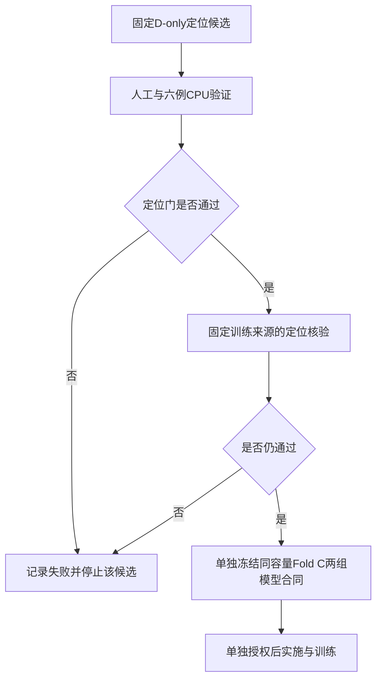

# 接口局部几何保留：最小对照方案 v1

日期：2026-11-02（Asia/Shanghai）。阶段名：BCSP-InterfaceLocal-v1。

**状态：供确认的限定研究方案。本文不构成代码实施、数据生成、模型 forward 或训练的执行请求。本轮只写文档。**所有新增阈值均为拟议研究参数，不是已验证的解剖或临床标准。

## 1. 研究问题与证据边界

唯一问题：在相同8k输入与8k完整骨块输出预算下，基于输入 D 定位局部接口几何，并直接为解码提供其局部特征，是否比同容量的全局取点分支更有利于接口吻合，同时保持未知表面补全质量？

现有证据：

- 四模型完整开发集：16k 输入 J Cover@2mm 为84.53%，预测45.31%；增加输入支持未得到稳定输出收益。
- 六例固定 CPU 比较：4k均匀＋4k高曲率采样失败，接口和全局覆盖均下降，不复用其“高曲率=接口”的假设。
- 两固定病例实际轨迹：256 proxy坐标覆盖约5%，但16k近接口点的97.76%–98.75%仍有最终proxy潜在传播路径。坐标稀疏不能直接证明特征被删除。
- A0221存在前景质量未决问题，本阶段不纳入训练或定位准入，也不继续为其开发清理框架。

**假设 H：**接口局部几何可以通过 D-only 结构识别获得；将该区域的高分辨局部特征直接提供给解码器，在相同容量对照下改善 J 指标。

H包含两个必须分开的命题：H1“定位可用”、H2“利用后有效”。H1失败即不实施依赖该定位的模型分支。H2的正结果也不能反推H1定位在临床或跨域可靠。

## 2. 为什么不能直接检测开放边界

实体缺损 D 的暴露切壁本身属于完整骨组织边界；有效实体的表面不一定有网格拓扑意义的开放边。因此不把mesh开放边检测直接当作contact rim检测。仅凭局部点云也可能无法唯一地区分自然孔洞、颅底结构和人工切除面，这种可辨识性限制必须允许输出“未定位”。

本阶段只尝试一个可证伪的几何候选，不保证成功：识别局部两侧近似平行骨面及连接它们的横向面。这个构型可能出现在切壁，也可能出现在自然结构；最终由固定数据上的精确率、面积召回及误定位来判断。

## 3. 输入合法性与评价隔离

定位器部署接口仅为 `partial[8192,3]`、输入自身的中心/尺度记录及固定配置。毫米尺度可由仅依赖 D 的归一化 scale 恢复。不得读取 G、C、implant、真实 J、切除 R、缺损类型名称或病例编号作为特征。

不得用体素面 provenance、源 mask 法向或原 STL 法向增强点云定位器：它们不一定是实际点云推理时可得的输入。法向/局部平面只能从输入点估计。输入平移旋转不应因固定世界轴切换定位结果；用刚体变换检查这一点。

G/J/R只在选点结果锁定后用于离线评分。若使用它们指定区域或选点，只能单列 oracle 诊断；本方案主比较不包含 oracle。

训练中允许双方使用同一完整骨块 GT及相同重建损失，但不新增J监督、区域loss或有监督定位训练，以免同时改变定位、模型和目标。

## 4. 阶段 A：一次限定的 D-only 定位验证

### 4.1 单一候选与冻结参数

拟名：局部多平面切壁候选（仅描述算法，不作为新方法命名或创新声称）。不再使用PCA曲率排名来分配一半输入点。

1. 从现有8k输入以确定性FPS选512个检查中心；首点选离输入质心最远点，平距使用坐标字典序，而不是文件行号，保证普通点序置换下的可重复性。
2. 每中心查询8mm球邻域，最多128点；不足24点标为证据不足，不扩大半径补救。候选邻居按距离排序，等距以坐标字典序处理；RANSAC索引基于该确定顺序。刚体变换下的浮点平距仍可能改变离散选择，因此人工检查评价几何定位是否一致，而不要求所有平距索引逐字相同；普通输入点序置换不应改变结果。
3. 在邻域内以固定seed进行96个三点平面假设，点到平面阈值1mm。确定性选择最大支持平面，去除其内点后继续至多拟合三个平面；退化三点及不满8支持点的平面拒绝。记录实际有效假设数，不为凑数自动增加迭代。
4. 检查至少一对无向法向 `abs(dot)>=0.9` 的近似平行面，估计分离距离在1–12mm；另有第三面与两者近似横向，法向绝对点积均≤0.35。该第三面内点在共同法向投影上必须接近两侧平面各≤1.5mm，并具有至少8个支持点。它只是连接构型判据，不是内外板解剖认证。
5. 以三个平面的最小支持比例排序，通过判据的横向面点成为候选；6mm邻接聚类，少于6点的候选组件记录后拒绝。未通过不返回伪造定位。
6. 合并并去重候选，选至多32个局部token anchor；用候选中的FPS保留分布。候选不足32点时补D全局FPS点并记录补点数；少于16个有效局部anchor时，该病例记作定位失败。补点不将失败改成成功。

上述数值只冻结一次探索性版本。1–12mm不是颅骨厚度的医学规则；8k下稀疏、薄骨及多表面混合可能直接导致失败。不得调阈值使六例通过，也不得换容易病例。实现前检查上述合同是否自洽；若算法依赖不成立，应报告并修订方案，不能默默更换候选。

### 4.2 数据与人工情形

真实数据沿用六例：SkullFix002/003/004，SkullBreak train000/001/002 bilateral；每例现有V1-8k seed0/1/2，共18份固定输入。其完整G8192目标保持不变，不生成新缺损。

人工验证沿用三组解析切开球壳，另需有限的困难/负例：完整未切球壳、两平行薄面及自然孔洞近似形状。负例仅为有限人工构造，不作为新真实病例。每类固定一个版本，不扫描缺损参数或厚度。完整球壳与自然孔洞能检验“曲率/横向面≠人工接口”；若自然孔洞不可分辨，应报告适用范围，不掩盖失败。

刚体/顺序检查只对人工同一几何做固定一次旋转平移和一次点序置换；不是新增模型实验。

### 4.3 指标与定位失败定义

- 精确率：32个候选anchor距真实J≤2mm的比例；补入全局anchor也计入分母，不只报告筛选出的好点。
- 召回：对真实J按物理面积加权，统计距anchor≤6mm的覆盖；同时报告2mm覆盖和P95，避免32点预算下用单一密阈值作结论。
- 相对全局FPS32：相同病例输入及相同token预算比较；不与8k全点的覆盖混称。
- 支持质量：anchor周围D-only 6mm邻域的J支持点数、NN间距及覆盖；真实数据只报告可得E/J标签，不伪造内外板标签。人工球壳另分内外侧。
- 误选：自然孔洞/颅底等部位先以几何位置图展示；没有标注就不自动命名解剖结构。
- 局部不足16 anchor、无合法三平面构型、低支持或数值退化均保留为失败；运行错误不等同科学定位失败。

### 4.4 一次性研究决策门（拟议）

定位分支进入下一阶段需同时满足：六病例中至少5例在三个seed中至少两个成功；候选精确率六例均值≥50%；J Cover@6mm较全局FPS32增加≥10个百分点，且任一病例下降不超过5个百分点；未切球壳候选拒绝，人工刚体/点序检查不改变几何结论。

上述是本计划事先选择的试验决策值，不是临床门，不从现有结果拟合。自然孔洞若高误报，不能宣称任意残颅自动定位，仅能评估是否值得限定颅盖范围。六例都已经观察过，故过门也只允许进入**新来源的只读定位核验**，不能直接当未接触验证成功。

新来源核验只在既定Fold C训练来源内、选点前按manifest顺序固定12个source，各五缺损；保持该集合为定位开发用途，不能用于报告独立泛化效果。不得接触confirmation/test。必须在执行前冻结具体source/case清单。过门条件保持，不因失败换病例。Fold C开发集不用于定位参数调优。

### 4.5 预算与终止

先人工及六例，一次CPU批次，最长30分钟、RSS≤8GiB、输出≤512MiB、线程≤2。满足门后才另行冻结12source核验；不把它捆绑成无限数据审计。阶段A最多一个算法、一个参数版本；失败后停止本路线并形成结论，不自动修复/重跑或追加训练。

## 5. 阶段 B：同容量的最小模型对照（H1通过后才讨论实施）

### 5.1 两组而非直接“旧B0 vs 加模块”

|内容|A：全局局部分支对照|B：D-only接口候选|
|---|---|---|
|原始输入／目标|均匀8k／完整G8k|完全相同|
|全局encoder|既定N→512→256|相同|
|新局部分支|32个D全局FPS anchor|32个D-only定位anchor；不足按同一规则补全并记录|
|局部邻域|每anchor向原8k取k16，包含相同几何/特征字段|相同|
|局部token映射／解码融合|相同模块、维度及初始化|相同|
|可训练参数量、优化器、loss|相同|相同|

建议局部token从第一次FPS之前的原始点特征与相对坐标聚合得到，以避免仅重用已经稀疏化的256坐标；映射至解码通道后，以同一残差交叉注意力为256 learned queries提供32局部token。具体张量接口须在implementation-only阶段核对，本文不虚构已接入。

不同时引入Mamba替换、query-off、额外J-loss、16k输入或新输出点数。旧B0已冻结结果只作背景，不能把“B相对旧B0”解释为定位的纯因果收益；A/B之差才是本轮单一选择因素。若需证明整个分支优于原B0，需要后续匹配对照，不能默认多训一组。

### 5.2 首批只做Fold C两次训练

两组均从scratch，以同一初始公共权重和新增分支初始化、相同seed0、相同source/fold、同一批次顺序、原3900更新合同、FP32 deterministic/TF32-off、同batch/BN语义训练。保持原模型/任务路径不变，使用隔离候选实现。当前不能创建可执行request：源码身份、数据清单和实际配置须在A通过后绑定。

仅两次Fold C训练，不自动进入Fold D、BNCal或参数扫描。额外32token带来资源开销，两组都承担并实测；若既有预算不满足，停止，不静默减batch或改变更新数。

### 5.3 评价与否定条件

使用既定Fold C开发集105病例、21来源，五缺损先按source平均。预先将J P95作为接口主指标，J Cover@2mm辅助；未知原生表面E P95为保护指标，同时保留全表面/反向参考及点预算控制。

拟议推进值：B较A的source均值J P95相对下降≥5%，J Cover@2mm增加≥2个百分点，且E P95相对恶化不超过2%，无无效预测；病例失败不删除。先报告所有原始值及source配对，不用正结果措辞掩盖门未满足。统计方案应继承现有source配对协议；不以单seed声称训练随机性已估计。

这些门需在看到新模型结果前确认冻结。Fold C两组仅作为方向筛选；满足后仍需单独授权Fold D复核及必要训练重复，未复核前不宣称稳定泛化或论文最终结论。

## 6. 失败后的收敛规则

- H1失败：保留均匀8k基线，不构建依赖不可靠定位的模型分支。总结是否存在点预算下的几何不可辨识性；不反复更换阈值或用G“帮助定位”。
- H1通过、H2失败：停止当前局部分支；不能由此否定所有接口建模，也不自动切换Mamba。
- A/B均有同等改善但差异小：说明可能是分支容量/额外路径收益，不是接口定位特异收益；需如实报告。
- 指标接口改善而E明显恶化：不满足本任务目标，不以单指标胜出推进。

## 7. 当前交付与后续授权范围

当前交付仅本计划。建议下一步确认阶段A的单一候选、数据和门值后，授权一次限定本机CPU implementation-only与人工/六例几何验证；阶段B不是当前自动执行内容。

## 8. 本计划的项目证据来源

- `outputs/cranial_bcsp_geov1_20261024/input_interface_sampling_20261102_v1/report_zh_v1.md`：六例曲率采样负结果。
- `outputs/cranial_bcsp_geov1_20261024/actual_proxy_trace_20261102_v1/local_analysis_v1/report_zh_v1.md`：实际坐标与潜在邻域依赖证据。
- `outputs/cranial_bcsp_geov1_20261024/development_eval_v1/local_scoring_v1/four_model_development_results_zh_v2.md`：既有四运行预测比较。
- `outputs/cranial_bcsp_geov1_20261024/mug_solid_pilot_20261029_v1/a0221_solid_pilot_20261102_v1/foreground_review_v1/review_and_decision_zh_v1.md`：A0221质量限制。

本文基于项目实测提出新假设；没有进行新文献检索，所提算法不宣称文献新颖性、已验证优越性或Mamba创新。方法设计、人工判断和后续发表解释仍需研究者复核。
