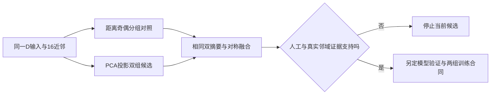

# 无显式接口定位的局部多表面表征：最小假设 v1

日期：2026-11-02。状态：待确认方案；本轮只制定假设，不实施、运行或训练。

本文件独立于已失败的 InterfaceLocal 阶段A，不覆盖其协议和结果。原阶段B依赖可靠定位，现不再沿该准入路径推进。本方案不是把失败定位器换个名字，也不增加接口候选筛选或新数据清理。

## 1. 是否还需要显式接口定位

**当前没有证据要求先定位接口，才能研究接口吻合。**高曲率采样和固定三平面定位均在本项目pilot失败；依赖它们的局部分支不具备准入依据。实体D的表面还包含切壁，不一定有拓扑开放边；自然孔洞与人工切口的局部构型也可能相似。

另一方面，实际CUDA轨迹显示：256proxy坐标对J的覆盖约5%，但近接口输入点仍有97.76%–100%的潜在图传播路径。因此，“输入点完全到不了proxy”不是充分解释，值得检查的是这些邻居如何被聚合。但潜在图连接不是特征有效保留，尚未证明max-pooling就是错误来源。

决定：暂停显式定位路线，提出一个适用于**所有中心**的局部聚合假设；不声明该改动一定改善接口或已经构成创新。

## 2. 唯一最小假设

**H：**在固定8k输入、512→256中心和k=16邻域下，相比不考虑局部几何的同容量双组摘要，按局部空间结构分组后保留两份邻域摘要，可能更好表达薄骨附近不同表面模式，并改善完整缺失骨块的接口重建。

这不是“两个组就是内外板”的假设。组可对应空间两侧、同一曲面的两片，或错误混合。必须允许结论为“几何分组在当前稀疏邻域中不稳定或不能区分表面”。不估计病例级接口位置，也不据此重新采输入点。

本轮只研究**第一次FPS后的 graph2：512中心向原始N点查询邻居后的聚合**。其余graph1/3/4、Transformer、query、decoder、loss保持既定路径。不能同时改四层、加接口loss或换Mamba后将收益归因于本假设。

## 3. 最小算子设计（拟议，尚未实现）

### 3.1 共同输入与分组

每个中心沿用既有16个近邻及其相对坐标；不新增邻居、不扩大半径、不调用G/J/R/C、缺损类型、体素面provenance、外部法向或解剖标签。单位缩放不影响排序。模型只处理实际点云。

两组各8个邻居：

- **A，同容量对照**：将邻居按距离排序（同距用相对坐标字典序），奇偶交错分组。它不追求表面分离，也不是人工解剖标签。
- **B，几何分组候选**：对16个邻居相对其均值计算3×3协方差，取最小特征值对应特征向量n，以投影 `(x_i-mean(x))·n` 排序，前8与后8分组。

PCA向量翻转只会交换组。数值退化时，若最小两特征值之差≤`1e-6 × max(trace(cov),1e-12)`，B回退为A并记录次数。此数值条件不代表PCA法向可靠；不通过调阈值消除真实不稳定性。近等距或投影平距的处理可影响旋转协变，应在人工检查中报告。

选择最小特征向量仅是待验证假设：薄双面点集在层间距较大或切壁邻域中，最小方差方向不一定是板法向；这种失败不能通过事后改用另一个特征向量补救。本轮不扫描轴、k或组数。

### 3.2 共同特征聚合

沿用graph2现有共享edge-MLP输出 `h_i∈R^64`，先计算：

`s1=max(h_i, i∈group1)`，`s2=max(h_i, i∈group2)`。

以组交换不变的形式融合：

`u=concat((s1+s2)/2, abs(s1-s2))∈R^128`，再通过双方相同的 `Linear(128,64)` 得到原维度输出。

A/B有相同group数、每组点数、MLP、投影参数、计算路径及输出尺寸，唯一因素是邻居归属。均不替换原8k点集或增加proxy/query数。局部双摘要不等同“完整保留两个面”，max-pooling仍可能丢失信息。

新增投影使两组都不同于旧B0。旧B0仅背景参考；A/B差异检验几何分组，不足以单独证明新算子整体优于旧B0。若后续需要与原B0比较，必须明确匹配运行，不能偷加第三组或引用不同运行条件当纯因果对照。

## 4. 先做有限CPU表示检查，不立即训练

### 4.1 范围

仅用既有人工几何与开发pilot：

1. 已有1/3/5mm双平行面，保留原点密度设置，检查两组的真实层混合；这些是原有固定人工情形，不新增厚度或k扫描。
2. 已有三组切开球壳，在有解析内/外侧与切壁真值的地方分别记录分组；完整单层曲面及未切球壳作对照，防止把任何曲面分片都解释为内外板分离。
3. 六例既有8k输入及两例四模型已保存的真实graph2邻域：只读坐标稳定性、分组均衡、退化比例和几何可解释性。16k轨迹仅是已观察的密度对照，不据此增加训练输入档位。

不重新运行GPU、不加载模型、不新增病例、不继续拟合定位器。真实无解剖标签数据不报告“内外板分类准确率”，J仅用于事后分区域诊断。原点集、目标、缺损及fold不变。

### 4.2 可证伪检查

- 实现合同：每组8点、并集为原16邻居且无重复/遗漏；融合对交换s1/s2不变；有限值、输入不修改。
- 点序：同一邻域行序置换不改变几何分组及融合，平距情况单独记录。
- 刚体变换：在固定一次旋转平移下检查组归属一致性，允许整体组交换；协方差退化情况记录回退，不能把回退当成功分离。
- 人工双层：用最佳组标签交换后的层纯度、两组代表点的层间距误差及两层覆盖比较A/B；不使用这些标签决定分组。
- 单层：记录B是否只是沿切向把同一面分成两片；这不必导致算子错误，但直接限制“分出内外表面”的解释。
- 球壳/切壁：分别报告真实原生内/外侧及切壁，不能只保留容易双平面结果。
- 真实：展示固定中心的局部点与分组，不按结果筛选最佳示例，不将未标注几何赋予确定解剖名称。

### 4.3 冻结研究门与预算（拟议）

只有以下条件都满足，才考虑模型实施：基础分组/融合合同通过；人工非退化邻域在固定刚体变换后分组一致（允许交换）；三个既有厚度中至少两个的平均层纯度较A增加≥10个百分点，且任一厚度不下降超过5个百分点；层间距估计误差不比A增大；球壳结果不出现与双平面结论相反的系统性混合加重。逐类报告全部数值，不把pooling组等同解剖标签。

这些是事先提出的探索性研究决策值，需确认后才能执行，不是临床门。若现有点密度无法满足，停止本候选，不调整轴、邻域或增大输入以凑过门。

一次CPU批次，上限15分钟、RSS8GiB、输出256MiB、线程2；若失败不自动修复重跑、不扩大框架或进入训练。

## 5. 若CPU支持H，再单独制定Fold C两组训练

两组同数据、同初始化公共部分及新增投影、同batch顺序与seed0、同3900更新、8k→8k、同FP32 deterministic/TF32-off与BN语义；不BNCal、不改变损失，不引入定位标签。只改graph2的分组，其他路径不变。

先实施CPU张量合同与限定GPU零更新验证，再创建待授权训练request。此处不创建可执行配置，不自动进入Fold D、更多seed或Mamba替换。

拟议训练推进条件沿用最小局部表征方向：B相对A的source均值J P95下降≥5%，J Cover@2mm增加≥2个百分点，E P95恶化不超过2%，无无效预测；完整报告未知E、整体和反向参考。开发集每来源五缺损先聚合为一个source观察，单seed不估计训练随机性。门值须在新训练结果出现前冻结。

## 6. 如何解读失败与下一步范围

- CPU不分层或旋转不稳定：否定这一PCA分组候选；不恢复三平面定位或调轴重跑。
- CPU分层改善、预测无收益：说明表示指标不能自动转化为补全质量，停止当前候选，不宣称接口保留机制已证实。
- B仅改善J而明显伤害E：不满足完整骨块补全目标。
- A/B没有差异：不把新增容量或双摘要本身的可能效果解释为几何分组贡献。

**当前建议的下一步仅为：确认这一最小假设后，实施一次限定本机CPU分组/表征检查。**没有新的接口定位、数据集搜索、服务器操作或训练任务。

## 7. 项目证据与新颖性边界

依据已冻结的实际轨迹分析、六例曲率采样负结果和InterfaceLocal阶段A负结果。本文未开展新文献检索，因此不宣称几何分组、双池化或组交换不变融合具备文献新颖性；它是项目内用于检验瓶颈的最小候选。CPU或模型结果若支持，仍需另行检索相关方法并评估是否足以构成论文贡献。

