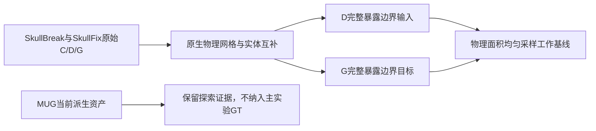

# 主实验数据范围与表面采样阶段决定 v1

日期：2026-11-02。依据用户本轮确认，收束当前MUG分支，明确主实验数据范围，并进入第三个问题“表面采样方法”。这是科研范围及工作基线的补充决定，不覆盖既有协议、数据、代码或结果；不构成新训练、GPU执行或保留数据访问授权。

## 1. 当前主线

1. 表示：骨组织完整边界的表面点云，不只采外轮廓。
2. 缺损：SkullBreak和SkullFix均沿用已核验的原始体素实体配对；不重新从点云／原生面片直接删出缺损。
3. 当前进入采样：明确从哪些边界取点、如何按物理面积分配、输入如何与目标隔离，以及哪些结论尚未得到证据支持。

## 2. 主实验的数据范围

| 数据 | 当前用途与范围 | 现有结果 | 尚未完成 |
|---|---|---|---|
| SkullBreak | 既定84个开发来源、420个缺损病例；继承C/D分折 | 完成新点集QC、8k/16k四运行及开发配对评价 | 新Mamba方法在本任务上的匹配比较等，不由本文件启动 |
| SkullFix | 既定80例train、10例val；10例内部保留test不开放 | 90例原始C/D/G几何QC通过 | 90例按统一新合同批量生成点集及后续模型验证 |
| MUG500+当前资产 | 探索性几何、表示和质量案例 | 保留100来源分流及实体版本、A0221审阅和文献记录 | 不作为当前主实验训练GT、定量主表或方法选型数据 |

精确ID、fold、路径及证据SHA256见配套`data_scope_and_sampling_contract_v1.json`，不在本轮重新随机划分。

### SkullBreak边界

- 84个来源是当前开发研究总体，不是把官方114个训练来源全部重新开放。
- 每个fold为63个训练来源/315病例、21个开发来源/105病例；继承C和D已有映射。
- C/D两折训练集按设计有重叠，不能当成两个独立数据集。每个来源的5种缺损同分区；病例数不等于独立颅骨数。
- 既有20个confirmation来源、历史monitor、官方test及其他未纳入来源仍按原边界保留，不因本文件开放。

### SkullFix边界

- 当前80/10/10是本机既有100例公开训练来源内的划分，不等于原论文官方100训练/110评价的划分。
- 几何QC读取了80 train+10 val，未读取内部保留test10例的几何内容；后续点集准备只针对这90例，train/val身份保持不变。
- 90例C/D/G互补、同坐标、共享切壁均通过；完整骨组织触及FOV的警告及018/062微小成分记录保留，不自动剔除、填孔或清理。
- 不能拿旧4096点implant目标或旧归一化的NPZ，直接改名为当前新任务数据。骨块目标需要从原始G的完整边界按新合同提取。

这些是可用于当前方法开发的数据边界，不是每一个体素的独立解剖准确性认证，也不自动授权训练、正式评价或读取保留数据。

## 3. MUG分支收束决定

本阶段不再继续对A0221同一ROI调连接定义、清理规则、平滑或位置来争取通过，不继续扩展MUG批量生成或其通用工程工具。

保留原始数据、v2的82组实体/62组几何候选、全部失败分母、A0221旧pilot、raw/C6/C26对照、clear mesh叠加、前景审阅决定及文献报告。这里“保留”不涉及移动、删除或新压缩归档；本轮没有清理操作。

A0221未通过的是当前固定ROI的可靠高精度GT准入，不等于MUG所有来源均不可用。此前`formal_training_eligible=false`也不能脱离各次协议语境解释为数据集整体没有研究价值。

MUG资料已用于探索和研究问题讨论，不再把这些已经查看的开发材料称作完全未见的外部盲测集。本阶段后续采样器/模型选择不使用其结果；若未来取得新证据或明确采用较弱的“公开分割条件下参考GT”目标，需另立版本和范围，不能改写本次不通过记录。

## 4. 第三个问题：当前工作基线是什么

**采用V1：全部暴露体素面的世界物理面积均匀采样。**这是可复现且已用于主线的工作基线，不是“已证明最优采样器”。本轮只确认合同，不修改实现或重跑点集。

令每个原生体素中心索引为i，方向矩阵按行存储为A，原点为o，则`world = i @ A + o`。对D的每个前景体素，检查六方向相邻体素；另一侧为背景的面进入输入候选集合。

对法向索引轴为a的面：

- 面中心索引为`i + sign * 0.5 * e_a`。
- 物理面积是另两个方向向量叉积的模长，不按每个边界体素等权替代物理面积。
- 以`p_f = area_f / sum(area)`抽面；在面的两条切向方向上均匀取点。
- 几何母版是原生体素并集的阶梯边界，不将其称为光滑解剖曲面的精确均匀采样。

输入取∂D；目标取∂G。G的原生未知边界E及与D相接的新切壁J均包含在目标候选中。存在于分割中的内侧边界、外侧边界及孔腔边界均不会因为外壳筛选被主动删掉；不能由此保证有限点集对每个解剖层面都覆盖充分。

### 输入与目标隔离

- 输入候选面和抽样只由D、D的affine及固定seed决定，不使用C、G、切除体R、真实J或植入物点来定位输入采样区域。
- 归一化只用D占据体素中心在世界坐标下的包围盒中心及半对角线；G使用同一个D-only坐标框架。
- 面来源及E/J标签可用于数据准备的离线诊断、目标审查与评价，不能把GT接触标签偷渡到部署时的输入选点。

### 当前点数只继承工作设置

当前主线默认输入8192、输出8192；输入16384保留为已完成的表示对照。它不是输入/输出点数最优性的最终决定，点数问题单独处理。

为了保持既有8k/16k配对，输入先按seed0生成16384点，再取前8192。不能直接抽8192后假定能逐点复现旧8k，因为随机数调用顺序不同。目标独立按seed0抽8192，两个输入臂共享同一个目标数组。

### 必须保留的FOV限制

当前V1实现把数组边界外按背景处理，所以原始前景碰到FOV时，相应截断面也进入候选。它们是体素并集的暴露面，但不能自动称为自然解剖骨面。

本文件如实保留该实现事实，不悄悄排除FOV面后声称沿用旧数据。后续准备SkullFix新点集时应记录FOV来源标志及采样贡献；若需要排除，应另定新数据版本并评估对旧配对结果的兼容性，不自动重跑四训练。

## 5. 现有证据如何支持这个决定

| 已完成工作 | 能支持的结论 | 不能支持的结论 |
|---|---|---|
| 六例V0/V1/MC比较 | 不同几何表示与抽样的覆盖不同 | V1或MC在同8k下已稳定胜出 |
| 六例V1 8k/16k几何比较 | 增点改善输入几何覆盖 | 必然改善模型预测 |
| SkullBreak四运行配对评价 | 当前B0/seed0中16k未显示稳定收益 | 8k最优、两者等效或16k永远无效 |
| PCA曲率增强输入采样 | 本固定候选六例覆盖下降，已停止 | 所有局部增强都无效 |
| 实际CUDA取点轨迹 | 稀疏proxy坐标与潜在特征传播不是同一件事 | FPS已将全部接口信息删除 |

六例同8k的接口Cover@1mm：V0约16.651%、V1约16.331%、MC约16.910%，没有达到原采样选择值。PCA增强的接口Cover@2mm由51.5013%降为33.5216%。不能把这些负结果包装成新采样创新。

因此，**第三个问题目前可以确认的是采样对象与可复现基线，不是最优方法或临床覆盖承诺。**真实内外板尚无独立语义标签；当前真实数据定量主要区分E/J，解析phantom的内外层标签不能自动迁移为真实解剖标签。

## 6. 下一步最小科研工作

下一次准备应集中补齐SkullFix已开放90例的新表示点集：按当前D-only物理面积基线生成输入、从G完整边界生成共同目标，保留train/val身份、面来源、E/J及FOV诊断信息，核对物理坐标和数组。

该步骤目的是把第二个数据集接到同一任务，不是证明采样已经胜出。它不捆绑新采样器、定位器、Mamba模块、BNCal或训练；当前没有执行这次批量准备，也没有创建执行launcher或训练request。

如果下一步只讨论采样是否还需修改，首先审阅已有覆盖证据及FOV来源影响，再决定是否有一个明确、可证伪的改动；不重复已失败的曲率/定位候选，不因GT含J就使用J指导输入采样。

## 7. 本轮验证与产物

本轮只读取已有代码和元数据/结果，不重新读取NRRD或NPZ几何内容、不重新计算评分/置信区间。已核对原SkullBreak采样实现与元数据绑定、SkullFixQC实现与划分绑定；精确ID及fold计数与既有记录一致。

只新增本补充文件和一个版本化记录目录，包含`data_scope_and_sampling_contract_v1.json`与产物清单。未修改原正式计划、数据、生产代码、模型或历史结果；没有服务器、GPU、训练、Git推送或文件删除。

参考项目证据：

- [SkullFix90例QC](E:/Codex/2026-06-06/mamba-ccf-c-1-high-resolution/outputs/cranial_bcsp_geov1_20261024/skullfix_batch_geometry_qc_20261102_v1/report_zh_v1.md)
- [SkullBreak真实数据QC](E:/Codex/2026-06-06/mamba-ccf-c-1-high-resolution/outputs/cranial_bcsp_geov1_20261024/real_data_qc_report_zh_v1.md)
- [六例采样比较](E:/Codex/2026-06-06/mamba-ccf-c-1-high-resolution/outputs/cranial_bcsp_geov1_20261024/cpu_geometry_results_report_zh_v1.md)
- [四模型评价](E:/Codex/2026-06-06/mamba-ccf-c-1-high-resolution/outputs/cranial_bcsp_geov1_20261024/development_eval_v1/local_scoring_v1/four_model_development_results_zh_v2.md)
- [曲率增强负结果](E:/Codex/2026-06-06/mamba-ccf-c-1-high-resolution/outputs/cranial_bcsp_geov1_20261024/input_interface_sampling_20261102_v1/report_zh_v1.md)
- [实际取点轨迹](E:/Codex/2026-06-06/mamba-ccf-c-1-high-resolution/outputs/cranial_bcsp_geov1_20261024/actual_proxy_trace_20261102_v1/local_analysis_v1/report_zh_v1.md)
- [A0221前景审阅决定](E:/Codex/2026-06-06/mamba-ccf-c-1-high-resolution/outputs/cranial_bcsp_geov1_20261024/a0221_foreground_adjudication_20261102_v1/前景审阅决定_zh_v1.md)
