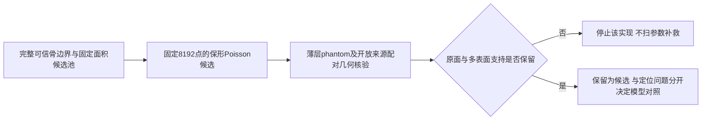

# 颅骨完整边界表面采样：文献核查与下一候选建议

检索日期：2026-11-03。性质：文献与现有实验结果分析，不是实施方案确认、执行request或实验授权。本轮未修改数据、模型或生产采样代码，未启动CPU几何实验、训练、推理或服务器任务。

## 结论

仍有值得尝试的采样方法；目前最有明确文献依据的是固定点数Poisson-disk／蓝噪声样本消除。对于当前完整骨边界的内外表面、孔腔及切壁，更值得研究的是其利用原始表面邻接或测地距离的实现，避免普通3D空间排斥在相邻薄层间相互抑制。但它们都尚未被本项目证明优于V1；V1继续作为当前默认。

这里应把“空间分布更均衡”和“模型预测更好”分开。此前Morton已使开发输入J Cover@2mm由61.04%增至68.40%，输出E P95却由8.410增至9.139 mm；固定8例可视化发现两臂在不同额眶病例都有完整骨片级位置错误。采样可以改善输入表示，不能预先承诺修复这类模型空间条件化失败。

## 检索与证据范围

按用户提供31篇题名，重点追踪可核查点云构造／采样细节的原文，并补充2025–2026年的几何采样和医学补全文献。通过公开arXiv全文、出版社、PubMed、作者页面／代码及正式会议论文检索；没有连接PubMed/CrossRef等专用MCP接口，不声称完成全部31篇逐篇全文精读或穷尽式系统综述。题名列表中的部分方法实际是体素网络；摘要中的“sampling”也可能指扩散／流模型的生成采样，不能误读为空间表面取点。

| 文献 | 核实到的相关事实 | 对当前任务的意义／限制 |
|---|---|---|
| Friedrich等，Point Cloud Diffusion Models for Automatic Implant Generation，MICCAI2023 | 方法Point Cloud Generation节明确从二值缺损骨提取Marching Cubes表面，再Poisson Disk Sampling；implant GT也采用相同构造思路 | 给Poisson类方法提供直接颅骨任务先例，不是与V1/Morton的受控采样消融。[全文](https://arxiv.org/html/2303.08061v2) |
| Wodzinski等，High-Resolution Cranial Defect Reconstruction…，MICCAI2023，所核版本2024-05-21 | 预处理从前景正体素坐标生成点云，再随机置换分组 | 不能把该版本称为保留多表面表面采样的直接方法证据，也不能照搬其点数。[全文§2.2](https://arxiv.org/html/2308.03813) |
| Neural shape completion for personalized Maxillofacial surgery，Scientific Reports2024 | 外部多视角深度图去掉内部顶点，再PDS简化到40k点 | PDS有先例，但外表面提取和直接删点造缺损与本项目目标不同；不能整套照搬。[全文](https://pmc.ncbi.nlm.nih.gov/articles/PMC11350194/) |
| Automatic Skull Shape Completion…Using Transformers，2024 | 使用3D U-Net与Transformer的体素方法 | “Transformer”不等于点云表面采样方法。[出版社](https://www.sciencedirect.com/science/article/pii/S187705092400992X) |
| CDRMamba，2025卷期／DOI2024 | 摘要描述增强3D U-Net结合Mamba，并有模板对齐阶段 | 不是Mamba点云采样最优性的证据。[出版社摘要](https://www.sciencedirect.com/science/article/pii/S1746809424014344) |
| Kwarciak、Wodzinski，MedPCFM，2026预印本 | §4.1用Poisson-based surface sampling生成稠密表面点，再FPS到目标点数；比较PTv3确定性／生成模型 | 提供较新的实际采样管线先例；没有隔离证明该采样胜过面积随机，也没有证明适合当前8k薄壳。[全文](https://arxiv.org/html/2606.24433v1) |
| MedPCFM-TED，2026预印本 | 关注条件生成和一步蒸馏 | 生成步数减少不等于表面点集更均匀，不应混为采样算法改进。[全文](https://arxiv.org/html/2609.16934v1) |
| Jiao等，Weighted Poisson-disk Resampling on Large-Scale Point Clouds，AAAI2025 | Poisson初始化加切平面Voronoi位移优化，可保尖锐特征 | 主要证据来自大场景点云；包含点位置调整。不能不加验证用于精确骨边界，或称为纯选点。[论文](https://arxiv.org/html/2412.09177v1)，[正式论文页](https://ojs.aaai.org/index.php/AAAI/article/view/32428) |

《Automatic Implant Generation for Cranioplasty via Occupancy Networks》的检索结果包含PDS描述，但本轮所找到机构PDF直接访问403，未把无法核查的细节／数值纳入确定结论。《Rectified Flow…》可核实出版社摘要，其重点为生成流程与速度，本轮无法据此核实更优表面取点策略；[出版社页面](https://link.springer.com/chapter/10.1007/978-3-031-82024-3_19)。CranGAN的PubMed摘要支持其点云补全设定，但不足以确定空间采样细节；[PubMed](https://pubmed.ncbi.nlm.nih.gov/36085744/)。

## 候选一：固定N的保形蓝噪声采样

从同一个按物理表面积加权的较密候选池中选出8192点，抑制局部堆叠，尽量减少随机大空洞。优先采用sample elimination等能控制点数的方案，而不是按半径输出不定数量后随意截断。应只选已有合法表面点，不先做Laplacian平滑、拟合补洞或体积重建。

Yuksel2015的Weighted Sample Elimination从候选集合选固定数量、具有蓝噪声特征的子集，但不保证最大覆盖。[作者原文与代码](https://www.cemyuksel.com/research/sampleelimination/)。论文中“Weighted”指消除准则，不应自动解释为颅骨曲率或J标签权重。

它与Morton的差别在于用点间相互排斥／空间分布质量决定保留，而不是按某种空间序列分层分配。不是简单给Morton换名字。但相同点数下仍须实测局部覆盖和薄层保留，不能由蓝噪声名词推导出模型收益。

普通3D欧氏排斥只是应纳入对照的低成本实现，不是可直接验收的最终方法。若它让另一层表面失去支持，应停止该普通实现，而不是调整到一个看起来更漂亮的半径后宣称解决多表面问题。

## 候选二：利用真实表面邻接／测地距离的Poisson-disk

这是与当前多表面目标更匹配的研究方向。内外板之间的3D距离可以很近，而沿骨表面的路径较长；以3D距离做FPS／Poisson排斥，可能把它们当作重复点。使用原始边界mesh的真实邻接或内在距离，有机会在同样预算下保住两层和切壁。

该问题并非对颅骨的凭空推测。Guo等2015在mesh Poisson采样论文中明确讨论欧氏冲突检测对thin-sheet及空间近／测地远区域的困难；[论文](https://www.sciencedirect.com/science/article/pii/S0097849314001034)。几何库也明确区分表面测地距离与外在距离；应逐项检查实际实现，不能仅因API名字带Poisson就认为使用测地距离。[Geometry Central官方文档](https://geometry-central.net/surface/algorithms/surface_sampling/)。

实现边界：

- 利用原始体素边界／mesh的表面来源与邻接，避免在稀疏8k点上先用普通KNN制造跨板捷径，再把该图最短路称为可靠测地距离。
- 原始骨边界必须足够可信；错误连接、非流形和分割孔洞会污染内在距离。不要为采样方便自动平滑或补洞。
- 内板与外板可能通过切壁或自然孔道连在同一个连通分量，不能用“一个连通分量就是一个表面层”作标签。
- 不使用G、J或缺失骨GT给输入分配点数。J只用于离线评价；若用它构造oracle，只能明确作为不可部署的上界诊断。
- 若用法向相容性作近似，应从可信原始边界获取方向，并检验翻转、切壁和薄层。简单用绝对法向点积会把相反方向视为相同；法向条件本身也不等于正确解剖分层。

2025预印本／2026会议版本的Manifold-Aware Point Cloud Completion将测地近邻用于网络特征聚合，支持关注邻域捷径，但它是模型方法，不是已验证的颅骨预处理采样算法。[预印本](https://arxiv.org/html/2512.05710v1)，[会议页面](https://ijcai.org/proceedings/2026/184)。其点云近邻图仍需检查是否保住本任务的薄层。

## 候选三：保留全局面积覆盖的轻度特征加权

原理是全局面积采样为主体，只用一小部分预算保留D自身的曲率／法向变化等细节。设表面为∂D，可考虑混合面积密度：

\[
q(p)=\frac{1-\alpha}{A_D}+\alpha\frac{w_D(p)}{\int_{\partial D}w_D(s)\,dA(s)}.
\]

这是待检验建议，不是引用论文已验证的颅骨最优公式；α及w的定义当前未冻结，也未启动扫描。关键在全局覆盖不可被少量高曲率区域吃掉、权重仅依赖D、点不能离开原始表面。

其风险较大：体素台阶、天然孔道、颅底结构、分割噪声也会有高曲率；高权重不等于缺损切壁。原本平滑的薄内／外板可能被低估。强力加密会改变经验点分布，而当前模型又存在整块定位错误，收益不确定。因此优先级低于保形、薄层感知的均匀化，不推荐再新增一个显式rim定位器配套。

## 当前不宜优先尝试的路线

1. **直接对点做强CVT／切平面平滑**：点位置可能偏离原面或在错误跨层邻域里漂移。若改成原始表面回投影，应明确是新的受限变体，不冒称复现WPD原方法。
2. **只采外表面或在完整点云上删点造缺损**：与当前完整骨边界及实体切壁目标不一致。文献采用过不代表适合此研究问题。
3. **GT切壁驱动的rim过采样**：输入泄漏；不能以训练时已知模拟切除区域替代部署可得条件而不披露。
4. **Poisson后普通FPS就认为保住多表面**：有2026医学文献先例，可作可复现参照，但最后FPS仍可能产生跨层竞争；Poisson输出分布也未必在FPS后保持。
5. **立即加可学习采样器**：SampleNet显示任务相关采样可通过可微方式学习，但增加训练模块和耦合，且软点混合在近邻跨层时有离面风险；当前不适合作为最小纯采样对照。[CVPR论文页](https://openaccess.thecvf.com/content_CVPR_2020/html/Lang_SampleNet_Differentiable_Point_Cloud_Sampling_CVPR_2020_paper.html)。

## 最小下一步建议

暂不启动新的模型训练。只保留一个候选家族：固定8192点、保形的Poisson-disk／样本消除；先检查普通欧氏版本是否会压掉相邻表面，最终候选优先利用原始表面邻接。若只能完成几何验证，不把结果称为模型胜出。

几何核验应包括：相邻双层、切壁连接和孔道phantom；刚体变换稳定性；内外板／切壁支持仅在标签可信时分别评价；原面距离、面积覆盖、局部大空洞和稀疏尾部，而不仅是平均NN间距。真实数据不得凭空生成内外板解剖标签，展示密集也不等于正确。

输入总数仍8192；缺失骨块GT完整边界8192、D-only归一化和A1评价参考不变。候选只改输入采样，不同时修改目标、输出点数、proxy、loss或网络。延续共同逐病例随机点序，避免采样输出排列改变FPS首点策略。以后若要增加目标J的监督权重，应作为独立训练目标实验，而非隐藏在新GT采样里。

还必须明确选择数据的角色：先前105例开发结果已经被用于选择Morton候选和后续诊断，属于开发证据，不能继续当未使用最终检验集。下一采样定义和参数应优先在已开放训练来源／人工phantom确定；最终泛化主张需要预先锁定、未用于方法选择的来源或外层评价，不在本轮访问或解封任何新数据。

当前V1是主实验默认，不能称其普遍最优；新Poisson候选也不能预先称其更好。对这篇研究而言，最有解释力的路线是让输入采样保住真实多表面信息，同时独立解决缺损位置条件化，而不是无限更换“更均匀”的采样器。

## 其它文献提醒

临床implant的设计厚度／rim与原生骨块重建并不完全等价，Fishman等2024对此做了实测比较；该文支持把厚度和rim单独考虑，不提供某个表面取点算法最优的证据。[PubMed](https://pubmed.ncbi.nlm.nih.gov/38430381/)。

2026-10的Plausible but Unimplantable审阅零样本预训练补全模型，强调相似性不等于可植入；它没有测试本项目这种颅骨数据fresh训练，不能拿其失败率直接类比当前模型。[作者接受稿](https://arxiv.org/html/2610.30035v1)。

本轮没有找到受控证明“某种空间表面采样同时对SkullBreak／SkullFix、多表面完整边界和当前模型均最优”的论文。推荐是基于机制、先例和本项目证据的研究判断，而非SOTA保证。
