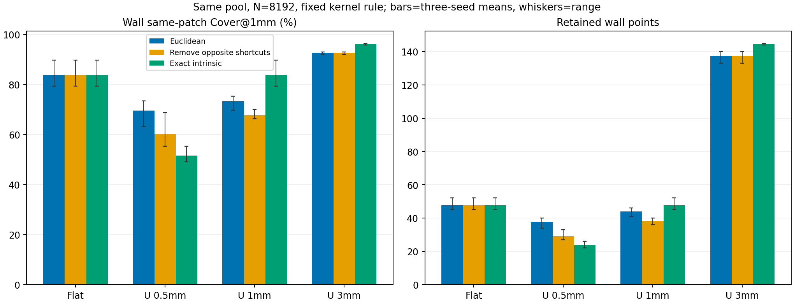

# 人工机制对照的科研判断

日期：2026-11-03。依据本目录一次冻结的人工CPU实验；没有追加几何条件、调参、真实数据访问或训练。

**当前不建议把表面邻接／测地距离约束设为通用必需项。** 对侧板面捷径确实参与欧氏样本消除并改变结果，但去掉捷径不保证切壁受益。精确曲面内距离也不能自动解决固定8192点下的小面积切壁预算不足。

## 主要证据

平面负对照的三组输出，在三个种子上均为完全相同的8192个索引。这确认：没有折叠时三组同面去拥挤的效果相同，U形对照中的变化不是偷偷改了点数或核函数。

| U形厚度 | 普通欧氏：切壁Cover@1mm | 仅去掉对侧捷径 | 精确曲面内距离 |
|---|---:|---:|---:|
| 0.5 mm | 69.58% | 60.10% | 51.56% |
| 1 mm | 73.23% | 67.71% | 83.75% |
| 3 mm | 92.64% | 92.64% | 96.22% |

数值为三个种子的均值，测距只使用切壁本身的点；没有用邻面点代替。不是置信区间或显著性结论。

在实际删除时刻日志中，0.5 mm条件下，两侧板面被删点的远路径对侧捷径核平均占比约33%；1 mm约6.3%；3 mm没有这种捷径。这比最终存活点的事后邻域更直接地证明机制存在，但不能逐点声称“若无这项核，该点就必然不删除”。完整配对处理显示，干预影响会通过全局点数预算传递到切壁。

## 为什么不能据此直接加入邻接约束

1. **几何上不该互为近邻的点，确实可能在欧氏空间参与竞争。** 在0.5 mm条件下，消除捷径或采用精确表面距离，均改善两块板面的同面覆盖。
2. **改善板面不等于改善切壁。** 同一0.5 mm条件下，切壁点数由普通欧氏的37.67减少到精确曲面内距离的23.67，切壁Cover@1mm下降约18.02个百分点。8192点的纯面积期望仅约25.52个切壁点；精确曲面内均匀分配可能接近面积份额，却仍不足以满足局部切壁支持目标。
3. **切壁转折处的合法连接不能被粗暴隔离。** 1和3 mm条件下，完整曲面内距离比只去掉对侧捷径更有利；其差异包括合法转折处距离的改变，不能全部归因于对侧捷径。
4. **该结论仅限解析人工曲面。** 真实颅骨的阶梯面、复杂曲率、孔腔及不可靠拓扑尚不在此对照内；本轮没有证明真实SkullBreak退化的唯一成因，也没有证明任何新采样方法提高模型精度。

## 对当前研究的决定

- 机制问题可以在当前范围内收束：跨表面竞争存在，但“移除竞争就能保护切壁”的假设不成立。
- 保持V1生产默认，现有固定参数的欧氏样本消除仍只是候选；不因本轮结果引入通用测地框架、切壁标签权重或半径扫描。
- 不再追加人工几何或为此扩展定位器。后续若继续推进采样候选，应回到既定真实数据及模型问题：用固定候选检验收益与细尺度代价，不能把本轮人工机制验证当作训练准入或模型胜出。

[完整方法、逐条件结果与删除日志说明](report_zh_v1.md) · [逐种子指标CSV](paired_patch_metrics.csv)

