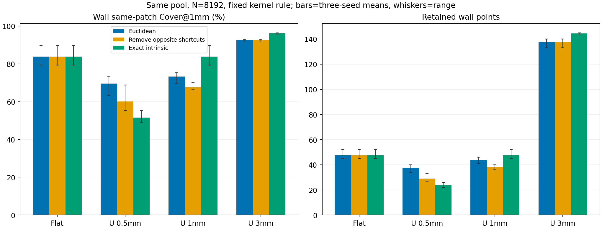

# 人工几何机制对照：同表面拥挤与跨表面捷径

日期：2026-11-03。仅人工几何、本机CPU；未读取真实病例、改生产代码、使用GPU或训练。

## 问题与可识别范围

检验普通欧氏样本消除中，对侧板面之间的三维近邻是否改变保留结果；并区分移除这种捷径与改变合法切壁转折处距离的影响。该试验是人工几何机制干预，不是颅骨任务精度验证。

## 冻结设计

U形表面由两块80×80mm平行板及80×t mm切壁连接，t固定为0.5/1/3mm；另有t=1mm的完全展开平面负对照。每个表面是一个连通的可展曲面，开放端不是闭合骨实体，不能直接替代颅骨。内侧距离在展开矩形(s,y)上精确计算，无KNN近似路径。

每个几何三个种子，各32768个物理面积随机候选点，共用同一候选池，消除至8192点。核函数(1-d/R)^8和R=2√(面积/8192)保持不变，无半径扫描、无点移动。三种处理：

- **Euclidean**：所有三维距离小于R的点对参与排斥。
- **no_opposite_shortcut**：只移除“分属对侧板面、展开距离大于R、欧氏距离小于R”的点对。保持同面拥挤、切壁连接及近切壁合法跨板路径；不是按标签完全隔离曲面。
- **intrinsic_unrolled**：所有权重用精确展开距离计算；还会改变切壁转折附近的距离，因此不能把它的全部收益归因于对侧捷径。

每次删除均保存点索引及当时存活邻居的三类核权重：同面、连接邻面、对侧远路径捷径。与上一轮仅用最终存活点估计不同，本轮有实际删除时刻日志。但两个处理的删除顺序会改变，不把相同步号当成同一个点的反事实。

## 三种子均值：切壁支持

| 几何 | 方法 | 切壁点数 | 同壁Cover@0.5mm % | 同壁Cover@1mm % | 同壁Cover@2mm % | 同壁P95 mm |
|---|---|---:|---:|---:|---:|---:|
| flat_control | Euclidean | 47.67 | 36.562 | 83.750 | 98.958 | 1.468 |
| flat_control | no_opposite_shortcut | 47.67 | 36.562 | 83.750 | 98.958 | 1.468 |
| flat_control | intrinsic_unrolled | 47.67 | 36.562 | 83.750 | 98.958 | 1.468 |
| U_t0.5 | Euclidean | 37.67 | 40.938 | 69.583 | 91.562 | 2.991 |
| U_t0.5 | no_opposite_shortcut | 29.00 | 32.500 | 60.104 | 87.188 | 2.718 |
| U_t0.5 | intrinsic_unrolled | 23.67 | 26.875 | 51.562 | 79.167 | 3.485 |
| U_t1.0 | Euclidean | 44.00 | 29.688 | 73.229 | 95.417 | 1.918 |
| U_t1.0 | no_opposite_shortcut | 38.00 | 25.729 | 67.708 | 93.125 | 2.231 |
| U_t1.0 | intrinsic_unrolled | 47.67 | 36.562 | 83.750 | 98.958 | 1.468 |
| U_t3.0 | Euclidean | 137.33 | 40.208 | 92.639 | 100.000 | 1.074 |
| U_t3.0 | no_opposite_shortcut | 137.33 | 40.208 | 92.639 | 100.000 | 1.074 |
| U_t3.0 | intrinsic_unrolled | 144.33 | 43.646 | 96.215 | 100.000 | 0.958 |

误差线只是三个随机种子的最小—最大范围，不是置信区间。same-patch距离只使用该切壁上的点，避免对侧板点造成虚假的近距离覆盖。CSV同时保存全部点的欧氏及精确曲面内距离指标。

## 相邻板面是否付出代价

| 几何 | 方法 | 下板同面Cover@1mm % | 上板同面Cover@1mm % |
|---|---|---:|---:|
| flat_control | Euclidean | 99.522 | 99.548 |
| flat_control | no_opposite_shortcut | 99.522 | 99.548 |
| flat_control | intrinsic_unrolled | 99.522 | 99.548 |
| U_t0.5 | Euclidean | 98.361 | 98.362 |
| U_t0.5 | no_opposite_shortcut | 99.345 | 99.411 |
| U_t0.5 | intrinsic_unrolled | 99.513 | 99.604 |
| U_t1.0 | Euclidean | 99.451 | 99.449 |
| U_t1.0 | no_opposite_shortcut | 99.492 | 99.510 |
| U_t1.0 | intrinsic_unrolled | 99.522 | 99.548 |
| U_t3.0 | Euclidean | 99.487 | 99.467 |
| U_t3.0 | no_opposite_shortcut | 99.487 | 99.467 |
| U_t3.0 | intrinsic_unrolled | 99.518 | 99.512 |

## 删除时刻的直接证据

| 几何 | 普通欧氏：下板删除时捷径核平均占比 % | 上板 % | 初始捷径点对数量（种子均值） |
|---|---:|---:|---:|
| flat_control | 0.000 | 0.000 | 0.0 |
| U_t0.5 | 32.803 | 32.988 | 764938.0 |
| U_t1.0 | 6.278 | 6.319 | 670109.7 |
| U_t3.0 | 0.000 | 0.000 | 0.0 |

捷径核占比说明实际删除时对侧远路径点参与过排斥，不等于“这个点一定因捷径而被删”。完整配对处理才检验移除这些边之后的最终结果。切壁点不是对侧板面捷径的直接端点，其点数变化也可能通过全局8192预算间接发生。

## 验证与局限

- 平面负对照三个种子的三组最终索引完全一致：没有折叠时，欧氏距离与精确展开距离一致；同面去拥挤的作用保留。
- 堆删除与人工小集合的全量贪心删除顺序一致；合法切壁连接保留，对侧远路径分类通过；各输出恰好8192点。
- 人工厚度是几何条件，核规则始终固定；不是调半径寻找收益。切壁为解析平面，不能模拟真实体素阶梯、曲面拓扑、孔腔或分割错误。
- 两板并无患者解剖内外板身份，展开坐标在真实颅骨上不可直接获得。无新增真实数据、无临床推广结论、无模型收益结论。

实验162.6秒，检查点RSS峰值0.200GiB；原采样器哈希不变。原始12个候选池、36组保留索引及36份逐步删除日志已保存并回读哈希核验。

结论须结合上表逐项判断，不能预设表面邻接约束必胜。
