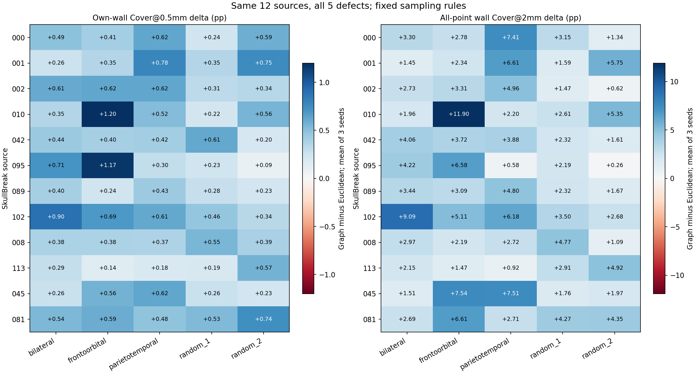

# 五类缺损适用性核验后的科研决定

完成日期：2026-11-04；目录沿用启动日期2026-11-03。

**结果支持在SkullBreak上准备固定欧氏版与表面图版的最小模型对照。** 这不是模型胜出、GPU训练准入或执行授权，也不改变V1生产默认。

## 已完成的科学工作

同12个已开放来源，新增检查其余四类缺损48例；原bilateral 12例直接复用。合计60病例、每例3个采样种子、3种方法，540条评分。没有调半径、加权、改图规则、改GT或新增来源。

以下为图版减欧氏版，覆盖单位为百分点。每个病例先平均3个种子，再对同类12来源等权汇总。

| 缺损类型 | 切壁自身Cover@0.5mm | 切壁总体Cover@2mm | 切壁自身P95 mm |
|---|---:|---:|---:|
| bilateral | +0.468 | +3.296 | −0.194 |
| frontoorbital | +0.563 | +4.720 | −0.372 |
| parietotemporal | +0.497 | +4.206 | −0.259 |
| random_1 | +0.354 | +2.738 | −0.155 |
| random_2 | +0.419 | +2.635 | −0.175 |

在每一种缺损类型中，上述三项的12个病例三种子均值均向有利方向变化。不能把60个缺损病例或180个种子组合视为60／180个独立患者，独立来源仍是12个。

先在来源内平均5类、再对12来源平均：切壁自身0.5mm覆盖增加0.460个百分点，总体2mm切壁覆盖增加3.519个百分点，切壁自身P95下降0.231mm。其余残缺骨输入边界2mm覆盖平均下降0.189个百分点；这是应保留的代价，不是无退化胜出。

## 本轮解决与未解决的问题

- 已解决：图版在SkullBreak上的切壁几何收益并非只限于bilateral；同一冻结规则在另外四类中得到重复。
- 未解决：模型是否利用这些输入改进。图版的细切壁支持不是全面优于V1，且有其它边界覆盖代价，不能用这轮CPU结果替代训练预测对照。
- 未解决：真实内外板解剖保留与连续精确测地效果。当前无可信内外板标签，图距离存在离散偏差，不能将所有收益唯一归因于阻断跨层。
- 不改变：SkullFix此前的图版切壁退化结论。本次不为SkullFix追加图版训练，也不按病例或数据集事后挑选更好者拼接新方法。

## 下一步收敛到模型价值

后续只准备两个固定新臂：欧氏版与表面图版，优先继承既有Fold C、8k输入／8k输出、seed0、同初始化／批次顺序和3900步合同，不同时改网络、loss或proxy。旧V1仅作历史参考，严格配对复用需另核输入与合同一致性。

当前60病例是适用性核验，不是已经备齐Fold C的315训练与105开发病例。下一阶段需要按冻结规则准备两臂点集和必要的最小入口绑定；完成数据与训练合同后，才能形成待授权的执行request。当前没有创建request、授权回执、runtime或launcher，也没有连接服务器或启动训练。

详见[最小模型对照条件草案](../../../docs/cranial_bcsp_geov1_20261024/minimal_Euclidean_vs_surface_graph_model_comparison_draft_zh_v1.md)。草案没有执行效力。

[完整实验报告](report_zh_v1.md) · [逐病例CSV](case_level_metrics.csv) · [五缺损来源均值CSV](five_defect_source_level_metrics.csv)

