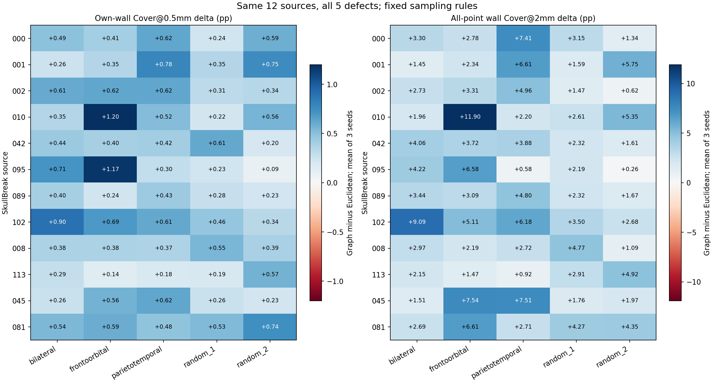

# SkullBreak五类缺损：固定采样规则的适用性核验

启动日期：2026-11-03；完成日期：2026-11-04。目录名保留启动日期。已完成同12个已开放来源的另外四类缺损48例，原bilateral 12例直接复用。合计60病例、三个种子、三种方法、540条评分。

## 范围与不变项

四类新增缺损为frontoorbital、parietotemporal、random_1、random_2，均为既有固定mask，不是重新构造缺损。没有新来源、没有访问封存／官方测试数据。

复用上一轮逐例函数，仅替换输出根目录和冻结的病例清单。32768候选点、8192输入点、种子0/1/2、指数8、R=2√(面积/8192)、欧氏与原表面图实现、原始面中心评价参考均不变。全部九份输入先保存，再读取该例implant推导J评价标签；不使用J选点。

真实内外板没有可信标签：J仅指D/G共享切壁，E为残缺输入骨D上的其余边界；这里的E不是模型输出评分中待补骨块的未知表面。图距离仍是保守的离散路径近似，不是连续精确测地距离。V1为共同32768点池的面积随机前8192点，与历史训练采样同分布，但不宣称历史训练坐标逐字节复用。

## 按缺损类型报告配对差值

每例先平均三个种子；下表每类12个来源，差值均为图版减欧氏版。覆盖单位百分点，P95单位mm。正负计数不等于显著性检验。

| 缺损类型 | 指标 | 均值差 | 中位差 | 正／负／持平来源 | 范围 |
|---|---|---:|---:|---|---|
| bilateral | 切壁自身Cover@0.5mm | +0.468 | +0.419 | 12/0/0 | +0.260至+0.896 |
| bilateral | 切壁总体Cover@2mm | +3.296 | +2.846 | 12/0/0 | +1.449至+9.095 |
| bilateral | 其它边界Cover@2mm | -0.260 | -0.238 | 0/12/0 | -0.658至-0.052 |
| bilateral | 切壁自身P95（下降更好） | -0.194 | -0.181 | 0/12/0 | -0.541至-0.007 |
| frontoorbital | 切壁自身Cover@0.5mm | +0.563 | +0.485 | 12/0/0 | +0.141至+1.199 |
| frontoorbital | 切壁总体Cover@2mm | +4.720 | +3.513 | 12/0/0 | +1.475至+11.899 |
| frontoorbital | 其它边界Cover@2mm | -0.104 | -0.113 | 3/9/0 | -0.374至+0.188 |
| frontoorbital | 切壁自身P95（下降更好） | -0.372 | -0.431 | 0/12/0 | -0.699至-0.027 |
| parietotemporal | 切壁自身Cover@0.5mm | +0.497 | +0.502 | 12/0/0 | +0.184至+0.783 |
| parietotemporal | 切壁总体Cover@2mm | +4.206 | +4.340 | 12/0/0 | +0.581至+7.506 |
| parietotemporal | 其它边界Cover@2mm | -0.149 | -0.134 | 3/9/0 | -0.466至+0.126 |
| parietotemporal | 切壁自身P95（下降更好） | -0.259 | -0.243 | 0/12/0 | -0.441至-0.113 |
| random_1 | 切壁自身Cover@0.5mm | +0.354 | +0.296 | 12/0/0 | +0.193至+0.613 |
| random_1 | 切壁总体Cover@2mm | +2.738 | +2.469 | 12/0/0 | +1.466至+4.766 |
| random_1 | 其它边界Cover@2mm | -0.178 | -0.187 | 3/9/0 | -0.603至+0.103 |
| random_1 | 切壁自身P95（下降更好） | -0.155 | -0.149 | 0/12/0 | -0.318至-0.043 |
| random_2 | 切壁自身Cover@0.5mm | +0.419 | +0.363 | 12/0/0 | +0.093至+0.751 |
| random_2 | 切壁总体Cover@2mm | +2.635 | +1.819 | 12/0/0 | +0.262至+5.751 |
| random_2 | 其它边界Cover@2mm | -0.254 | -0.133 | 1/11/0 | -0.683至+0.003 |
| random_2 | 切壁自身P95（下降更好） | -0.175 | -0.106 | 0/12/0 | -0.532至-0.059 |

蓝色表示图版覆盖增加，红色表示下降。每格是同一来源、同一缺损的三种子均值；不能把60格当成60个独立患者。全部退化格保留。

## 五类平均后的来源级结果

每个来源先平均五种缺损，再对12来源等权汇总；有效来源数为12。没有bootstrap、p值或正式gate。

| 指标 | 图－欧氏均值 | 中位数 | 正／负／持平来源 |
|---|---:|---:|---|
| 切壁自身Cover@0.5mm | +0.460 | +0.484 | 12/0/0 |
| 切壁总体Cover@2mm | +3.519 | +3.332 | 12/0/0 |
| 其它边界Cover@2mm | -0.189 | -0.153 | 2/10/0 |
| 切壁自身P95（下降更好） | -0.231 | -0.218 | 0/12/0 |

## 分类型绝对覆盖

| 缺损 | 方法 | J自身Cover@0.5mm % | J总体Cover@2mm % | E总体Cover@2mm % |
|---|---|---:|---:|---:|
| bilateral | V1_common_pool | 5.167 | 62.723 | 58.835 |
| bilateral | Euclidean_elimination | 4.645 | 77.991 | 77.835 |
| bilateral | surface_graph | 5.113 | 81.287 | 77.575 |
| frontoorbital | V1_common_pool | 4.570 | 59.696 | 55.356 |
| frontoorbital | Euclidean_elimination | 3.961 | 72.260 | 73.031 |
| frontoorbital | surface_graph | 4.524 | 76.980 | 72.926 |
| parietotemporal | V1_common_pool | 4.677 | 59.463 | 56.524 |
| parietotemporal | Euclidean_elimination | 4.288 | 74.079 | 74.718 |
| parietotemporal | surface_graph | 4.785 | 78.284 | 74.569 |
| random_1 | V1_common_pool | 4.874 | 60.275 | 57.613 |
| random_1 | Euclidean_elimination | 4.545 | 76.293 | 76.180 |
| random_1 | surface_graph | 4.899 | 79.031 | 76.002 |
| random_2 | V1_common_pool | 5.224 | 62.794 | 58.803 |
| random_2 | Euclidean_elimination | 4.712 | 77.876 | 77.707 |
| random_2 | surface_graph | 5.131 | 80.511 | 77.453 |

## 可靠性与适用边界

- 新增48例的432份点集均为原候选池的8192点子集。科学核心与输入哈希不变；原有bilateral未重复执行。
- 缺损类型共享相同来源，报告按来源分层，不把多个缺损或随机种子计为独立患者；所有来源已开放且参与过开发研究，不是最终确认集。
- 不能用总体均值隐藏某一缺损类型的退化，也不按类型或病例挑选更有利采样器拼接为新方法。
- 该对照不能把效果唯一归因于跨内外板竞争：真实曲面绕行、体素阶梯、歧义边阻断及图离散偏差均参与距离定义。没有真实内外板完整保留或模型精度的证明。
- 本轮仅完成训练前科研适用性检查，不创建训练执行内容；后续模型比较需另行冻结数据与训练合同。

本机CPU总用时2651.7秒，总RSS监测峰值3.280GiB；监测不是硬隔离。未使用GPU、连接服务器、修改采样参数或启动训练。

完整逐例见case_level_metrics.csv，来源平均见five_defect_source_level_metrics.csv，逐种子见seed_level_metrics.csv。
