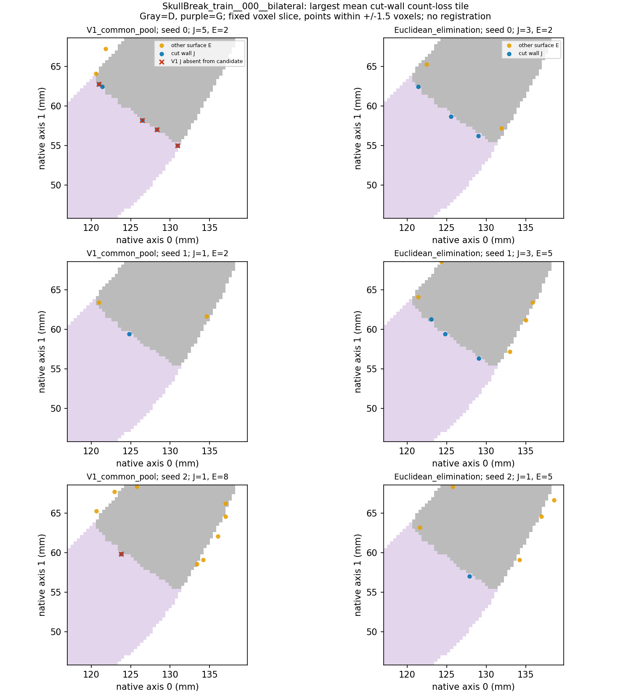
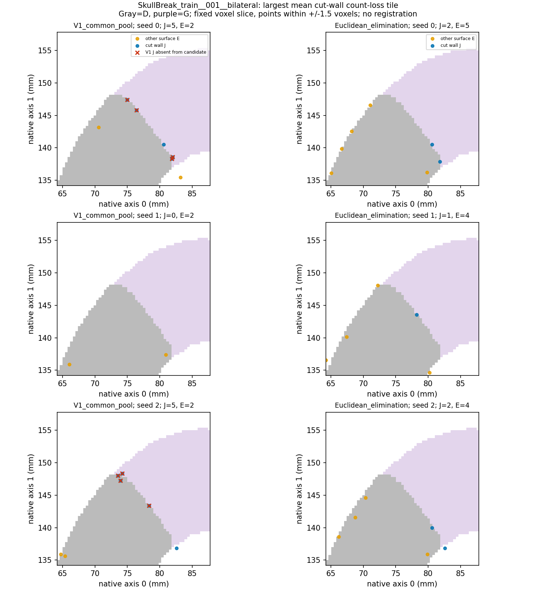
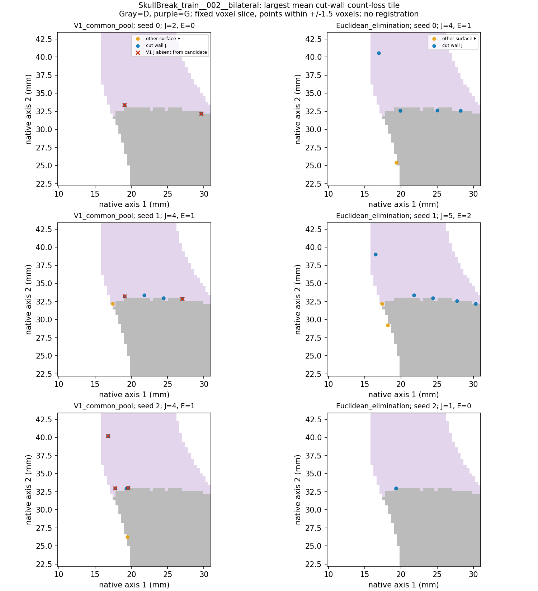

# 已保存蓝噪声点集：切壁减少位置与邻面支持诊断

日期：2026-11-03。范围：已有六例、三个种子、两种方法，共36份真实数据点集。未生成候选池、重新采样、重新执行消除、调半径、加权、调用模型或操作服务器。

**结论：存在跨J/E表面的欧氏核耦合，但尚不足以将切壁点数减少判定为邻面挤压所致。2mm尺度主要仍由切壁点自身获得改善；0.5mm尺度的切壁细支持损失确实存在，部分局部片区还出现2mm切壁支持退化。因此不能按总体覆盖收益宣称全面保留多表面。**

## 如何确定位置与支持来源

保存点通过原始NRRD仿射逆变换精确回到体素暴露面，不用最近面中心猜标签；核验其J/E归属与原保存标签逐点一致。J仅指D/G共享切壁，E为其余全部边界，不将E解释成外板或内板。重新计算的J覆盖和总覆盖均重现先前结果。

对每个J参考面中心分别查询最近J点与最近E点，沿用0.5/1/2mm阈值。总覆盖被拆为两个互斥部分：J点能提供的覆盖，以及J点不能覆盖、仅E点补足的覆盖。面中心参考按物理面积加权。

在原始体素轴的物理坐标系内，以原冻结核半径R为边长划分空间单元；包含全部J单元，不过滤退化区域。单元按点所落的原始面的中心归属，避免面内随机坐标跨格造成虚假变化。每例选择三种子平均切壁点数减少最多的一个单元作展示；选择仅用于定位，不作为性能估计或新训练子集。

## 1．粗尺度改善主要来自哪里

下表为每来源三病例×三种子均值。两个覆盖分量互斥且相加等于总J Cover@2mm；单位均为%。

| 数据 | 方法 | 切壁点自身覆盖 | 仅邻面补足 | 总覆盖 |
|---|---|---:|---:|---:|
| SkullBreak | V1_common_pool | 59.858 | 6.021 | 65.878 |
| SkullBreak | Euclidean_elimination | 73.182 | 9.380 | 82.562 |
| SkullFix | V1_common_pool | 30.827 | 6.269 | 37.096 |
| SkullFix | Euclidean_elimination | 44.918 | 11.075 | 55.994 |

SkullBreak总增益16.684个百分点，其中切壁自身增益13.325个百分点，新增仅邻面补覆盖3.359个百分点。按此恒等分解，邻面新增部分占总增益约20.1%；这不是因果贡献分解。不能把总体改善说成全是邻面造成的假象。

## 2．细尺度退化与位置

| SkullBreak病例 | J点数 V1→候选 | J自身Cover@0.5mm V1→候选 | 仅邻面补覆盖@0.5mm V1→候选 |
|---|---:|---:|---:|
| SkullBreak_train__000__bilateral | 166.0→152.3 | 5.211%→4.877% | 0.213%→0.287% |
| SkullBreak_train__001__bilateral | 167.3→148.7 | 5.449%→4.866% | 0.179%→0.231% |
| SkullBreak_train__002__bilateral | 358.7→323.0 | 6.180%→5.614% | 0.171%→0.241% |

三个病例的细尺度自身覆盖均下降，而邻面只补回一部分。因此不能用2mm收益取代亚毫米支持检查。空间单元既有损失也有改善，完整表见[全部空间单元CSV](all_spatial_tiles.csv)。

| 病例 | 展示单元世界中心mm | J面积mm² | 平均J点数变化 | 0.5mm覆盖面积净变化mm² | 2mm覆盖面积净变化mm² |
|---|---|---:|---:|---:|---:|
| SkullBreak_train__000__bilateral | (130.04, 54.84, 96.34) | 65.28 | -2.33 | -2.19 | +2.08 |
| SkullBreak_train__001__bilateral | (75.84, 147.40, 99.09) | 64.48 | -3.33 | -3.36 | -9.07 |
| SkullBreak_train__002__bilateral | (93.84, 19.69, 29.89) | 44.64 | -4.00 | -4.16 | -8.59 |

坐标是原始NRRD仿射对应的世界坐标，不自行赋予未确认的解剖方向。二维图为中心二值剖面叠加±1.5体素厚度内的投影点；由于切壁有曲率，投影点可落在中心切片的其它区域，不能误判为原点离开表面。三维原面归属已精确核验。

图中灰色为D、紫色为G，蓝点为J、橙点为E，红叉是V1中存在但最终候选未保留的J点。各行是三个固定种子；显示窗口比选定单元大，所以图中点数不等于该单元点数，单元计数以CSV为准。

## 3．能否据此判定跨表面竞争

用已有最终候选中的存活点，计算每个V1切壁点周围原冻结核(1-d/R)^8的J/E权重；保留点排除其自身。下表是先点平均、再种子平均的E权重占比，**不是删除时的权重日志**。

| SkullBreak病例 | 未保留的V1 J点：存活E核占比 | 保留的V1 J点：存活E核占比 |
|---|---:|---:|
| SkullBreak_train__000__bilateral | 23.73% | 37.87% |
| SkullBreak_train__001__bilateral | 19.88% | 39.78% |
| SkullBreak_train__002__bilateral | 18.72% | 27.58% |

这些SkullBreak病例中，各病例各个种子中，99.66%至100%的未保留V1切壁点能找到原核范围内有正权重的存活E点，说明算法在这些位置确实存在跨J/E表面的空间耦合。然而，未保留组的存活E占比并不高于保留组，且其剩余核权重主要来自J。**这不支持把所有删除解释成邻面主导挤压。**它也不能排除消除早期曾受E影响，因为删除过程的邻居集合会改变。

J与E是共享边缘处合法连接的曲面，不同标签也不等于不合理的几何短路。没有逐步删除日志、完整候选池或可信内外板标注，不能从本次存活点回推每次删除原因，不能证明内外板互相压制，也不能证明改用测地距离一定更好。

## 决策建议

1. 保留该候选的粗尺度覆盖价值，同时将局部切壁精细支持退化列为未解决问题；当前仍不替换V1或自动训练。
2. 不凭本次相关证据加入切壁标签权重，也不修改半径。若要继续，下一步应是一个限定的机制验证：在人工薄板或同一已开放几何上区分同表面邻近与跨表面捷径，直接检验几何邻接约束是否必要；先明确对照，不能先假定测地方案胜出。
3. 不再为本次分析增加通用框架；现有报告、全空间单元表和支持来源场足够用于下一步科研决策。

## 核验及范围说明

运行34.1秒，检查点RSS峰值0.481GiB。36份保存点集逐点归属核验、已有覆盖值复现及输入哈希不变均通过；未重新采样。首次启动仅因绘图缓存提前创建目录而停止，尚未进入病例分析；其失败记录保留于../cutwall_support_review_v1。缓存路径分离后，本次结果保存在v2目录，不覆盖既有结果。

本报告为描述性机制诊断，没有统计显著性或因果效应估计；没有GPU、训练、forward、部署或新数据访问。
