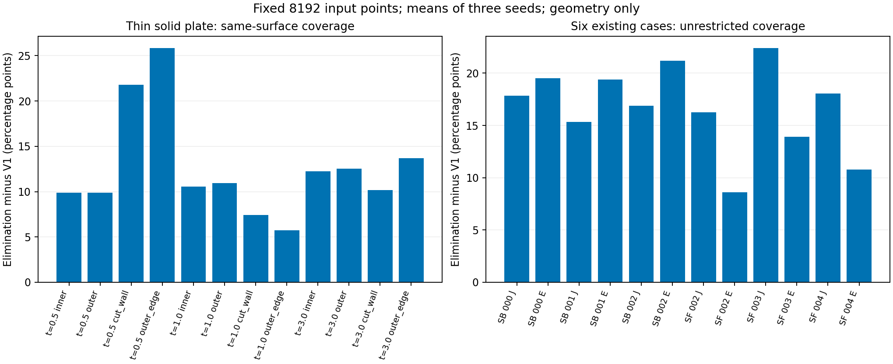

# 固定点数欧氏蓝噪声样本消除：限定CPU几何试验报告

日期：2026-11-03。仅本机CPU；未训练、推理、连接服务器或改动生产数据。

## 方法与冻结范围

候选是受Yuksel样本消除启发的紧支撑核实现，不宣称逐字复现cyCodeBase、不保证严格最小间距，也未做频谱蓝噪声认证。从同一物理面积随机候选池32768点中消除至8192点；半径R=2√(面积/8192)，权重为(1-d/R)^8，对半径内全部点对求和，迭代移除权重最大点。参数仅一次冻结，无半径扫描、无移动点或表面修改。

对照为同一候选池前8192点，分布与V1面积随机一致，但因候选池长度影响随机数消耗，不声称重现历史V1点集字节。采样器不接收标签、植入物、J或目标；真实病例的候选索引在读取implant之前保存。输出GT、归一化和生产样本均未改动。

六例为SkullFix 002/003/004及SkullBreak train 000/001/002 bilateral，均为此前开放的诊断来源，不是全新的最终检验集。人工几何为80×80mm实体薄板、30×30mm贯穿方孔，厚度0.5/1/3mm；标注内外面、孔切壁及外侧边。每例三个种子，共54个8192点集合。这里inner/outer只是人工两侧，不代表解剖标注。

## 人工多表面结果

下表使用“同类表面点”测距，避免另一侧点替代而掩盖丢层；面积加权参考为独立0.5mm或更细的矩形中点积分。表中为三个种子均值，不是统计显著性检验。

| 厚度mm | 区域 | V1 Cover@1mm % | 候选 % | 差值pp | V1 P95 mm | 候选 P95 mm |
|---|---|---:|---:|---:|---:|---:|
| 0.5 | inner | 89.180 | 99.083 | +9.903 | 1.165 | 0.835 |
| 0.5 | outer | 89.248 | 99.155 | +9.906 | 1.162 | 0.828 |
| 0.5 | cut_wall | 52.986 | 74.792 | +21.806 | 5.061 | 1.906 |
| 0.5 | outer_edge | 51.432 | 77.266 | +25.833 | 4.178 | 1.878 |
| 1.0 | inner | 88.905 | 99.453 | +10.548 | 1.175 | 0.795 |
| 1.0 | outer | 88.635 | 99.559 | +10.924 | 1.179 | 0.789 |
| 1.0 | cut_wall | 73.194 | 80.625 | +7.431 | 2.057 | 1.578 |
| 1.0 | outer_edge | 73.047 | 78.802 | +5.755 | 2.199 | 1.755 |
| 3.0 | inner | 87.058 | 99.295 | +12.238 | 1.217 | 0.821 |
| 3.0 | outer | 86.768 | 99.286 | +12.518 | 1.223 | 0.821 |
| 3.0 | cut_wall | 84.630 | 94.792 | +10.162 | 1.314 | 1.000 |
| 3.0 | outer_edge | 82.439 | 96.137 | +13.698 | 1.379 | 0.966 |

## 真实数据结果

J为由原始D/G互补关系精确确认的共享切壁；E为其它骨边界，**E不等于外板**。真实数据没有可信内外板标注，不做真实内外板分层保留宣称。主距离允许任何输入点提供支持；CSV另列仅同J/E区域的距离，避免局部支持来源混淆。参考为精确体素暴露面的中心及物理面积权重，并非连续表面Hausdorff保证。

| 病例 | 区域 | V1 Cover@2mm % | 候选 % | 差值pp | V1 P95 mm | 候选 P95 mm |
|---|---|---:|---:|---:|---:|---:|
| SkullBreak_train__000__bilateral | J | 62.667 | 80.497 | +17.830 | 3.445 | 2.403 |
| SkullBreak_train__000__bilateral | E | 60.564 | 80.069 | +19.505 | 3.548 | 2.429 |
| SkullBreak_train__001__bilateral | J | 64.357 | 79.706 | +15.349 | 3.387 | 2.436 |
| SkullBreak_train__001__bilateral | E | 60.063 | 79.444 | +19.381 | 3.568 | 2.447 |
| SkullBreak_train__002__bilateral | J | 70.611 | 87.485 | +16.874 | 3.039 | 2.227 |
| SkullBreak_train__002__bilateral | E | 66.414 | 87.607 | +21.193 | 3.314 | 2.236 |
| SkullFix_002 | J | 29.913 | 46.167 | +16.255 | 5.194 | 3.431 |
| SkullFix_002 | E | 38.942 | 47.561 | +8.618 | 4.778 | 3.323 |
| SkullFix_003 | J | 42.842 | 65.234 | +22.392 | 4.206 | 2.812 |
| SkullFix_003 | E | 51.500 | 65.408 | +13.908 | 3.991 | 2.784 |
| SkullFix_004 | J | 38.534 | 56.580 | +18.046 | 4.597 | 3.053 |
| SkullFix_004 | E | 44.792 | 55.589 | +10.797 | 4.325 | 3.043 |

## 可靠性与局限

- 人工合同检查通过：堆实现与逐次全量删除一致、复现、无并列的人工坐标刚体协变、精确点数、原始子集和输入不变。原始输入哈希不变；重新回读54份点集及完整内容清单通过。共用时161.8秒，检查点记录RSS峰值0.442GiB；不是硬隔离。
- 三种子用于检查随机波动，不是独立患者数。六例不能替代批量来源和未知缺损类型验证。核半径按总面积确定可能受复杂孔腔或跨层邻近影响；尚未检验测地版本。
- 真实各区域各种子同区域Cover@1mm的下降记录见report_verification.json；所有下降均保留，不隐藏、不据此调参。仅Cover@2mm接近饱和不代表亚毫米精度，必须同时看0.5/1mm覆盖与P95。
- 采样仍基于原始体素面边界，不能改善上游分割真实性；未生成平滑网格，不把体素阶梯误当重建精度。
- 点数与分层支持并不等同于网络512/256 proxy保留，也不证明减少了既有整块骨片定位错误；模型收益尚无证据。当前V1生产默认不变。

## 下一步决策边界

若人工层面无系统性丢层且真实J/E配对覆盖确有改善，可保留为下一轮扩大既有开放来源几何核验的候选；仍不自动部署或训练。如果发现稳定的局部退化，应停止此实现并先解释，而非扫描半径补救。不要仅凭均匀外观宣称胜出。

文献依据：[Yuksel 2015样本消除](https://www.cemyuksel.com/research/sampleelimination/)；颅骨任务中Poisson-disk先例：[Friedrich等MICCAI2023](https://arxiv.org/html/2303.08061v2)。本实现是本项目限定候选，文献先例不替代本次或后续验证。

**细尺度退化与最终解释见[科研结论](research_conclusion_zh_v1.md)：SkullBreak切壁点数减少，不能将本次候选称为无退化胜出。**
