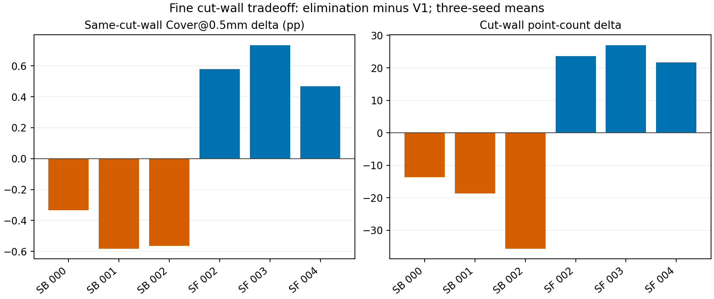

# 蓝噪声采样试验：科研结论与退化项

本文件仅解读已经保存的54份点集与评分，不重新采样或运行模型。

**结论：该固定点数候选显著改善这六例的2mm尺度几何覆盖，但不是无退化的多表面保护方案。值得保留研究，尚不能替换V1或直接进入训练。**

## 粗尺度收益与细尺度代价必须同时报告

| 来源（三例，各三种子） | J Cover@2mm：V1→候选 | J P95 mm：V1→候选 | 仅J点 Cover@0.5mm：V1→候选 |
|---|---:|---:|---:|
| SkullBreak | 65.878% → 82.562% | 3.290 → 2.355 | 5.613% → 5.119% |
| SkullFix | 37.096% → 55.994% | 4.665 → 3.099 | 2.463% → 3.057% |

SkullBreak三个病例的切壁点数均值分别为166.0→152.3、167.3→148.7、358.7→323.0；其中001和002的仅J点Cover@1mm种子均值也略降。18个真实病例×种子组合中，5个组合的仅J点Cover@1mm下降，最大下降1.767个百分点。不能用总体2mm覆盖改善隐藏这些退化。

在人工0.5/1/3mm带孔薄板中，各侧及孔壁的同类表面Cover@1mm种子均值均改善，且没有单种子下降；但这只是人工薄板证据，不能证明复杂真实颅骨内外板都受到保护。

合理解释是：欧氏排斥减少堆叠和大空洞，同时可能重分配了切壁、相邻骨面之间的点数。现有结果与这种机制相容，但不能仅凭这些指标证明跨层抑制是唯一原因。局部点数减少不一定意味着覆盖下降；必须按尺度与支持来源分别检查。

## 下一步建议

保持8192点和本次参数不变，不扫描半径、不自动训练。优先用已保存点集，在同一批真实病例上核对切壁减少区域、邻面点的支持来源和剖面，再决定是否需要基于原始表面邻接的采样。该核对不需要新模型或GPU；不需要新造内外板标签。之后才决定是否扩大已开放来源的几何对照。

本次实现是compact-kernel样本消除候选，不是严格最小间距Poisson保证；报告的输入几何收益不能替代模型精度验证。所有模型训练、GT和生产默认均保持不变。

[完整方法与逐例结果](report_zh_v1.md)；[配对CSV](paired_case_region_summary.csv)；[冻结协议](protocol.json)。
