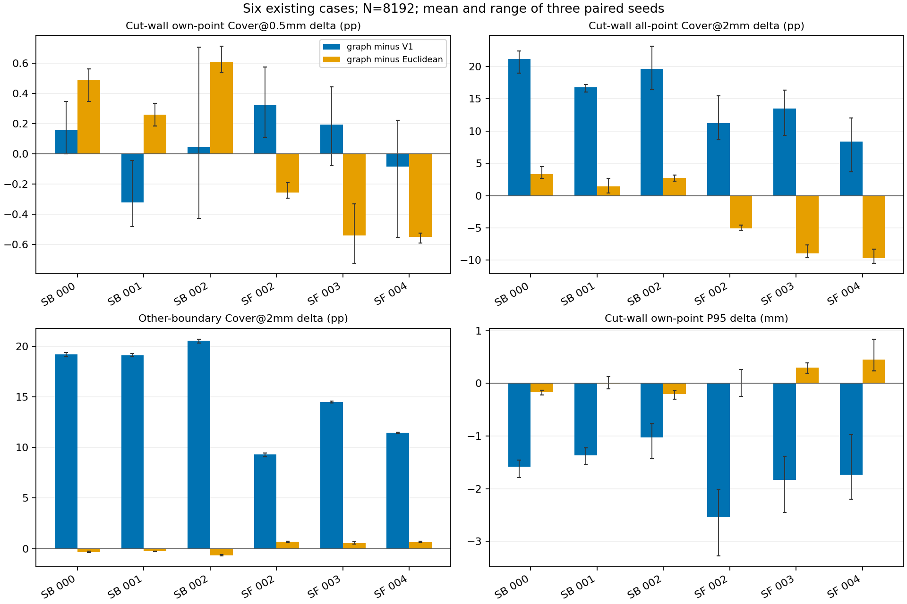

# 原始表面邻接图版本：科研结论

日期：2026-11-03。本次已实现并完成真实六例的表面邻接图距离版本，不是用人工U形结果代替真实数据验证。

**结论：值得保留为固定候选，但不具备跨数据集统一胜出的证据，当前不替换V1或已有欧氏候选。** 图版本对SkullBreak的切壁支持有利，对SkullFix的切壁支持不利；这是需要保留的数据分布差异，不能只报有利一侧。

## 同一候选池、同一8192点预算的结果

以下均为每数据集三个既有病例、每例三个种子的等权均值；J为共享切壁，E为其余全部骨边界，不等于外板。

| 数据集 | 方法 | J自身Cover@0.5mm | J总体Cover@2mm | E总体Cover@2mm |
|---|---|---:|---:|---:|
| SkullBreak | V1面积随机 | 5.613% | 65.878% | 62.347% |
| SkullBreak | 欧氏蓝噪声候选 | 5.119% | 82.562% | 82.373% |
| SkullBreak | 表面图距离候选 | 5.571% | 85.053% | 81.956% |
| SkullFix | V1面积随机 | 2.463% | 37.096% | 45.078% |
| SkullFix | 欧氏蓝噪声候选 | 3.057% | 55.994% | 56.186% |
| SkullFix | 表面图距离候选 | 2.607% | 48.121% | 56.810% |

相对欧氏候选：

- SkullBreak三例的J自身0.5mm覆盖均提高，J总体2mm覆盖增加1.45—3.30个百分点；E总体2mm覆盖下降0.27—0.66个百分点。图版本的细支持并非每例超过V1，001仍低于V1。
- SkullFix三例的J总体2mm覆盖下降5.04—9.66个百分点，J自身0.5mm覆盖也均下降；E总体2mm覆盖增加约0.55—0.67个百分点。004的J自身0.5mm覆盖还略低于V1。
- 所以不能简单排序“图距离最好”或“欧氏距离最好”。粗尺度覆盖、细切壁支持与其它边界存在取舍；单折模型与六例几何均不足以建立普遍最优性。

## 现在真正验证到什么

1. 能在保持原始体素暴露面几何、不平滑、不填孔、不删结构的前提下，构造不依赖J/E标签的共享边表面图。
2. 候选池已与旧V1和欧氏结果逐点对齐；图版只改变距离定义，不改变点数、核规则、GT或模型。共有18份新8192点集和54条配对评分。
3. 图不会把仅空间靠近或只顶点接触的独立面直接相连；切壁与两侧骨面的合法共享边连接被保留。四面相交歧义边被保守阻断并记录。
4. **尚不能证明真实内外板都完整保留。** 当前没有可信解剖内外板标签；拓扑连接合理不等于有限采样点一定覆盖充分。

## 必须披露的数值限制

本实现使用原始面中心及共享边／角点路径，并对同面和相邻面局部距离作精确改进，是保守的图路径近似，不是连续精确测地距离。其变化包含曲率绕行、体素阶梯与图离散偏差，不能把全部收益或退化都归因于跨内外板竞争。一个平面面中心标定例子误差约7.97%，不是所有曲面与点端偏移的误差上界。

SkullFix图有48/280/343个分量，SkullBreak为1/2/1；这些不是解剖结构数量，也不能据此直接推断分割质量。原始不连通结构没有被删除，不应未经证据将数据集差异归因于其中任一因素。

## 后续建议

保持两个采样候选均固定，不按病例或数据集挑选更有利者拼成“新方法”，不追加权重或扫描半径。若继续验证，优先扩大已开放来源上的同协议配对几何核验，确认SkullBreak收益和SkullFix退化是否可重复；然后再决定最小模型对照。不要依据这六例直接推广全数据，也不要把本轮CPU验证当作训练准入或临床精度证据。

本轮已完成用户要求的真实表面邻接版本探索；生产默认仍为V1，无训练、GPU、服务器或部署操作。

[完整方法与逐例结果](report_zh_v1.md) · [逐种子配对CSV](paired_metrics.csv)

