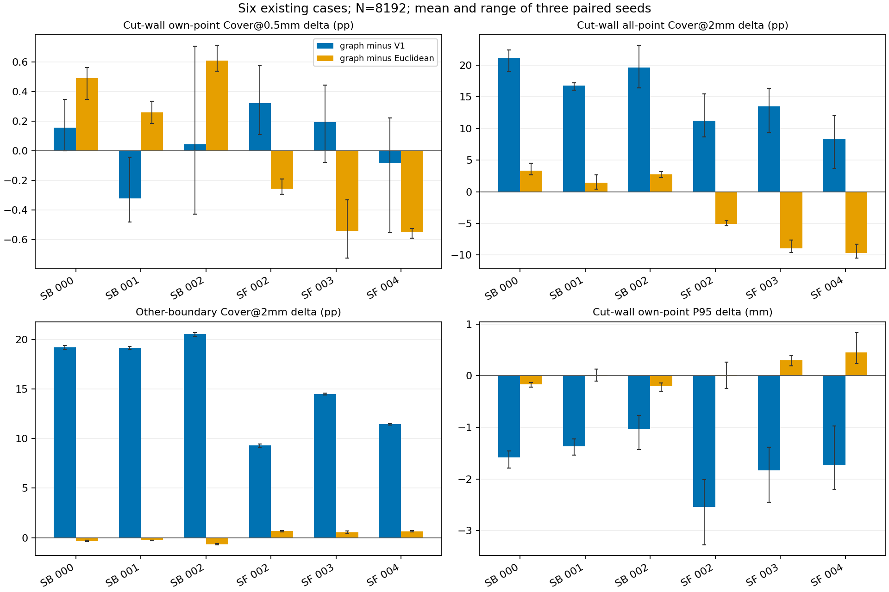

# 真实六例：原始体素边界邻接图距离采样对照

日期：2026-11-03。仅本机CPU几何验证；未训练、使用GPU、操作服务器或修改生产采样器。

## 研究范围

在此前开放的SkullFix 002/003/004和SkullBreak train 000/001/002 bilateral上，保持原始完整骨边界、32768点候选池、8192输入点、固定核规则及评价参考，比较V1、已有欧氏样本消除和本次原始表面图距离版本。三个种子；共54个方法×病例×种子评分记录。六例是重复用于方法诊断的开放来源，不是全新最终检验集。

## 图的定义与限制

原始暴露体素四边形只在共享完整边且恰好两个面相交处连接。四面相交歧义边阻断并计数；仅顶点接触的独立表面不连接。除共享边中点路径外，加入经过同一中间面角点的合法路径，减少平面图的方向偏差；不进行Marching Cubes、平滑、删岛或填孔。

距离为点到所在面中心、图上最短路径、中心到目标点构成的合法表面路径长度；同一面用直线距离，相邻面用沿共享边展开的局部精确路径改进。核仍为max(0,1-d/R)^8，R保持原冻结的2√(面积/8192)。

**这是保守的离散表面路径近似，不是连续精确测地距离。**平面面中心标定示例相对误差约7.97%，并不构成所有点端偏移或曲面误差的界。真实距离增加同时包含合法曲率、体素阶梯、跨层绕行与数值近似，不能将核变化全部归因于阻断跨层。

历史完整候选池未单独保存，本次用原始未改动采样器和种子重建；前8192点与V1保存坐标逐点完全一致，欧氏保留索引对应坐标也逐点完全一致。新方法保留索引先保存，然后读取implant推导J评价标签；不使用GT指导选点。

## 切壁自身支持：三个种子均值

J为真实D/G共享切壁；同区域测距只使用J点。E为其余全部骨边界，不等于外板。

| 病例 | 方法 | J点数 | J自身Cover@0.5mm % | J自身Cover@1mm % | J自身Cover@2mm % | J自身P95 mm |
|---|---|---:|---:|---:|---:|---:|
| SkullBreak_train__000__bilateral | V1_common_pool | 166.00 | 5.211 | 19.653 | 55.477 | 4.371 |
| SkullBreak_train__000__bilateral | Euclidean_elimination | 152.33 | 4.877 | 20.212 | 69.703 | 2.957 |
| SkullBreak_train__000__bilateral | surface_graph | 163.67 | 5.366 | 21.963 | 74.390 | 2.789 |
| SkullBreak_train__001__bilateral | V1_common_pool | 167.33 | 5.449 | 20.215 | 58.413 | 4.197 |
| SkullBreak_train__001__bilateral | Euclidean_elimination | 148.67 | 4.866 | 19.820 | 71.236 | 2.835 |
| SkullBreak_train__001__bilateral | surface_graph | 155.67 | 5.126 | 20.919 | 73.547 | 2.828 |
| SkullBreak_train__002__bilateral | V1_common_pool | 358.67 | 6.180 | 23.531 | 65.683 | 3.498 |
| SkullBreak_train__002__bilateral | Euclidean_elimination | 323.00 | 5.614 | 23.456 | 78.608 | 2.677 |
| SkullBreak_train__002__bilateral | surface_graph | 351.67 | 6.222 | 26.190 | 83.594 | 2.473 |
| SkullFix_002 | V1_common_pool | 64.33 | 1.752 | 6.797 | 23.472 | 7.561 |
| SkullFix_002 | Euclidean_elimination | 88.00 | 2.332 | 9.204 | 34.636 | 5.010 |
| SkullFix_002 | surface_graph | 75.67 | 2.074 | 8.283 | 31.689 | 5.017 |
| SkullFix_003 | V1_common_pool | 99.67 | 3.022 | 11.077 | 36.094 | 5.876 |
| SkullFix_003 | Euclidean_elimination | 126.67 | 3.756 | 14.629 | 53.451 | 3.739 |
| SkullFix_003 | surface_graph | 102.67 | 3.214 | 12.131 | 45.969 | 4.039 |
| SkullFix_004 | V1_common_pool | 95.33 | 2.616 | 9.867 | 32.915 | 6.199 |
| SkullFix_004 | Euclidean_elimination | 117.00 | 3.083 | 12.347 | 46.668 | 4.018 |
| SkullFix_004 | surface_graph | 92.67 | 2.532 | 10.043 | 38.916 | 4.464 |

## 与已有欧氏候选的配对变化

| 病例 | J自身0.5mm覆盖变化pp | J总体2mm覆盖变化pp | E总体2mm覆盖变化pp | J自身P95变化mm |
|---|---:|---:|---:|---:|
| SkullBreak_train__000__bilateral | +0.488 | +3.297 | -0.327 | -0.168 |
| SkullBreak_train__001__bilateral | +0.260 | +1.449 | -0.265 | -0.007 |
| SkullBreak_train__002__bilateral | +0.607 | +2.727 | -0.658 | -0.204 |
| SkullFix_002 | -0.258 | -5.043 | +0.670 | +0.007 |
| SkullFix_003 | -0.542 | -8.915 | +0.547 | +0.301 |
| SkullFix_004 | -0.551 | -9.662 | +0.654 | +0.447 |

柱为三个种子均值，误差线为最小—最大范围，不是置信区间。完整逐种子和V1对照数据见paired_metrics.csv。不能只看近饱和的2mm覆盖忽略亚毫米细支持。

## 表面图与原始拓扑记录

| 病例 | 原始暴露面数 | 阻断歧义边数 | 图连通分量 | 有限核内图距离/欧氏距离中位数（三种子均值） |
|---|---:|---:|---:|---:|
| SkullFix_002 | 1311880 | 304 | 48 | 1.292 |
| SkullFix_003 | 950958 | 1196 | 280 | 1.314 |
| SkullFix_004 | 1169558 | 1660 | 343 | 1.314 |
| SkullBreak_train__000__bilateral | 1013608 | 44 | 1 | 1.265 |
| SkullBreak_train__001__bilateral | 1027984 | 24 | 2 | 1.265 |
| SkullBreak_train__002__bilateral | 858528 | 114 | 1 | 1.278 |

原始非连通结构没有被删除；图分量数不是解剖结构数。歧义边阻断是保守选择，可能切断真实应连通的路径；不能把所有阻断边解释为伪结构。以上距离比也不是数值误差估计，不能区分真实表面绕行与图离散偏差。

## 核验与判断边界

- 人工闭盒连通、平面标定、四面相交边阻断及仅顶点接触不连通检查通过。54条评分中的V1和欧氏历史覆盖值复现；原始输入及旧工具哈希不变。
- 18份新点集均为冻结候选池的原坐标子集，未改变目标点集、坐标归一化或模型；选择时未使用J/E或真实解剖标签。
- 当前真实数据没有可信的内外板解剖标注，只能核查原始表面连接和J/E支持，不能据此宣布真实内外板完整保留。
- 这只检验一个离散表面图版本，不是测地算法普遍优劣的证明。结果不自动授权模型训练或改变生产默认。

CPU实验总用时735.4秒；检查点RSS峰值0.534GiB，不是硬内存隔离。报告阶段只读取既有产物，不重新采样或重复实验。
