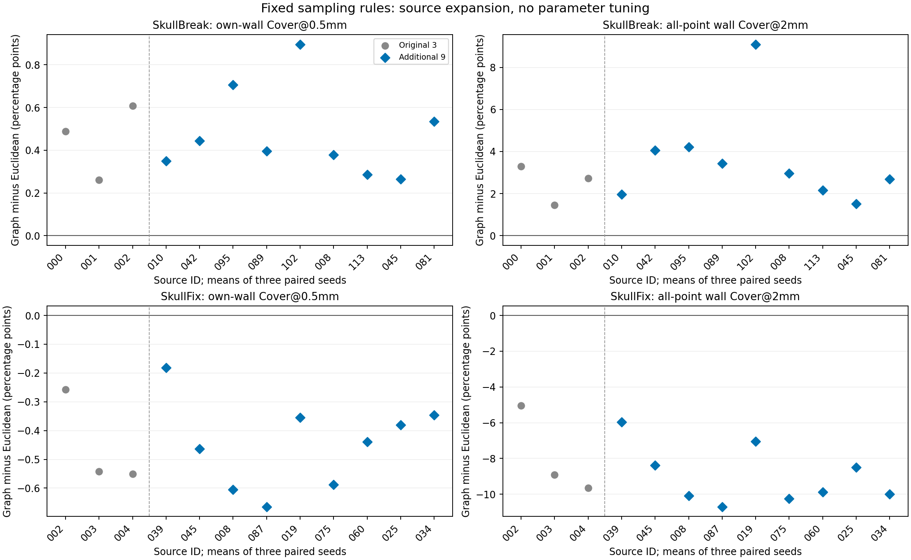

# 扩展核验的科研结论

日期：2026-11-03。已完成24个已开放来源、每例3个种子、三种方法的216条评分；六例复用旧结果，新增18例。没有半径扫描、追加权重、科学实现变更或模型实验。

**原先“SkullBreak切壁受益、SkullFix切壁退化”的方向，在新增来源中重复出现；不是仅由原六例支撑。** 这支持在本轮范围内将其视为可重复的数据分布依赖，但不构成全数据、其它缺损类型或临床泛化的确认性结论。

## 关键结果：只看新增9来源／数据集

差值为表面图版减欧氏版，覆盖单位为百分点；每个来源先平均三个种子。

| 指标 | SkullBreak bilateral | SkullFix |
|---|---:|---:|
| 切壁自身Cover@0.5mm均值差 | +0.473；9/9来源改善 | −0.447；9/9来源退化 |
| 同指标中位差 | +0.396 | −0.439 |
| 切壁总体Cover@2mm均值差 | +3.565；9/9来源改善 | −8.979；9/9来源退化 |
| 同指标中位差 | +2.966 | −9.884 |
| 其它骨边界Cover@2mm均值差 | −0.208；9/9来源下降 | +0.857；9/9来源上升 |
| 切壁自身P95均值差 | −0.216mm；9/9来源下降 | +0.282mm；8/9来源上升、1/9下降 |

J是D/G共享切壁，E是其余全部骨边界，不是外板标签。没有把三个种子当成三个独立患者，没有执行bootstrap、显著性检验或正式gate。

## 如何解读

1. **不能认定图版全局更优。** 它在SkullBreak改善切壁支持，同时牺牲少量其它边界覆盖；在SkullFix则呈相反的分配取舍。
2. **不能认定几何改善等于预测改善。** 全12个SkullBreak来源中，图版切壁自身Cover@0.5mm为5.113%，欧氏版4.645%，V1为5.167%；图版虽改善欧氏版，细支持仍未整体超过V1。其较好的2mm覆盖也不能替代模型实验。
3. **不能将差异唯一归因于内外板竞争。** 该图距离包含曲面绕行、体素阶梯及离散近似；歧义边阻断和原始非连通结构也参与了距离定义。本轮不是这些因素的因果消融。
4. **来源扩大不等于解剖标签补齐。** 没有可信真实内外板标签，仍不能宣布真实内外板完整保留；本轮SkullBreak仍仅bilateral，不外推其它四类缺损。

## 当前决定与下一步边界

冻结并保留欧氏版和图版，不再为了消除这组差异继续调半径、加权或修补图规则；V1生产默认不变。也不按每个病例或数据集事后挑选表现更好的一版拼接为“新方法”。

本轮“差异是否跨来源重复”的问题可以在上述范围内收束。若继续推进，应把问题转向固定候选的模型价值，而不是继续循环修改采样器；在正式模型对照前仍需明确其余缺损类型的适用边界、固定数据来源与评价目标。当前未创建训练request、部署或运行模型。

[完整实验报告](report_zh_v1.md) · [来源级CSV](source_level_metrics.csv) · [逐种子CSV](seed_level_metrics.csv)

