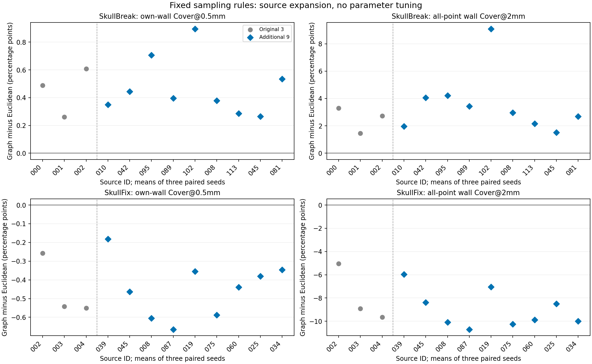

# 扩大已开放来源：欧氏与表面图采样的配对几何核验

日期：2026-11-03。已完成限定本机CPU核验，不涉及训练、GPU、服务器或部署。

## 范围与方法

每数据集从原3个来源扩大到12个，合计24个来源。原六例直接复用哈希绑定的既有结果；新增18例各完成三个种子、三种采样，合计216条方法×病例×种子评分。新增来源依据冻结的SHA256顺序选择，不看结果；不是按有利或退化病例挑选。

SkullFix来源来自已开放90例，SkullBreak来自已开放84来源，但本轮仍仅比较bilateral缺损，一来源一病例，不能外推其余四类缺损。三个种子先在来源内平均；患者来源数是12，不是36。新增9来源单列，用来避免原例子主导判断。

保持32768面积随机候选点、8192输入点、(1-d/R)^8及R=2√(面积/8192)。欧氏与原始表面图距离版本均调用未改动的科学实现。图仍采用共享完整边、歧义边阻断、面中心／角点合法路径和同面／相邻面局部精确改进；没有半径扫描、权重追加或图方法修补。

全部九份输入点集先保存，再解码该病例implant并推导J标签用于评价。GT、原始数据和生产点集均不修改。引用面仍是全部原生暴露面的中心与物理面积权重；真实数据没有可信的内外板标签，J是共享切壁，E是其余边界。本轮V1指共同32768候选池的面积随机前8192点，与历史训练V1同分布，但不声称全部历史训练点坐标逐字节复用。

## 新增9来源：是否重复原方向

下表仅使用新增来源；差值均为图版减欧氏版，覆盖单位为百分点，P95单位mm。正负来源数按三个种子均值判断，不做显著性／正式gate。

| 数据 | 指标 | 均值差 | 中位差 | 正／负／持平来源 | 范围 |
|---|---|---:|---:|---|---|
| SkullBreak | 切壁自身Cover@0.5mm | +0.473 | +0.396 | 9/0/0 | +0.265至+0.896 |
| SkullBreak | 切壁总体Cover@2mm | +3.565 | +2.966 | 9/0/0 | +1.513至+9.095 |
| SkullBreak | 其它边界总体Cover@2mm | -0.208 | -0.204 | 0/9/0 | -0.530至-0.052 |
| SkullBreak | 切壁自身P95（下降更好） | -0.216 | -0.193 | 0/9/0 | -0.541至-0.057 |
| SkullFix | 切壁自身Cover@0.5mm | -0.447 | -0.439 | 0/9/0 | -0.665至-0.181 |
| SkullFix | 切壁总体Cover@2mm | -8.979 | -9.884 | 0/9/0 | -10.705至-5.959 |
| SkullFix | 其它边界总体Cover@2mm | +0.857 | +0.865 | 9/0/0 | +0.574至+1.219 |
| SkullFix | 切壁自身P95（下降更好） | +0.282 | +0.359 | 8/1/0 | -0.153至+0.543 |

## 原3例与新增9例的比较

| 数据 | 范围 | 切壁自身0.5mm覆盖平均差pp | 切壁总体2mm覆盖平均差pp |
|---|---|---:|---:|
| SkullBreak | prior_six | +0.452 | +2.491 |
| SkullBreak | new_expansion | +0.473 | +3.565 |
| SkullBreak | all | +0.468 | +3.296 |
| SkullFix | prior_six | -0.450 | -7.873 |
| SkullFix | new_expansion | -0.447 | -8.979 |
| SkullFix | all | -0.448 | -8.702 |

每个点是一个来源的三个种子均值；灰色为原3来源，蓝色为新增9来源。图中没有将多个随机种子当作独立患者。

## 全12来源的绝对覆盖

| 数据 | 方法 | J自身Cover@0.5mm % | J总体Cover@2mm % | E总体Cover@2mm % |
|---|---|---:|---:|---:|
| SkullBreak | V1_common_pool | 5.167 | 62.723 | 58.835 |
| SkullBreak | Euclidean_elimination | 4.645 | 77.991 | 77.835 |
| SkullBreak | surface_graph | 5.113 | 81.287 | 77.575 |
| SkullFix | V1_common_pool | 2.296 | 35.741 | 43.716 |
| SkullFix | Euclidean_elimination | 2.898 | 54.189 | 53.452 |
| SkullFix | surface_graph | 2.451 | 45.486 | 54.250 |

## 全部来源与退化记录

| 数据／来源 | 阶段 | J自身0.5mm差pp | J总体2mm差pp | E总体2mm差pp |
|---|---|---:|---:|---:|
| SkullFix SkullFix:002 | prior_six | -0.258 | -5.043 | +0.670 |
| SkullFix SkullFix:003 | prior_six | -0.542 | -8.915 | +0.547 |
| SkullFix SkullFix:004 | prior_six | -0.551 | -9.662 | +0.654 |
| SkullFix SkullFix:039 | new_expansion | -0.181 | -5.959 | +0.588 |
| SkullFix SkullFix:045 | new_expansion | -0.463 | -8.388 | +0.625 |
| SkullFix SkullFix:008 | new_expansion | -0.605 | -10.094 | +0.865 |
| SkullFix SkullFix:087 | new_expansion | -0.665 | -10.705 | +1.219 |
| SkullFix SkullFix:019 | new_expansion | -0.355 | -7.043 | +0.863 |
| SkullFix SkullFix:075 | new_expansion | -0.589 | -10.240 | +0.877 |
| SkullFix SkullFix:060 | new_expansion | -0.439 | -9.884 | +1.015 |
| SkullFix SkullFix:025 | new_expansion | -0.381 | -8.507 | +0.574 |
| SkullFix SkullFix:034 | new_expansion | -0.346 | -9.991 | +1.087 |
| SkullBreak train:000 | prior_six | +0.488 | +3.297 | -0.327 |
| SkullBreak train:001 | prior_six | +0.260 | +1.449 | -0.265 |
| SkullBreak train:002 | prior_six | +0.607 | +2.727 | -0.658 |
| SkullBreak train:010 | new_expansion | +0.350 | +1.957 | -0.200 |
| SkullBreak train:042 | new_expansion | +0.443 | +4.057 | -0.530 |
| SkullBreak train:095 | new_expansion | +0.707 | +4.215 | -0.246 |
| SkullBreak train:089 | new_expansion | +0.396 | +3.439 | -0.052 |
| SkullBreak train:102 | new_expansion | +0.896 | +9.095 | -0.233 |
| SkullBreak train:008 | new_expansion | +0.379 | +2.966 | -0.243 |
| SkullBreak train:113 | new_expansion | +0.286 | +2.154 | -0.079 |
| SkullBreak train:045 | new_expansion | +0.265 | +1.513 | -0.085 |
| SkullBreak train:081 | new_expansion | +0.535 | +2.689 | -0.204 |

## 可靠性与限制

- 18个新增病例的162份点集均精确8192点，三方法使用同一病例／种子的候选池；六个旧病例没有重新执行。
- 科学核心文件、选定原始D/G、既有点集和目标所在文件哈希均保持不变。报告阶段验证保存内容清单，不重新执行几何。
- 图距离仍是保守的离散路径近似，不是连续精确测地距离；变化混合了曲率、体素阶梯、跨层绕行和离散偏差。不能把差异唯一归因于内外板竞争。
- 这不是未使用测试集：所有来源此前已开放，部分曾用于其它候选几何研究。因此只能报告探索性的跨来源重复性，不能当最终确认性结果。
- 不按数据集或病例选择更有利的一组拼接成新方法，不改变GT、不据结果调整半径或权重，也不自动授权模型训练。

总用时1042.6秒，三工作进程的总RSS监测峰值2.506GiB；资源为监测而非硬隔离。

完整来源均值见source_level_metrics.csv，逐种子见seed_level_metrics.csv；源数据和各病例拓扑记录在protocol.json与cases/*/result.json。
