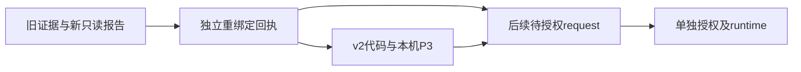

# Fold C 8k 首运行最小 resource-rebind 补充方案 v1

_2026-10-25 · 状态：DRAFT_AWAITING_USER_CONFIRMATION · 仅制定方案，不实施、不操作服务器_

---

## 📋 目的与决策边界

本方案只解决首个 `BCSP_INPUT_DENSITY_V1` 训练运行从旧容器迁移到已确认新容器后的身份绑定冲突。保留已完成的真实数据 QC、静态科研配置、模型／provider、共同病例顺序、315 例名单及3900-step合同；不重建通用库存、传输或审计框架。

**确认方案不等于执行授权**：本文件不是 resource-rebind 正式回执、部署 request 或训练 execution request。本轮只新增本草案及其机器可读伴随文件，不改任何既有源码、配置或服务器文件，也不运行 CPU 测试、GPU 或模型。

建议采用显式版本化补充绑定，不替换旧报告中的 hostname、GPU UUID 或驱动，不关闭身份断言，也不将“30文件哈希一致”写成“新 GPU CUDA 实测通过”。

## 📚 已有证据与身份差异

依据[新容器只读报告](E:/Codex/2026-06-06/mamba-ccf-c-1-high-resolution/outputs/cranial_bcsp_geov1_20261024/first_run_freeze_foldC_8192_v1/new_container_readonly_3x9rq5_v1/readonly_identity_assets_upload_report_v1.json)，报告 SHA256 为 `1ccb8c7fc712cdecb04f260d84b827e422fb1d6926110664783f0033ef9a33c6`。

| 字段 | 旧绑定 | 新观测 |
| --- | --- | --- |
| hostname | `shu-common-25721452-notebook-o9mz8z-0` | `shu-common-25721452-notebook-3x9rq5-0` |
| GPU UUID | `GPU-2f32f6fb-ea5d-730a-4ea2-2f6063e31065` | `GPU-4b19574a-832d-b4fe-e655-a57462954d6a` |
| 驱动 | `575.51.03` | `570.190` |
| GPU 型号／SMI容量 | RTX 4090 D／24564 MiB | 相同 |
| 用户／项目 | jovyan、uid1000／PoinTr | 相同 |
| 固定训练解释器 | Python 3.10.20 | 可执行，二进制哈希相同 |

30 个选定模型／配置／helper／provider／环境文件的字节哈希匹配；上传五文件及327个归档成员的名称、大小和哈希全部匹配。计划代码、数据及结果目录当时均不存在。GPU 观测占用1 MiB且无计算进程，磁盘空闲约13.13 GiB；这些是只读报告当时的观测，后续启动前仍须刷新，不构成持久空闲承诺。

默认 `/opt/conda/bin/python3.8` 仅用于只读探针启动，不是训练环境；训练仍固定 `/opt/conda/envs/adapointr-mamba/bin/python3.10`。不降级 Python、不安装或升级依赖、不重新编译 PointNet2 或 Chamfer。

## 🔐 必须保持不变的范围

| 不变量 | 既定值或 SHA256 |
| --- | --- |
| 首个运行 | Fold C、8192→8192、seed0，B0 AdaPoinTr；非新 Mamba 对比 |
| 数量与更新 | 63源／315例；batch8；100遍，epoch0–99；39 batch／遍；3900更新；31200曝光 |
| 静态配置 | `86dbbb7b216a932209abd446bdd28408ad5327433834336f2584b087c1b35647` |
| 共同顺序文件 | `6ab424177d5227bd34585a710eedca578acdd2eeb226bec10cdfc86ee89cec9d` |
| 旧运输范围 | `19bb88a4a63484d39a3f42146802af29cc695fc3dbae5ae5488df36046f770c3` |
| 已上传归档 | `fc3c4daa64f7a90ff6396d039c43344ab4d07947d12b675c1ecd4d6c54a08c0d`，49,773,476 bytes |
| 训练循环源码 | `55ad69b0e87f3fc4ecac68a5ebcc4cdd560c4825ff01363ba9868de5875f0847` |
| 旧 preflight scope | `c6edb9bfcf833d2abf98eb18749d03b49a490579d79475e4823750df6a8311e6` |
| 旧 GPU 正式审计 | `af3c3053be96a443d203c486ccede4d2bf2f0799ae753294ee946618726cf000` |

资源停止合同也不变：总时限86400秒、RSS 8 GiB、PyTorch allocated／reserved各20 GiB、设备22528 MiB、结果2 GiB、最低空闲磁盘4 GiB；两条数值查询口径继续分开记录。FP32、严格确定性／TF32关闭、普通训练 BN、AdamW、LR／BN调度、clip10、全 key 分块 KNN、cdist loss、final-only、不自动 BNCal／development／resume 均不变。

原 scope 内旧 `CUDA_VISIBLE_DEVICES` 和旧身份作为历史内容保留。补充方案只允许覆盖本次部署的身份期望及其派生可见设备值，不把旧 scope 自身改成新机器报告。

## 🔧 唯一建议的实施范围

### 两个生产模块、一个测试文件

未来若单独获准 implementation-only，只新增：

1. `bcsp_training_contract_v2.py`：在新 request schema 中增加唯一的 `resource_rebind` 精确文件绑定，验证补充回执与既有只读证据；保持静态配置 schema、QC／fold／数据读取及单向授权链不变。
2. `bcsp_training_entry_v2.py`：校验重绑定回执，使用其经核验的新身份做 live identity／GPU 比较；`CUDA_VISIBLE_DEVICES` 仅改为该回执中的新 UUID。其他环境值仍按旧 scope 和本次 owned output 派生，不泛化放行环境差异。
3. `test_resource_rebind_contracts_v1.py`：一次限定的12项人工 CPU 回归，不读真实点集、不调用 CUDA、不重跑3900-step Tiny生命周期或已通过的 GPU preflight。

旧 v1 contract／entry、`bcsp_training_runtime_v5.py`、adapter、模型、KNN、preflight helper、静态配置及所有数据不改。新 entry 的 `-I -S -B` bootstrap 应显式加载精确哈希绑定的 v2 contract sibling；为兼容不变的 runtime，可以继续使用既有逻辑模块名 `bcsp_training_contract_v1`，但其 `__file__` 必须与新 request 的 contract 绑定一致，禁止从全局路径或旧 sibling 回退加载。

新 request 的 schema 版本为 v2，不代表发生第二次训练尝试；首个训练 run 尚未执行，其 run ID 仍为原 `…train_v1`。不得把不存在的旧训练 request 标为“已消耗”。

### 只允许三个身份字段变化

回执同时记录旧 identity 与新 identity，并要求除 `hostname`、`gpu_uuid`、`driver_version` 外所有字段完全一致。uid、项目、解释器真实路径和版本、PyTorch／NumPy／timm版本、GPU型号、SMI容量及全部选定资产绑定均不得借机变化。新值只能是上表已核验值，不允许接受任意 hostname、UUID 或驱动通配符。

启动时必须重新核对新身份、GPU容量／空闲／其他进程、磁盘、源文件哈希及目标新鲜性；过期的只读报告不能替代 live check。任何新增差异或再次换容器都停止，不自动更新回执。

## 🔗 补充回执与单向绑定

正式回执仅在以后单独获准实施时创建，至少包含：原运输范围与旧 GPU scope／审计的 SHA、新只读报告 SHA、旧／新 identity、三个字段的精确差异、静态配置／顺序／运行循环的未变哈希，以及以下证据边界：

- `identity_binding_verified` 只表示既有只读身份及资产证据通过
- `new_gpu_execution_validated=false`
- 旧 GPU preflight 只能标为 historical evidence，不复制成新设备 PASS
- 驱动兼容性和完整训练显存未在新设备实测，不生成“兼容已认证”布尔值

回执不得反向绑定未来代码、P3、request、authorization 或 runtime 的哈希。可以按下列单向顺序形成新材料，不引入循环：

静态配置仍不含 request SHA；授权回执仍不含 runtime SHA。新 entry 可以在最终代码中钉住重绑定回执的 SHA；后续 request 同时绑定新代码和该回执。单独确认草案只允许讨论／审批下一步，不产生本图中的正式执行材料。

## ⚠️ GPU 历史证据的适用边界

已证实的是选定文件字节一致、GPU型号／容量相同、资源观测满足停止合同；未证实的是新 UUID、驱动570.190下的扩展执行、确定性算子、forward／backward或 AdamW／普通 BN 训练峰值。不能由资产哈希推出 ABI／运行兼容，更不能把旧驱动575.51.03的实测数值归属于新卡。

本次 resource-rebind 不自动批准“直接迁移训练”，也不自动要求或执行一轮新 GPU 实验。建议后续待授权训练 request 明示历史证据和迁移不确定性；若拟在尚无新机 GPU 实测的情况下启动首个有界训练，必须由用户在该新 request 范围内另行明确接受此剩余风险。若用户要求新机实测准入，则应另行制定并授权最小固定验证，不能在本方案内悄悄重跑、扫描或放宽断言。

无论后续选择哪种准入策略，运行时严格数值断言、设备／资源核验、有限超时和失败即停均不能删除。OOM、驱动／算子异常或首个 AdamW更新超限后，停止并保留部分产物，不自动降 batch、换后端、重试、resume 或另开训练分支。

## 📋 人工回归与完成标准

未来 implementation-only 阶段只运行一批12项人工 CPU检查，进程预算120秒；无服务器、真实 payload、真实模型或 CUDA。失败即停，不自动修复重跑。

| 编号 | 必须覆盖的合同 |
| --- | --- |
| R01 | 父文件、静态配置、顺序及运行循环的固定哈希未变 |
| R02 | 新补充回执正确绑定旧 scope／审计与新只读证据 |
| R03 | 恰好允许三个字段变化；其他身份或容量变化拒绝 |
| R04 | live hostname／UUID／驱动与回执不符时拒绝 |
| R05 | v2 request 缺失、漂移或布尔式 resource_rebind 拒绝 |
| R06 | 新 CUDA_VISIBLE_DEVICES 精确匹配；旧或任意 UUID 拒绝 |
| R07 | 非 CUDA 环境字段、资源阈值及所有零容忍守卫不放宽 |
| R08 | 原科学配置、3900-step及数据／fold schema拒绝变体 |
| R09 | 不伪造新 GPU PASS；历史／新机证据边界字段必须保留 |
| R10 | request／auth／runtime单向链及反向哈希拒绝保持 |
| R11 | v2 sibling bootstrap／逻辑模块origin受精确哈希约束，无旧版fallback |
| R12 | 未授权入口在 GPU／payload前停止；旧原包清单和哈希保持 |

本机 P3需证明改动只落在身份接口和必要派生哈希：训练循环、科学配置、数据及资源合同不变；12项通过不宣称新 GPU 或训练通过。完成后停止，报告新文件和 SHA，不自动部署或创建训练 request。

## 📦 运输与后续权限

继续使用已上传的原327成员归档，保持其文件名、成员及 SHA 不变，不重新上传49 MB点集。不覆盖原327个目标；未来若授权安装，按原映射创建原文件，再以单独的小补充包旁置 v2 contract／entry、重绑定回执、新P3及必要只读证据。旧entry／contract作为原包成员保留，但后续新 request 只能显式选择 v2 活动入口。

补充包的精确成员数、最终哈希及不覆盖映射，必须在实现／测试／P3后再冻结；不得以本草案代替最终运输清单。小包不含模型、训练循环、provider或真实 NPZ副本，也不包含测试 fixture。若现有路径与新旁置文件发生冲突，停止，不重命名覆盖或删除。

权限顺序是：审核草案 → 单独授权有限 implementation-only 与12项CPU检查／P3 → 冻结小补充包 → 分别授权上传核验及不覆盖安装 → 核对就绪与 GPU证据策略 → 仅创建待授权训练request → 对完整SHA再单独执行授权。任何一阶段均不自动授权下一阶段。

本轮没有创建正式重绑定回执、代码、小包、部署／训练request或运行材料。仅按文档技能将证据、差异、不可变条件与权限分开记录；不增加新的实验分支或通用工程框架。
