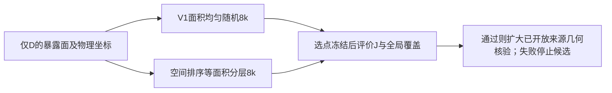

# 输入侧局部支持研究：90例证据分析与最小对照方案 v1

日期：2026-11-03。已完成工作：分析SkullFix既有90例点集及来源标签，不重新读取原始NRRD、不生成候选采样、不运行模型或训练。下文候选尚未实现或执行，不是新的生产采样默认值。

## 研究问题与本次发现

目标是改善残缺颅骨输入在缺损接触区域的几何支持，同时保留完整骨边界的全局覆盖。不能把事后可见的真实切壁J用于输入选点，也不把输入覆盖改善自动解释为模型性能改善。

对已固定的80例训练、10例验证逐例核对点集、来源标签及记录SHA256。90例等权均值如下。

| 量 | 实测值或条件期望 | 含义 |
|---|---:|---|
| J占D完整边界物理面积 | 0.8748% | 共享切壁只占输入边界的一小部分 |
| 面积均匀8k应分配的J点数 | 71.67 | 每例8192×J面积/D面积，再对90例平均 |
| 实际J点数 | 71.96，范围42–104 | 与面积分配预期接近，不支持系统性漏采判断 |
| 输入J Cover@2mm | 34.4111% | 最近邻允许来自全部D采样点 |
| 输入J Cover@2mm，仅用J来源点 | 27.9956% | 与上一行差6.4155个百分点；邻近原始表面点也在提供支持 |
| 输入全部边界 Cover@2mm | 42.5561% | 输入整体也较稀疏，不能把所有不足归于接口识别 |
| 输入J P95距离 | 4.9291 mm | 当前离散参考度量下的局部空隙仍大 |
| 各例J样本的同J最近邻距离中位数，再平均 | 3.1175 mm | 只描述已抽到的点，不代表未覆盖区域的最大空隙 |
| 各例J样本到任意其他D样本的最近邻距离中位数，再平均 | 2.5812 mm | 不等于内外板间距，也不能据此判定跨板混合 |
| 目标G的J Cover@2mm | 99.5820% | G远小于D，相同8192点带来更高密度 |
| G/D点密度比 | 14.9695倍 | 逐例D面积/G面积后平均；不是输入输出难度的因果比较 |

均匀采样的J点数条件期望是N×A_J/A_D。实际总J点数6476，期望总数6450.04。单例计数仍会随机波动；这组描述性核对没有进行显著性检验，也不能证明采样实现毫无局部问题。

### FOV不是此次支持不足的主要数量解释

FOV封口占D面积平均0.7836%。若只排除FOV、其余仍按面积均匀抽8192点，J点数条件期望仅从71.67增至72.23，平均增加0.56点。这是精确面积比例下的计数期望，不是已经运行的采样对照，不预测覆盖率或模型性能。

是否排除扫描截断面仍是表示定义问题，应独立决定；不能为了接口增密而声称删除FOV足以解决当前不足。本轮保持既有FOV规则。

## 继承证据与边界

1. 高曲率4k全局＋4k局部候选曾在固定六例上失败：J Cover@2mm由51.5013%降至33.5216%，全局覆盖也下降。停止该候选，不改曲率阈值、邻域或配额补救。
2. 三平面D-only定位器真实18份输入均未达到定位成功标准，人工刚体稳定性也未通过。停止继续修补该定位器。
3. 既有SkullBreak四模型8k/16k对照没有稳定的16k预测收益。两例实际轨迹显示近接口输入仍有潜在传播路径，因此本轮的输入稀疏分析不能替代模型聚合与解码利用研究，也不能把问题全部归因于FPS删除接口信息。
4. 本轮无可靠解剖内外板标签，J是原始D/G实体互补得到的几何切壁标签。上述覆盖率以离散体素面中心及物理面积为参考，不是连续解剖精度或临床吻合认证。

## 最小可证伪假设

**H1：在输入8192点、全边界面积分配不变的条件下，通过空间排序后的等面积分层随机采样，减少独立随机采样的空间聚集，能改善切壁及整体覆盖，同时不牺牲其他原始表面。**

该候选不增加J的期望采样比例；它只试图改善有限点数的分布。如果改进很小，应接受固定全表面8k预算的几何限制，不继续滚动修补定位器或寻找“无成本”接口增密。

## 唯一候选的精确定义

本节是待实施科研小对照，不是已授权/已运行的execution request。

- 可见输入仅为D暴露面：体素索引、面轴/符号、物理面积、affine。不得传入C、G、J、ROI、预测误差、训练标签或人工缺损中心。
- 将D暴露面中心的双整数坐标`2q + sign*axis_unit`按Morton空间顺序排序；同键按面轴、符号和原始体素字典序确定并列顺序。坐标平移至非负后编码，位宽由D索引范围确定，不调空间网格大小。
- 在排序后累积物理面积，总面积分为8192个等面积区间。每区间用同一seed的独立均匀数取一个面积位置，以累积面积逆查确定面，再在面内均匀抖动取点。
- 若某面跨多个区间，允许同面多次采样；不裁剪、不补点、不改变每例总数。该规则保持期望面积分配，但空间排序并不保证蓝噪声、最小间距或切壁覆盖提升。
- 输入仍8192，目标仍为既有G的8192点，目标哈希不变。归一化仅用D。FOV纳入规则与V1相同，仅单独报告其影响。
- 基线严格复用V1的16384抽点后前8192规则。候选直接构造8192分层点，因此本小试只回答固定8k的空间分布问题，不宣称具有既有8k/16k前缀配对性质。
- 在世界坐标刚体变换、原始体素索引/拓扑不变时，排序索引不应变，采样应随affine协变。任意重新体素化、改变扫描网格方向不在这一等价性承诺内；不得靠旋转扫描轴挑选更好结果。

## 一次限定CPU小试范围

固定已开放六例：SkullFix 002/003/004，SkullBreak train:000/001/002的bilateral。使用已有三个球壳离散设置，不新增MUG，不挑选高收益病例。种子0/1/2；真实六例是来源单位，seed是采样重复，不当成独立病例。

先用人工几何验证面积分配、样本归属、相同seed重复性、面列表置换稳定性及固定affine旋转平移的坐标协变。不通过则停止，不自动改排序或随机数流程重跑。

真实输入每例三个seed的两方法全部完成并保存后，才读取C/G做评价。必须记录完整边界、原始边界E、切壁J的面积加权Cover@1/2mm、P95、直接J点数、近J≤2mm支持点数、FOV比例、短距聚集及采样耗时。解析球壳另外记录真实内外层覆盖，真实数据不伪造对应标签。

候选与基线按病例/seed配对。报告全部单例和两数据集各自均值，不能只报告合并均值。暂定扩大几何核验的探索性筛选标准：两数据集平均J Cover@2mm都提高；六例平均提高至少5个百分点；J P95两数据集均不变差；两数据集E及全边界Cover@2mm平均下降均不超过1个百分点；人工层面与刚体合同通过。5/1个百分点仅是事先提出的工作筛选阈值，不是文献或临床标准。实施前如需修改必须另版说明，不得看结果后调阈值。

单批总CPU预算15分钟、检查点RSS 4 GiB、输出256 MiB；失败即停，不扫参数、不自动补救。仅新增专用科研脚本及产物，不改生产采样器或通用审计框架，不操作服务器。

通过也只能进入已开放来源的扩大几何核验；不直接训练。失败保留V1和全部负结果，停止这一个候选；再讨论局部预算/结构性输入设计或模型利用问题，不能凭采样支持不足宣称已找到Mamba改进机制。

## 当前交付与复现入口

`case_support.csv`、`results.json`、`scope_and_verification.json`保存本次90例诊断及源哈希。执行脚本为上级目录`input_support_analysis_20261103_v1.py`。候选尚未生成、测试或替换现有90例点集。
