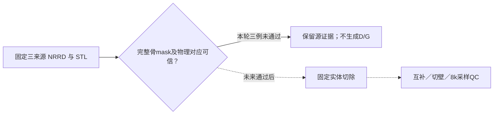
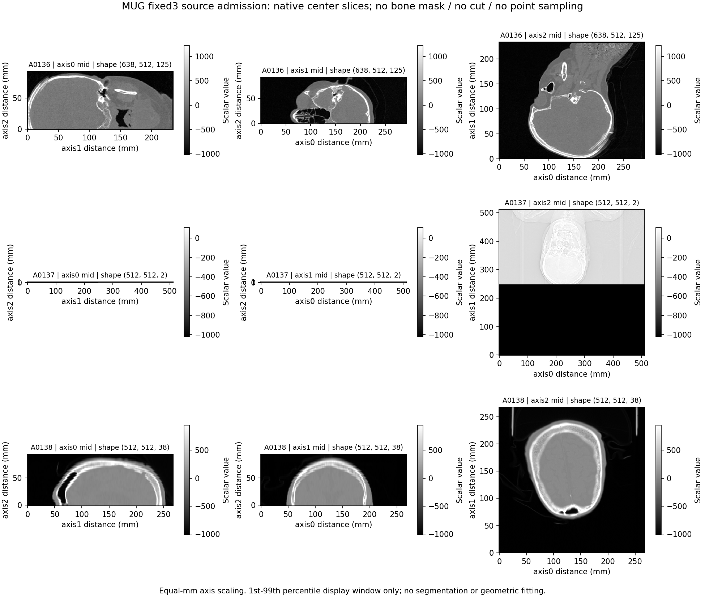

# MUG500+固定三来源实体缺损pilot：源准入结果报告 v1

日期：2026-10-29。固定来源：A0136、A0137、A0138。执行位置：本机CPU；不连接服务器、不使用GPU、不训练。

## 结论与实际完成程度

**三例源数据核查已完成，但没有一例通过“可直接切除的可信完整骨实体”准入，因此实体缺损生成及8k采样验证尚未执行。** 本轮不是成功生成三例新缺损，也不把源检查完成等同于构造验证成功。

已完成：三个精确NRRD成员的解码、体素值全量分布、affine及范围检查；三个clear STL的绑定哈希与包围盒核对；原始标量中心剖面；8项人工CPU测试。实际生成D/G实体0组、点云配对0组。

## 范围与方法

- 仅从既定A0136-A0140.zip读取A0136、A0137、A0138的同名NRRD内容，不解压整个数据包，不读取A0139／A0140几何。三份NRRD首次完整读取后固定成员SHA256，并在本轮再次读取核验不变；未冒称已匹配历史NRRD哈希。
- NRRD按明确signed int16、gzip、NRRD第一轴最快顺序解析，严格核验声明形状／解码字节数／affine，不调用旧的values>0或values>0.5骨mask转换。
- 全量统计65536个可能int16值的直方图，未按观察结果调阈值；二值取值本身也不被视为骨组织语义证明。
- 三个现有clear STL按二进制记录流式读取；SHA与2026-10-23 scope一致。只比较顶点包围盒，不做ICP、轴翻转、缩放、平移、填洞或自动删组件。STL本身没有可信坐标系声明，包围盒比较不能替代配准或同源认证。
- 保留原ellipsoid_medium的center／frame／radii，但未将其直接套在未认证的NRRD上；未重新选切除中心、病例或缺损参数。

## 三来源实测

| 来源 | NRRD形状 | 标量范围 | 不同取值数 | 体素轴中心跨度mm | 准入 |
|---|---|---|---:|---|---|
| A0136 | 638x512x125 | -1024～3071 | 4096 | 292.541 / 234.541 / 93.000 | 未通过 |
| A0137 | 512x512x2 | -1024～583 | 564 | 511.000 / 511.000 / 1.000 | 未通过 |
| A0138 | 512x512x38 | -1024～1607 | 2608 | 267.477 / 267.477 / 92.500 | 未通过 |

A0136、A0138为多值标量体积，不能直接当骨前景；A0137只有两层，第三体素轴中心跨度1 mm，不能充当完整三维颅骨实体。三者都没有本轮可核验的骨标签映射。值域及剖面与灰度影像一致，但这里不认证HU校准、具体影像类型或解剖诊断。

按未经变换的坐标比较，三个NRRD的中心坐标包围盒均不能包含对应clear STL的顶点包围盒。该结果只说明“直接按同一世界坐标套用历史切除”未获支持，不能据此认定文件损坏，也不能通过自由配准把它调到相似。

原clear STL已在既有诊断中发现开放／非流形边：A0136为2601／172、A0137为1868／262、A0138为561／158。本轮只重验相同文件SHA，不重算这些拓扑指标；不能因为NRRD未准入，就未经验证把旧网格当闭合实体体素化。

## 原始数据剖面

图中为原始标量图像，不是C／D／G mask，也没有模拟缺损。各面板采用体素轴距离的等毫米比例；1～99百分位仅为显示窗，不是分割阈值。A0137前两面板呈极薄条带来自实际两层数据，未人为补层；第三面板的投影样外观不作为影像类型认证。已逐图检查标题、比例和图注。

## 仍未执行的验证

| 任务 | 状态 | 原因 |
|---|---|---|
| 固定ellipsoid_medium实体切除 | 未执行 | 缺乏可信完整骨mask及物理对应 |
| C=D并G、D与G互斥及同affine验证 | 未执行 | 未生成C/D/G实体 |
| 共享J面位置、相反法向及面积配对 | 未执行 | 没有实体切壁真值 |
| 内／外表面及切壁采样覆盖 | 未执行 | 没有合法边界与点集；不伪造覆盖率0% |
| 8192输入→8192完整骨块边界目标 | 未执行 | 没有合法实体配对 |

## 下一步需要补齐的具体条件

优先补齐这三个同编号来源的完整骨组织分割mask，带spacing／方向／origin及组织标签含义，并提供与用于历史切除的clear STL的可追溯坐标关系。只有灰度CT时，需要另行明确分割方法，不能以values>0或随意选HU阈值代替本计划的骨实体。

本轮对E:/dataset/MUG500plus的文件名搜索未发现这三个编号的额外已解压NRRD／NIfTI／MHA／MHD／seg文件；指定ZIP三来源目录也未列出单独骨mask成员。这不是证明其他存储位置一定没有相应分割。

如果只能使用现有STL，应另行确定可信实体化／拓扑修复和验证方案，保留几何修改记录及坐标依据；该路线没有在本轮自动执行。三来源仍保留，不换容易病例，也不把旧删面点云当作新的实体切除结果。

## 资源与证据

总耗时 9.906 秒；守卫采样中最大RSS 167981056 字节。预算：总60分钟、单例15分钟、监测RSS8GiB、输出1GiB、线程2；不是持续峰值或硬cgroup保证。8项人工CPU检查通过。源文件未写入，未改变旧MUG数据。

本轮NRRD成员SHA256：

| 来源 | SHA256 |
|---|---|
| A0136 | `ef68661afe1aa21d6bc6a160c7e9860101f4d0ea53dd65d1817a80385ccf3339` |
| A0137 | `2393021643a92b7d8a11bb0dbe84bba5d5b6c3c12eab7cc30aaf7e3b542e73ff` |
| A0138 | `33090ae01bffae1657e28c35dcbfc0e7ffc3226f8efa740fc11f3582d3cc7ed0` |

精确机器结果：results.json、三份*_source_admission.json、source_summary_v1.csv及*_scalar_histogram.npz。范围和代码绑定见上级scope_v1.json及artificial_CPU_tests_v1.json。

本报告严格区分“源检查完成”和“实体构造验证通过”。当前科学状态为UNRESOLVED_SOURCE，不宣称新MUG缺损构造已完成。
