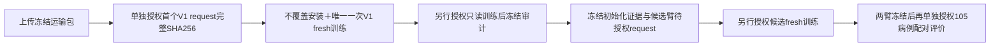

# 固定8k采样方法最小模型对照：正式方案与首运行准备报告 v1

日期：2026-11-03。阶段：BCSP_SAMPLING_AB_V1。状态：本机配对数据、专用入口、限定CPU合同及运输包完成；首个V1 request待单独明确授权。尚未上传、部署、训练、推理或BNCal。

## 设计与研究问题

只比较V1面积均匀采样与已冻结Morton等面积分层采样，输入和输出均8192点。使用既有B0 AdaPoinTr Transformer作为模型平台，Mamba/SCQR/SCF等附加机制保持关闭。本阶段回答输入几何改善能否转化为缺失骨块预测改善，不是Mamba方法有效性实验。

最小范围固定为SkullBreak Fold C、训练seed0、采样seed0。两臂各一次fresh scratch训练，共计划两次；当前request只覆盖第一次V1训练。没有新增SkullFix/MUG训练、Fold D、16k或额外训练seed。

| 共同项 | 固定合同 |
|---|---|
| 训练来源 | Fold C 63 source、每源5缺损，共315例 |
| 后续开发评价 | 同折21 source、105例；两臂共210次预测，需后续单独授权 |
| 输入、目标 | 完整残缺骨边界8192点；缺失骨块完整边界8192点，两臂目标数组逐元素相同 |
| 模型 | B0 AdaPoinTr，graph encoder，中心[512,256]、query256、FC输出8192 |
| 计数 | batch8、drop_last、100遍，每遍39更新；3900 steps、31200使用曝光、300丢弃曝光 |
| 更新时序 | 相同冻结病例顺序及末批丢弃名单；不是每例恰好训练100次 |
| 优化与调度 | AdamW lr1e-4、weight_decay5e-4、clip10；LR=max(0.9**(e/21),0.02)，每遍末更新；BN momentum=max(0.9*0.5**(e/21),0.01)，每遍开始设置 |
| 数值与算子 | FP32、严格deterministic、TF32/AMP关闭；全key query-chunk256 KNN；同一已绑定原生PointNet2；同一torch.cdist Chamfer分支 |
| 初始化与权重 | 两臂fresh seed0、final-only；候选第一步前必须核对与审计后V1基线相同的参数/持久状态、环境及批次顺序，不加载基线权重 |
| 禁止项 | 不自动BNCal/evaluation，不resume/retry，不扩Fold或seed，不更新依赖或改变模型来源 |

## 为什么不直接复用旧V1权重

候选的原始输出顺序沿Morton空间序列，V1则为随机点序。冻结PointNet2源码的sampling_gpu.cu中FPS以索引0为首点；不能先验假定输入顺序对这套实现无影响。直接比较旧随机顺序V1与Morton顺序候选，会同时改变点集分布与首点位置策略。

因此本次两臂均施加同一按病例固定的随机置换。它不改变点集几何、目标顺序或归一化，不使用G/J标签，不随epoch变化，也不消耗训练RNG。规则为SHA256(ASCII `BCSP_SAMPLING_AB_V1|point-order|case_id`)前8字节大端整数作为PCG64种子，生成8192置换；每例索引哈希按little-endian int64冻结。服务器直接读取冻结NPZ，不重新生成置换。

这控制了共同的点序处理规则，但不证明网络对任意置换严格不变，也不是跨点序重复实验。由于共同点序政策已不同于历史训练，加上历史GPU UUID不同，历史权重只作背景参考，主对照使用同环境两次fresh训练。不得把两臂差异归因于输入点数、增加proxy或新增Mamba。

## 已完成的实际工作

1. 从既有V1和冻结候选seed0提取315例训练输入，生成630个规范NPZ，键只有partial/implant。逐例核对目标、D-only坐标框架、共同置换、有限float32与回读；反向置换可精确恢复各自原始点数组。没有重采样、读取NRRD、修改原点集或读取本折105例开发payload。
2. 复用原100遍批次顺序文件，字节哈希不变。两臂训练样本及丢弃曝光完全配对。
3. 新增四个限定文件：采样训练contract、entry、runtime及CPU test。旧密度实验工具及模型/provider源码不变。runtime仅变更checkpoint/completion的公开任务标识，内部复用原3900-step计数守卫；训练运算循环保持原样。
4. CPU合同12项通过；增加候选训练前初始化比对后执行了新版本v2验证，仍12项通过。原通过v1及源码快照保留，不属于失败自动重试。测试含拒绝旧阶段、16k、来源越界、缺例/重复、不同GT/归一化/点序、错误更新顺序及反向/陈旧授权；授权fixture只存在内存，不是真实授权。入口bootstrap无Torch导入。
5. 对实际生成的首运行request进行本机未来路径映射核验：qualified receipt、315例选择、批次顺序及资源证据解析一致；没有在服务器执行入口。

CPU元数据与bootstrap验证不等于当前CUDA验证或训练成功。两次CPU记录、local_P3_v1.json与local_request_reader_verification_v1.json保留适用范围。

## 当前服务器只读证据

已确认hostname为shu-common-25721452-notebook-v2iwsa-0、uid1000、项目/home/jovyan/adapointr_work/PoinTr。GPU为NVIDIA GeForce RTX 4090 D，UUID `GPU-34a1b996-2bd7-88e6-9dca-164b718caea6`，driver570.190，SMI总容量24564 MiB；核对时使用1 MiB、无compute进程，空闲磁盘约11.19 GiB。Python3.10.20路径与既有环境一致。

30个精确模型/provider/配置资产哈希全部匹配，合计18,245,900 bytes；只读核验没有导入Torch、建立CUDA上下文或执行forward。新third_party、data和日志三个根目录均不存在，父目录可写。以上是当时快照，执行前必须重新核对身份、资产、目标不存在、空闲GPU及磁盘；不视为持续训练准入。

## 专用入口与分阶段顺序

首个request明确禁止自动启动候选臂。候选request尚未创建；它必须引用已审计V1的初始化证据，当前模型参数及持久状态必须在第一步前与之匹配。若容器/环境/代码条件变化，不得继续声称严格同条件。

训练资源逐臂沿用wall86400秒、RSS8GiB、torch峰值20GiB、SMI使用22528MiB、输出2GiB、最低空闲磁盘4GiB。保留监测超限停止；PID仅诊断，不重新开发可信procfs/cgroup框架。失败即停，不自动重训或resume。

## 当前唯一可申请执行的request

文件：V1_training_execution_request_v2.json

完整SHA256：`4a889afad90b1a8a52fcb75691c71990d03af8b7d120a96608ac4b9b85cb7a62`

状态：AWAITING_EXPLICIT_USER_AUTHORIZATION。v1仅因禁止项措辞澄清被v2替代，未授权未执行，不能复用。v2的内层request和运输包未变化。当前授权、runtime JSON及launcher均未材料化；runtime.py是代码文件，不是已授权runtime config。

该request允许用户上传后，按冻结映射不覆盖安装647个文件（含630个两臂训练点集），再只启动首个V1的一次3900-step训练。虽然候选训练点集一并运输，训练读取守卫只允许本臂315个NPZ，不允许读取另一臂或开发payload。模型源码/provider不改、不重装；测试文件只运输，不在服务器自动执行。

## 手动上传清单

请将以下五文件上传至服务器`/home/jovyan`。本机来源为本目录transport_v1；运输包只含工具、配置、训练点集及必要证据，不含原始NRRD或checkpoint。当前仅本机封包，没有上传或部署。

| 精确文件名 | bytes | SHA256 |
|---|---:|---|
| bcsp_sampling_ab_foldc_seed0_v1.tar.gz | 99336483 | `e10cf03536265976b9c42ca6d85da54efda12efd84311ea6d3e4faa6afac37a8` |
| bcsp_sampling_ab_foldc_seed0_v1.tar.gz.sha256 | 105 | `8bd03f5df80819116606094facc82871b9dfef9fc68932cc2573780f367b6f2f` |
| bcsp_sampling_ab_foldc_seed0_v1.bytes | 9 | `d9401eef0017ffbda86f416e28f1dd4660126b774a7061c9a8ac4bed2102f4e9` |
| bcsp_sampling_ab_foldc_seed0_v1.contents.sha256 | 80352 | `86df852785e77e3e840a0fb1024f9439c88d1e008823446d218ab13bae540e01` |
| bcsp_sampling_ab_foldc_seed0_v1.contents.sha256.sha256 | 114 | `e7b650ad655782ffc8dcd549f0b5953d4b4824010cdc83d7b6b4b3cff22509e1` |

建议在确认五文件上传后，再单独明确授权上述v2 request完整SHA256。执行前仍要逐项复核上传包和映射目标，异常立即停止，不能把本报告代替启动前核验。

## 后续评价与结论边界

两臂训练均冻结后，准备同105例开发病例的共同点序输入，使用final权重和原BN状态，native eval，不投票/TTA/BNCal。继承A1 G面心面积加权参考：主终点为未知原始边界E_G→预测P95；关键次指标为J_G P95、J_G Cover@2mm、E_G Cover@2mm和同GT8192 CD-L1。先平均同source五缺损，再来源等权；只作一折一种子的探索性差值，不以此宣称统计显著、临床达标或Mamba收益。若收益不稳定，停止扩展，不自动追加Fold D或seed。

先前几何收益支持开展该模型对照，但尚未证明更均衡的点集可被模型有效利用。SkullFix退化病例及真实内外板标签限制继续保留；本次不把SkullBreak结果外推为SkullFix或临床泛化。
