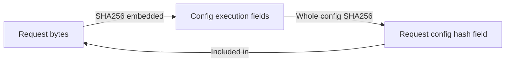

# Cranial-BCSP-GeoV1：真实数据 QC 与首批训练合同合并复核 v1

_2026-10-25 · 本机既有证据、JSON 元数据与源码只读复核 · 不执行训练或新的 GPU 验证_

---

## 📋 结论

**真实数据表示 QC 和人工 GPU 验证这两项已经完成**，不应继续沿用旧报告中的“数据尚未生成”“GPU 尚未验证”作为准备事项。当前可推进到训练专用合同的有限收尾，但现有候选仍不能直接作为可执行训练入口；本轮不创建 training execution request。

状态：`READONLY_JOINT_REVIEW_COMPLETE_NOT_TRAINING_READY`。剩余工作不是再建设库存、传输或审计框架，而是把已经验证的模型路径、既有真实点集和新任务训练生命周期接到同一个无歧义合同中。

本轮只读取既有报告、JSON／JSONL、日志与 Python 源码，复核了 26 个选定证据文件的哈希及其中的绑定；重新逐条对照 840 条 manifest 记录、420 对病例和 C/D 名单。未打开或重新哈希 NPZ、NRRD、checkpoint，未导入 PyTorch、候选或模型，未连接服务器。历史 payload QC 结论来自既有冻结回执，本轮不冒充再次认证所有 payload。

## ✅ 已关闭的准备项

| 项目 | 当前证据 | 判定与适用范围 |
| --- | --- | --- |
| 真实点集生成及几何配对 | 84 个 SkullBreak 来源、420 例、840 个 NPZ | 既有全量 QC 完成，非六例 pilot |
| 两档病例对应 | 420 对 manifest 的来源、归一化、原始来源哈希及共同目标内容哈希一致 | 本轮元数据复核通过 |
| 输入和目标张量 | 既有逐文件核验确认 8k 是 16k 前缀、共同 8k 目标、有限 float32 | 不重读 payload，沿用既有冻结证据 |
| Source/fold | 每折 63 源／315 训练例，21 源／105 开发例 | 同折无来源交集，排除 20 个 confirmation 来源 |
| 精确训练计数候选 | CPU 人工生命周期及正式 post-test 审计 | 100 遍、3900 次真实人工 AdamW step；不是颅骨训练结果 |
| 全输入 KNN 与 CUDA 模型路径 | v3 人工 GPU preflight 及正式冻结审计 | 两档均真实 forward／loss／backward，保留全 key |
| GPU 资源 | batch 8，8k／16k allocated 12.01／12.39 GiB，reserved 13.18／13.55 GiB | 人工零更新验证通过，非完整训练显存保证 |

证据入口：[真实 QC 回执](E:/Codex/2026-06-06/mamba-ccf-c-1-high-resolution/outputs/cranial_bcsp_geov1_20261024/real_data_qc_verification_v1.json)、[候选 CPU 正式审计](E:/Codex/2026-06-06/mamba-ccf-c-1-high-resolution/outputs/cranial_bcsp_geov1_20261024/implementation_candidate_v4/post_test_freeze_audit_v1/audit_receipt.json)、[GPU 正式审计](E:/Codex/2026-06-06/mamba-ccf-c-1-high-resolution/outputs/cranial_bcsp_geov1_20261024/gpu_preflight_plotting_lazy_v3/authorized_execution_v3/post_preflight_freeze_audit_report_v1.json)。旧回执保留当时的待办状态，不覆盖改写；本报告给出其后续证据的合并解释。

## 📊 科研问题与表示证据

现有四 run 设计回答的是：同一 V1 几何定义、共同输出与固定 proxy 预算下，把输入从 8192 增加到 16384，能否转化为预测收益。它不比较 V0 与 V1，不证明新采样法胜出，也不是 Mamba 对 Transformer 的性能比较。当前人工 GPU 验证用的是 B0 Transformer 母版；不要将其写成 Mamba 训练已经通过。

输入是残颅 D 的全部暴露实体边界，目标是缺失骨块 G 的全部边界，而不是完整颅骨全部边界，也不只是缺失的原始外表面片。两档均使用 D-only defective-bbox 归一化；完整颅骨、GT 或 provenance 不作为输入特征。

| 既有 420 例等权表示读数 | 8k | 16k |
| --- | ---: | ---: |
| J Cover@1mm，全部输入点 | 19.723% | 35.538% |
| J Cover@1mm，仅切壁 provenance 点 | 18.478% | 33.452% |
| J P95，全部输入点 | 3.4891 mm | 2.5193 mm |
| 距 J 面心 2mm 内的输入支持点数 | 273.48 | 548.37 |

这些是既有描述性统计，本轮未重算、bootstrap 或计算模型 gate。嵌套增加采样点导致参考覆盖提高具有集合包含关系的预期成分，不能据此宣称网络会改善。六例 proxy 几何代理已提示固定 512／256 中心预算会压缩坐标覆盖，因此要保持模型合同不变，用后续配对模型结果回答问题。

独立内板／外板的解剖覆盖尚未认证，E 是合并原有边界而非外表面标签。此限制不能用 GPU 通过来补齐，但也不要求先开发全颅解剖分层系统才能做本轮受限输入密度基线。不得声称内外板均达到统一临床精度。共同 8k GT 的 J Cover@1mm 平均约 82.324%、最差约 49.158%；不能承诺所有病例 1mm 接口精度，也不能自动增加输出点数。

## 📚 首批训练共同合同

以下是对已确认设计及当前候选实现的复核，不是新的执行授权，也不是已生成的 runtime config。

| 合同项 | 既定范围 |
| --- | --- |
| 矩阵上限 | V1 8k→8k、16k→8k，Fold C／D，seed 0，共最多 4 run |
| 模型 | 同一冻结 B0 AdaPoinTr，graph encoder，中心 `[512,256]`、query 256、FC factor 32、输出 8192 |
| 附加机制 | Mamba、SCQR／额外 Local、SCF、Query 等路径保持关闭，不能混入密度比较 |
| 两臂一致性 | 同 fold、共同目标、相同 D-only 坐标框架、初始化种子、病例顺序、优化与数值合同 |
| 训练集 | 每折 315 例、63 源，每源五缺损；不读本折 105 例开发 payload |
| Batch | 单 GPU，global batch 8，`drop_last=true`，`step_per_update=1`，不自动减 batch 或累积 |
| 遍历与计数 | epoch 标签 0–99，共 100 遍，每遍 39 batch，3900 更新，31200 次病例曝光 |
| 优化 | AdamW，lr `1e-4`，decay `5e-4`；bias／一维参数不衰减；clip norm 10 |
| LR 时序 | `max(0.9**(e/21),0.02)`；候选在每遍结束调用一次 LambdaLR，共 100 次 |
| BN momentum | 每遍开始设置 `max(0.9*0.5**(e/21),0.01)`；与额外 BNCal 不同 |
| 数值 | FP32、严格 deterministic、TF32 关闭；冻结实际相关设置与断言 |
| KNN／loss | query chunk 256、全 key；同一原生 PointNet2 provider、同一既有 PyTorch cdist Chamfer |
| 权重与结果 | scratch、final-only，不加载旧 QA 权重；失败即停，不自动 resume、重跑或追加 seed |
| 后续阶段 | 不自动 BNCal、development evaluation、正式 gate 或参数扫描 |

每遍 315 例中的最后 3 例被丢弃，不能把 31200 次曝光写成“每例恰好 100 次”。需要共同顺序与实际使用／丢弃病例的证据，见下文 G4。候选 AdamW 其余参数使用当前环境默认，最终配置或运行回执应明确记录实际值，不借此调参。

训练 case allowlist SHA256：

- Fold C：`3c5883d1f582b90533ffed3ae61b1bbe8b88c39b75f40faddf25b63d8f93836d`
- Fold D：`682067ea877e8370e5c3d0ac7b2cdd7ae3b2b372a146829b42491899aa1c0aa1`

C/D 开发来源互斥，但训练来源按交叉验证设计重叠，不能当作两套独立总体。新任务是 `BCSP_INPUT_DENSITY_V1`，不得复用旧 QA-1 的 101 遍／3939-step request 或更改旧守卫常数。

## ⚠️ 尚未关闭的四组精确缺口

### G1：真实 QC 产物与训练读取合同不一致

[bcsp_runtime.py:107](E:/Codex/2026-06-06/mamba-ccf-c-1-high-resolution/outputs/cranial_bcsp_geov1_20261024/implementation_candidate_v4/overlay/tools/bcsp_runtime.py:107) 校验 manifest／fold／QC 文件哈希，随后第 110 行要求 `qc.status == 'PASS'` 且存在单个 `manifest_sha256`。实际 QC verification 状态是 `PASS_GEOMETRIC_PAIRING_SOURCE_QC_WITH_DECLARED_SEMANTIC_LIMITS`，summary 状态也不是 `PASS`；二者都没有这一单 manifest 字段。直接将它们交给当前 reader 会被拒绝，这是静态字段比较的确定结果，不是本轮试跑失败。

最小收尾应明确一个训练专用、保留限制的证据映射：绑定原 QC 回执、840 条 manifest／两档各自 SHA、fold／病例名单及当前 arm。不能改原回执为无条件 `PASS`，不能宽泛接受字符串含 PASS，不能删除解剖限制或重新生成点集。

本机 manifest 与数据资产不能当作已在服务器就绪。未来仅需运输本任务点集和必要元数据，不需上传原始 NRRD 或旧 checkpoint；实际服务器数据根、文件哈希和每 run 315 例允许名单仍待独立绑定。manifest 中原始 Windows 路径仅作来源记录，不能转成猜测的 Linux 路径执行。

### G2：训练启动、包导入和哈希方向尚未闭合

当前 `run_bcsp` 的 `config.bcsp_execution.request_sha256` 绑定 request；request 又通过 `config_sha256 == sha(args.config)` 绑定整份 config。如果该 execution 段位于同一 `args.config`，会形成结构性循环：

应沿用已验证的单向原则：先冻结不包含 request SHA 的静态科研配置，再冻结 request；明确授权后才创建授权回执、计算其 SHA、创建独立 runtime 并启动。不能在当前 provisional 字段上尝试填出循环哈希。

`run_bcsp` 还使用 `from models import build_model_from_cfg`；已通过 GPU 的短入口使用受控 namespace 和直接导入 `models.AdaPoinTr`，没有执行母版 package initializer，也没有导入完整 runner。当前 v3 包中的 runner／runtime 仅作静态绑定。不能直接把 `run_bcsp` 接到该 namespace 就认定包级导出存在，更不能为此执行母版初始化器、扩大导入整个项目。

最小收尾是训练专用短入口，复用已验证的有限模型导入与 `train_lifecycle`，不用原 runner 的宽依赖入口；将实际代码／配置／provider／正式 GPU 审计证据进行哈希绑定，而不是只设置 `resource_preflight_passed=true`。训练所需精确 NPZ 读取和最终 checkpoint 写入必须有独立任务授权边界，不能放宽或复用 preflight 的零 payload 守卫。

### G3：训练数值合同与资源边界需要落实，而非重复验证模型

[bcsp_runtime.py:119](E:/Codex/2026-06-06/mamba-ccf-c-1-high-resolution/outputs/cranial_bcsp_geov1_20261024/implementation_candidate_v4/overlay/tools/bcsp_runtime.py:119) 已设置 seed、deterministic 和若干 TF32／cuDNN 标志，但没有已通过 preflight 中的 `set_float32_matmul_precision('highest')` 与完整 `assert_numeric` 前后断言。应复用相同设置和断言，保持模型、provider、loss、KNN 和预算语义不变，不重新比较后端。

preflight 临时关闭 BN running-stat tracking、没有 optimizer step；正式训练按既定设计更新 BN 与 AdamW 状态。12.39 GiB allocated／13.55 GiB reserved 因此不是完整训练显存证书，不能把 BN 冻结策略直接带入正式训练，也不能因可能增加显存就自动减 batch。

最终 training request 还需冻结训练专属的有限总时长、RSS／设备显存／结果空间监测与失败即停合同，不能沿用 900 秒 preflight 时限冒充 3900-step 的训练预算。首次真实 AdamW 更新只能发生在单独授权的正式训练内，届时监测并超限停止；本报告不另起一次未经授权的 GPU 更新测试，也不要求重做已通过的两档零更新 preflight。

### G4：共同顺序、曝光与逐步训练结果需要可核对记录

当前 `make_loader` 使用 `manual_seed(epoch)`，有确定性顺序设计，但 Dataset 只返回 `partial,target`；`train_lifecycle` 的 completion 只汇总总计数，并未记录逐 epoch 使用／丢弃 case ID、逐源曝光或逐步 loss／LR。seed 相同不等于这些实际证据已经存在。

最小收尾应固定训练 case 初始顺序及每遍共同 batch／丢弃清单，并在真实执行中记录与核对使用顺序、病例／来源曝光、step／epoch、loss／LR／梯度裁剪结果及最终 checkpoint。两档不得各自重新排列、换病例或因 QC／结果不好而剔除来源。无需新建通用追踪平台或全量保存激活；这是本训练循环本来就需要的有限科研日志。

首批实际模型、静态配置、精确 run ID、服务器数据位置、输出路径、tmux／PID／退出码路径及训练预算尚未冻结；因此本轮不能跳到创建或执行训练 request。

## 🎯 一次收尾的建议与明确完成标准

建议下一次授权只涵盖一次训练专用 implementation-only 收尾，集中解决 G1–G4：QC reader／writer 合同、单向 request 链与有限模型入口、严格数值断言、共同顺序／曝光和训练日志。保留数据几何、315 例名单、3900-step、B0 模型、分块 KNN、provider／wheel、cdist loss 及既有 GPU 证据不变；不建设通用库存或传输框架。

完成标准：

1. 原 QC 报告、两个 manifest、fold 与模型／provider 哈希可沿有限绑定链追溯，语义限制不丢失；无 request／config／runtime 哈希环。
2. 训练短入口使用已验证模型导入路径，未执行宽 package initializer 或旧 QA 路径；首个 run 不接触本折开发数据。
3. 仅执行针对这四组缺口的一批人工 CPU 合同检查并完成本机 P3；失败即停，不自动修补重跑。已通过的真实 GPU preflight 不重复执行。
4. 再按独立授权准备真实点集运输及服务器精确只读就绪核对；全部条件齐全后才能创建首个待授权 training request。

建议固定顺序为 Fold C 8k、Fold C 16k，之后 Fold D 两档，仍以最多四 run 为上限；这是建议的执行顺序，不是本轮新增冻结或启动授权。首个 request 只覆盖第一个 run；不得以四 run 设计替代其余单次执行授权。不要依据哪档 loss 较好来追加 seed、修改点数或只保留有利折。

本轮新增的只是本报告与机器可读复核回执。没有源码修改、数据复制／生成、CPU 契约测试、服务器操作、forward、optimizer step、training request、runtime config 或 launcher。

## 🔗 可追溯证据

- [机器可读合并复核及 26 文件哈希清单](E:/Codex/2026-06-06/mamba-ccf-c-1-high-resolution/outputs/cranial_bcsp_geov1_20261024/training_readiness_joint_review_20261025_v1.json)
- [既定母版与四 run 设计](E:/Codex/2026-06-06/mamba-ccf-c-1-high-resolution/outputs/cranial_bcsp_geov1_20261024/consolidated_binding_v1/mother_and_training_design_binding_v1.json)
- [精确 C/D 来源与病例名单](E:/Codex/2026-06-06/mamba-ccf-c-1-high-resolution/outputs/cranial_bcsp_geov1_20261024/consolidated_binding_v1/fold_binding.json)
- [真实数据 QC 报告](E:/Codex/2026-06-06/mamba-ccf-c-1-high-resolution/outputs/cranial_bcsp_geov1_20261024/real_data_qc_report_zh_v1.md)
- [真实数据 QC 核验回执](E:/Codex/2026-06-06/mamba-ccf-c-1-high-resolution/outputs/cranial_bcsp_geov1_20261024/real_data_qc_verification_v1.json)
- [GPU 正式只读冻结审计](E:/Codex/2026-06-06/mamba-ccf-c-1-high-resolution/outputs/cranial_bcsp_geov1_20261024/gpu_preflight_plotting_lazy_v3/authorized_execution_v3/post_preflight_freeze_audit_report_v1.json)

本报告按 Markdown 科学文档规范组织证据状态和限制；AI 辅助源码／证据复核，不将描述性覆盖、人工验证或推断写成正式训练或临床结论。
