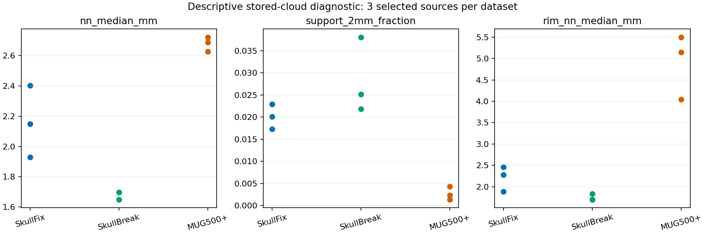
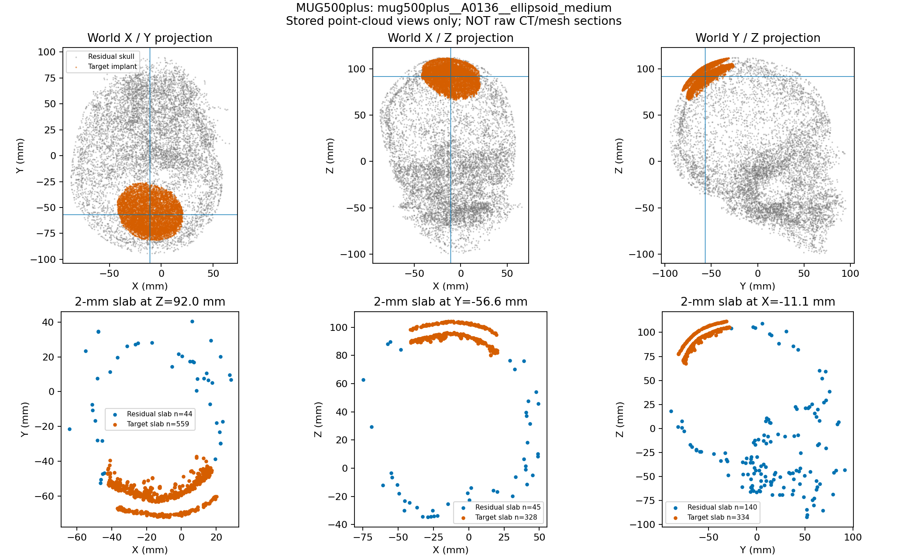
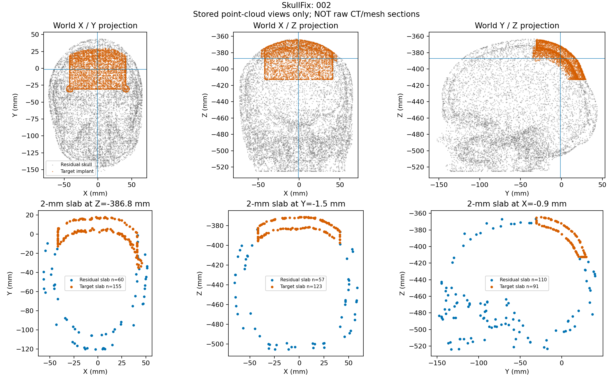
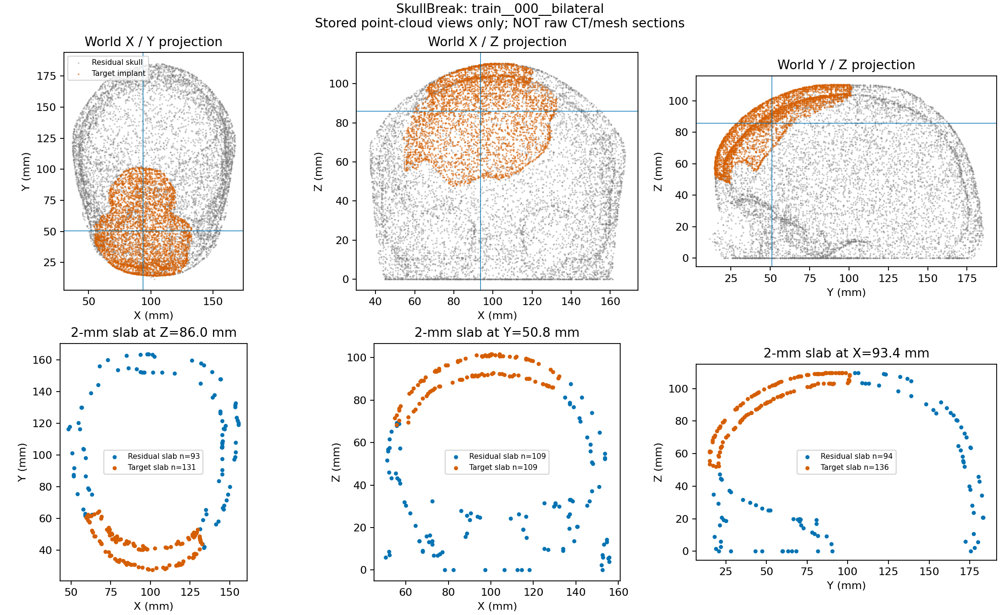

# 颅骨补全输入几何诊断：九例既有点云结果与原始几何缺口

_Cranial-SCQR · 2026-10-23 · 当前容器 n9i64i-0 · 模型无关 CPU 描述性分析 · 部分完成_

---

## 📋 结论与完成状态

本轮真正执行了九例既有点云的毫米尺度几何计算，而非仅进行环境准备。主要结果是：在本次固定选择的病例中，MUG500+ 输入全局点间距较大、2 mm 接近带点较少，接近带内部点间距也较大。它支持优先检查局部信息供给与标签定义，但不能证明缺少切壁导致 SCF 失败。

原计划的**原始体素／网格与点云配对覆盖分析尚未完成**。SkullFix／SkullBreak 预处理摘要记录的旧 Windows 原始路径当前不存在；MUG500+ D6 元数据记录的 STL 位于一个当前为空的父目录。未擅自改用其他来源、重新下载、恢复数据或重建表面。

状态为 `PARTIAL_COMPLETED_RAW_GEOMETRY_MISSING`，不能称为完整原始几何验证通过。机器可读原始结果见 [results.json](result_v2/results.json)，最终本机核验与原始文件需求见 [local_verification_and_summary_v3.json](local_verification_and_summary_v3.json)。v1/v2 核验摘要被 v3 取代：更正了服务器路径显示以及 mask 指纹与 NRRD 文件哈希的区别，数值结果未改变。

## 🎯 数据范围与选择规则

只读取以下九个训练／开发病例的 NPZ，不读取 test／holdout payload。选择在计算结果之前固定：各组符合分区条件的源病例按 case ID 排序取前三；SkullBreak 固定 bilateral，MUG500+ 固定 ellipsoid_medium。没有根据模型表现或几何结果换病例。

| 数据组 | 病例／源 ID | 分区依据 |
| --- | --- | --- |
| SkullFixPC | 002、003、004 | splits.json 的 train，且 manifest split=train |
| SkullBreakPC | train__000__bilateral、train__001__bilateral、train__002__bilateral | group_splits.json 的 gate.train，official_split=train |
| MUG500+ D6 | A0136、A0137、A0138 的 ellipsoid_medium | manifest d6_partition=development |

各组输入都是 8,192 点；SkullFix／SkullBreak 本轮选定文件的 implant 目标为 4,096 点，MUG500+ 为 8,192 点。前两组对应项目基础 dataset config 指向的 `SkullFixPC`／`SkullBreakPC`，**并非所有 out8192 变体，也不是所有历史 SCF 运行的精确 runtime 输入**。未执行在线 FPS、增强或 proxy 构建。

因此，本轮是这些已记录点云的描述性诊断，不是点密度、缺损大小、部位和目标采样完全匹配的跨数据集实验。不能从每组三例估计整个数据集总体分布。

选择记录和元数据哈希见 [selected_scope.json](result_v2/selected_scope.json)。曾读取 manifest 首行作格式检查，其中含 test 标识元数据；未读取对应 test 点云或原始数据。

## 🔍 方法与指标定义

采用 NPZ 的 centroid／scale 反归一化为物理坐标，逐文件核验既有 SHA256。读取结束后再次计算九个输入文件哈希，全部与读取前一致。

- **全局点间距**：对唯一输入点计算最近的其他点距离，先取每病例中位数，再汇总三个病例中位数的中位数。
- **2 mm 接近带**：输入点到本病例稀疏 implant 目标点集的最近距离不超过 2 mm。报告点数和占 8,192 输入点的比例。这不是解剖切壁标签，也不是 SCF proxy 阳性数量。
- **接近带内间距**：仅在该带内的唯一输入点之间计算最近邻间距。它与“带内点到全局输入的最近邻间距”不同，二者均保留在 JSON。
- **局部法向变化**：32 点 PCA 估计无定向法向，对邻域法向使用绝对内积计算 0–90 度夹角。不能据此区分内／外表面、判断全局法向朝向或直接认定跨层混接。
- **点密度代理**：第 16 个其他邻点半径构造 `16/(pi*r^2)`。其局部二维假设可能在边缘和多层区域失效，不是实测表面面积密度。
- **尺度代理**：目标点云 PCA 主轴范围，仅作为形状尺度描述；不是实际缺损开口宽度。

1 mm 与 2 mm 是固定的描述性距离口径，未进行参数寻优，也不作为临床合格阈值。真实面积覆盖率、边界体素数量、切壁覆盖、网格开放边界和连通性全部保持为未测，不以点数比例替代。

脚本内执行了五项算术 sanity checks，通过；这不是完整算法验证或 P3。未声称完成生产工具链验证。

## 📊 已测结果

下表中距离及比例均为**病例内统计后再取三病例中位数**；接近带点数为三例范围。

| 数据组 | 全局间距中位数 mm | 2 mm 点数范围 | 2 mm 比例中位数 | 带内间距中位数 mm |
| --- | ---: | ---: | ---: | ---: |
| SkullFix | 2.1484 | 142–188 | 2.0142% | 2.2784 |
| SkullBreak | 1.6971 | 179–312 | 2.5146% | 1.6971 |
| MUG500+ | 2.6863 | 11–35 | 0.2319% | 5.1455 |


_图 1：每个点代表一个病例，无总体推断或显著性检验。中间纵轴为比例而非百分数。右图只使用接近带内的点计算间距。_

九例输入点均无精确重复。MUG500+ 三例重算的 2 mm 标签与 NPZ 内保存的 `reference_rim_mask` 完全一致。没有对 SkullFix／SkullBreak 虚构同名保存标签。

各病例邻域无定向法向夹角中位数的组内中位数：SkullFix 21.6481°，SkullBreak 16.8682°，MUG500+ 25.3763°。这只是固定 PCA 邻域下的几何描述，混合了曲率、点密度、形状与多层几何等影响，不能解释为法向误差或模型性能。

逐例结果见 [point_geometry_per_case.csv](result_v2/point_geometry_per_case.csv)。MUG 三例接近带点数分别为 A0136=19、A0137=35、A0138=11。

## 📍 点云薄层图与解释边界

每例生成三向世界坐标投影和厚度 2 mm 的点云薄层图，薄层中心取目标点云质心；图中标明 `NOT raw CT/mesh sections`。这不是缺损壁面局部剖切的最优平面，尤其不能保证通过真实接口最关键位置。


_图 2：橙色为目标，蓝色为残颅薄层点。目标中可见分离的层状结构，不能直接将现有 MUG 点云描述为“只有单层外轮廓”；但其解剖身份和接触壁连续性仍须原始 STL 验证。_


_图 3：已采样点可表现层状与边缘结构，但看见若干点不等于证明原始切壁完整覆盖。_


_图 4：同样采用世界坐标等比例显示，不把不同姿态的投影直接作为解剖配准比较。_

总计九张病例图加一张汇总图，均在 result_v2 目录。此次人工视觉核查查看了以上三张代表病例图及汇总图；未声称对所有病例完成解剖标注。

## 💡 对科研路线的意义

1. 本次样本中 MUG 接近带非常稀疏，值得优先检查局部输入信息供给。若严格以 2 mm 接近带描述 support，则少量点难以构成密集接口几何；但这里没有得到真实接口面积分母，不能称为“切壁覆盖率低至某百分比”。
2. 固定点数不等于固定物理分辨率；本次三组点间距不同。缺损部位、大小及目标密度也不同，不能将差异归因于数据集名称或单一采样算法。
3. 不应把 MUG 失败简单解释为“完全没有内板”。薄层中的层状结构与这种笼统解释不符；需要验证的是表面的准确身份、切口壁是否生成、及有限输入采样后的局部覆盖。
4. 2 mm 接近带及 PCA 法向都只是代理。不能从它们推导 SCF 的实际 proxy 数量、标签质量、模型因果机制或完整 QA 失败原因。
5. 下一步最小必要工作不是重训、扩大病例或阈值扫描，而是补齐这九例对应的原始几何，完成同病例配对验证。旧冻结结果、阈值和数据版本保持不变。

## 📦 缺失原始输入与最小补齐方式

完整清单共 21 文件，逐文件路径、已知哈希及建议相对放置位置见 [最终本机核验与输入需求](local_verification_and_summary_v3.json) 的 `missing_raw_assets`。不要求上传整个数据集。

- SkullFix：002、003、004 各自的 complete_skull、defective_skull、implant NRRD，共九文件。摘要记载旧根为 `D:/dataset/SkullFix/extracted/training_set`，当前路径不存在。
- SkullBreak：train 来源 000、001、002 的 complete_skull、defective_skull/bilateral、implant/bilateral NRRD，共九文件。摘要记载旧根为 `D:/dataset/SkullBreak/raw`，当前路径不存在。
- MUG500+：`A0136_clear.stl`、`A0137_clear.stl`、`A0138_clear.stl`，共三文件。元数据记录的服务器父路径为 `/home/jovyan/datasets/MUG500plusD6Development100_v1/raw_v20/clear_stl/d6_development100_v1/batch_001/`；其上级 clear_stl 当前为空。

MUG 原 STL 的已绑定文件 SHA256：

```text
dd93e89139408c31724af3e74cc49413ab110e2ced52f0d27d3cecf4462d6baf  A0136_clear.stl
42ddbdd7c5745e40b6d9d3332aaa4854719ac33ca89a4c67c4bc043fbcbc8993  A0137_clear.stl
2d15ac09193c493437f48ce368a2f4f8433df44c0c6d35b94f737b7fb5ff14d2  A0138_clear.stl
```

NRRD 文件本身的 SHA256 尚未知，不能虚构。SkullBreak 的 `complete_mask_sha256` 是 shape＋二值数组内容指纹，不是压缩 NRRD 文件哈希；后续应分别记录文件哈希与语义指纹。

建议仅在用户选定的可读本机目录或新授权服务器输入目录中按 JSON 的相对路径提供上述文件；例如本机 `E:/Datasets/cranial_geometry_review_20261023/`。这是建议位置，本轮未创建、写入或假定它已存在。不会将其转换成服务器 Linux 路径，也不会自动恢复旧服务器数据集。

## 🔐 执行与产物核验

- 身份：`shu-common-25721452-notebook-n9i64i-0`，uid=1000，项目 `/home/jovyan/adapointr_work/PoinTr`。
- 服务器结果：`logs/cranial_geometry_diagnostic_v1_20261023`；会话 `cran_geom_v1_20261023`，launcher PID 644。
- 启动／结束：2026-10-23 11:58:08／11:58:38 UTC；分析主体记录 8.548 秒（不含前置导入等开销），不可将其当作性能 benchmark。
- Python 3.10.20、NumPy 2.2.6、SciPy 1.15.3、Matplotlib 3.10.9；复用已有环境，没有安装或升级。
- 只新增本次 logs 目录的分析脚本、日志和结果；没有修改科研源码、配置、原数据或既有冻结结果。本机亦仅新增任务文件及报告。项目不是 Git 工作树，未 commit/tag/push。
- 算术 sanity checks 5/5；本次分析只执行一次，退出码 0。16 项分析产物清单在服务器及本机均核验通过；九个输入 NPZ 的前后哈希相等。这里不是对全部生产依赖或全部服务器文件的全面冻结审计。
- 原始 mask/STL 读取数 0，NPZ 病例读取数 9，checkpoint 加载数 0，模型 forward 数 0，GPU 计算数 0；没有生成新数据、训练、preflight、修复网格或删除文件。
- 首次长行元数据查询在传输层超时，无远端 Python 任务残留；改用文件传输后的元数据检查识别到 STL 缺失，没有把该缺失绕过为“源几何合格”。
- 首份目录式打包出现 tar 目录变化警告，保留其原件；改用精确文件清单另建 v2 包。没有重跑分析或改动数值结果。

已下载并核验的结果包为 [geometry_result_v2.tar.gz](geometry_result_v2.tar.gz)，6,201,433 bytes，SHA256：

```text
684e09bee3311059fc99157b2fbe2fb238b3827c80145e258fdc3f5f5c24e6e8
```

本报告通过科学文档技能将实测、代理量和缺失证据分开；图表通过 Matplotlib 技能使用毫米单位和等比例坐标，避免把点云投影伪称为真实体素／网格剖面。
