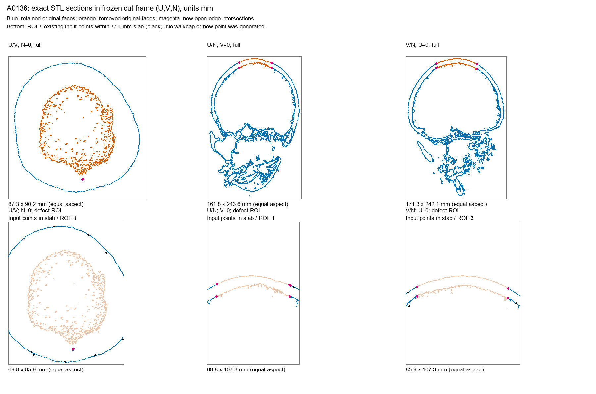
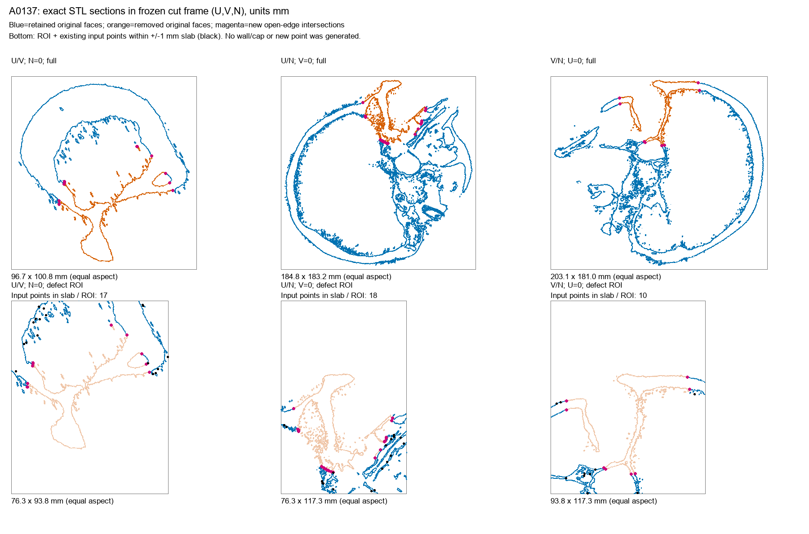
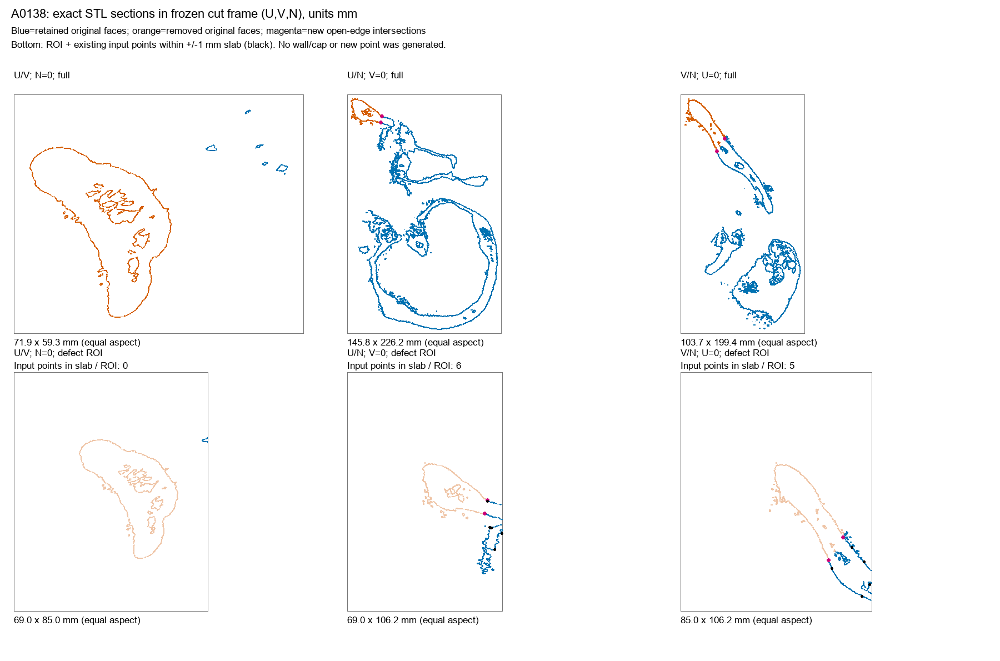

# 颅骨点云表示诊断收尾报告：MUG500+ 三例网格与九例证据综合

_Cranial-SCQR · 2026-10-23 · 本机 CPU／源数据只读 · 固定开发来源的小规模诊断_

---

## 📋 结论与完成范围

本轮补完 A0136／A0137／A0138 三例固定 D6 `ellipsoid_medium` 的原始 STL 与已有点云检查，并与前六例 SkullFix／SkullBreak 原始体素配对结果合并解读。九例范围内的源文件对应、输入分布、原始几何切片以及可定义的接口诊断已完成；没有扩展病例、重新选缺损位置或训练。

最重要的区别是：**MUG500+ 并非只有单层外表面，但现行删面生成并没有建立新暴露的厚度方向切壁。** 内外层存在和切口壁存在是两个不同问题。

三例原始 STL 已包含开放边、非流形边和方向不一致的相邻面。不能未经处理就把它们当成已认证的闭合骨实体。不能将这些拓扑边界直接称作自然孔洞或临床缺损，也不能据此断言整个数据集都不可用。

本轮没有完成整颅内板／外板语义分割、每个内部腔体的解剖验证、连续实体有效性认证或新数据生成；这些不被“本轮有界诊断完成”所替代。原始结果见 [results.json](results.json)，逐例简表见 [summary.csv](summary.csv)。

## 🎯 输入与固定范围

STL 位于用户提供根目录下：

```text
E:/dataset/MUG500plus/raw_v20/clear_stl/d6_development100_v1/batch_001/
    A0136_clear.stl
    A0137_clear.stl
    A0138_clear.stl
```

三个 STL 的 SHA256 全部匹配既有记录。三个已有 NPZ 在本机历史快照找到：`d6_experiment_history/snapshots/d6v/datasets/MUG500plusD6Development400_v1/cases/`，同样全部匹配上一轮服务器诊断使用的哈希。每例输入和 implant 目标均为 8,192 点。

只处理原先固定的三例 `ellipsoid_medium`。使用旧记录的 center／frame／radii，按原算法对三角形质心做椭球包含判断。三例的移除面数、保留面数和移除面积比例均与冻结记录一致。这是对既有删面分组的只读识别，不是重新生成缺损或点云。

来源、目标、固定参数与哈希见 [scope.json](scope.json)。没有读取其他病例几何或封存数据；没有连接服务器或安装依赖。

## 🔍 方法与解释边界

STL 按二进制记录读取。在内存中将数值完全相同的顶点归为一个索引，不用 epsilon 合并、不移动顶点、不补面、不删除小组件。开放边指仅邻接一个三角面的边，非流形边指邻接超过两个面；面连通性按共享边定义，而非仅在一个点接触。

将保留面的开放边与原始网格逐边对应：原来已有一面的边归为继承边；原来恰有两个面、删面后仅剩一个面的边归为新开放边；原非流形边另行分类。本轮三例最后一类均为 0。这里统计的是离散三角网格的拓扑，不自动赋予内缘、外缘或腔体语义。

另外计算两个固定 1／2 mm 描述性覆盖口径：

- 保留原始三角面的质心到输入点最近距离，按三角面积加权。
- 新开放边中点到输入点最近距离，按边长加权。

二者分别是面积与长度的离散积分近似，不是连续曲面／线段的精确覆盖。第二项尤其**不是厚度方向切壁面积覆盖率**；当前没有生成相应切壁曲面，因此该面积指标未定义，不能写成 0%。附近薄层的欧氏近邻也可能影响覆盖。

剖面采用既定切除坐标系 U／V／N，穿过 cut center，显示真实三角面与平面的交线。下排为固定 ROI 与既有输入点的 ±1 mm 薄层投影。ROI 边缘只显示完全位于显示框内的线段；不能用显示裁剪处的线段终止判断网格开放性，拓扑统计独立于绘图。

## 📊 三例网格实测结果

### 原始网格已非无边界流形

| 源 ID | 原始开放边 | 原始非流形边 | 原始面连通分量 | 删面后面连通分量 |
| --- | ---: | ---: | ---: | ---: |
| A0136 | 2,601 | 172 | 64 | 91 |
| A0137 | 1,868 | 262 | 73 | 142 |
| A0138 | 561 | 158 | 4 | 21 |

原始网格两面边的方向不一致数分别为 1,609／2,580／1,594。尽管有多个组件，最大组件仍分别占表面积约 99.906%／99.303%／96.463%；不能把全部组件当作同等重要的解剖结构，也不能为了统计好看自动移除小组件。

这些精确坐标索引结果表明三份文件目前不满足“无开放边且每边恰有两个一致定向邻面”的全网格条件。没有进一步验证自相交、组件包含关系或可制造性；因此不提供骨实体有效性证书。

### 删面确实产生新的开放边，但不产生壁面

| 源 ID | 被移除原始三角面 | 删面后全部开放边 | 新开放边 | 新开放边总长度 mm |
| --- | ---: | ---: | ---: | ---: |
| A0136 | 70,515 | 3,852 | 1,251 | 838.44 |
| A0137 | 187,075 | 4,691 | 2,823 | 1,856.29 |
| A0138 | 52,264 | 1,377 | 816 | 566.06 |

每例全部开放边均可分解为原有边＋新开放边：2,601＋1,251；1,868＋2,823；561＋816。原有开放边不能错误归因于本次人工切除。

新开放边形成的简单闭合环分别有 45／101／49 个，另外存在非简单环连通组。这些包含细碎内部曲面截断的结果，**不是 45／101／49 个临床缺损，也不是可直接使用的外缘／内缘标签**。原始复杂曲面和分支使“只找两个最大边界环”也不是已经验证的通用规则。

只删除原始面片，没有新增任何三角面，因此没有为这次切除建立连接内外层的新切壁。这里没有试图通过补面修复这个问题。

### 现有点云在保留面及开放边上的覆盖

| 源 ID | 保留面 2 mm 面积覆盖近似 | 新开放边 2 mm 长度覆盖近似 | 新开放边中点 2 mm 内输入点 | 旧 sparse-implant 2 mm 点数 |
| --- | ---: | ---: | ---: | ---: |
| A0136 | 30.34% | 17.82% | 25 | 19 |
| A0137 | 29.69% | 17.31% | 46 | 35 |
| A0138 | 28.69% | 17.61% | 16 | 11 |

固定点数下的近边线覆盖较稀疏，但参考包含所有本次新开放边，并非已经语义确认的临床 contact rim。全表面／开放边的面积与长度分母不同，不能把这些百分比直接当作模型优劣或相同几何对象的比较。

重算的旧接近带与三个 NPZ 保存的 reference_rim_mask 全部一致。新开放边接近带与旧带不是同一定义；A0136 还有一个旧带点不在新边接近带中。因此不应把旧 rim 名称直接当成新接口真值，也不能自动修改旧实验阈值。

## 📍 内外层与内部曲面的直接证据


_图 1：U/N 与 V/N 剖面中可见分离的内外层曲线；洋红色点为新开放边与剖面的交点。图中没有连接两层的人工切壁，浅橙色仅为被移除的原有曲面参考。_


_图 2：局部内部曲面更复杂，并非只有单一外轮廓。多交线不等于每个结构都已通过解剖学或分割质量验证。_


_图 3：固定病例呈现多层复杂交线。本轮没有因为结构复杂或点数少而剔除该病例，也没有另选更容易的缺损位置。_

沿固定局部 N 轴，A0136 正向交点约为 5.551／12.879 mm，A0137 为 6.818／14.077 mm；A0138 出现多个正向交点。这里只报告曲面交点，不将任意两交点间隔直接当作临床骨厚度，也不将多交点全部解释为真实封闭腔体。

三张剖面图均已人工视觉查看。可以确认这些固定 STL 包含内外层及内部复杂曲面；不能声称完整保留所有孔道、每个腔体或骨小梁，更不能声称已判别所有伪影。

## 💡 九例综合判断与下一阶段路线

结合 [SkullFix／SkullBreak 六例原始体素报告](../raw_pairing_v1/raw_pairing_report_zh_v1.md)：

| 数据组 | 内外层证据 | 缺损断面表示 | 本轮主要发现 |
| --- | --- | --- | --- |
| SkullFix 三例 | 原始分割及配对剖面 | D/G 相邻体素面存在；输入已有切口邻接点 | 有限采样覆盖与 proximity 标签参考问题 |
| SkullBreak 三例 | 原始分割及配对剖面 | D/G 相邻体素面存在；输入已有切口邻接点 | 同上，不能笼统称为 outer-only |
| MUG500+ 三例 | 原 STL 剖面有内外层及复杂内部曲面 | 旧删面方式没有构造新的切壁 | 缺损构造与采样稀疏是两个不同问题；原网格还存在拓扑限制 |

因此，建议继续以**完整骨组织边界的表面点云**为主输入，而不是立即切换成体积点云。表面点云本身并不排斥内外层或厚度接口；关键在于输入资产、实体切除方法和监督对象是否真正包含这些几何信息。

下一阶段优先确定新数据表示：在骨组织实体中切除后提取残颅／缺失骨块边界，同时保留接口 provenance。对 MUG500+，先定位同源适用的骨组织分割；若只有当前不闭合 STL，再制定限定的实体化／修复规则，而不是直接填满颅骨外轮廓或盲目封掉所有自然孔道。本轮没有实施这一步。

新协议应明确输出到底是完整缺失骨块边界、完整颅骨边界，还是旧的原表面缺失片。新旧目标不同，不能将旧 QA 指标与新表示结果直接混合作为提升证据。

随后才在固定新真值、source-level split、输入点数和训练预算下，用同一基线比较均匀全边界采样与输入可获得的局部覆盖保障；不能使用缺失骨块真值在推理时选点。最后再检验单一 SCF／Mamba 改动的额外贡献，不立即重训整套矩阵或进行参数扫描。

这不是“已经证明数据问题解释全部负结果”，也不是新方法有效性结论。它把后续实验的优先级从继续堆叠网络模块，转回有证据支持的数据表示和接口定义。

## 🔐 执行与复核

真实三例分析只执行一次，退出码 0，主体约 49.74 秒。本机 Python 3.10.11、NumPy 1.26.3、SciPy 1.11.4；绘图使用已有 Pillow，没有安装依赖或修改环境。

正式读取前，静态阶段修正了一处 CSV 输出括号，随后语法及七项人工拓扑／剖切算术检查通过；未因此重跑真实数据。七项检查不是完整生产 P3。

三份 STL 和三份 NPZ 的前后哈希全部一致。新文件仅在项目 outputs 下，包括 [分析脚本](../analyze_mug_mesh_v1.py)、本目录的机器结果、CSV、图表与报告。源数据、旧报告、生产代码、实验阈值保持不变。

没有服务器操作、模型导入、checkpoint 加载、GPU 计算、数据重采样、网格修复或训练；没有生成新的切壁、封闭实体、STL 或 NPZ。[files.sha256](files.sha256) 绑定原始计算产物；报告和独立复核另用新清单绑定，不覆盖原清单。

科学文档技能用于分离已观察的曲面结构、精确离散拓扑、近似覆盖与尚未完成的解剖解释；未将代理量包装为完整临床证据。
