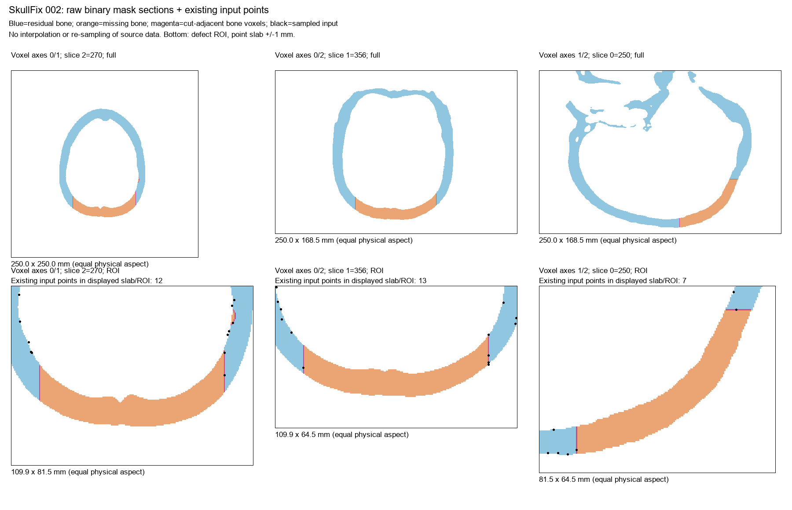
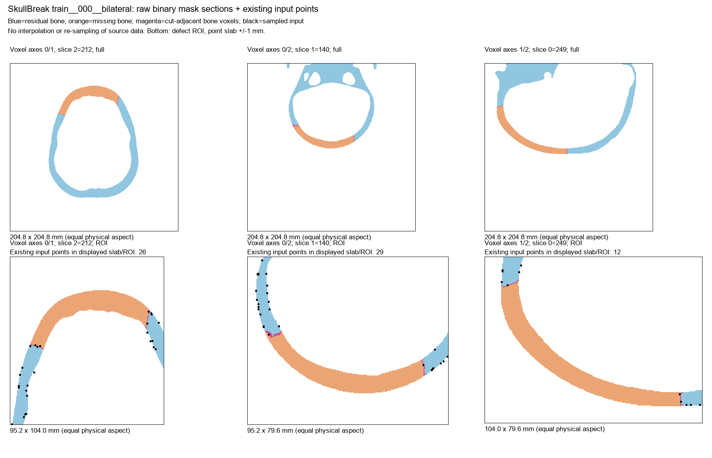

# SkullFix／SkullBreak 六例原始体素与既有点云配对诊断

_Cranial-SCQR · 2026-10-23 · 本机 CPU／只读数据分析 · MUG500+ 原网格仍待补齐_

---

## 📋 核心结论

本轮已经补完上一轮六例 SkullFix／SkullBreak 的原始体素配对分析。18 个用户指定 NRRD 全部可读，六个本机 NPZ 的文件 SHA256 与上一轮服务器分析的文件一致；没有更换病例或点云变体。

六例原始分割均有厚度、朝向颅腔与朝外的骨组织边界，以及缺损切开的接口。现有点云也确实采到了切口邻接体素中心。因此，不能把这六例概括成“只有外表面，完全不含切口断面”。在所示局部剖面中可观察内外轮廓及厚度断面，但本轮没有完成整颅的内板／外板语义标注。

在预先固定的 2 mm 几何距离口径下，切口体素面的面积加权覆盖近似为 SkullFix 39.84%–54.30%、SkullBreak 54.43%–65.17%。这表明有限点数下仍存在未被近邻点覆盖的接口区域，**不等于其余区域在原始数据中不存在**。同一口径下全局边界覆盖率也较低，不能据此单独认定采样专门忽略了切壁。

这些是六例训练来源的描述性结果，不是模型实验、临床验收或数据集总体推断。没有修改旧 SCF 标签、指标阈值、数据或模型。

## 🎯 输入、身份与范围

原始体素来自用户明确提供的位置：

- SkullFix：`E:/dataset/SkullFix/extracted/training_set`，002／003／004 的 complete_skull、defective_skull、implant。
- SkullBreak：`E:/dataset/SkullBreak/raw`，train 的 000／001／002，各自 complete_skull、defective_skull/bilateral、implant/bilateral。

本机对应点云来自 `E:/dataset/SkullFix/pointcloud_defective_norm` 和 `E:/dataset/SkullBreakPC`，均与上一轮六个原始 NPZ 哈希一致。每例输入 8,192 点、implant 目标 4,096 点。没有自动改用 out8192 版本，没有运行在线 FPS 或模型 proxy 构造。

六例均使用上一轮已冻结的训练来源选择，没有读取新的病例、test／holdout payload。精确路径、24 个源文件的读取前哈希、三元组记录见 [scope.json](scope.json)；读取后哈希见 [results.json](results.json)。18 个 NRRD 和六个 NPZ 均保持不变。

## 🔍 几何与覆盖率定义

### 原始分割与点坐标对应

令 C 为完整骨组织、D 为残颅、G 为缺失骨块。六例均逐体素满足 `C = D union G` 且 `D intersection G = empty`。同时核对体积形状、方向矩阵、origin 和原预处理记录的占据体素计数；SkullBreak 的完整 mask 语义指纹也与原记录一致。

NRRD 按其头部的类型、gzip 编码、Fortran 索引顺序读取，保持原 spacing／方向／origin，不重采样。现有输入反归一化后可映射回原始残颅边界体素中心，数值误差在预先设置的 0.001 体素单位内；所有输入点均落在 D 的六邻域边界体素中。

### 边界与接口

边界体素定义与原预处理一致：`D & ~binary_erosion(D, six_neighbors)`。

另外，枚举 D 的六方向暴露体素面。其中，若面另一侧的体素属于 G，则该面为本轮的合成切口接口参考。这个定义来源于原始实体分割，不使用随机 implant 点之间的距离代替接口。

面面积由方向矩阵中两个切向向量的叉积模长计算。覆盖参考采用各暴露面的物理中心，按面面积加权：某参考面中心到输入点集最近距离不超过固定容差即记为覆盖。

这属于**体素面中心积分近似**，不是平滑网格的连续面积积分。阶梯边界、网格方向和分辨率会影响面积；邻近薄层的欧氏近邻也可能贡献覆盖。为此另报告：只使用“来自切口邻接残颅体素”的输入点计算接口覆盖率。它减少非接口点贡献，但仍非组织学或临床标注。

1 mm、2 mm 为上一轮已固定的描述性尺度，不是临床阈值，也未用于参数扫描。严格限制数据只读；原始 NRRD 未被网格化后保存、插值、平滑或填孔。

## 📊 数值结果

### 原始边界与切口采样确实存在

| 病例 | 残颅边界体素数 | 切口参考面数 | 切口体素面面积 mm² | 输入中切口邻接体素点数 |
| --- | ---: | ---: | ---: | ---: |
| SkullFix 002 | 763,084 | 11,861 | 2,877.49 | 116 |
| SkullFix 003 | 552,837 | 11,154 | 2,694.14 | 156 |
| SkullFix 004 | 671,342 | 12,033 | 2,930.41 | 134 |
| SkullBreak 000 bilateral | 609,072 | 20,475 | 3,276.00 | 166 |
| SkullBreak 001 bilateral | 617,426 | 19,741 | 3,158.56 | 142 |
| SkullBreak 002 bilateral | 515,260 | 37,867 | 6,058.72 | 323 |

这里的切口采样点仍是残颅体素中心，不是精确落在连续切壁上的曲面点；角点体素也可能同时邻接多个边界面。不能把“采到了 116 点”解释成覆盖了 116 个互不重叠的解剖区域。

### 固定 2 mm 下的面积加权近似覆盖率

| 病例 | 残颅全部暴露面 | 切口面：所有输入点 | 切口面：仅切口邻接输入点 |
| --- | ---: | ---: | ---: |
| SkullFix 002 | 38.29% | 39.84% | 34.87% |
| SkullFix 003 | 50.80% | 54.30% | 48.44% |
| SkullFix 004 | 44.18% | 46.75% | 41.96% |
| SkullBreak 000 bilateral | 57.39% | 61.51% | 57.27% |
| SkullBreak 001 bilateral | 56.89% | 54.43% | 50.37% |
| SkullBreak 002 bilateral | 64.11% | 65.17% | 59.97% |

只使用切口邻接点时覆盖率下降，提示邻近其他表面的输入点确实影响欧氏覆盖指标。不过多数病例切口覆盖并不低于全局覆盖；目前更符合“整体有限分辨率＋局部信息不足”的问题，尚不能认定为切壁独有的采样偏置。

1 mm 下切口覆盖率分别为 9.00%、15.76%、12.59%、20.78%、18.13%、22.01%，进一步说明覆盖率依赖容差定义。不能将不同容差下的数字混用。全部边界体素中心覆盖、距离分位数及原始统计见 [results.json](results.json)，精简表见 [summary.csv](summary.csv)。

### 原有接近带与原始体素接口接近带不同

| 病例 | 到稀疏 implant 点云 ≤2 mm | 到原始接口面中心 ≤2 mm | 后者中前者未选中的点 |
| --- | ---: | ---: | ---: |
| SkullFix 002 | 142 | 164 | 22 |
| SkullFix 003 | 188 | 221 | 33 |
| SkullFix 004 | 165 | 185 | 20 |
| SkullBreak 000 bilateral | 206 | 239 | 33 |
| SkullBreak 001 bilateral | 179 | 213 | 34 |
| SkullBreak 002 bilateral | 312 | 493 | 181 |

本次六例旧接近带均为体素接口接近带的子集。这表明稀疏目标采样和参考对象选择会改变标签；尤其最后一例差异不能忽略。但两种量本来就不是同一数学定义，不能因此直接宣布旧标签“错误”、自动改阈值、或把新量替换为旧 QA gate。

两个接近带也都不等于严格切口邻接体素点集合，更不等于 SCF proxy 的阳性个数。本轮未运行网络或修改训练监督。

## 📍 配对剖面图

蓝色为残颅骨组织，橙色为缺失骨块，洋红色为切口邻接残颅体素；下排黑点为既有输入点在 ±1 mm 薄层内的投影。剖面按采集体素轴显示、保留真实物理宽高比，不把体素轴强行命名为统一解剖方向。剖面本身是原始二值分割，不是 CT 灰度图；橙色填充显示真值，不是预测。

_图 1：内外轮廓之间保留骨厚度，缺损边缘具有贯穿厚度的接口；既有点云在部分断面上已有采样，但点间存在空隙。_

_图 2：切口参考来自残颅与缺失骨块的相邻体素面，而不是 sparse implant 点云近邻。_

其余四张图：

- [SkullFix 003](SkullFix_003_raw_sections.png)
- [SkullFix 004](SkullFix_004_raw_sections.png)
- [SkullBreak 001 bilateral](SkullBreak_train__001__bilateral_raw_sections.png)
- [SkullBreak 002 bilateral](SkullBreak_train__002__bilateral_raw_sections.png)

六张图均已人工视觉查看，未以此声称完成整颅内外板、所有内部腔体或骨小梁的语义鉴定。二值分割缺少的细节不能通过采样恢复。

## 💡 对下一阶段的建议

本轮支持继续使用全骨边界表面点云，不支持仅因“表面点云”这一名称而全面切换成体积点云。对于这六例，问题不是断面在数据中完全不存在，而是有限采样覆盖、边界体素中心误差，以及接触标签使用的参考对象。

下一步应先补齐 MUG500+ 的三个固定 STL（A0136_clear、A0137_clear、A0138_clear），完成同范围的原始面片与删面后接口核查，以区分“没有生成切壁”和“已有切壁但点不够”这两个问题。上一轮已列出其精确 SHA256，本轮未猜测位置、联网下载或恢复服务器文件。

若后续开展采样实验，应在新数据版本中固定点预算和原始缺损，对比现有采样与局部覆盖保障，而不是同时换实体表示、架构、损失和评估协议。接口 provenance 可用于本轮诊断或训练监督，但推理时不能用缺失骨块真值选择输入点。

内／外表面分别的定量覆盖率、平滑网格面积、局部厚度误差、真实缺损开口宽度仍未完成，不能从本轮的“全部暴露面”指标自动拆出。MUG 原网格未检查，九例跨数据集配对诊断仍不能宣称全部结束。

## 🔐 执行与可复核性

本轮完全在 Windows 本机执行，没有连接服务器或上传原始数据。只新增当前项目 outputs 下的分析脚本、结果与报告，不修改数据集目录、生产代码、旧报告或旧实验阈值。

- 环境：Python 3.10.11、NumPy 1.26.3；使用既有 SciPy 和 Pillow。Matplotlib 不可用，因此直接采用已有 Pillow 绘制原始数据剖面，没有安装依赖。
- 静态语法检查通过，五项几何算术检查通过；不是完整生产 P3。
- 六例正式配对分析运行一次，退出码 0，主体耗时约 56.01 秒；未作为性能 benchmark。
- 18 个 NRRD＋六个 NPZ 的前后文件哈希全部一致；分区、体素数量、坐标及 SkullBreak 完整 mask 指纹检查通过。
- 模型导入、checkpoint 加载、GPU 计算、源数据重采样、训练与服务器写入均为 0。
- 执行脚本：[analyze_raw_pairs_v1.py](../analyze_raw_pairs_v1.py)。原始机器结果与图表由 [files.sha256](files.sha256) 绑定；报告与补充核验由独立的新清单覆盖，不覆盖已有清单。

科学文档技能用于严格区分实测、离散近似与未完成项目；绘图没有生成或补绘解剖结构，保持原始体素标签和物理比例。
