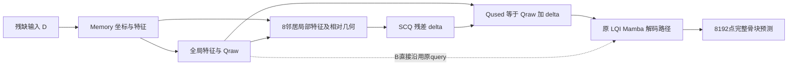
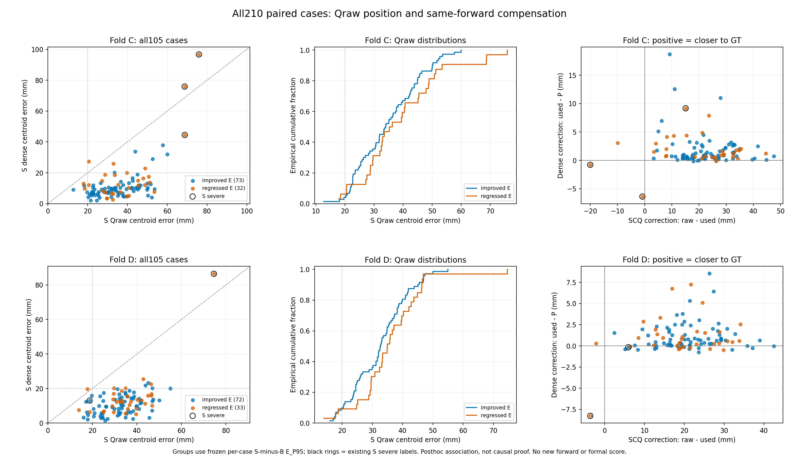
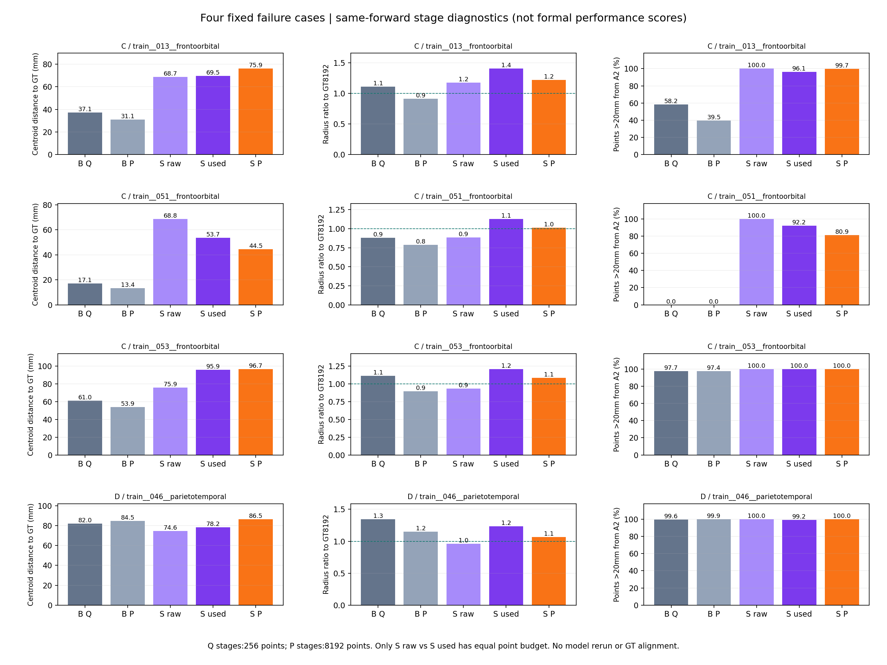

# Cranial-BCSP-FullMamba：SCQ B／S阶段正式实验报告

_版本 v1｜2026-11-14｜依据已冻结的实施、CUDA、训练、Native预测、CPU评分与全队列诊断证据编写_

---

## 1. 摘要与阶段结论

本阶段研究的问题是：在既有无注意力LQI全Mamba补全模型中，向learned coarse query提供实际Memory的局部特征和相对空间几何，能否改善缺失骨块的完整表面补全与接触接口吻合。实验设置原LQI基线B和增加SCQ残差的候选S，在SkullBreak已开放来源上，完成C／D两折、seed 0、四次从头训练；每次固定8,192点输入、8,192点输出、3,900次更新。随后对每折105个开发病例进行两臂配对Native预测，共420次预测；统一CPU评分产生420行模型记录及420行共享控制记录。相关训练、预测和评分均完成正式只读冻结审计。[^contract][^training][^pred][^score]

**开发集平均结果支持保留SCQ研究方向，但不支持认定当前版本已经可靠替代B。** 完整未知表面主终点E P95在C折由11.743降至6.688 mm，D折由7.307降至5.494 mm；接口J Cover@2 mm分别提高11.11和5.62个百分点。按来源统计，E改善来源分别为15／21和18／21，表明收益并非仅由单一极端病例构成。然而，C折出现两例新增严重几何失败，frontoorbital类型平均退化；D折反向距离P95虽均值略降，却有12／21来源变差。[^score]

机制诊断经历了必要的解释修正。四个固定失败病例中可观察到Qraw阶段偏位及后续纠正不足或放大，但全210例核查发现：195例Qraw质心距离大于20 mm，改善病例和退化病例的对应比例分别为93.10%和92.31%。因此，**Qraw偏位不是失败特有的根因证据**。SCQ在205／210例中降低质心距离，说明模型通常依赖Qraw与残差共同形成有效位置；与此同时，60个表面退化病例的质心仍被拉近，说明位置纠正不等于形状与接口改善。[^visual][^cohort]

本轮B／S阶段的执行与描述性诊断可以正式收束。尚未完成同容量F控制训练、多seed复现、独立确认集验证、bootstrap或正式G1判定，也未证明显式几何是收益的唯一原因。下一阶段应先冻结一个保留有效补偿、改善局部条件与残差可靠性的最小假设，再决定是否实施；不能直接增加Qraw强监督、统一压小残差，或根据开发集结果筛掉困难病例。

## 2. 科研问题、研究对象与实验边界

### 2.1 从前期问题到本阶段假设

前期FullMamba及LQI实验已建立可训练的无注意力补全母版，但仍出现整块级位置、范围与远端离群错误。本阶段不是继续搜索采样方案、输入点数或缺损构造，而是在固定表示和固定母版上，检验coarse生成路径的空间条件是否有价值。前期有限证据复盘与实际Memory追踪用于确认接口，随后冻结SCQ唯一公式。[^plan][^implementation]

最小假设为：只使用残缺输入D及其编码Memory，让每个Qraw读取最近Memory的局部特征与相对几何，通过残差得到Qused，并让原生成路径一致使用Qused，可能改善完整骨块的空间覆盖和接触接口。该假设不要求Qraw独立成为准确骨块预测，也不把GT几何输入模型。

### 2.2 表示与输出目标

本轮使用骨组织与背景相接的完整边界表面点云。原始分割中存在的外侧表面、朝向颅腔的内侧表面、孔道或腔体边界，以及实体缺损暴露的切壁，均属于可采样表面。这里的“完整边界”描述几何定义，不保证有限的8,192个点对每处薄层和切壁都充分覆盖。

输入是残缺实体骨组织D的边界采样；目标G是缺失实体骨块的完整边界，包括缺失原始骨表面与骨块切除界面。目标不是仅有外板的缺失面片，也不是完整颅骨重建。SkullBreak沿用已核验的原有体素实体缺损；V1采样、坐标变换及点集身份在两臂间固定，不与结构修改混合。[^contract][^scoreprep]

### 2.3 本轮包含和不包含的内容

| 项目 | 本轮状态 | 解释边界 |
|---|---|---|
| B／S隔离实现、人工CPU检查、P3 | 完成 | CPU结果不替代CUDA验证 |
| 人工CUDA零更新准入 | 完成并冻结 | 只证明指定路径可执行及数值合同成立 |
| B_C、S_C、B_D、S_D训练 | 完成并冻结 | 每个模型单seed、固定预算 |
| 四模型Native开发集预测 | 完成并冻结 | 420次，未做GT配准或后处理 |
| 统一评分与冻结审计 | 完成 | 原始指标和阈值保持不变 |
| 四例阶段可视化、210例Qraw队列诊断 | 完成 | 离线描述性归因，非因果证明 |
| F同容量控制训练 | 未执行 | 不能分离几何、局部读出与参数容量效应 |
| bootstrap、显著性检验、正式G1 | 未执行 | 不报告“统计显著”或“正式门通过” |
| 多seed、封存确认集、跨数据集或临床验证 | 未执行 | 不外推为可靠临床性能 |

本报告仅汇总已有冻结证据，没有追加训练、forward、重新评分、服务器操作或新结构实施。

## 3. 实验内容与方法

### 3.1 数据划分与配对单位

实验池为SkullBreak已开放84个来源，每来源五类缺损，共420个病例。缺损类型为bilateral、frontoorbital、parietotemporal、random_1和random_2。每折63个训练来源、315病例，21个开发来源、105病例；C／D开发来源不重叠，合计42来源、210开发病例。两折训练来源重叠，因此它们不是两组完全独立的训练复现实验。[^contract][^score]

训练和评价以来源划分防止同一来源不同缺损跨越同折训练／开发边界。评分先将同来源五病例等权，再将每折21来源等权；病例级结果用于风险转移和机制描述。不能把同一颅骨的五类缺损作为五个独立患者，也不能把420行模型评分理解为420名独立受试者。

本阶段没有使用SkullFix或MUG500+作为SCQ效果验证集。既往数据表示研究不等于本轮已获得跨数据集泛化结论；MUG也没有因本实验而被认证为高精度解剖GT。

### 3.2 B、S与未执行的F控制

| 臂 | 定义 | 原生模型可训练参数 | 本轮训练 |
|---|---|---:|---|
| B | 原LQI全Mamba母版，不增加SCQ头 | 39,903,169 | C、D各一次 |
| S | 相同母版＋局部特征／相对几何SCQ残差 | 40,596,676 | C、D各一次 |
| F | 同结构同初始化，将7维几何通道换为固定特征投影 | 未训练 | 仅在人工CUDA中检查初始化及梯度路径 |

S新增693,507个可训练参数，约为B的1.74%。B是本轮重新训练的配对LQI基线，不能用历史LQI或F0分数替代它。F不是“完全关闭局部信息”的对照：它保留局部特征与同容量残差头，只替换显式7维几何通道。因此即使将来执行F，也应按其实际公式解释。[^implementation][^cuda][^pred]

### 3.3 SCQ唯一公式与插入位置

记编码Memory坐标为 \(S\in\mathbb R^{256\times3}\)，特征为 \(F\in\mathbb R^{256\times384}\)，全局特征为 \(z\in\mathbb R^{1024}\)，learned query坐标为 \(Q^{raw}\in\mathbb R^{256\times3}\)。对每个query取Memory中最近的8个邻居，不搜索邻域半径，不引入GT或额外定位器。以下公式省略batch维。[^implementation]

\[
\mathcal N_i=\operatorname{KNN}_{8}(S,Q_i^{raw}),\qquad d_{ij}=S_j-Q_i^{raw}.
\]

Memory特征先逐token作无仿射LayerNorm（epsilon为\(10^{-5}\)），再在邻域内取均值和最大值：

\[
f_i^{avg}=\operatorname{mean}_{j\in\mathcal N_i}\operatorname{LN}(F_j),\qquad
f_i^{max}=\operatorname{max}_{j\in\mathcal N_i}\operatorname{LN}(F_j).
\]

相对几何包含三维均值、三维离散尺度和一维平均距离：

\[
\mu_i=\operatorname{mean}_j d_{ij},\quad
\sigma_i=\sqrt{\operatorname{mean}_j(d_{ij}-\mu_i)^2+10^{-6}},\quad
\rho_i=\operatorname{mean}_j\lVert d_{ij}\rVert_2,
\]

\[
g_i=[\mu_i,\sigma_i,\rho_i]\in\mathbb R^7,
\quad h_i=[z,f_i^{avg},f_i^{max},Q_i^{raw},g_i]\in\mathbb R^{1802},
\]

\[
\delta_i=W_2\operatorname{GELU}(W_1h_i+b_1)+b_2,
\qquad Q_i^{used}=Q_i^{raw}+\delta_i.
\]

MLP宽度为1802→384→3，GELU使用精确分支。\(W_2,b_2\)零初始化；初始残差为零，避免一开始改变母版输出。新增初始化使用独立固定随机流，保留母版随机状态。F使用固定正交投影产生替代的7维通道，并与S共享新增参数初始化。

Qused统一进入query特征构建、坐标位置编码、排序、self／cross KNN、dense中心及原coarse监督。不是只替换导出的诊断坐标。Qraw没有新增独立GT监督，最终dense仍由原解码路径生成。[^implementation]

### 3.4 损失与训练合同

保留原coarse＋dense重建损失；概念上为

\[
\mathcal L=\operatorname{CD}(Q^{used},G)+\operatorname{CD}(P,G).
\]

未增加位置、接口、法向、厚度、辅助范围或SCQ正则项。去噪分支关闭。运行日志中沿用的`loss_sparse=0`指去噪项关闭，重建项包含coarse与dense，不能解释为coarse不受监督。本轮明确使用现有PyTorch `cdist` Chamfer路径，不把结果外推到其他编译loss后端。[^contract][^implementation]

| 合同项 | 固定设置 |
|---|---|
| 输入／输出／coarse点数 | 8192／8192／256 |
| 初始化 | seed 0，从头训练；共有母版参数初始化配对一致 |
| 训练数据 | 每折315病例；B／S同点集、同归一化和同数据顺序 |
| batch与遍历 | batch 8，100次遍历，每次39个完整batch |
| 更新与曝光 | 每run 3900更新、31,200曝光；每遍历丢弃3例，累计300次丢弃 |
| 优化器 | AdamW，初始lr=0.0001，betas=(0.9,0.999)，eps=1e-8 |
| 权重衰减 | 矩阵5e-4；一维、bias及明确SSM例外为0；新头权重／bias按同策略 |
| 梯度与数值 | clip=10；FP32；TF32关闭；接受并披露有限梯度非位级确定性 |
| 学习率 | `1e-4 × max(0.9^(epoch/21), 0.02)` |
| BN动量 | `max(0.9 × 0.5^(epoch/21), 0.01)` |
| 禁止项 | 自动resume／重试、BNCal、训练内开发评价、按C折loss调整D折 |

四run合计15,600次更新、124,800次曝光、1,200次丢弃。每病例“曝光＋丢弃”为100次，实际完整批次顺序与计数经冻结审计核对；这比仅比较总epoch更能约束两臂公平性。共有参数初始化相同不代表新增SCQ参数不存在，也不代表训练轨迹逐位相同。

### 3.5 环境、资源及设备迁移

四次训练在同一`t6ibfm-0`容器、同一RTX 4090 D GPU UUID及驱动570.190上进行。冻结环境包含Python 3.10.20、PyTorch 2.4.1+cu118、NumPy 2.2.6和原生Mamba／PointNet2 provider。训练预算为24小时、RSS 8 GiB、torch显存20 GiB、SMI显存22,528 MiB、输出2 GiB、空闲磁盘至少4 GiB；资源合同是监测与超限停止，不宣称专属cgroup硬隔离。[^contract]

预测前迁移至`zbpgzu-0`，GPU及驱动更换为另一RTX 4090 D、驱动575.51.03。重新绑定了当前身份、权重、源码与数据哈希；四模型均在同一新预测环境运行。它保留本轮B／S预测条件配对，但不能据此宣称与历史设备位级一致。容器名字和路径是历史执行身份，不是未来可直接复用的当前连接凭据。[^pred]

### 3.6 准入和Native评价

人工CPU实施检查49项通过；真实CUDA准入固定B_eval1、F_eval1、S_eval1、S_train8四阶段，共4次forward、4次完整loss/backward、0次optimizer step，记录144次原生SSM调用。F和S初始输出与B实测一致；零输出层使首次反传W1梯度为0、W2梯度非零，这是预期初始化行为，不能误判为整个SCQ无梯度。各阶段恢复状态、模式、BN动量和RNG的运行时断言通过。[^implementation][^cuda]

CUDA记录的最大SMI为14,624 MiB，torch峰值allocated为13,570,521,600字节，reserved为14,822,670,336字节，RSS约1.91 GB。采样监测和torch峰值分别具有各自统计口径，不将它们混为同一数值，也不把人工准入解释为科研性能通过。

Native开发预测每模型105例、batch 1，合计420次；无warmup、loss、backward、更新、BNCal、TTA或GT-Oracle配准。保存同次forward的8,192点dense、256点coarse／Qused、Qraw及delta。参数／BN状态及CPU、CUDA、Python、NumPy RNG前后指纹按冻结合同核验。[^pred]

### 3.7 评分几何、终点与风险定义

所有几何误差在D-only归一化的逆变换后，以世界坐标mm计算。GT与预测使用相同坐标合同，没有通过GT求最优平移或刚体配准。[^scoreprep][^metric]

| 指标或对象 | 定义与解释 |
|---|---|
| E | 缺失骨块的原始表面区域，排除人工切除接触面J；不是仅颅骨外板 |
| J | 残缺骨与缺失骨块共享的实体接触／切除界面 |
| 主终点E P95 | 参考E→预测的面积加权最近邻距离95分位，越低越好 |
| J P95、Cover@0.5／1／2 mm | 接口距离与参考面积覆盖；覆盖率越高越好 |
| CD-L1 | P8192与GT8192的双向、未平方欧氏最近邻均值的半和 |
| 预测→A2 P95 | 反向离散参考距离，补充检查远端生成点；不是E P95的同义指标 |
| 预测→A2大于20 mm点比例 | 预测点的远端离群比例，不作面积加权 |
| 质心距离、回转半径比 | 对位置和分布范围作描述，不替代完整表面／厚度精度 |
| severe_geometry | `E P95 >20 mm 或 J Cover@2 mm=0` |
| placement_tail | 质心距离>20 mm |
| compact_distribution | 回转半径比<0.9 |

主参考A1使用体素边界面中心及物理面积权重；A2将每面细分为四个偏移参考点并分配四分之一面积；另保留marching-cubes三角面中心／面积参考，称Ref-B以区别模型臂B。离散参考降低了只对有限GT点集评分的偏差，但仍不是连续真实解剖表面的精确证明。20 mm风险阈值是既有研究定义，不是临床合格阈值。[^metric]

共享控制为Nop_D与GT8192，每个开发病例各一条，共420行；它们不是额外模型。全部共享控制逐字段复现既有冻结值。正式评分输出包括840病例行、168来源均值、210配对病例差值、类型汇总、风险转移与退化排序。[^score]

## 4. 执行完成情况与证据质量

### 4.1 四run训练和冻结

| Run | 更新／遍历／曝光 | 完成文件记录耗时 | checkpoint字节数 | 审计 |
|---|---|---:|---:|---|
| B_C | 3900／100／31200 | 1524.32 s | 478,810,419 | 通过 |
| S_C | 3900／100／31200 | 1524.06 s | 487,148,386 | 通过并配对核验 |
| B_D | 3900／100／31200 | 1524.32 s | 478,810,419 | 通过 |
| S_D | 3900／100／31200 | 1530.15 s | 487,148,386 | 通过并配对核验 |

这些时间为本次运行记录，未做重复计时和统一性能基准，不能据小差异宣称S没有计算开销。四run退出码、完整计数、初始化、实际顺序、产物清单、资源记录及checkpoint哈希均在正式审计范围内；训练过程的BNCal、evaluation、resume保持false。[^training]

### 4.2 预测、评分与独立核查的具体含义

预测正式冻结审计35组检查通过，包含420份预测及精确清单、归档哈希、计数、状态／RNG证据。预测压缩包为40,571,136字节，含420份NPZ和6份元数据，共426成员；压缩包及三个校验文件已在本机目录核验。评分实现43项人工CPU检查及P3通过，真实CPU评分约23.1分钟完成，正式评分冻结审计25组检查通过。[^pred][^score]

审计独立复核了保存的标量、计数、配对、代数关系、共享控制及CSV／JSON汇总一致性，但没有在审计中重新解码所有点集、重算每一次最近邻距离。模型状态恢复也主要依赖已绑定运行代码、断言与指纹证据，而不是在进程结束后重新加载模型复演。报告区分“可追溯且内部一致”与“通过独立实现再次证明几何真值”。评分峰值RSS没有持久化时间序列，不能独立重建。

### 4.3 执行中出现的问题及影响

| 问题 | 处理与证据边界 | 对科研解释的影响 |
|---|---|---|
| B_C早期UTC链接守卫顺序阻断 | 训练前停止；限定hotfix、CPU检查与新P3后以新请求执行 | 失败尝试不是额外训练复本，不混入四run |
| 预测容器身份变化 | 首次在身份检查停止，随后显式重绑定 | 不重写旧训练身份；不声称跨设备位级相同 |
| 开发点集实际缓存根与折名表象不一致 | 只读核清210个路径，并逐文件核验原冻结哈希 | 依据source／fold绑定及内容哈希，不凭目录名判断划分 |
| 本机长路径导致审计回读保存失败 | 保留响应，使用短审计目录继续核验 | 未因此重跑预测或选择性丢弃病例 |
| 早期四例诊断可能诱导Qraw根因判断 | 扩展至全210例后修正解释 | 是机制推断范围的修正，不修改模型分数 |

上述执行问题不构成模型效果失败的替代解释。当前真正的科研问题仍是新增严重病例、类型异质性、形状覆盖与离群残差，以及几何条件的独立贡献尚未被分离。

## 5. 实验结果

### 5.1 两折主要均值

以下按每来源五病例等权、每折21来源等权。距离单位mm；覆盖率和点比例以百分比表示；变化均为S−B。负距离变化表示改善，正覆盖率变化表示改善。[^score]

| 指标 | C：B | C：S | C变化 | D：B | D：S | D变化 |
|---|---:|---:|---:|---:|---:|---:|
| E P95 | 11.743 | 6.688 | −5.055 | 7.307 | 5.494 | −1.813 |
| J P95 | 14.983 | 9.202 | −5.781 | 10.669 | 7.948 | −2.720 |
| CD-L1 | 7.144 | 4.181 | −2.962 | 3.804 | 3.221 | −0.583 |
| E Cover@2 mm | 55.08% | 63.83% | +8.75 pp | 64.19% | 68.20% | +4.00 pp |
| J Cover@2 mm | 38.77% | 49.88% | +11.11 pp | 48.30% | 53.93% | +5.62 pp |
| 预测→A2 P95 | 13.598 | 10.440 | −3.158 | 9.726 | 9.451 | −0.275 |
| 预测→A2 >20 mm点比例 | 7.80% | 4.19% | −3.60 pp | 2.31% | 1.76% | −0.55 pp |
| 质心距离 | 17.477 | 12.566 | −4.911 | 13.444 | 11.840 | −1.604 |
| 回转半径比 | 0.819 | 0.909 | +0.090 | 0.883 | 0.921 | +0.038 |

两折主终点方向一致，接口也有改善。但S接口平均Cover@2 mm仍仅约49.88%和53.93%，不能将相对收益写成接口已经充分吻合。回转半径比向1靠近只是范围线索，不能据此认定内外板厚度、切壁方向或拓扑正确。

### 5.2 来源层级一致性与反向距离尾部

| 指标 | C改善来源／21 | D改善来源／21 | 补充观察 |
|---|---:|---:|---|
| E P95 | 15 | 18 | 来源差值中位数−2.734、−1.266 mm |
| J P95 | 16 | 20 | 两折接口距离改善较广泛 |
| J Cover@2 mm | 19 | 19 | 不等于每个病例均改善 |
| CD-L1 | 14 | 15 | 完整骨块仍存在退化来源 |
| 预测→A2 P95 | 11 | 9 | D折12来源退化，中位差+0.331 mm |

E均值与来源差值中位数同时改善，使“收益完全由一个异常值决定”的解释不足；但未进行置信区间或显著性检验。尤其D折反向P95均值下降与多数来源退化同时存在，提示不同病例尾部变化不均匀，不能只选有利的均值总结。[^score]

### 5.3 严重风险转移

| 折 | B严重病例 | S严重病例 | B严重→S非严重 | B非严重→S严重 | 共同严重 |
|---|---:|---:|---:|---:|---:|
| C | 11 | 3 | 10 | 2 | 1 |
| D | 5 | 2 | 3 | 0 | 2 |
| 合计，仅描述 | 16 | 5 | 13 | 2 | 3 |

至少一种缺损严重的来源数C为8→3，D为5→2。总体严重数下降有价值，但13例恢复与2例新增必须并列报告；不能只写“净减少11例”。本轮定义是几何研究风险，不是临床事件率。[^score]

其他风险也不是一致改善：C的质心>20 mm病例为18→11但新增5例，D为15→9但新增4例；C半径比<0.9为83→55、D为62→42，两折各有5例新增紧缩标签。减少总量不等于消除新失败。

### 5.4 五类缺损的差异

| 类型 | C ΔE P95 | C ΔJ P95 | D ΔE P95 | D ΔJ P95 |
|---|---:|---:|---:|---:|
| bilateral | −3.804 | −5.446 | −1.841 | −2.123 |
| frontoorbital | +3.967 | +3.886 | −4.031 | −4.322 |
| parietotemporal | −14.916 | −15.203 | +0.135 | −0.825 |
| random_1 | −3.448 | −4.396 | −1.934 | −3.477 |
| random_2 | −7.075 | −7.746 | −1.391 | −2.854 |

C折frontoorbital同时出现CD增加4.891 mm、J Cover@2 mm下降3.34个百分点和>20 mm点比例增加8.11个百分点；不能被其他类型收益抵消后隐去。D折同类型却改善，故也不能概括为“SCQ不适合全部额眶缺损”。C折parietotemporal平均收益较大；D折该类型E和CD略退化而J改善，说明接口与全形状可能出现不同方向。当前更适合描述来源／缺损几何异质性，而非宣布一个单一类型根因。[^score]

## 6. 分阶段几何诊断与解释修正

### 6.1 四个固定失败病例

使用两例新增严重C013、C051，以及共同严重且进一步退化的C053、D046，复用已保存预测，对输入、GT、B coarse／dense和S Qraw／Qused／dense作同坐标可视化。未配准、重采样或新增forward；全局图统一范围，局部ROI仅影响显示，不改变评分点集。[^visual]

| 病例 | E P95 B→S | J Cover@2 mm B→S | >20 mm预测点比例 B→S |
|---|---:|---:|---:|
| C013 frontoorbital | 17.798→39.988 | 21.46%→0% | 39.54%→99.73% |
| C051 frontoorbital | 7.029→25.566 | 38.30%→2.48% | 0%→80.90% |
| C053 frontoorbital | 29.989→69.653 | 0%→0% | 97.39%→100% |
| D046 parietotemporal | 43.838→56.968 | 0%→0% | 99.91%→100% |

| 病例 | B coarse质心距离 | B dense | S Qraw | S Qused | S dense |
|---|---:|---:|---:|---:|---:|
| C013 | 37.140 | 31.120 | 68.719 | 69.531 | 75.908 |
| C051 | 17.076 | 13.444 | 68.791 | 53.715 | 44.534 |
| C053 | 60.997 | 53.852 | 75.905 | 95.921 | 96.700 |
| D046 | 81.950 | 84.527 | 74.592 | 78.196 | 86.455 |

C013、C053、D046中，SCQ残差增加质心距离，dense继续增加；C051中两个阶段都在纠正，但最终偏位仍大。因此至少存在“补偿方向／幅度异常”与“纠正不足”两类现象。它们不证明全部失败源于同一阶段。

S的Qraw来自共同训练后的S参数，不能视为B，也不能把Qraw当作“关闭SCQ的dense反事实”。四个失败病例属于结果选取，不能单靠它们判断Qraw偏位是否具有失败专属性。

### 6.2 全210例检验：Qraw偏位不是失败专有现象

随后固定全队列合同，读取四模型已有420份NPZ，并直接复用冻结评分中的GT质心及回转半径，核查210个配对病例；没有重新读取GT／参考几何数组，没有重算正式最近邻指标。按已有E主终点差值划分改善／退化组，保留来源均值与原严重标签，未扫描新阈值。[^cohort]

| 折与组 | 病例数 | Qraw质心>20 mm | Qraw距离中位数 | Qused中位数 | dense中位数 |
|---|---:|---:|---:|---:|---:|
| C：E改善 | 73 | 70 | 34.03 | 10.32 | 9.21 |
| C：E退化 | 32 | 30 | 35.78 | 13.46 | 12.21 |
| D：E改善 | 72 | 65 | 32.65 | 10.29 | 9.90 |
| D：E退化 | 33 | 30 | 34.93 | 13.85 | 12.76 |

全部195／210例Qraw>20 mm；E改善145例中135例>20 mm，E退化65例中60例>20 mm，比例几乎相同。改善／退化组Qraw分布明显重叠，来源层级也未出现跨折一致的简单分离。两折frontoorbital各21例Qraw全部>20 mm，但C有11例、D有14例E改善。

因此，之前“在固定失败例的Qraw阶段已经看到偏位”作为局部观察成立；将其升级为“Qraw偏位是失败特有根因”则不成立。既不能把大Qraw全部视为无意义，也不能事后挑一个更高阈值替代原问题以追求区分效果。

### 6.3 常见工作方式：大幅残差补偿，小幅dense修正

| 统计 | C | D |
|---|---:|---:|
| Qraw质心距离中位数 | 34.12 mm | 33.19 mm |
| Qused质心距离中位数 | 10.58 mm | 11.81 mm |
| dense质心距离中位数 | 9.63 mm | 11.29 mm |
| SCQ降低质心距离 | 102／105 | 103／105 |
| SCQ增加质心距离 | 3／105 | 2／105 |
| dense进一步降低质心距离 | 100／105 | 83／105 |
| SCQ质心纠正量中位数 | 21.77 mm | 20.06 mm |
| dense进一步纠正量中位数 | 1.01 mm | 0.63 mm |

SCQ合计在205／210例中拉近质心；145个E改善病例全部拉近，但65个E退化病例也有60例拉近。由此支持两点：第一，当前S常依赖较大的SCQ补偿，简单压缩残差可能破坏已有有效路径；第二，质心纠正不是完整表面改善的充分条件。

该现象与现有训练图一致：coarse损失监督Qused，Qraw与delta可以共同形成分工。它仍只是与计算图相容的解释，并未通过训练干预证明这种分工的形成原因，更没有证明它是最优分工。[^cohort]

### 6.4 必要反例：位置接近仍可能形状覆盖严重失败

D069 random_2的S结果为：Qraw→Qused→dense质心距离18.82→12.86→13.03 mm，半径比约0.645→0.796→0.792；E P95仍为23.07 mm，保留严重标签。它相对B的E由23.53略降至23.07 mm，因此属于“相对改善但绝对仍严重”，不能与退化组混用。[^cohort]

该例提示范围／形状覆盖可以在位置已改善后继续失败。回转半径仅是摘要，不能定位究竟哪个表面或方向缺失；本轮没有通过GT-Oracle配准或反事实forward进一步分离位置与形状贡献。所有指向GT的方向余弦也只用于离线诊断，不能变成Native推理的门控条件。

### 6.5 本轮可复用的诊断图

图：全病例阶段位置与补偿分布。比较组按冻结E差值划分，属于事后描述，不是独立预测器性能。

图：固定失败病例的阶段几何摘要；应与全队列结果一起阅读，不能以病例展示替代人群核查。交互三维视图见[四例离线浏览页](LOCAL_ONLY_RESULTS.md)。

## 7. 专业分析、未解决问题与结论强度

### 7.1 已获得的科学进展

一是，在固定点数、采样、母版与训练预算下，加入局部Memory条件的coarse残差获得了两折方向一致的表面与接口平均改善；这支持继续研究空间条件生成，而非只增加全局特征或继续搜索采样。

二是，接口和整块指标同时报告，避免只用CD掩盖局部接触失配。当前仍较低的接口覆盖与少数整块失败明确揭示了实际差距。

三是，保存同次forward的Qraw／Qused／dense使阶段诊断不需要重新推理；全队列核查又纠正了由少数失败例形成的过强解释。当前最可靠的机制认识是“普遍有效的补偿与少数失效／覆盖不足并存”，而不是“query头全部坏了”。

### 7.2 当前不能排除的竞争解释

| 解释或混杂 | 当前证据 | 尚缺内容 |
|---|---|---|
| 显式相对几何产生收益 | S优于B，与假设相容 | F同容量／同局部特征控制未训练 |
| 更多参数或新增局部读出产生收益 | S新增693,507参数 | B／S不能单独分离这些因素 |
| 位置纠正解释全部收益 | 多数质心被拉近 | 60例拉近仍表面退化，D069仍严重 |
| Qraw偏位解释全部失败 | 少数失败例极端偏位 | 大量改善病例同样偏位，缺乏特异性 |
| 接口局部建模是唯一剩余问题 | J覆盖仍有限 | 整块错位、范围和离群也未消除 |
| 模型已经泛化到真实临床 | 本轮无此证据 | 跨来源独立确认、跨数据集及临床缺损评价 |

### 7.3 统计和评价局限

本轮只有seed 0，Mamba有限梯度非位级确定性已接受，不能凭一对模型区分结构效应与训练随机性。C／D训练来源重叠，开发集也已用于多轮探索；两折结果是有价值的开发证据，不是独立确认性验证。

没有进行bootstrap、p值或正式G1，不能补写“显著改善”。若未来需要置信区间，应按来源重采样、明确折间依赖和探索属性，并在计算前固定方案；不能把420评分行当作独立样本得到过窄区间。

有限表面点云和边界参考不直接保证闭合网格、无自交、可制造厚度、材料设计或临床植入安全。E／J与反向距离也不能完全分离平移、旋转、尺度和形状。当前没有GT配准Oracle，不能量化“多少误差由纯平移造成”。

### 7.4 当前版本的定位

建议将当前S冻结为“具有开发集平均收益、仍有严重尾部风险的SCQ研究候选”，保留本轮B为配对基线。不能宣布可靠替代、临床可用或几何条件唯一归因已完成；也不应因两例新增失败完全否定空间条件方向。

原计划中是否投入F训练需结合可靠性与预算单独决定。本轮未执行正式门，且新增严重失败和类型退化已被观察，不能自动宣告满足继续训练预算条件。

## 8. 下一阶段建议与可证伪路线

### 8.1 先冻结一个最小可靠性假设

建议下一问题为：**在保留Qraw＋残差协同路径的前提下，来自输入及实际Memory的局部条件能否更稳定地产生方向、幅度和覆盖都合适的修正，减少新严重失败，同时保留现有表面与接口收益？**

这是一项后续研究建议，尚不是具体已确认公式。实施前仅需一次有限计算图复核，确认已有局部条件是否表达了query与Memory的关联强弱，并冻结一个唯一修改位置及公式；不再扩展通用审计、定位器或参数搜索框架。

### 8.2 建议固定的最小对照

保留B及当前S的源码、初始化、点集、完整顺序和预测证据。新候选应与原S做同预算配对，保持8k→8k、原loss、3900步及来源划分；除唯一研究改动外，不同时改采样、数据、输出头和辅助损失。是否重新训练B、执行F或补充seed，应在方案中说明目的与预算，不能用历史非配对模型悄然替换。

不能直接将GT方向余弦、GT质心距离或严重标签输入推理门控。若引入关联或置信量，必须仅由输入D和实际Memory计算。也不建议在尚无证据时统一clamp delta：中位约20 mm的有效补偿表明固定小幅度上限可能伤害大多数正确路径。

### 8.3 预期、证伪条件与完成标准

| 目标 | 建议预期 | 应判不足或证伪的情况 |
|---|---|---|
| 保留平均补全收益 | E主终点及J覆盖不出现跨折系统退化 | 只改善质心，完整表面／接口反而变差 |
| 降低可靠性代价 | 如实报告新增、恢复、共同严重病例及来源 | 平均改善但新增严重失败增加 |
| 解释修改作用阶段 | 同次forward保存Qraw、Qused、dense；全队列检查 | 只展示改善案例或仅看单个摘要 |
| 兼顾形状与远端离群 | 共同检查E／J、反向P95、>20 mm比例及范围 | 将质心接近误写为形状正确 |
| 支持机制归因 | 对照范围与归因问题匹配 | B／S差异直接宣称几何独立因果贡献 |

上述表格给出研究方向，不新设已批准的数值门槛。精确容差和风险接受范围应在新结果产生前写入协议，不观察新分数后调整。C013、C051、C053、D046及D069可作为固定解释病例，但完整开发病例必须保留，不能靠排除它们实现“可靠”。

### 8.4 后续优先级

第一优先级是确认唯一可靠性假设与对照，不追加无明确判据的诊断。第二优先级是在最小实现完成必要人工CPU检查后，只对新增实际CUDA路径做有界准入；不重复已经通过且未改动的整个框架。第三优先级才是按预先冻结合同开展配对训练、Native预测与同定义评分。

只有当开发性收益和尾部风险达到预先约定的研究目标后，再决定同容量归因、多seed和封存确认集。确认集不得用于选择候选。当前不建议并行追加定位器、半径／权重扫描、强Qraw监督及新增接口loss，因为多因素同时修改会削弱本轮刚获得的机制可解释性。

## 9. 可追溯材料、关键身份及阶段收束

### 9.1 关键checkpoint身份

以下为训练后正式审计实测值；列出哈希不代表这些权重已另行下载归档。

| Run | SHA256 |
|---|---|
| B_C | `9c4352355d001404e6e43a461244b6a2134884974cf8fba616ec0065c1001418` |
| S_C | `00f1ce94d219a42294c6c5a7874710edbd58431deac44c9522a9ab4f120d2f0b` |
| B_D | `f4bdd386c78eb3ebd7e764e9166761d18c3381acf0b0dc2ac91472533f5faf82` |
| S_D | `bd8fe23f1a276019b776b5d2cadce7aad62bd31eea440975ffd1222331f636fa` |

同折实际批次顺序的规范化指纹：

- C：`349189dcada4c41b9e6b0152fa24695b2c71ce5fce4144865247d03c445f795f`
- D：`2c9f3e9afb2cfe9ae46c0566bdbced465c64acc2a564654914d2163d74e5e838`
- 新增参数初始化：`e7858ee3ae4c0bf6d68e447727c36514f5bbab42b95e1935f1686620ec089416`

### 9.2 已验证的预测归档

本机目录：`E:/ResearchBackups/AdaPoinTr/BCSP_FULLMAMBA_SCQ/2026-11-14_native_development_eval`。

压缩包SHA256：`57e7c761510bd8fb0f4758a49eb38354231ba8b0893eab16513f1b478350838d`；大小40,571,136字节。压缩包和`.sha256`、`.bytes`、`.contents.sha256`三个校验文件已本机核验。此处指预测归档，不能据此声称四个checkpoint或整个SCQ阶段均已长期归档。

原服务器归档路径：`/home/jovyan/adapointr_work/PoinTr/logs/cranial_bcsp_fullmamba/SCQ_BS_CD_native_development_20261114_v2/development_predictions_v1.tar.gz`。该路径是历史记录，未来操作仍须核验容器和文件现状。

### 9.3 主要证据索引

下列链接相对于本报告位置，指向本机项目中的冻结材料。同行复核宜先读协议、公式与审计，再看评分原表及队列诊断；本报告是综合解释，不替代原始记录。

| 材料 | 入口 |
|---|---|
| 原阶段计划 | [空间条件Coarse正式计划v2](evidence/docs/cranial_bcsp_fullmamba_spatial_coarse_20261113/Cranial_BCSP_FullMamba_空间条件Coarse与可靠性_正式实验计划_zh_2026-11-13_v2.md) |
| 四run合同 | [SCQ_BS_CD_pair_contract_v1.json](evidence/outputs/cranial_bcsp_scq_foldC_training_preparation_20261113_v1/SCQ_BS_CD_pair_contract_v1.json) |
| 实现与CPU P3 | [P3_implementation_v1.json](evidence/outputs/cranial_bcsp_scq_implementation_20261113_v1/P3_implementation_v1.json) |
| SCQ源码 | [residual](evidence/outputs/cranial_bcsp_scq_implementation_20261113_v1/bcsp_scq_residual_v1.py)、[factory](evidence/outputs/cranial_bcsp_scq_implementation_20261113_v1/bcsp_scq_factory_v1.py) |
| CUDA正式冻结 | [freeze_verification_v1.json](evidence/outputs/cranial_bcsp_scq_cuda_preparation_20261113_v1/post_CUDA_freeze_audit_v1/freeze_verification_v1.json) |
| B_C训练冻结 | [freeze_verification_v2.json](evidence/outputs/cranial_bcsp_scq_foldC_training_preparation_20261113_v1/UTC_order_hotfix_v2/post_training_freeze_v2/freeze_verification_v2.json) |
| S_C训练冻结 | [freeze_verification_v1.json](evidence/outputs/cranial_bcsp_scq_foldC_training_preparation_20261113_v1/S_C_pending_preparation_v1/post_training_freeze_v1/freeze_verification_v1.json) |
| B_D训练冻结 | [freeze_verification_v1.json](evidence/outputs/cranial_bcsp_scq_foldD_training_preparation_20261113_v1/post_training_freeze_v1/freeze_verification_v1.json) |
| S_D训练冻结 | [freeze_verification_v1.json](evidence/outputs/cranial_bcsp_scq_foldD_training_preparation_20261113_v1/S_D_pending_preparation_v1/post_training_freeze_v1/freeze_verification_v1.json) |
| 预测正式冻结 | [post_prediction_freeze_audit_result_v1.json](evidence/outputs/scq_pred_freeze_20261114_v2/post_prediction_freeze_audit_result_v1.json) |
| 统一评分原始病例表 | [case_metrics.csv](evidence/outputs/scq_score_impl_20261114_v1/unified_scores_v1/case_metrics.csv) |
| 统一评分配对汇总 | [paired_comparison.json](evidence/outputs/scq_score_impl_20261114_v1/unified_scores_v1/paired_comparison.json) |
| 风险转移 | [risk_transitions.json](evidence/outputs/scq_score_impl_20261114_v1/unified_scores_v1/risk_transitions.json) |
| 评分正式冻结 | [audit_report_v1.json](evidence/outputs/scq_score_freeze_20261114_v1/audit_report_v1.json) |
| 四例阶段诊断 | [阶段诊断报告](evidence/outputs/scq_stage_visual_20261114_v1/四例Qraw_Qused_dense阶段诊断报告_zh_v1.md) |
| 全队列诊断 | [210例Qraw诊断报告](evidence/outputs/scq_Qraw_cohort_20261114_v1/Qraw偏位专属性与补偿协同_全队列诊断报告_zh_v1.md)、[病例CSV](evidence/outputs/scq_Qraw_cohort_20261114_v1/all210_case_stage_positions_v1.csv) |

### 9.4 正式收束意见

SCQ B／S本轮已完成预定四run、配对Native评价、正式冻结及有限机制诊断，可以作为一个完整的开发研究阶段关闭。已得到的结论是：局部Memory条件残差在当前合同下带来平均表面与接口收益，但当前版本仍有新增严重失败和形状／离群残差，收益来源与可靠性尚未完成确认。

下一阶段应以“保留有效补偿并提高空间条件可靠性”为新的、可证伪的问题；不能把本阶段的Qraw现象当作已经证明的单一根因，也不能把报告完成理解为新训练、归档、GitHub推送或服务器清理授权。

---

[^plan]: [阶段正式计划v2](evidence/docs/cranial_bcsp_fullmamba_spatial_coarse_20261113/Cranial_BCSP_FullMamba_空间条件Coarse与可靠性_正式实验计划_zh_2026-11-13_v2.md)。用于说明原问题和边界；计划内容不等于实际执行结果。
[^contract]: [四run冻结合同](evidence/outputs/cranial_bcsp_scq_foldC_training_preparation_20261113_v1/SCQ_BS_CD_pair_contract_v1.json)。
[^implementation]: [实施P3](evidence/outputs/cranial_bcsp_scq_implementation_20261113_v1/P3_implementation_v1.json)、[SCQ残差源码](evidence/outputs/cranial_bcsp_scq_implementation_20261113_v1/bcsp_scq_residual_v1.py)及同目录factory。人工构造参数量不用于替代原生模型参数量。
[^cuda]: [正式post-CUDA冻结](evidence/outputs/cranial_bcsp_scq_cuda_preparation_20261113_v1/post_CUDA_freeze_audit_v1/freeze_verification_v1.json)。
[^training]: 本报告9.3节列出的B_C、S_C、B_D、S_D四份正式训练冻结记录及各自`output/completion.json`。训练耗时、计数及checkpoint SHA256来自这些完成记录与审计。
[^pred]: [预测正式冻结](evidence/outputs/scq_pred_freeze_20261114_v2/post_prediction_freeze_audit_result_v1.json)及[预测冻结报告](evidence/outputs/scq_pred_freeze_20261114_v2/SCQ四模型预测后正式冻结审计报告_zh_v1.md)。
[^scoreprep]: [评分病例索引](evidence/outputs/scq_score_prep_20261114_v1/SCQ_BS_score_case_index_candidate_v1.json)、[本机归档核验](evidence/outputs/scq_score_prep_20261114_v1/local_archive_verification_v1.json)。
[^metric]: [冻结指标实现](evidence/outputs/cranial_bcsp_geov1_20261024/blue_pair_eval_v1/bcsp_eval_metrics_v1.py)，SHA256为`af938519125b25b6d22d862dd4967dabef3be6d97d38e60eb9995ee7e9ce9766`。
[^score]: [评分正式冻结与解读](evidence/outputs/scq_score_freeze_20261114_v1/SCQ_BS正式评分后冻结审计与结果解读_zh_v1.md)、[审计机器记录](evidence/outputs/scq_score_freeze_20261114_v1/audit_report_v1.json)及[原始配对汇总](evidence/outputs/scq_score_impl_20261114_v1/unified_scores_v1/paired_comparison.json)。
[^visual]: [四例阶段诊断](evidence/outputs/scq_stage_visual_20261114_v1/四例Qraw_Qused_dense阶段诊断报告_zh_v1.md)、[机器可读结果](evidence/outputs/scq_stage_visual_20261114_v1/stage_diagnostic_result_v1.json)。
[^cohort]: [全210例诊断报告](evidence/outputs/scq_Qraw_cohort_20261114_v1/Qraw偏位专属性与补偿协同_全队列诊断报告_zh_v1.md)、[分组汇总](evidence/outputs/scq_Qraw_cohort_20261114_v1/twofold_group_summaries_v1.json)及[固定分析合同](evidence/outputs/scq_Qraw_cohort_20261114_v1/fixed_analysis_contract_v1.json)。本报告机制建议以该较完整证据修正早期四例解释。
