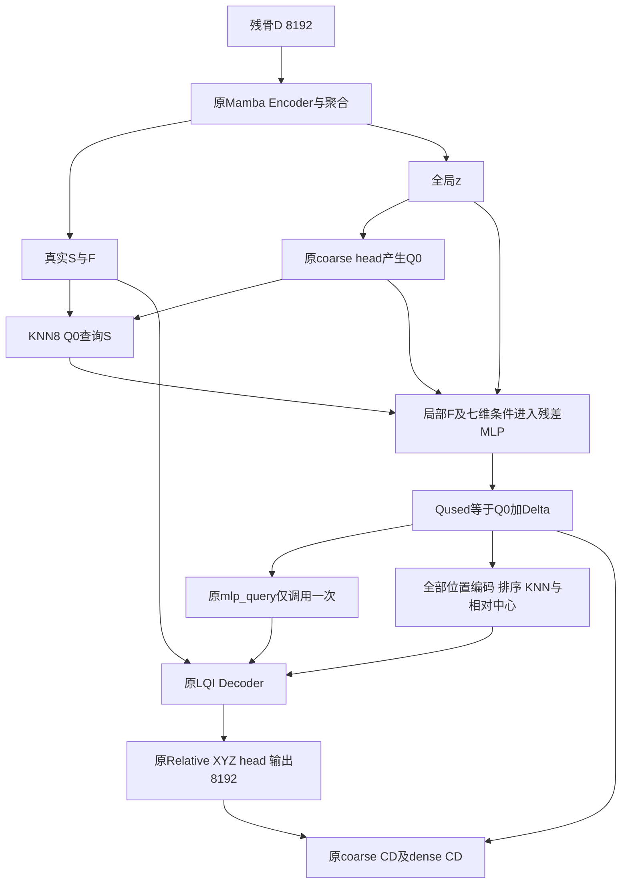

# Cranial-BCSP-FullMamba：空间条件 Coarse 与病例级可靠性正式实验计划

**版本：v2.0；日期：2026-11-13；状态：待研究负责人确认。**

本文件修订用户同日提供的 v1.0 草案，作为后续分阶段研究的参考协议。它不是执行授权、execution request、已实施算法或新性能报告。本轮仅阅读本机文本、核对有限源码及联网文献，未访问服务器、加载 checkpoint、读取真实预测数组、重新评分或训练。

## 1. 审阅结论与本版研究决策

**总体判断：方向合理，值得做一次有终点的证伪研究；现有证据不足以保证“局部 Query 空间残差”是最优下一步，也不足以支持原创性或稳定优越性主张。**

保留原案的核心选择：固定完整骨组织边界表示、8192→8192、原 loss 和 LQI 无注意力母版；先诊断、再验证唯一空间残差；先四次 B/S 训练，支持后再补两次同容量 F 对照。不同于原案，本版不把主观的“邻域可信”当训练准入证据，不重复原 query 网络计算，明确三臂的数据流及预算判断，并更新已经完成的归档和服务器清理状态。

### 1.1 原案优点

1. 将完整骨块、接口和长尾风险作为目标，没有用质心或半径改善替代补全质量。
2. 研究位置由 decoder 条件传递转向其上游 coarse 生成，符合冻结诊断所暴露的问题。
3. 区分 GT 诊断与 D-only 推理，保留同容量对照、同设备比较及单 seed 限制。
4. 明确旧 H1/H2 固定候选的负结果，不把采样、点数、对称先验和新 loss 同时加入。

### 1.2 必须修改的内容

| 原案问题 | 本版修改及理由 |
|---|---|
| 文本称在 `mlp_query` 之前插入，公式却先用 `X=mlp_query(z,Qraw)` | SCQ 直接读取 z、Qraw、局部 F 和相对几何，原 `mlp_query` 仅在 Qused 形成后调用一次 |
| 可将原 query 模块想当然视作带 BN | 已查看母版：该模块实际为 Linear/GELU，无 BN；重复调用的真实问题是冗余计算和梯度路径改变，不能虚构 BN 缺陷 |
| “有界残差”与未设置幅度上限不一致 | 明确 Δ 无硬幅度界；clip10 限制梯度，不限制坐标残差 |
| N0 用远距离 KNN 或“与缺损无关”直接判 NO-GO | 远离残骨可能恰是缺失骨片的合理位置。距离只作描述，不作为 GT 选择模型或否定机制的阈值 |
| 成功门中“有意义、显著/广泛退化”含混 | 写出原始未舍入指标、来源符号及风险转移的确定性预算晋级规则，明确它不是临床阈值或确认性检验 |
| F 对照在看到 S 收益后才补，存在选择性解释 | 训练前冻结 F 代码、初始化和判断规则；仅将后补视作阶段式开发，结果不获得未经校正的确认性意义 |
| 归档章节仍要求从零备份四权重，且将无恢复推理等同未核验归档 | 更新为“字节与成员备份已核验，模型恢复推理未验证”；只恢复本次确需的资产 |
| 继续依赖服务器旧结果路径 | 2026-11-13 已授权删除 680 个已备份文件，后续应以本机归档为来源，不假设远端旧文件仍在 |
| 文献版本和新近工作不全 | 更新 3DMambaComplete v2/TOMM 信息，加入 Simba、医学可靠性审计及近期 RWKV 对照背景；不按标题把含 Mamba 的网络一概称无注意力 |
| 缺少明确准备终点 | N0 限定一次基础复盘、必要时一次最多七例原模型追踪；不新建通用库存、传输或硬隔离框架 |

**本版不把方案确认等同于授权实施。下一项可申请的实际工作是第 6 节 N0-A 本机证据复盘。**

## 2. 研究问题、表示及临床边界

对于完整分割骨实体 C 和切除区域 R，沿用 D=C\R、G=C∩R，C=D∪G、D∩G=∅ 的实体缺损语义。输入是 ∂D，目标是 ∂G。边界包括原分割保留的外侧、内侧、孔道/腔体和切壁，不仅是一片外壳。

E 表示缺失骨块继承的原生自由表面，J 表示与残骨共享的实体切壁；按冻结体素面来源分类 ∂G=E∪J。J 有面积，不等于二维 rim 线。∂D∪∂G 中存在的共享内部切壁，不属于实体并集的外边界 ∂C。

主问题：**在已有 LQI 中，为每个 coarse slot 额外提供输入 Memory 的局部特征及明确的相对几何数值，能否改善最终 Native 骨块的完整覆盖和病例风险？若改善，是否优于只增加局部特征残差容量？**

不将 8192 点的骨块边界称为水密植入物；不能由点间距离直接认证骨厚度、制造性能、临床装配间隙或材料安全性。临床植入设计与合成骨块存在差异，见文献 [R10–R12]。本轮不追加体积网络、mesh/solid 重建或临床病例认证。

## 3. 已有证据与允许的推断

下表来自已冻结 FullMamba 报告，不是本轮重新评分。P95/CD 单位 mm，Cover 为 2 mm；来源内五缺损先平均，再来源等权。

| Fold | 模型 | E P95↓ | J P95↓ | J Cover↑ | CD↓ | 严重病例/105 |
|---|---|---:|---:|---:|---:|---:|
| C | T0 | 8.450 | 11.626 | 47.01% | 4.308 | 7 |
| C | M0 | 6.935 | 9.476 | 50.29% | 3.885 | 4 |
| C | F0 | 7.615 | 10.286 | 49.57% | 4.476 | 4 |
| C | LQI | 7.338 | 10.148 | 47.84% | 4.040 | 5 |
| D | T0 | 7.450 | 10.922 | 45.91% | 3.484 | 5 |
| D | M0 | 7.812 | 10.795 | 48.13% | 4.194 | 10 |
| D | F0 | 10.913 | 13.999 | 40.26% | 6.295 | 12 |
| D | LQI | 6.898 | 9.468 | 48.05% | 3.986 | 5 |

LQI 对 F0：D 折 E P95 下降约 4.014 mm，17/21 来源改善；C 折下降约 0.277 mm，但 11/21 来源退化，E/J Cover 均下降。严重事件合计 16→10，新增 5、恢复 11。训练 GPU UUID/驱动不同，且原生 Mamba 存在有限梯度非位级确定性。因此不能直接把全部差异归因于 LQI。

F0 的 30 次 decoder-only 干预中，prefix donor dense 坐标 RMSE 平均约 0.034335 mm，local donor 约 4.620589 mm。干预强度和语义不同，后者还可能破坏邻域；这些数值不是准确率、梯度贡献比或“Mamba 遗忘”的证明。

固定病例提示至少两类问题：C/012 的 LQI coarse/dense 已整块错位；D/060 则位置较近但范围收缩、接口覆盖不足。最终 Q 已错，不能据此确定最早错误来自 encoder、池化还是 coarse head。LQI 训练后 Q 改变也不能称为其 decoder 在同一次推理中改写上游 Q。

旧 P2 中 H1 矩监督及 H2 固定尺度候选未形成稳定 E/J 收益。这只是否定具体候选在该训练条件下的效果，不是数学上否定所有几何约束。新研究不能换名复用旧候选并省略对照。

## 4. 文献对照及新颖性边界

### 4.1 本次检索范围与可得性

检索日期 2026-11-13。围绕 Mamba point cloud completion、coarse/query geometry、cranial implant completion 检索 arXiv、会议/出版社及作者机构页面；结合用户原 31 篇颅骨论文及后续粘贴的分级文献清单按相关性筛选。未把全部标题标为已精读，未声称系统综述穷尽全部研究。

当前未提供专门的学术检索 MCP，改用网页检索访问上述一手入口；无须安装工具或配置密钥。部分 IEEE/Elsevier 全文及 AAAI 页面有访问限制。下表区分方法正文与摘要/索引，不将摘要升级为逐公式验证；FusionMamba 同名遥感图像融合论文不能替代点云那篇。

| 工作及核验层级 | 与本阶段直接相关的事实 | 对本计划的约束 |
|---|---|---|
| 3DMambaComplete v2，2026-05-19，arXiv 方法正文及其 TOMM 元数据 [R1] | HyperPoint 生成、offset 分散及变形；正文仍有 cross-attention | 更新旧“仅 2024 预印本”描述；“粗点残差防集中”不是独有贡献，不能作全无注意力证明 |
| CompletionMamba，TIP 2025，机构出版记录/摘要 [R2] | 用局部与形状感知 SSM 建模补全 | 不宣称首次将局部几何/形状信息接入 Mamba；方法全文细节留待投稿前核对 |
| DAPointMamba，AAAI 2026，出版检索记录及作者预印本 [R3] | 面向域适应的 patch 扫描和空间/通道对齐 | 不把 patch 对齐或几何序列化本身作为原创；任务不同，不抄原文分数 |
| FusionMamba 点云篇，Information Fusion 2026，出版预览 [R4] | LGSA 及 residual geometric alignment 是明显近邻概念 | 不能仅凭“输入空间条件+残差”宣布创新；全文受限，原创性结论暂缓 |
| Simba，AAAI-26 接收记录，预印本方法正文 [R5] | 变换场扩散与分级 Mamba 精修；前两级融合仍有 cross-attention | 是几何条件化相关工作，不是纯无注意力直接基线；不自动引入对称/扩散 |
| PPC-MT、Mamba/Transformer 补全混合网络，摘要/出版页 [R6–R7] | 仍保留 Transformer 或 cross-attention 分支 | 支持分类比较，不能证明去掉 decoder attention 必然有利 |
| DAPointRWKV，2026-11 预印本方法页 [R8] | 几何偏置、序列化和 progressive decoder 在其他序列模型中也被研究 | 它不是 Mamba；说明空间条件问题不专属于 SSM，不升级本轮架构搜索 |
| MPath Mamba，2026-11 预印本摘要 [R9] | 语义场景补全结合 Mamba 和扩散 | 与单颅骨缺失骨片目标不同，只作近期边界背景 |
| MedPCFM、MedPCFM-TED，2026 作者论文 [R10] | 医学点云的 deterministic PTv3、流匹配及蒸馏比较 | 后续强基线应考虑同协议适配；不同时改成随机生成 |
| 临床植入设计研究及 2026 可信度审计 [R11–R12] | 点云外观、补全误差与可植入性不是同一概念 | 保留无操作控制与风险报告，不把接口 Cover 当临床认证 |

### 4.2 对用户原文献清单的具体取舍

Wodzinski 2023 的高分辨率 Transformer、点云扩散及实体/occupancy/SDF 工作有助于理解目标表示和表面到实体的鸿沟 [R13–R14]；不能把体积点云、整颅骨恢复、植入物生成的原论文指标直接与当前 ∂D→∂G 表面任务排列。CDRMamba 和原清单中尚未取得完整方法的医学模型继续作为待核验背景，不依据标题推断其模块或纯 Mamba 性质。

PointMamba/Mamba3D 等点云分析骨干不自动等同补全模型；SkullFix/SkullBreak/MUG 数据论文说明来源，不代替当前训练/开发病例身份审计。原清单中的法向、对称、骨厚度、隐式表面、概率生成方向可留待整体骨块稳定后研究，本轮不并行加入。

### 4.3 未来可主张的贡献范围

候选定位是：**在固定无注意力骨干中，将逐 Query 的 D-only 相对 Memory 几何接入 coarse 生成，检验其是否优于同容量局部特征残差，并用完整骨块/共享切壁/来源级长尾评价其收益与代价。**

这是可检验的问题，不是已经证明的原创方法。投稿前必须对 [R1–R5] 的插入位置、条件来源、offset 参数化、监督、注意力分支逐项比对。医学任务迁移本身不足以证明算法原创；若显式坐标不优于 F 对照，应转述为局部读出/容量收益，不能继续强调“空间条件创新”。

## 5. 冻结任务与母版

| 项目 | 冻结内容 |
|---|---|
| 数据 | SkullBreak 已开放 84 来源、五类缺损/来源，共 420 病例 |
| 两折 | C、D 各 63 train 来源/315 病例，21 dev 来源/105 病例；两折 dev 来源不重叠 |
| 表示与点数 | V1 物理暴露体素面面积采样；输入 ∂D 8192，目标 ∂G 8192；Q256，每 Q 展开 32 点 |
| 归一化 | 沿用 D 决定的世界坐标 center/scale；G 共用，不重新由预测或 GT 估计 |
| 母版 | LQI-v1；这是一次性研究预算选择，不是可靠性认证 |
| 禁止改动 | encoder/decoder 序列规则、局部 k、采样、点数、额外 H1/H2/rim/对称 loss、AMP、Chamfer 后端 |
| 封存 | confirmation20、官方测试、未开放/monitor 等原保护范围不访问 |
| 外部数据 | SkullFix 暂不进入首轮模型训练；MUG 不用作已认证高精度解剖 GT |

五种类型为 bilateral、frontoorbital、parietotemporal、random_1、random_2。C/D 的训练来源有交集，开发来源也已被多轮观察。它们是固定开发性研究集合，不是新的盲测或两次独立临床验证。来源是主要统计单位，不能把同来源五种缺损当五名独立患者。

**母版不事后切换。** 同设备 LQI-B 表现不利也不能换 F0 重新挑分数。原 T0/M0/F0/LQI 留作历史背景；新结构的主要效应来自新 B/S 同条件对照。

## 6. N0：一次有限的现有证据复盘

### 6.1 N0-A：只使用既有结果

按本机归档清单读取 F0/LQI 各 210 份 Q256/P8192 的身份及既有评分；合计 420 份历史模型输出，不产生新预测。优先复用已计算统计；确需新几何描述时标为诊断扩展，不覆盖原评分。

固定输出：逐病例和逐来源 E/J/CD/风险表、Q/P 质心误差、表面采样回转半径比、协方差谱与世界 bbox；全部五类型保留。质心与范围不是实体体积或精确形状。不能把向量误差范数直接相加；使用 μP−μG=(μQ−μG)+(μP−μQ) 的向量分解。

重点病例固定为 C/012/parietotemporal、C/013/frontoorbital、C/038/random_1、C/041/frontoorbital、D/060/bilateral、D/008/frontoorbital、D/052/frontoorbital。七例只是已有选择的解释性案例，不据它们估计总体发生率或筛选训练样本。

### 6.2 N0-B：确有缺失时的七例实际 Memory 追踪

先检查历史文件是否保存实际 encoder 的 S256/F256×384。若已有，不新增 forward。若没有，另行申请**最多七次 LQI Native eval forward、0 backward、0 optimizer step**，仅对应上述七例及两折原 checkpoint；不额外运行 F0。记录真实 S/F、Q、原始 KNN 索引、排序/逆排序及归一化。

不得以 NumPy 近似 FPS 或输入 8192 点的 KNN 冒充实际 256 Memory 的轨迹。加载后先核对原 checkpoint、源码、输入、归一化；Q/P 与冻结输出按原有等价性合同比较。若原合同没有容差，执行前登记，建议数值身份上限为 normalized max-abs≤1e−6 且 world max-abs≤1e−3 mm，两者均满足；这些只是工程身份检查提案，未在本轮实测，不是临床精度指标。超限停止归因，不能边观察边放宽。

追踪必须使用真实历史路径、eval/inference_mode，前后参数/持久 BN/RNG 状态恢复并核对；人工导出不得改变预测。若不能恢复，则明确 S/F 为 NOT_AVAILABLE，停止本轮局部机制准入，不重新训练旧模型来补轨迹。

### 6.3 Memory 分析如何避免循环论证

报告 d1=min||q−s||、d8=邻域平均距离、邻域直径及局部特征离散度。GT 仅用于离线按 Q 距 G/J/E 的误差分层，不进入推理或训练数据筛选。

必须承认：缺失骨片内部粗点与残骨表面相距较远可以完全合理；跨内外板的欧氏近邻也不必对应同一解剖表面。因而**“距离大”“8 个邻居合法”“位于 GT 附近”都不是条件有用性的证明**。本轮没有已验证的“邻域可信度”临床标签，不制造一个由 dev GT 决定的模型启用门。

SCQ 每个 Query 还可读取 z；即使局部邻域欠理想，也不能逻辑上宣布候选完全无法纠正大偏移。N0 只判断数据身份、接口可用、假设是否与旧候选不同，并说明预期局限。

### 6.4 N0 完成与停止条件

完成：420 份历史输出身份清楚；210 病例/模型、42 开发来源及五类型齐全；七例图和实际 S 的可得性明确；给出 coarse 错位、范围不足、dense/接口残差的联合分布。

停止：输入/输出身份错误、实际接口不存在、GT 泄漏、原模型无法恢复且无真实 trace。仅凭历史近邻距离或七例主观外观，不设置性能型 GO 门。若证据明显更支持不依赖错误 Q 的 coarse 生成，可由负责人在看到新候选分数前终止 SCQ；不得直接切另一公式后沿用此协议。

**准备预算**：一次本机基础复盘、必要时一次七例追踪；不扩大病例、k、半径或可视化搜索。预计 1–2 个工作日为计划预算，若超出，列出唯一实质阻断，决定停止或另立范围；不持续开发通用框架。

## 7. N1：唯一结构 SCQ-v2 的数学定义

本节是设计冻结提案；实现前须以有限差量核对确认张量的实际身份。若不同，不自动用投影层或别的变量替代，应先修订本公式并重新确认。

### 7.1 插入点及维度

原路径产生 S∈R^(B×256×3)、F∈R^(B×256×384)、全局 z∈R^(B×1024)、Q0∈R^(B×256×3)。**在 Q0 产生后、所有后续 query 构造/排序/decoder 之前**加入残差。

原 `mlp_query` 的实际母版是 Linear(1027,1024)→GELU→Linear(1024,1024)→GELU→Linear(1024,384)，无 BN。SCQ 不先调用它产生 Xraw，也不共享它的权重作为新增残差网络。

### 7.2 局部特征和七维空间描述

用 Q0 查询 S 的 k=8 精确欧氏近邻，索引选择不求导；重复距离的 tie 顺序按冻结实现处理。不得反向在 Q 中查询 S。

\[
N_i=\operatorname{KNN}_8(S,Q_i^0),\quad
f_i^{a}=\tfrac18\sum_{j\in N_i}\operatorname{LN}_{0}(F_j),\quad
f_i^{m}=\max_{j\in N_i}\operatorname{LN}_{0}(F_j).
\]

LN0 是新增、无 affine 参数、eps=1e−5、仅对最后特征轴归一化的函数，不改变原 decoder LN。令 d_ij=S_j−Q_i0：

\[
\bar d_i=\tfrac18\sum_jd_{ij},\quad
\sigma_{i,a}=\sqrt{\tfrac18\sum_j(d_{ij,a}-\bar d_{i,a})^2+10^{-6}},\quad
\rho_i=\tfrac18\sum_j\|d_{ij}\|_2,\quad
g_i=[\bar d_i,\sigma_i,\rho_i]\in\mathbb R^7.
\]

σ 的 Q 平移项相消，是所选 S 邻域的轴向散布，不是骨厚度。eps 为归一化坐标中的设计常数，不能称 1 mm 容差。ρ、dbar 保留距离/方向信息。所有几何使用原 D-only 坐标，不按 GT 或预测重新缩放。

### 7.3 唯一两层头与三臂

\[
u_i=[z,f_i^a,f_i^m,Q_i^0]\in\mathbb R^{1795},\quad
\Delta_i=W_2\operatorname{GELU}(W_1[u_i,\tilde g_i]+b_1)+b_2,\quad
Q_i^*=Q_i^0+\Delta_i.
\]

头为 **1802→384→3，两个 Linear 均有 bias**。不加 BN、dropout、attention、额外 SSM、距离权重或幅度门控。理论新增可训练参数 693,507；若母版 39,903,169 不变，F/S 理论总量 40,596,676，须用实际实例化核对，不能把估算当已测量。

| 臂 | 行为 | 可解释的比较 |
|---|---|---|
| B：LQI-B | 原母版；不参与残差计算，Q*=Q0 | S−B 是新增整个机制的效果，含容量和梯度路径变化 |
| F：SCQ-F | gtilde=Pfix·LN0(fa)，为活跃的七维固定投影 | S−F 检查显式相对几何相对局部特征替代输入的增量 |
| S：SCQ-S | gtilde=g | 唯一主候选 |

Pfix 是固定 7×384 正交行矩阵，只作 buffer；CPU 独立 Generator 种子 20261113，使用固定版本 QR 得到后保存完整 FP32 字节及 SHA256。F/S 都注册同一 buffer，避免 state key 不一致；S 不消费投影输出。投影生成不消耗母版随机流。

七维通道分布不同；F 还通过 KNN、F、z 和 Q0 保留空间信息。因此 F 只能称“去显式相对坐标数值对照”，不是纯无空间或严格随机化因果控制。不在本轮增加 matched-statistics、第三个替代通道或投影种子搜索。

### 7.4 初始化、梯度和输出

W2/b2 全零；W1 按独立 CPU 随机流种子 20261114、固定 PyTorch Linear 默认初始化规则生成并保存。F/S 新参数完全相同；B/F/S 共有参数与初始持久状态逐名匹配，新增参数不推进共有 RNG。实测初始完整 forward 应与 B 等价。

第一步 W2=0 时，新增 W1 的梯度可为零，这是链式法则，不是实现失败。第二次人工验证通过**手动设置已知非零 W2**检查上游可导，不必为此更新真实模型或做 optimizer step。

Δ 无硬幅度上限，不硬贴残骨，不 clamp 到 GT 或输入 bbox；global clip10 仅控制梯度。记录有限大残差为科研风险，不能把有限但错误的输出自动删掉。非有限数值才按数值失败停止。

正式重建监督仅为原 CD(Q*,G)+CD(P,G)，denoise=0；不额外保留 CD(Q0,G) 作为新辅助项。保存 Q0/Q*/Δ/P，Q0 只是同模型内部诊断，不是另一完整推理臂。

## 8. 接入合同：只改 coarse 条件化，全部下游使用 Q*

有限源码核对必须枚举实际消费者，不预设恰好五处：query feature、position embedding、self/local graph、LQI KNN、稳定排序/逆置换、dense 相对中心、coarse return/loss，以及当前母版存在的 query selection/ranking 分支。确认本合同实际使用 learned coarse 256，不意外混入输入 FPS query 或 denoise query。

Q0 的 KNN 只服务残差；Q* 的 KNN 重新用于 decoder，不共用错误缓存。Q* 改变下游邻域和排序是实际机制的一部分。SCQ 与整个模型共同训练，不能把最终差异解释为“仅七个坐标值的孤立直接作用”。

保持现有 shared PE、local graph、SSM 参数和 optimizer 分组策略。禁止恢复 `softmax(QKᵀ)V`、MultiheadAttention、SDPA 或换名实现的内容注意力。DynamicGraphAttention 按实际 KNN/MLP/max 运算判断；第三方 opaque kernel 只报告可观察证据范围，不作全二进制形式证明。

## 9. N2：最小 CPU 与真实 CUDA 准入

实施范围建议限制为残差模块、隔离 factory/接入、短入口、针对性 tests；复用已通过的运行和评价工具。记录差量、源码 SHA、CPU 结果及一次 P3，不新建通用审计系统。

### 9.1 必须覆盖的 CPU 合同

| 类别 | 必需断言/反例 |
|---|---|
| 几何 | Q→S KNN 方向、独立小样本参考、ties、重复坐标、近/远 Query、薄双层面 |
| 对齐 | S/F 同步置换、索引合法、B=1/B=8 无串批；唯一距离时验证置换一致，ties 按实际稳定规则，不声称任意 ties 下严格置换不变 |
| 公式 | fa/fm、7D g、Pfix 正交行/固定字节、两层维度和精确参数量 |
| 初始化 | W2=0 时 Q*=Q0；初始完整输出等价；所有共有参数/持久 BN 未被新增随机流或调用次数改变 |
| 梯度 | coarse/dense loss 真正到达 Δ；初始 W2 可导，已知非零 W2 时 W1/被选 F/Q0 可导，离散索引不伪称可微 |
| 实际接入 | 已知非零残差使真实 decoder 坐标消费者、KNN/排序、P 和 loss 响应；保留张量身份日志 |
| 无泄漏 | 仅 D 可完成 forward；G/J/类别/GT bbox 不参与条件、索引、开关或归一化 |
| 反例 | 正确质心但范围狭小、错误位置但拥有合法邻居；应暴露局限，不要求方法凭空成功 |
| 数值边界 | FP32 finite、D-only world 往返、状态/RNG 复原；刚体变换仅做鲁棒性观察 |

本模型的 XYZ 排序、axis-wise MLP 和 KNN ties 不保证严格 SE(3) 等变/不变，不能要求其通过不存在的数学性质。有限 Mamba 梯度非位级确定性沿用已披露政策，不以 byte equality 作为所有重复 backward 的条件。

### 9.2 CUDA 固定工作量

人工输入、真实 Mamba/PointNet2、原 torch.cdist loss：B batch1、F batch1、S batch1、S batch8 train 各一次完整 forward/loss/backward；**总计 4 forward、4 backward、0 optimizer step**。不额外临时加 GPU 测试；已知残差响应在 CPU 接入验证完成，必要的新增 CUDA 反例须另列次数。

记录真实 loss、预期活跃梯度组、峰值 allocated/reserved、SMI 样本、RSS、BN 与各 RNG 指纹。batch8 train 的 BN 临时变化在任务结束前恢复。验证不将 GT 作为模型条件；人工 G 只供原监督 loss。

准入只证明固定版本、输入和设备下可运行与可反传，不证明精度。新 coarse 路径值得一次必要 CUDA 验证，但不重复完整旧 FullMamba preflight，不重编译 provider 或升级环境。

## 10. N3/N4：正式训练矩阵与控制变量

### 10.1 阶段式最多六运行

| 顺序阶段 | 模型 | 每折训练 | 总更新 | 目的 |
|---|---|---:|---:|---|
| N3 | B_C、S_C、B_D、S_D | B/S 各一次 | 15,600 | 新机制相对同设备母版是否值得继续 |
| 条件式 N4 | F_C、F_D | F 一次 | 7,800 | 区分新增局部读出与显式相对几何 |
| 合计上限 | 六个 scratch 模型 | 三臂×两折 | 23,400 | 超出需新协议，不自动追加 |

F 的公式、投影、初始化、参数组在 N3 之前冻结。N3 单凭 S−B 不能归因于显式坐标。阶段选择带来的偏差必须披露；N4 仍是开发性机制复核，不因后补成功自动获得确认性显著性。

每折 B/S/F 必须同 GPU UUID、驱动、软件/数值合同和数据顺序；优先六次同一容器。若 F 阶段已换设备，不用历史 B/S 硬配，标为未完成归因，是否重建匹配组另行批准，不突破六运行上限。两折配置在首个训练前同时锁定，不看 C loss 或分数调 D。

### 10.2 每运行固定合同

- seed0，scratch；batch8；100 traversals，每遍历 floor(315/8)=39 更新；总 **3900 更新、31200 病例曝光、300 个 drop-last 样本曝光缺额**。不能称“每病例恰好曝光相同”，应沿用冻结逐批次顺序与逐病例计数核验。
- AdamW：lr1e−4、betas=(0.9,0.999)、eps1e−8、global clip10；lr=1e−4×max(0.9^(epoch/21),0.02)，原 BN schedule 不变。
- 原参数实际 decay 0 或5e−4；新增 W1/W2 权重5e−4、bias0；SSM A_log/D no-decay 不变。optimizer defaults 的 .01 不代表显式参数组实际 decay。
- FP32、TF32=false，沿用确定性设置及有限梯度非确定性披露；固定 torch.cdist 后端和现有环境；不引入 AMP、Chamfer 重编译或版本升级。
- 固定 epoch99/step3900 checkpoint；不择 dev best epoch；不 warmstart 旧权重；不 resume/自动重训。
- 原 CD(Q*,G)+CD(P,G)，其余新监督均0。runtime 的 `loss_sparse=0` 是历史命名映射，不能因此说 coarse 未监督；新增日志分别记录实际 coarse CD 与 dense CD，反向仍只使用一次原总和。

3900 步是对照预算，不证明充分收敛。若未来需长训，另立同时延长所有比较臂的协议，本轮不根据单臂欠拟合追加步数。

## 11. Native 预测与评分

N3 每模型每折105例，共 **420 次新 Native 预测**；N4 另210次，总630次。全部按固定顺序 eval/inference_mode 单次执行；GT 不进入模型 forward。不做配准、去飞点、TTA、按病例选臂、BNCal 或后处理。

保存输入/checkpoint/代码身份、fold/source/case/type/seed、D-only center/scale、Qraw/Qused/P、Δ摘要、有限性及实际 Memory 距离摘要。七例按事前清单保存实际 S/索引，F 特征仅按预定需要导出；不得在看到好结果后只保存有利病例。

冻结原评分代码 SHA256：`af938519125b25b6d22d862dd4967dabef3be6d97d38e60eb9995ee7e9ce9766`，须在执行前核对；不由本计划改写算法。

| 指标层级 | 定义与边界 |
|---|---|
| 主终点 | E 的高分辨率 A1 面参考→预测、物理面积加权 P95，world mm；先病例再来源汇总 |
| 共同次终点 | J P95、E/J Cover@1/2mm、双向未平方 CD-L1、预测→A2 P95 和 >20mm 比例；0.5mm 若原输出已有则沿用，否则单列扩展版本，不冒充已有冻结字段 |
| 研究风险 | severe：E P95>20mm 或 J Cover2==0；placement：质心偏差>20mm；compact：回转半径比<0.9，阈值不变 |
| 诊断 | Qraw/Qused/P 的位置、范围、协方差谱和 residual 分解；不替代 Native 完整骨片评分 |
| 控制 | GT8192 有限采样上限与 Nop_D；二者共享且独立于模型前向 |

GT8192 到高分辨率 A1 的误差不必为0；这属于参考/采样差异，不把它全归模型。E/J Cover 是参考点附近支持率，不能证明预测点来自正确解剖表面、连续接触或壁面法向吻合。不同表面在2mm邻近也可能产生交叉支持。

第一批 B/S 420 模型行+420 共享控制行=840评分行；三臂完整后630模型行+420控制行=1050行。旧控制复用须哈希一致，不能把复用控制当新模型预测或独立患者。

## 12. 统计与可执行晋级规则

### 12.1 来源配对估计

每折主要比较 Δs=(1/5)Σt[e(s,t,S)−e(s,t,B)]；折均值为21来源 Δs 的平均。F 对照用同样定义。报告未舍入均值差、中位数/IQR、改善/退化来源数、全五类型和风险2×2转移。

每折单独 source-cluster paired bootstrap：21来源有放回10,000次，种子20261113，每次保留来源内五种缺损的完整配对。报告均值差95% percentile区间；同一比较多个指标复用同一组抽样索引。合并42来源仅作描述，不能视为两个完全独立模型重复。

该区间条件于已训练模型，不包含训练 seed 方差。单 seed、反复使用 dev、多指标及阶段式筛选都限制推断；不把 CI 全负或未经多重校正的 p 值写成最终临床/论文确认。风险事件同时报告病例与“至少一种缺损严重”的来源层级，不把样本相关性忽略后使用3/n无事件临床上界。

### 12.2 G1：是否值得支付 F 两次训练的保守预算门

为替代含混的“明显改善”，本版建议在负责人确认后采用以下**确定性、无临床含义**规则。计算一律用未舍入原值，不能通过报表四舍五入把退化当持平。

1. C、D 两折来源等权 ΔE 均<0，且每折至少11/21来源 E 改善。
2. 每折 J P95、CD 和预测→A2 >20mm 比例的来源均值不高于 B；E/J Cover2 均不低于 B。指标数值身份误差若需要容差，应在新预测前单独冻结，不能由新分数决定。
3. 任一折新增 severe 病例数必须为0；记录恢复数与共同严重数，不只看净减少。frontoorbital 的来源等权 E/J P95 不高于 B，J Cover2 不低于 B；其他四类仍全部展示。
4. 无缺失病例、泄漏、异常数值或未解决的设备/初始化/顺序不匹配。

全部通过才建议进入 N4；否则分别标为 MIXED_NOT_PROMOTED（局部收益与代价并存）、HYPOTHESIS_NOT_SUPPORTED（矩改善未转化）、NO_GO（完整指标整体退化）或 INCONCLUSIVE（工程/身份不足）。

**此门是选择研究预算的严格规则，不是最小临床有效差、非劣效性证明或“新风险为零”的总体保证。** 它可能拒绝有一定价值但尚不可靠的候选；不通过也不能宣布整个空间条件方向被普遍否证。若负责人认为标准过严，应在任何新训练/评分前修改并签定，不能观察结果后豁免病例。

### 12.3 N4 归因门及停止

最终同时报告 S−B、F−B、S−F。只有 S−F 在两折也符合上述方向/风险要求，才有“显式相对坐标在该设置额外有用”的开发性支持。S≈F 时保留共同局部读出解释，不继续包装空间坐标独有效果。S 胜 F 却不胜 B 不足以替代母版。

G1 后补 F 的选择性要写入报告。没有 F 或设备无法匹配则 NOT_ADJUDICATED，不用旧 F0/T0 填补容量对照。第一轮结束不扫描 k、投影、幅度、loss 或序列化寻找通过版本。

## 13. 机制复盘与风险分析

所有新增/恢复/共同严重病例列出 fold/source/type、E/J/CD、离群、Qraw→Qused→P 的位置/范围及同视角图。七例为解释，群体结论来自全105例/折。

同一次 forward 的 Qraw/Qused 可比较 coarse 几何，但不能把 Qraw 的结果称为“关掉 SCQ 后完整模型精度”。若后续确需同权重 dense 干预，应单独登记固定病例、完整重跑下游的次数，并区分：

- Δ 强制为0是移除残差的干预；
- g置0只是改变条件输入，残差仍可非零，**不等于关掉 SCQ**；
- 特征/几何交换可能 OOD，不证明因果重要性或泛化。

本轮默认不新增这些 GPU 干预。严禁用 GT-Oracle 配准后的分数冒充 Native 性能。若重复使用旧 Oracle，只用于离线归因，不回流到推理、门控或训练筛样。

## 14. 资源、故障与准备工作的终点

沿用已接受监测合同：RTX4090D级24GB、batch8；Torch allocated/reserved 各≤20GiB，设备采样≤22528MiB，RSS≤8GiB；磁盘/归档单次既有4GiB/2GiB预算保持，具体含义与监测口径由原运行合同核对，不重新发明硬隔离。CUDA 采样不能证明连续独占资源。

当前服务器清理后记录可用约12.81GiB只是2026-11-13时点，不作未来资源事实。每次启动前重查；保留至少4GiB可用空间作为本方案额外调度余量。六checkpoint约2.87GB原始字节量级，实际输出以新模型为准；不得因临时空间不足删除未备份结果。只恢复本次实际需要的两份 LQI checkpoint或结果材料，不重传全部旧权重。

不承诺“新头显存只增多少”或“训练必然25分钟”；GPU准入给出实测容量，训练报告真实时间。整个网络含 KNN/FPS/排序/Chamfer，不能由 Mamba 子层近线性推断整网严格 O(N) 或一定快于 Transformer。

N0 完成后，实施和准入集中在一轮有限适配中收尾。工程失败记录为未取得有效试验，不等于科研假设失败；正常训练完成而指标差是负结果。失败即停止该尝试，不自动 resume、重训、扩大病例或放宽科研门。必要兼容修订使用新版本并明确仍未改变何种科学合同，不借此扩展通用工具链。

## 15. 已归档资产、清理事实及恢复准入

与原案不同，当前状态为：

1. 代码/结果主包 823,642,789 字节，SHA256 `cb3c44f97ab9e0d90cae0f8ced27734e9fa7fcb34cb9ed51b3e88179b1251940`，2450成员已回读核验；伴随 support_sources 和两份 support 清单一同保留。
2. 四关键权重本机包 1,774,972,769 字节，SHA256 `40dc8b376906c6ea6f5d7bc3ed473bca2fdb2f8c2a3e10507863b020231afbae`，32成员已核验；原始四 PTH 同时保留。**没有恢复推理测试。**
3. GitHub final annotated tag `cranial-bcsp-fullmamba-20261112-final`，commit `979e997ea844d3b157a2aefe821575c819d5df08`，原 v1 tag保留。权重/二进制预测不在 GitHub。
4. 用户确认备份后，680文件已按清单删除，实测释放约3.07GiB；保留已安装工具、数据及环境。不能再将旧 logs/输出和服务器 ckpt 路径视作存在。

本机根目录：`E:/ResearchBackups/AdaPoinTr/BCSP_FULLMAMBA`；代码结果在 `2026-11-12_code_results_v1`，权重在 `2026-11-12_key_checkpoints_v1`，清理回执在 `2026-11-13_server_cleanup_receipts_v1`。

归档状态应分成 `BYTE_AND_MEMBER_VERIFIED` 与 `MODEL_RESTORE_NOT_TESTED`；不将缺少恢复 forward 误称压缩包未验证。后续若需要七例 trace，按 N0-B 才恢复/加载，不为“归档合规”强制增加四模型全量恢复流程。Windows与服务器不是同一文件系统，不把 E: 路径换算成猜测的服务器路径。

## 16. 条件式后续研究与论文证据

### 16.1 多 seed 与独立验证

N4 支持后另立预算，至少增加两个预先固定训练 seed（共≥3），B/F/S成组配对，不选最佳seed；展示每seed差异、最差seed及风险是否集中在相同来源。来源聚类和seed方差分开处理，3个seed不足以支持精细总体尾部推断。

未用于架构搜索的来源只在模型/阈值锁定且单独授权后打开。SkullFix 既有90来源已参与表示研究，不自动成为盲测；核对跨数据集实际来源重合、FOV和缺损生成差异。MUG未准入高精度GT，不通过换数据集名称绕过质量问题。

### 16.2 强基线与 Mamba 特异性

后续以同 ∂D→∂G、同点数、同source划分和评分参考适配 T0/M0 及条件允许的 deterministic PTv3；不能使用原论文不同任务的分数作 SOTA 排行。临床/体积/随机生成方法另注明任务口径。

若声称 SCQ 与 Mamba 特有协同，需在 Transformer母版上加同等模块的匹配消融；若只声称“在全Mamba任务系统中有效”，也不能隐瞒该模块可能架构通用。无注意力是当前设计约束，不是学术或临床价值本身。效率主张要同设备、warmup、多重复，分别报告编码/解码/KNN/dense头和全模型延迟及显存。

### 16.3 失败后不自动切换的分支

若身份/接口有效，但 SCQ 正常训练后仍错位或不可靠，收束该固定候选。下一独立假设可研究不依赖错误 Q0 查邻域的全 Memory→latent slots→coarse；这会改变 coarse generator，不能仍叫本版SCQ。若 Q 已合理而 P 漏覆，另立 dense展开/多表面覆盖研究，不同轮加入 rim、厚度、对称和16k输出。

训练顺利但几何差不是继续修监测器的理由；两个创新点不应在尚未定位整体骨块失败时同时堆叠。

## 17. 阶段交付、授权与总预算

| 阶段 | 一次性交付 | 本版建议上限 | 下一步条件 |
|---|---|---|---|
| N0-A | 既有输出/评分联合复盘 | 0新forward、0训练 | 身份与假设边界明确 |
| 必要 N0-B | 七例LQI实际Memory追踪 | 7forward、0backward、0step | 恢复身份及真实S确认 |
| N1 | 唯一公式实现、CPU/P3 | 无真实模型训练 | 全消费者、初始化、梯度正确 |
| N2 | 人工CUDA准入 | 4forward、4backward、0step | 固定batch8路径资源可用 |
| N3 | B/S两折训练与预测 | 4×3900更新；420预测 | G1预算门 |
| N4 | F两折补训、三臂评分 | 2×3900更新；210预测 | 归因门 |
| N5 | 多seed/独立来源/强基线 | 本版不授权、不承诺次数 | 独立协议 |

所有训练、恢复追踪、GPU准入与预测仍须对应冻结 execution request 的单独执行授权；本文件确认不启动任何任务。不为每个文本修订再建通用审计流程。沿用版本化运行、一次尝试、精确计数、前后状态及完整清单；代码/Git以本机规范副本为准。

每阶段保留：公式/数据/代码/环境身份、实际参数组、初始化/顺序/曝光、完整日志与checkpoint SHA、失败证据、Native预测、病例/来源评分、风险转移及解释报告。结果收束时再归档，不把未实施公式写成已完成。

## 18. 执行前签定清单

- [ ] 研究负责人确认 LQI 母版及 SCQ-v2 公式，接受 residual 无硬幅度上限和不保证等变性。
- [ ] 确认先N0、必要七例追踪，不以近邻距离/GT标签设推理开关。
- [ ] 确认首批四运行、条件式F两运行及跨设备时不自动补训。
- [ ] 签定本版G1严格预算门，或在看任何新结果前以明确版本修订。
- [ ] 实施前确认 S/F/z/Q0 实际shape、learned query路径及一次 mlp_query 调用。
- [ ] 固定投影字节、额外随机流、参数组、batch/source顺序及数值身份合同。
- [ ] 确认真正需要恢复的本机资产与新容器，不引用已清理的旧输出。
- [ ] CUDA准入/训练/预测分别形成具体待授权request；不以本计划代替执行授权。

## 19. 参考文献及本次核验级别

检索截至2026-11-13。下列是支持当前取舍的代表资料，不是用户清单的全文认证。日期以论文版本/出版社记录为准；预印本不自动升级为正式出版。R1和R5的方法信息来自可访问正文相应方法段；R4仅出版预览，未完成源码/完整公式审查。

- **[R1]** Li, Y., Ma, L., Yang, W., Fei, B. *3DMambaComplete: Structured State Space Model for High-Efficiency Point Cloud Completion.* arXiv:2404.07106v2, 2026-05-19；页面列TOMM 22(1), DOI 10.1145/3774887。[方法正文](https://arxiv.org/html/2404.07106v2)。旧v1标题/作者列表不能直接冒充v2。
- **[R2]** Fu, Z., et al. *CompletionMamba: Taming State Space Model for Point Cloud Completion.* IEEE TIP 34 (2025), 5473–5485，DOI 10.1109/TIP.2025.3597041。[作者机构出版记录](https://research-repository.uwa.edu.au/en/publications/completionmamba-taming-state-space-model-for-point-cloud-completi/)。核验摘要与出版身份，未取得完整方法全文。
- **[R3]** Li, Y., et al. *DAPointMamba: Domain Adaptive Point Mamba for Point Cloud Completion.* AAAI 2026，DOI 10.1609/aaai.v40i8.37596。[作者预印本](https://arxiv.org/abs/2511.20278)、[会议记录](https://ojs.aaai.org/index.php/AAAI/article/view/37596)。会议全文入口有访问限制，检索记录和作者版交叉核验。
- **[R4]** Wu, X., et al. *FusionMamba: Efficient 3D Point Cloud Completion via Spatially-Aware State Space Models and Multi-Scale Information Fusion.* Information Fusion 134 (2026),104378，DOI 10.1016/j.inffus.2026.104378。[出版预览](https://www.sciencedirect.com/science/article/pii/S1566253526002575)。摘要/Highlights可检索，完整页面曾403；不引用同名遥感融合项目代替。
- **[R5]** Zhang, L., et al. *Simba: Towards High-Fidelity and Geometrically-Consistent Point Cloud Completion via Transformation Diffusion.* AAAI-26接收记录；arXiv:2511.16161v1。[方法正文](https://arxiv.org/html/2511.16161v1)，重点3.2、MBA-Refiner；AAAI页面访问被拦截，不据此否定论文存在。
- **[R6]** Li, J., et al. *PPC-MT: Parallel Point Cloud Completion with Mamba-Transformer Hybrid Architecture.* arXiv:2603.00870。[作者摘要](https://arxiv.org/abs/2603.00870)，预印本层级。
- **[R7]** Wu, W., Xu, Y., Xie, Z. *A Point Cloud Completion Network Integrating Mamba and Transformer Architectures.* ESWA 313 (2026),130826，DOI 10.1016/j.eswa.2025.130826。[出版摘要](https://www.sciencedirect.com/science/article/pii/S0957417425044410)。
- **[R8]** Li, Y., et al. *DAPointRWKV: Domain Adaptive Vision RWKV for Point Cloud Completion.* arXiv:2611.10353v1，2026-11-07；作者页列ACM MM 2026元数据，独立ACM出版核验未完成。[作者方法页](https://arxiv.org/html/2611.10353v1)。
- **[R9]** Liang, L., et al. *Multi-Path Mamba Diffusion for 3D Point Cloud Semantic Scene Completion.* arXiv:2611.04583，2026-11-03。[摘要](https://arxiv.org/abs/2611.04583)。仅近期不同任务背景。
- **[R10]** Kwarciak, K., Wodzinski, M. *MedPCFM: Improving Medical Point Cloud Completion by Integrating Point Transformers and Flow Matching.* arXiv:2606.24433。[作者论文](https://arxiv.org/html/2606.24433v1)。另见 *MedPCFM-TED*, arXiv:2609.16934，[作者摘要](https://arxiv.org/abs/2609.16934)；没有直接移植其参数或排名。
- **[R11]** Fishman, Z., et al. *Thickness and Design Features of Clinical Cranial Implants—What Should Automated Methods Strive to Replicate?* IJCARS 19 (2024),747–756，DOI 10.1007/s11548-024-03068-4。[作者论文摘要与元数据](https://pubmed.ncbi.nlm.nih.gov/38430381/)。
- **[R12]** Wodzinski, M., et al. *Plausible but Unimplantable: A Trustworthiness Audit of Shape Completion Foundation Models for Cranial Defect Reconstruction.* arXiv:2610.30035，2026-10-21，作者标ACCV TrustFMI接收。[作者摘要](https://arxiv.org/abs/2610.30035)。其zero-shot模型和可植入性判据不同，不能用来宣称本项目已同样失败或已解决临床问题。
- **[R13]** Wodzinski, M., et al. *High-Resolution Cranial Defect Reconstruction by Iterative, Low-Resolution, Point Cloud Completion Transformers.* MICCAI 2023；arXiv:2308.03813v2。[作者记录](https://arxiv.org/abs/2308.03813)。本次核对摘要/版本，详细solid/surface协议以对应全文和本项目既有表示诊断为准。
- **[R14]** Friedrich, P., et al. *Point Cloud Diffusion Models for Automatic Implant Generation.* MICCAI 2023；arXiv:2303.08061。[作者论文](https://arxiv.org/abs/2303.08061)、[作者机构项目](https://dbe.unibas.ch/en/cian/research-projects/point-cloud-diffusion-models-for-automatic-implant-generation/)。

## 20. 本机证据入口与版本关系

- [FullMamba完整报告](../../reports/cranial_bcsp_fullmamba_20261112_v1/Cranial_BCSP_FullMamba_本轮完整实验报告_zh_2026-11-12_v1.md)。历史数值、源码角色、设备差异及风险转移的主要依据。
- [报告数值与来源编译](../../reports/cranial_bcsp_fullmamba_20261112_v1/verified_report_values_v1.json)。本文件只转录，不重做模型评分。
- [P2完整报告](../cranial_bcsp_mamba_p2_20261106/Cranial_BCSP_Mamba_P2_完整实验报告_zh_2026-11-07_v1.md)。H1/H2的有限否证及特征读出边界。
- [本机归档完成回执](E:/ResearchBackups/AdaPoinTr/BCSP_FULLMAMBA/FullMamba_归档完成回执_zh_20261112_v1.md)。备份字节身份与未做恢复测试的边界。
- [680文件清理回执](E:/ResearchBackups/AdaPoinTr/BCSP_FULLMAMBA/2026-11-13_server_cleanup_receipts_v1/server_completion_receipt.json)。更新远端文件可用性假设。

**最终建议：保留这一研究方向，但先做一次有限N0，以本版唯一公式和预算门为前提决定是否投入首批四运行。不要把“修好 coarse”当已经定位的唯一根因，也不要将本方案确认转成自动训练。**
