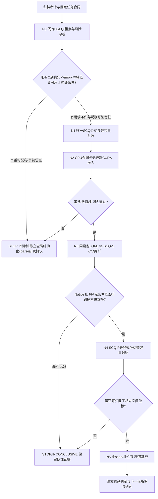

# Cranial-BCSP-FullMamba 下一阶段正式实验计划书

## 面向完整缺失骨块的输入空间条件、结构化 Coarse 生成与病例级可靠性研究

**方案版本**：v1.0（拟执行／预注册草案）  
**编制日期**：2026-11-13  
**研究任务**：残缺颅骨完整骨组织边界点云 `∂D (8192点)` → 缺失实体骨块完整边界点云 `∂G (8192点)`  
**研究平台**：已完成注意力替换的 Cranial-BCSP-FullMamba；保留 FPS、KNN、PointNet++/DGCNN、MLP、归一化、局部几何聚合及 Relative-XYZ；**不恢复 Transformer Self-Attention / Cross-Attention**。  
**本文件状态**：**仅为研究计划与建议，不是已执行实验报告，不构成服务器/GPU运行授权，不产生任何新的模型性能数字。**

> **一句话决策**：正式结束 F0/LQI 替换研究这一历史阶段；**暂以 LQI 作为下一阶段研究性母版**（不是已经获得可靠性认证的最终模型），先使用冻结证据确定其 coarse/query 空间失配与局部条件错配是否可见，再以**一个明确、可证伪的逐 Query 输入空间残差机制**开展同设备、匹配训练实验。不要再把全局质心约束、半径缩放、采样搜索或“多加 Mamba 层”作为本轮主线。

---

## 0. 阅读本计划之前必须理解的证据等级

本计划将所有陈述分为四类，避免把已有结果、论文事实、建模假设和拟执行步骤混为一谈。

- **[E：既有实验证据]** 直接来自本项目 `2026-11-12 FullMamba`、`2026-11-07 P2`、`2026-11-06 P1` 及更早几何 QC/P0 的冻结报告。数值仅依报告转录；**本文件没有重跑模型或独立复算最近邻距离**。
- **[L：公开文献]** 依据截至 2026-11-13 可访问的论文摘要、正式出版页面或开放论文；具体核验级别见第 3 节和参考文献。用户此前提供的论文题目清单是选题范围，不等于已获得并通读其全部正文。
- **[H：研究假设]** 尚待实验否证。尤其“coarse 头缺少空间联系”“局部邻域能修复定位”“Mamba 遗忘前缀条件”**均不是已知事实**。
- **[P：拟执行动作 / Gate：停止或晋级规则]** 此次计划的新研究操作，须在训练前锁定公式、数据、种子、预算与验收口径。不能以开发集成绩倒改。

### 0.1 本阶段最终交付是什么

首轮交付不是论文模型，也不是植入体 mesh，而是：

1. 一份能复核的 **coarse 位置—空间展开—输入 Memory 邻域—dense 完整覆盖**诊断；
2. 一个不含注意力、与 LQI **同设备、同数据、同训练合同**的唯一新机制实现；
3. 两折配对 `LQI-B` 与 `SCQ-S` 的 Native 全开发集评分和全部新增/恢复严重风险；
4. 如果获得可信正向结果，再补 `SCQ-F` 等容量去坐标对照及多 seed/独立来源确认；
5. 明确的 **GO / NO-GO / INCONCLUSIVE** 结论与冻结档案。

未经第 12–15 节条件检验，不使用“稳定提高”“医学级”“新 SOTA”“临床可用”等表述。

---

## 1. 前序研究的统一科研问题与任务语义

### 1.1 真正预测的是什么

设完整骨组织二值实体为 `C`，残缺实体为 `D`，移除骨块实体为 `G`。对于合成缺损，有：

\[
D=C\setminus R,\quad G=C\cap R,\quad C=D\cup G,\quad D\cap G=\varnothing.
\]

研究输入 `S_D = ∂D`，监督输出 `S_G = ∂G`。其中：

- `E_G`：缺失骨块继承自完整颅骨的未知原生自由表面，可包含外侧、内侧和源分割所保留的孔道/腔体表面；
- `J_G`：缺失骨块与残余骨 `D` 共享的物理切壁面，具有面积，并非单纯二维切口边缘线；
- `∂G = E_G ∪ J_G`（按已冻结体素面来源分类）。

**重要的实体几何事实**：`∂D ∪ ∂G` 不等于实体并集的外边界 `∂C`，因为共享内部断面在实体并集外边界上应消失。8192 点的 `∂G` 预测本身也不等于水密、可制造的实体植入物。

### 1.2 当前冻结数据协议 [E]

| 维度 | 固定合同 | 本轮是否可修改 |
|---|---|---|
| 主数据 | SkullBreak 已开放 84 来源，五类缺损/来源，共 420 病例 | 否 |
| 主开发折 | Fold C / Fold D，各 63 来源训练、21 来源开发；开发来源互不重叠 | 否 |
| 训练样本 | 每折 315 个缺损病例，来源不在本折 train/dev 交叉 | 否 |
| 输入 | 残骨全部暴露边界 `∂D`，8192×3，FP32 | 否 |
| 目标 | 缺失骨块全部暴露边界 `∂G`，8192×3，FP32 | 否 |
| 采样 | 已冻结 V1：按物理暴露体素面面积采样 | 否 |
| 归一化 | `D` 体素中心世界包围盒确定 center/scale，G 共用 | 否 |
| Coarse / Dense | 256×3 / 8192×3；每 coarse 生成 32 个 relative 点 | 否 |
| 训练原损失 | `CD(Q,G)+CD(P,G)`，去噪、H1/H2、额外 rim 损失均关闭 | 否 |
| 开发评价 | world-mm、E/J 分区、面积加权 P95 与 Cover、双向 CD、风险事件 | 否 |
| 保护边界 | confirmation20、官方测试、monitor、未开放来源继续封存 | 绝不访问 |
| SkullFix | 已完成几何 QC 的第二数据集，当前无同协议模型泛化结果 | 不进入第一轮 |
| MUG500+ | 当前实体构造不等于可靠临床解剖 GT，未准入高精度训练 | 不进入第一轮 |

**独立性边界**：一个来源有五种相关缺损；统计归约先按病例、再按来源平均，来源才是主要推断单位。C/D 训练来源有重叠；现有 C/D 开发来源已被多轮研究观察，后续在这些来源上取得收益仍是**开发性/探索性**证据，不能改称独立确认。

---

## 2. FullMamba 的冻结事实：为什么要从 coarse 空间条件而不是采样或 rim loss 开始

### 2.1 四种架构的结果 [E，2026-11-12]

以下 E/J P95、CD 单位为 mm；Cover 为 `@2mm`；所有预测均为 Native、无 GT 对齐。

| Fold | Model | E P95 ↓ | J P95 ↓ | E Cover ↑ | J Cover ↑ | CD ↓ | 严重病例/105 |
|---|---|---:|---:|---:|---:|---:|---:|
| C | T0：Transformer Encoder/Decoder | 8.450 | 11.626 | 62.09% | 47.01% | 4.308 | 7 |
| C | M0：Mamba Encoder + Transformer Decoder | 6.935 | 9.476 | 67.49% | 50.29% | 3.885 | 4 |
| C | F0：Attention-free Mamba Encoder/Decoder，prefix conditional | 7.615 | 10.286 | 66.04% | 49.57% | 4.476 | 4 |
| C | LQI：F0 + Query-local interleaved conditional sequence | 7.338 | 10.148 | 64.42% | 47.84% | 4.040 | 5 |
| D | T0 | 7.450 | 10.922 | 63.44% | 45.91% | 3.484 | 5 |
| D | M0 | 7.812 | 10.795 | 60.29% | 48.13% | 4.194 | 10 |
| D | F0 | 10.913 | 13.999 | 53.40% | 40.26% | 6.295 | 12 |
| D | LQI | 6.898 | 9.468 | 63.54% | 48.05% | 3.986 | 5 |

来源：`Cranial_BCSP_FullMamba_本轮完整实验报告_zh_2026-11-12_v1.md`，第 8 节。

**不得误读：**

- F0 成功建立完整无注意力 Mamba 主干，却**没有证明**该主干精度优于 M0。F0 在 D 折 15/21 来源 E P95 恶化，且额外参数多、精度较差。
- LQI 比 F0 在 D 折 E P95 改善 **4.014 mm**（17/21 来源），但 C 折只改善均值 **0.277 mm**，且 **11/21 来源 E P95 退化**；C 折 E/J Cover 分别下降约 1.61/1.73 pp。
- LQI 相对 F0 两折合计严重数 `16→10`，但**新发 5 例、挽回 11 例**；不能用净数取代风险转移。
- LQI 的训练 GPU UUID/驱动与 F0 不同；对照虽匹配初始化和样本顺序，**仍有跨设备/有限数值非确定性混杂**。
- 当前仅训练 seed0，无独立确认、无跨 seed 方差或论文可宣称的统计显著性。

### 2.2 条件传递的有限诊断 [E]

固定 10 组 recipient/donor 的 30 次 **decoder-only** 干预显示 F0 的 dense 坐标响应 RMSE：prefix donor ≈ **0.034335 mm**，local-graph donor ≈ **4.620589 mm**，prefix 特征置零 ≈ **0.963305 mm**。这些是同权重输出槽位的坐标响应，**不是 E/J 精度，更不是分支相对因果贡献比例**。Local donor 同时可能破坏邻域几何而造成 OOD；Query、`z`、X 被固定，原先已经携带 D 条件；不能断言 prefix 不重要。

LQI 用 Query 邻近 8 个真实 Memory Token 聚合特征，再按 `[A_1,Q_1,...,A_256,Q_256]` 交错送入单向 SSM，保持无 Transformer Attention。但这个修订**同时改变局部聚合与序列布局**，未单因素拆分；LQI 也尚未执行与 F0 完全对应的训练后 30 次条件干预。

### 2.3 病例级失效表型 [E]

| 病例 | LQI 或 F0 现象 | 对下阶段的约束 |
|---|---|---|
| `C/012/parietotemporal` | F0 E95≈5.21；LQI E95≈73.59，LQI coarse/dense 质心偏离约 91.74/92.77 mm | 最危险的是**正常病例转成整骨块错位**；不能只看平均 |
| `C/013/frontoorbital` | LQI E95≈18.54，但 J Cover2=0，仍触发严重风险 | 接口零覆盖不能被 E95<20 排除 |
| `D/060/bilateral` | LQI Dense 半径比≈0.536，J Cover2≈1.55%，没有远端 >20mm 飞点 | **位置较近不等于范围/覆盖充分** |
| `D/008/frontoorbital` | F0 E95≈77.21→LQI≈6.69 | LQI 确能在某些病例大幅改善 coarse 空间配置 |
| `D/052/frontoorbital` | F0 E95≈66.34→LQI≈4.42 | 同上，但不是完整接触/临床验收 |

已有多例错误在 **最终 coarse 出口**已经可见；Dense 可以纠偏，也可能维持或加重紧缩。由于 LQI 不在推理时修改上游 `Q`，两模型最终 coarse 不同是**训练后的端到端权重变化**，不能误称 LQI 在一次推理中“把 coarse 拉回正确位置”。

### 2.4 P2 已经否证的简化假设 [E，2026-11-07]

- **H1：**增加 coarse 质心和对数半径监督后，矩误差可改善，但 E/J P95 与 CD 在 C/D 两折均恶化；按固定候选收束。
- **H2：**冻结特征的半径信息可由线性读出更好预测；尺度残差进入真实生成路径、改变 coarse 范围，但 H2-COUPLE 不稳定、两折 E/J P95 相对 M0 均未改善，且 frontoorbital 反复退化。
- **P0/P1：**骨块级位置错误与局部形状不足并存；输入 J 覆盖改善未必带来预测 J 覆盖改善。

**因此新机制绝不能只是 `Q += 统一质心偏移`、`Q *= 单个半径标量`、重新加 H1 loss、增加输入点数或重复旧三平面/高曲率 rim 定位器。**

### 2.5 当前研究性母版的一次性选择 [P]

**选择：LQI-v1 作为下一阶段唯一主实验母版；F0-P-v2 及 M0/T0 只作冻结历史参照。**

理由：LQI 仍满足无 Self/Cross-Attention 的终局架构；在 D 折相比 F0 有广泛的完整几何收益，并保留了 Query 对齐的邻近条件接口，便于研究其上游 coarse 生成。它在 C 折新增严重失败，因此**不认证为安全/稳定模型**。选择 LQI 是面向研究机制的预算决策，不是根据合并均值宣布其普遍胜出。

**禁止事后切换母版**：如果 LQI 的后续候选不理想，不得改用 F0 重新挑选有利结果。若发现 LQI 基线无法同设备恢复，则本阶段先报告不可复现并停止效果声称；修复属于单独协议，不在 C/D 分数之间任意换母版。

---

## 3. 近期文献核验与本课题的真实研究空隙

本节依据出版机构、CVF/AAAI/NeurIPS 官方页或原作者/预印本信息。**可核验的公开摘要不等于已精读每篇全文或取得源码许可。** 具体链接与日期见第 22 节。

### 3.1 Mamba/点云补全核心文献

| 文献 | 已核验的核心思想 [L] | 与本课题的关系/创新重合风险 |
|---|---|---|
| **Mamba**（Gu & Dao，2023/2024） | 选择性状态空间与线性序列尺度建模 | Mamba 扫描本身不是创新；总网络含 KNN/Chamfer/排序，不得宣称严格整体 O(N) |
| **PointMamba**（NeurIPS 2024） | 空间填充曲线序列化与非层级 Mamba Encoder | XYZ/Morton/空间排序不是独家贡献；此前排序负结果应保留 |
| **3DMambaComplete**（2024 预印本） | Mamba 特征编码、HyperPoint 生成和分散、精细变形 | 它已关注粗点分散；不能把“防止 coarse 集中”当新颖性本身 |
| **CompletionMamba**（IEEE TIP 2025） | 邻域 local SSM 与 shape-aware Mamba，加强局部—全局形状联系 | 不能仅以 local KNN+SSM/shape code 为核心原创；需证明颅骨任务/接口及机制差异 |
| **DAPointMamba**（AAAI 2026） | 跨域 patch-level scanning，空间/通道 SSM 对齐，指出简单 1D 序列化破坏空间几何 | 直接重用 patch 对齐或多方向扫描有明显重合；本研究重点不是域适应 |
| **FusionMamba**（Information Fusion 2026） | 空间感知的局部—全局顺序聚合 LGSA 与 residual geometry correction CM | **高度相关重合风险**：输入几何锚/残差并非本课题天然新概念，必须通过完整公式、工作位置及任务机制区分 |
| **PPC-MT**（2026 预印本） | PCA 引导平行补全的 Mamba–Transformer 混合架构，Transformer 解码 | 强相关但不满足当前“无 Transformer Attention”的架构约束 |
| **BuildingComSSSM**（2026） | geometry-aware Mamba，但 keypoint generation/diffusion 仍分别使用 Self/Cross-Attention | 不能当作全无注意力的直接基线；几何条件生成思想已存在 |
| **A point cloud completion network integrating Mamba and transformer architectures**（ESWA 2026） | Mamba 编码 + cross-attention 解码 | 应归类为混合模型，不可用它证明无注意力 Decoder 必然有效 |

### 3.2 颅骨医学任务与强基线

| 文献 | 已核验事实 [L] | 本项目必须遵守的边界 |
|---|---|---|
| **Wodzinski et al., MICCAI 2023** | 低分辨率 Transformer 迭代高分辨率颅骨重建；原方案包含**实体正体素坐标**点云 | 不能把其 solid-point 结果当本项目 surface `∂D→∂G` 同任务数值 |
| **SkullBreak / SkullFix 数据论文**（2021） | 提供合成缺损与挑战基准，原数据有训练/评价边界 | 本项目只使用已开放的 84/90 来源，不声称覆盖原始全量挑战设置 |
| **Wodzinski et al., Learnable Symmetry**（2025） | 学习型颅骨对称先验，有专门的约束设计 | 对称性是未来可选机制；不等于所有缺损、局部骨厚度均严格对称 |
| **CDRMamba**（Biomedical Signal Processing and Control 2025） | 3D U-Net + Mamba 应用于颅颌面影像缺损重建 | **体积影像/分割路径**，不能当作本项目 surface query 点云方法的直接等任务对比 |
| **MedPCFM**（2026 arXiv） | PTv3 deterministic completion、flow matching 与 SkullFix/SkullBreak 医学点云基线，研究分辨率/规模 | 未来强基线应考虑其**同协议改造**，不能照搬原论文指标排名 |
| **Fishman et al.**（2024） | 临床植入物厚度、rim 结构与 MUG500+ 样本存在显著差异 | 合成 `∂G` 骨片不等于可制造、临床经过审定的 implant |

### 3.3 2025–2026 其他前沿工作对本阶段的意义

- **Hyper-PCN（CVPR 2026）**：用超图关系表征高阶点云联系。说明“结构关系缺失”可有非 Mamba 的解法，不应未经证据宣称 SSM 是唯一方案。
- **SymmCompletion（AAAI 2025）**：通过局部对称变换、对称引导重建增强几何一致性；适合未来对称性消融，不应作为本轮主线并行加入。
- **Revisiting Point Cloud Completion（ICCV 2025）**：现实点云的噪声、非均匀性及拓扑比常见合成基准复杂。支持强调医学表面来源、源级泛化和真实数据鸿沟；不是直接验证颅骨临床效果。
- **RDS-Net（2026）**：强调跳跃多尺度细节及跨尺度形状精修；其主要模块依赖 Transformer/upTransformer，属于后续比较方向，不符合本轮全无注意力约束。

### 3.4 经过文献对比后，本阶段**可以研究**但不能预先声称创新的空隙 [H]

> 当前 LQI 的 Query-local Memory 条件只在 **decoder** 生效；coarse 位置仍由全局 `z → 256×3` 一次性自由回归。假设在不使用 GT 缺损区、不增加注意力的前提下，让**每个粗 Query 的生成**显式接触其对应的输入 Memory 特征及**相对世界空间信息**，能改善骨块级空间布局、复杂表面覆盖及长尾风险。

这个假设相对 H1/H2 的**功能差异**在于“每个 Query、在 coarse 生成处、由输入 D 的真实 Memory 特征/相对几何条件化”，而非事后监督总体矩、统一缩放或整块统一平移。

但该思想与 FusionMamba 的 geometry correction、CompletionMamba 的 local SSM、DAPointMamba 的 patch alignment 存在概念交集。**实验成功≠新颖性成立**：将来论文需要进一步阅读它们方法全文、审查公式/模块代码与损失接口，给出逐项差异表，再决定能否表述为独立贡献。

---

## 4. 科研主假设与必须区分的三种失效

### H0（零假设）

在匹配训练条件下，显式 Memory 相对坐标信息并不能改善 FullMamba 的 Native 完整骨片生成；观察到的变化可以由增加参数、一般局部 Memory 读出、随机训练轨迹或开发样本波动解释。

### H-S（唯一主假设，待证伪）

在 LQI 原始 coarse 生成后、任何 decoder Query/Memory 条件化之前，对每个 `Q_i` 利用该 Query 对应的 **D-only Memory 特征和相对坐标统计**预测一个**逐 Query 的三维残差**，可以在保持原架构/监督的条件下改善完整骨片的位置—空间展开联合表现，并减少严重风险；几何信息的额外贡献可通过**等参数、等训练的去坐标对照**验证。

### 三种不得混淆的结果

- **Placement failure**：预测骨块整体偏离正确缺损区域（Native coarse/dense 质心偏差、预测→参考离群及 GT→预测 E P95）。
- **Shape/extent failure**：整体位置可能基本合理，但点集只覆盖目标的一部分或过于紧缩（回转半径比、局部覆盖空缺、E Cover 与反向距离）。
- **Interface failure**：整体 E 尚可，但切壁 J 几何支持不足（J P95、J Cover 及 zero-contact）。

**位置/半径改善不是验收条件本身**。验收以 Native E/J、CD、双向误差、严重事件为核心。

---
## 5. 新实验总体结构与防止“继续盲目试错”的入口门槛



**控制原则**：执行 N0–N3 期间 **不并行训练其它新架构**，不开启 H1/H2 权重扫描、不试十余种序列化、不增添 rim/对称/曲率/法向损失、不换点数、不追加输入采样候选。

### 5.1 一开始就应记录的两个“可能彻底否定本方向”的事实

1. LQI 的 Query 邻近 Memory 来自**预测** `Q`，而不是 GT 缺损中心。对极端错位的 Query，KNN 返回的“最近邻”可能仍离实际缺损远，无法提供正确的位置/形状信息。
2. 残颅 Memory `S` 是输入 `D` 的**已知骨面**。缺失骨块的大部分未知自由表面并不位于这个表面上。**绝不能强制把预测 Query 投影到 `D` 表面、取 KNN 均值作为缺失骨块真值坐标，或在推理时使用 `G/J` 定位。**

如果 N0 显示该方式主要能调整已有正常 Query，却无法处理大偏移 Query，不应通过扩大 k、加全局质心损失或人为缩放继续补救；按第 18 节 NO-GO 分支另立研究问题。

---

## 6. N0：不训练的空间条件可用性诊断（本轮首个具体操作）

### 6.1 目的

用已经冻结的 F0/LQI Native 结果回答三个可操作的问题：

- **N0-Q**：当前 `Q_raw` 的主要长尾是整体平移、尺度收缩、方向/分布形状，还是多种错误并存？
- **N0-M**：预测 `Q_raw` 与**实际 Encoder Memory 坐标 `S`** 的 KNN 几何关系是什么？对于已知失败病例，条件是否退化为远距离、不相关的骨面邻域？
- **N0-R**：decoder 的局部信息是否存在“coarse 已错—最终 dense 未修复”的典型模式？哪些病例是 coarse 正常但 dense/接口失败？

### 6.2 数据可用性与诚实边界

FullMamba 报告确认 F0/LQI 各 210 病例保存了完整 `Q256/P8192`；**没有确认每个 LQI 预测都单独保存 Encoder Memory 的实际 256 个坐标及其特征**。

因此：

1. 第一阶段只用已经归档的 `D`、`G`、`Q`、`P` 与现有评分文件，执行本机只读汇总，不重新生成模型结果。
2. 若要分析**实际 256 Memory Token 的精确 KNN**，先查历史归档/模型 trace 是否已有精确 `S` 与索引；若没有，仅对事前确定的少量固定病例申请**0-update、无损模型追踪**。必须核对同一 checkpoint/输入/归一化，复现输出 Q/P 身份后再允许读取 S。
3. 不得把 NumPy 的近似 FPS 结果称为原 CUDA grouper 的真实 memory；也不得把对 8192 输入点的 KNN 冒充对 256 Memory Token 的 KNN。
4. 如权重备份/恢复尚未验证，先完成第 17 节的数据/模型归档检查。无法恢复时，N0 精确 Memory 分析标注 **NOT_AVAILABLE**，不靠猜测填充。

### 6.3 固定 210 病例的基础指标

按 Fold、source、五种缺损和模型计算：

- coarse 与 dense 的 Native 质心误差，`μ_Q - μ_GT8192` 与 `μ_P - μ_GT8192`；**GT 质心仅用于离线评分**；
- coarse/dense 表面点采样回转半径比（分别对 GT8192），以及比值与 E/J 覆盖是否一致；
- coarse/dense 的 X/Y/Z 世界包围范围及协方差谱；坐标轴 bbox 随旋转变化，**不是**旋转不变量；
- `E_P95/J_P95/E/J Cover@0.5,1,2mm`，预测→A2 P95 与 >20mm 点比例；
- 预设严重风险 `E_P95>20mm 或 J_Cover2==0`，placement_tail `centroid>20mm`，compact `r_P/r_GT<0.9`；记录所有共现而非相加；
- 来源级 E、J、CD 的 LQI−F0 变化与来源排名；标注事后观察属性，不以排名重选训练来源。

计算方式必须沿用已冻结的世界空间 GT/面积参考；如需要扩展新诊断，应新增指标版本，不覆盖原正式评分。

### 6.4 只在精确 Memory 可用时增加的指标

令 `S={s_j}_{j=1}^{256}` 为同次模型前向产生的真实 Memory 坐标，`Q={q_i}_{i=1}^{256}`。对于每个 `q_i`：

\[
 d_{1,i}=\min_j\|q_i-s_j\|_2,\qquad
 d_{8,i}=\frac18\sum_{j\in\mathrm{KNN}_8(S,q_i)}\|q_i-s_j\|_2.
\]

保存 `d_1/d_8` 的中位数、P95 与分位图，按病例和 coarse slot 聚合；核对 KNN index 唯一性、`S/Q` 坐标系和冻结排序逆置换身份。**只在诊断**中再计算 `q_i` 距 GT G/J/E 的距离，评估邻域选取对错误 Query 是否显著失配；绝不在推理中读这些 GT 标签。

可新增邻域特征离散度、8 邻域世界空间直径，以及 `Q→P` relative 位移是否减轻误差（用向量恒等式，不把两个向量范数直接相加）。

### 6.5 重点病例的固定复查

复用本轮报告已经固定的 `C/012/parietotemporal`、`C/013/frontoorbital`、`C/038/random_1`、`C/041/frontoorbital`、`D/060/bilateral`、`D/008/frontoorbital`、`D/052/frontoorbital`；另保留当前完整 210 病例的来源级统计。

- 七例用于**解释**，不是重新估计总体失败率。
- 世界 mm 同坐标视角叠加 `D、E/J参考、F0/LQI 的 Q/P、可用的真实 S`；GT 不用于平移/旋转配准。
- 对 012 类大偏移重点检查 `Q→S` 距离/邻域是否可信；对 060 类“位置在附近、范围欠缺”检查不同空间区域的 dense 覆盖。
- 不将标签可视化回流模型输入，也不删离群点再报分数。

### 6.6 N0 Gate（不凭有利数字作后验判断）

N0 不要求先证明新方法有用，而要求**新假设具有可证伪的、可执行的条件**：

1. `PASS_GEOMETRY_IDENTITY`：所有记录中的 Q/P、world-mm 逆变换和原冻结评分身份能够回溯；Memory 仅在真实 trace 可用时称为真实。
2. `PASS_HYPOTHESIS_DISTINCTION`：已说明该新 Query 残差与 P2 H1/H2、H3 全局平移、LQI decoder 局部图的不同工作位置与信息流。
3. `FEASIBLE`：`Q_raw` 邻域机制没有在事先关注的大偏移病例中普遍退化为无意义/错误空间邻域，或至少存在足以可检验的病例级有效作用空间。
4. `STOP`：若候选几乎完全靠与真实缺损无关的残骨邻居估计位置，或精确 S/Q 合同不可核验，则**不进入大训练**。出具负面诊断，按第 18 节设计新的非局部 Coarse 方案，不能悄悄改 KNN 半径救结果。

N0 本身不能确定“Encoder 必然有错”“Global Pooling 必然丢信息”或“local cross graph 才是唯一有效条件”。

---

## 7. N1：唯一待验证的新结构 SCQ——逐 Query 空间条件 Coarse 残差

### 7.1 命名与角色

临时研究编号：**SCQ（Spatially Conditioned Query residual）**。该名字只是实验标识，**不预先声称原创**。

需要验证的不是“给全体 coarse 一个统一方向/尺度”，而是在同一 LQI 全 Mamba 骨干中，让每个 coarse slot 的生成借助其附近的实际输入 Memory 进行独立、有界范围可解释但**不硬投影**的条件修正。

**唯一插入接口**：`z → Q_raw` 已产生、但 `mlp_query([z,Q])`、Query 排序、LQI 近邻、decoder 和 dense 生成**尚未执行**的时刻。其余 Decoder、Encoder、排序、k=8、loss、点数均不改变。

### 7.2 记号与条件来源

- `S ∈ R^{B×256×3}`：由输入 D 生成的真实 Memory 坐标，已经用 D-only 归一化；
- `F ∈ R^{B×256×384}`：与 S 对齐的 Encoder Memory 特征；
- `z ∈ R^{B×1024}`：原 Encoder 全局汇聚特征；
- `Q^0 ∈ R^{B×256×3}`：原 learned-only coarse 头给出的**初始** Query 坐标；
- `X_i = mlp_query([z,Q^0_i])`：可用的原 Query 特征，维度遵循冻结代码；
- `N_i = KNN_8(S,Q^0_i)`：由实际 S 坐标对每个预测 Q^0 执行的 8 邻居查找，**不涉及 G、真实 J、GT bbox、缺损类别、预知手术部位**。

索引选取不可微是现有 KNN 类操作的常规边界；被选中的特征以及显式坐标表达保留连续值梯度。通过 CPU 合同核对 `KNN(memory=S,query=Q^0)` 方向，不能反过来在 Q 中查 S。

### 7.3 纯特征上下文与逐 Query 相对空间描述

对每个 Query：

\[
 f_i^{\mathrm{avg}}=\frac18\sum_{j\in N_i}\mathrm{LN}(F_j),\qquad
 f_i^{\mathrm{max}}=\max_{j\in N_i}\mathrm{LN}(F_j).
\]

其中 `LN` 使用**预先冻结并在两臂完全相同的模块**，不重用/覆盖旧 decoder 的中间缓存；仅将当前已知 Memory 输入作为上下文。

令 `d_{ij}=S_j-Q^0_i`，显式相对空间统计定义为：

\[
 \bar d_i=\tfrac18\sum_{j\in N_i}d_{ij}\in\mathbb R^3,
\]
\[
 \sigma_{i,a}=\sqrt{\tfrac18\sum_{j\in N_i}(d_{ij,a}-\bar d_{i,a})^2+10^{-6}},\quad a\in\{x,y,z\},
\]
\[
\rho_i=\tfrac18\sum_{j\in N_i}\|d_{ij}\|_2,\quad
 g_i=[\bar d_i,\sigma_i,\rho_i]\in\mathbb R^7.
\]

坐标全部在原 `D` 所决定的同一归一化坐标中，不使用预测/GT 重新估计 center/scale。`σ` 是局部 8 邻域的坐标散布，不是骨厚度或内外板标签；`ρ` 不是预测骨块到 GT 的距离。

### 7.4 两臂共享的残差头与唯一实验变量

令 `u_i=[X_i, f_i^{avg},f_i^{max},Q_i^0]`，两臂均采用**同一形状、同一可训练参数量**的残差头；F 臂的非学习特征投影也必须在源码/随机种子中冻结：

\[
 h_i=\mathrm{GELU}\big(W_1[u_i;\,\tilde g_i]+b_1\big),\quad
 \Delta_i=W_2h_i+b_2,\quad Q_i^*=Q_i^0+\Delta_i.
\]

- **SCQ-F（Feature-only 活跃通道/等参数对照）**：`\tilde g_i = P_{\mathrm{fix}}(\mathrm{LN}(f_i^{avg})) \in\mathbb R^7`，其中 `P_fix` 是**事前确定随机种子、非学习、7×384 的正交行投影**；两臂均保留同一个输入维度的残差头。它仍利用 KNN 邻域与 Encoder 特征，因此只能称为“**不显式提供 Q-to-S 相对坐标数值**”的对照，不能误写“完全没有空间信息”。与直接填 0 不同，七个输入通道在 F 臂中保持活动，能降低“虽然参数数相同，但空间通道永远为零、有效容量不同”的混杂。
- **SCQ-S（Spatial 候选）**：`\tilde g_i = g_i`。与 SCQ-F 的主要设计差别是：最后七个输入通道提供的是**真实相对坐标几何**，而非仅由局部特征投影得到的信息。两臂的 MLP 参数量、初始化和训练合同完全一致，但七维值的分布不相同，仍应记录输入均值/方差；**这是更强的等参数活跃特征对照，不是完美的随机化因果隔离**。
- 头部宽度建议固定为 **384**（与 Encoder/Decoder feature width 对齐），两层 MLP 的其他结构一致。不增设注意力或新的 Mamba 层；具体 `u` 维度以 Stage N1 源码 shape 审计为准。**384 是研究设计选择，不是文献已证最优超参**。
- `W_2,b_2` 在所有模型使用相同的 **零初始化**，使两臂初始 `Q* = Q^0`；中间层按共同隔离种子初始化。`W2` 零初始化会使第一步初始梯度主要落在出口层，必须在 CPU 梯度测试中验证后续步能更新上游层。
- 不人为截断或固定上限 `||Δ_i||` 来制造主指标改善。采用现有全局 clip10 和非有限数值失败即停；仅记录修正幅度的病例分布，评估是否出现异常跳跃。若未来需要幅度门控，应另立独立协议，不能训练途中修改。

**输出与原任务保持一致**：`Q*` 是最终训练使用、供 LQI Decoder 消费的 256 个 coarse；`P=Q*+relative_xyz`。原 `CD(Q*,G)+CD(P,G)` 监督保持一致，不能偷偷以 `CD(Q^0,G)` 替代或额外叠加。`Q^0` 与 `Q*` 都单独保存供离线诊断。

### 7.5 为什么这不是此前 H1/H2/H3 的简单改名

| 工作 | 主要输入 | 干预位置 | 作用形式 | P2/FullMamba 对此是否已训练评价 |
|---|---|---|---|---|
| H1 | GT G 的质心、半径（训练监督） | loss | 约束 Q 全局低阶矩 | 已完成，固定候选负结果 |
| H2 | `z` 预测范围残差 | Q 使用前 | 绕 Q 均值各向同性缩放 | 已完成，固定候选混合/负结果 |
| H3 草案 | Memory 坐标的全局加权均值 | Q 使用前 | 所有 Q 共享一个平移向量 | 草案，未计入 P2 完成实验 |
| LQI | 预测 Q 附近的局部 Memory | **decoder 内** | 邻域摘要与 Query 交错 SSM | 已完成，跨折不稳定 |
| **SCQ-S [H]** | **每个 Q 的 Memory 特征+相对坐标值** | **coarse 生成与 decoder 之间** | **每个 Q 单独的 3D 残差；能改变整体位置与相对布局** | **尚未实施** |

本机制的“逐 Query 残差”允许改变点集内的相对形状，而全局平移/尺度不能做到这一点；**允许**不等于**保证**能恢复完整内外表面或接口。

### 7.6 必须明确的两类失效可能 [H]

1. **错误 Query 的错误 KNN**：`Q^0` 偏离缺损很远时，Memory 的局部邻居不是实际有帮助的结构，SCQ 可能被误导。N0 须对此提供证据；新训练后报告这类病例有没有恶化。
2. **训练相互抵消**：`Q^0` 生成头可能适应新增残差，使 `Q^0` 自身退化，而 `Q*` 回到旧结果（类似 P2-H2 的 raw/used 范围现象）。因此保存并分别评价 `Q^0` 与 `Q*`，但**只用完整 Native Q*/P/E/J 判断性能**。

### 7.7 明确禁止的实现“捷径”

- 不用 GT `G/J` 选择邻域、确定 coarse 残差方向、决定测试时的开关；
- 不把目标 coarse 直接设成 `D` 表面采样点；
- 不只修改 `P` 的最终坐标而绕开 decoder 的 q_pos/query feature/local KNN 消费者；
- 不对一部分病例启用 SCQ、另一部分病例启用旧 LQI，除非未来预先登记且仅 D-only 决定的门控方案；
- 不在 SCQ-F 中偷偷减少参数、层数、邻域或训练预算；
- 不增设 Transformer attention，也不在本轮将整个 decoder 再换一种新实现；
- 不把训练中使用的 GT 表面/接口统计编码成推理输入缓存。

---

## 8. N1 工程接口：每一个坐标消费者都要统一使用 Q*

冻结 LQI 的 Decoder 实际使用 `Q` 构造 query feature、position embedding、Query 排序、局部 conditional KNN、relative dense placement；Coarse 返回还参与 loss。**接入 SCQ 时需要审计每一处实际消费者，而不是预设“只有五处”并照搬 H2 的字段名。**

建议（伪代码只说明数据流，不宣称可直接运行）：

```python
# D-only: encoder(...) -> S, F, z; learn_coarse(z) -> Q_raw
# Shapes: S[B,256,3], F[B,256,384], z[B,1024], Q_raw[B,256,3]
# KNN is query Q_raw over memory S (not vice versa)
idx = knn_indices(memory_xyz=S, query_xyz=Q_raw, k=8)
local_F = gather(F, idx)
local_S = gather(S, idx)
feat = build_feature_context(z, Q_raw, local_F)
geo = build_relative_geometry(Q_raw, local_S)  # B,256,7; no GT
if arm == "FEATURE":
    geo = fixed_orthogonal_projection(layer_norm(local_feature_mean))
    # shape B,256,7; fixed random seed, no learnable extra parameters
residual = shared_architecture_residual_head(concat(feat, geo))
Q_used = Q_raw + residual
# Every Q-dependent consumer must now use Q_used:
query_feat = original_mlp_query(z, Q_used)
query_pos = original_query_position_embedding(Q_used)
q_perm = stable_xyz_sort(Q_used)
local_idx_decoder = knn_indices(S, Q_used, k=8)
decoded = original_attention_free_LQI_decoder(
    F, S, query_feat, query_pos, q_perm, local_idx_decoder
)
P_dense = original_relative_xyz_head(decoded, z, Q_used)  # B,8192,3
loss = original_CD(Q_used, G) + original_CD(P_dense, G)
```

实现前须据源码逐节点核对：

- `Q_used` 是否每次参与 original learned-only query、decoder local cross graph、LQI conditional KNN、stable sort、dense center 与 coarse CD；
- 是否有旧 `Q_raw` 被隐藏地复用在 position embedding、cached KNN 或 decoder 后处理；
- 多 batch、batch=1、train/eval/BN 的行为是否一致；
- XYZ 排序稳定性：重复坐标、同键重合时保留原索引，inverse permutation 正确；
- `S/F` token 对齐：每一层 downsampling/排序/逆排序不能让某一个 `F_j` 与错误的 `S_j` 配对；
- `Q_raw` 的 KNN 仅用于 SCQ 上游，`Q_used` 的 KNN 用于现有 LQI Decoder，二者**应分别记录**，不得混为一个缓存。

**特别注意**：从 `Q_used` 到 decoder 的重新构图会使 SCQ 的效果包含 Q 改变带来的下游邻域/序列变化；这属于该候选真实作用机制，不能把最终效果归为“只加坐标 7 维”的单次前向直接因果。在模型训练中，两臂的完整参数都会更新；正式解释须同时看等容量 SCQ-F 与原 LQI-B。

---
## 9. N2：数学、数值、梯度与无注意力准入（完整训练之前）

### 9.1 纯 CPU 的算法合同测试

| ID | 固定输入/反例 | 必须通过的检查 | 失败后的处理 |
|---|---|---|---|
| C01 | B=1 和 B=8，Q/S/F/z 维度正确 | 两臂 Q*/P 形状、dtype、finite；不存在 batch 互串 | 停止 |
| C02 | N=256，k=8，精确小型手算几何 | 邻域索引方向为 `Q→S`；与独立 CPU 参考一致 | 停止 |
| C03 | `S/F` 原索引配对及受控置换 | 同时置换 S/F 顺序后，聚合语义一致；ties 规则明确 | 停止 |
| C04 | 真实 `g` / 特征投影 `P_fix(LN(f_avg))` | F 臂七维通道真实非零、无显式 Q-to-S 相对坐标；S 臂公式正确；额外人为零输入只作单测 | 停止 |
| C05 | 零初始化出口 | 初始 `Q*=Q_raw`，初始 F/S 输出与共同 LQI 基础路径相同（数值容差预冻结） | 停止 |
| C06 | 残差出口人工置已知非零 | 两臂 Q*/P/下游 KNN 与排序真实响应，非“只改日志” | 停止 |
| C07 | 一次变换，Q 恰在记忆面上/远离记忆面 | `d`, `σ`, `ρ` 均有限，远离情形不 NaN、不强制贴 D | 停止 |
| C08 | 两层平面/薄板 + 有限点集 | 不把跨内外板近邻当解剖正确；只检验数值与几何边界 | 保留局限 |
| C09 | 相同质心与半径、形状不同的人工反例 | 证明低阶矩不足以保证形状；SCQ 不借旧 H1 门过关 | 作为负例 |
| C10 | `k=8` 有重复和相同距离 | 稳定 tie-breaking；索引不越界；不随机依赖批次顺序 | 停止 |
| C11 | Q/S 坐标归一化人工逆变换 | D-only center/scale、world-mm 往返误差满足冻结容差 | 停止 |
| C12 | 只提供 D，不提供 G/J | SCQ 前向全部路径可独立执行；不加载 GT/label/cache | 任何泄漏立即停止 |
| C13 | D 整体 rigid transform 的人工测试 | 报告坐标协变性/不变性现状，**不要求模型天然旋转等变** | 不作虚假声明 |
| C14 | 同一初始状态的 B/F/S | 参数名/shape/BN、SSM state/初始化分组完全可比 | 停止 |

**关于刚体测试的科学边界**：XYZ 排序、axis-wise 相对位置 MLP 和原 AdaPoinTr 归一化并不保证 SE(3) 不变性。人工变换测试只用于揭示鲁棒性/数值失配，不得将不成立的严格等变性作为通过标准或事后宣称。

### 9.2 梯度合同

用小型有限点云和原 `torch.cdist` 后端，在不执行 optimizer step 的条件下核对：

1. `CD(Q*,G)` 对残差出口、共享特征层、原 coarse 头和 Encoder 具有预期可导路径；
2. `CD(P,G)` 通过 `Q*` 及 dense-relative reconstruction 回传；
3. `Q_raw` 仍对原 coarse head 可导，且非连续索引选择本身不会被错误称为可微；
4. `W2=0` 初始时，人工 loss 的 W2 梯度可非零；上游 MLP 梯度在初始化/后续更新的差别符合链式法则；
5. FP32 数值为 finite；梯度裁剪与 SSM `A_log/D` 的 no-decay 仍按既有实际参数组；
6. FEATURE/SPATIAL 采用相同 learnable 参数量与初始化分布。两臂梯度不同是候选差异，不要求训练后相同。

**不再延用“每个 Mamba 梯度张量必须逐字节相同”的错误标准**。先执行人工量化测试；有限非位级非确定性按 P1/P2 已披露的测量政策报告，不以“小误差可忽略”代替多 seed 稳定性。

### 9.3 原生 GPU 无更新准入

CPU 与源码审计通过后，申请单独的原生 CUDA 检验；使用真实 Mamba 版本与 PointNet2 provider，分别执行：

- LQI-B：1 组 batch1 完整 forward/loss/backward、0 step；
- SCQ-F：1 组 batch1 完整 forward/loss/backward、0 step；
- SCQ-S：1 组 batch1 完整 forward/loss/backward、0 step；
- SCQ-S：1 组 **batch8 train 模式**完整 forward/loss/backward、0 step，记录 BN 临时变化与恢复策略；
- 必要的已知人为残差非零和 memory geometry 交换检查，使用固定合成输入，**不以 GT 测试推理条件**。

这是建议的限定上限，不是当前已运行的次数；若预算/资源不允许，必须明确缩小协议并记录没检验什么，不能用 batch1 eval 代替 batch8 训练容量证明。

必须记录 `max_memory_allocated/reserved`、SMI 采样峰值、CPU RSS、训练模式、AMP/TF32 状态、各 RNG 与持久 BN 指纹；人工检查与正式训练分开归档。任何 nonfinite、缺失梯度、隐性 Attention dispatch、输出 identity 失配均为停止条件。

### 9.4 确认整个架构仍属于“无 Transformer Attention”

- 保留 **原 Mamba Encoder、LQI Decoder**；SCQ 仅增加 KNN、LN、MLP、均值/最大池化和逐 Query XYZ 残差；
- 不调用 `softmax(QKᵀ) V`、Transformer Attention 模块、MultiheadAttention、scaled-dot-product attention 或在别的名字下实现内容寻址的 attention；
- 代码类名 `DynamicGraphAttention` 不自动意味着真实 Self/Cross-Attention；按实际算子/dispatch 审计，而不是按类名猜测；
- 原生 Mamba 内部 selective gating 不等于恢复 Transformer 注意力；对第三方不透明二进制只能报告**冻结源码和可观测调用范围**内的守卫证据。

---

## 10. N3：最小正式训练矩阵（第一批最多 4 次新训练）

### 10.1 第一批模型角色

| ID | Fold | 架构 | 唯一实验目的 | 新增训练? |
|---|---|---|---|---|
| `B_C` | C | LQI-v1 同设备重新 scratch | 排除本轮训练设备/驱动变化；共同基线 | 1 |
| `S_C` | C | LQI + SCQ-S，同初始协议 | 验证逐 Query 空间坐标条件 | 1 |
| `B_D` | D | LQI-v1 同设备重新 scratch | 另一个开发来源集合的匹配基线 | 1 |
| `S_D` | D | LQI + SCQ-S，同初始协议 | 不能据 C 的结果改变设置 | 1 |

**共 4 次 × 3900 = 15600 optimizer updates**（建议首轮预算，不是已执行次数）。单个 Fold 的两臂必须在**相同 GPU UUID、驱动、容器依赖、数值策略**下执行；优先让四臂都在同一设备/环境完成。若设备变更，需重建相应匹配对照，而不是拿跨设备旧 LQI 结果填充基线。

旧 F0、旧 LQI、M0、T0 均保留完整冻结表作为历史性能参照，但**第一批结构效果的正式主比较仅 `SCQ-S − LQI-B` 同设备同折配对**。为控制首次预算，第一个阶段不训练 SCQ-F；**SCQ-F 必须在第一批正式提交前完成代码/数学/初始化合同，并在 S 显示明确收益后按第 14 节补训**。否则不能向论文声称相对坐标值本身的增益。

### 10.2 训练配置（与 FullMamba v1 保持一致）

| 组件 | 固定值/限制 |
|---|---|
| Input / GT / Q / P | 8192 / 8192 / 256 / 8192 |
| 数据 | SkullBreak 既定 C/D，V1、原 source ID、原 dataset index |
| Seed | seed0，源级抽样/顺序与既有冻结训练合同一致；追加 seed 另立协议 |
| Batch / Traversal / Update | 8 / 100 / 3900；每遍历 39 个完整 batch |
| 曝光 | 每次训练 31200 case exposures，300 次 drop-last 事件 |
| 训练初始化 | 各折从 scratch 共同随机流构造模型；共有模块和新增参数按受控合同配对，不 warmstart 旧 checkpoint |
| Optimizer | AdamW；lr `1e-4`，betas `(0.9,0.999)`，eps `1e-8` |
| Weight decay | **以参数组实际值为准**：已有 0 或 `5e-4`；新增 MLP 权重/偏置规则事前登记；SSM no-decay 不变 |
| Clip | global norm 10，nonfinite 立即中止 |
| LR/BN schedule | 既有 `1e-4 * max(0.9^(epoch/21),0.02)` 与原 BN 计划 |
| 精度 | FP32，TF32=false；不在本轮引入 AMP/新 Chamfer/新 PyTorch 版本 |
| 重建 loss | `CD(Q*,G)+CD(P,G)`；denoise=0；H1/H2/额外 Rim loss=0 |
| Epoch selection | 固定 epoch99/update3900；不按 dev 选择 best epoch |
| 禁止 | TTA、BNCal、自动 retry/resume、临时换点数、临时更改排序与 k、按 C 结果调 D |

**训练 3900 步是控制变量，不代表模型必然充分收敛**。需保存训练曲线和 coarse/dense loss 的真实分项，而不是将 runtime `loss_sparse=0` 误解为“coarse 没监督”。若有充分证据需延长训练，须另立固定预算协议，同时延长基线与候选；不能只延长较弱模型后宣称公平。

### 10.3 GPU / 资源限制

首轮沿用已接受的硬件预算：RTX 4090D 级（显存约 24GB），batch8；Torch allocated/reserved 各控制在既有 20GiB 预警/停止策略内，设备采样峰值不超过 22528MiB，CPU RSS 8GiB。保留既有磁盘 4GiB、归档 2GiB 与超时停止策略。**这些是研究运行警戒/停止策略，不是独立 cgroup 连续硬隔离证明**。

SCQ 新增 `B×256×8` gather/cache 与 MLP，参数量预计只占原 39.90M 很小的一部分，但**未运行前不能声称显存增量和时间开销具体是多少**。N2 记录实际内存；如果 batch8 超出预算，先停止并汇报，不可只对候选改 batch 或 gradient accumulation 后继续与原基线混比。

### 10.4 成对执行审计

必须保存：

- exact commit/tree + dataset manifest + source split + hash；
- 每折两臂从头初始化的**共有参数逐名字/shape/dtype/state identity**；新增 SCQ 参数隔离种子；
- 3900 个实际 batch 的 case/source 顺序、曝光/drop、optimizer step、LR/BN、nonfinite/clip；
- 模型参数、BN 持久状态、optimizer group 的真实 decay 值（不能只看 AdamW defaults）；
- 每个 checkpoint（末步）的绝对路径、字节、SHA256、加载版本、RNG 状态；
- 运行耗时分区、allocated/reserved 显存、GPU UUID/驱动、依赖版本；
- 失败的尝试及重启记录（不得覆盖旧失败或复用消耗的授权）。

首轮最多四次完整训练不是鼓励反复跑到成功；若出现训练失败应先核对工程合同，按新请求处理，不以“更换 seed/换病例”补性能。

---

## 11. Native 预测、评价指标与模型保存

### 11.1 完整预测协议

每个正式模型各 Fold `105` 例，按冻结 source/case 顺序执行完整单次 Native `eval + inference_mode` forward；每折 B/S 两臂共 210 份预测，两折合计 **420 份新增模型 Native 输出**。不得加载 GT 进入模型 forward。

每次至少保存：

```text
case_id / source_id / defect_type / fold / model_id / seed
input_identity: hash, source_file, normalization_center, normalization_scale
checkpoint_identity: bytes, sha256, architecture_revision
Q_raw: 256 x 3 (float32)         # 若该模型有SCQ
Q_used: 256 x 3 (float32)
P_dense: 8192 x 3 (float32)
case_forward_finite: bool
```

SCQ 需额外保存**轻量** `Δ` 的范数/质心/方差统计、`d1/d8`（实际 256 Memory）摘要、`Q_raw→Q_used→P` 的尺度与位置变化；是否保存 256×384 Memory 全量特征由数据量/研究需要预先决定，不能训练后只挑有利病例存全量。重要诊断只需对事前固定病例保存完整 S/Q/索引；全开发至少存真实 Qraw/Qused/P。

模型前后参数/持久 BN/RNG 指纹应核对不变。禁止 GT ICP、去飞点、按病例选择 B 或 S、移除某类缺损、重采样、额外推理时间优化等。

### 11.2 指标冻结合同

**主终点**：`E_G` 高分辨率 A1 参考面 **参考→预测** 的物理面积加权 P95，单位 mm。分层和统计以原 BCSP evaluator 为准。逐病例 P95 先算，再五缺损来源内平均，最后来源等权汇总。

**共同必报次终点**：

| 维度 | 指标 | 解释边界 |
|---|---|---|
| 原始自由表面 | `E_P95`, `E_Cover@0.5/1/2mm` | 未知骨片内外表面及孔道/其他已存在边界的覆盖代理 |
| 共享切壁 | `J_P95`, `J_Cover@0.5/1/2mm`, `J_Cover@2mm=0` | 接口邻近支持，不是最终临床接触间隙/法向贴合认证 |
| 全骨块匹配 | 既有 CD-L1（双向未平方欧氏最近邻均值半和） | 不能与平方 Chamfer 或训练归一化 loss 直接混用 |
| 预测离群 | 预测→A2 P95、>20mm 比例 | 不代表 GT 所有区域均被覆盖 |
| 位置 | `Q_raw/Q_used/P` 的质心偏差（world mm） | 诊断，不能替代 E/J 主终点 |
| 分布 | radius ratio / abs log-radius、协方差谱 | 不是体积/骨厚度/精确形状指标 |
| 病例风险 | E95>20mm 或 J Cover2=0、placement>20mm、radius<0.9 | 研究阈值，不是临床阈值 |
| 类型分层 | bilateral/frontoorbital/parietotemporal/random_1/random_2 | 探索异质性，不得按结果筛样本 |
| 技术效率 | 参数、训练时长、Native 推理 latency/显存 | 同设备预热多重复才可做可比性结论 |

**额外有用的非选模诊断**：E/J 同时覆盖比例、参考→预测最大大空洞连通区域（若能依据已冻结 A1 面邻接精确定义）、预测点集 per-coarse 的分布占比。新定义需另定实现版本，**不得用新增指标事后替换主终点**。

### 11.3 必须分开保存的四种坐标状态

对 SCQ：

1. `Q_raw`：原 coarse head 输出；
2. `Q_used`：SCQ 作用后、真正被 decoder 使用的 coarse；
3. `Δ=Q_used−Q_raw`：残差本身（大小/方向/空间分布）；
4. `P_dense`：真正参加正式指标的 dense 8192 点。

**不要**把 `Q_raw` 的 GT-Oracle 配准结果、`Q_used` 的离线定位误差或人工纠偏后的 P 当成新模型实际精度。报告中应分清本地计算诊断与 Native 效果。

### 11.4 同时报告全部负结果

新候选不晋级时，也必须保存每个来源的改善/退化符号、最差若干病例的完整坐标和未筛选整体均值。出现单例极端回退不得删除、截断或用邻域/点裁剪美化；需用同视角 D/GT/Q/P 可视化辅助解释，但不覆盖完整评价。

---

## 12. 统计设计与“前置成功标准”的正确设置

### 12.1 统计单位与估计量

令 `e_{s,t,m}` 是来源 `s`、缺损类型 `t`、模型 `m` 的逐病例 E P95；每个 `s` 对应五类缺损。预先定义来源级配对差：

\[
 \Delta_s=\frac15\sum_{t=1}^{5}(e_{s,t,S}-e_{s,t,B}),
 \qquad \bar\Delta=\frac1{21}\sum_{s\in\mathrm{dev\ fold}}\Delta_s.
\]

同样构造 J P95、CD、E/J Cover、离群、风险。对两个开发折分别汇总；不将 105 个缺损或多预测模型视为独立受试者。

建议做**来源聚类配对 Bootstrap**：Fold C/D 每折从 21 个 source 有放回抽 10,000 次（随机种子事前固定，例如 `20261113`），每次 source 内五种缺损保留关联；计算来源差均值的 95% percentile CI，并同时报中位数、IQR、改善/恶化来源数量。必要时对两折 42 个不同开发来源计算描述性合并区间，但两折模型训练来源有交集，不能声称两次独立重复。

统计与图表在新结果前锁定。**禁止在看到结果后更换 Bootstrap 类型、来源权重或临床阈值。**

### 12.2 三层 Gate：工程、科研、确认

**G0 — 工程可执行（必须全部通过）**

- 输入/输出、Memory/Query 坐标与单位一致；
- 无 GT/真实 J 进入 forward；无 forbidden attention；
- 新残差对真实下游消费者有效；梯度有限且路径完整；
- 两臂共同初始化、同设备、同批次顺序与预算审计通过；
- 预测 manifest、checkpoint/数据/hash 完整。

**G1 — 首轮探索性科研晋级（一次只看冻结的全套指标）**

- 两折来源等权 **E P95 均不高于同设备 LQI-B**，至少存在明确而非显示舍入造成的有意义下降趋势；
- `J P95`、`J Cover2`、CD、E Cover、预测→参考离群**不能以显著/广泛恶化换主指标改善**；多指标冲突时标为 `MIXED/NOT_PROMOTED`；
- **新增严重事件必须逐例披露**。若任一折出现新增“整骨块远离参考、几乎全点离群”的严重病例，**不得直接晋级**；其他新发严重风险也原则上不通过可靠性门，除非另立、预先批准的独立风险评估协议，而不是临时放宽阈值；
- frontoorbital 为事先关注的困难类型，不能出现被合并均值掩盖的广泛重大退化；但不能因为该类型已知困难就把它从主分析中剔除；
- 记录来源改善/退化、配对区间、coarse raw→used→dense 的方向，不能只展示漂亮病例。

**G1 不是统计显著性或临床验收。** 本阶段 21 来源/折与单 seed 不足以支撑最终稳定优越性。没有经验依据时不要随意写死“改善至少 1mm/95%CI 必须全负”的临床门槛；如果另订最小有意义改善量，应在 N3 训练前由既有分布、评分离散误差和研究资源做事前合理化，不可事后补设。

**G2 — 论文贡献确认（G1 通过后再实施）**

- SCQ-S 必须优于**等容量、无显式坐标值的 SCQ-F**，排除“只是更多参数/局部特征 MLP”；
- 多训练 seed 下方向及尾部风险仍可信，至少进行来源级配对区间和稳定性分析；
- 至少一个未用于多轮机制设计的验证来源集合/新协议，才可称确认性证据；
- 如果提出医学接触/效率/对称/鲁棒性主张，须分别补相应实验；
- 检索、精读相邻论文方法/源码，证明贡献与 FusionMamba 等已有机制的实质区别。

### 12.3 预先定义的结果解释标签

| 结果情况 | 阶段判断 | 允许的结论 |
|---|---|---|
| 算法/泄漏/数值门失败 | `ENGINEERING_STOP` | 设计未获得有效测试，不能谈性能 |
| 两折 E/J/CD/风险整体变好 | `EXPLORATORY_GO` | 值得做去坐标对照与确认，不能宣称可靠优越 |
| E 降低而 J 下降/新发严重，或折间反向 | `MIXED_NOT_PROMOTED` | 有选择性改善但风险未解决 |
| 只有质心/半径改善、E/J 不好 | `HYPOTHESIS_NOT_SUPPORTED` | 几何矩收益未转化成重建质量 |
| 两折整体退化 | `NO_GO` | 当前固定 SCQ-S 候选终止，不扫权重/k |
| GPU/随机性/档案不全导致无法解释 | `INCONCLUSIVE` | 说明证据缺口，不能凭推断定胜负 |
| G1+等容量+跨 seed+独立来源均通过 | `CANDIDATE_CONFIRMED` | 仍限于声明过的数据/表示/指标，不代表临床可用 |

**失败即停与科学负结果不同**：完整训练、模型收敛/推理正常但指标退化是科学负结果；依赖、路径、GPU或授权阻断是工程问题。两者不能混报。

---
## 13. 风险—机制可解释性专门实验（不替代 Native 主评分）

### 13.1 原始/修正 coarse 的同模型关联分析

对 SCQ-S 同一 forward 记录：

\[
\Delta\mu_Q=\mu_{Q^*}-\mu_{Q^0},\quad
\Delta r_Q = r(Q^*)-r(Q^0),\quad
\Delta \text{CD}_{\mathrm{coarse}}=CD(Q^*,G)-CD(Q^0,G).
\]

同时比较最终 `P_dense` 的 Native E/J、CD 与风险。因为 `Q^0/Q^*` 是同次模型可得的两个张量，比较可以回答修正的即时几何方向；但 `Q^0` 单独不经过重新解码，**不能**将其 coarse 结果写成“去掉 SCQ 后的完整 Native 性能”。

如需评估同权重 SCQ 开关对 dense 的因果作用，须在 N3 评价前另立**固定、有限的 decoder-only 前向干预**：不改 checkpoint/BN，不从输出选择好版本，使用 SCQ-S 的同一 recipient 输入分别计算真 g 与全零 g 的完整 decoder/dense，记录每层条件传递差异。这属于机制分析，不替代训练时的 SCQ-F 容量对照，且零掉 g 可能带来分布外效应，不能单靠一次测试判断泛化。

### 13.2 分类型风险转移

- 列出 `severe/placement/compact` 的 2×2 配对转移表：共同正常、新发、挽回、共同严重；
- 对 `frontoorbital` 作**事先登记的分层汇总**，同时报告其余四类，不只挑选收益最大的类别；
- 按 `source` 合并，注明同来源五个缺损相关，不能将同一颅骨的两个严重案例算成两名患者；
- 对发生 E/J 强烈矛盾的病例，记录 `E_P95`、`J_Cover2`、预测→参考离群比例、coarse 质心/半径差；
- 对新增严重病例无裁剪地展示世界坐标图，不做 GT alignment，不修改低覆盖区域。

### 13.3 两类必备物理几何反例

**反例 A：位置正确但表面缺失。** 人工构造落在正确局部的狭小骨片点团，保持近似质心而严重缺失外侧/切壁。预期 centroid 表现可能还行，但 E/J 覆盖差。用于检验评分与可视化能识别漏覆。

**反例 B：位置错误但局部近邻存在。** 将人工 Q^0 移动到另一个骨面附近，KNN 能返回 8 个合法邻居但它们与目标缺损无关。用于验证 SCQ 不应因“有近邻”而误判其条件语义可靠，并说明本机制可能的固有局限。

两个反例不是临床样本，也不是新增训练数据；只检验数学/指标与机制可证伪性。

---

## 14. N4：只有 N3 获得支持后才执行的等容量与成分消融

### 14.1 核心必需对照：SCQ-F

由于 `SCQ-S` 比 LQI-B 增加一个局部 Memory 特征残差头，任何精度变化都可能来自新增容量、训练正则化、原 coarse 梯度改变，而不是显式坐标 `g_i`。

因此，若 N3 出现值得继续验证的趋势，**在同一 GPU/驱动/源码/训练合同下补两次**：

| 模型 | Fold | 初始结构 | 差异 |
|---|---|---|---|
| `F_C` | C | 与 `S_C` 等量参数/同初始状态 | 7维为固定非学习局部特征正交投影，非真实相对坐标 |
| `F_D` | D | 同上 | 同上 |

**最终关键比较为 `SCQ-S − SCQ-F`，同时检验 `SCQ-S − LQI-B`。** 两臂输入数据分布不可能仅凭等参数而完全相同，因此应报告七维输入的分布、梯度/训练曲线，不能把此对照称为严格独立的“几何因果效应”证明。若仍怀疑输入分布差异，应另立后续更严格的 matched-statistics 控制，不在这轮增加第三个训练候选。

解释树：

1. **S 胜 B、胜 F**：才有“显式 Memory 相对几何值额外有用”的探索性支持；
2. **S/F 均胜 B、S≈F**：更可能来自共同的局部特征读出/容量/优化，而非显式几何值；
3. **S 胜 F、但 S 不胜 B**：显式坐标虽优于弱控制，仍不足以替代原 LQI；
4. **S/F/B 指标混合或新增严重事件**：不进入论文优越性主张，保留机制负结果。

注意：如果额外数据/设备条件导致 F 与 S 无法同设备、同预算比较，则该因果问题标记 `NOT_ADJUDICATED`，不能用已保存的 F0/T0 代替 F。

### 14.2 何时才考虑额外单因素消融

只有 S 相对 B/F 表现可信时，才值得登记后续有限消融：

- 仅 `mean(F_N)` vs `mean+max`：检验特征汇聚方式；
- 仅 `\bar d` vs `\bar d+σ+ρ`：检验位置信息 vs 局部散布；
- 原 LQI 交错 decoder vs prefix decoder：检验空间 coarse 条件能否在不同条件化 decoder 上迁移；
- k=8 之外的 k 值：**本轮不做**。如有机制证据表明邻域不充分，必须另立新协议并重新登记数据/假设。

这些都不是 N3 的自动追加项目。若 S 未稳定改善，不应靠扫描特征组合找到一个恰好在 C/D 上表现好的版本。

### 14.3 由论文贡献决定的 Transformer 对照

最终研究目标是 attention-free FullMamba，但需要承认 SCQ 本身不一定是 Mamba 特异的。若准备发表“SCQ 与 SSM 具有特殊协同”这样的主张，则还需在**相同 BCSP 表示**下为 T0 或 M0 增加同等 SCQ 机制并匹配参数/数据/预算。

这一步的成本较高，不能在第一轮与 SCQ-S 同时展开。若论文主张只是“在 FullMamba 架构中提出有效的空间条件生成方法”，仍需与现代强基线保持公平比较，但不一定要证明它在 Transformer 上完全失效。**切勿为了维护 Mamba 叙事隐藏 Transformer 也有效的消融结果。**

---

## 15. N5：多 seed、独立来源与可发表证据（仅条件式）

### 15.1 多 seed 稳定性

如 N4 已区分相对几何的独立作用，再为 B/F/S 三臂登记至少两个**额外训练 seed**，在冻结 C/D 或事先固定的开发协议上评估。具体 seed ID、抽样控制、BN/梯度非确定性政策应提前固定。

报告维度：

- 对每个 source 保留多 seed 配对变化，并单独报告**不同训练 seed 下新发严重病例是否集中在同一来源**；
- 先以 seed 为重复模型训练单位展示差异，再以 source 为相关病例单位建模，不能把 `seed×5缺损` 当独立患者；
- 报告平均、最差 seed、跨 seed 方差及置信/不确定区间；
- 允许模型存在性能方差，但不得在测试后只选“最好的一个 seed”作为方法真实表现；
- 相同 GPU 之外的设备结果要分别报告，跨设备因素不能被并入“训练 seed 效应”而不说明。

### 15.2 未用于机制搜索的来源确认

当前 C/D 42 来源已被 P0/P1/P2/F0/LQI 反复分析。它们仍可用于开发性比较，但**不能再作为真正未见确认集合**。

优先采用：

1. 现有曾封存的确认资源，**仅在方法/超参/训练预算完全锁定并取得实验协议许可后**使用；每个源只使用规定次数，不用来调架构；
2. 另一个事前冻结、没有参与前序模型选择的 source-level 集合；必须审核与前序训练/CT源是否重叠；
3. SkullFix 既有 90 来源范围内的匹配迁移/再训练验证，但其原 80/10 划分已经用于表示研究，**不能自动叫临床外部盲测**。

不得凭“SkullBreak 是数据集 A、SkullFix 是数据集 B”就断言完全独立临床泛化。需要核对实际 source 身份、数据构造差异、FOV 截断及接口分布。已被官方 test/历史排序实验接触过的集合不能重新宣称未曝光。

### 15.3 强基线比较计划

适合在方法锁定后按**相同输入表面、缺失骨块完整边界目标、训练样本范围、输出点数与评分参考**对比：

- T0（原 AdaPoinTr Transformer）；
- M0（Mamba Encoder + Transformer Decoder）；
- F0-P-v2（无注意力 prefix 全 Mamba）；
- LQI-v1（无注意力局部交错）；
- SCQ-F、SCQ-S（若机制通过）；
- 条件允许时，适配 MedPCFM 中的 deterministic PTv3 baseline；如无法同协议实现，**只做相关工作分析，不放入公平数值排行榜**；
- Wodzinski 2023、CDRMamba、临床/体积方法属于不同表示/目标，应说明比较适配条件，不直接拼原论文分数。

跨方法报告参数量、FLOPs/MACs（在固定 profile 工具/真实序列长度下）、实际 GPU latency、峰值显存及训练/推理时长。Mamba 单层近线性不等于整个含 KNN、FPS、Chamfer、Geometry 的模型严格 O(N) 或一定比 Transformer 快。

### 15.4 临床、实体与高分辨率研究的边界

如果未来提高到 16384 输出或研究亚毫米细节，需作为单独 `8k/16k output` 控制实验；不能与新 Query 机制一起改，否则无法归因。对于完整骨块 `∂G`，仅有点集还需经过**经验证的 surface-to-solid** 才能评价实体、厚度、壁面法向、连续装配间隙与制造能力。没有可靠临床真值/专业审阅前，不能宣称满足临床要求。

---

## 16. 为什么现在不建议同时引入更复杂的“两个创新点”

用户最终硕士论文可合理区分：

**研究内容一（当前）**：无注意力 FullMamba 中，残颅 Memory 空间信息如何条件化缺失骨块的粗空间配置，改善骨块级位置/方向/范围与完整 E 覆盖。此阶段先验证 SCQ 的独立作用及稳健性。

**研究内容二（未来）**：在整体形状稳定后，针对内外骨板、共享切壁与自然孔道的多表面精细重建，研究局部—全局一致性、接触面几何与适当对称先验。此阶段才值得增加分区 loss、局部 SSM/refinement 或结构约束。

当前若同时加粗预测空间机制、解码器新序列化、多尺度曲率、法向、rim 加权、对称性和 16k 输出，即使主指标提高，也几乎无法解释有效机制与责任来源；如果退化更无法定位。尤其 P2 已为低阶几何目标提供多轮负证据，不宜把已停候选“换名字再加回来”。

### 16.1 可能形成论文贡献的必要条件

只有经过完整对照与文献检查，才可以考虑类似如下技术定位：

> 在固定无 Transformer Attention 的 Mamba 编解码器中，提出**输入残颅 Memory 的逐 Query 相对空间条件化粗补全**，并在完整骨块自由表面 E、共享接口 J、病例长尾和源级泛化上验证其作用。

这只是未来可能的论文表述模板，不是已有结论。**FusionMamba 的几何校正等相邻文献可能构成重要重合风险**，论文仍须明确算法位置、条件语义、残差机制及医学评价的区别。不能仅因在 SkullBreak 上取得改善就认定方法原创。

---

## 17. 归档、权限、路径、版本与复现要求

### 17.1 首先保存 FullMamba 阶段的可靠资产

FullMamba 报告已提供训练及预测的冻结核验，但**没有断言四个关键 checkpoint 在本机完成长期备份和恢复推理验证**。因此在新研究前执行下列只读/备份工作：

1. 核对 `F0_C、F0_D、LQI_C、LQI_D` 各 checkpoint 的文件字节、SHA256、绝对路径与对应源码 commit/tree；
2. 将四份权重、模型 factory/decoder 实现、Mamba/PyTorch/PointNet2 版本、静态配置和 source/case manifest 一起保存到项目受控长期目录；
3. 在隔离环境以固定病例做**零更新恢复验证**：加载原 checkpoint，检查 `Q/P` 与已有冻结 Native 输出是否在声明的数值/字节容差内匹配；
4. 不能因原报告含 SHA 就直接删除远端旧权重；缺少恢复验证时标记 `ARCHIVE_NOT_VERIFIED`；
5. 保留旧 P1/P2/F0/LQI 的负结果、失败 attempt 和审计版本，不覆盖，不重新选 epoch。

本计划书不是实际备份操作。原报告列出的 `E:/...` 是用户 Windows 本地工作目录，**不表示本文作者已连接或检查该目录/远端 GPU**。

### 17.2 建议的独立实验目录

```text
experiments/cranial_bcsp_fullmamba_n1_scq_20261113/
  protocol/
    study_protocol_v1.md
    formula_scq_v1.md
    source_split_manifest_v1.json
    numerical_contract_v1.json
    gates_v1.json
    provenance_and_literature_v1.md
  n0_diagnostics/
    input_identity_manifest.json
    existing_case_summary.csv
    source_equal_summary.csv
    fixed_cases_manifest.json
    memory_trace_scope.json
    report_n0.md
  implementation/
    scq_residual_head_v1.py
    lqi_factory_scq_v1.py
    tests_cpu_contract_v1.py
    code_diff_and_attention_audit.md
  admission/
    cpu_tests.json
    cuda_no_step_scope.json
    cuda_results.json
    resource_records.json
  runs/
    foldC_LQI_B_seed0/
    foldC_SCQ_S_seed0/
    foldD_LQI_B_seed0/
    foldD_SCQ_S_seed0/
  predictions/
    model_manifest.json
    fixed_development_case_manifest.json
    native_npz/
  evaluation/
    per_case_metrics.csv
    per_source_equal_metrics.csv
    paired_fold_comparison.json
    paired_bootstrap.json
    risk_transitions.json
    severe_case_registry.csv
    figures/
  closeout/
    frozen_evidence_manifest.json
    audit_reports/
    negative_and_positive_findings.md
    go_no_go_decision.md
```

上面是**建议命名**，不与项目现有目录已存在的事实混淆。路径以实际机器为准，所有远程读取/写入须使用明确授权与 hash 校验。推荐每一阶段保存只读源清单、失败实例、模型身份与冻结审计，而不是重复构建通用传输框架。

### 17.3 预注册元数据示例（必须按源码审计后修订）

```yaml
protocol_id: Cranial-BCSP-FullMamba-SCQ-v1
status: PROPOSED_NOT_EXECUTED
primary_endpoint: E_G_A1_area_weighted_P95_world_mm
secondary_endpoints:
  - J_G_A1_area_weighted_P95_world_mm
  - E_G_cover_2mm
  - J_G_cover_2mm
  - CD_L1_GT8192_world_mm
  - reverse_A2_outlier_gt20mm
  - native_severe_transition
input_representation: boundary_of_defective_bone_D
output_representation: entire_boundary_of_missing_bone_G
input_n: 8192
output_n: 8192
coarse_n: 256
sampling: V1_world_area_uniform
backbone: LQI_v1_attention_free_mamba
candidate: SCQ_S_per_query_relative_memory_geometry
capacity_control: SCQ_F_same_head_active_feature_projection_no_explicit_geometry
memory_k: 8
residual_hidden: 384
residual_last_layer_init: zero
loss: original_coarse_CD_plus_dense_CD
train_seed: 0
batch_size: 8
updates: 3900
optimizer: AdamW
lr_initial: 0.0001
folds: [C, D]
paired_same_gpu: required
sealed_confirmations: protected
new_training_authorized: false
```

**注意**：这些字段是提案，不可把 `status: PROPOSED_NOT_EXECUTED` 改成 PASS 后当作模型结果。要按实际现有预处理、batch schedule、loss 代码与请求合同逐项审计，不依靠 YAML 独自建立正确性。

---

## 18. NO-GO 情况的独立后续研究分支（不得在本轮自动执行）

### 18.1 如果 N0 显示“先有错误 Q → KNN 选错 Memory”

**不要**继续用 KNN-to-Q 的额外残差做本轮主方法，也不要把 k=8 改成 k=32/64 后反复试。下一阶段应考虑**不依赖初始 Q 空间位置的输入条件粗骨块生成**，另立 `Coarse-Generation-v2` 协议。例如：

- 利用全部 D-only Memory 的空间 token 序列，先生成缺失区域的一个结构化 latent slots，再解码 coarse；
- 可研究将 Memory 坐标编码与一组可学习 latent query slots 放入无注意力 conditional SSM 进行粗骨块生成；
- 设置同容量、不带相对坐标/不带 Memory 条件的基线，专门检查是不是回到了只依赖 `z` 的自由回归；
- 尽量保留当前 LQI decoder、输出8192、原 loss，**只换 coarse generator**。

这一方向可覆盖更大骨块级错误，但同时改变 coarse 头/序列信息流与容量，研究和实现成本更高。当前仅作为失败后的下一独立项目，不能现在算成已验证创新，也不能在 SCQ-S 不好时临时切换公式然后继续叫 SCQ-v1。

### 18.2 如果 Q 已经基本正确，但 P 仍严重漏覆

说明首要问题可能更接近 dense 分组展开、局部几何关系或 J/E 分区覆盖，而非 coarse 位置。此时应先用原 `Q_used/P_dense` 分布做机制诊断，评估是否需要：

- 在 fixed full-Mamba decoder 下对相对点展开进行结构保持（注意 256×32 组固定预算）；
- 对 GT 表面面积/薄板的覆盖损失做严格、独立、低权重原理性检验；
- 局部 E/J 后验分区评价与法向/厚度研究。**Rim loss 必须与历史负结果对照**，不能只报告改善的 J Cover。

此分支不应与 SCQ 同轮混合训练，特别不能用 GT J 选推理 Query 或用 GT 配准纠正结果。

### 18.3 如果所有新候选仍不稳定

回到模型与数据的条件可辨识性问题：完整骨块目标对输入残颅究竟可识别到何种程度？是否需要更强的医学先验、成像输入或 shape distribution？这些问题可能超出当前 `D surface→G surface` 的信息量，不应无止境加 Mamba 层数。可以将本轮系列负结果作为课程/学位论文的机制证据，并重新选择更聚焦的问题定义。

---

## 19. 工作量与资源规划（建议，而非训练授权）

| 阶段 | 预期主要交付 | 全模型新训练上限 | 推荐投入判断 |
|---|---|---:|---|
| **N0** | 冻结全病例风险与 Q/S 空间对应报告 | 0 | 首先做，先于任何新模块 |
| **N1** | SCQ-S/SCQ-F 源码、公式、参数与 attention 审计 | 0 | 必须保证可训练参数量、活跃通道与初始化匹配 |
| **N2** | 解析/CPU/原生 CUDA 零更新准入 | 0 | 可执行与数值正确不等于效果有效 |
| **N3** | 两折 `LQI-B` vs `SCQ-S` 同设备配对 | 4×3900 updates | 首轮唯一正式机制验证 |
| **N4** | 两折 SCQ-F 等容量对照 | 条件式2×3900 updates | 仅 N3 获支持才开展 |
| **N5** | 多 seed、独立来源、PTv3 等强基线 | 另立预算 | 仅候选冻结/正向证据后开展 |
| **高保真/临床** | E/J、骨厚度、mesh、16k 输出等 | 独立方案 | 不和 N3 绑定 |

以此前单次训练约 25–28 分钟的记录只能粗略说明资源量级；**不同架构/设备/依赖的实际训练时长需 N2/N3 重新测量**。不承诺真实耗时或实验成功率。

### 19.1 效率研究要遵守的公平性

如果将来主张“FullMamba 更高效”，需要统一 GPU、CUDA/PyTorch/driver、batch、input/point count、warmup、重复次数，分别报告：

- Encoder、Decoder、KNN/归一化、dense head、完整模型 forward 的延迟分解；
- batch1 Native 推理的峰值显存与 p50/p95 延迟；
- batch8 训练的速度、峰值 allocated/reserved 与显存监测口径；
- 参数量与可重复的 FLOPs/MACs 估算，同时指出自定义 SSM kernel、KNN 和 sparse graph 的 profiler 局限；
- 尽量不拿旧 F0 在另一个驱动/GPU 的 25.5min 与新 SCQ 的时间直接作“谁更高效”结论。

---

## 20. 论文与开题/组会表述模板

### 20.1 截至 FullMamba 2026-11-12 可以说的

“在统一完整骨组织边界表示与既定训练合同下，已构建无 Transformer Self/Cross-Attention 的 Mamba Encoder–Decoder 基线。原 prefix 条件基线在 Fold D 存在明显完整骨块与接口误差；局部 Query 条件交错版本在 Fold D 改善多项 Native 指标，但 Fold C 结果混合并出现新增严重退化。多轮误差归因显示，部分位置与空间展开问题在 learned coarse 出口已经出现。当前尚无跨 seed、同设备严格确认和独立来源证明。”

### 20.2 本阶段新机制训练前只能说的

“拟检验在不改变骨块表面表示、输出点数及原损失的条件下，利用残颅 Encoder Memory 的逐 Query 局部特征与相对空间描述，是否可改善 coarse 生成及完整表面覆盖；同时设置不使用显式相对坐标的等容量对照，以区分几何信息贡献与网络容量贡献。”

### 20.3 禁止的表述

- “全 Mamba 已经全面超过 AdaPoinTr”——现有事实不支持；
- “LQI 大幅提升且没有风险”——C 折及新发严重事件直接反例；
- “coarse 没有监督”——原 coarse CD 已存在；
- “Mamba 记忆衰减被证实导致失败”——30 次条件响应不足以证明唯一根因；
- “SCQ 是首个具有空间结构意识的 Mamba 补全”——CompletionMamba、DAPointMamba、FusionMamba 等存在明显近邻工作；
- “当前输出是临床植入体”——点云、合成缺失骨块与临床厚度/rim 不同；
- “这批 42 来源是盲测”——开发集已被多轮观察；
- “原生 Mamba 必然更快、更省显存”——当前项目没有统一硬件的效率支持。

---

## 21. 逐阶段验收清单（研究负责人可直接复核）

### N0 / 先验诊断

- [ ] 锁定 FullMamba 报告、旧模型/预测/evaluator 的内容哈希；
- [ ] 全 210 个已开发病例各保留 F0/LQI 对应 source 及 Native Q/P；
- [ ] 若报告 Memory 邻域，必须核对**实际**256 个 Encoder S/F；
- [ ] 计算 `Q_raw/used → P` 的位置/范围与 E/J 联合失败分布；
- [ ] 在训练前判断该局部条件是否具备足够支持；无则停止 SCQ；
- [ ] 记录 N0 的 GO/NO-GO 与所有证据缺口。

### N1/N2 / 模块设计与工程准入

- [ ] 代码层定义唯一 SCQ 公式与冻结 k=8、hidden384；
- [ ] 保留 attention-free LQI Encoder/Decoder、原输出头和 loss；
- [ ] 单独定义 `Q_raw` 与 `Q_used`，所有消费者统一；
- [ ] SCQ-F / SCQ-S 参数数、初始化、Memory KNN 一致；
- [ ] CPU 几何/零初始化/梯度/归一化/无 GT 泄漏门通过；
- [ ] 原生 CUDA batch1+batch8/训练状态与资源准入通过；
- [ ] 重建旧 LQI 的权重与预测身份；
- [ ] 所有完整训练设置、风险门、Bootstrap seed 先于运行正式冻结。

### N3 / 第一批公平比较

- [ ] 同设备同 Fold 的 `LQI-B` 和 `SCQ-S` scratch 初始化可比；
- [ ] 每个 run 3900 更新、31200 曝光、drop-last 与每个实际 batch 配对；
- [ ] 固定末步权重，不根据 dev 选择 epoch；
- [ ] 每模型保存完整 105 例 Native，四臂共 420 份新预测；
- [ ] 保存 Qraw/Qused/P、必要的实际 Memory 邻域摘要；
- [ ] 用同一 A1/A2 evaluator 评分、来源等权、成对风险转移；
- [ ] 完整报告 C/D、五类缺损、frontoorbital、新发/恢复 severe；
- [ ] 按第 12 节签署 GO / NO-GO / MIXED / INCONCLUSIVE 结论。

### N4/N5 / 仅在条件满足后

- [ ] SCQ-F 等参数对照两折验证空间描述是否独立有效；
- [ ] 不把同一开发集反复使用的结果宣称独立确认；
- [ ] 多 seed、独立来源与必要强基线先注册后执行；
- [ ] 重新查新颖性、逐项比对 FusionMamba/CompletionMamba/DAPointMamba；
- [ ] 如主张临床相关性，单独建立可靠实体与厚度/切壁/制造评价；
- [ ] 最终仅在科研 Gate 支持时升级为论文候选方法。

---

## 22. 已核验核心公开文献与稳定入口（检索截至 2026-11-13）

以下选取与本轮决策**直接相关**且有可核验入口的代表文献。用户先前提供的 82 篇左右相关题目中，尚未取得全文的论文**不标记为已精读**；部分文献名称可能有修订版/拼写差异，引用时应以出版社、会议主页或 DOI 正式元数据为准。

### 22.1 State Space Models 与 Mamba 点云补全

1. **Gu, A. & Dao, T.** *Mamba: Linear-Time Sequence Modeling with Selective State Spaces.* arXiv:2312.00752 (2023/2024). https://arxiv.org/abs/2312.00752
2. **Liang, D., et al.** *PointMamba: A Simple State Space Model for Point Cloud Analysis.* NeurIPS 2024. https://proceedings.neurips.cc/paper_files/paper/2024/hash/395371f778ebd4854b88521100af30ad-Abstract-Conference.html
3. **Li, Y., Yang, W. & Fei, B.** *3DMambaComplete: Exploring Structured State Space Model for Point Cloud Completion.* arXiv:2404.07106 (2024). https://arxiv.org/abs/2404.07106
4. **Fu, Z., et al.** *CompletionMamba: Taming State Space Model for Point Cloud Completion.* IEEE TIP 34 (2025), 5473–5485. DOI: 10.1109/TIP.2025.3597041. https://doi.org/10.1109/TIP.2025.3597041
5. **Li, Y., et al.** *DAPointMamba: Domain Adaptive Point Mamba for Point Cloud Completion.* AAAI 2026, 40(8), 6653–6661. DOI: 10.1609/aaai.v40i8.37596. https://ojs.aaai.org/index.php/AAAI/article/view/37596
6. **Wu, X., et al.** *FusionMamba: Efficient 3D Point Cloud Completion via Spatially-Aware State Space Models and Multi-Scale Information Fusion.* Information Fusion 134 (2026), 104378. DOI: 10.1016/j.inffus.2026.104378. https://doi.org/10.1016/j.inffus.2026.104378
7. **Li, J., et al.** *PPC-MT: Parallel Point Cloud Completion with Mamba-Transformer Hybrid Architecture.* arXiv:2603.00870 (2026). https://arxiv.org/abs/2603.00870
8. **Li, H., et al.** *BuildingComSSSM: Building Point Cloud Completion with Geometry-Aware Mambas.* International Journal of Applied Earth Observation and Geoinformation 149 (2026), 105269. DOI: 10.1016/j.jag.2026.105269. https://doi.org/10.1016/j.jag.2026.105269
9. **Wu, W., Xu, Y. & Xie, Z.** *A Point Cloud Completion Network Integrating Mamba and Transformer Architectures.* Expert Systems with Applications 313 (2026), 130826. DOI: 10.1016/j.eswa.2025.130826. https://doi.org/10.1016/j.eswa.2025.130826

### 22.2 颅骨缺损修复与医学边界

10. **Wodzinski, M., et al.** *High-Resolution Cranial Defect Reconstruction by Iterative, Low-Resolution, Point Cloud Completion Transformers.* MICCAI 2023. DOI: 10.1007/978-3-031-43996-4_32. https://arxiv.org/abs/2308.03813
11. **Kodym, O., et al.** *SkullBreak / SkullFix – Dataset for Automatic Cranial Implant Design and a Benchmark for Volumetric Shape Learning Tasks.* Data in Brief 35 (2021), 106902. DOI: 10.1016/j.dib.2021.106902. https://doi.org/10.1016/j.dib.2021.106902
12. **Wodzinski, M., Daniol, M. & Hemmerling, D.** *Automatic Skull Reconstruction by Deep Learnable Symmetry Enforcement.* Computer Methods and Programs in Biomedicine 263 (2025), 108670. DOI: 10.1016/j.cmpb.2025.108670. https://doi.org/10.1016/j.cmpb.2025.108670
13. **CDRMamba**. *A framework for automated craniomaxillofacial defect reconstruction using Mamba-based modeling.* Biomedical Signal Processing and Control 103 (2025), 107376. DOI: 10.1016/j.bspc.2024.107376. https://doi.org/10.1016/j.bspc.2024.107376
14. **Kwarciak, K. & Wodzinski, M.** *MedPCFM: Improving Medical Point Cloud Completion by Integrating Point Transformers and Flow Matching.* arXiv:2606.24433 (2026). https://arxiv.org/abs/2606.24433
15. **Fishman, Z., et al.** *Thickness and Design Features of Clinical Cranial Implants—What Should Automated Methods Strive to Replicate?* IJCARS 19 (2024), 747–756. DOI: 10.1007/s11548-024-03068-4. https://doi.org/10.1007/s11548-024-03068-4
16. **Friedrich, P., et al.** *Point Cloud Diffusion Models for Automatic Implant Generation.* MICCAI 2023. DOI: 10.1007/978-3-031-43996-4_11. https://doi.org/10.1007/978-3-031-43996-4_11

### 22.3 其他近年前沿及风险边界

17. **Li, L., et al.** *Hyper-PCN: Hypergraph-Based Point Cloud Completion via High-Order Correlation Modeling.* CVPR 2026. https://openaccess.thecvf.com/content/CVPR2026/html/Li_Hyper-PCN_Hypergraph-Based_Point_Cloud_Completion_via_High-Order_Correlation_Modeling_CVPR_2026_paper.html
18. **Yan, H., et al.** *SymmCompletion: High-Fidelity and High-Consistency Point Cloud Completion with Symmetry Guidance.* AAAI 2025. DOI: 10.1609/aaai.v39i9.32984. https://doi.org/10.1609/aaai.v39i9.32984
19. **Pathak, S., et al.** *Revisiting Point Cloud Completion: Are We Ready For The Real-World?* ICCV 2025. https://openaccess.thecvf.com/content/ICCV2025/html/Pathak_Revisiting_Point_Cloud_Completion_Are_We_Ready_For_The_Real-World_ICCV_2025_paper.html
20. **Li, X., et al.** *RDS-Net: Recursive Structure Refinement Network with Dual-awareness Shape Transfer for Point Cloud Completion.* Pattern Recognition, volume 180, article 114230, 2026（出版索引列示 2026 年 12 月期次；**截至本计划日期应区分期次与在线发表日期**）。DOI: 10.1016/j.patcog.2026.114230. https://doi.org/10.1016/j.patcog.2026.114230

**新颖性核验升级要求**：在准备投稿前，应按最新正式版本核对上述尤其 CompletionMamba、DAPointMamba、FusionMamba 的方法公式与可用源码，而非仅根据摘要写“首次提出局部几何条件 Mamba”。其他用户清单中的重要论文（Mamba3D、PPC-MT、StruMamba3D、SymmFusion、SymmCompletion、2025–26 医学综述等）可继续按相关性核验，但不能由“在文献清单上出现”推断已通读或能提供逐公式的原创性证明。

---

## 23. 本研究的直接证据索引（非联网论文）

1. **主要依据**：`Cranial_BCSP_FullMamba_本轮完整实验报告_zh_2026-11-12_v1.md`，尤其第 3–4、6–11、13–15 节。对应全无注意力 F0、LQI 结构、四模型 Native 评分、风险转移、条件干预、coarse/dense 诊断及同设备混杂。**报告是已冻结结果摘要，不代表本次独立校验所有原始权重/点云**。
2. `Cranial_BCSP_Mamba_P2_完整实验报告_zh_2026-11-07_v1.md`：H1/H2 低阶矩监督/尺度耦合的已完成负结果与冻结特征读出限制。
3. `Cranial_BCSP_Mamba_P1_完整实验报告_zh_v1.md`：T0/M0 两折唯一 seed0，从头训练和局部完整性能的对照。
4. `whole_fragment_pose_shape_oracle_report_zh_v1.pdf`：P0 全骨块 Native vs GT 辅助配准；GT-Oracle 仅用于离线误差归因。
5. `阶段归因诊断报告_zh_v1.pdf`：两个固定病例 × 两模型的 Q/Dense 位置和分布追踪，不是全病例因果证明。
6. `骨组织完整边界点云_表示缺损采样与点数综合实验报告_20261104_zh_v1.pdf`：V1 / 8k→8k 选择及停止采样搜索的证据与限制。
7. `Cranial_BCSP_FullMamba_无注意力替换基线_正式实验计划书_2026-11-10.md`：前轮结构边界、实施与证据链，不能把其中当时的“拟执行”文本误作新结果。

**结果归属原则**：文献是公共背景；本项目报告是已有实验；本计划是未来拟实施。P1/P2/FullMamba 的不同训练母版、公式/设备/任务口径不能混合组成一个“跨版本统一排行榜”而不注明匹配条件。

---

## 24. 最终研究决策

**立即启动的工作只限 N0：**归档/恢复检查、Frozen F0/LQI 全病例 `Q/P` 位置/空间展开/接口风险诊断，核对真实 `S/F` 可用性与 Query→Memory 条件是否可信。N0 完成前不申请新的正式训练。

**如果 N0 支持继续**，按第 7–9 节一次性冻结 SCQ-S/SCQ-F 的公式、代码与数学/数值门；**首轮 N3 只做同设备 LQI-B vs SCQ-S 两折共四次 scratch 训练**。评估时坚持 E/J 完整骨片、CD、双向覆盖和新发风险，不用仅有的质心/半径收益代替模型成功。

**只有 N3 获得明确、完整、风险可接受的探索性支持**，才执行 N4 的等容量 feature-only 对照；只有该坐标机制真正获得支持，才启动多 seed、独立来源及后续结构精修研究。

**如果失败**，应保留否证结果并退出“局部 Query 邻域残差”假设，转而在新的独立协议中检验不依赖错误初始 Q 的全局/结构化 Coarse 生成。不得通过连续调 k、调 loss、改采样、加对称/边界头来掩盖一个已经不成立的本轮假设。

> **研究目标不是让每次实验都取得正结果，而是建立一个既符合终局 attention-free Mamba 约束、又能以完整缺失骨块和长尾可靠性为核心给出可复核判断的科研链条。**

