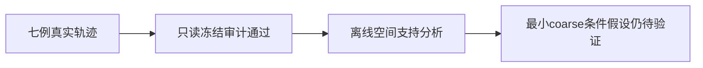

# N0-B：正式冻结审计与实际 Memory 空间条件分析

日期：2026-11-13。范围：七个事前固定的 LQI 开发病例；复用两折原权重、实际采集轨迹和冻结历史评分。本次审计及分析新增 forward、backward、optimizer step 均为 **0**。

## 1. 结论与适用范围

**正式 post-diagnostic freeze audit 通过，七例真实 LQI Memory 已可用；N0-B 的证据缺口已补齐。** 采集的 Q/P 与七份原冻结预测逐元素完全一致。实际 S256/F256×384、原始 KNN 索引和排序数据身份明确，未用近似 FPS、原始输入点 KNN 或 F0 的 Memory 替代。

**Memory 提供了真实且非恒定的空间上下文，但本次观察尚不能证明这些条件被模型有效用于纠正骨块位置。** 五例新增严重病例的 Query→Memory 距离整体较大，其中 C/012 尤其明显；两例既定改善病例距离较小。但七例是有目的选择的解释性案例，不能据此估计总体概率、建立可靠性阈值或证明因果。

本轮结果支持把 coarse 空间条件作为最小研究假设，**不支持“局部 Memory 已经有效”“失效全部来自 KNN”或“SCQ 必定改善”**。尚未实施 SCQ、创建训练 request 或取得训练准入。

## 2. 执行身份及冻结审计

执行 request SHA256：

`4a554bc7bd23eaebf62982cda6cecc99948f47c9511cedcd9fbfa28e69630baf`

Runtime SHA256：

`22d7a24a83db766bf4e729de96bddcb762eba476a755c402e911525e47372d79`

当前执行容器：`shu-common-25721452-notebook-t6ibfm-0`。采集使用 RTX 4090 D、driver 570.190；它与原冻结预测的设备/驱动不同，已披露，未放宽等价性容差。七例本次实际误差均为 0。

| 审计项 | 重新核验结果 |
|---|---|
| 退出状态 | exit code=0；固定 tmux 会话不存在，worker PID 对应进程已不存在 |
| 单次尝试与计数 | 本版7次 forward，C折4次、D折3次；日志7次执行前claim与7次等价性检查按原顺序一一对应 |
| Mamba调用 | 每例36次，总计252次真实Mamba模块调用 |
| 无更新约束 | backward=0、optimizer step=0、loss call=0；未运行训练或BNCal |
| 预测身份 | 七例Q/P normalized及world-mm max-abs差异全部为0 |
| 模型状态 | 两折参数/持久BN状态指纹前后一致 |
| RNG | 两折记录的Python、NumPy、CPU/CUDA RNG状态前后一致 |
| 安装身份 | 回读授权回执、runtime、worker、launcher的大小与SHA256均匹配本机冻结文件；runtime单向绑定授权回执哈希 |
| 文件/目录 | 精确27文件、3目录；无额外文件或符号链接；本次读取以内容指纹核验，不以atime判断变化 |
| 清单与归档 | 13个归档成员逐一核验名称、大小、SHA256，无重复/越界成员；服务器当前内容与本机下载一致 |
| 资源记录 | 17条记录全部通过既有资源判据 |
| 本次审计/分析计算 | 本机CPU读冻结轨迹；未导入模型、使用CUDA或重新执行forward |

归档：`development_predictions_v1.tar.gz`，大小 **5,862,997 bytes**，SHA256：

`ebed5c74cf0a491ebc26557abd5a2fc37c021d919051d8e47dc9ccf11c933db5`

注意计数口径：此前旧版失败已消耗1次forward；新版新增7次，**累计8次**。旧失败记录保持不变。模型状态一致仅是本次eval采集未改参数的证据，不代表梯度确定性或训练可重复性。

资源监测是采样记录及PyTorch峰值记录，不是专属cgroup硬隔离，也不证明采样间隔内的全部系统状态。显存/RSS的实际峰值记录见 `frozen_memory_analysis_v1/supplementary_audit_v1.json`，保留原阈值。

## 3. 实际采集内容与离线指标

每例包含 X/F：[1,256,384]，Q/S：[1,256,3]，P：[1,8192,3]；浮点均为有限float32。原生cross/self索引均为[1,256,8]、int64，每行8个不同合法索引。排序及逆排序满足置换身份；采集Q等于模型输出coarse。

原生cross_idx在原始Memory索引空间读取。本次用float64在保存的Q/S上复算全部256×256距离，与原生八邻居的排序距离比较：**全部1792个Query的八邻居距离集合一致，最大正差为0 mm**。这排除了本次样本中明显的索引/邻居选错问题，不保证其解剖邻接正确。

所有空间距离用各例冻结的D-only归一化scale还原为mm，不使用GT重定位。定义：

- d1：每个Q到实际S256的最近欧氏距离。
- d8：每个Q到记录的八个实际邻居的**平均距离**，不是第八近距离。
- 邻域直径：八个S之间最大的两两距离。
- 邻域中心偏移：八个S均值与该Q的距离；该均值不作为骨块真值或修正目标。
- 特征离散度：八个原始F在其均值周围的分量RMS，再除以该例全部F围绕全局均值的分量RMS。它是描述性指标，不是训练所得LayerNorm、位置编码或完整SSM条件的实际激活。

每例报告256个Query的分布；下表列中位数。既有GT相关指标只从已冻结的N0病例汇总读取，未打开GT payload、修改评分或挑选病例。

## 4. 七例结果

| 固定病例 | 历史Q质心误差mm | d1中位mm | d8中位mm | 邻域直径中位mm | 选中Memory数量/256 | 历史E P95mm | 历史J Cover@2mm |
|---|---:|---:|---:|---:|---:|---:|---:|
| C/012/parietotemporal | 91.74 | 39.62 | 42.98 | 73.10 | 69 | 73.59 | 0% |
| C/013/frontoorbital | 28.30 | 20.04 | 26.45 | 51.37 | 47 | 18.54 | 0% |
| C/038/random_1 | 24.01 | 14.40 | 26.15 | 59.87 | 45 | 25.06 | 22.07% |
| C/041/frontoorbital | 58.41 | 21.60 | 27.48 | 49.11 | 79 | 30.96 | 0% |
| D/060/bilateral | 16.05 | 28.67 | 35.13 | 66.14 | 42 | 21.64 | 1.55% |
| D/008/frontoorbital（既定改善） | 33.42 | 8.90 | 18.56 | 45.22 | 54 | 6.69 | 54.57% |
| D/052/frontoorbital（既定改善） | 17.70 | 9.77 | 21.51 | 51.88 | 46 | 4.42 | 61.80% |

“选中Memory数量”是256个Query的2048次邻居引用的并集，不能视为全模型只使用这些输入；encoder和全局特征仍有自己的信息路径。

| 固定病例 | 不同八邻居集合数/256 | 单个Memory最大被引用次数/256 | 特征相对离散度中位数 | 邻域中心偏移中位mm |
|---|---:|---:|---:|---:|
| C/012 | 167 | 176 | 0.682 | 29.50 |
| C/013 | 134 | 151 | 0.668 | 16.45 |
| C/038 | 91 | 219 | 1.066 | 14.36 |
| C/041 | 165 | 140 | 0.547 | 19.30 |
| D/060 | 108 | 133 | 0.685 | 25.79 |
| D/008 | 111 | 168 | 0.409 | 5.86 |
| D/052 | 107 | 199 | 0.553 | 8.04 |

## 5. 机制解读

### 5.1 空间上下文真实存在，但“local”不是毫米级接口邻域

七例实际S的最近邻间距中位数约 **14.75–15.58 mm**。在只有256个全颅Memory中心的条件下，八邻居直径中位数达到 **45.22–73.10 mm**。因此LQI的“local”只能理解为Memory尺度的欧氏邻近，不能直接解释为内外板、切壁或2mm contact-support的精细几何支持。

不能把这些数值当作新采样失效证据：Memory已经过模型取点及特征编码，它与原始8k输入密度是不同层次。本轮没有改变采样、点数或proxy策略。

### 5.2 严重错位Query可能读取离目标很远的骨面，但距离本身不能证明无用

C/012已经有约91.74mm的coarse质心误差；最近Memory距离中位39.62mm，八邻居平均距离中位42.98mm，邻域跨度也大。这与“错误粗位置无法依靠当前局部条件充分纠正”的解释相容，但尚未证明是邻域导致错位。

D/060的Q质心误差只有16.05mm，仍有明显范围不足（历史Q半径比0.554）、d8中位35.13mm和严重漏覆。不能用一个整体平移解释全部问题。

缺失骨块内部本来就可远离残骨表面，欧氏邻居也可能跨内外板、不同侧壁。因此不能由距离大直接判定邻域错误，更不能把Q投影到S或强制以S均值替代骨块坐标。

### 5.3 条件并未完全塌缩；引用集中也不是充分失效条件

七例分别有91–167种八邻居集合，局部原始F均值随Query变化，F本身也非恒定。故没有证据称“所有Query都读到完全相同的条件”。

C/038中同一个Memory被219/256个Query引用，提示局部引用集中，值得在固定候选的风险解释中保留。但既定改善D/052也存在199/256的高引用，不能据此设一个失败门。邻域直径同样不能区分全部成败：改善D/052的中位直径51.88mm，与若干失败病例相近。

特征相对离散度在七例中均非0，说明有变化可读，**不等同这些变化含有可解码的正确缺损位置，也不等同decoder实际使用了它**。本轮未保存/重算学习后LayerNorm、coordinate_pe与SSM的全部激活，不能从原始F的RMS推出最终条件信噪比。

### 5.4 改善病例提供相容性证据，不构成因果对照

D/008和D/052的d1/d8及邻域中心偏移较小，与其较好的覆盖相容。不过它们与失败病例还同时存在缺损形态、范围、特征和训练折等差异。本次没有打乱、移除或替换Memory的干预；不能声称空间支持单独解释了性能改善，也不追加干预来补强叙事。

D/008的coarse质心误差33.42mm而dense降至20.22mm，说明下游确实可能改变整体位置；不能将coarse偏移都视为不可修复，或凭末端结果认定误差最早出现的计算层。

## 6. 对下一步研究的决定建议

N0的身份、历史全病例复盘及七例真实Memory可得性已完成。此前报告的“LQI实际S/F NOT_AVAILABLE”是当时状态，本报告以真实采集将其更新为 **AVAILABLE_AND_FROZEN**，不改写旧报告及旧失败记录。

建议**保留既定SCQ最小假设，先做一次有限的公式与插入点确认，再决定限定实现**：检验在coarse之后、后续query构造与decoder之前，用D-only局部F及相对几何预测逐Query残差，是否优于等容量无显式相对坐标对照。继续保留z与Native评分；不得把邻域均值变成输出目标。

原因是：接口真实可用、邻域并未完全塌缩，存在可检验的空间信息路径；同时错误Q绑定远距离邻域和Memory粗尺度的局限明确。观察证据不足以现在就认定该候选无效，也不足以直接批准训练。

**不扩展N0**：不增加病例、不扫描k/半径、不新增启用阈值、不重复preflight、不追加训练。若负责人选择改为不依赖Q0的全Memory粗生成，应另立独立假设及对照；不在本协议内悄然换公式。

后续科研有效性的判据仍是Native完整骨块覆盖、接口吻合、来源级结果和严重风险；最近邻变近、矩改善或训练loss下降均不能替代这些终点。

## 7. 可复核材料

- `post_diagnostic_freeze_v1/freeze_verification_v1.json`：正式审计结论。
- `post_diagnostic_freeze_v1/remote_inventory_v1.json`：服务器当前27文件及3目录的内容清单。
- `post_diagnostic_freeze_v1/`：实际下载归档、三个校验文件、运行记录、七例trace。
- `frozen_memory_analysis_v1/supplementary_audit_v1.json`：授权单向绑定、事件顺序、零等价性误差和资源摘要补证。
- `frozen_memory_analysis_v1/case_memory_geometry_v1.json`：七病例完整分布及原冻结评分对照。
- `frozen_memory_analysis_v1/query_memory_geometry_v1.json`：1792个Query的实际邻居及指标。
- `frozen_memory_analysis_v1/analysis_identity_v1.json`：分析输入、脚本、历史汇总及冻结回执哈希绑定。
- 本机只读审计脚本：`local_tools/freeze_n0b_capturefix_readonly_v2.py`。
- 本机离线描述分析脚本：`local_tools/analyze_n0b_frozen_memory_v1.py`。

以上材料均保存在本机项目目录，不意味着已提交Git、推送GitHub或迁入长期备份目录；本轮未执行服务器清理。
