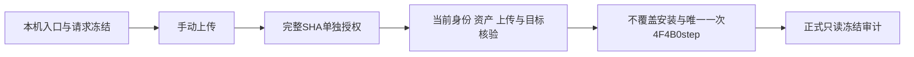

# SCQ-v2 人工CUDA短入口与待授权范围

日期：2026-11-13。当前状态：**AWAITING_EXPLICIT_USER_AUTHORIZATION**。

本轮仅完成本机入口准备、人工CPU入口验证、限定P3、运输包和待授权request。服务器连接/安装/执行均为0；没有材料化真实授权回执、runtime、launcher或执行claim，没有运行GPU、读取真实病例/checkpoint或启动训练。

## 1. 唯一请求与冻结工作量

请求：`pending_transport_v1/payload/SCQ_artificial_cuda_execution_request_v1.json`。

完整SHA256：

`0f5aec8c30d0044547cd8806c5663aeb4f0f9643e254a65ce562f5d45641521b`

| 顺序 | 模型 | batch | 模式 | 完整forward/loss/backward |
|---|---|---:|---|---|
| 1 | B / 原LQI | 1 | eval，有梯度 | 各1次 |
| 2 | F / 去显式相对坐标对照 | 1 | eval，有梯度 | 各1次 |
| 3 | S / SCQ主候选 | 1 | eval，有梯度 | 各1次 |
| 4 | S / SCQ主候选 | 8 | train | 各1次 |

合计 **4 forward、4原始loss、4 backward、0 optimizer step**。不实例化optimizer，不运行单独decoder、warmup、额外比较forward或真实病例。预期22个真实Mamba模块的forward hook累计144次。

三次batch1使用同一人工输入：直接复用B第一次输出作为F/S初始等价性参考，不额外调用模型。四次构造的共有参数/持久状态指纹必须一致；F/S严格加载已冻结初始化字节。W2全零时W1梯度为0符合链式法则，要求W2梯度活跃；非零W2的连续上游可导性已在上一轮CPU验证，不擅自追加CUDA干预。

## 2. 实现及本机验证

最终入口：`bcsp_scq_cuda_admission_v3.py`。复用既有LQI启动、计数、资源和状态恢复逻辑；新增内容仅为固定四阶段、SCQ精确读取绑定、初始三臂比较及新增头梯度约束。没有修改此前SCQ实现或初始化二进制。

本机入口最终CPU检查 **31/31通过**，上一轮SCQ实现的 **49/49通过** 及源码哈希已重新核验。入口检查使用低成本人工模型/loss和仅映射到CPU操作的CUDA API替身，不会调用真实CUDA；另在新进程中验证了实际SCQ两模块的精确导入与初始化二进制读取策略。

入口P3：`entry_P3_v1.json`，状态`SCQ_CUDA_ENTRY_LOCAL_P3_PASS`。这不是实际CUDA通过、临场资源核验或科研效果结论。

### 本机失败与修订记录

前两版均通过前30项，在最后的实际文件读取检查停止；未运行GPU。

- v1将一次底层读取视为完整读取，暴露精确内容检查失败。
- v2增加有界读取循环后仍失败，说明第一次原因判断不完整。
- 只读核查发现Windows默认文本描述符会转换CRLF并在二进制0x1A处提前结束：factory原14,176 bytes读为13,942 bytes，初始化原2,784,780 bytes读为538 bytes。
- v3保留有界读取循环，并加`getattr(os,'O_BINARY',0)`；Windows按二进制读取，Linux该额外标志为0。未放宽大小、SHA256或任何科研守卫。

两份失败回执和stderr均保留，详见`cpu_entry_batch_v1/`、`cpu_entry_batch_v2/`及`local_binary_read_cause_v1.json`。最终通过结果为`cpu_entry_batch_v3/result_v1.json`；不把本轮描述为一次CPU批次全部通过。

## 3. 冻结身份与执行前提

request继承最近成功N0-B的身份：`shu-common-25721452-notebook-t6ibfm-0`，GPU `GPU-aa9e6ffb-fdbb-1836-1c32-7244231d3714`，RTX4090D，driver570.190；Python3.10.20、PyTorch2.4.1+cu118、Mamba2.3.1及原Python310 PointNet2 provider。

**这些是历史绑定，本轮没有重新连接确认当前容器。** request明确标为历史证据，并要求执行前重新核验身份/GPU、46项精确复用绑定、原项目/provider/配置及资源。身份改变时停止，不自动重绑定；缺少资产时不下载、编译、升级或安装替代依赖。

部署前重新核验上传包与三个校验文件、9个目标及新根/control/output不存在、父路径无链接。按冻结映射不覆盖安装，异常停止。执行前再次核验设备、资源、安装哈希和tmux不存在；授权回执→计算其SHA256→runtime单向绑定→launcher→一次claim→唯一一次tmux。

所有模型输入/目标均为固定NumPy种子生成的人工8192点；真实数据和checkpoint允许清单为空。仅新增两个SCQ源码和初始化二进制的精确只读绑定，不泛化允许二进制或文本资源。

## 4. 资源与成功条件

保持原预算：全进程外部timeout1800秒，TERM后10秒KILL；RSS监测8GiB；PyTorch allocated/reserved峰值各20GiB；物理SMI停止阈值22,528MiB；初始SMI使用≤256MiB；剩余磁盘≥4GiB；输出上限1GiB。每2秒采样，SMI查询预算10秒、不自动重试；PID只作诊断，不要求额外host procfs。

资源监测不是专属cgroup硬隔离。每阶段记录实际loss、35个共有梯度模块组、SCQ梯度及峰值；临时BN变化、全部模式/BN momentum、Python/NumPy/CPU/CUDA RNG和state_dict在成功及异常退出路径恢复，参数不更新。

失败即停，保留日志/计数/退出码，不自动重试或resume。即使四阶段运行完成，仍须单独做正式post-CUDA freeze audit；不能自动授权训练，不能据人工输入宣称补全精度改善。

## 5. 运输文件与服务器位置

四文件在本机同一目录`pending_transport_v1/`：

1. `bcsp_scq_artificial_cuda_pending_20261113_v1.tar.gz`
2. `bcsp_scq_artificial_cuda_pending_20261113_v1.tar.gz.sha256`
3. `bcsp_scq_artificial_cuda_pending_20261113_v1.tar.gz.bytes`
4. `bcsp_scq_artificial_cuda_pending_20261113_v1.tar.gz.contents.sha256`

运输包 **2,581,773 bytes**，SHA256：

`d226d30d8b188bbfa457d2f100af22fb2a4f3d849e40d4e2136116e709b03cba`

供用户手动上传至`/home/jovyan/`。包内为9个不覆盖安装目标及1份映射，共10成员；没有真实权重或点集。安装根为：

`/home/jovyan/adapointr_work/PoinTr/third_party/bcsp_scq_cuda_20261113_v1`

冻结tmux：`bcsp_scq_cuda_20261113_v1`。

冻结运行输出：

`/home/jovyan/adapointr_work/PoinTr/logs/cranial_bcsp_fullmamba/SCQ_artificial_cuda_20261113_v1`

本机校验文件/报告中的Windows路径仅为追溯来源，不作为服务器命令路径。

**下一步需上传完成并单独明确授权上述request完整SHA256；本轮没有执行授权。**
