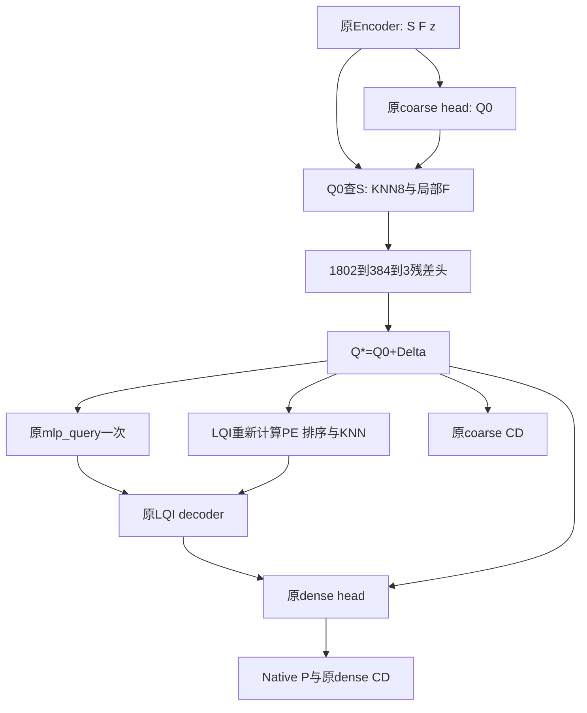

# SCQ-v2：唯一公式与插入接口确认

日期：2026-11-13。依据：已确认正式计划v2第7–9节、成功N0-B绑定的母版及LQI源码、N0-B正式冻结结论。

**结论：既定公式与实际接口相容，可进入限定 implementation-only；本轮不实施、不新增诊断、不创建 execution request，不启动训练。** 本文没有另选公式、修改点数/采样/loss或把Memory距离变成准入阈值。

## 1. 有限核对及证据身份

本次只读取9份本机材料；其中6份实际调用链源码的SHA256逐一匹配成功N0-B scope中的绑定。执行16项源码/AST静态核对，均通过；未导入模型或实例化网络。该结论不是CPU张量验证、完整P3或CUDA准入。

| 材料 | 核对用途 |
|---|---|
| `models/AdaPoinTr.py`冻结母版 | encoder出口、global/coarse head、query选择、query构造、dense与loss |
| `models/Transformer_utils.py` | 实际KNN分派接口 |
| `tools/bcsp_adapter.py` | 分块精确KNN、no_grad及topk ties口径 |
| `bcsp_p1_model_factory_v1.py` | 已完成共有初始化后的Mamba encoder替换 |
| `bcsp_lqi_factory_v1.py` | 已完成母版初始化后的LQI安装与mem_link身份 |
| `bcsp_lqi_decoder_v1.py` | 当前Query的PE、排序、self/cross KNN与SSM条件路径 |
| 正式计划、N0-B scope及正式freeze | 公式、文件身份与此前证据状态 |

完整绝对路径、源码字节数、SHA256和AST行号见 `static_confirmation_v1.json`。本次没有服务器操作，也未重新检查环境或扩展依赖库存。

## 2. 唯一张量身份与插入位置

固定输入D：[B,8192,3]；输出为缺失骨块完整表面P：[B,8192,3]，coarse为256点。

| 符号 | 实际变量/模块 | 形状与约束 |
|---|---|---|
| S | `coor`，来自实际grouper/encoder坐标 | [B,256,3]，原D-only归一化坐标 |
| F | `mem=self.mem_link(x)` | [B,256,384]；当前mem_link必须为Identity，因此与此时x一致 |
| z | `PCTransformer.forward`中encoder输出经`self.increase_dim(x)`并沿token轴max所得`global_feature` | [B,1024]；不是外层dense head再次聚合的同名变量 |
| Q0 | `learned_coarse[:, :self.num_query]` | [B,256,3]；`query_selection=learned_only`、rim关闭 |
| Q* | Q0+Δ | 替代当前`coarse`，供全部后续坐标消费者使用 |

**实际插入点：`PCTransformer.forward`完成query-selection分支之后、进入`if self.training and self.use_denoise`之前。** 此时S/F/z/Q0均存在，尚未调用`mlp_query`或decoder。

采用一个隔离的forward适配，复用原base对象与原有模块注册路径；不覆盖母版源码、不重建共有网络、不在旧forward之外再执行一遍encoder。B臂走原LQI路径；F/S安装相同接口的SCQ适配。具体适配代码须在下一轮人工验证中证明调用等价，不能由本次静态确认替代。

必须保留母版中的 `coarse_inp=misc.fps(xyz,fps_count)` 调用：它在learned_only下仍然计算，但不进入输出query。不得顺手删除、把其点接入Q，或把“存在FPS调用”误称“learned query混入FPS”。query_ranking模块虽注册，其ranking分支在本合同下不执行。

## 3. 唯一残差公式

### 3.1 邻域与特征

索引由 **Q0查询S**：`idx=knn(8,S,Q0)`。继承当前分块精确欧氏KNN，chunk=256、`torch.topk(largest=False,sorted=False)`；索引在no_grad中选择。**不更换ties规则，不把NumPy稳定argsort当生产实现。** 相同距离时不声称跨设备/任意置换严格同索引。

对所选F逐token沿最后384维做新增无affine LayerNorm，eps=1e−5，然后分别均值池化与逐通道max池化：

\[
f_i^a=\tfrac18\sum_{j\in N_i}\mathrm{LN}_0(F_j),\qquad
f_i^m=\max_{j\in N_i}\mathrm{LN}_0(F_j).
\]

不借用decoder已有的带affine LN，不先平均再对平均结果归一化。该LN也不同于N0-B中为描述分布计算的原始F离散度。

### 3.2 七维显式几何

\[
d_{ij}=S_j-Q_i^0,\quad
\bar d_i=\tfrac18\sum_jd_{ij},\quad
\sigma_{i,a}=\sqrt{\tfrac18\sum_j(d_{ij,a}-\bar d_{i,a})^2+10^{-6}},\quad
\rho_i=\tfrac18\sum_j\|d_{ij}\|_2,
\]

\[
g_i=[\bar d_i,\sigma_i,\rho_i]\in\mathbb R^7.
\]

使用冻结的归一化坐标；不把sigma的eps解释成毫米容差，不按GT、预测半径或本次Memory距离再缩放。索引离散不求导，但g、所选F、Q0与z的数据通路保留梯度；不得为采集方便将这些张量detach后送入残差头。

### 3.3 残差头与对照

\[
u_i=[z,f_i^a,f_i^m,Q_i^0]\in\mathbb R^{1795},\quad
\Delta_i=W_2\mathrm{GELU}(W_1[u_i,\widetilde g_i]+b_1)+b_2,\quad
Q_i^*=Q_i^0+\Delta_i.
\]

两层维度固定 **1802→384→3**，两个Linear均有bias，GELU沿用默认精确形式；不加BN、dropout、attention、额外SSM、半径权重、幅度门控或硬投影。新增可训练参数理论值 **693,507**，本轮只核对算术，未实例化测量总参数量。

| 臂 | 七维通道与行为 |
|---|---|
| B / LQI-B | 原LQI，无残差计算，Q*=Q0 |
| F / SCQ-F | `gtilde=LN0(fa) @ Pfix.T`，Pfix为[7,384]固定buffer |
| S / SCQ-S | `gtilde=g`，主候选 |

F/S都注册同一个Pfix buffer，S不消费其输出；新头形状、参数量与初始字节一致。F仍读取Q0、z与由Q0确定的局部F，故只能称**去显式相对坐标数值对照**，不能称无空间条件对照。

继承种子：Pfix用独立CPU随机流20261113；W1用20261114，按固定版本PyTorch Linear默认初始化规则；W2/b2全零。下一轮实现时固定一次QR生成及初始化顺序，记录CPU库版本、实际FP32字节和SHA256，之后加载冻结字节，不在GPU重生成或扫描投影种子。**本轮不生成这些张量，尚不能报告其内容哈希。**

母版LQI完整初始化必须先完成，再安装新增头；禁止再次对整模型调用`apply(_init_weights)`，以免重置共有参数或Mamba特殊初始化。新增随机流不得推进共有RNG。B/F/S共有参数与持久状态必须逐名一致；F/S新增参数必须一致。

Δ无硬限幅。非有限输出按数值失败处理，有限但错误的大残差作为科研风险记录，不按dev GT过滤。global clip10保持原合同。

## 4. 下游消费者必须全部使用Q*

| 实际消费者 | 接入后行为 |
|---|---|
| query feature | 原`mlp_query(cat(z,Q*))`仅一次；不先生成Xraw |
| decoder坐标实参 | `q_pos=Q*`，`v_pos=S`、`v=F`保持原身份 |
| shared coordinate PE | 原LQI `coordinate_pe(Q*)`；Memory PE仍来自S |
| Query排序/逆排序 | 对Q*重新按原规则计算；不得沿用Q0排序缓存 |
| self graph索引 | 原`knn(8,Q*,Q*)` |
| cross graph/局部条件索引 | 原`knn(8,S,Q*)`；不复用残差头的Q0→S索引 |
| local graph与SSM | 原模块、参数和运算保持；接受上述Q*位置与索引 |
| dense重建特征拼接 | 外层`rebuild_feature`的coarse坐标改为Q* |
| dense相对中心 | 原`relative_xyz + Q*.unsqueeze(-2)`，固定fc head |
| train/eval返回coarse | 均为Q*；训练四元组及eval二元组接口不变 |
| coarse监督 | 原`CD(Q*,G)`；不新增`CD(Q0,G)` |
| dense监督 | 原dense loss；fine_coverage_weight=1、fine_local_weight=0，保持原CD口径 |
| 日志/可视化 | 分别保存Q0/Q*/Δ/P；日志detach，模型计算保留梯度 |

原代码有train/eval及instrumentation调用分支，不只一处decoder调用；静态复核确认四个调用位置均使用同一`coarse`变量。实施应让该变量统一等于Q*，避免只改一条分支。当前denoise关闭，rim/SCQR/H1/H2不启用；不顺带适配未授权的其他query选择方式。

Q*导致decoder邻居和排序发生变化属于机制本身；不能把最终S−F差异解释成七维坐标的孤立直接因果作用。

## 5. 是否进入限定实现

**建议进入限定 implementation-only，尚不训练。** 理由是公式、维度、插入点与实际消费者均已明确，成功N0-B提供真实接口身份，未发现必须换公式的实质冲突。

下一轮授权范围建议集中为：

1. 新增隔离SCQ残差模块与隔离factory/forward适配；保持原LQI、科研源码和环境不变。
2. 一批针对性人工CPU合同验证，覆盖公式、KNN方向/ties、薄双层几何、S/F同步置换及批次隔离、零初始化完整调用链等价、非零已知残差对全部真实消费者的响应、梯度与共有状态/RNG。
3. 冻结Pfix与初始化字节、明确新增权重/bias decay分组，并完成一次本机P3；不得仅用假decoder证明实际接入通过。

初始W2=0时W1梯度可为0；用人工指定的非零W2检查W1、所选F/Q0上游路径，不为此做真实optimizer step。任何失败保留记录，不自动调公式或滚动重跑。

本轮没有上述实现、CPU张量测试或P3。之后必要CUDA按既定计划 **4 forward／4 backward／0 step** 单独准备与授权，使用真实Mamba/PointNet2与原cdist loss；不重复旧FullMamba整套preflight。首对训练仍需独立request与执行授权，保持3900-step及原资源合同。

## 6. 当前边界与科研局限

- N0已完成，不追加七例以外诊断，不改k、半径或Memory数量。
- 本次只确认可实现性；错位Q0查到远邻的局限仍存在，z保留不保证能解决。
- 不使用G/J、缺损类别、GT bbox、Oracle配准或GT决定的开关构造SCQ条件。
- 不以Q更接近残骨、整体矩改善或训练loss下降替代Native骨块完整覆盖和接口风险。
- 训练矩阵及阶段规则保持正式计划：先匹配设备的B/S两折，F公式先冻结、满足既定阶段条件后再做两折对照；不拿旧异设备LQI成绩冒充本次匹配B。
- 没有模型效果GO结论；目前状态是 **FORMULA_AND_INTERFACE_CONFIRMED / IMPLEMENTATION_NOT_STARTED**。
