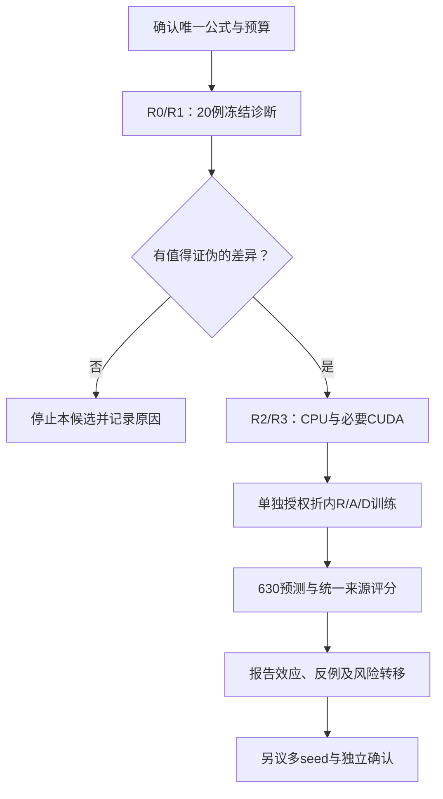

# Cranial-BCSP-FullMamba：SCQ-DAC 双邻域残差方向一致性调节正式实验计划书

> 版本：审阅修订 v2；日期与文献检索截止：2026-11-15。  
> 性质：下一阶段的候选机制与条件式实验计划，**待用户确认，不构成实施、服务器操作或训练执行授权**。  
> 任务：残缺骨组织完整边界 → 缺失骨块完整边界，8192 → 8192。  
> 主体：沿用现有无 Transformer attention 的 FullMamba Encoder–Decoder、SCQ 与 RF。  
> 本次工作：阅读用户草案、核对本机冻结报告和相关实现、核对归档/清理状态、检索一手文献；未连接服务器、加载模型、运行 forward、评分或训练。

## 📋 1. 审阅结论与本版采用的修改

**总体判断：计划具有可检验的研究价值，适合作为一次预算封顶的候选证伪；不应直接承诺六次训练，更不能预先称为可靠性改进。** 草案已经正确地安排 RF-Requery 实用基线、Dual-Average 等参数控制、来源级统计、严重事件转移和停止条件；这些应保留。真正需要修改的是数值公式语义、冻结权重诊断的解释与预算、资产状态，以及过重的环境要求。

### 1.1 合理之处

1. 没有把 RF 的平均改善解释成可靠性已经解决，而是追问错误反馈与有效大步纠偏如何区分。
2. 同一第二头分别读取旧/新邻域，以最小程序差异检验组合规则；没有同时改变采样、Mamba、loss 和点数。
3. `DAC−Average` 与 `DAC−Requery` 回答不同问题，两个对照都必要。
4. 继承完整骨块 E/J 评分与反向离群检查，能识别“位置改善、表面仍缺失”的失败。
5. 保留单 seed、反复开发、跨设备混杂和临床外推的限制，不把开发集当独立盲测。

### 1.2 必须改进的事项

| 草案问题 | 为什么重要 | 本版决定 |
|---|---|---|
| 用 `dot/(norm_old×norm_new+1e−6)` 表示方向余弦 | 会把残差幅值混入权重；小而同向的更新也接近平均 | 改为逐向量范数保护的稳定余弦，明确定义近零退化；见 §5。此为待确认的公式修订，不能与旧公式混跑 |
| 将方法称为“一致性校准” | 没有预测概率、正确性目标及独立校准验证 | 正式科学表述改为“一致性调节/组合”；缩写 DAC 保留，不声称概率校准 |
| R1 将 proposal 调用和完整 forward 混算 | 难以冻结预算，容易重复跑 backbone | 精确固定 20 次完整 Native forward + 40 次 decoder-only，合计 60 次 decoder 输出；见 §7 |
| 冻结旧模型的反事实变差即推断新结构不值得训练 | 旧 `h1` 只在新邻域训练，旧邻域分支和新混合规则有分布偏移 | 反事实用于筛查退化和暴露风险，不能充当端到端新结构的最终效果判决 |
| “95% proposal 接近”或“alpha 几乎不变”未定义 | 判据容易随结果改变；系数相同不代表等于 RF | 预先给出数值等价阈值，区分 `D≈A`、`D≈R` 和常数但不等价；见 §7.5 |
| 要求先恢复六个模型并保证未来六 run 都不换 GPU | 核心诊断只需两个 Requery；平台不能预先保证未来资源 | 六权重检查本机身份，实际只恢复 C/D Requery；硬件以折内三臂匹配为核心，六 run 同卡优先 |
| 权重未备份的状态已过时 | 会诱发重复归档和无意义的准备工作 | 更新为六权重已本机核验、服务器源产物按授权清理；加载/数值重放尚未由本次证明 |
| CUDA 初态检查可能只覆盖零 proposal | 零输出使三个公式一致，不能验证训练后的真实组合 | 唯一一次短准入同时包含冻结初态与非零人工第二头副本；副本不得用于训练 |
| “J 无系统退化”“基本同质”缺乏操作定义 | 容易变成事后解释 | 给出明确均值方向、中位数、来源广度与风险转移裁决；不新增医学阈值 |
| R 臂推理额外计算旧 proposal 未单独计数 | 会改变预算和效率比较口径 | 正式 R 路径仅计算新 proposal；20 例机制包额外旧 proposal 已在 R1 预算中单列 |

### 1.3 本轮唯一科学问题

> 在现有无注意力 FullMamba 的第二次 coarse 坐标校正处，对同一 `Q1`、同一 `h1`，使用旧/新两组实际 Memory 邻域产生更新，并以方向一致性组合，能否比固定平均更好，同时保留 RF-Requery 的实用性能和重要挽回能力？

它是**可失败的结构启发式**。旧/新 proposal 共用特征、全局条件和权重，既不是两个独立专家，也不是独立误差估计器。共同错误、相反方向中的正确更新被抵消、初始 coarse 空间布局错误，都是可能的真实阴性原因。

## 📊 2. 已有实验依据与当前资产状态

### 2.1 从冻结 SCQ-RF 报告核对的结果

下表沿用本机正式报告的来源等权汇总，不是本轮重新计算的分数。距离 mm，覆盖率百分比；每折 21 来源、105 病例。[^rf]

| Fold | 模型 | E P95↓ | J P95↓ | CD-L1↓ | E Cover2↑ | J Cover2↑ | severe病例 |
|---|---|---:|---:|---:|---:|---:|---:|
| C | S-ref | 9.030 | 11.963 | 5.953 | 61.91 | 49.61 | 9 |
| C | RF-Static | 7.619 | 9.811 | 4.984 | 57.51 | 49.30 | 6 |
| C | RF-Requery | 6.932 | 9.178 | 4.318 | 67.62 | 55.35 | 3 |
| D | S-ref | 5.273 | 7.765 | 3.130 | 67.22 | 53.82 | 2 |
| D | RF-Static | 5.795 | 8.360 | 3.332 | 63.48 | 50.74 | 2 |
| D | RF-Requery | 5.029 | 7.538 | 2.755 | 69.36 | 53.97 | 2 |

- Requery−Static：C 折 E P95 −0.687 mm、来源中位差 −0.901 mm、来源改善/回退 17/4；D 折 −0.766 mm、中位差 −0.308 mm、13/8。
- 相对 Static，新发/挽回 severe：C 为 1/4，D 为 2/2；相对 S-ref 两折合计 severe 11→5，但仍新增 1 例。
- C 折 parietotemporal 的 E P95 回退 1.693 mm、J P95 回退 2.048 mm，而 J Cover2 提高 7.08 pp。覆盖与高尾误差须一起解释。
- Static_D 训练迁移了 GPU UUID 和驱动；该折 Requery−Static 只能作受混杂限制的证据。统一预测设备不能消除训练设备差异。[^rf]

因此支持的是“重查询具有开发性增量，但仍有异质失败”，不是“重查询导致所有新发严重事件”或“加一个一致性权重必然能修复”。

### 2.2 既有轨迹对本假设的约束

| 固定病例 | Requery 质心误差 Q0→Q1→Q2→dense，mm | 对 DAC 的意义 |
|---|---|---|
| C/012 parietotemporal | 82.94→102.69→130.87→132.03 | 反馈放大存在，但不能只归因第二头 |
| C/025 parietotemporal | 57.69→60.88→71.77→70.25 | 两邻域可能都错误 |
| C/053 frontoorbital | 64.27→51.00→50.29→48.80 | 纠偏不足；不是正确 Q1 被第二头推坏 |
| D/069 random_2 | 22.96→14.19→11.52→11.83 | 质心改善仍可能漏掉形状/接口 |
| D/087 frontoorbital | 68.09→61.92→38.21→35.97 | 大步正确方向也可能不足以恢复 |
| C/025 random_2 | 50.99→30.75→8.42→7.64 | 必须保护大幅有效二次纠偏 |
| D/008 frontoorbital | 52.16→41.71→15.67→9.40 | 不能把小范数当可靠性 |

这些病例是已用于形成假设的压力测试，不能用来估计独立泛化效果。不同端到端模型的 `Q1`、Memory 和 head 都会变化，不能把跨模型阶段差值当成同权重反事实因果效应。[^rf]

### 2.3 当前归档与清理事实

1. SCQ-RF 六个关键 checkpoint 已保存至 `E:/ResearchBackups/AdaPoinTr/BCSP_FULLMAMBA_SCQ_RF/2026-11-15_key_checkpoints_v1`，本机单文件与归档成员大小/哈希已有核验记录。
2. 本机代码/结果归档、预测归档及校验记录已存在。SCQ B/S 与 SCQ-RF 的 1388 个服务器源文件/上传包已在单独授权后精确删除，清理回查通过。
3. 旧服务器日志目录残留并不代表权重仍在；新工作必须以本机真实文件和对应版本源码为资产来源。
4. **字节备份核验≠模型反序列化与数值恢复验证。** 本次没有加载 checkpoint，后续仅在获准的 R0/R1 范围恢复所需两个 Requery，不要求先恢复所有六模型。

| 资产 | 当前状态 | 下一阶段最低动作 |
|---|---|---|
| 六关键权重 | 本机备份已核验 | 查本机凭据；只恢复 Requery_C/D 到全新远端路径 |
| 冻结 factory/residual/初始化 | 本机存在，主体代码本轮已阅读 | 绑定最终实际使用文件，不改旧版 |
| 原 Native 预测和评分 | 已归档 | 选定 20 例后复用原 Native 作重放参照 |
| 新 DAC 实现 | 不存在本阶段有效实现 | 计划确认、实施授权后才新增 |
| 当前服务器资源 | 本轮未检查 | 到 GPU 工作前作必要身份/资源核对，不预用旧设备身份 |

## 📚 3. 文献复核与创新性边界

### 3.1 检索方式与证据层级

本轮采用多来源检索与关键引文核对，优先作者论文、arXiv 正文、会议/出版社和作者机构页面。专用文献 MCP 检索工具在当前会话不可用，因此通过网页工具访问上述一手来源。检索不是系统综述，也未逐篇精读用户过去全部题目清单；不以搜索摘要证明整篇方法的无注意力性质，不据二手总结编造实现细节。

核心检索词包括 `Mamba point cloud completion 2026`、`CompletionMamba`、`DAPointMamba`、`FusionMamba point cloud`、`point cloud completion direction consistency refinement`。按 DOI/arXiv 身份去重，区分在线版本、出版年与摘要/正文可访问程度。搜索命中日期晚于检索截止、无法核实的内容不作为本计划依据。

### 3.2 与本阶段直接相关的文献

| 文献及身份 | 本轮核对范围 | 对本实验的直接启示及限制 |
|---|---|---|
| CompletionMamba，TIP 2025，DOI 10.1109/TIP.2025.3597041 | 作者机构出版页和摘要 | 已研究局部 SSM、点序重排和形状条件；不能把局部邻域或 Mamba 本身写成新贡献。未完成全实现 attention 审计。[^completion] |
| DAPointMamba，AAAI 2026 / arXiv:2511.20278 | 作者开放正文；会议页访问受限 | patch 扫描、空间/通道域对齐；文中亦用余弦相似度调节特征。因此“余弦权重”本身不是创新，本轮应聚焦坐标反馈 proposal 的同容量对照。其域适应损失与本轮 D-only 监督协议不同。[^dapoint] |
| FusionMamba，Information Fusion 134，104378，2026 | 出版社可检索的摘要/引言；完整直连受限 | 几何聚合与显式残差融合已是直接相邻方向；不能宣称首次用几何条件校正。不能把同名图像融合 FusionMamba 混为此论文。[^fusion] |
| 3DMambaComplete，arXiv:2404.07106，v2：2026-05-19 | v2 开放正文 §§3.2–3.4 | HyperPoint 生成/扩散及 Mamba 解码与空间分布相关；**v2 明确包含 Cross-Attention Block**，不是本项目的纯无注意力对照。引用须说明版本；v2 HTML 与摘要页题名表述有差异，以 arXiv ID 固定身份。[^3dmamba] |
| Simba，AAAI 2026 / arXiv:2511.16161 | 开放正文 §3.3 和消融 | 几何变换分布、Mamba 上采样值得关注；前两级 refiner 明确使用 cross-attention，不能直接称全 Mamba 无注意力。[^simba] |
| PPC-MT，arXiv:2603.00870，2026 | 作者摘要 | 明确 Mamba–Transformer 混合；PCA 序列化和并行补全属于相邻设计，不在本轮新增。[^ppc] |
| Multi-Path Mamba Diffusion，arXiv:2611.04583，2026-11-03 | 作者摘要 | 最新相邻方向，但任务是 SemanticKITTI 语义场景补全，不能拿其指标证明颅骨实体边界任务效果。[^mpath] |
| SeedFormer，ECCV 2022 | 作者摘要/会议页 | patch seed 的局部结构恢复说明全局统计不足以代表局部几何；其 Transformer 模块不直接移植。[^seed] |
| PMP-Net，CVPR 2021 | 会议论文页/摘要 | 多步点移动早已有研究；本轮不能声称首次进行残差/迭代位置更新。[^pmp] |
| Wodzinski 等，MICCAI 2023 高分辨率颅骨点云补全 | 作者公开摘要、论文入口 | 支持颅骨点云任务和计算动机，不等于本 BCSP 的 E/J 目标及来源划分。[^cranial] |
| CDRMamba，BSPC 103，107376，2025 | 出版社题录/摘要入口 | 颅颌面 Mamba 已有工作；本轮未取得足以逐算子确认的完整实现，不能据名称断言其结构等于本模型。[^cdr] |
| Revisiting PCC，ICCV 2025 | CVF 摘要 | 真实噪声、密度和拓扑差异限制合成基准外推；本轮没有由此获得真实临床验证。[^realpc] |
| Fishman 等，IJCARS 2024 | 出版社摘要 | 临床厚度/rim 设计有额外要求；点云 E/J 改善不证明植入体可制造或临床合格。[^implant] |

额外检得 2026 年 RWKV 域适应补全等工作，属于其它序列骨干；不将其混称 Mamba，也不在本轮因追逐最新名称替换主体。

### 3.3 可主张与不可主张的贡献

合理候选表述：**在已有无注意力颅骨补全网络的第二次 coarse 校正中，对共享 head 的旧/新空间上下文更新作方向一致性调节，并以固定平均和重查询重训基线，检验 Native 几何与失败转移。**

不可主张：首次 Mamba 颅骨补全、首次几何残差校正、首次余弦融合、贝叶斯不确定度、经过概率校准的置信分数、全流程严格线性复杂度、临床安全。当前检索没有证实本精确公式已用于同一颅骨协议，也**不足以证明世界范围首次**。

## 🔬 4. 任务、数据与不变合同

### 4.1 几何任务

完整骨实体 `C=D∪G`，D 为残余骨，G 为移除骨块；实体内部互补，边界可共享。输入 `∂D` 覆盖分割中存在的外板、朝向颅腔的内表面、孔道/腔体边界及暴露切壁；目标是 `∂G` 的完整骨块边界。`∂G=E∪J` 中 E 为自由表面、J 为与 D 接触的切除断面，具体离散分区以冻结评分器为准。

这不是完整颅骨点云输出，也不是仅缺失外板面片输出。有限采样可能局部稀疏，不能声称每个解剖结构都被完整、高精度保留；源分割也不等于独立临床高精度 GT。

### 4.2 固定数据与访问范围

| 项目 | 本轮固定 |
|---|---|
| 数据 | SkullBreak BCSP V1，已开放 84 来源、420 缺损病例 |
| 每来源 | bilateral、frontoorbital、parietotemporal、random_1、random_2 五类 |
| 每折 | 63 来源/315 病例训练，21 来源/105 病例开发 |
| 两折关系 | 开发来源互斥，训练来源重叠；不是两个独立训练总体 |
| 点数 | 输入 8192、目标 8192、coarse 256、每中心生成 32 点 |
| 采样 | 冻结 V1 六邻域实体暴露面面积采样；不重采样比较 |
| 坐标 | 同一 D-only 中心/尺度；输出按该变换回 world mm |
| 目录 | source/case manifest 为准；历史 C 开发在带 foldd 名称的目录，D 反向，不凭目录名推断 |
| 封存 | confirmation20 不访问；已曝光官方数据不重命名为盲测 |
| 其它数据 | 不混入 SkullFix/MUG 做本轮模型选择 |

模型 forward 只接收 D 派生张量与模型状态。GT、E/J、缺损类别、病例风险标签和 Oracle 配准只能进入离线评分/诊断端。不能按病例身份切换公式、删点或回退到另一模型。

## 🧮 5. 唯一模型公式与数值语义

### 5.1 共同计算图

沿用真实 Memory `M∈R^(B×256×3)`、`F∈R^(B×256×384)`、全局 `z∈R^(B×1024)` 和 learned coarse `Q0`。第一头 `h0:1802→384→3` 不变：

\[
N^0=\operatorname{KNN}_8(M,Q^0),\quad
Q^1=Q^0+h_0\big(\Phi(Q^0,N^0)\big).
\]

\[
\Phi(q,N)=[z,\operatorname{mean}(\operatorname{LN}(F_N)),
\operatorname{max}(\operatorname{LN}(F_N)),q,\mu_d,\sigma_d,\rho_d]\in\mathbb R^{1802}.
\]

其中 `d=M_N−q`；`μ_d` 是三维均值，`σ_d=sqrt(mean((d−μ_d)^2)+1e−6)` 为逐坐标三维标准差，`ρ_d=mean(||d||₂)`；LN 无 affine，eps `1e−5`。GELU 为现有精确实现。上述几何的 `1e−6` **继承不改**，不要与下面的余弦保护混淆。原两 RF 臂都在 Q1 重算相对几何，这一点已从本机冻结代码核对。

### 5.2 两个同权重更新建议

\[
N^{old}=N^0,\quad N^{new}=\operatorname{KNN}_8(M,Q^1),
\]

\[
u=h_1\big(\Phi(Q^1,N^{old})\big),\quad
v=h_1\big(\Phi(Q^1,N^{new})\big),\quad h_1:1802\to128\to3.
\]

u/v 对应同一个 query 索引、同一 Q1、同一 M/F/z，唯一条件差异是邻居索引与其内容。`h1` 为一个共享模块，不新建两头，不读取 GT。旧邻域的索引保留自 Q0，但几何中心仍用 Q1。

两支不是独立预测器：它们可以因邻域重叠和共享全局条件共同出错。KNN 仅整数选点不求导；选中 F、M 的连续路径及 Q1 相对几何按原模型正常反传。

### 5.3 本版选择的稳定方向一致性

草案 `dot/(||u||||v||+1e−6)` 不是纯角度：若 `u=v=(1e−4,0,0)`，得到 `c≈0.009901、a≈0.504950`；若同向向量幅值变成 `1e−2`，则 `c≈0.990099、a≈0.995050`。两个方向完全相同，权重却差异很大。这是公式直接推导，不是新的实验结果。

本版将 **eps 定义在单个向量范数上**，仅作为数值保护：

\[
n_u=\|u\|_2,\quad n_v=\|v\|_2,\quad \epsilon_n=10^{-6},
\]

\[
\tilde c=\operatorname{clip}\left(
\left\langle\frac{u}{\max(n_u,\epsilon_n)},
\frac{v}{\max(n_v,\epsilon_n)}\right\rangle,-1,1\right),
\]

\[
c=\begin{cases}\tilde c,&n_u>\epsilon_n\ \text{且}\ n_v>\epsilon_n,\\0,&\text{其它情况},\end{cases}
\quad a=\tfrac12+\tfrac12\max(0,c).
\]

ε 的单位是 **D-only 归一化坐标的残差长度**，不是 mm 或医学阈值；近零 proposal 视作方向未定义，a 取 0.5。实现须先安全除法再做 mask，不能在无效分支先产生 NaN 再试图用 `where` 隐藏。有效范数区间内，独立正比例缩放 u/v 不改变 c/a；近零边界的变化须如实记录。

唯一候选：

\[
\delta^{D}=\operatorname{sg}(a)v+[1-\operatorname{sg}(a)]u,
\qquad Q^2=Q^1+\delta^{D}.
\]

sg 只阻断 a 的梯度；u/v、共享 h1、Memory 连续条件仍参与训练。保留这一规则，不扫描余弦温度、幂次、权重下界、epsilon 或其它 gate。**本版新公式须随计划确认后冻结；不得把原加性分母公式与本版混为同一候选。**

### 5.4 必须正确理解的数学性质

\[
\delta^D=\underbrace{\tfrac12(u+v)}_{\delta^A}
+\tfrac12\max(0,c)(v-u).
\]

由此可知：

1. c≤0 时 DAC 与 Average 完全相同，不识别哪个方向正确。
2. c=1 时使用 v；正余弦区只是在 Average 与 Requery 之间插值。
3. 若 u=v，三臂同输出；若 u/v 反向且等幅，Average/DAC 可抵消为零。
4. 凸组合满足 `||δD||≤max(||u||,||v||)`，但没有最终几何误差下降、接触覆盖或风险保证。
5. `||δD−δA||=0.5·max(0,c)·||v−u||`。方向高度一致且向量接近时，D−A 可能天然很小；是否存在足够动态差异是 R1 的重要问题。
6. 两向量同向但幅值不同，DAC 选 v，可能保留大的正确更新，也可能采用大的错误更新。
7. detach 不等于“模型无法操纵一致性”：模型仍通过 u/v 的端到端适应改变未来 a 的分布。

因此论文应写“方向一致性调节”，不能写成 uncertainty/confidence calibration 或可信更新概率。

### 5.5 三臂与归因

| 项目 | R：RF-Requery | A：Dual-Average | D：SCQ-DAC |
|---|---|---|---|
| 第二次更新 | v | `(u+v)/2` | `sg(a)v+(1−sg(a))u` |
| h1 实例 | 1 | 1 | 1 |
| h1 正式调用 | 1 | 2 | 2 |
| 第二阶段上下文 | Nnew | Nold+Nnew | Nold+Nnew |
| 可训练参数 | 预期 40,827,847 | 相同 | 相同 |
| 主要作用 | 实用基线 | 固定双上下文控制 | 唯一候选 |

D−A 控制参数量、上下文数量和 h1 两次调用，检验自适应组合相对固定平均的增量；两者组合算子成本和实际梯度权重不同，不能称完整 FLOPs/优化路径严格相同。D−R 判断是否值得替代工作基线；A−R 判断固定双邻域平均本身的价值。

若 D>A 但 D≤R，并不支持新方法优于现有 RF；若 A≈D 且都优于 R，支持的是双邻域融合，不支持动态方向权重的独立必要性。

### 5.6 插入与初始化

Q2 统一进入原 `mlp_query`、位置编码/排序、局部/Memory KNN、重建中心加法、coarse 返回和 coarse loss。不得仅改记录字段。LQI decoder 本来会在当前输入 query 上使用空间邻域，不能宣称 DAC 首次让 decoder 感知当前位置。

R/A/D 从同一 scratch 母版、SCQ 初始字节和 RF 第二头初始字节构建。第二头最后层为零，初态三个 Q2 都等于 Q1；第一头也按原 scratch 状态加载。构造新增包装不得消耗母版随机流。权重二进制为权威，seed 是出处；禁止再要求跨环境 seed 重生成与其位级相同。

初态 V2/bias 可有有效梯度，而前层 V1 或输入路径的梯度可能为零，这是零输出层的数学结果；不能一律要求所有参数从第一步非零。必须另用**不用于训练的非零第二头副本**检查上游连续梯度。

## 🧭 6. R0：最小资产与接口复核

目标是得到可直接进入有限机制诊断的资产，不扩展通用库存、传输或审计框架。

1. 查本机六权重备份凭据，核对 Requery_C/D 的实际大小/SHA 与对应配置；其余四个模型不要求上传/加载。
2. 绑定本轮实际使用的 factory、residual、encoder/decoder、原 loss、PointNet2/Mamba provider 及数据清单。仅做与本计算图有关的差量检查，不重新扫描整个环境。
3. 核对 20 例已有 Native 和归一化元数据可用；冻结相同输入字节和世界坐标变换。
4. 在之后获准的 R1 第一次原 Native 内完成每折重放比较，不额外增加模型 forward。严格 `state_dict` 检查、记录 key/shape/dtype、拒绝缺失或意外参数。跨设备数值重放只验证身份/连续性，不能保证逐位一致。
5. 重放比较先冻结归一化坐标 `atol=1e−5、rtol=1e−4`，以及 dense 对应索引差值分布、world-mm 差值。它是候选运行检查容差，无现成跨设备保证。若原生非确定性导致超限，先停止、调查和申请修订，不据 GT 分数放宽；点序改变应单列而非自动做 GT 配准。

**恢复范围**：新远端目录只放两个所需 checkpoint 和最小必要代码/配置；不恢复旧预测目录、不重装环境、不联网下载或升级依赖。Windows 项目与 Linux 项目是独立文件系统。最小身份、文件哈希、可用内存/显存及空间检查到此为止。

R0 完成标准：两个可恢复权重、两个来源合同、唯一公式、实际加载接口和 20 例清单明确。缺失时列出精确缺口并停止；不另起框架开发。

## 🔍 7. R1：20 例冻结权重双邻域反事实诊断

### 7.1 为什么先诊断

只回答：旧/新条件是否形成不同 proposal？固定规则是否在已知压力病例中抵消有效更新？组合变化能否经过 decoder 到达最终骨块？这是决定是否值得花六次训练预算的机制筛查。

冻结的 Requery h1 从未接受旧邻域分支的正式训练。A/D 反事实属于对已训练 R 的结构干预，存在分布偏移。**反事实差不等于端到端 D 必然差，反事实好也不证明重训收益。**

### 7.2 唯一样本选择规则

总计 20 例，固定为 `2 folds × 5 defect types × 2 cases`。先纳入 §2.2 的七例，随后每个 `(fold,type)` 单元按 `SHA256("SCQ_DAC_R1_v2|fold|source_id|defect_type")` 升序补足到两例；排除已入选同病例，不按已有模型分数筛选。若某单元固定例已满则不再补。

两折各 10 例，每类型每折两例。七例中 C/parietotemporal 恰有两例。该规则可由既有 manifest 直接生成精确清单，生成后绑定 SHA，再申请执行。不能在看到新结果后换病例。“哈希补充”不代表这些开发来源未被历史观察。

### 7.3 唯一运行计数

每例一次 encoder+coarse+原 R decoder 完整 forward，保存同次真实 M/F/z、Q0/Q1、N0/N1；在同一权重、eval/inference 条件下额外计算旧 proposal u；复用同次条件，分别以 Q2A/Q2D 调用 decoder-only 两次。

| 内容 | 每例 | 20 例合计 |
|---|---:|---:|
| 完整 Native 模型 forward | 1 | 20 |
| 额外 decoder-only | 2 | 40 |
| 最终 dense 输出 | R/A/D 各 1 | 60 |
| 第二头 h1 proposal 调用 | 新/旧各 1 | 40 |
| encoder / 第一头 | 各 1 | 各 20 |
| loss / backward / optimizer.step | 0 | 0 |

共 20 次完整 forward，另 40 次局部 decoder 调用；不是 20 次总网络调用，也不是 100 次完整 forward。forward 使用同次已捕获连续条件的只读副本，不把 detached 诊断缓存误用于之后训练实现。

### 7.4 必要保存与输出

保存实际 M/F/z（仅该 20 例）、Q0/Q1、N0/N1、u/v、范数、余弦有效 mask、c/a、三组 Q2/dense、D-only 变换、权重/输入/源码 hash。CPU 后处理才读取 GT 做 E/J、反向误差和风险标签；GT 不进入模型采集进程的候选选择。

记录邻居集合 overlap、N0≠N1 比例、`||v−u||`、`||δD−δA||`、`||δD−v||` 的病例分布，避免只看 alpha 或病例均值。比较原 Native 与复放 R 的数值差；核验共享模型 eval 状态、buffer/RNG 前后不变。

**必须做的解释表**：同向错误、异向新支正确、近零退化、两支相近、大步挽回被抵消、质心改善但接口缺失。报告未知/不能判定，不能强行每例归一个根因。

### 7.5 数值非退化规则与决策

在归一化坐标定义 `same(x,y)` 为 `||x−y||₂ ≤ 1e−6 + 1e−4·max(||x||₂,||y||₂)`。对有效 proposal、无效方向、近零向量分别计数。

- 若每折至少 95% query 的 D 更新都与 A 数值等价，说明本冻结权重样本内未显示动态组合区别；若同时在 20 例全部 dense 的 D/A 对应坐标亦处于数值等价范围，按 **MECHANISM_UNINFORMATIVE** 停止当前 DAC 训练提案。不是证明所有重训情形的数学等价。
- 若 D 与 R 同样近乎等价，记录它退化成已有 Requery 的证据；不为几乎不改变输出的规则直接投入六 run。
- alpha 近常数但 D 不等于 A/R 时，仅说明缺乏自适应证据，不能称完全无新信息；进入训练需要专门确认预算和研究理由，不自动更换公式。
- 若出现七例成功挽回被明显抵消，完整列出与 E/J 的影响。**不把七例中的某个人工阈值变成推理 gate，也不单凭这几个旧案例判定所有端到端模型必然无效。** 可作 HOLD，用户据固定矩阵价值决定是否仍做证伪。
- 若存在实质不同的 proposal/组合、加载和公式正确，且无明显不值得投入的退化，则为 **ELIGIBLE_FOR_FALSIFICATION**：允许申请下一阶段，不表示候选有效。

诊断只执行一次冻结批次；不补病例、不扫半径、不加权重搜索、不调公式到七例全过。没有计算结果前，本计划不声称 R1 已满足任何准入条件。

## 🧪 8. R2：隔离实施、CPU 验证与 P3

实现控制为一个组合模块、一个 factory/最小 bridge 适配和一批针对性测试；实际短入口在 GPU/训练阶段按需要新增。旧 SCQ/RF 文件保持冻结，不扩大通用读取/传输框架。

| CPU 验证组 | 必须覆盖的内容 |
|---|---|
| 唯一公式 | 同向同/异幅、正交、反向等幅、单支零、双零、近 ε、clip、非有限拒绝 |
| 尺度语义 | 有效范数区间正比例缩放不改变 a；原加性分母公式不得悄然保留 |
| 解析性质 | c≤0 时 D=A；u=v 时 R=A=D；凸组合与 D−A 分解成立 |
| 真实接口 | 同一 Q1 两次 Φ，仅索引有别；N0 旧索引配 Q1 新几何；B×256×3 和1802维 |
| 调用/状态 | 一个 h1 两次调用，没有额外 BN/dropout；共享参数不重复注册；不改变母版 RNG |
| 初态 | 零输出层下三臂中性；完整 state 与参数数；原参数/no-decay 分组不变 |
| 梯度 | a.detach；u/v 通过固定 a 接收梯度；h1 共享累积；非零副本验证连续上游 |
| 下游 | Q2 的 query MLP、位置编码/排序、KNN、重建中心、coarse返回/loss 全消费 |
| 数据禁区 | forward 不能读取 GT、E/J、风险、类别或病例标签；无按病例回退 |
| 入口 | 覆盖实际 factory/encoder/residual 加载顺序及全部精确读取，不逐文件试跑补丁 |

**梯度验证注意**：detach(a) 定义的是停止梯度的训练规则。数值差分若每次扰动都重新计算 a，就对应另一套总导数，不能据其不一致判实现失败。CPU 梯度检查应在基点固定 a，与解析加权梯度/固定 a 的数值差分比较；另测 a 自身不回传。

P3 仅汇总数学规格、实际源码身份、测试结果、可微路径、参数/初始化和执行接口，列明 CPU 人工替身与真实 CUDA 的区别。一次测试失败后保留证据、限定修正再授权；不能自动无限重试。未通过时不生成可执行训练 request。

## ⚙️ 9. R3：唯一一次必要 CUDA 零更新准入

CPU/P3 通过且单独获准后执行；沿用原 native Mamba/PointNet2、FP32 与 `torch.cdist` 实际 loss 分支，不安装/编译或升级依赖。

| 调用 | 模式/Batch | 模型状态 | loss/backward | 核查重点 |
|---|---|---|---|---|
| C0 | eval /1 | R 冻结 scratch 初态 | 0/0 | 共同母版与状态 |
| C1 | eval /1 | A 同初态 | 0/0 | 初态中性及两次共享调用 |
| C2 | eval /1 | D 同初态 | 0/0 | 初态中性、近零 mask |
| C3 | train /8 | A 的固定非零人工第二头副本 | 1/1 | 完整 loss、连续梯度与资源 |
| C4 | train /8 | D 的同一非零人工第二头副本 | 1/1 | a停止梯度、真实非零组合与下游 |

精确合同：**5 次完整 forward、2 次完整 coarse+dense loss、2 次 backward、0 次 optimizer step**。不同于旧草案“最多5次”的模糊预算。非零副本用事先固定人工构造和 hash，不读取真实 GT 来挑参数；它不是新增训练初始化，不写回正式母版。解析向量边界已由 CPU 验证，CUDA 只补真实算子、full loss、梯度和资源。

逐参数记录“结构预期零/允许零/应有效”的梯度类别，记录实际 native Mamba调用、模型/BN/RNG前后恢复、allocated/reserved/SMI、RSS及walltime。a 分支仅检查指定连续梯度合同，不要求不存在硬件/Mamba有限梯度非确定性。正式只读冻结后才能准备训练。

若人工构造未产生可验证的非零组合，不得以“全零通过”报准入完成；应停止记录覆盖不足，不自动增加 forward。以后只变折/入口身份而未改模型，不重复整套 GPU preflight。

## 🏋️ 10. R4：两折三臂的封顶训练矩阵

### 10.1 核心矩阵

| Fold | R | A | D |
|---|---|---|---|
| C | RF-Requery_C_seed0 | Dual-Average_C_seed0 | SCQ-DAC_C_seed0 |
| D | RF-Requery_D_seed0 | Dual-Average_D_seed0 | SCQ-DAC_D_seed0 |

最多六 run、每 run 3900 steps，全部 scratch。历史 Requery 只作解释/恢复参考，不充当新同初始化主对照。每折三臂完整参数/持久 buffer 初态及真实 batch 流逐项配对，不能只检查都写 seed0。

建议顺序 `R_C→A_C→D_C→R_D→A_D→D_D`。每个 run 仍单独 request/执行授权；下一臂绑定前一臂已冻结身份，但不根据训练 loss 调参。全部矩阵完成再统一评分；不得因为某臂开发效果差就更换初始化或筛病例。

### 10.2 完整训练合同

| 项目 | 固定值/规则 |
|---|---|
| 数据 | 同折固定315训练病例、63来源、五缺损 |
| batch/drop | 8、drop_last=True、每遍历39个完整batch |
| 训练长度 | 100遍历，3900次optimizer update |
| 曝光 | 每run 31,200；每遍历丢3病例，合计300 dropped exposures |
| AdamW | lr=1e−4，betas=(0.9,0.999)，eps=1e−8 |
| decay | 常规矩阵5e−4；1D、bias、既有SSM例外0；按实际组清单验证 |
| LR | 继承 `1e−4×max(0.9^(epoch/21),0.02)`，epoch索引/应用时点以旧runtime为准 |
| BN momentum | 继承 `max(0.9×0.5^(epoch/21),0.01)`，不改变调度时点 |
| clip | global norm 10；保存实际clip前范数/非有限状态 |
| 精度 | FP32，TF32=false；披露既有Mamba有限梯度非确定性 |
| loss | 原 coarse Chamfer(Q2,G8192)+dense Chamfer(P8192,G8192)，具体归约/尺度不改 |
| checkpoint | 唯一最终epoch99/update3900，不按开发分数挑epoch |
| 禁止 | BNCal、TTA、aux/Rim/半径/法向loss、自动retry/resume、训练内选模 |

六次合计23,400 updates、187,200重复病例曝光、1,800 dropped exposures；它们不是独立病例数。

### 10.3 硬件公平性与平台现实

首选六 run 同GPU UUID/driver/provider。**最低核心比较单位是折内 R/A/D 三臂的匹配硬件块**：每折三臂须在同设备/驱动/软件栈完成。C、D 若因资源分别在不同设备完成，可分别报告两个折内结构对照，披露硬件和fold交互限制，不能称跨设备数值复现或把它们合成独立重复。

如果同折三臂中途必须迁移：停止启动未授权任务，保留已成结果；不得直接混作严格三臂比较。由用户另行决定在新设备完成一个完整匹配块，还是将该折降为描述性结果。**不自动重训已成模型，也不为等待同一物理GPU无限延误科研。** 对未迁移完成的折仍可先形成有效折内证据。

旧RF不同设备分数保留历史身份，不改写、不纳入新矩阵主统计。资源差异不能以“同型号”或“统一预测环境”抹去。

### 10.4 预算与失败停止

历史训练约25–29分钟/run、allocated约13 GiB、SMI约14.6 GiB，仅为旧RF观测。六run纯训练历史量级约2.5–3小时，另算核验/预测/评分；DAC时长须实测，不承诺更快。

资源沿用并在具体 request 冻结：allocated上限20 GiB、SMI上限22,528 MiB、进程树RSS上限8 GiB，保持现有其它已确认阈值；不因本计划静默改变监测口径。使用资源监测与超限停止，**不新增专属cgroup/PID跨命名空间硬隔离框架**。启动前查实际可用资源/他人GPU进程，不能把所有GPU进程盲判为己方，也不能自动终止他人进程。

建议正式每run walltime上限3600秒，GPU零更新180秒，R1整批600秒；这些是待实际 request 审查的计划预算，不是已经实测保证。若既有合法调用需要更大预算，只在执行前说明依据并单独确认，不运行中自动延长。监测超时需持久化真实值、命令/错误和最后阶段，失败即停，不转为模型阴性。

磁盘按本机清理后观测约10.27 GiB可用估算，不代表未来启动时状态。新六checkpoint约3 GiB量级，另需两恢复权重约1 GiB、输出与运行余量；每阶段前确认空间，分批传输与及时本机备份，不提前再上传整套历史归档。

## 📥 11. R5：630 次 Native 开发预测与完整阶段证据

六模型各105例，共630完整forward，batch1、eval/inference_mode、无warmup/TTA/loss/backward/update/BNCal。统一预测provider和world变换，模型/BN/RNG前后指纹不变；不做GT配准、删离群点或病例级回退。

### 11.1 最低记录 schema

| 全量630份 | 内容 |
|---|---|
| 身份 | fold/source/defect/case、input/checkpoint/config/code SHA、D-only中心尺度 |
| 坐标阶段 | Q0、delta0、Q1、Q2、delta_used、dense8192 |
| 实际Memory证据 | M[256,3]、N0[256,8]、N1[256,8]；保证索引可解释 |
| A/D额外 | u/v、nu/nv、有效mask、c/a、a停止梯度版本标识 |
| R记录 | v；正式R不额外计算u，旧proposal分析仅来自已授权20例 |
| 轻量摘要 | 范数、邻域overlap、质心/半径/bbox、各类实际调用计数 |

M坐标体积很小，应全量保存；完整F/z仅20例机制包必要，避免每例存全特征。R的u/c/a字段明确为“不适用”，不能填伪造0后混入相关性分析。跨臂Q2差值不是同权重反事实。

一次Native输出必须完成全schema并原子落盘；不能为了凑预算删异常病例字段。冻结630份清单/哈希/计数与状态证据，通过后再下载预测压缩包及三个校验文件。先核验本机真实字节和清单，再做CPU评分。

### 11.2 调用、存储与效率分离

不将A/D多一次h1描述为多一次完整encoder/decoder；也不宣称无参数即无成本。输出大小先按固定schema的人工序列化测量，连同实际数据预算写入请求，避免为扩展字段反复开发工具。

正式Native无warmup；若之后需要论文延迟/显存benchmark，另设固定warmup、同步与重复次数的专门授权，不混入630次预测合同。当前不自动开展效率实验。

## 📏 12. R6：统一CPU评分与来源级统计

### 12.1 评分口径继承

| 指标 | 解释 |
|---|---|
| 唯一主终点 E_P95↓ | A1中E高分辨率物理面积加权参考→预测距离P95，world mm |
| J_P95↓、E/J Cover@0.5/1/2mm↑ | 分别检查自由表面与共享切壁 |
| CD-L1↓ | 固定G8192与P8192双向非平方欧氏NN均值半和；不是逐坐标L1 |
| prediction→A2 P95、>20mm比例↓ | 检查远端生成离群与方向非对称 |
| 质心、回转半径比、bbox | 辅助空间分布；半径比不是骨厚度 |
| severe | `E_P95>20mm OR J_Cover2==0`，精确沿用原评分器布尔判定 |
| placement_tail / compact | centroid>20mm / radius_ratio<0.9；标签可重叠 |

阈值、A1/A2、参考点生成、单位、分位数实现与权重归约全部继承已冻结评分器，不用本轮结果重定阈值。它们是研究风险标签，不是临床标准。

630模型行 + 210病例×2共享控制（Nop_D、GT8192）= **1050病例评分行**。每个fold有3臂×21来源=63模型来源行，两折126；共享控制2×42=84来源行，总来源汇总210行。不得把630/1050行称作独立患者数。

### 12.2 成对来源归约

每病例先计算指标；来源内五缺损等权，再折内21来源等权：

\[
m_s^X=\frac15\sum_{t=1}^{5}m_{s,t}^X,\qquad
\Delta_s^{D-A}=m_s^D-m_s^A,\qquad
\overline\Delta^{D-A}=\frac1{21}\sum_s\Delta_s^{D-A}.
\]

固定比较顺序 D−A、D−R、A−R。每折均报告均值差、中位差、IQR、改善/回退/相等来源数、五缺损类型分层。距离改善为负，覆盖改善为正。以存储全精度作差，不据表格四舍五入判断相等。

severe形成四格：稳定非严重、新增、挽回、共同严重；列明病例与受影响来源数，不能只给总数净下降。分别以A、R为基线，不混用“新增”的参照。

### 12.3 预先固定的统计不确定性

每折各自21来源，paired cluster bootstrap 5000次，NumPy PCG64 seed=2026111501；同一折每次抽21个来源并保留五病例与全部三臂。三比较共享该折重采样索引，C/D按固定顺序产生独立抽样矩阵。报告95% percentile区间，分位数为linear，保存索引/版本。**不再事后选择BCa、扩大次数或切换seed来争取排除0。**

这是固定训练模型、固定开发来源条件下的探索性区间，不覆盖训练seed方差，也不消除反复选模偏差。两折单列，不把训练重叠的C/D当独立盲测。当前不把区间构造成正式确证性p值或多终点显著性结论。

草案12/21来源改善可保留为开发广度筛查，不能称统计显著。即便不计并列，在独立公平胜负的简化模型下，21次中至少12次赢的概率约0.332；这里还存在来源/训练依赖，不能拿这个简化检验替代本实验统计。

## 🚦 13. R7：预先冻结的解释与晋级标准

以下是**本阶段开发性裁决**，不是医学合格或最终论文显著性。所有方向以全精度来源汇总为准；仅允许固定1e−6数值比较容差处理表示误差，不引入新的临床非劣界。

### 13.1 三组问题分别判定

**E：实现可用**——公式、初始化、数据/计数/状态合同、CUDA及完整预测/评分全部核验通过。失败属于工程未完成，不生成候选科学阴性。

**M：机制筛查支持**——D−A在C/D均满足：E_P95均值差<0、来源中位差≤0、E改善至少12/21；J_P95均值不升、E/J Cover2均值不降、CD均值不升、prediction→A2 P95与>20mm比例均值不升。它是有意严格的多几何一致性筛查，单项违背不能用另一项平均收益抵销；完整效应和区间仍须报告。

**U/R：实用性与风险筛查**——D−R在每折E_P95/J_P95/CD及反向高尾均值不升、E/J Cover2均值不降；两折分别**零新增severe**。同时报告挽回数量、共同严重及新发病例连续分数，防止阈值边缘掩盖问题。相对A的风险同样完整报告，但本轮可靠性主参照明确是R。

### 13.2 裁决表

| 观察 | 裁决及允许的表述 |
|---|---|
| R1数值等价/无可区分更新 | 当前规则机制证据不足，停止训练提案；保留局限，不宣称所有可能DAC都已被证明无效 |
| 完整重训D与A无跨折E增量 | 当前动态组合未获得支持；不通过继续扫gate挽救 |
| D>A但D≤R，或只有单折好 | HOLD：有机制线索/异质收益，实际替代价值未确定 |
| 均值改善但新增severe>0 | HOLD：研究性增量，可靠性目标未达；不解封确认集 |
| M与U/R均满足但CI跨0或效应极小 | 有描述性筛查支持，证据仍不确定；不能称统计显著或有临床意义 |
| M与U/R满足、两折方向一致、风险完整 | 可申请独立确认与多seed；不是自动执行，也不是论文最终成功 |
| D/A都好于R但D≈A | 可以支持固定双邻域融合；不包装成方向调节独立贡献 |
| 整体无收益且同向错误/早期偏位主导 | 收束DAC，重新研究更早coarse空间条件，而非第三次反馈 |

不因结果改变零新增要求，也不把12/21调整到刚好通过。不得用“审计PASS”作效果结论。两折单seed即便均好，也只进入下一步申请。

## 🩺 14. 机制解读、反例与临床边界

### 14.1 本轮应回答什么

1. N0/N1真实变化是否带来不同更新，还是共享全局条件占主导？
2. DAC与Average的差异有多大，是否真实传播至dense？
3. 成功挽回是否依赖被组合减弱的大步？
4. 新严重病例来自Q0/Q1已错、Q2放大，还是dense范围/接口覆盖不足？
5. 角度一致是否常对应同向错误？仅在离线端结合GT判断，不能反写gate。

全量A/D的c/a分布与query统计是描述；若做GT方向关联，不能将256个query当256独立病例，也不能用GT最近点方向当唯一真实对应。质心变化、集合E/J评分与局部NN方向证据须分列。

R1固定20例可生成分箱描述，不自动扫AUROC阈值、校准器、温度或风险回退策略；如之后要研究错误检测/概率校准，另定独立目标、样本和验证协议。

### 14.2 不从本轮得出的结论

没有新增多seed、未见来源、SkullFix外部适用性、真实CT/临床缺损、可制造mesh、厚度优化、碰撞、密闭性或临床风险验证。旧SkullFix已开放80/10不是天然盲测，MUG也没有被认证为高精度实体GT。临床植入体rim和厚度需要独立任务层。[^implant]

### 14.3 新颖性与硕士小论文路线

最有价值的成果可能是：明确的完整骨边界任务、纯无注意力主体、空间条件重查询的有限开发性增量，以及对方向组合何时有效/无效的完整实证。不能把每个gate都作为新阶段无限加码。DAC若阴性，也可作为方法设计选择的证据；论文核心仍需可复现基线、多seed/独立来源及公平适配比较，而不是堆叠失败模块。

后续确认若获准，先冻结唯一R/D版本，再至少追加两个训练seed，按折报告；不得将seed×五缺损展开当独立患者。独立确认来源保持原曝光声明。与CompletionMamba/3DMambaComplete等比较前需适配同任务和数据协议，不能拿其它论文CD数字直接排名。

## 🗂️ 15. 最小交付、授权边界与停止预算

### 15.1 交付清单

| 阶段 | 最小交付 | 明确完成标准 |
|---|---|---|
| 计划确认 | 本文及来源身份清单 | 唯一公式/预算/裁决获确认 |
| R0/R1 | 两权重映射、20例清单、60份dense及proposal包、机制判断 | 固定批次结束，输出ELIGIBLE/HOLD/UNINFORMATIVE |
| R2 | 组合模块/factory、CPU报告、P3 | 实际接口/公式/梯度/初始化一致 |
| R3 | 5/2/2/0 CUDA报告及冻结回查 | 原生算子与非零路径已覆盖 |
| R4 | 六次最多3900步终态、checkpoint hash和配对证据 | 每run完整终态与对应初始化/顺序 |
| R5/R6 | 630份预测、1050行评分、来源差值和risk transitions | 清单完整、统一评分/统计可追溯 |
| 收束 | 报告、候选裁决、代码结果归档、关键权重本机备份 | 区分工程/科学/临床边界 |

交付目录建议 `outputs/scq_dac_20261115_v2/`，本机长期备份另在 `E:/ResearchBackups/AdaPoinTr/BCSP_FULLMAMBA_SCQ_DAC/` 版本子目录登记。物理路径在实施时明确，不猜Linux映射。报告md、hash/JSON/CSV足够，不另建通用审计产品。

### 15.2 阶段与权限

本次只交付计划。确认计划后，首项应是**R0/R1的有限资产/接口与20例机制诊断准备**，不是直接六次训练。实施、运输/安装、GPU诊断和每次训练沿用既定单独授权边界；正式request须绑定最终实现hash。失败即停、不自动resume/retry，不因计划确认隐含获得未来模型运行权限。

准备工作以“已有最小实现能验证假设”为完成标准。若需要改通用框架、修PID宿主映射、全依赖库存或大规模环境重构，暂停并优先用已批准最小研究路径解决，不让本阶段重新退回工程准备循环。

## 🔗 16. 证据与参考文献

### 16.1 本机主要证据

- 用户原草案：`C:/Users/zhj/Desktop/Cranial_BCSP_FullMamba_SCQ-DAC_双邻域残差方向一致性校准_正式实验计划书_2026-11-15.md`；本版阅读其完整内容，不将正文中的未来动作视作用户本次执行指令。
- RF完整报告：`docs/cranial_bcsp_scq_rf_20261115_final/Cranial_BCSP_FullMamba_SCQ_RF_完整实验报告_zh_2026-11-15_v1.md`。
- 实际第二头：`outputs/scq_rf_initialization_loader_20261114_v2/bcsp_scq_rf_residual_v2.py`；实际包装接口参考：`outputs/scq_rf_implementation_20261114_v1/bcsp_scq_rf_factory_v1.py`。本次只读核对，不修改。
- 本机checkpoint核验：`E:/ResearchBackups/AdaPoinTr/BCSP_FULLMAMBA_SCQ_RF/2026-11-15_key_checkpoints_v1/local_verification_receipt_v1.json`。
- 六归档凭据复核：`outputs/scq_BS_RF_server_cleanup_20261115_v2/final_scope_review_v1.json`。
- 清理完成回查：`outputs/scq_BS_RF_server_cleanup_20261115_v2/authorized_execution_v1/local_cleanup_verification_v1.json`；不得再假定原服务器产物存在。
- 本次另存 `source_evidence_manifest_v1.json` 绑定原稿、报告、实现与归档凭据的真实文件大小/SHA256；没有因此宣称重算历史评分或恢复模型。

### 16.2 可复核一手文献

[^rf]: 本机《Cranial-BCSP-FullMamba：SCQ-RF完整实验报告》，2026-11-15 v1，§§4、6、8–13；见上列本机路径。历史数值仅复核此冻结报告及本机实现，未重跑NN评分。
[^completion]: Fu Z, Zhang J, Wang L, et al. CompletionMamba: Taming State Space Model for Point Cloud Completion. IEEE TIP 34 (2025):5473–5485. DOI: https://doi.org/10.1109/TIP.2025.3597041 。作者机构摘要：https://research-repository.uwa.edu.au/en/publications/completionmamba-taming-state-space-model-for-point-cloud-completi/ 。
[^dapoint]: Li Y, Zhou Q, Shao D, et al. DAPointMamba: Domain Adaptive Point Mamba for Point Cloud Completion. arXiv:2511.20278 / AAAI2026。开放正文：https://arxiv.org/html/2511.20278v1 ；会议DOI：https://doi.org/10.1609/aaai.v40i8.37596 ，会议直连本轮访问受限，方法依据作者正文。
[^fusion]: Wu X, Wang J, Zhang S, et al. FusionMamba: Efficient 3D point cloud completion via spatially-aware state space models and multi-scale information fusion. Information Fusion 134 (2026):104378. DOI: https://doi.org/10.1016/j.inffus.2026.104378 。出版社索引：https://www.sciencedirect.com/science/article/pii/S1566253526002575 。本轮可核对摘要/引言，未声称全文代码审计。
[^3dmamba]: Li Y, Yang W, Fei B. 3DMambaComplete. arXiv:2404.07106v2，修订2026-05-19。摘要身份：https://arxiv.org/abs/2404.07106 ；正文：https://arxiv.org/html/2404.07106v2 ，尤其§3.2中的Cross-Attention。
[^simba]: Zhang L, Zhao Z, Zuo Z, Gao P, Qin J. Simba: Towards High-Fidelity and Geometrically-Consistent Point Cloud Completion via Transformation Diffusion. AAAI2026 / arXiv:2511.16161。正文：https://arxiv.org/html/2511.16161v1 ，§3.3及fusion消融。官方代码：https://github.com/I2-Multimedia-Lab/Simba 。
[^ppc]: Li J, Tian S, Yu L, Ning X. PPC-MT: Parallel Point Cloud Completion with Mamba-Transformer Hybrid Architecture. arXiv:2603.00870，2026。https://arxiv.org/abs/2603.00870 。本版仅引用可核对摘要。
[^mpath]: Liang L, Akhtar N, Vice J, Ulhaq A, Mian A. Multi-Path Mamba Diffusion for 3D Point Cloud Semantic Scene Completion. arXiv:2611.04583，2026-11-03。https://arxiv.org/abs/2611.04583 。本版仅引用作者摘要，区分语义场景补全任务。
[^seed]: Zhou H, Cao Y, Chu W, et al. SeedFormer: Patch Seeds Based Point Cloud Completion with Upsample Transformer. ECCV2022。https://www.ecva.net/papers/eccv_2022/papers_ECCV/html/5127_ECCV_2022_paper.php ；https://arxiv.org/abs/2207.10315 。
[^pmp]: Wen X, Xiang P, Han Z, et al. PMP-Net: Point Cloud Completion by Learning Multi-Step Point Moving Paths. CVPR2021:7443–7452。https://openaccess.thecvf.com/content/CVPR2021/html/Wen_PMP-Net_Point_Cloud_Completion_by_Learning_Multi-Step_Point_Moving_Paths_CVPR_2021_paper.html 。
[^cranial]: Wodzinski M, Daniol M, Hemmerling D, Socha M. High-Resolution Cranial Defect Reconstruction by Iterative, Low-Resolution, Point Cloud Completion Transformers. MICCAI2023。DOI：https://doi.org/10.1007/978-3-031-43996-4_32 ；作者预印本：https://arxiv.org/abs/2308.03813 。
[^cdr]: Wang W, Jin Z, Chen X. CDRMamba: A framework for automated craniomaxillofacial defect reconstruction using Mamba-based modeling. BSPC103 (2025):107376。https://doi.org/10.1016/j.bspc.2024.107376 ；出版社入口：https://www.sciencedirect.com/science/article/abs/pii/S1746809424014344 。本版不据可访问摘要推断全部实现。
[^realpc]: Pathak S, Kumar P, Baiju D, et al. Revisiting Point Cloud Completion: Are We Ready For The Real-World? ICCV2025:25388–25398。https://openaccess.thecvf.com/content/ICCV2025/html/Pathak_Revisiting_Point_Cloud_Completion_Are_We_Ready_For_The_Real-World_ICCV_2025_paper.html 。
[^implant]: Fishman Z, Mainprize JG, Edwards G, et al. Thickness and design features of clinical cranial implants—what should automated methods strive to replicate? IJCARS19 (2024):747–756。https://link.springer.com/article/10.1007/s11548-024-03068-4 。

原稿另列的贝叶斯颅骨论文，本轮出版正文受访问限制；未以二手解读补充其具体校准结果。它可保留为待精读背景，**不作为DAC能实现概率校准的论据**。
