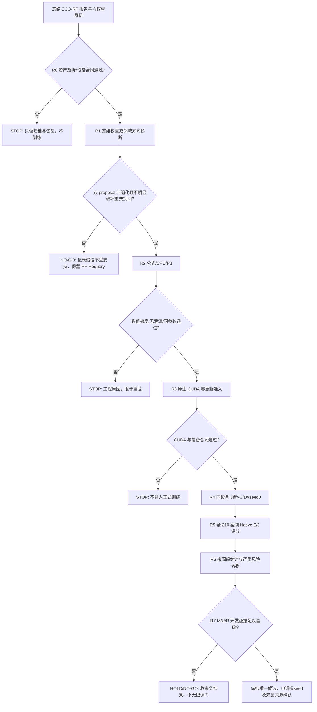

# Cranial-BCSP-FullMamba：SCQ-DAC 双邻域残差方向一致性校准实验计划书

> **英文名称**：Spatially Conditioned Query — Dual-neighborhood Agreement Calibration (SCQ-DAC)  
> **阶段性质**：SCQ-RF 之后的**候选机制预注册与可证伪实验方案**，**不是已执行实验报告**  
> **版本**：v1.0（2026-11-15）  
> **任务**：Defective Skull Complete Boundary → Missing Fragment Complete Boundary，简称 BCSP  
> **架构约束**：保持已完成的 **Attention-free FullMamba Encoder–Decoder**；不新增 Transformer Self-/Cross-Attention  
> **当前证据截止**：2026-11-15 既有 SCQ-RF 正式报告及同日以前可核验的公开论文  
> **推荐决策**：首先执行 R0/R1（资产与冻结权重机制诊断），通过后才考虑 R2/R3 及新的完整训练；不预先承诺新候选有效。

---

## 0. 执行摘要：本轮到底研究什么

本阶段建议命名为 **SCQ-DAC：双邻域残差方向一致性校准**。中心科学问题不是“是否再增加一层 Mamba”，也不是“能否把预测质心再拉近”，而是：

> **在第二次空间残差更新时，以当前 Query 为中心的重查询邻域与第一次使用的旧邻域可能提供不同的更新方向；不借助 GT、只依据两种输入可得条件产生的更新建议，其一致性是否能帮助维持有效的大幅纠偏，同时减少错误反馈、表面漏覆盖及新增严重几何事件？**

提出一项**不增加可训练参数的最小候选**：将旧邻域与新邻域分别输入**同一个**第二阶段残差头，获得两种更新向量，再使用预先冻结的方向一致性公式决定如何组合。与单纯的二向量均值对照具有**同样参数量、相同两次第二头前向计算、相同可微路径**；与原 RF-Requery 的配对重训用于评价实际增量。这种“一致性”只能暂称**启发式更新一致性指标**，未经误差检测或校准研究不能称为真实不确定度、可靠概率或安全保证。

**严格先决条件**：SCQ-RF 旧报告中 Fold C 的同设备核心证据较好，Fold D 的 RF-Static 曾迁移 GPU/驱动；因此本轮不沿用旧 D 分数作新的公平主比较。所有正式新增模型必须在同一张 GPU/驱动下、相同来源列表、相同可验证初始化合同与完整数据顺序完成配对训练。若这些条件无法实现，就只能进行只读／无更新机制诊断，不得写“跨折机制验证”。

**第一轮新训练的最大建议矩阵**：若 R0/R1 通过，训练 `RF-Requery / Dual-Average / SCQ-DAC × Fold C/D × seed0`，合计 **6 次、每次 3900 optimizer steps**；不在本轮加入第三次查询、Rim loss、尺寸或采样搜索、多轴扫描、对称重建或额外 GT 定位器。

当前成果并未表明该机制必定有效。其科学价值是能以很小的自由度，检验“空间反馈的方向一致性”是否比“单纯重查询”和“双上下文平均”更有用；无效也有明确停止条件。

---

## 1. 证据基础：严格复述 2026-11-15 SCQ-RF 实验

### 1.1 原报告证据身份和解释层级

**一手来源 [R0]**：《Cranial-BCSP-FullMamba：SCQ-RF 完整实验报告》，2026-11-15 v1；实际上传文件为 `Cranial_BCSP_FullMamba_SCQ_RF_完整实验报告_zh_2026-11-15_v1.md`，第 1—14 章。下表来自该报告第 8 章**已有正式评分**，本计划未读取其报告中提及但未附在本次会话中的服务器 checkpoint、原始评分 CSV 或 Memory 张量，不能声称已进行独立复算。

| Fold | 模型 | E P95 ↓ (mm) | J P95 ↓ (mm) | CD-L1 ↓ (mm) | E Cover@2mm ↑ | J Cover@2mm ↑ | Severe 件数 |
|:--|:--|--:|--:|--:|--:|--:|--:|
| C | S-ref | 9.030 | 11.963 | 5.953 | 61.91% | 49.61% | 9/105 |
| C | RF-Static | 7.619 | 9.811 | 4.984 | 57.51% | 49.30% | 6/105 |
| C | RF-Requery | **6.932** | **9.178** | **4.318** | **67.62%** | **55.35%** | **3/105** |
| D | S-ref | 5.273 | 7.765 | 3.130 | 67.22% | 53.82% | 2/105 |
| D | RF-Static | 5.795 | 8.360 | 3.332 | 63.48% | 50.74% | 2/105 |
| D | RF-Requery | **5.029** | **7.538** | **2.755** | **69.36%** | **53.97%** | **2/105** |

**核心结构对照 `Requery − Static`**：C 折 E P95 −0.687 mm，J P95 −0.633 mm，J Cover@2mm +6.05 pp，CD −0.666 mm；来源 E 改善/回退 17/4。D 折相应 −0.766、−0.822、+3.23 pp、−0.578，但来源改善/回退 13/8，且 **Static_D 训练 GPU UUID/驱动与另外两臂不同**，不得把 D 写作严格同设备因果复现。[R0, §§6.2、8.1—8.2]

**核心严重事件**：相对 Static，C 折 Requery 新增 1／挽回 4，D 折新增 2／挽回 2；相对 S-ref，两折合计 severe 从 11 减到 5，**仍新增 1**。这两套基线的“新发”不可混用。当前研究用严重标签定义为 `E_P95 > 20 mm OR J_Cover@2mm == 0`，不是临床安全阈值。[R0, §8.4]

### 1.2 七例诊断为什么迫使我们改变研究问题

| 既有病例 | Q0→Q1→Q2→Dense 质心误差 (mm) | 必须避免的过度解释 |
|:--|:--|:--|
| C/012 parietotemporal | 82.94→102.69→130.87→132.03 | 两次反馈均放大，但尚不能证明只由 N1 邻域错误造成 |
| C/025 parietotemporal | 57.69→60.88→71.77→70.25 | 更近的输入 Memory 并非天然等于正确骨块位置 |
| C/053 frontoorbital | 64.27→51.00→50.29→48.80 | 整块仍错位，不能简单说第二头把本来正确的 Q1 推坏 |
| D/069 random_2 | 22.96→14.19→11.52→11.83 | 位置改善但 E P95 21.82 mm、J P95 36.47 mm、范围不足 |
| C/025 random_2 | 50.99→30.75→8.42→7.64 | 成功骨块依赖较大的第二次有效纠偏，不能统一小幅限残差 |
| D/008 frontoorbital | 52.16→41.71→15.67→9.40 | 同样证明大幅二次更新可以挽回失败 |

**因而本轮禁止三种捷径**：①对所有 `δ¹` 统一 clamp 或惩罚大范数；②给 Q0/Q1 新增强 GT 质心或半径监督，破坏共同生成分工；③用已知 GT 方向、GT 缺损中心、风险标签或事后异常病例身份做推理期门控。[R0, §§9.2—9.4、12]

### 1.3 哪些事项尚未完成

- **仅 seed0**；两折训练来源重叠，开发来源虽互斥但已被多个阶段反复观察。
- **无来源级 bootstrap、无正式 M/U/R gate**；过去零新增可靠性必要条件在核心比较中已经不满足。
- **D 折 Static 的硬件与驱动混杂**；统一预测设备不抹去训练混杂。
- **全量 630 个 RF 预测没有保存完整 Memory、N0/N1 与特征差异**；七例是有选择的机制诊断。
- **先前 SCQ B/S 的 F 等容量控制仍未训练**；既有成果不能证明其 7 维显式几何通道的独立效应。
- **六个关键 checkpoint 的服务器字节哈希已经记录，但长期本机备份、反序列化和恢复验证没有由报告证明完成**。

本阶段的计划必须承认上述边界，不得通过新候选一次开发集的好分数把它们抹掉。

---

## 2. 文献核验：为什么做双邻域更新一致性，而不是继续叠模块

### 2.1 用户搜集文献与新检索资料的使用边界

用户提供了分成四档的文献清单：①颅骨修复与植入体生成；②Mamba 与点云补全；③2025—2026 前沿补全；④医学点云及补全综述。本文件以这些**题目清单和此前已讨论的研究线索**确定检索优先级，同时以出版社、会议、PubMed、arXiv 的可访问摘要/页面核对代表论文。**不能声称已逐篇精读用户所列全部 82 篇的全文**；对未检得方法正文或代码的内容，只作为需后续精读的相邻方向，不据题目猜测具体机制和数值。

| 文献/来源 | 截至 2026-11-15 可核验的主要相关内容 | 对本研究的约束 | 核验入口 |
|:--|:--|:--|:--|
| **CompletionMamba**, IEEE TIP 2025 | 局部 SSM、重排以及 shape-aware Mamba，用于改善三维序列局部与全局形状感知 | “局部 SSM/KNN”不是新的独创点；应论证**生成 Query 的反馈一致性**而非重命名已有局部模块 | [L1] |
| **DAPointMamba**, AAAI 2026 | 讨论 3D→1D 序列化对拓扑的破坏，提出跨域 patch 扫描、空间/通道对齐 | “空间对齐”“patch 扫描”已有研究；本阶段不擅自增加新排序 | [L2] |
| **FusionMamba**, *Information Fusion* 2026 | LGSA 局部—全局几何聚合及残差几何对齐 | “残差校正”不能本身作为新颖性；需同容量对照和稳定性机制证据 | [L3] |
| **3DMambaComplete**, 2024 | HyperPoint 生成、空间展开与后续形变重建 | 空间分布与几何覆盖需要单独评价，不能把质心正确视为完整形状成功 | [L4] |
| **PointMamba**, NeurIPS 2024 | 以空间填充曲线序列化 token 的 Mamba 点云表示 | 点云排序影响时空依赖；本轮冻结现有 XYZ 排序以确保单变量归因 | [L5] |
| **PPC-MT**, 2026 | PCA 结构序列与并行补全，解码仍融合 Transformer | 不能借其性能直接宣称纯无注意力 FullMamba 的优势 | [L6] |
| **CDRMamba**, *Biomedical Signal Processing and Control* 2025 | 增强 3D U-Net 与 Mamba 的颅颌面缺损恢复框架 | 医学任务相关，但其 3D 体图建模与当前 `∂D→∂G` 点云目标不同，不能直接比较不同协议指标 | [L7] |
| **Bayesian Skull Reconstruction**, *Scientific Reports* 2026 | 概率形状重建与误差/不确定度评估，提示骨形状多解与厚度变异 | **启发评估可靠性**，但本项目的“双邻域方向一致性”不是已校准概率，也不是贝叶斯方差 | [L8] |
| **Revisiting PCC: Real-World?**, ICCV 2025 | 真实场景点云的拓扑与分布变化挑战 | 不能从合成 SkullBreak 直接外推到真实临床缺损 | [L9] |
| **SkullBreak/SkullFix**, *Data in Brief* 2021 | 官方数据集的体积缺损任务与分割数据背景 | 必须保留本研究的独立 BCSP 任务转换与数据划分，不拿官方不同协议数值直接排名 | [L10] |
| **Learnable Symmetry**, *CMPB* 2025 | 利用可学习颅骨对称性辅助重建 | 后续可作为结构先验竞争方向，不可与本轮方向一致性主变量同时引入 | [L11] |
| **Fishman et al.**, *IJCARS* 2024 | 临床植入体厚度和 rim 过渡可与合成基准不同 | 当前输出是缺失骨块边界点集，不能声称制造或临床厚度已得到保证 | [L12] |

### 2.2 关于“创新点”的正确表述

当前不能宣称“首次将 Mamba 用于颅骨”“首次提出几何重查询”“首次通过迭代残差补全点云”。拟检验的**具体候选研究点**是：

> **在无注意力 Mamba Encoder–Decoder 的 coarse 生成链路中，利用同一更新头基于旧/新两组实际 Memory 邻域产生两个坐标更新，并以其方向一致性进行参数免费的更新组合；通过等容量、等双次调用和来源级风险对照验证作用。**

只有当其相对于 RF-Requery 和等计算 Dual-Average 的独立收益、风险边界、跨 seed 与外部适用性获得证据后，才可考虑将它提炼为小论文的具体贡献。文献能支持研究动机，**不能代替本任务实验结果**。

---

## 3. 问题定义与实验假设

### 3.1 正式任务

设完整二值骨组织实体为 `C`，移除骨块实体为 `G`，残余骨为 `D`，则合成缺损符合 `C=D∪G`（相应实体互补；接触处边界可共享）。输入为残余实体的**全部可见骨组织边界** `∂D` 的 8192 点采样；目标为缺失实体骨块完整边界 `∂G` 的 8192 点采样，不是完整颅骨、不只是外板或外轮廓。`∂G=E∪J`，E 表示缺失骨块继承的自由表面，J 表示与 D 接触的人工切除断面。源数据的有限体素与点采样不意味着独立高精度临床 GT。

### 3.2 唯一主要结构假设 H-DAC

**H-DAC**：对同一批 D-only 输入和同一个第二阶段残差头，在 `Q1` 处使用旧邻域 `N0` 与新邻域 `N1` 形成的两种更新建议，**在方向较一致时优先采用重查询建议；方向不一致时采用更对称的组合**，可能降低错误反馈的局部放大，同时不一律压缩所有大幅有效更新。

- **H0（零假设）**：参数与双次计算匹配后，一致性自适应组合对 Native E/J、CD、覆盖和严重风险没有稳定附加收益；即使有收益也可能来自训练随机性。
- **H1（支持性）**：相对于 `Dual-Average`，`DAC` 在 Fold C/D 来源级 E 和 J 及高尾风险上得到跨折一致的开发性收益，且相对于原 `RF-Requery` 不产生不可接受的新风险。
- **反例预测**：当两个提议方向一致但都错误、或相互不同但新邻域正确时，DAC 仍可能错误地放大/抵消有效更新。这些反例是本实验必须检验的**模型失败可能性**，不是实现 bug。

### 3.3 严格区分的三个问题

1. **可用性**：两个邻域是否形成非同质的候选方向？若两头输出几乎相同，额外双次计算可能没有研究价值。
2. **机制增量**：与参数和第二头计算都匹配的固定平均对照相比，方向一致性是否真正带来附加收益？
3. **真实补全与风险**：即使 Q2 质心更准确，最终 E/J、双向误差和新增严重病例是否实际改善？绝不能只验证更新向量或质心。

---

## 4. 数据、来源划分和绝对禁止事项

| 合同项 | 冻结要求 |
|:--|:--|
| 数据协议 | SkullBreak BCSP V1，当前已开放 **84 个来源、420 个缺损案例**；每来源五种缺损 |
| C/D 每折 | 63 来源训练/315 案例；21 来源开发/105 案例，两个开发来源集合互斥，但训练集合有重叠 |
| 点数 | 输入 `8192`，GT `8192`，coarse `256`，每 coarse 32 dense 点 |
| 输入几何 | 6 邻域实体暴露面 V1 面积采样，原始 D-only 归一化；不再比较 V0/V2/Morton/graph |
| 存储与分折 | **以 source ID、manifest 与哈希为准**；历史 C 开发输入实际位于带 `foldd` 名称的路径，D 位于带 `foldc` 的路径，不能凭目录名猜测 |
| 推理可用项 | D8192、D-only 坐标变换、实际 Encoder Memory 坐标 M/特征 F、全局 z、各级 Query 与预测更新 |
| 禁用推理项 | GT 中心/半径、GT bbox、J mask、严重标签、GT 法向/切壁、预测与 GT 的 Oracle 配准 |
| 封存数据 | `confirmation20` 维持原有访问边界；历史曾曝光的官方测试不能重新宣称“未见盲测” |
| 其它数据 | SkullFix 80/10 及 MUG500+ 暂不混入本轮模型选择；MUG 未认证为高精度植入体 GT |
| 评价单位 | 每病例计算指标→同来源五缺损等权→每折21来源等权；配对 bootstrap 在来源层级进行 |

**本轮不增添**新 loss、法向或 Rim 监督、GT 引导对齐、三维实体重构、输入采样搜索、Mamba 轴排序变更、局部图改造、第三次空间迭代、对称性先验或 Decoder 替换。这样才能把本轮问题集中到第二次更新方向组合。


---

## 5. 结构设计：从 RF-Requery 到 SCQ-DAC

### 5.1 全部继承、不允许更改的主体

保留当前无 Transformer attention 的 FullMamba：

```text
D (8192×3, D-only normalized)
  └─ DGCNN / FPS / KNN / local aggregation
       └─ Mamba encoder → Memory M(256×3), F(256×384), z(1024)
            └─ learned coarse Q0(256×3)
                 └─ 1st SCQ head (1802→384→3) → δ0 → Q1=Q0+δ0
                      └─ 2nd feedback head (1802→128→3), see variants below
                           └─ Q2(256×3)
                                └─ attention-free LQI Mamba decoder (8 layers)
                                     └─ FC relative xyz head, 256×32=8192 points
```

- Encoder/Decoder 的原生 Mamba、XYZ 稳定序列化、局部 graph 分支、z 维度、coarse 与 dense 点数完全不动。
- 第一头 `1802→384→3`、第二头 `1802→128→3` 的公式、normalization、GELU 精确实现、原权重衰减策略保持不变。
- 仍使用训练 `CD(Q2,G8192)+CD(P8192,G8192)` 的冻结路径；R0 基线 Q2 按原 RF-Requery 定义。无 auxiliary moment、radius、Rim 或 delta 损失。
- 原 LQI Decoder 在传入 `Q2` 后会自己执行基于当前 Q2 的局部 KNN，不能把本实验误写成“首次让 Decoder 使用当前空间邻域”。

### 5.2 统一的局部特征合同

设实际 Encoder Memory 坐标为 `M∈R^{256×3}`、特征 `F∈R^{256×384}`，原 learned query 为 `Q0∈R^{256×3}`。第一头使用

\[
\mathcal N_i^0 = \operatorname{KNN}_8(M,Q_i^0),\quad
Q_i^1=Q_i^0+h_0\big(\Phi(Q_i^0,\mathcal N_i^0)\big).
\]

其中 `Φ` 与上轮报告完全相同，必须使用**实际 Memory 的 8 邻居**而非输入的 8192 个原始点，特征 LN 在逐 Memory token 上执行，几何采用当前查询位置重算：

\[
\Phi(q,\mathcal N) = \big[z,\;\mathrm{mean}(\mathrm{LN}(F_\mathcal N)),\;
\mathrm{max}(\mathrm{LN}(F_\mathcal N)),\;q,\;\mu_d,\;\sigma_d,\;\rho_d\big]
\in\mathbb R^{1802},
\]
\[
d_j=M_j-q,\quad
\mu_d=\tfrac{1}{8}\sum_{j\in\mathcal N}d_j,\quad
\sigma_d=\sqrt{\tfrac{1}{8}\sum_j(d_j-\mu_d)^2+10^{-6}},\quad
\rho_d=\tfrac{1}{8}\sum_j\|d_j\|_2.
\]

这里 `σ_d` 是**逐坐标的三维标准差**。LN 不含仿射参数，eps=1e−5；后端的距离和排序 tie-break 必须与已冻结实现一致。对静态邻域，也必须在**Q1** 重新计算 `d_j`，不能错误地复用 Q0 的相对几何缓存。

### 5.3 先定义同一参数头的两种更新建议

在 `Q1` 处分别获取：

\[
\mathcal N_i^{\rm old}=\mathcal N_i^0,\qquad
\mathcal N_i^{\rm new}=\operatorname{KNN}_8(M,Q_i^1).
\]

使用**同一个**第二阶段 MLP `h_1:1802→128→3`，不是两套独立 head：

\[
\delta_i^{\rm old}=h_1\big(\Phi(Q_i^1,\mathcal N_i^{\rm old})\big),\qquad
\delta_i^{\rm new}=h_1\big(\Phi(Q_i^1,\mathcal N_i^{\rm new})\big).
\]

二者读取相同的 `z`、相同的 Q1，差异只在**邻域索引与其所对应的 Memory/相对几何内容**。两次 `h1` 共享权重且梯度累积到同一组参数；禁止为候选额外新增学习型 gate 或独立第三头。本轮待检验的是输出规则，而不是拟合更强的网络。

### 5.4 主候选 SCQ-DAC：冻结的无参数方向一致性组合

对每个 Query 计算两向量的数值稳定余弦一致性：

\[
 c_i=\operatorname{clip}\!\left(
  \frac{\langle \delta_i^{\rm new},\delta_i^{\rm old}\rangle}
       {\|\delta_i^{\rm new}\|_2\,\|\delta_i^{\rm old}\|_2+\epsilon},-1,1\right),
 \qquad \epsilon=10^{-6}.
\]

规定不需要训练的组合系数：

\[
 a_i=\frac12+\frac12\max(0,c_i)\in[0.5,1],
\]
\[
 \delta_i^{\rm DAC}=\operatorname{sg}(a_i)\,\delta_i^{\rm new}
 +\big[1-\operatorname{sg}(a_i)\big]\,\delta_i^{\rm old},
\quad Q_i^2=Q_i^1+\delta_i^{\rm DAC}.
\]

`sg` 表示对**混合权重**停止梯度，而不是对任意更新向量或 Encoder Memory 停止梯度；两个 proposal 仍通过输出组合接受损失的正常梯度。`a_i` 在不一致或一方零向量时取 0.5；方向高度一致时趋向 1，更多使用经重查询的更新。冻结 `a` 梯度可防止训练通过 `a` 的连续路径直接“操控一致性评分”，但**并不能阻止模型通过更新向量本身形成一致或产生共同错误**。

这是一条**候选假设**，并非数学上的误差下降定理、收敛保证或概率置信度：

- 二者高度一致却同向错误时，DAC 会基本采用错误的 Requery 更新；
- 二者方向相反但其中一个正确时，平均可能削弱正确大幅纠偏；
- 协议**未**将更新幅度硬截断到小数值，也没有单独给 Q0/Q1 施加 GT 监督；但**凸组合本身可能在不一致时减小向量范数**，必须对成功挽回病例专门审计这一副作用。

如果 R1 显示这类问题广泛且无区分能力，就直接 NO-GO，不通过“再调 a 的阈值/温度”挽救原假设。

### 5.5 两个必须同时存在的对照

**R（原 RF-Requery）**：

\[
Q_i^2=Q_i^1+\delta_i^{\rm new}.
\]

**A（Dual-Average，等参数且等双次前向的固定平均对照）**：

\[
Q_i^2=Q_i^1+\tfrac12\big(\delta_i^{\rm new}+\delta_i^{\rm old}\big).
\]

**D（SCQ-DAC）**：上述由方向一致性决定的 `a_i` 的组合。

| 特征 | R：RF-Requery | A：Dual-Average | D：SCQ-DAC |
|:--|:--|:--|:--|
| Encoder/Decoder | 全部相同 | 全部相同 | 全部相同 |
| 第一头 | 原 SCQ | 原 SCQ | 原 SCQ |
| 第二头参数 | 单个共享 `h1` | 单个共享 `h1` | 单个共享 `h1` |
| 第二头函数调用数 | 1 次 | **2 次** | **2 次** |
| 第二邻域信息 | N1 | N0+N1 | N0+N1 |
| 更新组合 | 原重查询更新 | 常数 `0.5/0.5` | 固定方向一致性权重 |
| 额外学习型 gate | 无 | 无 | **无** |
| 新增 Transformer attention | 无 | 无 | 无 |
| 最关键的比较作用 | 实际增量基线 | 排除“双上下文平均/双次计算”本身 | 检验动态方向一致性作用 |

**模型参数数目**：如严格保留上一轮 RF 的所有模块，三臂都应为报告中的 **40,827,847** 个可训练参数；这是实现期必须由原生模型参数清点验证的*预期值*，不能在实际检查前宣称已经验证。`A`/`D` 的每次 `h1` 调用不同，但**不会重复计入参数**；其计算与推理耗时必须单独测量，不能将“零新增参数”写作“零额外开销”。

**主机制比较**为 `D−A`（两次 `h1` 及参数规模一致）；**实用比较**为 `D−R`（是否真的值得比已经可运行的 Requery 更复杂）。只比 `D−R` 会混淆“双上下文平均”与“自适应权重”；只比 `D−A` 则不能说明优于工作基线。

### 5.6 梯度、排序与下游坐标消费要求

- 整数 KNN 邻居选择本身不求导；**选中的 Memory 特征、Q1 相对几何、两条 proposal** 保留可微路径。
- `a` 的计算仅使用 `Q1` 与模型已经产生的两组 `δ`，不得读取 GT、E/J 标签或当前样本属于哪一类缺损。
- `Q2` 必须统一进入 `mlp_query`、decoder 位置编码、排序、局部/条件 KNN、相对重建的中心加法、最终 coarse 返回和 coarse loss；逐项审核其实际消费者，避免只修改日志/可视化输出。
- 第二阶段 `h1` 的输出层按旧 RF 协议零初始化；**此时两个 proposal 都是零，R/A/D 的 Q2 都等于 Q1**，但更新参数梯度应非零。第一头仍从共同 scratch 母版初始化，不用旧 RF 训练权重 warm-start。
- 统一 FP32、TF32 关闭、固定原生 Mamba provider，不更换 `torch.cdist` Chamfer。数值零差断言需采用训练环境可兑现的容差，不能以不同设备位级一致作为不现实要求。

---

## 6. 训练前第一关 R0：资产、版本和公平性合同审计（零训练）

### 6.1 为什么这一步是必要条件

上一轮六个 checkpoint 均有在运行后正式冻结记录中的字节长度与 SHA256，但报告未证明已被下载至长期存储，也未对新恢复环境完成独立 `state_dict` 加载与一次数值复现。本轮不应在无法恢复上一代候选的情况下继续堆积训练资产。

**最低恢复资产**：上一轮 `S-ref_C/D`、`RF-Static_C/D`、`RF-Requery_C/D` 六权重；绑定源码、factory/入口、训练配置、manifest、真实折/来源表、三臂原生参数初态指纹、评分器源码 SHA 与原评分汇总。权重必须与具体实现版本配对；仅有模型名称和 checkpoint 哈希字符串不足以复现。

### 6.2 具体任务及验收

1. 读取六个最终 checkpoint 的 `bytes/SHA256` 和模型构造签名，**只在用户授权的存储位置**确认真实字节是否存在；如文件丢失，不得推测可从以前实验同名文件恢复。
2. 独立加载一个 C/D 模型与对应源码，固定至少一个已冻结案例，检查重新计算的 `Q0/Q1/Q2/P8192` 是否与原 Native 在事先规定的容差内一致（不同 GPU 时可执行数值容差比较，不能要求字节级相同）。
3. 固定真实 `C/D` 的 `source_id/fold/defect` 清单、文件 hash、D-only 归一化方式和训练样本流；专门核对“C 开发路径名称带 foldd / D 名称带 foldc”的历史命名反转。
4. 确认计划中的全部 R/A/D 正式训练可**使用同一个 GPU UUID、驱动、容器镜像、PyTorch/Mamba/PointNet2 provider**。不允许复制上一轮的设备身份冒充当前资源；新容器必须重新做必要身份及路径验证。
5. 复核与 2026-11-14 SCQ B/S 的同名 S/S-ref 结果差异（例如旧 S 的 C E P95=6.688，而新 RF 轮 S-ref_C=9.030）：逐项对照权重身份、母版源码、初始化流、训练资源、完整数据顺序和 seed，**不得仅由数字漂移推断 bug**；记录不能核实的差异。

**R0 STOP**：六模型的关键对照资产不可验证、来源清单无法恢复、训练设备无法满足同设备配对、或者新基线与原结构存在无法解释的接口差异时，停止正式新增训练，只归档已验证资料。

---

## 7. 训练前第二关 R1：冻结权重下的双邻域反事实诊断（零更新）

### 7.1 诊断目的

在**固定原 RF-Requery 训练后权重**下，用同一个第二头计算 `δ_old`、`δ_new`，初步判断方向一致性是否提供非平凡信息。此时无需训练新结构，可识别“两个方向几乎完全一样”“大量原本有效的大更新被平均抵消”等明显不利情形；它**不能**预言两个端到端重训后的最终收益。

### 7.2 样本选择与预算

建议固定 **20 个已开放开发病例**作为机制审计（不是独立测试）：

- 5 个既有失效解释病例：C/012 parietotemporal、C/025 parietotemporal、C/053 frontoorbital、D/069 random_2、D/087 frontoorbital；
- 5 个既有改善/挽回或其它类型的固定解释病例（包含 C/025 random_2 与 D/008 frontoorbital，其余根据原冻结来源索引、提前书面锁定）；
- 10 个按**模型成绩未知于选择函数**的稳定哈希规则在其余开发来源中抽选的病例，预先锁定 C/D 和缺损类型分布。

上述案例此前已参与模型设计；即便后 10 个使用哈希，也不是“真正新盲测”。不得根据看到的结果事后替换样本。预算建议最多 `20×(1 原 Native + 2 个 frozen-h1 proposal 提取 + 必要的 2 个 decoder-only 反事实)` 次限定调用（具体实现可合并相同 backbone 的计算，不得扩大成全量无授权搜索）。

### 7.3 保存与分析的张量

同次 forward 存 `M, F, z, Q0, N0, Q1, N1, δ_old, δ_new, c, a, Q2^R, Q2^A, Q2^D`，以及必要的 `P^R/P^A/P^D`（仅作冻结模型下的**反事实诊断**）。记录每个 Query 的：

- `||δ_old||, ||δ_new||, ||δ_DAC||`，以及两向量夹角余弦；
- `N0/N1` 集合重合率、邻域中心距离、查询到 Memory 的最近距离、相对几何摘要；
- 正/负/近零余弦所占比例、`a` 分布，是否塌缩为全 0.5 或全 1；
- 是否把曾被挽回病例的大幅更新抵消，以及极端错误病例的反馈是否减弱；
- 反事实 `Q2/P` 的 E/J P95、双向覆盖、远端离群与 severe 标签（仅诊断，绝不用于训练时选择 gate 超参）。

**特定数学检查**：固定相同 h1 权重时，`δ_old`/`δ_new` 的差异应来自 N0/N1 的实际数据，不允许把两次前向混入不同 BN 模式、不同归一化元数据、供体 Memory 或随机 TTA。

### 7.4 R1 预设停止判据

在看到新的任何完整训练分数之前锁定下述**工程性非退化判据**（不是临床阈值）：

- 若至少 95% 的有效 Query 上 `δ_old≈δ_new`（预先在归一化坐标定容差、并同时检查几何/特征输入身份），或 `a` 几乎恒定，则两邻域方向信息不足，**不启动 DAC 完整训练**。
- 若冻结权重诊断显示大部分已挽回病例的必需大更新被严重抵消，且既有失败未得到任何可识别的变化线索，按 NO-GO 记录；不能现场换成另一个 gate 权重继续试。
- 若相异更新有实质比例、机制可复现且未出现确定的实现错误，可进入 R2/R3；这里是**允许有限证伪训练**，不是证明候选具有可靠性。

没有资料支持把“余弦一致”直接等同于“预测更新正确”，所以 R1 的成功门仅表示有值得进一步验证的变量，不是科学结果通过。


---

## 8. R2：隔离实现与 CPU 数学/梯度合同（零训练）

### 8.1 实现方式

**不修改旧项目已冻结的 RF 训练源码**。在独立命名空间中新建 DAC 组合模块和 factory/launcher；复用既有模型、输入 Manifest、Memory KNN、`Φ` 与第二头模块。禁止把旧 Static 或 Requery 的共享工厂悄然覆盖到新版本。写入唯一公式说明及源码 SHA；数学规格与实际程序保持一一对应。

### 8.2 核心 PyTorch 伪代码（仅逻辑示意，不是本次已执行代码）

```python
# Q0: B×256×3; M: B×256×3; F: B×256×384; z: B×1024
# All geometric queries are in the SAME D-only normalized coordinate frame.
N0 = knn_memory(M, Q0, k=8)                 # integer indices, not differentiable
Q1 = Q0 + first_scq_head(phi(Q0, N0, M, F, z))

# Difference must be the neighbor set only; BOTH summaries use Q1 geometry.
N1 = knn_memory(M, Q1, k=8)
x_old = phi(Q1, N0, M, F, z)
x_new = phi(Q1, N1, M, F, z)

d_old = second_head(x_old)                   # weight SHARED
D_new = second_head(x_new)

if arm == "RF_REQUERY":
    d2 = D_new
elif arm == "DUAL_AVERAGE":
    d2 = 0.5 * (D_new + d_old)
elif arm == "SCQ_DAC":
    eps = 1e-6
    dot = (D_new * d_old).sum(dim=-1, keepdim=True)
    normprod = D_new.norm(dim=-1, keepdim=True) * d_old.norm(dim=-1, keepdim=True)
    cosine = (dot / (normprod + eps)).clamp(-1., 1.)
    alpha = (0.5 + 0.5 * cosine.clamp_min(0.)).detach()  # stop grad through α only
    d2 = alpha * D_new + (1. - alpha) * d_old
else:
    raise ValueError(arm)

Q2 = Q1 + d2
coarse, dense = fullmamba_lqi_decoder_and_fc(Q2, M, F, z)
# coarse returned to loss must be Q2; dense is 8192×3.
```

注：若性能优化需要 R 臂省略 `d_old` 计算，可以在正式性能 benchmark 单独记录；**训练基线需保持可审计的程序身份**，不得为了节省计算改变其他结构或梯度。上方的 `fullmamba_lqi_decoder_and_fc` 表示原有消费者接口，实际实现必须与报告冻结代码一致，并验证所有坐标路径。`D_new` 变量名仅示意，不代表缺损实体 D。

### 8.3 必须通过的 CPU 合同

| 检查项 | 预期 | 失败判定 |
|:--|:--|:--|
| Tensor shape | `Q0/Q1/Q2, d_old/d_new` 均 B×256×3；`α` 为 B×256×1 | 不一致即 stop |
| 无数据泄漏 | forward 构造函数不接受 GT、E/J mask、缺损类别、GT bbox；必要 D-only 几何可追溯 | 任何 GT 使用即 stop |
| 初态中性 | 第二头输出层为零时，R/A/D 的 Q2=Q1；所有输出与同配置母版数值一致 | 不一致即 stop |
| 完全同邻域 | `N0=N1` 且 `δ_old=δ_new` 时，A/D 输出严格等于 R | 不一致即 stop |
| 完全同向 | 两 proposal 同向同幅时，DAC 不减小有效更新 | 不一致即 stop |
| 相反向量 | cos≈−1 时 `α≈0.5`；等幅反向 proposal 可能互相抵消，标记为预期风险 | 不得强行解释为改进 |
| 一支为零 | 分母有 eps，输出有限；`α=0.5` 的定义稳定 | NaN/Inf stop |
| 梯度 | `δ_old` 与 `δ_new` 的可用梯度汇合至同一第二头；`α` 不回传 | 梯度合同不符 stop |
| KNN 梯度 | 索引不微分，Q1 相对几何、F 与连续参数应按原合同反传 | 错误 detach stop |
| 共享初始化 | R/A/D 的母版以及第二头初始权重/BN 状态匹配，新增模块不消耗母版随机流 | 不匹配 stop |
| 参数数 | 原生总参数预期三臂一致，目标 **40,827,847** | 若不同先说明且不得宣称等容量 |
| 现有 attention | 无新增 Transformer Self-/Cross-Attention，已有 local KNN 不按类名误判 | 内容 attention 路径残留 stop |
| 来源约束 | C/D 清单、点集 SHA、归一化、来源隔离严格匹配 | 源混叠 stop |

完成一套解析可验证的人工输入测试：用已知向量配置 proposal，手算 `c、α、Q2` 并对照代码；把“方向相反时可能失败”写入预期结果，不能只测有利场景。**不允许**此时根据人工样本的 GT 几何结果扫描 alpha 公式。

---

## 9. R3：真实原生 CUDA 零更新准入

CPU/P3 全部通过后，申请与正式模型版本一致的 CUDA 环境进行**有限次数**检查；它是工程准入，**不是科研效果验证**。

建议固定最小矩阵：

| 准入调用 | 模式 | 输入 batch | 模型 | 目的 |
|:--|:--|--:|:--|:--|
| C0 | eval | 1 | R | 与冻结 RF 主体对齐 |
| C1 | eval | 1 | A | 两 proposal 与双次调用路径 |
| C2 | eval | 1 | D | 方向一致性与完整路径 |
| C3 | train/autograd | 8 | A | 全部 Chamfer、BN、共享梯度与资源 |
| C4 | train/autograd | 8 | D | gate detach、双支梯度与资源 |

**合计建议 5 次完整 forward、最多 5 次原 loss / backward、0 次 optimizer.step**；可以在 eval 模式选用无 backward 的必要项，但不能把它记成更大规模实际训练。每次实际 `native Mamba` 调用、完整模型峰值 allocated/reserved/SMI、RSS、walltime、有限梯度、BN/RNG 与模型状态恢复均记录。CPU 人工模型不能代替原生 Mamba CUDA 准入。

检查 `Q2` 下游至少包括 query MLP、位置编码、排序、局部/条件 Memory KNN、FC 生成中心、coarse 返回与损失；与历史报告中的消费者接口相符即可，不为了积累检查数量扩建通用审计框架。完整 loss 保留旧 `torch.cdist` 实际分支，不更改算法或数值保护。

**R3 STOP**：出现 nonfinite、梯度中断/错误双头权重、初态非中性、设备身份变化未再绑定、batch8 超资源限额、模型输出未真正消费 Q2、或发现新增 attention 路径，都应停止并修正工程问题。工程修复须保留版本与重验证，不能把启动失败算作实验阴性。

---

## 10. R4：正式训练矩阵与配对策略

### 10.1 唯一正式训练矩阵（条件式启动）

| ID | Fold | 主干 | 第二更新 | 训练身份 | 角色 |
|:--|:--|:--|:--|:--|:--|
| R_C | C | FullMamba+SCQ-RF | 新邻域 single update | scratch, seed0 | 实用基线 |
| A_C | C | 完全相同 | N0/N1 共享头固定均值 | scratch, seed0 | 等双次计算控制 |
| D_C | C | 完全相同 | N0/N1 共享头一致性组合 | scratch, seed0 | 唯一候选 |
| R_D | D | 完全相同 | 新邻域 single update | scratch, seed0 | 消除旧 D 设备混杂 |
| A_D | D | 完全相同 | N0/N1 共享头固定均值 | scratch, seed0 | 等双次计算控制 |
| D_D | D | 完全相同 | N0/N1 共享头一致性组合 | scratch, seed0 | 唯一候选 |

三臂**每折都从共同 scratch 母版与共同初始化字节开始**，不是从上轮已训练 Requery checkpoint fine-tune。配对的要求是共享参数初始张量身份一致、每个真实 mini-batch 病例/source 顺序一致、更新计数相同、优化器实际参数组及调度相同；**不要求从第 1 步起梯度轨迹相同**，因为前向组合公式不同。

### 10.2 训练超参数（与 RF 报告逐项继承）

| 项目 | 正式固定值 |
|:--|:--|
| 训练数据 | 每折 315 个病例、63 来源；五类缺损完整保留 |
| Batch | 8，`drop_last=True`，每遍历 39 个完整 batch |
| 遍历 | 100 次，恰好 `3900 optimizer steps` |
| 每 run 实际病例曝光 | 31,200；每次遍历丢弃 3，合计 300 次 dropped exposures |
| 优化器 | AdamW，`lr=1e−4, betas=(0.9,0.999), eps=1e−8` |
| Weight decay | 常规矩阵 `5e−4`；1D、bias、SSM 指定参数例外 `0`，以实际组清单为准 |
| LR | `1e−4 × max(0.9^(epoch/21),0.02)` |
| BN momentum | `max(0.9 × 0.5^(epoch/21), 0.01)` |
| Gradient clip | max norm 10 |
| Precision | FP32；TF32=false；沿用报告所披露的 Mamba 有限非位级确定性 |
| Loss | 原 `coarse Chamfer + dense Chamfer`；denoising/H1/H2/rim/额外正则均关闭 |
| Checkpoint | 固定最后 `epoch99 / update3900`，不依据开发分数选最佳 epoch |
| 禁用 | BNCal、TTA、GT Oracle、训练内开发挑选、按 C 折结果更改 D 折、自动 retry/resume |

全部六个新 run 若完成，将形成 **23,400 optimizer steps、187,200 实际病例曝光、1,800 dropped exposures**；这里的“曝光”是重复迭代，不是 187,200 个独立样本。

### 10.3 同设备操作约束与首选运行顺序

**必须**先验证同一张 GPU UUID/驱动可用于所有六 run；如果资源周期变化需要迁移，优先在启动任何核心比较前统一新设备并重新执行必要身份/准入检查，而不是一个折末尾只迁走某一对照。建议执行顺序为 `R_C→A_C→D_C→R_D→A_D→D_D`，但完整矩阵授权后**不得因前一臂开发分数改变后续模型或超参数**。可以在全部六 run 完成后再统一 Native 评分，减少开发反馈诱发的选择偏差。

如果无法满足同设备要求：

1. 保持冻结权重与日志，不把不同 GPU 的训练结果标为严格结构对照；
2. 可给出受混杂限制的描述性补充结果；
3. 若后续希望为论文声称可靠机制收益，则必须另行登记同设备配对重复，不在同一阶段自动“补跑直到看起来一致”。

### 10.4 资源与耗时预算

上一轮 RF 报告的典型训练记录约 1678—1726 s/run（第六次 Static_D 因设备迁移为 1512.8 s），SMI 峰值约 14.6 GiB，Torch allocated 峰值约 12.97—13.00 GiB；这些是**历史观测，不是新 DAC 的实测或时间保证**。双次共享第二头调用带来额外计算，需以本轮设备实际监控为准。建议保留至少 20 GiB Torch allocated、22,528 MiB SMI、RSS 8 GiB 的现有停止限，任何真实超限按固定合同停止并单独批准后续资源调整；不为了完成实验偷偷更改 batch 或 gradient accumulation。

**显存提醒**：当前用户本地 4 GiB 显卡与历史 13 GiB Torch 峰值不匹配，正式 3900-step 训练应使用能满足合同的 GPU，不把在低显存上缩小 batch 的结果纳入本轮公平矩阵。

---

## 11. R5：统一 Native 预测、评分与保存内容

### 11.1 必须保留的 Native 契约

- 每模型 Fold C/D 开发各 **105 个病例**；六 run 共 **630 次 Native 完整 forward**。
- `batch=1`、`model.eval()`、`inference_mode()`；无 warmup（沿用旧正式推理合同）、无 GT 对齐、无 TTA、无后验删点、无评估过程优化器更新或 BNCal。
- 预测在同一冻结版本的 CPU/GPU 评分环境完成，记录真实设备、源码哈希、输入点云/manifest、checkpoint、D-only 归一化和 world-mm 反变换；模型状态和 RNG 前后指纹保持不变。
- 不只保留 dense8192，还必须保存本轮真正重要的**完整阶段证据**；在来源和隐私边界允许时另存轻量 Memory 邻域审计包。

**推荐每份预测输出**：

```text
case_id, source_id, fold, defect_type
input_sha256, model_sha256, config_sha256
norm_center_D, norm_scale_D
Q0[256,3], delta0[256,3], Q1[256,3]
N0[256,8], N1[256,8]             # strictly from actual M(256,3)
delta_old[256,3], delta_new[256,3]
cosine[256,1], alpha[256,1], delta_used[256,3]
Q2[256,3], dense[8192,3]
summary: centroid, radius, bbox, neighbor_overlap, proposal_norms
```

**角色说明**：R 模型中 `delta_used=delta_new`；A 模型中 `alpha=0.5`；D 模型中 `alpha` 为固定一致性权重。R 段可仅保存 `delta_old` 作只读诊断，但不得因它额外参与损失而改变 R 的正式前向。保存 `M/F/z` 全量可能影响文件体积；如果需要另行读取这些特征，应限制为固定诊断子集，但 `N0/N1` 整数索引与两条 proposal 的轻量记录建议全量保留，直接修补 RF 阶段的机制证据空缺。

**估算体积**必须用人工推理结果实际测量后冻结预算，不能把上一轮仅 9 个字段、约 66 MB 压缩包的大小机械用于本轮更大 schema；禁止因输出超限静默删掉异常案例或关键阶段字段。

### 11.2 几何评分协议（完全冻结）

- `E_P95`：以 A1 中 E 的**世界 mm、物理面积加权**参考→预测距离 P95 为**唯一主终点**；不是对所有病例/点拼接的总体 P95。
- `J_P95` 与 `E/J Cover@0.5、1、2mm`：区分完整自由表面与共享切壁。
- `CD-L1`：固定 G8192 与 P8192 的双向非平方欧氏 NN 距离均值的半和；与按坐标逐元素 L1 不同。
- 预测→离散 A2 `P95`、`>20mm` 离群比例：评估模型生成点落在错误区域的尾部风险。
- 质心距离、回转半径比、bbox、Q0/Q1/Q2/Dense 位移方向：**辅助诊断**，不能替代完整几何成功。
- 控制 `Nop_D` 和 `GT8192` 仅按相同病例复用，不算额外训练模型；GT8192 相对高分辨率 A1 可以有非零距离，不把 CD=0 视为无限分辨率表面精确。
- `severe = (E_P95>20mm) OR (J_Cover@2mm==0)`、`placement_tail=(dense_centroid>20mm)`、`compact_distribution=(radius_ratio<0.9)`；均非临床合格标准。

比较必须包含原报告未解决的“位置改善但 E/J 恶化”现象；不能把 `alpha` 上升、余弦变大或 Q2 质心改善当作候选效果通过。

### 11.3 正式比较与病例表

**六个模型在两折的 210 个不同开发病例上各输出一份预测**，故新增模型行为 `6×105=630`；共享两组控制每病例各一行，共 420 行，**统一评分预期合计 1050 行**。实际评分器若沿用旧文件结构，须按照来源/病例/候选分组核验，不得把 1050 行当 1050 名独立患者。

固定比较顺序：

1. **D−A**：唯一核心机制差异（相同 params、相同第二头调用数）；
2. **D−R**：相对于 RF-Requery 的实用增量与成本；
3. **A−R**：双上下文固定平均是否本身解释了收益；
4. 既有 `T0/M0/F0/LQI/S-ref`：作为历史背景，不自动属于新训练的匹配对照；不得把不同轮次随机种子/硬件结果混成严格 A/B。

所有比较按相同来源ID和五缺损病例严格配对；对缺失病例、非有限预测、服务故障等采取**失败即说明**，绝不按最终成绩选择性排除。

---

## 12. R6：统计分析、效果量与不确定性

### 12.1 来源层级配对处理

对某个折的每个来源 `s`，先计算五类缺损病例的原生指标，然后分别汇总：

\[
 m_{s,k}^{(D)}=\frac15\sum_{t=1}^5m_{s,t,k}^{(D)},\quad
 \Delta_{s,k}^{D-A}=m_{s,k}^{(D)}-m_{s,k}^{(A)},\quad
 \bar\Delta_k=\frac1{21}\sum_{s=1}^{21}\Delta_{s,k}.
\]

报告 `mean、median、IQR、改善/退化/相等来源数、每类缺损分层、风险新增/恢复/共同严重`。对于距离指标 `Δ<0` 才是改善，覆盖率则 `Δ>0` 才是改善；**不能用均值降低掩盖来源中位数和来源胜负反向**。

### 12.2 建议来源级 bootstrap（预注册后执行）

分别在每折 **21 个来源**上做成对 cluster bootstrap（建议固定 RNG seed，5000 次有放回重采样），每次保留被抽来源的五个缺损和完整三臂结果，计算 `D−A` / `D−R` 的来源均值差，报告 95% percentile interval、点估计与重采样方法；需要更严格时可报告 BCa 作为敏感性，但**不能在看到结果后挑 CI 版本**。

明确三类限制：

1. 只有**一个训练 seed**，bootstrap 量化的是固定训练模型在已开发来源样本上的统计不确定性，**不覆盖训练随机性**；
2. Fold C/D 训练来源重叠、已经被反复用于方法选择，不能合并为两个独立盲测，也不能用此 bootstrap 消除选模偏差；
3. 如果多个指标均报告，不能无说明地从多个 CI 中挑一个排除 0 的指标宣布方法显著；主终点仍只有 E P95。

### 12.3 风险分析必须同时报告“总数”和“转移”

形成完整 `severe` 转移矩阵：原本不严重→仍不严重、原本不严重→新增严重、原本严重→被挽回、原本严重→仍严重；按病例列表和**受影响来源数**分别展示。还要补充 `placement_tail` 与 `compact_distribution` 的新增/恢复计数，但这三个标签可重叠、不得相加。

**特别强制的病例复盘**：C/012、C/025 parietotemporal，C/053 frontoorbital，D/069 random_2、D/087 frontoorbital，以及 C/025 random_2、D/008 frontoorbital 两个重要挽回案例。它们已被反复研究，属于已知机制压力测试，**不能作为独立验证样本**；新病例的全量风险转移不能只从这七例推断。

---

## 13. R7：预先声明的 GO / HOLD / NO-GO 决策

### 13.1 三层不同的问题，不混同成一个“PASS”

**工程验收（E）**：公式、同容量、同随机流、输入身份、真实 CUDA/损失与预测完整性必须全部通过；这只说明实现可运行。

**开发性机制证据（M）**：`D−A` 在 Fold C/D 的 E P95 方向一致为负，且来源中位差不为正；J P95、E/J Cover、CD 和逆向 A2 不呈现系统性相反退化。作为事前推荐的**最低筛查要求**，每折 E P95 至少 `12/21` 来源改善；该 `12/21` 仅是研究筛查门槛，**不是统计显著性或医学可用标准**。

**实用性与可靠性（U/R）**：`D−R` 也应两折 E P95 不变差、J 接触指标无系统退化；必须报告每折新增严重病例。对于目标为“可靠性创新”的新方法，建议严格 GO 要求**两折均无新增 severe**，否则即使平均 E P95 改善也只能定位为 `HOLD：有益但风险仍未解决`，不自动升级到外部确认。若研究团队希望采用非零允许风险，必须**在任何新分数产生前**写明医学/工程依据与明确数量，不能因为结果不佳事后降低门槛。

### 13.2 推荐判定矩阵

| 观察结果 | 研究裁决 | 下一步 |
|:--|:--|:--|
| R0/R1 不可恢复、方向信息退化或抵消挽回 | NO-GO（机制或条件不足） | 停止 DAC 路线，保留 RF-Requery，转入基线复现/独立验证 |
| CPU/CUDA/数据合同不成立 | STOP（工程原因） | 修正实现，限于必要重验，不生成科研阴性结论 |
| D 与 A 基本同质，或两折 E/J 主要指标均无增量 | NO-GO（当前公式研究结果阴性） | 冻结负结果，不扫描余弦权重/门控温度 |
| 只在 C 或 D 改善，另折回退 | HOLD（异质结果） | 先做来源/缺损诊断，不称跨折优越 |
| D−A 平均改善但 D−R 没改善 | HOLD（组合规则有相对收益，实际替代价值不足） | 不以 A 为唯一弱对照包装创新 |
| E/J 平均改善，但新增 severe >0 | HOLD（可靠性目标未达） | 完整报告新增/恢复，不解封确认集 |
| M/U/R 在两折均通过，且来源广度与中位数方向一致 | GO-to-confirmation（**开发性候选晋级**） | 预注册多seed及未用于设计的独立来源确认 |
| bootstrap 不确定性跨零、单 seed 仍在 | 只能限制结论强度 | 不称统计显著/临床可靠，即使其它筛查通过 |

**重要限制**：即使 R0–R7 全部满足，也只代表**在反复开发的数据上获得可继续验证的候选**，不是论文最终显著性、临床认证或外部泛化结论。

---

## 14. 机制诊断：如何避免把余弦一致性误当成“可靠性”

### 14.1 必须观察的 D-only 量

- `cos(δ_old,δ_new)` 的病例内分布及按来源平均分布；`alpha` 的量级与是否塌缩；
- `N0/N1` 的真实八近邻一致性与稳定 tie-break；
- 旧邻域/新邻域 Memory 特征差异和相对几何统计差异；
- `||δ_new||`、`||δ_old||` 与 `||δ_DAC||`，包括**大幅成功纠偏**病例；
- 同样 Q1 前提下 `Q2^R/Q2^A/Q2^D` 的坐标更新对比（对于训练后不同模型的 Q1，单纯跨臂比较并非同一权重反事实）；
- Dense 相对 coarse 的质心移动、半径变化及局部 interface 覆盖，不把回转半径比误解成骨厚度。

### 14.2 需要用 GT 但只允许在评分/诊断端计算的量

- GT 定义的更新方向夹角、每一步质心误差变化；
- 每次 Native 输出的 E/J P95、A2 反向距离、严重事件；
- “高方向一致性是否能预测更新真的有益”的离线相关性、分箱错误率或 AUROC。

**重要**：上述离线目标只允许检验这个一致性启发式**是否具有错误检测价值**，不能再把 AUROC 最优的阈值回写为同一开发集的新 gate 后宣称独立验证。若需要研究校准，必须另行冻结预测器/校准样本与确认协议；现阶段不能把一个 `cos` 映射直接叫作“confidence”。

### 14.3 特别关注的反例

1. **同向错误**：`cos≈1` 但 `Q2` 离 GT 更远；方向一致不等于正确。
2. **异向但新邻域正确**：DAC 混合使更新减弱，旧 RF 能修复但新候选失败。
3. **大步有效纠偏**：C/025 random_2 或 D/008 frontoorbital 等；不得为了少数灾难病例强行限制整体更新半径。
4. **零飞点仍漏覆盖**：D/069 random_2；`A2>20mm=0` 并不排除 E/J P95 很大。
5. **J 覆盖上升但高尾更坏**：C 折 parietotemporal；Cover 与 P95 关注的几何分布部分不同。
6. **权重共同训练补偿**：D/A/R 的 Q0/Q1 参数会发生不同适应；即使 DAC 更好，也不能说只因在推理期替换了旧邻域。

---

## 15. 若初轮有正证据，下一阶段如何做可靠性确认

### 15.1 先固定一个最终候选，再谈多 seed

如果 R7 达到 `GO-to-confirmation`，将唯一 **D（DAC）** 与唯一 **R（RF-Requery）** 作为核心确认模型；保留 A 的第一轮机制消融记录。建议追加至少 **2 个不同训练 seed**，在同一训练协议下两个折均完整重训 R/D，以估计跨 seed 的方向和变异。新增 seed 不是对同一 source 的独立患者复制；报告每个 `(fold,seed)` 的来源级结果和跨 seed 汇总，而不是把所有病例行混合为一个巨型样本量。

### 15.2 独立确认来源与 SkullFix 的边界

- 保持历史 `confirmation20` 的封存与曝光声明，不因本轮好分数擅自解封；只有模型与门槛**冻结后**，按既定权限执行一次独立确认，并如实披露历史任何官方 test 暴露。
- SkullFix 的前期 BCSP 资产可为后续跨数据集适用性提供准备，但 80/10 已用于前期开发，不得自动称为全新外部盲测；需要重新明确可训练来源、未曾用于设计的评价来源和相同 GT 语义。
- MUG500+ 尚未有认证的高精度实体骨块 GT，不允许为验证增益而直接标注为精确真实植入体。
- 临床植入体厚度、rim 设计、碰撞与密闭网格应作为**新的实体/医学任务层**单列，不和本轮点云结构收益混写。

### 15.3 需要另列预算的对照

**F（原 SCQ 的显式几何同容量控制）**：此前尚未训练。若论文最终主张“7 维相对几何带来了独立优势”，必须补做 F，在等参数/训练合同下与 SCQ 比较；不能用本轮 Dual-Average 替代 F，因为它们回答的不是同一个问题。

**T0/M0/F0/LQI 或可复现的 CompletionMamba、3DMambaComplete 强基线**：应先核对各方法是否可合理适配 `∂D→∂G`、8192→8192、相同 source split 与 world-mm E/J；无法适配时提供协议差异说明，不直接排列其它论文的 CD 数字。

**效率/复杂度**：在相同硬件、同样 batch、warmup/sync/稳定计时方法下分别测 R/A/D 的参数、每案例真实 forward 延迟、峰值显存与模型各组成部分计算。Mamba 序列算子可能具有线性序列复杂度，但本网络仍含 FPS、KNN、排序、`cdist` 训练 loss 与点集重建，不能宣称整个补全框架严格线性或候选必然更快。

---

## 16. 如果 DAC 无效，科学上应该怎样停止

如果固定余弦组合失败：

1. 保留 RF-Requery 已取得的**同容量重查询增量**和本轮失败机制证据；
2. 不能沿着 `alpha=σ(γcos)`、再调 γ、再加入一个 gate MLP、再增加第三次校正的路径无限试错；
3. 若核心失败仍是 `Q0/Q1` 早期已严重偏离、旧新邻域均不正确，下一次应重新审视**输入 D → coarse 初始空间布局**的结构表示，而不是继续在错误近邻附近微调；
4. 若主要是位置已正确而范围/接口缺失，则应设计**单独的完整形状/内外表面/切壁覆盖实验**，不能靠方向一致性替代几何表示；
5. 已反复观察的 C/D 开发集不应无上限追加模型。对小论文而言，**稳定复现已有 RF-Requery 的有限收益 + 完整负结果与异质性**，比继续堆叠没有可证伪依据的模块更有科研价值。

---

## 17. 工程与科研风险登记册

| 风险 | 早期识别 | 控制办法 | 不允许的解释 |
|:--|:--|:--|:--|
| 历史权重或 factory 无法恢复 | R0 bytes/SHA/state dict/numeric replay | 暂停训练，恢复最小必要资产 | “文件名相同所以权重一定相同” |
| Fold/目录名称错置 | manifest/source+case SHA、开发全集 | C/D 按 ID 绑定而非目录名 | “foldd 字符串就是 Fold D” |
| 训练设备不统一 | GPU UUID/driver+容器环境 | 核心矩阵保持同设备；迁移要披露 | “统一预测环境消除了训练差异” |
| 双次调用意外增加参数 | 原生 named_parameters 清点 | 共用 h1 单实例 | “两个 h1 前向就是两倍参数” |
| 静态支路几何错位 | Q1 处 d=M−Q1 的独立数值测试 | 两 proposal 同 Q1 只改邻域 | “Static 还在用 Q0 几何” |
| 错误 detach | CPU 梯度与 CUDA 梯度对照 | detach 仅 a；保留 proposal 和相对几何梯度 | “KNN 索引不微分等于整个支路无梯度” |
| cos 的病态零向量 | eps、clip 与解析样本 | 非有限立即停止 | “NaN 属于正常数值噪声” |
| 反向一致却仍错误 | 同向错误反例 | E/J Native 与严重病例决定效果 | “两个 proposal 同意就是高置信” |
| 混合抵消有效大更新 | 成功案例 `||δ||` 配对审计 | 观察预先固定压力测试，不能事后改门 | “平均变小肯定更稳” |
| 只优化质心 | Q/Dense 两阶段和表面评分 | 多方向距离+覆盖+形状范围 | “位置变准=植入体可用” |
| 反复开发选择 | 先冻结候选和全部训练矩阵 | 条件式多 seed/新来源 | “旧 C/D 是崭新盲测” |
| 临床外推 | 点云 vs mesh/实体厚度 | 界定科研目标，另设计临床验证 | “J Cover=临床间隙合格” |

---

## 18. 交付物目录与复现审计清单

推荐与上轮 RF 分开建新版本目录，实际物理路径由本机和远端各自登记，**不得假定 Windows E 盘与 Linux `/home/jovyan` 共享文件系统**。

```text
scq_dac_20261115_v1/
  docs/
    00_scientific_hypothesis_and_decision_v1.md
    01_unique_formula_and_interfaces_v1.md
    02_data_fold_source_contract_v1.json
    03_pre_registered_gate_v1.json
    04_literature_and_novelty_review_v1.md
  implementation/
    scq_dac_combiner_v1.py
    scq_dac_factory_v1.py
    cpu_math_gradient_report_v1.json
    cuda_admission_report_v1.json
    frozen_code_sha256.txt
  r0_r1_frozen_diagnostics/
    asset_recovery_manifest_v1.json
    20_case_selection_manifest_v1.json
    fixed_weight_proposals_and_consistency_v1.npz
    frozen_weight_counterfactual_review_v1.md
  training/
    RF_REQUERY_C_seed0/
    DUAL_AVERAGE_C_seed0/
    SCQ_DAC_C_seed0/
    RF_REQUERY_D_seed0/
    DUAL_AVERAGE_D_seed0/
    SCQ_DAC_D_seed0/
  native_predictions/
    case_manifest_and_checkpoint_hashes.json
    predicted_Q_stages_and_delta_proposals/
    dense_8192/
    light_memory_indices/
  scoring/
    case_metrics.csv
    source_metrics.csv
    paired_source_deltas.csv
    defect_type_summary.csv
    risk_transitions.json
    bootstrap_source_level.json
    freeze_audit.json
  diagnostic/
    known_failure_and_rescue_cases/
    full_210_consistency_summary.csv
    mechanism_failure_taxonomy.md
  conclusion/
    DAC_stage_report_v1.md
    GO_HOLD_NOGO_decision_v1.json
    limitations_and_reproducibility_v1.md
```

每次训练要单独记录：入口源码 SHA、模型配置、参数初态指纹、run 的 checkpoint bytes/SHA、实际每个 batch 的病例/source 顺序、3900 步日志、梯度 nonfinite、学习率、BN 动量、资源时间序列与退出码。评分要核对病例全集、预测字节身份、GT 参考/几何评价器哈希、来源归约、严重风险新增/恢复、文件摘要和只读复核结果。

**不要**仅用“审计 PASS”证明科研效果，也不能仅凭有 checkpoint 哈希便宣称已备份权重；恢复验证是独立的资产问题。运行失败与科学负结果必须分开记录。

---

## 19. 执行顺序与决策依赖（组会审查版本）



**最值得优先启动的不是六次训练，而是 R0/R1。** 如旧模型不能恢复、方向一致性不具有实质区分能力或显著损害已有挽回案例，本轮在零新训练处即可科学地停止。

---

## 20. 最终结论与对硕士论文的价值

本计划在用户已经坚持并实现的**纯无注意力 FullMamba 架构约束**下提出，不要求改回 Transformer Decoder。SCQ-RF 在先前同容量对照中得到值得保留的开发性增量，但 Fold D 的训练设备混杂、仅 seed0 和新发严重病例阻止它直接升级为可靠的最终模型。[R0]

**SCQ-DAC 的创新假设并非“多做一次 KNN”**：RF 已经完成那一步；本次真正检验“**来自两个空间上下文的更新建议，在一致性被显式控制时是否更可靠**”。它不一定有效：更新方向一致可能共同错误、方向不一致也可能包含唯一正确的大步更新；因此必须同时安排**固定平均控制、真实 RF 基线以及完整 E/J 和 severe 风险评价**。

如果得到稳定的增量证据，可将其视为结构感知 Mamba 在**空间条件反馈可靠性**上的候选技术贡献；如果只改善平均分或出现新严重病例，必须明确标注“研究性候选，未解决可靠性”。如果阴性，应终止这条门控公式并转向更基本的 coarse 空间生成或 E/J 覆盖问题，不继续无边界增加补丁。

这份文档是**未来实验的完整实施协议**，不应在写论文时被描述成已经完成的模型、已通过的 gate 或已获得的验证结果。

---

## 21. 核验文献与来源索引（可复核 URL）

**一手实验来源**

- **[R0]** `Cranial_BCSP_FullMamba_SCQ_RF_完整实验报告_zh_2026-11-15_v1.md`，用户 2026-11-15 上传，重点 §§4、6、8—12；本计划的历史数值与执行限制均来自此文件，不替代该报告所列的本机独立证据包。
- **[R−1]** `SCQ_BS_阶段正式实验报告_zh_v1.pdf`，报告日期 2026-11-14；SCQ B/S 阶段 B 与 S 的训练结果及其执行身份以该报告为准；更早 P2-H1/H2 的负结果应另据相应 2026-11-07 阶段报告，不得混为同一实验。

**Mamba 与点云补全**

- **[L1]** Fu et al. *CompletionMamba: Taming State Space Model for Point Cloud Completion.* IEEE Transactions on Image Processing 34 (2025): 5473–5485. DOI: <https://doi.org/10.1109/TIP.2025.3597041>；[官方 PubMed](https://pubmed.ncbi.nlm.nih.gov/40853794/)。
- **[L2]** Li et al. *DAPointMamba: Domain Adaptive Point Mamba for Point Cloud Completion.* AAAI 2026, 40(8):6653–6661. DOI: <https://doi.org/10.1609/aaai.v40i8.37596>；[会议页](https://ojs.aaai.org/index.php/AAAI/article/view/37596)。
- **[L3]** Wu et al. *FusionMamba: Efficient 3D Point Cloud Completion via Spatially-Aware State Space Models and Multi-Scale Information Fusion.* Information Fusion 134 (2026), 104378. DOI: <https://doi.org/10.1016/j.inffus.2026.104378>。
- **[L4]** Li et al. *3DMambaComplete: Exploring Structured State Space Model for Point Cloud Completion.* arXiv:2404.07106, 2024. <https://arxiv.org/abs/2404.07106>。
- **[L5]** Liang et al. *PointMamba: A Simple State Space Model for Point Cloud Analysis.* NeurIPS 2024. <https://proceedings.neurips.cc/paper_files/paper/2024/hash/395371f778ebd4854b88521100af30ad-Abstract-Conference.html>。
- **[L6]** Li et al. *PPC-MT: Parallel Point Cloud Completion with Mamba-Transformer Hybrid Architecture.* arXiv:2603.00870, 2026. <https://arxiv.org/abs/2603.00870>。这是**混合模型**，不可误标为纯无注意力架构。

**颅骨重建及科研边界**

- **[L7]** *CDRMamba: A Framework for Automated Craniomaxillofacial Defect Reconstruction Using Mamba-Based Modeling.* Biomedical Signal Processing and Control 103 (2025), 107376. DOI: <https://doi.org/10.1016/j.bspc.2024.107376>。
- **[L8]** Li, Sengupta & Zachow. *Uncertainty estimation and probabilistic skull shape reconstruction using Bayesian neural networks.* Scientific Reports 16 (2026), 16383. DOI: <https://doi.org/10.1038/s41598-026-54679-7>。
- **[L9]** Pathak et al. *Revisiting Point Cloud Completion: Are We Ready for the Real-World?* ICCV 2025. <https://openaccess.thecvf.com/content/ICCV2025/html/Pathak_Revisiting_Point_Cloud_Completion_Are_We_Ready_For_The_Real-World_ICCV_2025_paper.html>。
- **[L10]** *SkullBreak / SkullFix – Dataset for automatic cranial implant design and a benchmark for volumetric shape learning tasks.* Data in Brief 35 (2021), 106902. DOI: <https://doi.org/10.1016/j.dib.2021.106902>。
- **[L11]** Wodzinski, Daniol & Hemmerling. *Automatic Skull Reconstruction by Deep Learnable Symmetry Enforcement.* Computer Methods and Programs in Biomedicine 263 (2025), 108670. DOI: <https://doi.org/10.1016/j.cmpb.2025.108670>。
- **[L12]** Fishman et al. *Thickness and Design Features of Clinical Cranial Implants—What Should Automated Methods Strive to Replicate?* International Journal of Computer Assisted Radiology and Surgery 19 (2024):747–756. DOI: <https://doi.org/10.1007/s11548-024-03068-4>。

**补充近邻参考（不自动采用其模块）**

- *BuildingComSSSM: Building Point Cloud Completion with Geometry-Aware Mambas.* International Journal of Applied Earth Observation and Geoinformation 149 (2026), 105269. DOI: <https://doi.org/10.1016/j.jag.2026.105269>。出版页说明关键点生成/扩散仍涉及 attention，不满足本项目全无 attention 约束。
- *Rethinking Multimodal Point Cloud Completion: A Completion-by-Correction Perspective.* AAAI 2026. DOI: <https://doi.org/10.1609/aaai.v40i9.37710>。使用多模态/预训练先验，不是本轮 D-only 输入协议。

**检索与证据说明**：以上文献按截至 2026-11-15 可访问出版页、正式摘要与部分开放正文核验；不能声称用户清单中所有文献已全文精读、所列方法在本实验相同数据协议下可直接复现，亦不能把文献所报告的其它数据集 CD 数值直接与本研究 world-mm E/J 指标比较。

